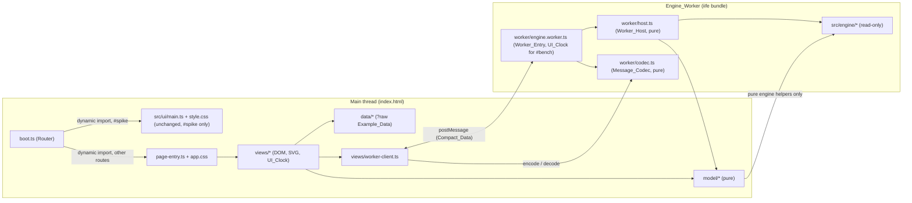

# Design Document: bench-ui-core

## Overview

bench-ui-core adds the Hexorcist web app on top of the committed engine. The app opens on the Crosswalk buggy build, runs a campaign in a Web Worker, shows one verdict card, reduces a BROKE trace with a visible shrink, and drives an original SVG crosswalk scene and a signal timeline from fresh-bridge replays. The user can then load the bundled fixed build, replay the reduced trace on it and rerun the same campaign. A speed page at `index.html#bench` measures the engine inside the same worker and compares results with the Node-pinned values.

Design goals, in priority order:

1. **No engine change.** Every engine call goes through an existing export of `src/engine/`. The section "Engine API used" quotes each one with its path and line range. No "ENGINE CHANGE NEEDED" item was found.
2. **Same numbers in Node and in the browser.** All emulation runs in the Worker_Host functions (`src/ui/app/worker/host.ts`). They read no clock, touch no DOM or worker global, and the Node acceptance test calls them directly with the slice and step sizes the worker uses.
3. **Thin DOM, pure logic.** Every rule about text, levels, ordering, diffs, spans and coverage lives in pure modules under `src/ui/app/model/` (plus the codec in `src/ui/app/worker/codec.ts`). The DOM views only render what those modules return.
4. **Determinism.** Simulated time is integer CPU cycles from the engine. The UI_Clock (`performance.now`, `requestAnimationFrame`, timers) is read only in `src/ui/app/views/` and in the Worker_Entry, and only for the elapsed timer, playback and the speed page.

Requirement 16.4 says Hunk B covers old lines 78 to 85 and new lines 78 to 83. This matches the committed sketches (`git diff --no-index -U3` prints `@@ -78,8 +78,6 @@`, see "Hunk B evidence" below).

### Hunk B evidence: Requirement 16.4

Evidence (command run in the workspace on the Start_Commit working tree):

```
git diff --no-index -U3 examples/crosswalk/buggy/buggy.ino examples/crosswalk/fixed/fixed.ino
@@ -1,4 +1,4 @@
-// crosswalk, buggy build
+// crosswalk, fixed build
...
@@ -78,8 +78,6 @@ void loop() {
     crossing = true;
     crossStart = now;
     walkStart = now;
-  } else if (pressed && crossing) {
-    walkStart = now;  // a new press restarts the walk countdown
   }
   if (!crossing) return;
```

Numbered lines of `examples/crosswalk/buggy/buggy.ino`: 80 `    walkStart = now;`, 81 `  } else if (pressed && crossing) {`, 82 `    walkStart = now;  // a new press restarts the walk countdown`, 83 `  }`. Both removed texts named by Requirement 16.4 occur only at lines 81 and 82 and do not occur in `fixed.ino`, so every correct line diff removes exactly lines 81 and 82. With 3 context lines before (78 to 80) and 3 after (83 to 85), the old range is 78 to 85 and the new range is 78 to 83.

Hunk A of Requirement 16.4 (old 1 to 4, new 1 to 4, 0 context lines before, 3 after) matches the data.

What the design does: the diff model follows Requirements 16.5 to 16.8 (properties 7 to 9). The example test for Requirement 16.4 is written exactly as the requirement states: Hunk A old 1 to 4 / new 1 to 4, Hunk B old 78 to 85 / new 78 to 83.

## Architecture



### Threads and responsibilities

| Place | Runs | May read the UI_Clock | May touch the DOM |
|---|---|---|---|
| `src/ui/app/boot.ts` | route choice, dynamic imports | no | yes (`location`, `window` events) |
| `src/ui/app/views/` | rendering, events, playback, elapsed timer, worker client | yes | yes |
| `src/ui/app/model/` | pure text, level, order, diff, span, coverage and flow logic | no | no |
| `src/ui/app/data/` | `?raw` imports and JSON parsing of Example_Data | no | no |
| `src/ui/app/worker/host.ts` | every Engine campaign, reduction and replay call | no | no |
| `src/ui/app/worker/codec.ts` | message encode and decode | no | no |
| `src/ui/app/worker/engine.worker.ts` | message loop, timing for the speed page | yes (`performance.now`) | no (worker scope only) |

The main thread imports these Engine modules, none of which reach `emulator-bridge.ts` or `campaign.ts`: `rules/rules-file.ts`, `rules/render.ts`, `rules/ir.ts` (types), `reducer/story.ts` (`failureStory`, `msText`, `cycleText`), `verdict.ts` (`heldText`, `VERDICT_*`), `gremlins/catalogue.ts` (`GREMLIN_CATALOGUE`). The app code never imports `copy-rules.ts` directly (`reducer/story.ts` imports it); only `tests/ui/` imports `BANNED_WORDS`. `createCampaign`, `runSlice`, `createReducer`, `replayEventList` and `runEventList` are called only from `worker/host.ts`, which only the Worker_Entry and Node tests import (Requirement 4.2).

### Routing (Requirement 1)

`index.html` changes to:

```html
<!doctype html>
<html lang="en">
  <head>
    <meta charset="UTF-8" />
    <meta name="viewport" content="width=device-width, initial-scale=1.0" />
    <title>Hexorcist</title>
  </head>
  <body>
    <div id="app"></div>
    <script type="module" src="/src/ui/app/boot.ts"></script>
  </body>
</html>
```

`src/ui/app/boot.ts` (the Router) has no static import of any page module, of `src/ui/main.ts`, of `src/ui/style.css` or of `src/ui/app/app.css`:

```ts
const route = location.hash; // compared exactly, case-sensitive

window.addEventListener("hashchange", () => location.reload()); // Requirement 1.11, every route

if (route === "#spike") {
  // Requirement 1.4: module scripts run before DOMContentLoaded, so the event has not fired yet.
  window.addEventListener("DOMContentLoaded", () => {
    void import("../main.ts").then(() => {
      window.dispatchEvent(new Event("DOMContentLoaded")); // Requirement 1.5, exactly once
    });
  }, { once: true });
} else {
  void import("./page-entry.ts").then((m) => {
    const root = document.getElementById("app") as HTMLElement;
    if (route === "#bench") m.mountSpeedPage(root); else m.mountApp(root);
  });
}
```

- The `{ once: true }` listener runs once. The synthetic event reaches the `DOMContentLoaded` listener that `src/ui/main.ts` registered at import time, and the Router's own listener is already removed, so no loop occurs.
- `src/ui/style.css` loads only through `import './style.css'` inside `main.ts` (Requirement 1.6). Vite puts the CSS of a dynamically imported chunk into a stylesheet that loads with that chunk ([Vite 5 features: CSS code splitting](https://v5.vite.dev/guide/features#css-code-splitting)), so neither `style.css` nor `app.css` loads on a route that does not import its chunk.
- `page-entry.ts` is the only module that imports `./app.css`. It exports `mountApp(root)` and `mountSpeedPage(root)`.
- The Router's dynamic imports run on the main thread only. The worker graph (`engine.worker.ts`, `host.ts`, `codec.ts`, `model/*`, `src/engine/*`, `avr8js`) holds no dynamic `import()` (checked for `src/engine` and `node_modules/avr8js/dist/esm`: zero matches), as Requirement 4.16 and the `iife` worker format require.
- `src/ui/main.ts` and `src/ui/style.css` are not edited (Requirement 1.12).

### Build and test tooling: no vite.config is added

No `vite.config.*` file exists at the Start_Commit, and this design adds none. Requirement 26.3 therefore needs no list comparison: `npx vitest --run` collects the same committed test files as before, plus the new `tests/ui/*.test.ts` files.

| Need | Default behaviour relied on | Source |
|---|---|---|
| Worker bundling | `new Worker(new URL('./worker/engine.worker.ts', import.meta.url), { type: 'module' })` is detected only when `new URL()` sits directly inside `new Worker()` and the options are literals. | [Vite 5 features: Web Workers, import with constructors](https://v5.vite.dev/guide/features#import-with-constructors) |
| Worker format | `worker.format` defaults to `'iife'` (Vite 5 docs; `node_modules/vite/dist/node/chunks/dep-BK3b2jBa.js:66603` reads `format: config.worker?.format \|\| "iife"`). An `iife` bundle cannot code-split, so the worker graph holds no dynamic `import()`. An `iife` script has no import or export statement, so it also runs as a module worker. | [Vite 5 worker options](https://v5.vite.dev/config/worker-options) |
| Dev server | In dev, Vite serves the worker as native ESM; `type: 'module'` is required for that and is kept. | same as row 1 |
| `?raw` imports | Built into Vite for dev and build; Vitest runs files through the same Vite transform pipeline, so `?raw` works in tests. Types come from `src/vite-env.d.ts` (`/// <reference types="vite/client" />`), which both `tsconfig.json` (via `src`) and `tsconfig.node.json` include. `src/ui/main.ts` already uses `?raw`. | Vite 5 docs (assets, `?raw`) |
| Test collection | Vitest 1.6.0 `defaultInclude = ["**/*.{test,spec}.?(c\|m)[jt]s?(x)"]` and `defaultExclude` (node_modules, dist, cypress, dot folders, tool config files) in `node_modules/vitest/dist/config.js:10-11`, so `tests/ui/*.test.ts` is collected. | local package |
| Type checking | `tsconfig.json` covers `src` (DOM lib, so `self`, `Worker`, `performance` type-check in `src/ui/app`); `tsconfig.node.json` covers `tests`, so `tests/ui/*.ts` type-check with Node types. | workspace files |

The worker file uses a small local interface instead of the `WebWorker` lib, which `tsconfig.json` does not load:

```ts
interface WorkerScope {
  postMessage(message: unknown): void;
  onmessage: ((ev: MessageEvent) => void) | null;
}
const scope = self as unknown as WorkerScope;
```

Hosting note: GitHub Pages serves a project site under a sub-path, and the default `base` is `/`. This feature does not add a `vite.config` (Requirement 26.3) and does not change `package.json` scripts beyond what Requirement 26.4 allows, so a sub-path deploy setting is out of scope here (see Choices I made, item 20).


## Engine API used (verified against the code)

Every quote below was read from the Start_Commit working tree. Line ranges are 1-based and inclusive. "Used by" names the new module that calls or imports the item. No Engine file changes.

### Rules

`src/engine/rules/rules-file.ts:15-16` (used by `data/crosswalk.ts`, `data/garage.ts`)

```ts
/** Reads a rules file: IR JSON when the first non-blank character is `{`, else one sentence per line. Never throws. */
export function readRulesFile(text: string): ReadResult {
```

`src/engine/rules/ir.ts:11-28` and `:41` (types used by model, codec and host)

```ts
export type Condition =
  | { op: "eq"; signal: string; value: 0 | 1 }
  | { op: "above"; signal: string; value: number } // integer 0..1022
  | { op: "below"; signal: string; value: number } // integer 1..1023
  | { op: "all"; of: Condition[] } // 2..8 members
  | { op: "any"; of: Condition[] }; // 2..8 members

export type Edge = { op: "rise"; of: Condition } | { op: "fall"; of: Condition };

export type Rule =
  | { form: "never"; condition: Condition }
  | { form: "respond"; trigger: Edge; withinMs: number; expect: Condition }
  | { form: "count"; edge: Edge; windowMs: number; max: number } // max integer 0..65535
  | { form: "hold"; after: Edge; durationMs: number; expect: Condition }
  | { form: "notLongerThan"; condition: Condition; ms: number };

export type RuleForm = Rule["form"];
export type RuleSet = Rule[]; // 1..32 Rules
...
export type ReadResult = { ok: true; ruleSet: RuleSet } | { ok: false; reasons: string[] };
```

`src/engine/rules/config-builder.ts:9-23` (used by `worker/host.ts`)

```ts
export type CampaignConfigRest = Omit<
  CampaignConfig,
  "fixture" | "checker" | "checkerSignals" | "findUntriggeredRules"
>;

export type BuildResult = { ok: true; config: CampaignConfig } | { ok: false; reasons: string[] };

/** Req 13.10, 13.11, 13.12. Never throws. */
export function buildCampaignConfig(ruleSet: unknown, fixture: Fixture, rest: CampaignConfigRest): BuildResult {
  try {
    const compiled = compileRuleSet(ruleSet, fixture);
    if (!compiled.ok) return { ok: false, reasons: compiled.reasons };
    const { checker, checkerSignals, findUntriggeredRules } = compiled.compiled;
    const config: CampaignConfig = { ...rest, fixture, checker, checkerSignals, findUntriggeredRules };
    return { ok: true, config };
```

The host passes `rest = { hex, gremlinSet, campaignSeed, runs, runCycles }` and no `bridgeFactory` (Requirements 19.11 and 26.8). The Campaign_Seed is the only randomness input.

`src/engine/rules/compile.ts:15-26` (used by `worker/host.ts` for each Replay)

```ts
export interface CompiledRuleSet {
  checker: Checker;
  checkerSignals: string[];
  findUntriggeredRules: (runs: readonly RunResult[]) => string[];
}

export type CompileResult = { ok: true; compiled: CompiledRuleSet } | { ok: false; reasons: string[] };
...
/** Req 6.1, 6.9, 6.11, 13.7. Never throws. */
export function compileRuleSet(ruleSet: unknown, fixture: Fixture): CompileResult {
```

`src/engine/rules/render.ts:9` and `:47` (used by `model/rules.ts` to find the rule whose Canonical_Sentence equals a violation's `rule`)

```ts
export type RenderResult = { ok: true; sentence: string } | { ok: false; reason: string };
...
export function render(rule: unknown): RenderResult {
```

`src/engine/rules/trigger.ts:12`, `:15` and `:110-117` (used by `model/coverage.ts`, called from the host)

```ts
export type TriggerRun = Pick<RunResult, "outputEvents" | "appliedInputs" | "endCycle">;
...
  if (rule.form === "never") return false;
...
/** Req 12.1, 12.2. False for an invalid Rule, a rejected Fixture, a non-Active Rule or a never Rule. */
export function triggerOccurred(rule: Rule, fixture: Fixture, run: TriggerRun): boolean {
  try {
    return evaluate(rule, fixture, run);
  } catch {
    return false;
  }
}
```

Line 15 is why a `never` rule gets the fixed "Rule trigger: none, a never rule has no trigger" part (Requirement 9.5) instead of a count.

### Campaign

`src/engine/campaign.ts:33-37`, `:157-160`, `:163-172`, `:179-183` (used by `worker/host.ts`)

```ts
export type BridgeFactory = (
  hex: string,
  fixture: Fixture,
  events: ScheduledInput[],
) => EmulatorBridgeInterface | BridgeError;
...
export type RunPathConfig = Pick<
  RunConfig,
  "hex" | "fixture" | "checker" | "runCycles" | "maxStepCycles" | "bridgeFactory"
>;

/** The Run_Path part of a RunResult. */
export interface RunPathResult {
  appliedInputs: AppliedInput[];
  outputEvents: OutputEvent[];
  diagnostics: Diagnostic[];
  cannotCheck: CannotCheck[];
  violation: Violation | null;
  endCycle: number;
  /** Unmodelled-peripheral uses, ascending cycle. Present only when non-empty. */
  peripheralUses?: PeripheralDiagnostic[];
}
...
export function runEventList(
  cfg: RunPathConfig,
  events: readonly GeneratedEvent[],
  runIndex: number,
): RunPathResult | EngineError {
```

Key behaviour lines (F8): the loop runs `while (bridge.cycleCount < cfg.runCycles)` (`:211`), stops after the step that found a violation (`:252-255`), and reports the stop point (`:273`):

```ts
    if (res.violation) {
      violation = res.violation;
      break;
    }
...
  const out: RunPathResult = { appliedInputs, outputEvents, diagnostics, cannotCheck, violation, endCycle: bridge.cycleCount };
```

`src/engine/campaign.ts:313` (used by `worker/host.ts` as the Replay and reduction `maxStepCycles`)

```ts
export const DEFAULT_MAX_STEP_CYCLES = 160_000;
```

`src/engine/campaign.ts:317-345` (used by `worker/host.ts`; the host never sets `bridgeFactory`, `stopOnFirstViolation` or `maxStepCycles`, so the defaults apply as in the Node tests that pin F4)

```ts
export interface CampaignConfig {
  hex: string;
  fixture: Fixture;
  gremlinSet: readonly GremlinSpec[];
  campaignSeed: number;
  checker: Checker;
  /** N, default 64. */
  runs?: number;
  /** Default: defaultRunCycles, else 8,000,000. */
  runCycles?: number;
  ...
  /** Default true. */
  stopOnFirstViolation?: boolean;
  /** Default 160,000. */
  maxStepCycles?: number;
  ...
  /** Test seam, default EmulatorBridge.create. */
  bridgeFactory?: BridgeFactory;
}

export interface CampaignHandle {
  runSlice(k: number): SliceProgress | CampaignError;
  /** Plain data copy of { nextRunIndex, runs }. */
  state(): CampaignState;
}
```

`src/engine/campaign.ts:492-509` and `:470-477` (`runSlice` and the `SliceProgress` it returns; `runs` is a deep copy of every RunResult, F6)

```ts
    runSlice(k: number): SliceProgress | CampaignError {
      if (!isPositiveInteger(k)) {
        return invalidCampaign(`slice size must be a positive integer, got ${String(k)}`);
      }
      if (failure !== null) return failure;
      if (isFinished()) return progress();

      const count = Math.min(k, settings.n - runs.length);
      for (let j = 0; j < count; j++) {
        const out = runOne(runCfg, runs.length);
        ...
        runs.push(out);
        if (settings.stopOnFirstViolation && out.violation !== null) break;
      }
      return progress();
    },
...
    return {
      runsCompleted: runs.length,
      total: settings.n,
      finished,
      nextRunIndex: runs.length,
      runs: structuredClone(runs),
      result,
    };
```

`src/engine/campaign.ts:517`

```ts
export function createCampaign(config: CampaignConfig): CampaignHandle | CampaignError {
```

### Data types

`src/engine/types.ts:31-45` (fixture, edge and input value types)

```ts
export interface Fixture {
  clockHz?: number;
  pins: FixturePin[];
}

export type PinValue = 0 | 1 | "input";

export interface OutputEvent {
  signal: string;
  value: PinValue;
  cycle: number;
}

/** External state a caller can apply to an input pin. "release" stops driving it. */
export type InputValue = 0 | 1 | "release";
```

`src/engine/types.ts:139-185` (`BrokeTrace`, `Verdict`, `RunResult`, `CampaignResult`, `SliceProgress`)

```ts
export interface BrokeTrace {
  runIndex: number;
  runSeed: number;
  eventList: GeneratedEvent[];
  outputEvents: OutputEvent[];
  violation: Violation;
}

export type Verdict =
  | { verdict: "BROKE"; trace: BrokeTrace; unchecked: CannotCheck[] }
  | { verdict: "HELD"; text: string; runs: number }
  | { verdict: "COULDN'T TELL"; reason: string };

export interface RunResult {
  runIndex: number;
  runSeed: number;
  eventList: GeneratedEvent[];
  skipped: SkippedEntry[];
  /** Digital and analog merged, in application order. */
  appliedInputs: AppliedInput[];
  outputEvents: OutputEvent[];
  diagnostics: Diagnostic[];
  cannotCheck: CannotCheck[];
  violation: Violation | null;
  /** Bridge cycleCount at the stop point. */
  endCycle: number;
  /** At most one per unmodelled peripheral, ascending cycle. Present only when non-empty. */
  peripheralUses?: PeripheralDiagnostic[];
}

export interface CampaignResult {
  runsCompleted: number;
  requestedRuns: number;
  /** Earliest violating Run_Index, or null. */
  violatingRunIndex: number | null;
  verdict: Verdict;
}

export interface SliceProgress {
  runsCompleted: number;
  total: number;
  finished: boolean;
  nextRunIndex: number;
  runs: RunResult[];
  /** Set when finished, otherwise null. */
  result: CampaignResult | null;
}
```

`src/engine/gremlins/generate-types.ts:30` and `src/engine/checker.ts:22-31`

```ts
export type GeneratedEvent = (InputEvent | AnalogInputEvent) & { gremlinId: string };
```

```ts
export interface Violation {
  rule: string;
  cycle: number;
}

/** `reason` is the Checker's own words. */
export interface CannotCheck {
  rule: string;
  reason: string;
}
```

### Verdict text

`src/engine/verdict.ts:9-13` (used by `model/verdict-text.ts`)

```ts
export const VERDICT_BROKE = "BROKE";
export const VERDICT_COULDNT_TELL = "COULDN'T TELL";

export const heldText = (n: number): string =>
  `No violation found in ${n} emulated ${n === 1 ? "run" : "runs"} of this gremlin set. Not a proof.`;
```

There is no `VERDICT_HELD` constant. The HELD title is the literal `"HELD"` of the `Verdict` type (`types.ts:149`); the title model returns `verdict.verdict` unchanged for all three, so no constant is needed.

### Reducer

`src/engine/reducer/reducer.ts:24-42` and `:191` (used by `worker/host.ts`)

```ts
export interface ReductionInput {
  hex: string;
  fixture: Fixture;
  ruleSet: RuleSet;
  originalList: ReducerEvent[];
  /** The target Violation (from the BROKE trace). */
  violation: Violation;
  runCycles: number;
  /** Default 160,000. */
  maxStepCycles?: number;
  /** Default 300. */
  budget?: number;
}

export interface ReducerOptions {
  onProgress?: (report: ProgressReport) => void;
  /** Test seam only. */
  bridgeFactory?: BridgeFactory;
}
...
export function createReducer(input: unknown, options?: ReducerOptions): ReducerHandle | ReducerError {
```

The host passes `maxStepCycles: DEFAULT_MAX_STEP_CYCLES` and no `budget` (Requirement 11.1). Only the speed page's Crosswalk reduction passes `bridgeFactory` (Requirement 19.11).

`src/engine/reducer/types.ts:8`, `:25-55`, `:64-78` (used by host, codec and views)

```ts
export type ReducerEvent = GeneratedEvent;
...
export interface ProgressReport {
  candidatesTried: number;
  bestGremlinCount: number;
  bestList: ReducerEvent[];
  part: CandidatePart;
  accepted: boolean;
}

export interface ReducerResult {
  /** Gremlin events of the original list (rest events not counted). */
  originalEventCount: number;
  /** Gremlin events of the reduced list (rest events not counted). */
  reducedEventCount: number;
  /** Oracle calls made, the confirmation run included. 1 to the budget. */
  candidatesTried: number;
  stoppedAtBudget: boolean;
  /** The smallest replay this reducer found, rest events included. */
  reducedList: ReducerEvent[];
  /** Recorded at the latest accepted candidate, or at the confirmation run. */
  violation: Violation;
}

export interface StepReport {
  ended: boolean;
  candidatesTried: number;
  bestGremlinCount: number;
  /** Present only when the reduction ended with a result. */
  result?: ReducerResult;
  /** Present only when the reduction ended with an error. */
  error?: ReducerError;
}
...
export interface ReducerError {
  kind: ReducerErrorKind;
  message: string;
  ...
}

export interface ReducerHandle {
  step(k: number): StepReport | ReducerError;
}
```

`src/engine/reducer/core.ts` (behaviour, not imported): each `step(k)` makes at most `k` oracle calls, and `onProgress` runs once after each oracle call that returned an outcome, with `bestList: toEvents(st.best)`. The search parts in `src/engine/reducer/passes.ts` only remove events (`removeIds`) or change an analog value (`snapIds`); they never change an event's `cycle`, `signal` or `gremlinId`. That is why Requirement 11.4 can match GREMLINS markers to `bestList` entries by `(cycle, signal, gremlinId)`.

`src/engine/reducer/reducer-error.ts:13` (used by host)

```ts
export function isReducerError(x: unknown): x is ReducerError {
```

`src/engine/reducer/events.ts:7`, `:12`, `:81-85` (used by host for the Replay input checks; `copyList` from the same file copies the event list)

```ts
export const REST_ID = "rest";
...
export const DEFAULT_MAX_STEP_CYCLES = 160_000;
...
export function checkEventList(
  list: readonly unknown[],
  fixture: Fixture,
  opts: { runCycles: number | null },
): EventProblem | null {
```

`src/engine/reducer/emulator-run.ts:18`, `:61-77`, `:88`, `:119-153` (the Replay_Function the host's Replay mirrors; quoted for the equivalence argument in "Replay design")

```ts
const RUN_INDEX = 0;
...
export interface ReplayInput {
  hex: string;
  fixture: Fixture;
  ruleSet: unknown;
  events: readonly ReducerEvent[];
  runCycles: number;
  maxStepCycles: number;
  /** Test seam; default EmulatorBridge.create. */
  bridgeFactory?: BridgeFactory;
}

export interface ReplayResult {
  /** The Run's Violation of any rule, or null. */
  violation: Violation | null;
  /** Every output edge the bridge reported, from the cycle-0 snapshot through the last Step. */
  outputEdges: OutputEvent[];
}
...
export function replayEventList(input: unknown): ReplayResult | ReducerError {
...
    const compiled = compileRuleSet(ruleSet, fixture);
    if (!compiled.ok) {
      return invalidInput("Field ruleSet: the rules did not compile.", { field: "ruleSet", reasons: compiled.reasons });
    }
    const ev = read(input, "events");
    if (!ev.ok || !Array.isArray(ev.value)) return invalidInput("Field events: must be an array.", { field: "events" });
    const bad = checkEventList(ev.value as unknown[], fixture, { runCycles: rc.value });
    if (bad !== null) return invalidInput(bad.message, { field: bad.field, index: bad.index });
    ...
    const path = runEventList(
      {
        hex: hex.value,
        fixture,
        checker: compiled.compiled.checker,
        runCycles: rc.value,
        maxStepCycles: ms.value,
        ...(bf.value === undefined ? {} : { bridgeFactory: bf.value as BridgeFactory }),
      },
      copyList(ev.value as ReducerEvent[]),
      RUN_INDEX,
    );
    if (isEngineError(path)) {
      return {
        kind: "replay-error",
        message: `The replay failed (${path.kind}: ${path.message}).`,
        cause: { kind: path.kind, message: path.message },
      };
    }
    return {
      violation: path.violation === null ? null : { rule: path.violation.rule, cycle: path.violation.cycle },
      outputEdges: path.outputEvents.map((e) => ({ signal: e.signal, value: e.value, cycle: e.cycle })),
    };
```

`src/engine/reducer/fingerprint.ts:54-55` (used by host)

```ts
/** Trace_Fingerprint of an ordered list of output edges. Never throws. */
export function traceFingerprint(edges: unknown): string | ReducerError {
```

`src/engine/reducer/story.ts:13-31`, `:38-45`, `:169` (used by `model/story-input.ts` (types) and `views/story.ts`; `msText` and `cycleText` by `model/format.ts`)

```ts
export interface StoryInput {
  reducedList: readonly ReducerEvent[];
  fixture: Fixture;
  violation: Violation;
  outputEdges: readonly OutputEvent[];
  violationSpan?: { lengthCycles: number; cut: boolean };
  /** Optional plain action words per digital signal. */
  labels?: Readonly<Record<string, StoryLabel>>;
}
...
export interface StoryLabel {
  active: string;
  inactive: string;
  held?: string;
}
...
/** Ms_Text: t = floor((c + 800) / 1600), written t/10 "." t%10 " ms". Precondition: integer 0 .. 2^53 - 1. */
export function msText(cycles: number): string {
...
/** Cycle_Text: base-10 digits with an ASCII comma between groups of 3 from the right. No locale. */
export function cycleText(cycles: number): string {
...
export function failureStory(input: unknown): string | ReducerError {
```

`failureStory` imports only `copy-rules.ts`, `reducer/events.ts`, `reducer/fingerprint.ts` and `reducer/reducer-error.ts`, so calling it on the main thread pulls in no bridge code.

### Gremlins, bridge and errors

`src/engine/gremlins/catalogue.ts:12-46` (types) and `:82-90` (the `masher` entry; used by `model/gremlin-tile.ts`)

```ts
export interface RangeParamSpec {
  name: string;
  shape: "range";
  /** Unit of both min and max. */
  unit: "count" | "cycles" | "ms";
  default: { min: number; max: number };
  ...
}
...
export interface GremlinDefinition {
  id: GremlinId;
  /** Name of the icon art, which is a UI task. */
  iconName: string;
  targets: ReadonlyArray<{ kind: "digital" | "analog"; restState?: "active" }>;
  params: readonly ParamSpec[];
  ...
}

/** The caller's request for one gremlin. */
export interface GremlinSpec {
  id: string;
  params?: Record<string, number | { min: number; max: number }>;
}
...
export const GREMLIN_CATALOGUE: readonly GremlinDefinition[] = [
  {
    id: "masher",
    iconName: "gremlin-masher",
    targets: [{ kind: "digital" }],
    params: [
      range("pressCount", "count", [1, 6], [1, 32]),
      range("gapCycles", "cycles", [80_000, 2_400_000], [2, MAX_GAP_CYCLES]),
    ],
```

`model/gremlin-tile.ts` imports `GREMLIN_CATALOGUE`, which pulls the generator modules (`gremlins/digital.ts`, `gremlins/analog.ts`, `gremlins/pins.ts`) into the main bundle. None of them imports the bridge.

`src/engine/emulator-bridge.ts:98-110`, `:117`, `:172-178` (used only by `worker/host.ts`, for the Counting_Factory)

```ts
export function isBridgeError(x: unknown): x is BridgeError {
  return x != null && typeof x === 'object' && 'kind' in x;
}
...
export interface EmulatorBridgeInterface {
  advance(requestedCycles: number): AdvanceResult | BridgeError;
  schedule(event: InputEvent): void | BridgeError;
  supports(capability: string): true | BridgeError;
  readonly clockHz: number;
  readonly cycleCount: number;
}
...
  get cycleCount(): number {
...
  static create(
    hex: string,
    fixture: Fixture,
    inputEvents?: ScheduledInput[],
  ): EmulatorBridge | BridgeError {
    return EmulatorBridge._build(hex, fixture, inputEvents, undefined);
  }
```

`src/engine/errors.ts:4-15` and `:29` (used by host)

```ts
export type EngineError =
  | PrngError
  | { kind: "invalid-run-index";        message: string }
  ...
  | { kind: "bridge-error";             runIndex: number; error: BridgeError; message: string }
  | { kind: "checker-error";            runIndex: number; cycle: number; message: string }
  | { kind: "internal-error";           message: string };

// A bad HEX or Fixture surfaces as a BridgeError unchanged, before any Run.
export type CampaignError = EngineError | BridgeError;
...
export function isEngineError(x: unknown): x is EngineError {
```

`src/engine/copy-rules.ts:4-13` (imported only by `tests/ui/ui-strings.test.ts`)

```ts
export const BANNED_WORDS: readonly string[] = [
  "safe",
  "secure",
  "guaranteed",
  "certified",
  "real-time",
  "first",
  "unique",
  "shortest",
];
```

### Engine change needed

None. Each requirement maps onto an export quoted above:

| Need | Export used | Requirement |
|---|---|---|
| Reached_End of a Replay | `runEventList(...).endCycle` (`campaign.ts:273`) | 4.5, 4.7, 12.4, 14.6 |
| Replay input checks equal to `replayEventList` | `compileRuleSet`, `checkEventList`, `copyList` | 4.6 |
| Per-run trigger counts for the Coverage_Line | `triggerOccurred` over `SliceProgress.runs` | 9.4 |
| Reduction emulated cycles on the speed page | `ReducerOptions.bridgeFactory` + `EmulatorBridge.create` + `cycleCount` | 19.5, 19.10 |
| Violation span | computed by the Span_Helper; `failureStory` accepts `violationSpan` (F5) | 12.4 to 12.10 |


## Components and Interfaces

### Module layout

Every new source file sits under `src/ui/app/` (Requirement 1.13). New tests sit under `tests/ui/`.

```
index.html                       (edited: one script, title "Hexorcist")
src/ui/app/
  boot.ts                        Router (main thread)
  page-entry.ts                  imports ./app.css; exports mountApp, mountSpeedPage
  app.css                        the only stylesheet of the App and the Speed_Page
  data/
    crosswalk.ts                 ?raw imports of the seven Crosswalk files + parsing
    example.ts                   shared parsing of fixture.json, rules.txt and meta.json (parseExample)
    garage.ts                    ?raw imports of the Garage fixed.hex, fixture.json, rules.txt, meta.json + parsing
  model/                         pure modules (Requirement 25.1, 25.6)
    timeline.ts                  levels, Timeline_Events, window, markers, axis ticks
    player.ts                    cursor, play/pause, speed, previous/next event
    scene.ts                     scene levels, labels and bracket at the Cursor
    verdict-text.ts              titles, BROKE finding and scope, trace rows, COULDN'T TELL lines
    coverage.ts                  coverage counts (triggerOccurred) and the Coverage_Line
    story-input.ts               Story_Labels and the failureStory input
    span.ts                      Span_Helper
    diff.ts                      Diff_Hunks and applyHunks
    fields.ts                    Run_Count and Campaign_Seed validation
    format.ts                    progress, elapsed, event counts, level and value texts
    rules.ts                     rule lookup by Canonical_Sentence, signals a rule names
    gremlin-tile.ts              tile texts from GREMLIN_CATALOGUE and the fixture
    fix-text.ts                  Fixed_Build Replay text, "Try removing" texts, list without one event
    flow.ts                      App flow state and button enablement
    speed.ts                     pinned values and comparisons for the Speed_Page
  worker/
    messages.ts                  Worker_Message types (types only)
    codec.ts                     Message_Codec (pure)
    host.ts                      Worker_Host (pure, Node-callable)
    engine.worker.ts             Worker_Entry
  views/                         DOM code; may read the UI_Clock
    dom.ts                       element helpers (createElement + textContent only)
    worker-client.ts             creates the Engine_Worker, decodes replies, routes them by jobId
    app-page.ts                  App controller: wiring, flow, announcements, plus (merged) Reduced_List rows with
                                 "Try removing", "Sketch source" diff and Apply_Fix results,
                                 "Replay again" with fingerprint and matches/differs
    panels.ts                    header, rule panel, gremlin tiles, controls, counter, Failure_Story card (merged)
    verdict-card.ts              the three Verdict_Cards
    scene.ts                     crosswalk SVG
    timeline.ts                  lanes, axis, cursor, markers, playback controls, toggle
    live.ts                      the single aria-live="polite" region
    icons.ts                     original inline SVG icons (verdicts, masher, card motif)
    speed-page.ts                Speed_Page
tests/ui/                        new Vitest files (see Testing Strategy)
```

The DOM-view folder is `views/` rather than an `app/` folder inside `src/ui/app/` (Choices I made, item 1).

### Example data modules (Requirement 2)

`data/crosswalk.ts`:

```ts
import buggyHex from "../../../../examples/crosswalk/buggy/buggy.hex?raw";
import fixedHex from "../../../../examples/crosswalk/fixed/fixed.hex?raw";
import fixtureText from "../../../../examples/crosswalk/fixture.json?raw";
import rulesText from "../../../../examples/crosswalk/rules.txt?raw";
import metaText from "../../../../examples/crosswalk/meta.json?raw";
import buggySketch from "../../../../examples/crosswalk/buggy/buggy.ino?raw";
import fixedSketch from "../../../../examples/crosswalk/fixed/fixed.ino?raw";

export interface ExampleMeta {
  title: string; story: string; timingNote: string;
  gremlinSet: GremlinSpec[]; runCycles: number; campaignSeed: number; runs: number;
}

export type LoadedExample =
  | { ok: true; buggyHex: string; fixedHex: string; fixture: Fixture; ruleSet: RuleSet;
      sentences: string[]; meta: ExampleMeta; buggySketch: string; fixedSketch: string }
  | { ok: false; rulesReasons: string[]; jsonErrors: { file: "fixture.json" | "meta.json"; message: string }[] };

export function loadCrosswalk(): LoadedExample;
```

- `readRulesFile(rulesText)` gets the imported text unchanged (Requirement 2.3). `sentences` holds `render(rule).sentence` for each rule, in rule-set order.
- `JSON.parse` runs on `fixtureText` and `metaText` inside `try`; each failure records the file name and the `SyntaxError` message (Requirement 2.6).
- `loadCrosswalk` itself reads no DOM and no clock, so the Node acceptance test imports it and builds every Campaign from the same strings the App ships (Requirement 24.3).
- The strings are inlined into the JavaScript bundle at build time, so the browser makes no request for them (Requirement 2.2).
- `data/garage.ts` exports `loadGarage()` with the same shape minus the buggy build and the sketches (Choices I made, item 2).

### Worker_Host (`src/ui/app/worker/host.ts`)

Pure functions over the Engine. No clock, no random source, no network, no `window`, `document`, `self`, `postMessage` or `onmessage` (Requirements 4.13 to 4.15). No dynamic `import()` (Requirement 4.16). It imports Engine modules only through their exports (Requirement 4.11) and never imports `avr8js` (Requirement 4.12).

```ts
export const SLICE_RUNS = 1;          // runSlice(1), Requirement 24.10
export const STEP_CANDIDATES = 1;     // step(1), Requirement 24.10
export const REPLAY_RUN_INDEX = 0;    // Requirement 4.5

export interface JobError { kind: string; message: string }

export interface CampaignJobInput {
  hex: string; fixture: Fixture; ruleSet: RuleSet; gremlinSet: GremlinSpec[];
  campaignSeed: number; runs: number; runCycles: number;
}
export interface CampaignHooks {
  beforeCreate?: () => void;                        // called right before createCampaign
  onProgress?: (p: { runsCompleted: number; total: number }) => void; // after each unfinished slice
  afterFinish?: () => void;                         // right after the runSlice that returns finished: true
}
export type CampaignJobResult =
  | { ok: true; runsCompleted: number; total: number; result: CompactCampaignResult }
  | { ok: false; error: JobError };
export function runCampaignJob(input: CampaignJobInput, hooks?: CampaignHooks): CampaignJobResult;

export interface ReductionJobInput {
  hex: string; fixture: Fixture; ruleSet: RuleSet;
  originalList: ReducerEvent[]; violation: Violation; runCycles: number;
}
export interface ReductionHooks {
  beforeCreate?: () => void;                        // right before createReducer
  onProgress?: (p: { candidatesTried: number; bestGremlinCount: number; bestList: ReducerEvent[] }) => void;
  afterFinish?: () => void;                         // right after the step whose report has ended: true
}
export type ReductionJobResult = { ok: true; result: ReducerResult } | { ok: false; error: JobError };
export function runReductionJob(
  input: ReductionJobInput, hooks?: ReductionHooks, bridgeFactory?: BridgeFactory,
): ReductionJobResult;

export interface CountingFactory {
  factory: BridgeFactory;
  totalCycles(): number;   // sum of cycleCount over every kept bridge
  keptCount(): number;
}
export function createCountingFactory(): CountingFactory;

export interface ReplayJobInput {
  hex: string; fixture: Fixture; ruleSet: RuleSet; events: ReducerEvent[]; runCycles: number;
}
export type ReplayJobResult =
  | { ok: true; violation: Violation | null; outputEdges: OutputEvent[]; reachedEnd: number; fingerprint: string }
  | { ok: false; error: JobError };
export function runReplayJob(input: ReplayJobInput): ReplayJobResult;
```

`runCampaignJob`:

1. `buildCampaignConfig(input.ruleSet, input.fixture, { hex, gremlinSet, campaignSeed, runs, runCycles })`. If `ok` is false, return `{ ok: false, error: { kind: "invalid-rules", message: reasons.join("; ") } }`.
2. `hooks.beforeCreate?.()`, then `createCampaign(config)`. If the result has no `runSlice` (it is a `CampaignError`), return its `kind` and `message`.
3. Loop: `p = handle.runSlice(SLICE_RUNS)`. A `CampaignError` returns its `kind` and `message` (Requirement 4.19). If `p.finished` is false, call `hooks.onProgress?.({ runsCompleted: p.runsCompleted, total: p.total })` (Requirement 4.9) and continue. If `p.finished` is true, call `hooks.afterFinish?.()` and leave the loop.
4. If `p.result` is null (not reachable with the committed engine), return `{ kind: "internal-error", message: "The campaign finished with no result." }`.
5. Build the `CompactCampaignResult` (Requirement 4.10): the `CampaignResult` fields and `verdict` copied unchanged, `coverage = coverageCounts(ruleSet, fixture, p.runs, runCycles)` (from `model/coverage.ts`), and `totalCycles` = the sum of `endCycle` over `p.runs` (Requirement 19.4). `p.runs` is dropped here and never leaves the host.

`runReductionJob`:

1. `hooks.beforeCreate?.()`, then `createReducer({ hex, fixture, ruleSet, originalList, violation, runCycles, maxStepCycles: DEFAULT_MAX_STEP_CYCLES }, options)`, where `options = { onProgress }` plus `{ bridgeFactory }` only when the argument is given. No `budget` field (Requirement 11.1).
2. The `onProgress` callback forwards `{ candidatesTried, bestGremlinCount, bestList }` of each `ProgressReport` to `hooks.onProgress`. `part` and `accepted` are not forwarded; the UI does not use them.
3. Loop `s = handle.step(STEP_CANDIDATES)` until `s.ended`. A `ReducerError` from `createReducer` or `step`, or `s.error`, returns its `kind` and `message` (Requirement 11.10). After the step with `ended: true`, call `hooks.afterFinish?.()` and return `s.result` unchanged.

`createCountingFactory` (Requirement 19.5): `factory(hex, fixture, events)` calls `EmulatorBridge.create(hex, fixture, events)`, pushes the value to a private list when `isBridgeError(value)` is false, and returns the value unchanged. `totalCycles()` sums `cycleCount` over the list. Node tests call it directly (Requirement 19.12).

### Replay design (Requirements 4.4 to 4.7)

`runReplayJob` runs one Replay: `runEventList` with `REPLAY_RUN_INDEX` (0), a checker that `compileRuleSet` builds for this Replay alone, a fresh bridge from the default factory, `maxStepCycles = DEFAULT_MAX_STEP_CYCLES` and no snapshot. It mirrors the steps of `replayEventList` (`emulator-run.ts:88-153`, quoted above) in the same order and with the same error values:

1. `fixture` must be an object with a `pins` array; it is copied with `structuredClone`.
2. `runCycles` must be an integer from 1 to `MAX_RUN_CYCLES`.
3. `ruleSet` is copied with `structuredClone`, then `compileRuleSet(ruleSet, fixture)`; on failure the error is `{ kind: "invalid-input", message: "Field ruleSet: the rules did not compile." }`.
4. `checkEventList(events, fixture, { runCycles })`; a problem gives `{ kind: "invalid-input", message: problem.message }`.
5. `path = runEventList({ hex, fixture, checker, runCycles, maxStepCycles: DEFAULT_MAX_STEP_CYCLES }, copyList(events), 0)`. An `EngineError` gives `{ kind: "replay-error", message: "The replay failed (<kind>: <message>)." }`, the same text as `emulator-run.ts:145-146`.
6. `outputEdges = path.outputEvents.map((e) => ({ signal: e.signal, value: e.value, cycle: e.cycle }))`, the same mapping as `emulator-run.ts:152`; `violation` copied as at `:151`; `reachedEnd = path.endCycle`; `fingerprint = traceFingerprint(outputEdges)` (a `ReducerError` from it is returned as the error; it cannot occur for bridge edges).

Why not call `replayEventList`: `ReplayResult` holds no end cycle (F8). Calling `replayEventList` and then `runEventList` would emulate every Replay twice (about 0.8 s each for Crosswalk at the 20M cycles/s measured in `SPIKE.md`). Passing a capturing `bridgeFactory` to `replayEventList` would read the end cycle in one run, but Requirement 19.11 forbids the App from passing any `bridgeFactory`. Mirroring the five steps above gives one emulation per Replay with the same violation, edges and errors, because both paths call `runEventList` with the same config, the same copied list and Run_Index 0. Requirement 4.6 is checked in Node by comparing `runReplayJob` with `replayEventList` on the same inputs (see Testing Strategy).

The App and the Node tests never pass `maxStepCycles`; the host always uses `DEFAULT_MAX_STEP_CYCLES` (160,000), so a message cannot pick another value.

### Worker_Entry (`src/ui/app/worker/engine.worker.ts`)

```ts
scope.onmessage = (ev) => {
  const decoded = decodeRequest(ev.data);
  if (!decoded.ok) { post(jobErrorFor(ev.data, "message", decoded.error)); return; }
  const req = decoded.message;
  switch (req.kind) {
    case "campaign": {
      let t0 = 0; let t1 = 0;
      const out = runCampaignJob(req, {
        beforeCreate: () => { t0 = performance.now(); },
        onProgress: (p) => post({ kind: "campaign-progress", jobId: req.jobId, ...p, finished: false }),
        afterFinish: () => { t1 = performance.now(); },
      });
      post(out.ok
        ? { kind: "campaign-done", jobId: req.jobId, runsCompleted: out.runsCompleted, total: out.total,
            finished: true, result: out.result,
            measure: req.measure ? { totalCycles: out.result.totalCycles, seconds: (t1 - t0) / 1000 } : null }
        : { kind: "job-error", jobId: req.jobId, job: "campaign", error: out.error });
      return;
    }
    case "reduce": { /* same pattern; with req.measure a createCountingFactory() is passed as bridgeFactory
                        and measure = { totalCycles: counting.totalCycles(), seconds } */ }
    case "replay": { /* runReplayJob(req) -> replay-done or job-error */ }
  }
};
function post(m: WorkerReply): void { scope.postMessage(encodeMessage(m)); }
```

- The worker handles one request at a time. A request sent while another runs waits in the worker's message queue, so jobs run in the order the App sent them.
- `performance.now()` is read only in the Worker_Entry and only to fill `measure` (Requirements 19.4, 19.9, 19.10). The App always sends `measure: false`; only the Speed_Page sends `true`, so only the Speed_Page's Crosswalk reduction gets a Counting_Factory (Requirement 19.11). The Speed_Page sends `measure: false` for its Replay (a `replay` request has no `measure` field).
- `postMessage` during a long synchronous job is delivered to the main thread while the worker keeps running, so progress reaches the page during a Campaign or reduction.

### Worker_Message protocol

All fields are Compact_Data (Requirement 4.8). There is no optional field: an absent value is `null`.

| kind | Direction | Fields (besides `kind`) |
|---|---|---|
| `campaign` | App -> worker | `jobId`, `hex`, `fixture`, `ruleSet`, `gremlinSet`, `campaignSeed`, `runs`, `runCycles`, `measure` |
| `reduce` | App -> worker | `jobId`, `hex`, `fixture`, `ruleSet`, `originalList`, `violation`, `runCycles`, `measure` |
| `replay` | App -> worker | `jobId`, `hex`, `fixture`, `ruleSet`, `events`, `runCycles` |
| `campaign-progress` | worker -> App | `jobId`, `runsCompleted`, `total`, `finished` (always `false`) |
| `campaign-done` | worker -> App | `jobId`, `runsCompleted`, `total`, `finished` (always `true`), `result` (CompactCampaignResult), `measure` (`null` or `{ totalCycles, seconds }`) |
| `reduce-progress` | worker -> App | `jobId`, `candidatesTried`, `bestGremlinCount`, `bestList` (event list) |
| `reduce-done` | worker -> App | `jobId`, `result` (ReducerResult), `measure` (`null` or `{ totalCycles, seconds }`) |
| `replay-done` | worker -> App | `jobId`, `violation` (`null` or `{ rule, cycle }`), `outputEdges`, `reachedEnd`, `fingerprint` |
| `job-error` | worker -> App | `jobId`, `job` (`"campaign"`, `"reduce"`, `"replay"` or `"message"`), `error` (`{ kind, message }`) |

- Slice and step sizes: one `campaign-progress` per completed run until the last, and one `reduce-progress` per oracle call. The Crosswalk defaults give at most 23 campaign progress messages and 30 reduction progress messages.
- `bestList` is sent as a plain event list (the `ProgressReport.bestList` entries with only `cycle`, `signal`, `gremlinId` and `value` or `analog`), on every report. The Crosswalk list holds at most 8 entries.
- `job-error` with `job: "message"` answers a request the worker could not decode; its `jobId` is the request's `jobId` when that is a non-negative integer, else 0.
- `jobId` is a non-negative integer the sender picks. The App counts up from 1 and ignores replies whose `jobId` is not the job it waits for.

### Message_Codec (`src/ui/app/worker/codec.ts`)

```ts
export type JsonValue = null | boolean | number | string | JsonValue[] | { [k: string]: JsonValue };
export interface CodecError { path: string; message: string }
export type Decoded<T> = { ok: true; message: T } | { ok: false; error: CodecError };

export function encodeMessage(m: WorkerMessage): JsonValue;
export function decodeMessage(v: unknown): Decoded<WorkerMessage>;
export function decodeRequest(v: unknown): Decoded<WorkerRequest>;   // reply kinds give path "kind"
export function decodeReply(v: unknown): Decoded<WorkerReply>;       // request kinds give path "kind"
```

- `encodeMessage` builds a new value field by field from the kind's schema. It copies only the listed fields, so a `runs` array of `RunResult` data, a `SliceProgress.runs` or a typed array cannot appear in the output (Requirement 5.8). It never changes its input (Requirement 5.2) and turns `-0` into `0`, so `JSON.parse(JSON.stringify(v))` is deep-equal to `v` (Requirement 5.1).
- `decodeMessage` never throws: the whole body sits in `try`, and a thrown read gives `{ path: "$", message: "Message: could not be read." }`.
- Paths: `"$"` for the whole message (Requirement 5.5), `"kind"` for a missing or unknown kind (Requirement 5.6), and dotted paths with bracketed indexes for fields, for example `result.verdict.trace.eventList[3].cycle` (Requirement 5.7).
- A plain object is a non-null object whose prototype is `Object.prototype` or `null` and that is not an array. Values that cross `postMessage` are structured clones, so this holds for every well-formed message.
- Field rules:
  - Non-negative integer (`Number.isSafeInteger(x) && x >= 0`): `jobId`, `runsCompleted`, `total`, `runs` (in requests and in the HELD verdict), `requestedRuns`, `campaignSeed`, `runCycles`, every `cycle`, `reachedEnd`, `runIndex`, `runSeed`, `candidatesTried`, `bestGremlinCount`, `originalEventCount`, `reducedEventCount`, `gremlinEvents`, `totalCycles`, each non-null `triggerCounts` entry, and `violatingRunIndex` when not `null`.
  - `analog`: integer 0 to 1023. `seconds`: finite number of at least 0.
  - `value` of an input event: `0`, `1` or `"release"`; `value` of an output edge: `0`, `1` or `"input"`. An event holds exactly one of `value` and `analog`, plus string `signal` and `gremlinId`, and no other key.
  - `verdict.verdict`: exactly `"BROKE"`, `"HELD"` or `"COULDN'T TELL"`, with the fields of that branch.
  - `fixture`: plain object with a `pins` array of plain objects with a string `signal`; `ruleSet`: array of plain objects; `gremlinSet`: array of plain objects with a string `id` and an optional `params` plain object. Inside these three the codec checks only that the value is JSON data (plain objects, arrays, strings, booleans, `null`, finite numbers) and copies it; the Engine checks the meaning (`compileRuleSet`, `validateFixture`, `resolveParams`).
  - `measure`: `null` or a plain object with `totalCycles` and `seconds`.
- Decoding builds a fresh value with the same field-by-field copy, so `decode(encode(m))` is deep-equal to `m` for every valid message (Requirement 5.4).

### Worker client (`src/ui/app/views/worker-client.ts`)

```ts
export interface EngineClient {
  run(req: WorkerRequest, onProgress?: (m: CampaignProgressMsg | ReduceProgressMsg) => void): Promise<JobOutcome>;
}
export type JobOutcome =
  | { kind: "done"; message: CampaignDoneMsg | ReduceDoneMsg | ReplayDoneMsg }
  | { kind: "job-error"; error: JobError }
  | { kind: "codec-error"; error: CodecError }
  | { kind: "worker-stopped"; message: string };
export function createEngineClient(): EngineClient;
```

- It creates the worker with `new Worker(new URL("../worker/engine.worker.ts", import.meta.url), { type: "module" })` (Requirement 4.17) when the page mounts.
- Every `message` event goes through `decodeReply` before any field is read (Requirement 5.9). A codec error settles the waiting job with `codec-error`; the App shows `Message from the engine worker could not be read: <path>: <message>` as error text and leaves every Verdict_Card on screen unchanged (Requirement 5.10).
- An `error` event settles the waiting job with `worker-stopped` and the event's `message`; the App shows `The engine worker stopped: <message>` (Requirement 4.21) and enables "Unleash gremlins" (Requirement 4.22). The client then terminates that worker and creates a fresh one for the next job (Choices I made, item 5). A `messageerror` event is handled like a codec error with path `$`.

### Pure model modules

Each module meets Requirement 25.6: no `document`, `window`, `self`, `postMessage`, `navigator`, `fetch`, `performance`, `requestAnimationFrame`, `setTimeout`, `setInterval`, `Date` or `Math.random`, and imports only from `src/engine/` and other model modules (the codec is the one pure module under `worker/`).

`model/format.ts`

```ts
export function progressText(k: number, n: number): string;        // "Completed k / N runs", no digit grouping
export function elapsedText(elapsedMs: number): string;             // s = floor(ms / 1000); "Elapsed m:ss"
export function eventsText(n: number): string;                      // "1 event" | "n events"
export function shrinkText(x: number, y: number): string;           // `${eventsText(x)} -> ${eventsText(y)}`
export function candidatesText(k: number): string;                  // "Candidates tried: k"
export function levelText(v: PinValue | undefined): "0" | "1" | "not driven";
export function inputValueText(v: InputValue): "0" | "1" | "release";
export function edgeValueText(v: PinValue): "0" | "1" | "input";
export const ms = msText;   // re-export of the Engine Ms_Text
export const cycles = cycleText;
```

`model/fields.ts` (Requirements 3.10 to 3.12, 3.16)

```ts
export const RUNS_MESSAGE = "Runs must be a whole number from 1 to 1000.";
export const SEED_MESSAGE = "Seed must be a whole number from 0 to 4294967295.";
export type FieldCheck = { ok: true; value: number } | { ok: false; message: string };
export function checkRuns(text: string): FieldCheck;   // /^[0-9]+$/ then BigInt(text) in [1, 1000]
export function checkSeed(text: string): FieldCheck;   // /^[0-9]+$/ then BigInt(text) in [0, 4294967295]
```

`BigInt` compares long digit strings without float rounding. Leading zeros are accepted ("0024" is 24).

`model/rules.ts`

```ts
export function ruleBySentence(ruleSet: RuleSet, sentence: string): { index: number; rule: Rule } | null; // via render
export function ruleSignals(rule: Rule): string[];
```

`ruleSignals` lists each signal in the order the Canonical_Sentence names it, each once: `never` and `notLongerThan` walk `condition`; `respond` walks `trigger.of` then `expect`; `count` walks `edge.of`; `hold` walks `after.of` then `expect`. Crosswalk gives `["CAR_GREEN", "WALK"]`.

`model/verdict-text.ts` (Requirements 7.3, 7.8, 8.1 to 8.8, 8.10, 9.1, 10.1 to 10.11, 25.4)

```ts
export function cardTitle(v: Verdict): "BROKE" | "HELD" | "COULDN'T TELL";   // returns v.verdict unchanged
export function observedText(rule: Rule | null, v: number, outputEvents: readonly OutputEvent[]): string;
//   "Observed at <msText(v)>: <signal> = <level>, <signal> = <level>."
//   level = levelText(levelAt(outputEvents, signal, v)); "input" and no edge give "not driven"
export function brokeScope(trace: BrokeTrace, runCount: number, seed: number): { runText: string; seedText: string };
//   runText "run <runIndex + 1> of <runCount>", seedText "Seed: <seed>"
export interface TraceRow { time: string; signal: string; value: string; gremlin: string }
export function traceRows(eventList: readonly ReducerEvent[]): TraceRow[];   // Rest_Events included, list order
export const EMPTY_TRACE_TEXT = "This trace holds no input events.";
export function uncheckedRows(unchecked: readonly CannotCheck[]): { rule: string; reason: string }[];
export interface ReasonLine { text: string; hints: string[] }
export function couldntTellLines(reason: string): ReasonLine[];   // reason.split("; "), hints per criterion order
export function heldFinding(v: { text: string }): string;         // v.text unchanged
export function announcement(build: "Buggy build" | "Fixed build", v: Verdict, finding: string): string;
```

Hint table for `couldntTellLines` (Requirements 10.2 to 10.7), tested in this order for each part; every match adds its hint:

| Order | Test on the part (case-sensitive) | Hint |
|---|---|---|
| 1 | contains `trigger never happened` | `Next step: adjust the stimulus (other gremlins, more runs or a longer run) so the trigger can happen.` |
| 2 | contains `floating` | `Next step: review the input configuration.` |
| 3 | starts with `Signals not mapped to a pin` | `Next step: map these signals to pins in the fixture.` |
| 4 | starts with `Peripherals not supported` or contains `which this emulator setup does not model` | `Next step: this program uses hardware this emulator does not model; check this part on a board.` |
| 5 | starts with `Only ` and ends with ` runs completed` | `Next step: run the campaign again.` |
| 6 | equals `No gremlin produced an event in any run` | `Next step: pick gremlins that target this program's inputs.` |

`model/coverage.ts` (Requirements 9.3 to 9.9, 9.12)

```ts
export interface Coverage { triggerCounts: (number | null)[]; gremlinEvents: number }
export function coverageCounts(
  ruleSet: RuleSet, fixture: Fixture,
  runs: readonly (TriggerRun & { eventList: readonly ReducerEvent[] })[], runCycles: number,
): Coverage;
export function coverageLine(
  ruleSet: RuleSet, coverage: Coverage, heldRuns: number, runCycles: number, seed: number,
): string;
```

- `triggerCounts[i]` is `null` for a `never` rule, otherwise the number of runs for which `triggerOccurred(rule, fixture, run)` is true (each run counted at most once).
- `gremlinEvents` counts entries with `gremlinId !== "rest"` and `cycle < runCycles` over every run's `eventList` (the `gremlinCoverage` definition of `tests/examples/examples-support.ts:789-803`).
- `coverageLine` joins with `" · "`: one part per rule in rule-set order (`Rule trigger happened in R of N runs`, or `Rule trigger: none, a never rule has no trigger` for `null`), then `Gremlin events: <count>`, `Run length: <msText(runCycles)>`, `Seed: <seed>`. `N` is the HELD verdict's `runs`. Crosswalk with the defaults on the Fixed_Build: `Rule trigger: none, a never rule has no trigger · Gremlin events: <count> · Run length: 1000.0 ms · Seed: 20261101`.

`model/story-input.ts` (Requirements 12.1 to 12.6, 25.3)

```ts
export const STORY_LABELS: Readonly<Record<string, StoryLabel>> = {
  REQUEST: {
    active: "pressed the walk button",
    inactive: "released the walk button",
    held: "pressed and held the walk button",
  },
};
export function buildStoryInput(args: {
  reducedList: ReducerEvent[]; fixture: Fixture; ruleSet: RuleSet;
  violation: Violation; outputEdges: OutputEvent[]; reachedEnd: number;
}): StoryInput;
```

`buildStoryInput` finds the violated rule with `ruleBySentence`. For `never`, `notLongerThan` and `respond` it calls `spanFor(rule, v, outputEdges, reachedEnd)` and adds `violationSpan: { lengthCycles, cut }`. For `count`, `hold` or no matching rule it adds no `violationSpan` and does not call the Span_Helper. It always adds `labels: STORY_LABELS`.

`model/span.ts` (Requirements 12.7 to 12.10)

```ts
export interface Span { end: number; lengthCycles: number; cut: boolean }
export function spanFor(rule: Rule, v: number, edges: readonly OutputEvent[], M: number): Span | null;
```

The algorithm is the one of `violationSpan` (`tests/examples/examples-support.ts:561-591`): stable sort by cycle; apply every edge with cycle ≤ v; then, for each distinct cycle c with v < c < M, apply all edges of c together and test the end condition (`never`/`notLongerThan`: the condition is false; `respond`: `expect` is true); the lowest passing c gives `{ end: c, lengthCycles: c - v, cut: false }`, else `{ end: M, lengthCycles: M - v, cut: true }`. Edges with cycle ≥ M are ignored. Condition evaluation on output levels: `eq` compares the level with 0 or 1 (`"input"` and no level are neither); `above` and `below` are false (outputs never hold a number); `all` and `any` combine members. `count` and `hold` give `null`. The module is a separate implementation inside `src/ui/app/model/`; it does not import from `tests/`.

`model/timeline.ts` (Requirements 11.4, 14.1 to 14.13)

```ts
export const DISPLAY_MARGIN = 32_000;
export const LANES = ["REQUEST", "CAR_GREEN", "CAR_YELLOW", "CAR_RED", "WALK", "DONT_WALK", "GREMLINS"] as const;
export function levelAt(edges: readonly OutputEvent[], signal: string, c: number): PinValue | undefined;
export function inputLevelAt(events: readonly ReducerEvent[], signal: string, c: number): InputValue | number | undefined;
export function windowEnd(v: number, reachedEnd: number): number;   // reachedEnd - v >= 32,000 ? v + 32,000 : reachedEnd
export type TimelineEvent =
  | { source: "input"; index: number; cycle: number; signal: string; value: InputValue | number; gremlinId: string }
  | { source: "output"; index: number; cycle: number; signal: string; value: PinValue };
export function timelineEvents(events: readonly ReducerEvent[], edges: readonly OutputEvent[], end: number): TimelineEvent[];
export interface Segment { from: number; to: number; level: PinValue | InputValue | number }
export function laneSegments(points: readonly { cycle: number; value: PinValue | InputValue | number }[], end: number): Segment[];
export interface Marker { cycle: number; signal: string; gremlinId: string; key: number }
export function gremlinMarkers(events: readonly ReducerEvent[], end: number): Marker[];
export function markersToRemove(markers: readonly Marker[], bestGremlinCount: number, bestList: readonly ReducerEvent[]): Marker[];
export function axisTicks(end: number, count: number): { cycle: number; label: string }[];   // label = msText(cycle)
```

- `levelAt` scans the whole list and keeps the edge with the greatest cycle ≤ c, taking the later list entry on equal cycles (Requirement 14.11). `undefined` means no level.
- `timelineEvents` tags each entry with its source and index, keeps those with 0 ≤ cycle ≤ end, and sorts by `(cycle, source rank with input before output, index)` (Requirements 14.12, 14.13).
- `markersToRemove` returns `[]` unless `bestGremlinCount < markers.length`; otherwise it matches each marker to an unused Gremlin_Event of `bestList` with equal `cycle`, `signal` and `gremlinId` (multiset match, in list order) and returns the unmatched markers (Requirement 11.4).
- `laneSegments` turns ordered points into steps that change only at point cycles and stop at `end`; the view draws vertical transitions between segments.

`model/player.ts` (Requirement 15)

```ts
export type Speed = "0.1x" | "1x";
export const RATE: Record<Speed, number> = { "1x": 16_000, "0.1x": 1_600 };   // cycles per UI_Clock ms
export interface PlayerState {
  cursor: number; end: number; violation: number;
  playing: boolean; speed: Speed; anchor: { c0: number; t0: number } | null; selected: number | null;
}
export function showReplay(end: number, violation: number, speed: Speed): PlayerState;  // cursor = violation, paused
export function play(s: PlayerState, now: number): PlayerState;    // at end: cursor = 0 before advancing (Requirement 15.26)
export function pause(s: PlayerState): PlayerState;
export function tick(s: PlayerState, now: number): PlayerState;    // min(c0 + floor(RATE * (now - t0)), end); pauses at end
export function setSpeed(s: PlayerState, speed: Speed, now: number): PlayerState;  // re-anchors, keeps cursor and play state
export function stepNext(s: PlayerState, events: readonly TimelineEvent[], now: number): PlayerState;
export function stepPrev(s: PlayerState, events: readonly TimelineEvent[], now: number): PlayerState;
export function home(s: PlayerState, now: number): PlayerState;    // cursor 0
export function toEnd(s: PlayerState, now: number): PlayerState;   // cursor = Violation_Cycle (Requirement 15.17)
```

`now` is a UI_Clock value the view passes in; the module never reads a clock. A user cursor move while playing re-anchors `c0` (Requirement 15.7). `stepNext` picks the entry after `selected` when one is selected, else the earliest entry with a cycle above the cursor; `stepPrev` mirrors it; with no entry in that direction the state is returned unchanged (Requirements 15.11 to 15.13).

`model/scene.ts` (Requirement 13)

```ts
export const SCENE_SIGNALS = ["CAR_RED", "CAR_YELLOW", "CAR_GREEN", "WALK"] as const;
export interface SceneState {
  lit: Record<(typeof SCENE_SIGNALS)[number], boolean>;
  labels: { carGreen: string; walk: string };   // "CAR_GREEN = <level>", "WALK = <level>"
  bracket: boolean;
}
export const SCENE_NOTE = "Illustrative scene · firmware outputs shown";
export function sceneAt(replay: { outputEdges: OutputEvent[]; violation: Violation | null } | null, c: number): SceneState;
```

`bracket` is true only when a Replay is shown, it has a violation with cycle v, c ≥ v, and both CAR_GREEN and WALK are at level 1 at c (Requirements 13.6, 13.7). With no Replay every level is "not driven" and every lamp is unlit (Requirement 13.10).

`model/diff.ts` (Requirements 16.2 to 16.8)

```ts
export type DiffLine = { type: "context" | "removed" | "added"; text: string };
export interface DiffHunk { oldStart: number; oldCount: number; newStart: number; newCount: number; lines: DiffLine[] }
export function diffHunks(oldText: string, newText: string, context?: number): DiffHunk[];   // context default 3
export function applyHunks(oldText: string, hunks: readonly DiffHunk[]): string;
export function sketchName(file: "buggy" | "fixed"): string;   // "buggy" / "fixed", no extension
```

- Both texts are split at every `"\n"` (a trailing `"\n"` gives a last empty line), and `applyHunks` joins with `"\n"`, so the round trip is exact.
- CRLF input: `?raw` returns file bytes as written, and neither `data/*` nor `model/diff.ts` normalises line endings. Only `"\n"` splits; a `"\r"` before it stays as the last character of that line's text, and a lone `"\r"` stays inside its line. Lines compare by full text, so a line that differs from another only by a trailing `"\r"` is a removed line plus an added line, shown in the diff rather than hidden. Joining with `"\n"` puts every `"\r"` back where it was, so the round trip is exact for LF, CRLF and mixed input. The committed sketches are LF (`.gitattributes` sets `* text=auto eol=lf`; `git ls-files --eol` reports `i/lf w/lf` for both), so the Requirement 16.4 line texts carry no `"\r"`.
- The edit script comes from a longest-common-subsequence table (`(n + 1) × (m + 1)` integers; the Crosswalk sketches are 106 and 104 lines). Backtracking prefers keeping a common line, then a removal before an addition, so removed lines come before added lines inside a change.
- Hunks: each run of changed lines gets up to 3 context lines on each side; two changes are merged into one hunk when 6 or fewer unchanged lines separate them. `oldStart`/`newStart` are 1-based; a range with count 0 starts at the line before the insertion point (unified-diff convention), and range checks use `[oldStart, oldStart + oldCount)` when the count is above 0.

`model/fix-text.ts` (Requirements 16.10 to 16.12, 18.4 to 18.6)

```ts
export function fixedReplayText(target: string, v: Violation | null): string;
//   null -> "The reduced replay does not break the rule on the fixed build."
//   v.rule === target -> "The reduced replay still breaks the rule on the fixed build."
//   other -> "The reduced replay breaks a different rule on the fixed build: " + v.rule
export function withoutEvent(list: readonly ReducerEvent[], index: number): ReducerEvent[];
export function tryRemovingText(target: string, v: Violation | null): string;
//   v !== null && v.rule === target -> "Without this event the rule still breaks."
//   otherwise -> "Without this event the rule does not break."
```

`model/gremlin-tile.ts` (Requirement 3.6)

```ts
export interface TileText { name: string; behaviour: string; iconName: string; targets: string[]; ranges: string[] }
export function gremlinTile(spec: GremlinSpec, fixture: Fixture): TileText | null;   // null for an id with no table row
```

The display table holds one row, `masher: { name: "Masher", behaviour: "Presses the input again and again" }`. `targets` lists the fixture's digital input signals for a `digital` target (Crosswalk: `REQUEST`). `ranges` comes from the catalogue defaults: `pressCount: 1 to 6` and `gapCycles: 80,000 to 2,400,000 cycles (5.0 ms to 150.0 ms)` (cycle values with `cycleText`, times with `msText`).

`model/flow.ts` (Requirements 3.15, 3.16, 16.21, 17.2, 18.7)

```ts
export interface FlowState {
  dataOk: boolean; runsOk: boolean; seedOk: boolean;
  busy: null | "campaign" | "reduce" | "replay";
  reduction: "none" | "running" | "result" | "error";
  reducedReplayOk: boolean;      // a Reduced_List Replay on the Buggy_Build finished without error
  fix: "hidden" | "available" | "used";
}
export function canUnleash(s: FlowState): boolean;      // dataOk && runsOk && seedOk && busy === null
export function canApplyFix(s: FlowState): boolean;     // busy === null && reduction === "result" && fix === "available"
export function canReplayAgain(s: FlowState): boolean;  // busy === null && reducedReplayOk
export function canTryRemoving(s: FlowState): boolean;  // busy === null && reduction === "result"
```

`model/speed.ts` (Requirement 19)

```ts
export const PINNED_CROSSWALK_FINGERPRINT = "47078989121ebc1d";
export const PINNED_GARAGE_VERDICT = {
  verdict: "HELD", text: "No violation found in 40 emulated runs of this gremlin set. Not a proof.", runs: 40,
} as const;
export function compareFingerprint(actual: string | null): "matches" | "differs";
export function compareGarage(v: Verdict | null): "matches" | "differs";   // deep equality on the three keys
export function cyclesPerSecond(totalCycles: number, seconds: number): number | null;   // null when seconds is 0
```

### Views and App controller

`views/dom.ts` offers `el(tag, attrs, children)` that sets text only through `textContent` and attributes through `setAttribute`. Example_Data text, Engine reasons and error messages therefore show markup characters literally (Requirement 2.5). No view uses `innerHTML` with data.

`views/app-page.ts` builds the page in document order (which is also the narrow-screen order and the Tab order, Requirements 21.2 and 22.2):

1. `header` (wordmark, pitch line, "ATmega328P · Browser only", the Crosswalk card labelled "Buggy example")
2. `main.workspace`
   - `section.config`: rule panel, gremlin tiles, campaign controls
   - `section.evidence`: verdict area, story card, scene region (scene + replay controls), reduction counter with Shrink_Label, timeline region, "Try removing" list, "Sketch source" diff
3. the `aria-live="polite"` region (visually hidden, present from load, empty at load; Requirements 7.9, 21.15)

On load the controller calls `loadCrosswalk()`. On `ok: false` it shows the reasons or JSON errors as plain text lines, shows no Verdict_Card and keeps "Unleash gremlins" disabled (Requirements 2.5, 2.6).

The Crosswalk flow:

```mermaid
sequenceDiagram
  actor U as User
  participant A as App (main thread)
  participant W as Engine_Worker
  U->>A: Unleash gremlins (Run_Count N, Campaign_Seed s)
  A->>A: announce "Buggy build: campaign of N runs started." ; start elapsed timer
  A->>W: campaign (Buggy_Build, measure false)
  loop each unfinished slice
    W-->>A: campaign-progress (k, N)
    A->>A: "Completed k / N runs"
  end
  W-->>A: campaign-done (CompactCampaignResult)
  A->>A: stop timer; verdict card; announce "Buggy build: <title>. <finding>"
  alt BROKE on the Buggy_Build
    A->>W: replay (trace.eventList on Buggy_Build) [activity "Replaying"]
    W-->>A: replay-done -> Timeline "Original run", Scene, Cursor = v
    A->>W: reduce (trace.eventList, trace.violation) [activity "Reducing"]
    loop each oracle call
      W-->>A: reduce-progress (candidatesTried, bestGremlinCount, bestList)
      A->>A: counts; drop GREMLINS markers (fade 160 ms)
    end
    W-->>A: reduce-done (ReducerResult)
    A->>A: "8 events -> 3 events", Shrink_Label, "Candidates tried: 30"; announce
    A->>W: replay (Reduced_List on Buggy_Build) [activity "Replaying"]
    W-->>A: replay-done -> Timeline "Reduced replay", Scene, story (Span_Helper, M = reachedEnd)
    opt Replay again
      A->>W: replay (Reduced_List on Buggy_Build)
      W-->>A: replay-done -> fingerprint + matches/differs
    end
    opt Try removing event i
      A->>W: replay (Reduced_List without event i)
      W-->>A: replay-done -> "Without this event ..."
    end
    opt Apply fix
      A->>A: show "Sketch source" diff
      A->>W: replay (Reduced_List on Fixed_Build)
      W-->>A: replay-done -> fixed replay text
      A->>W: campaign (Fixed_Build, same seed, N, gremlin set)
      W-->>A: campaign-done -> "Fixed build" card after the "Buggy build" card; announce
    end
  end
```

Controller rules that the diagram does not show:

- The controller runs one job at a time and awaits it; `flow.busy` holds the running job, and every button reads its enabled state from `model/flow.ts`.
- Starting a Buggy_Build Campaign clears the verdict area, story, scene and timeline (no Replay shown), counter, "Try removing" list, "Replay again" result, diff and Apply_Fix state (Choices I made, item 6). The Run_Count and Campaign_Seed used are stored with the Campaign, so the BROKE card, the Fixed_Build rerun and "run k of N" use them even after the fields change (Requirements 6.2, 8.5, 16.13).
- If the "Original run" Replay ends with an error, the controller shows the error and still starts the reduction; the timeline then stays empty until the reduced Replay arrives (Choices I made, item 7).
- A Fixed_Build BROKE starts no reduction and leaves the Buggy_Build reduction results unchanged (Requirements 11.13, 16.18).
- The elapsed timer is a `setInterval` of 250 ms in `views/panels.ts` that writes `elapsedText(performance.now() - t0)`. It stops on a verdict, an Engine error or a worker stop, and the last texts stay (Requirements 6.3 to 6.5).
- Activity labels "Replaying" and "Reducing" sit in one line inside the scene region's replay controls, outside every Verdict_Card, with no rail or icon (Requirements 6.7 to 6.9). The App shows no "Loading" label (the word is allowed only as an activity label; the flow has no loading step).

Live announcements (Requirements 7.8, 21.15 to 21.20) are written by `views/live.ts`, which sets the text of the single region:

| When | Text |
|---|---|
| Campaign starts | `<build>: campaign of <N> runs started.` (`1 run` when N = 1) |
| Campaign verdict | `<build>: <title>. <finding>` (finding as in Requirement 7.8) |
| Reduction result | `<X events -> Y events>. The smallest replay this reducer found.` |
| Reduction error | `Reduction error: <kind>: <message>` |

Nothing else writes the region, so one Crosswalk buggy Campaign with its reduction changes it exactly 3 times. Progress counts, elapsed time, "Candidates tried" and the Cursor sit outside it and outside any `role="status"`, `alert` or `log` element (Requirement 21.20).

### Speed_Page (`views/speed-page.ts`, Requirement 19)

- Rendered at `#bench` by `mountSpeedPage`. One "Run speed check" button; the run starts only on activation (Choices I made, item 8).
- Steps, in order, each a request to the same Engine_Worker:
  1. Crosswalk buggy Campaign (`measure: true`) with the meta defaults.
  2. If step 1 ends BROKE: reduction of `trace.eventList` (`measure: true`, so the Worker_Entry passes a Counting_Factory).
  3. If step 2 ends with a result: Replay of the Reduced_List on the Buggy_Build; compare its fingerprint with `PINNED_CROSSWALK_FINGERPRINT`.
  4. Garage fixed Campaign (`measure: true`); compare the verdict with `PINNED_GARAGE_VERDICT`. It does not depend on steps 1 to 3 and always runs (Choices I made, item 9).
- Table rows: Crosswalk buggy campaign (total cycles, seconds, cycles per second), Crosswalk reduction (total cycles, seconds, cycles per second, candidates tried), Crosswalk reduced replay (fingerprint, pinned fingerprint, matches/differs), Garage fixed campaign (total cycles, seconds, cycles per second, verdict, matches/differs).
- Numbers: cycles with `cycleText`; seconds with 3 decimals; cycles per second rounded down to an integer with `cycleText`, or "not measured" when seconds is 0.
- An error or an unexpected verdict shows its `kind` and `message` (or the verdict title) in that row and "differs"; dependent steps do not run (Requirement 19.13).
- The heading region carries the label "Local performance information" (Requirement 19.8).

### Scene (`views/scene.ts`, Requirement 13)

Original inline SVG, `viewBox="0 0 960 440"`, `preserveAspectRatio="xMidYMid meet"`, inside a region of fixed size (see Layout). Shapes only from this list (Requirement 13.1):

| Element | Shapes (viewBox units) |
|---|---|
| Road | one `rect` x 0, y 300, w 960, h 100, fill `--c-raised` |
| Curb | one `rect` x 0, y 292, w 960, h 8, fill `--c-outline` |
| Crossing bars | five `rect` w 28, h 72 at x 540, 584, 628, 672, 716, y 314, fill `--c-text-2` at alpha 0.35 |
| Car | body `rect` x 300 to 492, y 236 to 292, rx 18; cabin `polygon` (332,236) (364,200) (436,200) (468,236); wheels `circle` r 16 at (344, 294) and (448, 294). The car stays at the stop line x ≤ 500 for every cycle and level (Requirement 13.9). |
| Traffic light | pole `rect` x 512, y 150 to 300, w 8; housing `rect` x 492, y 32, w 48, h 120, rx 8; three `circle` r 14 at (516, 56) CAR_RED, (516, 92) CAR_YELLOW, (516, 128) CAR_GREEN |
| WALK sign | pole `rect` x 812, y 160 to 292, w 8; sign `rect` x 780, y 96, w 72, h 64, rx 6; walking figure: head `circle` and four `line` limbs, stroke 4 |
| Ghost | standing on the far curb at x 870 to 930: one `path` with an oval cap and a two-lobed hem, two `circle` dot eyes |
| Shrubs | two `ellipse` (rx 30, ry 18) at (60, 280) and (240, 280), left of the car; no shape overlaps the car |
| Labels | `text` "CAR_GREEN = <level>" at (480, 132) anchored end, beside the light; `text` "WALK = <level>" at (816, 84) anchored middle, above the sign |
| Bracket | coral `path` M 400 116 V 20 H 816 V 66 (from above the CAR_GREEN label up to y 20, across, and down to the WALK label); stroke 3; shown only when `sceneAt(...).bracket` |

- Lit lamps use the palette colour of their meaning: CAR_RED `--c-broke` (#FF8A80), CAR_YELLOW `--c-gremlin` (#F3C982), CAR_GREEN and the WALK figure `--c-signal` (#99F5AC). Unlit lamps use `--c-raised` with an `--c-outline` stroke (Choices I made, item 10). The coral bracket is told apart from the red lamp by shape.
- No collision, impact or injury is drawn (Requirement 13.9).
- `SCENE_NOTE` "Illustrative scene · firmware outputs shown" is HTML text under the SVG at every cursor cycle and with no Replay (Requirement 13.8).
- The SVG has `role="group"` and `aria-label="Crosswalk scene"`; labels are SVG `text`. A visually hidden HTML line repeats the four levels (`CAR_RED = 0, CAR_YELLOW = 0, CAR_GREEN = 1, WALK = 1`), so screen readers get text, not shapes (Requirement 21.7). It is not a live region.

### Timeline (`views/timeline.ts`, Requirements 14, 15, 22.5, 22.9)

Region structure:

```
section.timeline-region
  div.timeline-head      run label ("Original run" / "Reduced replay"), toggle (two buttons, aria-pressed)
  div.timeline           the Timeline element: tabindex="0", role="group", aria-label="Signal timeline"
    div.lane-labels      seven HTML labels, fixed column 112 px
    div.plot-scroll      overflow-x: auto; holds one SVG (lanes, axis, markers, cursor)
  div.timeline-controls  play, pause, previous event, next event, 0.1x, 1x
  p.selected-event       "<cycleText> cycles · <msText> · <signal> = <value>" or "No event selected."
```

- The keyboard map of Requirements 15.14 to 15.17 is attached to `div.timeline`. The playback buttons sit in `div.timeline-controls`, a sibling outside `div.timeline`, so Space on a focused button performs that button's action (Requirement 21.3) and Space on the Timeline toggles play and pause (Choices I made, item 11). Space calls `preventDefault` so the page does not scroll.
- Lane height 40 px; SVG height 7 × 40 + 32 px axis. Plot width = max(container width, 720 px); x = 8 + (cycle / windowEnd) × (width − 16). Narrow screens scroll the plot horizontally while the label column and the controls stay put (Requirements 22.5, 22.9).
- Output lanes (CAR_GREEN, CAR_YELLOW, CAR_RED, WALK, DONT_WALK) draw `laneSegments` of the output edges: level 1 at y 8, level 0 at y 32, vertical transitions at edge cycles; `"input"` is a dashed line at y 20 (Requirement 14.3). No segment is drawn before the earliest edge or after the window end.
- REQUEST lane draws only Replay event-list entries of REQUEST (gremlin and rest events): 0 and 1 as levels, `"release"` as a dotted line at y 20 (Requirement 14.4).
- GREMLINS lane: one amber circle r 9 with the letter "M" (`#0B100F` on `#F3C982`) per Gremlin_Event inside the window; Rest_Events get no marker (Requirement 14.5).
- Violation marker: a coral diamond on the axis plus a solid coral vertical line at v (Requirement 14.8). Hatched interval: an SVG `pattern` of diagonal coral lines at alpha 0.35 from v to `min(v + L, windowEnd)` (Requirement 14.9). Cursor: a 2 px `--c-text` line. Selected event: an amber square outline at the event's lane and cycle. Each has a distinct shape or pattern for greyscale (Requirement 21.13).
- Axis: 6 ticks from `axisTicks(windowEnd, 6)`, labelled with `msText`; no raw cycle numbers on the axis (Requirement 14.10). Values use the system monospace font at 14 px with `font-variant-numeric: tabular-nums` (Requirement 20.21).
- Playback: `requestAnimationFrame` calls `tick(state, now)` while playing; the scene and lanes re-render from the new cursor. Speed changes and pause go through `model/player.ts`.
- Marker removal on `reduce-progress`: `markersToRemove(...)`; when `matchMedia("(prefers-reduced-motion: reduce)").matches` is false, add class `is-leaving` (opacity transition 160 ms) and remove the element on `transitionend` or after 160 ms, whichever comes earlier; when it is true, remove the element at once. The query is read at each removal, so a change applies without a reload (Requirements 11.16, 21.10).
- Under reduced motion the cursor moves only on a user action; play still runs after the user activates it (Requirement 21.11).
- Before any Replay the region renders the empty lanes at full size with the label "No replay yet." (Requirement 20.28).

### Visual system (`app.css`, Requirement 20)

Palette tokens (the only colours in the App's CSS and SVG, Requirements 20.7 to 20.12):

```css
:root {
  --c-page: #0B100F;    --c-panel: #121B18;   --c-raised: #1B2923;
  --c-text: #EDF4EF;    --c-text-2: #A5B5AA;  --c-signal: #99F5AC;
  --c-broke: #FF8A80;   --c-tell: #C4B5FD;    --c-gremlin: #F3C982;   --c-outline: #6F8777;
  --s-1: 4px; --s-2: 8px; --s-3: 12px; --s-4: 16px; --s-5: 24px; --s-6: 32px; --s-7: 48px;
  --r-panel: 10px; --r-control: 6px;
  --t-hover: 140ms; --t-disclosure: 180ms; --t-fade: 160ms;
  --font-ui: system-ui, sans-serif;  --font-mono: ui-monospace, monospace;
}
```

- Alpha variants are written as 8-digit hex of a palette colour (for example `#C4B5FD59`) or with `opacity`; no `rgb()`, `hsl()` or named colour other than `transparent`, `currentColor` and `none`.
- `--c-outline` is used for borders and strokes only, never for text (Requirement 20.11).
- Fonts: `--font-ui` for prose and controls; `--font-mono` for signal names, seeds, timestamps, the Canonical_Sentence and the timeline. No `@font-face` (Requirements 20.13 to 20.15).
- Type: verdict title 36 px (28 px at ≤ 430 px), weight 700 for BROKE and COULDN'T TELL and 400 for HELD; page title 28/24 px; region titles 18 px weight 600; body 16 px / 1.5; chips and meta 14 px / 1.4 (Requirements 20.16 to 20.20).
- Every margin, padding and gap uses `0` or a `--s-*` token (Requirement 20.22). Panels: padding `--s-5` (`--s-4` at ≤ 430 px), radius 10 px; controls radius 6 px (Requirements 20.23, 20.24).
- Motion: hover transitions use `--t-hover`; the timeline toggle and the "Sketch source" disclosure use `--t-disclosure`; no transition or animation on gremlin icons (Requirements 20.25, 20.26, 20.35).
- Verdict rails are a `::before` bar on a `position: relative` card: BROKE `border-left: 4px solid var(--c-broke)`, COULDN'T TELL `4px dashed var(--c-tell)`; HELD has `border: 1px solid var(--c-outline)` and no rail (Requirements 20.30 to 20.32). The cards share the `--c-raised` background.
- BROKE emphasis: one `@keyframes verdict-rail` that ramps the rail's `opacity` from 0 to 1 over 400 ms, one iteration; it changes nothing else and moves nothing (Requirement 20.27). Ramping the rail keeps every text at full contrast during the animation.

Verdict icons (inline SVG, 24 × 24, `currentColor`, stroke 2): BROKE broken link (two rounded link outlines with a gap and two short break marks); HELD bounded trace (a short step wave between two vertical bars); COULDN'T TELL open bracket (a "[" with a short dashed stub). No checkmark, shield, seal or triangle (Requirements 9.11, 10.12, 8.12, 21.12).

Gremlin icon (Masher, Requirement 20.34): `viewBox="0 0 32 32"`, stroke width 2, a broad low blob body, two rectangular fists over a small button, two eyes, press marks. Original art.

### Layout (Requirements 20.1 to 20.6, 20.28, 20.29, 22)

- Wide (> 430 px): `header` full width; `main.workspace` is a grid `360px 1fr` with gap `--s-5`, page padding `--s-6`, `max-width: 1760px`, centred.
- Narrow (≤ 430 px): one column, padding `--s-4`, the DOM order above; gremlin tiles in `grid-template-columns: 1fr 1fr` (the Masher tile takes the left column); "View result" appears under the progress text after a verdict and, when activated, calls `scrollIntoView` on the latest Verdict_Card title and moves focus to that card (`tabindex="-1"`). No other code calls `scrollIntoView` or moves focus, so finishing a job never scrolls the page (Requirements 22.4, 22.7, 22.8).
- Fixed region sizes, so the scene is the largest evidence region and progress updates move nothing:

| Region | Size |
|---|---|
| Verdict area | height 440 px; with two cards they sit side by side on wide screens and in a horizontal scroll-snap row on narrow screens; each card's trace list scrolls inside the card (max 176 px) |
| Story card | auto height, at most 4 short sentences |
| Scene region | min-height 560 px, full column width (largest region) |
| Reduction counter | one line, height 44 px, `white-space: nowrap` |
| Timeline region | about 7 × 40 + 32 px plot plus head, controls and selected text: below 480 px |
| "Try removing" list | max-height 320 px, scrolls inside |
| "Sketch source" diff | max-height 360 px, scrolls inside |

- Progress texts use tabular numerals inside fixed-width boxes, so "Completed k / N runs" and "Candidates tried: k" changes keep every region's position and size (Requirement 20.29). No page horizontal scroll at 360 to 430 px: wide content (plot, card row, diff lines with `white-space: pre`) scrolls inside its own box (Requirement 22.6).

### Accessibility (Requirement 21)

- Every control is a native `button` or `input` (or the Timeline `div` with `tabindex="0"`; the Shrink_Label `span` with `tabindex="0"` only while it carries the Minimality_Tooltip), so Tab, Shift+Tab, Enter and Space work without extra code (Requirements 21.1, 21.3).
- Focus: `:focus-visible { outline: 2px solid var(--c-gremlin); outline-offset: 2px; }` (amber is 9.72:1 against #1B2923) (Requirement 21.4).
- Targets: `min-width: 44px; min-height: 44px` on every control, including toggle options and the Shrink_Label (Requirement 21.5).
- Accessible names: icon-only buttons (play, pause, previous event, next event) get `aria-label` "Play", "Pause", "Previous event", "Next event"; others use their visible text (Requirement 21.6).
- Shrink_Label: `aria-describedby` points at the Minimality_Tooltip element, which shows on `:hover` and `:focus` (Requirement 11.7).
- Reduced motion: `@media (prefers-reduced-motion: reduce) { *, *::before, *::after { transition-duration: 0ms !important; animation-duration: 0ms !important; } .verdict--broke::before { animation-name: none; } }`. Media queries apply live, so a change while the page is open needs no reload (Requirements 21.8, 21.9).
- Contrast: all text uses `--c-text` or `--c-text-2` on `--c-page`, `--c-panel` or `--c-raised`, or `#0B100F` on the green button and the amber marker; disabled controls keep `--c-text-2` labels (7.05:1) and switch to a dashed `--c-outline` border instead of lowering opacity (Requirement 21.21).
- Check results are words ("matches", "differs" and the fixed-build and "Try removing" sentences), never colour alone (Requirement 21.14).

### Copy and guard constraints for every file under `src/ui/app/`

These hold for code, comments, identifiers, string literals, CSS and SVG (Requirements 23.1 to 23.3, 23.7, 27.1):

- Never the standalone words safe, secure, guaranteed, certified, real-time, realtime, first, unique or shortest, in any letter case. The guard regex skips matches next to a letter, digit, underscore or hyphen, but the UI_Strings_Scan uses `wholeWordMatches`, which treats `_` and `-` as boundaries. So `is_first`, `first-line`, `:first-child`, `.first`, `first(` and `unique-id` all fail the scan. Use words such as `earliest`, `head`, `lead`, `initial`, `only one`, `:nth-child(1)`. Names where the word is joined to a letter or digit (`firstChild`, `isSafeInteger`) pass both checks, but the code avoids them where an alternative exists.
- Never the board brand words of `BOARD_BRAND_NAMES` (Arduino, Genuino, Uno, Nano, Mega, Leonardo, Duemilanove, Diecimila) as whole words, and the chip only as "ATmega328P" (so no class name such as `chip-atmega`).
- Never the substring `guard-allow`.
- The banned-word and brand lists live only in `tests/ui/ui-strings.test.ts`, which imports them from `src/engine/copy-rules.ts` and `tests/examples/examples-support.ts`.
- No `avr8js` import, no `createWithTestHooks`, no `Math.random`, no `crypto.getRandomValues`, no `fetch`, `XMLHttpRequest`, `WebSocket`, `EventSource` or `navigator.sendBeacon` (Requirements 4.12, 26.7, 26.10).


## Data Models

### Worker_Messages (`src/ui/app/worker/messages.ts`, types only)

```ts
import type { Fixture, OutputEvent, Verdict } from "../../../engine/types";
import type { RuleSet } from "../../../engine/rules/ir";
import type { GremlinSpec } from "../../../engine/gremlins/catalogue";
import type { ReducerEvent, ReducerResult } from "../../../engine/reducer/types";
import type { Violation } from "../../../engine/checker";
import type { Coverage } from "../model/coverage";

export interface JobError { kind: string; message: string }
export interface Measure { totalCycles: number; seconds: number }

export interface CompactCampaignResult {
  runsCompleted: number;
  requestedRuns: number;
  violatingRunIndex: number | null;
  verdict: Verdict;          // BROKE: trace (runIndex, runSeed, eventList, outputEvents, violation) + unchecked
  coverage: Coverage;        // triggerCounts (null for never rules) + gremlinEvents
  totalCycles: number;       // sum of RunResult.endCycle over the completed runs
}

export interface CampaignRequest {
  kind: "campaign"; jobId: number; hex: string; fixture: Fixture; ruleSet: RuleSet;
  gremlinSet: GremlinSpec[]; campaignSeed: number; runs: number; runCycles: number; measure: boolean;
}
export interface ReduceRequest {
  kind: "reduce"; jobId: number; hex: string; fixture: Fixture; ruleSet: RuleSet;
  originalList: ReducerEvent[]; violation: Violation; runCycles: number; measure: boolean;
}
export interface ReplayRequest {
  kind: "replay"; jobId: number; hex: string; fixture: Fixture; ruleSet: RuleSet;
  events: ReducerEvent[]; runCycles: number;
}
export type WorkerRequest = CampaignRequest | ReduceRequest | ReplayRequest;

export interface CampaignProgressMsg { kind: "campaign-progress"; jobId: number; runsCompleted: number; total: number; finished: false }
export interface CampaignDoneMsg {
  kind: "campaign-done"; jobId: number; runsCompleted: number; total: number; finished: true;
  result: CompactCampaignResult; measure: Measure | null;
}
export interface ReduceProgressMsg {
  kind: "reduce-progress"; jobId: number; candidatesTried: number; bestGremlinCount: number; bestList: ReducerEvent[];
}
export interface ReduceDoneMsg { kind: "reduce-done"; jobId: number; result: ReducerResult; measure: Measure | null }
export interface ReplayDoneMsg {
  kind: "replay-done"; jobId: number; violation: Violation | null;
  outputEdges: OutputEvent[]; reachedEnd: number; fingerprint: string;
}
export interface JobErrorMsg {
  kind: "job-error"; jobId: number; job: "campaign" | "reduce" | "replay" | "message"; error: JobError;
}
export type WorkerReply =
  | CampaignProgressMsg | CampaignDoneMsg | ReduceProgressMsg | ReduceDoneMsg | ReplayDoneMsg | JobErrorMsg;
export type WorkerMessage = WorkerRequest | WorkerReply;
export const WORKER_MESSAGE_KINDS = [
  "campaign", "reduce", "replay",
  "campaign-progress", "campaign-done", "reduce-progress", "reduce-done", "replay-done", "job-error",
] as const;
```

What Compact_Data excludes: `SliceProgress.runs`, any `RunResult`, `appliedInputs`, `diagnostics`, `skipped`, `peripheralUses`, typed arrays and per-cycle arrays. The BROKE trace's `outputEvents` and a Replay's `outputEdges` are edge lists (one entry per output change), not per-cycle data.

### App-side records (`views/app-page.ts`, plain data)

```ts
interface CampaignRecord {
  build: "Buggy build" | "Fixed build";
  hex: string;                 // the imported Buggy_Build or Fixed_Build text, unchanged
  runs: number;                // Run_Count the Campaign started with
  seed: number;                // Campaign_Seed the Campaign started with
  outcome: CampaignDoneMsg | JobError | null;
}
interface ReplayView {         // what the Timeline and the Scene show
  label: "Original run" | "Reduced replay";
  events: ReducerEvent[];
  outputEdges: OutputEvent[];
  violation: Violation | null;
  reachedEnd: number;
  windowEnd: number;           // windowEnd(v, reachedEnd); reachedEnd when there is no violation
  span: Span | null;
}
interface ReductionRecord {
  originalGremlinCount: number;   // X
  latest: { candidatesTried: number; bestGremlinCount: number } | null;
  result: ReducerResult | null;
  error: JobError | null;
}
interface ReplayAgainRecord { previousFingerprint: string | null; shown: { fingerprint: string; same: boolean } | null }
interface TryRemovingRecord { results: Map<number, { text: string } | { error: JobError }> }   // key = Reduced_List index
interface FixRecord { hunks: DiffHunk[]; replayText: string | null; replayError: JobError | null; campaign: CampaignRecord | null }
```

The Run_Count and Campaign_Seed of the BROKE Campaign are read from its `CampaignRecord`, not from the fields, when the Fixed_Build Campaign starts (Requirement 16.13).

### Model value types

| Type | Module | Fields |
|---|---|---|
| `Coverage` | `model/coverage.ts` | `triggerCounts: (number \| null)[]`, `gremlinEvents: number` |
| `Span` | `model/span.ts` | `end`, `lengthCycles` (= end − v), `cut` |
| `TimelineEvent` | `model/timeline.ts` | `source` (`"input"` or `"output"`), `index` in its source list, `cycle`, `signal`, `value`, and `gremlinId` for inputs |
| `Marker` | `model/timeline.ts` | `cycle`, `signal`, `gremlinId`, `key` (index in the shown Replay's event list) |
| `PlayerState` | `model/player.ts` | `cursor`, `end`, `violation`, `playing`, `speed`, `anchor`, `selected` |
| `SceneState` | `model/scene.ts` | `lit` per scene signal, `labels`, `bracket` |
| `DiffHunk` | `model/diff.ts` | `oldStart`, `oldCount`, `newStart`, `newCount`, `lines` (`context`/`removed`/`added` with `text`) |
| `FlowState` | `model/flow.ts` | `dataOk`, `runsOk`, `seedOk`, `busy`, `reduction`, `reducedReplayOk`, `fix` |
| `ReasonLine` | `model/verdict-text.ts` | `text` (a reason part, unchanged), `hints` (in hint-table order) |

All cycle values are integer CPU cycles that come from the Engine (Requirement 26.9). The only non-integer numbers in the system are `Measure.seconds` and the UI_Clock values the views hold.


## Correctness Properties

*A property is a characteristic or behavior that should hold true across all valid executions of a system-essentially, a formal statement about what the system should do. Properties serve as the bridge between human-readable specifications and machine-verifiable correctness guarantees.*

PBT fits the pure modules of this feature: the timeline model, scene levels, verdict and coverage texts, the Span_Helper, the Message_Codec, the diff model, field validation, the flow model and the player. Each takes plain data and returns plain data, and their input spaces (edge lists, cycles, reason strings, texts, messages) are large. It does not fit the DOM rendering, the CSS, the routing or the emulator runs: those are covered by example, smoke and integration tests (see Testing Strategy). Each property below is one `fc.assert` with an integer-literal `seed` and `numRuns` of at least 100.

Reflection on redundancy: the level rule appears in Requirements 8.3, 13.3, 14.4 and 14.11; it is stated once (Property 1) and the scene, observed-values and lane properties build on it rather than repeat it. Requirements 5.3 and 5.4 are one round-trip property. Requirements 16.7 and 16.8 are one hunk-shape property. Requirements 15.5 to 15.10 and 15.26 are one playback property. The fixed-build Replay texts and the "Try removing" texts share one classification property.

### Property 1: Level at a cycle is the latest edge at or before it

*For any* list of output edges (signal from a small set, value 0, 1 or `"input"`, integer cycle from 0 to 2^53 − 1), any signal and any integer cycle c from 0 to 2^53 − 1, `levelAt(edges, signal, c)` equals the value of the edge of that signal with the greatest cycle ≤ c, taking the later list entry when two such edges share that cycle, and is `undefined` when the signal has no edge with cycle ≤ c. The same holds for `inputLevelAt` over event lists with values 0, 1, `"release"` or an analog count.

**Validates: Requirements 14.11, 14.4, 8.3**

### Property 2: Lane segments agree with the level rule inside the window

*For any* edge list, signal and window end E, every integer cycle c with 0 ≤ c ≤ E lies in a segment of `laneSegments` whose level equals `levelAt(edges, signal, c)` when that level is defined, lies in no segment when it is `undefined`, and no segment reaches past E; segment boundaries occur only at edge cycles.

**Validates: Requirements 14.2, 14.3, 14.7**

### Property 3: Timeline_Events are ordered by cycle with inputs before outputs

*For any* event list and output edge list, `timelineEvents(events, edges, E)` is sorted by non-decreasing cycle; entries of the same source with equal cycles keep their source order; and at each cycle every event-list entry comes before every output edge.

**Validates: Requirements 14.12**

### Property 4: Window end and window contents

*For any* integers v and R with 0 ≤ v ≤ R ≤ 2^53 − 1 and any event and edge lists, `windowEnd(v, R)` equals min(v + 32,000, R), `timelineEvents` returns exactly the event-list entries and output edges whose cycle is from 0 to that end inclusive, each once, and every tick of `axisTicks(end, 6)` has a cycle from 0 to end and the label `msText(cycle)`.

**Validates: Requirements 14.13, 14.6, 14.7, 14.10**

### Property 5: GREMLINS markers track the best list

*For any* event list L (Gremlin_Events and Rest_Events), window end E, and list B obtained from L by deleting any Gremlin_Events and changing any analog values, `gremlinMarkers(L, E)` holds exactly one marker per Gremlin_Event of L with cycle ≤ E and none for a Rest_Event; and when `bestGremlinCount(B)` is below the marker count, the markers left after removing `markersToRemove(markers, count, B)` match, as a multiset on `(cycle, signal, gremlinId)`, the Gremlin_Events of B with cycle ≤ E; otherwise no marker is removed.

**Validates: Requirements 14.5, 11.4**

### Property 6: Scene state follows the shown Replay's levels

*For any* shown Replay (edge list and violation or `null`) or no Replay, and any cursor c, `sceneAt` draws each of CAR_RED, CAR_YELLOW, CAR_GREEN and WALK lit exactly when `levelAt(edges, signal, c)` is 1; the labels read "CAR_GREEN = <level>" and "WALK = <level>" with `levelText` ("not driven" for `undefined` or `"input"`, and for every signal when no Replay is shown); and `bracket` is true exactly when a Replay with violation cycle v is shown, c ≥ v, and both CAR_GREEN and WALK are at level 1 at c.

**Validates: Requirements 13.3, 13.4, 13.5, 13.6, 13.7, 13.10**

### Property 7: Observed values name each rule signal in order

*For any* rule (generated from conditions over a small signal set), violation cycle v and output edge list, `observedText(rule, v, edges)` equals "Observed at " + `msText(v)` + ": " + the pairs "<signal> = <level>" joined by ", " + ".", where the signals are `ruleSignals(rule)` (each once, in the order the Canonical_Sentence names them) and each level is `levelText(levelAt(edges, signal, v))`.

**Validates: Requirements 8.2, 8.3, 8.4**

### Property 8: BROKE scope and trace rows

*For any* BROKE trace and Run_Count N with `runIndex` < N and any seed s, `brokeScope` gives "run <runIndex + 1> of <N>" and "Seed: <s>" in decimal digits with no separators; and `traceRows(eventList)` has one row per event in list order, Rest_Events included, with time `msText(cycle)`, the signal, the value text (`0`, `1`, `release` or the analog count) and the `gremlinId`.

**Validates: Requirements 8.5, 8.6, 8.7**

### Property 9: Verdict title and HELD text come from the Engine unchanged

*For any* Verdict value of the three branches, `cardTitle(v)` equals `v.verdict` and is one of "BROKE", "HELD" and "COULDN'T TELL"; and for any integer n ≥ 1, the HELD finding of `{ verdict: "HELD", text: heldText(n), runs: n }` equals `heldText(n)` character for character.

**Validates: Requirements 7.3, 9.1, 25.4**

### Property 10: COULDN'T TELL lines keep each part and add the matching hints

*For any* reason string built from parts that may contain the hint substrings (`trigger never happened`, `floating`, `Signals not mapped to a pin`, `Peripherals not supported`, `which this emulator setup does not model`, `Only … runs completed`, `No gremlin produced an event in any run`) and arbitrary text, `couldntTellLines(reason)` returns one line per part of `reason.split("; ")` in order, each line's text equals its part exactly, and each line's hints equal the hints of the hint table whose test the part passes, in table order (none when it passes none).

**Validates: Requirements 10.1, 10.2, 10.3, 10.4, 10.5, 10.6, 10.7, 10.8, 10.10, 10.11**

### Property 11: Coverage counts

*For any* rule set over the Crosswalk fixture signals and any list of runs (synthetic `outputEvents`, `appliedInputs`, `endCycle` and `eventList`), `coverageCounts` gives `null` for each `never` rule and, for every other rule, the number of runs for which `triggerOccurred` returns true (so 0 ≤ R ≤ number of runs); and `gremlinEvents` equals the number of entries with `gremlinId` other than `"rest"` and cycle below Run_Cycles, summed over every run.

**Validates: Requirements 9.4, 9.5, 9.6**

### Property 12: Coverage_Line text

*For any* rule set, Coverage value, HELD run count N, Run_Cycles and seed, `coverageLine` equals the parts joined by " · " in this order: for each rule in rule-set order "Rule trigger happened in R of N runs" (or "Rule trigger: none, a never rule has no trigger" for a `null` count), then "Gremlin events: <count>", "Run length: <msText(Run_Cycles)>", "Seed: <seed>"; and the line contains no "%" and no "percent".

**Validates: Requirements 9.4, 9.5, 9.7, 9.8, 9.9, 9.11**

### Property 13: Span_Helper equals the tests/examples reference

*For any* rule of form `never`, `notLongerThan` or `respond` (conditions over a small signal set), integer v, output edge list and integer M ≥ v, `spanFor(rule, v, edges, M)` returns `lengthCycles` equal to `violationSpan(rule, v, edges, M).spanCycles` and `cut` equal to its `cutByReplayEnd`, with `end` = v + `lengthCycles`.

**Validates: Requirements 12.7, 12.8, 12.10**

### Property 14: Story input carries labels always and a span only for span forms

*For any* rule set, violation naming one of its rules, reduced list, edge list and Reached_End M ≥ v, `buildStoryInput` returns a `labels` record deep-equal to the Story_Labels (only the `REQUEST` key with the three exact texts), and holds `violationSpan` exactly when the violated rule has form `never`, `notLongerThan` or `respond`, in which case `violationSpan` equals `{ lengthCycles, cut }` of `spanFor(rule, v, edges, M)`.

**Validates: Requirements 12.3, 12.4, 12.5, 12.6, 25.3**

### Property 15: Message_Codec round trip

*For any* valid Worker_Message of every kind in `WORKER_MESSAGE_KINDS`, `encodeMessage(m)` is built only from `null`, booleans, finite numbers, strings, arrays and plain objects; `JSON.parse(JSON.stringify(encodeMessage(m)))` is deep-equal to `encodeMessage(m)`; encoding leaves `m` unchanged and gives deep-equal output for deep-equal input; and both `decodeMessage(encodeMessage(m))` and `decodeMessage(JSON.parse(JSON.stringify(encodeMessage(m))))` return `ok: true` with a message deep-equal to `m`.

**Validates: Requirements 5.1, 5.2, 5.3, 5.4**

### Property 16: Message_Codec reports the field at fault

*For any* value that is not a plain object, `decodeMessage` returns, without throwing, an error with path `"$"`; *for any* plain object whose `kind` is missing or not a Worker_Message kind, the error path is `"kind"`; and *for any* valid encoded message and any one required field in it (at any depth) that is deleted, replaced by a value of another type, or (for a cycle, count, run index or progress counter field) replaced by a negative, fractional or unsafe number, the error path equals that field's path from the top level.

**Validates: Requirements 5.5, 5.6, 5.7**

### Property 17: Encoded messages are compact

*For any* valid Worker_Message, including messages built with extra keys such as a `runs` array of RunResult-shaped objects, a `SliceProgress`-shaped value or a typed array, the encoded value holds no typed array at any depth, and every key named `runs` holds a non-negative integer.

**Validates: Requirements 5.8, 4.8**

### Property 18: Diff round trip

*For any* pair of texts (old, new) built from a small line alphabet (which includes the empty line and lines ending in or containing "\r", so LF, CRLF and mixed texts occur) and split at every "\n", `applyHunks(old, diffHunks(old, new))` equals new character for character, and equal texts give zero hunks.

**Validates: Requirements 16.5, 16.8**

### Property 19: Hunk lines match their ranges

*For any* pair of texts, for each hunk of `diffHunks(old, new)`, its context and removed lines in hunk order equal the old-text lines of its old range, and its context and added lines in hunk order equal the new-text lines of its new range.

**Validates: Requirements 16.6**

### Property 20: Hunk shape

*For any* pair of texts, every hunk holds at least one removed or added line, begins with exactly min(3, b) and ends with exactly min(3, a) context lines (b and a as defined in Requirement 16.7, computed from old-text positions), holds no run of more than 6 unchanged lines, and hunks are in ascending old-text order without overlap with more than 6 unchanged lines between consecutive hunks.

**Validates: Requirements 16.7, 16.8**

### Property 21: Run_Count and Campaign_Seed validation

*For any* string t, `checkRuns(t)` is `ok` with value Number(t) exactly when t is non-empty, every character is a digit 0 to 9, and the integer it denotes is from 1 to 1000; otherwise it returns the message "Runs must be a whole number from 1 to 1000.". `checkSeed(t)` behaves the same with the range 0 to 4294967295 and the message "Seed must be a whole number from 0 to 4294967295.".

**Validates: Requirements 3.10, 3.11, 3.12**

### Property 22: Button enablement follows the flow state

*For any* `FlowState`, `canUnleash` is true exactly when `dataOk`, `runsOk` and `seedOk` are true and `busy` is `null`; `canApplyFix`, `canReplayAgain` and `canTryRemoving` are false whenever `busy` is not `null`; `canReplayAgain` is false when `reducedReplayOk` is false; `canTryRemoving` is false unless `reduction` is `"result"`; and `canApplyFix` is false when `fix` is `"used"` or `"hidden"`.

**Validates: Requirements 3.15, 3.16, 16.21, 17.2, 18.7**

### Property 23: Progress and count texts

*For any* non-negative integers k and N, `progressText(k, N)` equals "Completed " + k + " / " + N + " runs" with plain decimal digits; *for any* non-negative elapsed time t in ms, `elapsedText(t)` equals "Elapsed " + floor(s / 60) + ":" + two-digit (s mod 60) with s = floor(t / 1000); and *for any* non-negative integers x and y, `shrinkText(x, y)` equals `eventsText(x)` + " -> " + `eventsText(y)`, where `eventsText(1)` is "1 event" and `eventsText(n)` is n + " events" for every other n, and `candidatesText(k)` is "Candidates tried: " + k.

**Validates: Requirements 6.1, 6.3, 11.2, 11.3**

### Property 24: Playback keeps the Cursor inside the window and follows the rate

*For any* window end E ≥ 0, violation cycle v ≤ E and sequence of player actions (play, pause, tick, speed change, previous, next, Home, End) with non-decreasing UI_Clock times, the Cursor stays an integer from 0 to E; after `showReplay` it equals v and the player is paused; while playing it equals min(c0 + floor(RATE × (now − t0)), E) with c0 and t0 from the latest play start, speed change or user Cursor move; a speed change keeps the Cursor and the play state; reaching E pauses; and play at E restarts from 0.

**Validates: Requirements 15.1, 15.3, 15.5, 15.6, 15.7, 15.8, 15.9, 15.10, 15.26**

### Property 25: Previous and next event navigation

*For any* ordered Timeline_Event list, selected index (or none) and Cursor, `stepNext` moves the Cursor to the cycle of the entry after the selected one (or, with none selected, the earliest entry with a cycle above the Cursor) and selects it; `stepPrev` mirrors this; and when no entry exists in that direction the Cursor and the selection stay unchanged.

**Validates: Requirements 15.11, 15.12, 15.13**

### Property 26: Removing one event keeps every other event

*For any* event list and index i of a Gremlin_Event in it, `withoutEvent(list, i)` has length one less, equals the list with entry i deleted (every other entry in order with unchanged cycle, signal, value or analog and gremlinId), and leaves the input list unchanged.

**Validates: Requirements 18.4**

### Property 27: Replay outcome texts

*For any* Target_Rule sentence and Replay violation (`null`, a violation of the Target_Rule, or a violation of another rule), `fixedReplayText` gives "The reduced replay does not break the rule on the fixed build.", "The reduced replay still breaks the rule on the fixed build." or "The reduced replay breaks a different rule on the fixed build: " + that rule's sentence, respectively; and `tryRemovingText` gives "Without this event the rule still breaks." exactly for a violation of the Target_Rule and "Without this event the rule does not break." otherwise.

**Validates: Requirements 16.10, 16.11, 16.12, 18.5, 18.6**


## Error Handling

Every error is shown as plain text (`textContent`) in an error line styled apart from the Verdict_Cards: `--c-text` on `--c-panel` with a 1 px dashed `--c-outline` border and the prefix "Error". It never uses a verdict rail, a verdict icon or a verdict title, and it never creates a Verdict_Card.

| Source | Where it is caught | What the user sees | State after |
|---|---|---|---|
| `readRulesFile` returns `ok: false` | `data/crosswalk.ts` | each reason on its own line, Engine wording, markup shown literally | no card; Unleash disabled; no Campaign (Requirement 2.5) |
| `fixture.json` or `meta.json` does not parse | `data/crosswalk.ts` | `<file name>: <SyntaxError message>` per failing file | same as above (Requirement 2.6) |
| Run_Count or Campaign_Seed invalid | `model/fields.ts` | the field message under the field | Unleash disabled until both fields are valid (Requirements 3.10 to 3.12) |
| `buildCampaignConfig` returns `ok: false` | host | `invalid-rules: <reasons joined by "; ">` | no card; Unleash enabled (Requirements 4.19, 4.20, 7.6) |
| `createCampaign` or `runSlice` returns a `CampaignError` (EngineError or BridgeError) | host | `<kind>: <message>` | no card for that Campaign; elapsed timer stopped, last progress texts kept (Requirement 6.5) |
| `createReducer` or `step` returns a `ReducerError`, or a `StepReport` has `error` | host | `<kind>: <message>`; announced in the live region | BROKE card and its trace list kept; no Shrink_Label, no tooltip, no reduced Replay; "Reduced replay" disabled (Requirements 11.10, 15.23, 21.19) |
| Replay input check fails or `runEventList` returns an EngineError | host (`invalid-input` or `replay-error`, as `replayEventList` would) | `<kind>: <message>` next to the action that started it ("Original run", "Replay again", the "Try removing" row, or the Apply_Fix section) | other results unchanged; a Fixed_Build Replay error starts no Fixed_Build Campaign (Requirements 16.19, 18.8) |
| Fixed_Build Campaign error | host | `<kind>: <message>` in place of the Fixed_Build card | BROKE card kept; Apply_Fix disabled until the next Buggy_Build Campaign (Requirements 16.20, 16.21) |
| `failureStory` returns a `ReducerError` | `views/panels.ts` | the error `message` in the story card | Timeline and Scene of that Replay kept (Requirement 12.11) |
| Codec error on a received message | `views/worker-client.ts` | `Message from the engine worker could not be read: <path>: <message>` | no card for that message; cards on screen unchanged (Requirement 5.10) |
| Codec error on a request inside the worker | Worker_Entry | `job-error` with `job: "message"`, shown as `message-error: <path>: <message>` | the waiting job ends with that error |
| Worker `error` event | `views/worker-client.ts` | `The engine worker stopped: <event message>` | Unleash enabled; the client terminates that worker and creates a new one for the next job (Requirements 4.21, 4.22) |
| Speed_Page step error or unexpected verdict | `views/speed-page.ts` | `<kind>: <message>` or the verdict title in that row, plus "differs" | dependent steps do not run (Requirement 19.13) |

The host never throws: each Engine call returns a value or an error value, and the host's own code reads only data it built. The Worker_Entry wraps each request in `try`/`catch` as a last line; an unexpected throw becomes `job-error` with `{ kind: "internal-error", message: "The engine worker could not finish this job." }`.

## Testing Strategy

Tests are evidence, not proof. A passing run says the checked cases behaved as expected on that run; reports describe results only as "pass" or "fail" with the command, exit code and output lines (Requirement 25.5).

### Tools

- Vitest 1.6.0 (`npx vitest --run`), default Node environment, no DOM library (Requirement 25.2).
- fast-check 4.10.2, already a devDependency; no new npm package (Requirements 20.36, 25.7, 26.4).
- Every property test is one `fc.assert(fc.property(...), { seed: <integer literal>, numRuns: <integer literal ≥ 100> })`, and carries a comment tag `// Feature: bench-ui-core, Property <n>: <property title>`.
- No property test is implemented from scratch; generators use fast-check arbitraries.

### New test files under `tests/ui/`

| File | Kind | Covers |
|---|---|---|
| `timeline-model.test.ts` | property + examples | Properties 1 to 5 (Requirements 14.11 to 14.13 as Requirement 25.2 names), examples for `LANES` order (14.1) and the selected-event text (14.14) |
| `scene-model.test.ts` | property + examples | Property 6; example: `SCENE_NOTE` text; scene geometry constants keep the car left of the crossing bars and away from the ghost (13.9) |
| `verdict-text.test.ts` | property + examples | Properties 7 to 10; examples of Requirement 25.4 (titles; `heldText(1)` and `heldText(24)` equal both the Engine output and the literals); `EMPTY_TRACE_TEXT` for an empty list (8.8); `uncheckedRows` order (8.10) |
| `coverage-line.test.ts` | property + examples | Properties 11 and 12 (Requirements 9.4 to 9.9); example of the Crosswalk line shape |
| `story-labels.test.ts` | property + example | Requirement 25.3 example (labels deep-equal, only `REQUEST`); Property 14 |
| `span-helper.test.ts` | property + integration example | Property 13 (imports `violationSpan` from `tests/examples/examples-support.ts`); Requirement 12.9: Crosswalk original campaign trace, v = 15,647,543, edges from `replayRun` to M = 16,032,000, expects 384,457 cycles and `cut` true (runs the emulator; timeout 600,000 ms) |
| `codec.test.ts` | property | Properties 15 to 17, with generators for all nine message kinds (Requirements 5.2 to 5.8) |
| `diff-hunk.test.ts` | property + example | Properties 18 to 20 (Requirements 16.5 to 16.8); Requirement 16.4 example on the Crosswalk sketches, written exactly as the requirement states (Hunk A old 1-4 / new 1-4, Hunk B old 78-85 / new 78-83; see Hunk B evidence); `sketchName` gives no ".ino" (16.3) |
| `fields-format.test.ts` | property + examples | Properties 21 and 23; examples "Elapsed 0:00", "Elapsed 0:59", "Elapsed 1:00", "Elapsed 61:05", "8 events -> 3 events" |
| `flow.test.ts` | property | Property 22 |
| `player.test.ts` | property + examples | Properties 24 and 25; examples for Home (15.16), End (15.17) and the 1x default (15.25) |
| `fix-text.test.ts` | property | Properties 26 and 27 |
| `speed-model.test.ts` | examples | `compareFingerprint` and `compareGarage` give "matches" for the pinned values and "differs" for a changed fingerprint, text or run count; `cyclesPerSecond` with 0 s gives `null` |
| `ui-strings.test.ts` | smoke | Requirement 23: reads every file under `src/ui/app/` (recursive, UTF-8) and `index.html`; Banned_Words = `BANNED_WORDS` plus each hyphenated entry without its hyphen ("realtime"); Board_Brand_Names from `BOARD_BRAND_NAMES`; `wholeWordMatches` for both; no `guard-allow`; every case-insensitive "atmega" begins "ATmega328P"; the Crosswalk `meta.json` fields `title`, `story`, `timingNote`, `rules.txt`, `buggy.ino` and `fixed.ino`. Each match is reported as `<path or meta field>:<line>: <word>`; a missing input fails with its name |
| `source-rules.test.ts` | smoke | Source text checks: `index.html` has exactly one `<script>`, `type="module"`, `src="/src/ui/app/boot.ts"`, title "Hexorcist", `id="app"` (1.1 to 1.3); `boot.ts` has no static import of `main.ts`, `style.css` or a page module (1.8); no `avr8js`, `createWithTestHooks`, `Math.random`, `crypto.getRandomValues`, `fetch`, `XMLHttpRequest`, `WebSocket`, `EventSource`, `sendBeacon` under `src/ui/app/` (4.12, 26.7, 26.10); no clock, random, network or DOM/worker global in `model/*`, `worker/host.ts` and `worker/codec.ts`, and their imports reach only `src/engine/` and other pure modules (4.13 to 4.15, 25.6, 26.9); no `import(` in `worker/*` (4.16); the `new Worker(new URL(...), { type: "module" })` pattern in `views/worker-client.ts` (4.17); `bridgeFactory` appears under `src/ui/app/` only in `worker/host.ts` and `worker/engine.worker.ts` (19.11); `createCampaign`, `runSlice`, `createReducer`, `replayEventList`, `runEventList` appear only in `worker/host.ts` (4.2); every colour literal in `app.css` and `views/*.ts` is a palette colour (6 or 8 hex digits), with no `rgb(`, `hsl(` or other named colour (20.12); no `@font-face` (20.15); every margin, padding and gap value is `0` or a `--s-*` token (20.22); no `<image`, `.png`, `.jpg`, `.svg"` file reference (13.2, 20.33); no `type="file"` input or `textarea` (2.8); every `fc.assert` in `tests/ui/` has an integer-literal `seed` and `numRuns` ≥ 100 (25.7) |
| `worker-host.acceptance.test.ts` | integration (Node, real emulator) | Requirement 24 and the checks listed below |

The brief's list of test files is kept; `scene-model`, `fields-format`, `flow`, `player`, `fix-text`, `speed-model` and `source-rules` are added so every model module and every source-level rule has a test.

### Node acceptance test (`tests/ui/worker-host.acceptance.test.ts`)

Runs in Node under `npx vitest --run` with no worker, DOM or browser (Requirement 24.1). It imports `loadCrosswalk` from `src/ui/app/data/crosswalk.ts` (Vitest resolves the `?raw` imports), the Worker_Host functions and the codec, and calls them exactly as the Worker_Entry does: `runCampaignJob`, `runReductionJob`, `runReplayJob`, `createCountingFactory`, with `SLICE_RUNS` = 1 and `STEP_CANDIDATES` = 1 (Requirements 24.2, 24.10). Every result is passed through `encodeMessage` and `decodeReply` as the matching reply message, and the checks run on the decoded values (Requirement 24.11). It changes no file under `src/engine/` (Requirement 24.14).

The expensive work runs once in a `beforeAll` with timeout 600,000 ms, and each check is its own `it` (each also with `{ timeout: 600_000 }`, matching `src/engine/__tests__/reducer-examples.test.ts`). The expected values are the acceptance values of Requirement 27.6:

| Check | Expected value | Requirement |
|---|---|---|
| Example strings equal the files read with `node:fs` (`readHex` and `readFileSync`) | equal, character for character | 2.1 |
| Buggy_Build Campaign (seed 20261101, N 24, Run_Cycles 16,000,000, `[{ id: "masher" }]`) | verdict `"BROKE"` with a trace | 24.3, 24.4 |
| `brokeScope(trace, 24, 20261101)` | `runText` "run 4 of 24", seed 20261101 | 24.5 |
| Reduction of `trace.eventList` on the Buggy_Build | `originalEventCount` 8, `reducedEventCount` 3 | 24.6 |
| `runReplayJob` of the Reduced_List on the Buggy_Build | fingerprint `47078989121ebc1d` | 24.7, 17.6 |
| `runReplayJob` of the Reduced_List on the Fixed_Build | violation `null` | 24.8, 16.10 |
| Fixed_Build Campaign (same seed, N, gremlin set) | verdict `"HELD"`, text "No violation found in 24 emulated runs of this gremlin set. Not a proof." | 24.9, 16.17 |
| Reduction with `createCountingFactory().factory` vs without | deep-equal `originalEventCount`, `reducedEventCount`, `reducedList`, `candidatesTried` (8, 3, 30); counted total cycles > 0 and equal to the sum of `cycleCount` of the kept bridges | 19.12, 19.10 |
| `runReplayJob` vs `replayEventList` (same HEX, fixture, rule set, list, Run_Cycles, `maxStepCycles` 160,000) for: the original `trace.eventList` on the Buggy_Build, the Reduced_List on the Buggy_Build and on the Fixed_Build, and each one-event-removed list of the Reduced_List | `violation` and `outputEdges` deep-equal | 4.6 |
| Same comparison for invalid lists (cycle ≥ Run_Cycles, a lower cycle after a higher one, an unknown signal, an event with both `value` and `analog`) | error `kind` and `message` equal to those of `replayEventList` | 4.6, 4.19 |
| `reachedEnd` vs `runEventList(...).endCycle` called directly with Run_Index 0 and a fresh `compileRuleSet` checker | equal | 4.7 |
| Host Buggy_Build Campaign vs a direct `buildCampaignConfig` + `createCampaign` + `runSlice(1)` loop | deep-equal verdict | 4.18 |
| `totalCycles` of the Campaign | equals the sum of `endCycle` over the direct run's `runs` | 19.4 |
| A bad HEX string through `runCampaignJob` and `runReplayJob` | `ok: false` with the Engine's `kind` and `message`, no verdict | 4.19 |

On any mismatch the test fails with `expect(actual, "<name>: expected <expected>, actual <actual>").toBe(expected)` (Requirement 24.12). Under Requirements 24.13 and 27.4 the Agent then stops and reports; the expected values are never edited.

Run time: the work is about one 4-run Buggy_Build Campaign, two reductions of 30 candidates each, about 12 Replays and one 24-run Fixed_Build Campaign, roughly 1.3 billion emulated cycles. At the 19 to 20 million cycles per second that `SPIKE.md` measured for the Crosswalk HEX in Node, that is about 70 to 100 seconds on that machine; slower machines and parallel Vitest workers take longer. The 600,000 ms timeouts leave room for that.

### Example, smoke and integration checks outside Vitest

DOM rendering, CSS layout, focus order, reduced motion, narrow screens and the speed page run in the browser and are checked by hand with `npm run dev` (the user starts it) and by `npm run build`:

- Routing: `#spike` shows the spike page once with its stylesheet and no App content; `#bench` shows the Speed_Page; `#`, empty, `#SPIKE` and `#Bench` show the App; changing the hash reloads (Requirement 1).
- The Crosswalk flow end to end, the three verdict cards in greyscale, the live region text changing exactly 3 times for one buggy Campaign with its reduction (Requirement 21.20), Tab order at 1280 px and 360 px, 44 px targets, focus rings, reduced motion on and off without reload, no horizontal page scroll at 360 px and 430 px (Requirements 20 to 22).
- The build output contains `index.html` as its only HTML entry (Requirement 19.1).

### Global checks (Requirement 26.1)

`npx vitest --run`, `npm run typecheck`, `npm run guard` and `npm run build`, each from the workspace root, exit 0 before the feature is reported done. `git status --porcelain --untracked-files=all` and `git diff HEAD --name-status` show no change under `src/engine/`, `fixtures/`, `examples/` or tracked `tests/` files, and no `scripts/tmp-*` file (Requirements 26.2, 26.6).

## Choices I made

These are non-acceptance values and behaviours that the requirements and the brief did not fix. Each is the most conservative option found; none changes an acceptance value.

1. **DOM views folder:** `src/ui/app/views/` instead of an `app/` folder inside `src/ui/app/`, to avoid the path `src/ui/app/app/`. The brief's split (views, `model/`, `worker/`, one stylesheet) is otherwise as asked.
2. **Garage data:** `data/garage.ts` imports only the four files the Speed_Page uses (`fixed/fixed.hex`, `fixture.json`, `rules.txt`, `meta.json`); the Garage buggy build and sketches are not bundled.
3. **Config error kind:** a `buildCampaignConfig` failure is reported as `invalid-rules` with the reasons joined by "; ", because that function returns reasons and no kind.
4. **Replay path:** the host mirrors `replayEventList`'s checks and calls `runEventList` once per Replay, rather than calling `replayEventList` and `runEventList` (two emulations) or passing a capturing `bridgeFactory` (forbidden by Requirement 19.11).
5. **Worker restart:** after a worker `error` event the client terminates that worker and creates a new one for the next job, so a broken worker state cannot affect later results.
6. **New Campaign resets:** starting a Buggy_Build Campaign clears the previous verdict cards, story, scene and timeline Replay, counter, "Try removing" results, "Replay again" result, diff and Apply_Fix state.
7. **Order after BROKE:** the "Original run" Replay runs before the reduction, so the timeline shows it while markers drop off; an error in that Replay is shown and the reduction still runs.
8. **Speed check trigger:** the Speed_Page runs only when "Run speed check" is activated, never on load.
9. **Speed check order:** Crosswalk Campaign, reduction and Replay run before the Garage Campaign; the Garage Campaign runs even when a Crosswalk step fails, because it does not depend on them.
10. **Lamp colours:** lit CAR_RED uses #FF8A80, lit CAR_YELLOW #F3C982, lit CAR_GREEN and the lit WALK figure #99F5AC; unlit lamps use #1B2923 with a #6F8777 stroke. These are palette colours (Requirement 20.12); the coral bracket differs from the red lamp by shape.
11. **Timeline keyboard target:** the key map of Requirements 15.14 to 15.17 applies to the focusable Timeline element (labels and plot); the playback buttons and the toggle sit outside it, so Space on a button performs that button's action (Requirement 21.3) without a conflict.
12. **Event selection resets:** the selected Timeline_Event is cleared when the shown Replay changes, on Home, on End and when play starts, so previous/next then work from the Cursor. The selected-event line reads "No event selected." when nothing is selected.
13. **Elapsed refresh:** the elapsed text refreshes every 250 ms of UI_Clock time (Requirement 6.3 asks for at least once per second).
14. **No "Loading" label:** the flow has no loading step, so that activity label is never shown.
15. **Announcement texts:** "<build>: campaign of <N> runs started." ("1 run" for N = 1), "<build>: <title>. <finding>", "<X events -> Y events>. The smallest replay this reducer found.", "Reduction error: <kind>: <message>".
16. **Other fixed texts:** "This trace holds no input events." (empty BROKE trace), "No replay yet." (empty timeline), "Message from the engine worker could not be read: <path>: <message>" (codec error), "The engine worker could not finish this job." (unexpected throw), "rest state" for Rest_Events in the "Try removing" list.
17. **Tile ranges:** `pressCount: 1 to 6` and `gapCycles: 80,000 to 2,400,000 cycles (5.0 ms to 150.0 ms)`, from the catalogue defaults; only the Masher icon is drawn because only Masher is shown.
18. **Region sizes:** verdict area 440 px tall (two cards side by side on wide screens, a horizontal scroll-snap row on narrow screens, trace lists scroll inside the card at 176 px), scene region at least 560 px tall, "Try removing" list at most 320 px and the diff at most 360 px with inner scrolling, timeline plot at least 720 px wide. This keeps the scene the largest evidence region (Requirement 20.6) with two cards on screen.
19. **Speed numbers:** total cycles with `cycleText`, seconds with 3 decimals, cycles per second rounded down with `cycleText`, "not measured" when the measured seconds are 0.
20. **Hosting base path:** not addressed; a GitHub Pages sub-path needs a `base` setting, which would need a `vite.config` or a script change outside this feature.
21. **BROKE emphasis target:** the 400 ms opacity ramp runs on the coral rail only, so every text keeps its full contrast during the animation.
22. **Progress payload:** `reduce-progress` carries `candidatesTried`, `bestGremlinCount` and `bestList`; `part` and `accepted` are not sent because the UI does not use them.
23. **Codec conventions:** no optional fields (absent values are `null`); `-0` is written as `0`; paths use `$` for the whole message and dotted names with bracketed indexes.
24. **Diff tie-breaking:** inside a change, removed lines come before added lines; hunk starts are 1-based, and a zero-length range starts at the line before the insertion point.
25. **Main-thread Engine imports:** `failureStory`, `msText`, `cycleText`, `readRulesFile`, `render`, `heldText` and `GREMLIN_CATALOGUE` run on the main thread; none reaches the bridge or the campaign runner.
26. **Disabled controls:** disabled buttons keep #A5B5AA labels and get a dashed #6F8777 border instead of lower opacity, so labels stay above 4.5:1 (Requirement 21.21).
27. **Error line style:** errors use a dashed #6F8777 border with the prefix "Error", distinct from all three verdict rails.

## Requirements traceability

| Requirement | Design sections |
|---|---|
| 1 Routing | Architecture: Routing; source-rules test |
| 2 Example data | Example data modules; Error Handling |
| 3 Opening state | Views and App controller; `model/fields.ts`, `model/gremlin-tile.ts`, `model/flow.ts`; Properties 21, 22 |
| 4 Engine Worker | Worker_Host; Replay design; Worker_Entry; Worker client; Node acceptance test |
| 5 Codec | Message_Codec; Properties 15 to 17 |
| 6 Progress | `model/format.ts`; Views and App controller; Property 23 |
| 7 to 10 Verdict cards | `model/verdict-text.ts`, `model/coverage.ts`; Visual system; Properties 7 to 12 |
| 11 Reduction | Worker_Host; Timeline (marker removal); Property 5, 23 |
| 12 Story and span | `model/story-input.ts`, `model/span.ts`; Properties 13, 14 |
| 13 Scene | Scene; `model/scene.ts`; Property 6 |
| 14, 15 Timeline | Timeline; `model/timeline.ts`, `model/player.ts`; Properties 1 to 5, 24, 25 |
| 16 Apply fix | `model/diff.ts`, `model/fix-text.ts`; Hunk B evidence; Properties 18 to 20, 27 |
| 17 Replay again | Views and App controller; Node acceptance test |
| 18 Try removing | `model/fix-text.ts`; Properties 26, 27 |
| 19 Speed page | Speed_Page; Worker_Entry; `model/speed.ts`; Node acceptance test |
| 20 Visual design | Visual system; Layout; source-rules test |
| 21 Accessibility | Accessibility; Timeline; live announcements |
| 22 Narrow screens | Layout; Timeline |
| 23 Copy rules | Copy and guard constraints; ui-strings test |
| 24 Node acceptance | Node acceptance test |
| 25 Pure model tests | Pure model modules; Testing Strategy |
| 26 Global checks | Build and test tooling; Global checks |
| 27 Stop conditions | Node acceptance test |
