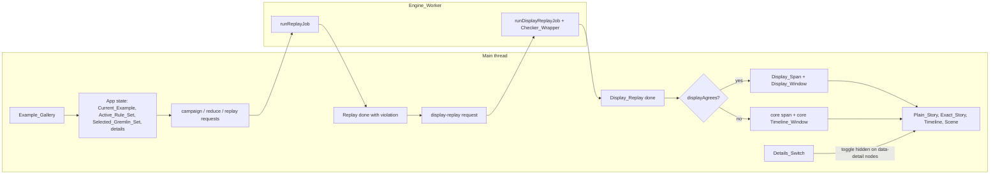

# Design Document: bench-ui-examples

## Overview

bench-ui-examples extends the bench-ui-core App (`.kiro/specs/bench-ui-core/design.md`, "core design" below). Everything the core design states still holds unless a section here replaces it. This document covers only new or changed modules:

- three Example data modules and a gallery (Requirement 3);
- a Details_Switch that hides Technical_Elements with the `hidden` attribute, with no re-render (Requirements 1, 2);
- plain-word tables, the Plain_Story_Builder and plain verdict texts (Requirements 4 to 8, 10 to 13);
- a Display_Replay with a Checker_Wrapper in `worker/host.ts`, so the span and the Timeline are no longer cut at the violation (Requirement 9);
- per-Example lanes with Lane_Words, garage and heartbeat Scenes (Requirements 16, 17);
- the Rule_Box with the Rule_Box_Check, and the Gremlin_Picker (Requirements 15, 18).

**Engine change needed: none.** Every new behaviour maps onto exports the core design already quotes: `runEventList`, `compileRuleSet`, the `Checker` / `CheckerOutcome` types (`src/engine/checker.ts:33-38`), `readRulesFile`, `render`, `failureStory`, `msText`, `cycleText`, `GREMLIN_CATALOGUE` / `findGremlin`, `MAX_RUN_CYCLES`. No new package. No committed test, baseline, fixture or example file changes; new tests are new files under `tests/ui/`.

Pinned exports that stay byte-for-byte in behaviour (G9): `LANES`, `windowEnd`, `shrinkText`, `elapsedText`, `STORY_LABELS`, `buildStoryInput`, `SCENE_SIGNALS`, `SCENE_NOTE`, `sceneAt`, `coverageLine`, `NEVER_RULE_PART`, the `FlowState` functions, `CROSSWALK_TEXTS`, `loadCrosswalk`. New behaviour lives in new functions next to them. One more pin found while designing: `tests/ui/codec.test.ts:91-92` pins `WORKER_MESSAGE_KINDS` at 9 entries, so the Display_Replay request is decoded outside that list (see Worker protocol addition).

## Architecture



Order of work for one violating Replay (original run, Reduced_List, "Replay again", "Try removing"):

1. `replay` request, as in the core design. Its result drives the Trace_Fingerprint, the "Replay again" / "Try removing" texts and the fixed-build replay text (Requirement 9.6). The Timeline, Scene and stories show it at once over the core Timeline_Window with the core span (Requirement 9.9).
2. When that result has a violation, the App sends one `display-replay` request with the same `hex`, `fixture`, `ruleSet`, `events` and `violationCycle = v`.
3. On the reply, `displayAgrees(replay, display)` checks Requirements 9.4 and 9.5. On success the App swaps the Timeline, Scene and stories to the Display_Replay with the Display_Span and Display_Window; otherwise it keeps step 1 and shows the error text when one was returned (Requirement 9.10).

The Display_Replay counts as `busy: "replay"` in `FlowState`, so Example_Cards, the Rule_Box and the buttons stay disabled until it ends (Requirements 3.6, 18.11). Cost: at most 16,000,000 extra cycles per violating Replay, about 0.8 s at the 20M cycles/s in `SPIKE.md`.

## Components and Interfaces

### Module changes

```
src/ui/app/
  data/
    examples.ts        NEW  EXAMPLE_IDS, loadExample(id), ExampleBundle (uses the three loaders)
    garage.ts          ADD  loadGarageExample() with all seven files; loadGarage unchanged
    heartbeat.ts       NEW  loadHeartbeat() with all seven files
    crosswalk.ts       unchanged (CROSSWALK_TEXTS, loadCrosswalk pinned)
  model/
    labels.ts          NEW  FRIENDLY_LABELS, EXAMPLE_STORY_LABELS, PLAIN_STORY_LABELS, GREMLIN_LEGEND, lookups
    example-copy.ts    NEW  EXAMPLE_COPY, CUSTOM_COPY, STORY_ENDING, SPAN_SENTENCE, isCustomRuleSet, copyFor
    plain-story.ts     NEW  plainMs, plainStory
    display.ts         NEW  DISPLAY_LIMIT, displayRunCycles, displayAgrees, displaySpan, displayWindowEnd
    lanes.ts           NEW  exampleLanes, outputLaneWord, inputLaneWord, releaseRanges, plainSelectedText
    scenes.ts          NEW  DOOR_TRAVEL_CYCLES, doorTravelAt, garageSceneAt, heartbeatSceneAt
    rule-box.ts        NEW  checkRuleBox, ruleErrorFrom, sentencePatterns
    gremlin-picker.ts  NEW  PICKER_TEXT, isCompatible, incompatibleReason, defaultSelection, pickerTile
    verdict-plain.ts   NEW  run/HELD/COULDN'T TELL/reduction/Gremlin_Log texts, plain coverage parts, storyHeading, reducedReplayNote, originalRunNote
    details.ts         NEW  DETAILS_KEY, detailsFromStored
    format.ts          ADD  elapsedSecondsText, shrinkArrowText (elapsedText, shrinkText unchanged)
    story-input.ts     ADD  exampleStoryInput (STORY_LABELS, buildStoryInput unchanged)
  worker/
    host.ts            ADD  wrapChecker, DisplayReplayJobInput, runDisplayReplayJob
    messages.ts        ADD  DisplayReplayRequest, DISPLAY_REPLAY_KIND (WORKER_MESSAGE_KINDS unchanged)
    codec.ts           ADD  encodeDisplayRequest, decodeDisplayRequest (existing functions unchanged)
    engine.worker.ts   CHANGE  route "display-replay" before decodeRequest
  views/
    details.ts         NEW  techOnly, plainOnly, applyDetails, readDetails, writeDetails, signalLabel
    gallery.ts         NEW  Example_Gallery
    rule-box.ts        NEW  Rule_Area, Rule_Box, Sentence_Patterns
    picker.ts          NEW  Gremlin_Picker (replaces the read-only tile panel in the page)
    scene-garage.ts    NEW  garage SVG
    scene-heartbeat.ts NEW  heartbeat SVG
    scene.ts           CHANGE  crosswalk ghost on crossing / at curb
    timeline.ts        CHANGE  lanes from exampleLanes, Lane_Words, dotted release ranges, legend
    verdict-card.ts    CHANGE  plain texts; trace table moves into the Gremlin_Log inside the card; reduced moves list
    panels.ts          CHANGE  header (switch, subtitle/chip, "What is this?", steps), renames, Reduction_Row
    worker-client.ts   ADD  runDisplay(req)
    app-page.ts        CHANGE  gallery wiring, Display_Replay flow, gates
  app.css              ADD  [hidden] rule, picker, gallery, scenes, 16 px Essential_Text
```

Every model module follows the core purity rule (core design, "Pure model modules"). No file under `src/ui` holds the claim words of G11 in code, comments or identifiers: the leading fixture input is named `leadInput`, the leading target entry `targets[0]`.

### Example data modules (Requirement 3)

`data/heartbeat.ts` and `loadGarageExample()` in `data/garage.ts` copy the `data/crosswalk.ts` pattern: seven `?raw` imports from `examples/<id>/`, then `parseExample(fixtureText, rulesText, metaText)`. `loadGarage()` stays as is for the Speed_Page.

```ts
// data/examples.ts
export const EXAMPLE_IDS = ["crosswalk", "garage", "heartbeat"] as const;
export type ExampleId = (typeof EXAMPLE_IDS)[number];
export interface ExampleBundle {
  id: ExampleId; buggyHex: string; fixedHex: string; fixture: Fixture; ruleSet: RuleSet;
  sentences: string[]; rulesText: string; meta: ExampleMeta; buggySketch: string; fixedSketch: string;
}
export interface FileProblem { file: "rules.txt" | "fixture.json" | "meta.json"; reasons: string[] }
export type LoadedExample = { ok: true; example: ExampleBundle } | { ok: false; id: ExampleId; problems: FileProblem[] };
export function loadExample(id: ExampleId): LoadedExample;
```

- `rulesText` is the raw `rules.txt` string, used for the Rule_Box text and "Reset to the example rule" (Requirements 3.4, 18.9).
- A failing parse gives `problems` with `readRulesFile` reasons unchanged and the `JSON.parse` messages (Requirement 3.8). The gallery shows them and disables "Unleash gremlins" while that Example is current.
- No DOM and no clock, so Node tests import `loadExample` and build Campaigns from the strings the App ships.

### Details_Switch mechanism (Requirements 1, 2)

- Marking: `techOnly(node)` sets `data-detail="tech"`; `plainOnly(node)` sets `data-detail="plain"`. Each sets `hidden` from the current view when the node is made. `applyDetails(root, on)` walks `root.querySelectorAll("[data-detail]")` and sets `hidden` on tech nodes when off and on plain nodes when on.
- `app.css` adds `[hidden] { display: none !important; }`, so no component rule such as `display: flex` can show a hidden node. `hidden` also removes the node from the accessibility tree (Requirement 1.6).
- The switch changes only `hidden` attributes and the switch's own `aria-checked`. Nothing re-renders, so every `<details>` open state, field value, Cursor, verdict and job keeps its state, and focus stays on the switch (Requirements 1.4, 1.7, 6.6, 12.3).
- Switch: `<button type="button" role="switch" aria-checked="false">Show technical details</button>` in the header. A native button fires `click` for Space.
- Storage: `readDetails()` returns `detailsFromStored(localStorage.getItem(DETAILS_KEY))` inside `try`, `false` on any throw or missing storage; `detailsFromStored(v)` is `v === "on"`. `writeDetails(on)` writes `"on"` or `"off"` inside `try`/`catch` and ignores errors (Requirements 1.2 to 1.4).
- Signal labels: `signalLabel(signal)` returns a span with the Friendly_Label text plus a `techOnly` `<code>` holding the signal name; for a signal with no entry it returns the name once and no `<code>` (Requirements 5.3 to 5.5).

Technical_Elements (`data-detail="tech"`): the header chip line "ATmega328P · Browser only"; the Canonical_Sentence lines of the Rule_Area; every `<code>` signal name inside a label; on the BROKE card the Target_Rule sentence, the observed text, the "<cycles> cycles" text and "Seed: <seed>"; the HELD Coverage_Line; the "Exact story" heading and text; the "(reduced replay, Y of X events)" text after the Story_Card heading; the seed field; on the Reduction_Row "X events → Y events", "Candidates tried: K", the Minimality_Tooltip and the budget note; the tile block "Synthetic input ranges"; the technical selected-event text of the Timeline. Plain-only (`data-detail="plain"`): the subtitle "Runs in your browser" and the plain selected-event text.

### Worker_Host addition (Requirement 9)

```ts
// model/display.ts (pure; host.ts imports it, as it already imports model/coverage.ts)
export const DISPLAY_LIMIT = 16_000_000;
export function displayRunCycles(v: number): number;            // Math.min(v + DISPLAY_LIMIT, MAX_RUN_CYCLES)

// worker/host.ts
export interface WrappedChecker { checker: Checker; recorded(): Violation | null }
export function wrapChecker(inner: Checker): WrappedChecker;
export interface DisplayReplayJobInput {
  hex: string; fixture: Fixture; ruleSet: RuleSet; events: ReducerEvent[]; violationCycle: number;
}
export function runDisplayReplayJob(input: DisplayReplayJobInput): ReplayJobResult;
```

Checker_Wrapper (`wrapChecker`): each call runs `out = inner(obs)`. When `out.violation` is not null and nothing is recorded yet, or its `cycle` is lower than the recorded one, the wrapper records `{ rule, cycle }`. It returns `{ violation: null }`, plus `cannotCheck: out.cannotCheck` when that field is present. `runEventList` therefore never stops early and makes its end-of-run call; the compiled checker reports each Violation once ("lowest unreported", `rules/rule-checker.ts:176-195`), so the wrapper sees every report. A throw from `inner` is not caught, so `callChecker` turns it into a `checker-error`, and the job returns `replay-error`.

`runDisplayReplayJob` runs the same checks as `runReplayJob` (core design, "Replay design", steps 1 to 6), in the same order and with the same texts, with two differences: `violationCycle` must pass `Number.isSafeInteger` and be 0 or more ("Field violationCycle: must be a whole number of 0 or more.") and `runCycles = displayRunCycles(violationCycle)`; the checker passed to `runEventList` is `wrapChecker(compiled.checker).checker`. The result is a `ReplayJobResult` with `violation = recorded()`, `outputEdges` in cycle order, `reachedEnd = path.endCycle` and `fingerprint = traceFingerprint(outputEdges)`. The App never uses that fingerprint (Requirement 9.6). A private helper holds the shared steps, so `runReplayJob` keeps its committed behaviour (guarded by `tests/ui/worker-host.acceptance.test.ts`).

If an event of the list has a cycle at or above `displayRunCycles(v)` (possible only with a Run_Cycles far above the Example defaults), `checkEventList` rejects the list, the job returns `invalid-input`, and the App falls back as Requirement 9.10 states.

### Worker protocol addition

| kind | Direction | Fields |
|---|---|---|
| `display-replay` | App -> worker | `jobId`, `hex`, `fixture`, `ruleSet`, `events`, `violationCycle` |
| reply | worker -> App | an ordinary `replay-done`, or `job-error` with `job: "replay"` |

- `DISPLAY_REPLAY_KIND = "display-replay"` is not added to `REQUEST_KINDS` or `WORKER_MESSAGE_KINDS` (pinned at 9). `decodeRequest`, `decodeReply`, `decodeMessage` and `encodeMessage` keep their behaviour.
- `encodeDisplayRequest` / `decodeDisplayRequest` use the field rules of the core codec (`violationCycle`: non-negative integer; `events`: event list; `fixture`, `ruleSet`: JSON data).
- `engine.worker.ts`: if the raw message is a plain object with `kind === "display-replay"`, it uses `decodeDisplayRequest` and `runDisplayReplayJob`; otherwise the core path runs unchanged.
- The reply reuses `replay-done`, so the client decodes it with `decodeReply`, and the Node test encodes the host result with `encodeMessage` and decodes it with `decodeReply` (Requirement 21.1).
- `EngineClient.runDisplay(req)` sends with `encodeDisplayRequest` and settles on the reply with the same `jobId`.

### Display model (Requirements 9.4, 9.5, 9.7, 9.8)

```ts
export function displayAgrees(replay: ReplayView, display: ReplayView): boolean;
//  display.violation and replay.violation are both non-null with equal rule and cycle, and
//  display.outputEdges.filter(e => e.cycle <= replay.reachedEnd) deep-equals replay.outputEdges.
export function displaySpan(rule: Rule, v: number, display: ReplayView): Span | null;
//  spanFor(rule, v, display.outputEdges, Math.min(v + DISPLAY_LIMIT, display.reachedEnd))
export function displayWindowEnd(span: Span | null, v: number, displayReachedEnd: number): number;
//  span !== null ? Math.min(span.end + DISPLAY_MARGIN, displayReachedEnd) : Math.min(v + DISPLAY_MARGIN, displayReachedEnd)
```

`ReplayView` is `{ violation: Violation | null; outputEdges: OutputEvent[]; reachedEnd: number }`. `DISPLAY_MARGIN` is the existing 32,000 of `model/timeline.ts`. `spanFor` is unchanged. Its `{ lengthCycles, cut }` is the same pair as `spanCycles` / `cutByReplayEnd` of the test helper `violationSpan`. `exampleStoryInput` takes the span as an argument and the Story_Labels of the fixture:

```ts
export function exampleStoryInput(args: {
  reducedList: readonly ReducerEvent[]; fixture: Fixture; violation: Violation;
  outputEdges: readonly OutputEvent[]; span: { lengthCycles: number; cut: boolean } | null;
}): StoryInput;   // labels = storyLabelsFor(fixture); violationSpan set only when span !== null
```

Before the Display_Replay ends, the App calls it with the core span (`spanFor` on the Replay edges with M = Replay Reached_End); afterwards with `displaySpan`. Count and hold rules pass `null` in both cases (Requirements 9.7, 11.12).

The Plain_Story, Exact_Story and Gremlin_Legend belong to the Reduced_List. A Display_Replay of "Replay again" or "Try removing" drives the Timeline and Scene only.

### Plain_Story_Builder (Requirement 11)

```ts
export function plainMs(cycles: number): string;   // k = Math.floor((cycles + 8000) / 16000), integer maths; k >= 1000 gets a thousands comma ("1,000 ms"), k < 1000 none
export function plainStory(a: {
  reducedList: readonly ReducerEvent[]; fixture: Fixture; v: number;
  storyEnding: string;          // STORY_ENDING lookup by Target_Rule Canonical_Sentence (done by the caller)
  spanSentence: string;         // SPAN_SENTENCE template for cut false, holding the literal "<Plain_Ms>"
  span?: { lengthCycles: number; cut: boolean };
}): string;
```

Algorithm:

1. `g` = the Gremlin_Events of `reducedList` (`gremlinId !== "rest"`) in list order. If `g` is empty, return "No gremlin move was needed: the program broke the rule on its own." (11.9).
2. For each `g[i]`, find its pin; its press value is 0 when `activeLevel` is `"low"` or absent, 1 when `"high"` (G6). Kind of phrase: `"release"` or a value other than the press value gives `inactive`; a press with a later `"release"` of the same signal anywhere after it in `reducedList` gives `active`; a press with none gives `held`.
3. Phrase `p[i]` = `PLAIN_STORY_LABELS[signal].short[kind]` when `i > 0` and `g[i-1].signal === g[i].signal`, else `.full[kind]` (11.3). A signal with no entry uses `changed <Friendly_Label or name>` / `changed it` (not reachable with the bundled fixtures).
4. Joined phrases: one → `p0`; two → `p0, then p1`; three or more → `p0, p1, …, then pk`.
5. Sentence 1 = subject (`"The gremlin"` when every `g[i].gremlinId` is equal, else `"The gremlins"`) + `" "` + joined; when `g.length >= 2` add `", all within " + plainMs(last.cycle − min cycle)`; then `"."`.
6. Sentence 2 = `plainMs(v − last.cycle) + " later, " + storyEnding`. No lower-casing; `storyEnding` comes from `STORY_ENDING` (below) and is used unchanged.
7. Sentence 3: `span.cut === false` gives the `SPAN_SENTENCE` text with `plainMs(span.lengthCycles)` in its slot (garage "The door kept closing for another <Plain_Ms>."; crosswalk, heartbeat and custom rules "It stayed that way for another <Plain_Ms>."); `span.cut === true` gives `"It was still that way " + plainMs(span.lengthCycles) + " later, when the replay stopped."`; no span gives none.
8. Return the sentences joined with one space.

`STORY_ENDING` (in `example-copy.ts`, keyed by Canonical_Sentence, 5 entries, Requirement 11.5): "all of (CAR_GREEN is 1, WALK is 1) must never happen." → "the light gave cars and walkers a green at the same time."; "Within 20 ms after BEAM_CLEAR is 0 becomes true, MOTOR_CLOSE is 0 must be true." → "the door was still closing, 20 ms after the gremlin blocked the beam."; "HEARTBEAT is 1 must never last 600 ms or longer." → "the heartbeat light had been stuck on for 600 ms."; "HEARTBEAT is 0 must never last 600 ms or longer." → "the heartbeat light had been stuck off for 600 ms."; any other rule → "the program broke your rule." `SPAN_SENTENCE` (same file, 4 entries: crosswalk, garage, heartbeat, custom): garage "The door kept closing for another <Plain_Ms>."; the others "It stayed that way for another <Plain_Ms>." The BROKE card keeps `EXAMPLE_COPY.broke` unchanged. Both tables join the copy scan (Requirement 20.5).

Pinned texts (Requirements 11.16 to 11.18), each with its span sentence:

- crosswalk: "The gremlin pressed the walk button, let go, then pressed and held it, all within 131 ms. 319 ms later, the light gave cars and walkers a green at the same time. It was still that way 1,000 ms later, when the replay stopped."
- garage: "The gremlin blocked the beam, cleared it, then blocked it and kept it blocked, all within 4 ms. 16 ms later, the door was still closing, 20 ms after the gremlin blocked the beam. The door kept closing for another 240 ms."
- heartbeat: "The gremlin held the pulse input on. 505 ms later, the heartbeat light had been stuck on for 600 ms. It was still that way 1,000 ms later, when the replay stopped."

A number that differs only by rounding: the Agent uses the computed number and reports it. If the wording differs, the Agent stops (Requirement 11.19).

Check against Requirement 11.16 (crosswalk, Reduced_List of 3 REQUEST events): press with a later release gives "pressed the walk button"; the release, same signal, gives "let go"; the press with no later release, same signal, gives "pressed and held it". Sentence 1 ends "all within 131 ms." when last − earliest cycle is between 2,088,000 and 2,103,999. The test pins the real cycles. The garage and heartbeat texts come from the same code and are pinned to the texts above (Requirements 11.17, 11.18).

### Rule_Box_Check (Requirement 18)

```ts
export interface RuleError { line: number | null; position: number | null; text: string }
export type RuleBoxResult = { ok: true; ruleSet: RuleSet; sentences: string[] } | { ok: false; errors: RuleError[] };
export function ruleErrorFrom(reason: string): RuleError;
export function checkRuleBox(text: string, fixture: Fixture): RuleBoxResult;
export function sentencePatterns(fixture: Fixture): { form: RuleForm; sentence: string }[];
```

Error mapping (`ruleErrorFrom`):

| Engine reason | Rule_Error |
|---|---|
| matches `^Line (\d+): No rule template matches at position (\d+) \(counting from 0\); allowed there: (.*)\.$` | `line` N, `position` P + 1, text `Line N, position Q: this part does not match any rule pattern. Allowed here: X.` with X = group 3 |
| anything else, including a reason cut at 200 characters by `cutReason` (it then has no final period and does not match) | `line` null, `position` null, text unchanged |

`checkRuleBox`: text `""` gives exactly `[{ null, null, "Add at least one rule." }]` (18.10). Otherwise `readRulesFile(text)`; a failure maps every reason in order. On success, `compileRuleSet(ruleSet, fixture)`; a failure passes every reason through unchanged (18.4). On success it returns the rule set and `render(rule).sentence` per rule. The App runs it synchronously in the `input` handler, before the next render (18.2).

Sentence_Patterns, with I = `leadInput` and O = the leading output in fixture order:

| form | sentence |
|---|---|
| never | `O is 1 must never happen.` |
| notLongerThan | `O is 1 must never last 500 ms or longer.` |
| respond | `Within 50 ms after I is 0 becomes true, O is 0 must be true.` |
| count | `I is 0 becomes true may happen at most 5 times in any 1000 ms.` |
| hold | `After I is 0 becomes true, O is 1 must stay true for 100 ms.` |

The numbers differ from every bundled `rules.txt`, so no appended pattern repeats a sentence (`rules-file.ts:67` rejects repeats). Insert appends `"\n"` only when the text is non-empty and does not end with `"\n"` (18.8).

### Gremlin compatibility (Requirement 15)

```ts
export function isCompatible(def: GremlinDefinition, fixture: Fixture): boolean;
//  some t of def.targets: an input pin with (t.kind === "analog") === (pin.kind === "analog"),
//  and pin.restState === "active" when t.restState === "active"
export function incompatibleReason(def: GremlinDefinition): string;
//  from targets[0]: analog -> "Needs an analog input"; restState active -> "Needs an input that is normally on";
//  else "Needs a button or switch input"
export function defaultSelection(gremlinSet: readonly GremlinSpec[], fixture: Fixture): GremlinSpec[];
export function pickerTile(def: GremlinDefinition, fixture: Fixture): PickerTile;
//  name and behaviour from PICKER_TEXT; target Friendly_Labels in fixture order;
//  ranges with exact ms = cycles / 16,000 (decimal string by integer maths, "1,600–48,000 cycles = 0.1–3 ms")
```

An input pin is an analog pin or a digital pin with `direction: "input"`. Order of the Selected_Gremlin_Set: see Choices I made, item 4. Tiles are `<button aria-pressed>` elements, so Enter and Space toggle them; incompatible tiles get `disabled` and the reason text. The existing `gremlinTile` and its texts stay for its committed test.

### Lanes and Lane_Words (Requirement 16)

```ts
export function exampleLanes(fixture: Fixture): { signal: string; direction: "input" | "output" | "gremlins" }[];
//  fixture.pins order, then { signal: "GREMLINS", direction: "gremlins" }
export function outputLaneWord(edges: readonly OutputEvent[], signal: string, c: number): "on" | "off" | "not driven";
export function inputLaneWord(events: readonly ReducerEvent[], pin: FixturePin, c: number): "pressed" | "released";
export function releaseRanges(events: readonly ReducerEvent[], signal: string, end: number): { from: number; to: number }[];
export function plainSelectedText(ev: TimelineEvent, label: string, word: string): string; // `${msText(c)} · ${label} = ${word}`
```

`outputLaneWord` uses the existing `levelAt`. `inputLaneWord` uses the latest event at or before c: `"pressed"` when its value is the pin's press value, else `"released"`. `releaseRanges` runs from each `"release"` to the next event of that signal or `end`; the view draws those parts dotted. The legend text is Requirement 16.5, shown in both views. The crosswalk lanes from `exampleLanes` are the same seven as `LANES`, which stays as is.

### Scenes (Requirement 17)

```ts
export const DOOR_TRAVEL_CYCLES = 4_800_000;      // 300 ms at 16 MHz
export function doorTravelAt(edges: readonly OutputEvent[], c: number): number;   // integer 0..DOOR_TRAVEL_CYCLES
export function garageSceneAt(r: SceneReplay | null, c: number): GarageScene;
export function heartbeatSceneAt(r: SceneReplay | null, span: Span | null, c: number): HeartbeatScene;
// SceneReplay = { outputEdges, events, violation }
```

- `doorTravelAt`: walk the MOTOR_CLOSE / MOTOR_OPEN edges below c in cycle order. On each interval `[a, b)` with fixed levels, add `b − a` when only MOTOR_CLOSE is 1, subtract it when only MOTOR_OPEN is 1, add nothing otherwise, then clamp to `0..DOOR_TRAVEL_CYCLES`. Clamping once per interval equals clamping once per cycle because the direction is fixed inside the interval. Door fraction = travel / 4,800,000 (1 = closed).
- `GarageScene`: `travel`, `beamBlocked` (BEAM_CLEAR input value at c is 0, inactive when no event), `deadlineMissed` (`r.violation !== null && c >= r.violation.cycle`), `summary` for the visually hidden text line. `null` replay gives travel 0, no marker (17.3).
- `HeartbeatScene`: `lampLit` (HEARTBEAT is 1 at c), `pulseOn` (`inputLaneWord` is `"pressed"`), `frozen` (`span !== null && r.violation !== null && v <= c <= span.end`).
- Crosswalk: `views/scene.ts` adds the ghost on the crossing when `sceneAt(...).lit.WALK`, at the curb otherwise. `sceneAt` itself does not change.
- SVG: original art only, built with the core `svg()` helper. Garage: frame, slatted door, emitter, receiver, amber dashed beam (`--c-gremlin`), cartoon cat, coral marker "20 ms deadline missed" (`--c-broke`), labels "Beam blocked" and "Door position is illustrative". Heartbeat: status lamp, PULSE switch, coral bracket "frozen". All three show `SCENE_NOTE`. Door movement follows the Cursor and has no tween, so reduced motion needs no extra path.

## Data Models

Text tables (all under `src/ui/app/model/`, values exactly as the requirement cited; tests compare them entry by entry):

| Table | Module | Keys | Source |
|---|---|---|---|
| `EXAMPLE_COPY` | example-copy.ts | crosswalk, garage, heartbeat → `{ card, headline, broke }` | Req 4.1 to 4.3 |
| `CUSTOM_COPY` | example-copy.ts | `{ headline: "Custom rule", broke: "The program broke your rule." }` | Req 4.4 |
| `STORY_ENDING` | example-copy.ts | 5 entries keyed by Canonical_Sentence (4 example rules + "any other rule") → sentence 2 ending | Req 11.5 |
| `SPAN_SENTENCE` | example-copy.ts | 4 entries: crosswalk, garage, heartbeat, custom → sentence 3 text for `cut` false | Req 11.6 |
| `FRIENDLY_LABELS` | labels.ts | 13 signals | Req 5.1 |
| `EXAMPLE_STORY_LABELS` | labels.ts | REQUEST, CLOSE, BEAM_CLEAR, PULSE → `StoryLabel` | Req 10.1 to 10.4 |
| `PLAIN_STORY_LABELS` | labels.ts | same 4 → `{ full, short }`, each `{ active, held, inactive }` (`full` = Story_Labels) | Req 11.1 |
| `GREMLIN_LEGEND` | labels.ts | 6 gremlin ids | Req 11.13 |
| `PICKER_TEXT` | gremlin-picker.ts | 6 gremlin ids → `{ name, behaviour }` | Req 15.1, 15.2 |
| `VERDICT_PLAIN` | verdict-plain.ts | fixed sentences of Req 6.7, 7.1, 7.2, 7.6, 8.1, 8.2, 13.1, 13.2 | those criteria |
| `UI_COPY` | panels.ts constants | "What is this?" text, three steps, subtitle, switch label, renames, legend, "Pick at least one gremlin." | Req 1, 2, 12, 14, 15.11, 16.5 |

`storyLabelsFor(fixture)` returns the `EXAMPLE_STORY_LABELS` entries of the fixture's input pins only (Requirement 10.5). `friendlyLabel(signal)` returns `{ text, known }`.

Text functions (`verdict-plain.ts`, `format.ts`):

| Function | Output |
|---|---|
| `runOfText(trace, n)` | `run ${runIndex + 1} of ${n}` |
| `gremlinLogSummary(list)` | "Show the full gremlin log (N moves)", "1 move", Rest_Events not counted |
| `reducedMovesLines(list, fixture)` | one "<time>: <phrase>" line per Gremlin_Event of the Reduced_List, Plain_Story_Label full phrases and Ms_Text times, Rest_Events skipped (Requirement 6.10) |
| `heldSentence(build, n)` | "No gremlin broke the fixed program in N tries." / "…this program…", "1 try" |
| `heldCardText(build, verdict)` | `[heldSentence(build, verdict.runs), verdict.text]` |
| `plainCoverageParts(line)` | `line.split(" · ")` with `NEVER_RULE_PART` replaced by the 7.6 text |
| `couldntTellHeadline(reason)` | 8.1 text when a part matches, else 8.2 text |
| `reductionSentence(x, y, atBudget)` | 13.1 / 13.2 texts with their singular rules |
| `elapsedSecondsText(ms)` | t = floor(ms / 100); `Elapsed ${floor(t / 10)}.${t % 10} s` |
| `shrinkArrowText(x, y)` | `shrinkText(x, y).replace("->", "→")` |
| `storyHeading()` | "What happened, replaying only the moves that matter" (Requirement 11.20), shown in both views |
| `reducedReplayNote(reduced, original)` | `(reduced replay, ${reduced} of ${original} events)` with reduced = `reducedEventCount`, original = `originalEventCount`; Technical_Element placed right after the heading (11.21) |
| `originalRunNote(x, y)` | `The original run had ${x} gremlin moves; the story above uses only the ${y} that matter, so lengths can differ.` with x = Gremlin_Events of the original list, y = of the Reduced_List; shown under the Timeline while "Original run" is selected, both views (11.22, 11.23) |

`isCustomRuleSet(active, example)` compares the two `sentences` lists in order. App state added to the core controller:

```ts
interface ExampleState {
  current: ExampleId; loaded: LoadedExample;
  details: boolean;                         // Details_Switch
  activeRuleSet: RuleSet; activeSentences: string[];
  ruleBoxText: string; ruleErrors: RuleError[];
  selected: GremlinSpec[];                  // Selected_Gremlin_Set
  display: null | { replay: ReplayView; span: Span | null; windowEnd: number };
}
```

"Unleash gremlins" is enabled when `canUnleash(flow) && loaded.ok && ruleErrors.length === 0 && selected.length > 0`. The extra gates sit outside `FlowState` (Requirement 18.12).

## Correctness Properties

*A property is a characteristic or behavior that should hold true across all valid executions of a system-essentially, a formal statement about what the system should do. Properties serve as the bridge between human-readable specifications and machine-verifiable correctness guarantees.*

Only two pure functions get properties; they guard stated texts where many input combinations exist. Everything that needs the emulator, and every fixed table, is an example test (Testing Strategy).

### Property 1: Plain story follows the stated sentence rules

*For any* fixture with digital input pins (either `activeLevel`), any event list over those pins (values 0, 1 or `"release"`, Rest_Events and Gremlin_Events mixed, ascending cycles, one to four gremlin ids), any v at or above the last event cycle, any non-empty Story_Ending, any non-empty Span_Sentence text and any optional span, `plainStory` returns exactly the text of a reference written in the test from Requirements 11.3 to 11.10: the fixed no-move text when there is no Gremlin_Event; otherwise sentence 1 with one phrase per Gremlin_Event (active / held / inactive by G6, short phrase only after the same signal), the "A, then B" / "A, B, …, then Z" join, the "all within" clause only for two or more phrases, sentence 2 as `plainMs(v − last)` + " later, " + the Story_Ending with no character changed, and sentence 3 chosen by `span.cut` (the Span_Sentence text with `plainMs(span.lengthCycles)` for `cut` false, the "still that way ... when the replay stopped" text for `cut` true) or absent; `plainMs` writes a thousands comma from 1,000 up; sentences joined with one space. Calling it twice with the same input gives the same string.

**Validates: Requirements 11.2, 11.3, 11.4, 11.5, 11.6, 11.7, 11.8, 11.9, 11.10**

### Property 2: Rule_Box reason mapping

*For any* positive N, non-negative P and text X with no line break (periods and parentheses allowed), `ruleErrorFrom("Line N: No rule template matches at position P (counting from 0); allowed there: X.")` returns line N, position P + 1 and the text "Line N, position P+1: this part does not match any rule pattern. Allowed here: X."; *for any* string not of that form (including that form cut to 200 characters), it returns line null, position null and the string unchanged.

**Validates: Requirements 18.3, 18.4**

## Error Handling

| Situation | Behaviour |
|---|---|
| Display_Replay returns `job-error`, a codec error, no violation, or `displayAgrees` is false | Keep the Replay over the core Timeline_Window and the core span; show the error `kind` and `message` when there was one; verdict, Trace_Fingerprint and Reduction_Row unchanged (9.10). |
| A file of an Example fails to parse | Gallery shows each file name with its reasons; "Unleash gremlins" disabled for that Example; other cards selectable (3.8). |
| Rule_Box text has errors | Errors listed in order; "Unleash gremlins" disabled; Active_Rule_Set stays at its last valid value (18.6). |
| localStorage missing, `getItem` or `setItem` throws | Plain_View on load; on toggle the view and focus change anyway (1.3, 1.4). |
| `failureStory` returns a `ReducerError` | No "Exact story" heading; Plain_Story, trace and card stay (10.8). |
| Reduction error | Reduction_Row shows neither sentence, no Shrink_Label, no arrow text (13.8). |
| Selected_Gremlin_Set empty | "Unleash gremlins" disabled with "Pick at least one gremlin." (15.11). |
| Engine_Worker stops during a Display_Replay | Core behaviour ("The engine worker stopped: …"); the Replay already on screen stays. |

All Engine and codec texts are shown through `textContent` only, as in the core design.

## Testing Strategy

Node only, `npx vitest --run`, no headless browser, no new package (fast-check is already a dev dependency). New files under `tests/ui/` only; no committed test changes. Passing tests are evidence, not proof. If a test and the system disagree, the Agent stops and reports (Requirements 9.13, 11.19, 21.9, 22.9).

| New test file | Guards |
|---|---|
| `examples-host.acceptance.test.ts` | For crosswalk, garage, heartbeat with `loadExample` and the meta.json defaults, through `runCampaignJob`, `runReductionJob`, `runReplayJob`, `runDisplayReplayJob`, each result encoded with `encodeMessage` and decoded with `decodeReply`: BROKE with `violatingRunIndex` 3 / 7 / 1 and `runOfText` "run 4 of 24" / "run 8 of 40" / "run 2 of 24"; seeds 20261101 / 20261102 / 20261103; reductions 8 → 3 / 7 → 3 / 2 → 1; reduced-replay fingerprints `47078989121ebc1d` / `616062947f71a1ae` / `19827a4e0a7ad440`; fixed-build HELD texts with 24 / 40 / 24 runs (21.3 to 21.5). `displayAgrees` true on the Display_Replay of the Reduced_List of each Example (21.7). `displaySpan` on the Display_Replay: crosswalk and heartbeat (violating run and Reduced_List) `lengthCycles` > 16,000 and `cut` true at the 1,000 ms Display_Limit; garage Reduced_List `lengthCycles` 3,833,643 and `cut` false (9.11, 9.12, 21.6). `plainStory`, with the span sentence, on the three Reduced_Lists equals the three pinned texts of 11.16 to 11.18 (22.2). `defaultSelection(meta.gremlinSet, fixture)` deep-equals `meta.gremlinSet` for each Example. Failures name the Example_Id, the build and the verdict or error (21.8). |
| `plain-tables.test.ts` | `EXAMPLE_COPY`, `FRIENDLY_LABELS`, `EXAMPLE_STORY_LABELS`, `PLAIN_STORY_LABELS`, `GREMLIN_LEGEND`, `PICKER_TEXT`, `STORY_ENDING`, `SPAN_SENTENCE` entry by entry against Requirements 4, 5, 10, 11, 15, failing on extra or missing keys; `FRIENDLY_LABELS` keys equal the union of the three fixtures' pin signals; `storyLabelsFor` gives {REQUEST} / {CLOSE, BEAM_CLEAR} / {PULSE} (22.1, 5.2, 10.5). |
| `plain-story.property.test.ts` | Property 1 (100 runs); `plainMs` at 0, 7,999, 8,000, 16,000, 16,000,000 gives "0 ms", "0 ms", "1 ms", "1 ms", "1,000 ms" (22.6). |
| `verdict-plain.test.ts` | `heldCardText` in the Plain_View for N = 24 and N = 1, Fixed_Build and Buggy_Build: the 7.1 / 7.2 sentence then the exact HELD_Text; `plainCoverageParts` replaces only `NEVER_RULE_PART` (22.3). `gremlinLogSummary` 0 / 1 / 8 moves; `storyHeading`, `reducedReplayNote(3, 8)` = "(reduced replay, 3 of 8 events)" and `originalRunNote(2, 1)` exact texts; `reductionSentence` crosswalk, garage, heartbeat texts and budget singulars; `elapsedSecondsText` 0, 99, 700, 61,250 ms; `shrinkArrowText` (22.6, 13.7). |
| `rule-box.test.ts` | Property 2 (100 runs); one real `readRulesFile` parse failure mapped end to end; one `compileRuleSet` reason passed through unchanged; `""` gives exactly "Add at least one rule."; each of the five Sentence_Patterns passes `checkRuleBox` alone and appended to each Example's `rules.txt` (22.4). |
| `gremlin-picker.test.ts` | For each Example fixture: masher, bouncer, stuck Compatible; dropout "Needs an input that is normally on"; spike, drifter "Needs an analog input". For a test-local fixture with a digital `restState: "active"` input and an analog input: all six Compatible (22.5, 15.9). |
| `copy-scan.test.ts` | Requirements 20.3 to 20.7: every string of the tables above plus `CUSTOM_COPY`, `VERDICT_PLAIN` and `UI_COPY` checked with `wholeWordMatches` against `BANNED_WORDS`, its hyphen-less variants, `BOARD_BRAND_NAMES` and "safety"; meta.json `title` / `story` / `timingNote`, `rules.txt` and both `.ino` files of all three Examples; every file under `src/ui/app/` and `index.html` for "safety"; counts 3 / 13 / 24 / 6 / 6 / 5 (`STORY_ENDING`) / 4 (`SPAN_SENTENCE`); the three story-heading texts of Requirement 11.20 to 11.22 (`storyHeading()`, `reducedReplayNote` and `originalRunNote` templates); each table non-empty; missing input fails with its name. |

Property tests use fast-check with `{ numRuns: 100 }`. Each carries the tag comment `// Feature: bench-ui-examples, Property <n>: <title>`, one test per property. The acceptance file uses a long per-test timeout because it runs six Campaigns, three reductions and the replays. The committed `tests/ui/ui-strings.test.ts` and `scripts/guard.mjs` cover the claim-word scan of `src/ui` code, comments and identifiers. Global_Checks run once at the end, as in the core design.

## Choices I made

1. Friendly_Labels for garage outputs: MOTOR_OPEN "Motor: opening" and LAMP "Warning lamp" (Requirement 5.1).
2. The garage label stays "Beam blocked" (user wording) instead of the design guide's "Beam interrupted" (G13).
3. Display_Limit is 1,000 ms (16,000,000 cycles); Plain_Ms rounds to the nearest millisecond with halves up and writes a thousands comma from 1,000 ms up; crosswalk and heartbeat spans are cut at the Display_Limit, garage ends on its own (G16); elapsed time shows tenths of a second with no minutes field.
4. **Deviation (gremlin order).** The glossary puts the Selected_Gremlin_Set in catalogue order, but the Engine draws every gremlin from one PRNG in `gremlinSet` order (`src/engine/event-list.ts:92-100`). Garage's meta.json lists bouncer before masher; catalogue order would almost certainly give the browser a different run than the pinned "run 8 of 40" and `616062947f71a1ae`. The design keeps the meta.json order for the defaults and appends manually added gremlins in catalogue order. The acceptance test checks that the default selection equals `meta.gremlinSet`.
5. The Display_Replay request is a new kind decoded outside `WORKER_MESSAGE_KINDS`, which a committed test pins at 9. Its reply reuses `replay-done`.
6. The Display_Replay counts as `busy: "replay"`, so controls stay disabled until the display data arrives.
7. Views mark Technical_Elements with `data-detail="tech"` and toggle only `hidden`; nothing re-renders on a switch change.
8. The Gremlin_Log is a `<details>` inside the BROKE card, collapsed when it appears. The opened table grows the card, with no overflow auto or scroll on any element in the card (19.2). Once a reduction result exists, the card also lists the reduced moves in plain words (6.10); while reducing it shows nothing extra. Decided: the collapsed log plus the plain-word reduced moves list satisfies "always show the trace".
9. The GREMLINS lane has no Friendly_Label entry (the table holds fixture signals only), so it shows "GREMLINS" once in both views (5.5).
10. Sentence_Pattern numbers (500 ms, 50 ms, 5 times in 1000 ms, 100 ms) differ from every bundled rule, so an appended pattern never repeats a sentence.
11. The Plain_Story, Exact_Story and Gremlin_Legend describe the Reduced_List only; "Replay again" and "Try removing" Display_Replays update the Timeline and Scene.
12. `loadGarage` stays for the Speed_Page; the gallery uses the new `loadGarageExample`.
13. Reasons cut at 200 characters by the Engine (`cutReason`, no final period) are shown unchanged, with no position conversion (decided).
14. The garage Scene label stays "Beam blocked"; the Agent updates the "Beam interrupted" line of `docs/design-direction.md` to "Beam blocked" (decided).
15. The Gremlin order of Choices item 4 (meta.json order for the defaults) is approved.

## Open points for the user

- The three Plain_Story texts of Requirements 11.16 to 11.18 are pinned in a test; a rounded-number difference uses the computed number and is reported; a wording difference stops the task.
- Each violating Replay now adds up to about 0.8 s of Display_Replay time.

## Browser checklist

Run `npm run dev` yourself and check:

- [ ] Crosswalk, Garage door, Heartbeat in the Plain_View: run, BROKE card in plain words, shrink sentence, Plain_Story, Scene, Timeline, "Try the fixed program", HELD sentence plus exact HELD text.
- [ ] Same three with "Show technical details" on: rule sentences, cycles, seed, Exact story, arrows, coverage line, signal names in monospace; switching back and forth keeps the Cursor, open logs and fields.
- [ ] Switch state remembered after a reload.
- [ ] Rule box: type a broken line, see "Line N, position Q: …", "Unleash gremlins" disabled; reset fixes it.
- [ ] Gremlin picker: toggle tiles, disabled tiles show their reason, empty selection shows "Pick at least one gremlin."
- [ ] Keyboard only: Tab to the switch, cards, tiles, rule box, buttons; Space and Enter work; focus stays visible.
- [ ] Reduced motion on: no animation beyond Cursor moves.
- [ ] Narrow window (about 400 px): nothing clipped, cards grow with their content.
- [ ] Console: no errors or warnings during all of the above.
