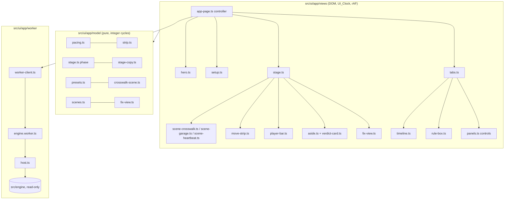
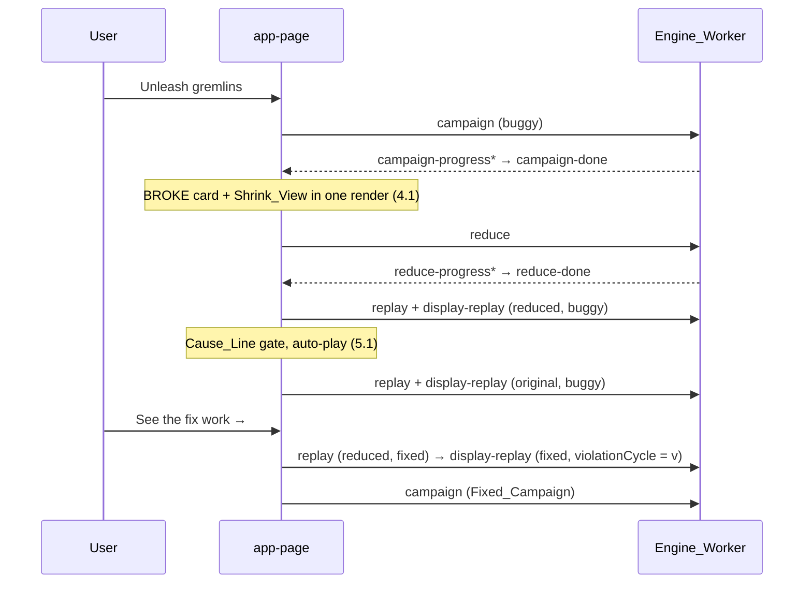

# Design Document: bench-ui-stage

## Overview

The App page is rebuilt around the Stage of `docs/stage-design.md` (the Contract). The work is UI-only: new pure models under `src/ui/app/model/`, new and rewritten views under `src/ui/app/views/`, one optional field in a Worker reply, and new Node tests under `tests/ui/`. Nothing under `src/engine/` changes, and no package is added.

Facts measured for this design (a temporary Vitest file ran the host functions on the bundled examples; it was deleted afterwards):

| Example | Reduced Gremlin_Event cycles | v (reduced, buggy) | `candidatesTried` | `stoppedAtBudget` | Buggy `totalCycles` |
|---|---|---|---|---|---|
| crosswalk | 8,449,937 · 9,496,850 · 10,543,764 (masher) | 15,647,515 | 30 | false | 63,788,954 |
| garage | 5,448,100 · 5,476,645 · 5,514,418 (bouncer) | 5,768,101 | 30 | false | 75,839,799 |
| heartbeat | 4,733,733 (stuck) | 12,811,661 | 4 | false | 28,893,733 |

Key decisions:

| Decision | Choice | Why |
|---|---|---|
| Shrink view | Counts-only case | See "Shrink view case" below |
| Job order after BROKE | reduce → reduced replay (+display) → original replay (+display) | The Shrink_View starts at once; the original run is needed only in the Signals tab |
| Pacing | Piecewise-linear plan with an equal share of free time per piece | Each move gets a similar screen time (about 2 s on the examples), and the lead-in does not take most of the 8 s |
| Speed_Slider | 11 integer steps, 0 = Pacing_Plan (left, "Slower"), 10 = real speed | Exact integer maths; step 10 gives a Slow_Factor of exactly 1 |
| Exact arithmetic | `BigInt` for products of UI position and cycle length | Values reach about 10^17, above 2^53 |
| Crosswalk car | Look-ahead "passes" planned from the whole edge list | The no-overlap rule (13.3) and the red-light rule (13.2) both hold by construction |
| Fixed right Scene | Display_Replay of the Reduced_List on the fixed HEX, `violationCycle` = buggy v | It runs to v + 16,000,000, so v + 8,000,000 is covered (crosswalk `runCycles` ends at 16,000,000, only 352,485 cycles after v) |
| Register/cycle for COULDN'T TELL (7.6) | Optional `peripheralUses` in `CompactCampaignResult`, a copy of the public `RunResult.peripheralUses` of one run | `runCampaignJob` already holds `SliceProgress.runs: RunResult[]` (`src/engine/types.ts`); no engine logic is copied |
| Shrink dot fading (4.4) | Fade dots with no match in `bestList`, which `ReduceProgressMsg` already forwards | Accepted reductions are real; the candidate under test is still not reported |
| Tabs before a replay (11.9) | "Nothing has broken yet." in "What happened" and "Signals" | No empty Timeline or story |
| Old tables scanned by `copy-scan.test.ts` | Kept with the same export names | That committed test imports them; it must not need edits |
| New copy scan | New file `tests/ui/stage-copy-scan.test.ts` | Requirement 20.4 is met without editing `copy-scan.test.ts` (Requirement 21.2) |

### Shrink view case (Requirement 4)

The counts-only case applies. `ProgressReport` (`src/engine/reducer/types.ts`, lines 24–31) holds `candidatesTried`, `bestGremlinCount`, `bestList`, `part` and `accepted`. `core.ts` (lines 264–272) builds it after each oracle call that returned an outcome, so the report describes a finished attempt and never the subset under test. `ReduceProgressMsg` (`src/ui/app/worker/messages.ts`) forwards `candidatesTried`, `bestGremlinCount` and `bestList: ReducerEvent[]`; `host.ts` (`runReductionJob`) copies `bestList` with `copyList`, `engine.worker.ts` posts it and `codec.ts` checks it as `arr(inputEvent)`. No forwarding change is needed. The counts-only case still holds for the candidate under test, since no subset is reported. The Shrink_View shows the counter "tried <Shorter_Count> shorter versions…" (label unchanged), starts every dot "testing now", and on each `reduce-progress` fades the dots that have no match in that `bestList` (Requirement 4.4). Then one 400 ms collapse runs on `reduce-done`. No engine change is needed.

Matching uses the identity fields of a Gremlin_Event in the message: `cycle`, `signal`, `gremlinId`, and `value` for a digital event. `analog` is left out because Pass C (`src/engine/reducer/passes.ts`, `snapIds`) can snap an analog value of an event that is still in the list. Rest_Events get no dot. Each `bestList` entry matches at most one dot (multiset match, in list order), as `markersToRemove` in `model/timeline.ts` already does for Timeline markers. The faded set is the union of every earlier faded set and the new unmatched set, so a dot never returns to "testing now". Reducer passes only remove events or snap analog values, so in practice the union adds nothing; it keeps the rule stated in 4.4 even if a later list held an event again.

## Architecture



Job sequence (one job at a time, as today):



## Components and Interfaces

### Component tree (file status)

| File | Status | Role |
|---|---|---|
| `views/app-page.ts` | rewritten | Controller: state, job sequence, wiring. Keeps `outcomeError`, `orderedSelection`, `viewOf`, `doReplay`, `buildCardStory`, `renderTryRemoving`, `replayAgain` (with `previousFingerprint` and `canReplayAgain` from `model/flow.ts`) logic |
| `views/hero.ts` | new | Header (ghost mark, wordmark, Details_Switch moved from `panels.ts`), hero h1/paragraph/chips, post-run tagline |
| `views/setup.ts` | new | Sections 1–3, Device_Cards, "Change rule ▾" with Limit_Control, Gremlin_Chips, "N more need other inputs", Unleash, Setup_Summary |
| `views/picker.ts` | rewritten | Gremlin_Chip rendering; keeps `PICKER_COPY` export |
| `views/gallery.ts` | deleted | Replaced by Device_Cards in `setup.ts` |
| `views/stage.ts` | new | Scene_Area + Aside grid; idle, running, Shrink_View, broke, Fix_View states |
| `views/scene-crosswalk.ts` | new (replaces `views/scene.ts`, deleted) | Top-down crosswalk SVG + HTML labels |
| `views/scene-garage.ts`, `views/scene-heartbeat.ts` | rewritten | New art; keep `GARAGE_TEXT` / `HEARTBEAT_TEXT` export names |
| `views/move-strip.ts` | new | Dots, ✕, legend, pulses; rows at Phone_Width |
| `views/player-bar.ts` | new | Play/Pause, Replay, Speed_Slider; rAF loop reads UI_Clock and calls `pacing.ts` |
| `views/aside.ts` | new | Verdict card slot, Reduction_Card, "See the fix work →" |
| `views/verdict-card.ts` | rewritten | BROKE / HELD / COULDN'T TELL cards from `stage-copy.ts`; keeps `CARD_COPY`, `violatedRule` |
| `views/fix-view.ts` | new | Two Scenes, shared Player, right card, "What the fix changed", disclosure, "Replay both" |
| `views/tabs.ts` | new | Tablist with roving tabindex, always shown; panels: What happened, Signals, The fix, Details. "What happened" and "Signals" show `TAB_TEXT.idle` ("Nothing has broken yet.") until a replay exists. Details holds the existing Replay-again row (`replayAgainBtn` "Replay again", `replayAgainOut` "Fingerprint <fp> · matches/differs", moved from the counter row of `app-page.ts`), shown only in the Technical_View |
| `views/timeline.ts` | reused, small change | `RunLabel` gains "Fixed program"; `setToggle(selected, reducedOk, fixedOk)`; "Original run" toggle marked `techOnly` |
| `views/panels.ts` | trimmed | Keeps `controls()` (tries/seed, moved into Details tab), `UI_COPY`, `SHRINK_LABEL`, `BUDGET_TEXT`, `MINIMALITY_TOOLTIP`, `fill`; `header()` and `counter()` removed |
| `views/icons.ts` | rewritten | Six pumpkin line-art gremlin icons, each with a dimmed variant; ghost mark; play/pause |
| `views/rule-box.ts`, `details.ts`, `dom.ts`, `live.ts`, `worker-client.ts`, `speed-page.ts` | reused unchanged | |
| `app.css` | rewritten | Contract section 1 tokens; grid; breakpoints > 899 px two columns, ≤ 899 px Aside under Scene, ≤ 430 px (Phone_Width) one column in the order of 17.5; `prefers-reduced-motion` sets every transition and animation to 0 ms |
| `model/pacing.ts` | new | Segment, Clusters, Pacing_Plan, slider, Friendly_Factor, Speed_Badge |
| `model/strip.ts` | new | Relative_Time, Strip_Phrase, strip dots, shrink dots with `bestList` fading, pulse crossing |
| `model/stage.ts` | new | Stage phase and derived flags (hero, setup expanded/locked, primary button) |
| `model/stage-copy.ts` | new | All new string tables and text functions |
| `model/presets.ts` | new | Rule_Preset build, Limit_Control check, custom headline |
| `model/crosswalk-scene.ts` | new | Car passes, walker crossings, lights, lamp, labels |
| `model/scenes.ts` | extended | Garage pumpkin, beam text, flicker, deadline badge; I'm-alive ring |
| `model/fix-view.ts` | new | Fix tail, left/right cursors, right badge, `fixedDisplayAgrees`, comment-only hunk filter |
| `model/tabs.ts` | new | `tabAfterKey(index, key)`, `tabIndexes(selected)` |
| `model/labels.ts`, `example-copy.ts`, `plain-story.ts`, `gremlin-picker.ts` | changed strings/logic | See "Pinned strings that change" |
| `model/scene.ts` | unchanged | `SCENE_NOTE` and `sceneAt` stay (pinned by `scene-model.test.ts`) |
| `worker/messages.ts`, `codec.ts`, `host.ts` | small change | Optional `peripheralUses` on `CompactCampaignResult` (pass-through) |

### Pacing_Plan (`model/pacing.ts`)

Constants: `PRE_ROLL = 3_200_000` cycles (200 ms), `CLUSTER_GAP = 800_000` (50 ms), `MIN_DWELL_MS = 400`, `TARGET_MS = 8_000`, `CYCLES_PER_MS = 16_000`, `POS_PER_MS = 160_000`, `SLIDER_MAX = 10`, `FIX_TAIL = 8_000_000`, `TAIL_CYCLES_PER_UI_MS = 4_000` (4×).

Steps, all integer:

1. `g` = cycles of the Gremlin_Events of the Reduced_List, sorted. `e0 = g[0]`, `S = max(0, e0 − PRE_ROLL)`.
2. Clusters: walk `g`; neighbours with gap `< CLUSTER_GAP` join a run; runs of length ≥ 2 are Clusters. `inCluster(c)` marks their cycles.
3. Breakpoints `B` = sorted distinct `{S, v} ∪ {c ∈ g : S < c < v}`. Pieces `[B_j, B_{j+1})`, `L_j = B_{j+1} − B_j > 0`. A piece is **held** when `B_j` is an in-cluster event cycle (its end is the next higher event cycle or v, as Requirement 5.4 defines).
4. Floor per piece: `m_j = max(held ? 400 : 0, ceil(L_j / 16_000))`. The `ceil` term keeps Slow_Factor ≥ 1.
5. `F = TARGET_MS − Σ m_j`. If `F > 0`, every piece gets `floor(F / n)` more ms and the `F mod n` earliest pieces get 1 more. Else `D_j = m_j`.
6. Plan total = `Σ D_j` = 8,000 when `Σ m_j ≤ 8,000`.

Playback position `p` is an integer in `1/160,000` UI ms (`p = floor(elapsedMs × 160_000)`). For slider step `s` (0..10) a piece lasts `N_j(s) = D_j × 16_000 × (10 − s) + L_j × s` position units. Then:

- `cursorAt(p)`: find piece j with `U_j ≤ p < U_{j+1}` (`U` = prefix sums of `N`); cursor = `B_j + floor((p − U_j) × L_j / N_j)` with `BigInt`; `p ≥ U_end` gives v.
- `slowFactorAt(p)` = `N_j(s) / (10 × L_j)` as `{ num, den }`. It equals 1 exactly at `s = 10`, and it is ≥ 1 at every step because `D_j × 16_000 ≥ L_j`.
- `positionOf(c, s)` = `U_j + ceil((c − B_j) × N_j / L_j)`. On a slider change the view re-anchors to `positionOf(cursor, s')`, which maps back to the same cursor because `N_j / L_j ≥ 10`. Events are never touched.
- `withTail(plan, E)`: Fix_View only. Adds piece `[v, E)` with `D = ceil((E − v) / 4_000)` ms (4×), `E = min(v + 8_000_000, right replay reachedEnd)`.

Friendly_Factor of `f = num/den`: `f < 10` → `floor((2num + den) / (2den))`; `10 ≤ f < 100` → `5 × floor((2num + 5den) / (10den))`; `f ≥ 100` → `10 × floor((2num + 10den) / (20den))`; then `max(2, ·)`. Speed_Badge: `num === den` → "Real speed", else "Slowed N× so you can see it".

**Domain note.** Requirement 5.5 applies only where `v − S ≤ 16,000,000` and 400 × (in-cluster count) ≤ 6,000. With those bounds `Σ m_j ≤ (v − S) / 16,000 + n + 400 × h ≤ 1,000 + n + 6,000`. Events outside Clusters are at least 800,000 cycles from each neighbour, so at most 21 fit in 16,000,000 cycles; with at most 15 in-cluster events, `n ≤ 37`. So `Σ m_j ≤ 7,037`, the total is exactly 8,000 ms, and 5.5 and 5.6 both hold. Longer Segments keep 5.4 and 5.6 and the total may grow. An in-cluster event at a cycle ≥ v has no piece, and 5.4 is checked only for cycles < v.

#### Worked example: crosswalk (real reduced replay)

`e0 = 8,449,937`, `S = 5,249,937`, `v = 15,647,515`. Gaps are 1,046,913 and 1,046,914 cycles (≥ 800,000), so there is no Cluster and Requirement 5.4 has nothing to check. `Σ m = 651`, `F = 7,349`, share 1,837, remainder 1 to piece 0.

| Piece (cycles) | L | Sim ms | m | D (UI ms) | Slow_Factor | Speed_Badge | Cursor reaches end at |
|---|---|---|---|---|---|---|---|
| S → e0 (5,249,937 → 8,449,937) | 3,200,000 | 200.00 | 200 | 2,038 | 10.19 | Slowed 10× so you can see it | 2,038 |
| e0 → e1 (→ 9,496,850) | 1,046,913 | 65.43 | 66 | 1,903 | 29.08 | Slowed 30× so you can see it | 3,941 |
| e1 → e2 (→ 10,543,764) | 1,046,914 | 65.43 | 66 | 1,903 | 29.08 | Slowed 30× so you can see it | 5,844 |
| e2 → v (→ 15,647,515) | 5,103,751 | 318.98 | 319 | 2,156 | 6.76 | Slowed 7× so you can see it | 8,000 |

Total 8,000 UI ms. Move_Strip: "+0 ms pressed", "+65 ms let go", "+131 ms pressed and held", "+450 ms broke" (Relative_Time = `floor((c − e0 + 8,000) / 16,000)`: 65.93 → 65, 131.36 → 131, 450.35 → 450). Fix_View tail: `E = 23,647,515`, 2,000 UI ms at 4×, badge "Same moves, same moment · slowed 4× so you can see it".

Garage (one Cluster of 3, all held): `S = 2,248,100`; `m = 200, 400, 400, 400`; `F = 6,600`; `D = 1,850, 2,050, 2,050, 2,050`. Badges 9×, 1150×, 870×, 130×. Each in-cluster event gets 2,050 UI ms (≥ 400). Strip: "+0 ms blocked", "+2 ms cleared", "+4 ms blocked", "+20 ms broke".
Heartbeat: `S = 1,533,733`; `m = 200, 505`; `D = 3,848, 4,152`; badges 20×, 8×. Strip: "+0 ms sensor held on", "+505 ms broke".

### Other model interfaces

```ts
// strip.ts
relativeTime(cycle: number, e0: number): string;                 // "+65 ms"
stripPhrase(list: readonly ReducerEvent[], i: number, f: Fixture): string;
stripDots(list, fixture, v): { cycle: number; label: string; gremlinId: string }[];
fadeShrinkDots(original, bestList: readonly ReducerEvent[], faded: ReadonlySet<number>): Set<number>; // dot indexes, union with `faded`
shrinkDots(original, faded: ReadonlySet<number>, reduced: ReducerEvent[] | null): { cycle: number; style: "testing" | "needed" | "not-needed" }[];
crossed(prevCursor: number, nextCursor: number, cycles: readonly number[]): number[];   // pulse indexes

// stage.ts
type StagePhase = "idle" | "running" | "shrinking" | "broke" | "reduce-error" | "fix" | "held" | "couldnt-tell";
stageFlags(phase, hasReplay: boolean): { hero: boolean; setupExpanded: boolean; setupLocked: boolean; primary: "unleash" | "fix" | null; tabsIdle: boolean };
// tabsIdle = !hasReplay; hasReplay is reset with the Current_Example, rule or gremlin set

// presets.ts
presetFor(id: ExampleId): { limitDefault: number | null };       // crosswalk null, garage 20, heartbeat 600
checkLimit(text: string): { ok: true; n: number } | { ok: false; reason: string };
presetRuleText(ex: ExampleBundle, n: number): string;           // rebuild IR limit, render each rule, join lines
presetHeadline(id, n): string;                                  // "Custom rule: …" when n ≠ default

// crosswalk-scene.ts (constants in travel cycles: LOOP 6_400_000, STOP 2_400_000, stripes [2_560_000, 3_520_000), CAR_LEN 960_000, PASS 2_400_000, WALK_CROSS 4_800_000)
crosswalkFrame(edges, events, c): { carX: number; walkerY: number; carLight: "green" | "yellow" | "red" | "off";
  walk: "on" | "off"; conflict: boolean; lampLit: boolean; carOnStripes: boolean; walkerOnStripes: boolean };

// scenes.ts additions
pumpkinShown(events, c): boolean; beamText(events, fixture, c): "Beam blocked" | "Beam clear";
flickers(events, c): boolean; deadlineBadge(kind, v, c, limitMs): string | null;
ringAt(edges, c, limitMs): { num: number; den: number; stuck: "on" | "off" | null; label: string };

// fix-view.ts
leftCursor(c, v): number; rightCursorEnd(v, reachedEnd): number;
fixBadge(id: ExampleId, edges, c): string;  fixedDisplayAgrees(replay, display): boolean;
codeHunks(hunks: DiffHunk[]): DiffHunk[];            // drops hunks whose changed lines are all comments or blank
```

Crosswalk car rule: a pass may start at cycle t only if, for all of `[t, t + PASS]`, the car light is green or yellow, the walk sign is off and no walker crossing is under way. Levels after the replay end keep their last value. Passes are found greedily from cycle 0; between passes the car waits with its front at STOP. During a pass the car moves `LOOP` travel cycles at a constant rate, wrapping off the right edge and back in at the left. Walker crossings start at the earliest cycle at or after the previous crossing's end where WALK is 1, and last `WALK_CROSS` cycles. While a crossing is under way the walker is on the stripes.

Fix_View right badge (`fixBadge(id, edges, c)`): levels come from the Shown_Replay's output edges at or before c; an output with no edge yet is 0, and on means level 1 (the example fixtures give outputs no `activeLevel`). Parts are joined by " · ":

| Example | Parts | Rule for odd states |
|---|---|---|
| crosswalk | "Car light: <colour>", "Walk sign: <on\|off>" (WALK) | Colour = the lit lights of CAR_GREEN, CAR_YELLOW, CAR_RED in that order joined by " and " ("green and red"); "off" when none is lit |
| garage | "Door: <word>" | MOTOR_CLOSE only → "closing"; MOTOR_OPEN only → "opening"; neither → "stopped"; both → "closing and opening" |
| heartbeat | "I'm-alive light: <on\|off>" (HEARTBEAT) | none |

Every odd state names what the pins show, so the badge never hides a fault on the fixed build.

## Data Models

```ts
interface PacePiece { from: number; to: number; ms: number; held: boolean }
interface PacingPlan { start: number; end: number; pieces: PacePiece[]; totalMs: number }
interface Playback { plan: PacingPlan; slider: number; pos: number; playing: boolean }

// worker/messages.ts: optional field; PeripheralDiagnostic is the public type of src/engine/types.ts
interface CompactCampaignResult { /* existing */ peripheralUses?: { runIndex: number; uses: PeripheralDiagnostic[] } }
```

Rule (7.6): when the Campaign verdict is COULDN'T TELL, `runCampaignJob` finds the lowest-index entry of `p.runs` (the `SliceProgress.runs: RunResult[]` it already reads for `totalCycles`) that has `peripheralUses`, and copies that run's `runIndex` and its `peripheralUses` entries unchanged (`peripheral`, `register`, `cycle`, `access`). Otherwise the field is left out. The host applies no filter by violation cycle and calls nothing private in `src/engine/`; the card lists exactly the uses that run recorded, labelled "(try N)". `codec.ts` checks the optional object: `runIndex` a non-negative integer, `uses` a non-empty array of strings `peripheral` and `register`, a non-negative integer `cycle`, and `access` "read" or "write".

### String tables (`model/stage-copy.ts`, all scanned by `stage-copy-scan.test.ts`)

`HERO`, `SETUP`, `DEVICE` (title/line per example), `WHY`, `CAUSE` (fingerprint + line), `FIX_EXPLAIN`, `GREMLIN_PLAIN`, `STAGE_TEXT` (idle, running, shrink, badges), `CARD_TEXT` (BROKE/HELD/COULDN'T TELL), `REDUCTION_TEXT`, `FIX_TEXT`, `TAB_TEXT` (tab names, `idle` "Nothing has broken yet.", "Press See the fix work to compare."), `PRESET_TEXT`, `PLAYER_TEXT`. Values are the Contract strings verbatim. Text functions: `triesLine` ("1 try" at M = 1), `runLengthText`, `tryProgress`, `shorterText`, `elapsedSeconds`, `cyclesRateText`, `brokeTryLine`, `reductionCard`, `causeLine`, `fixHeading`, `fixBadgeText`, `fixReplayText`, `fixedCampaignText`, `couldntTellCard` (Technical_View use lines "<peripheral> · <register> · cycle <cycle> (try N)"), `legendLines`, `setupSummary`. The Replay-again strings stay where they are today in `views/app-page.ts`: the button text "Replay again" and the line `` `Fingerprint ${fp} · ${same ? "matches" : "differs"}` ``.

### Pinned strings that change (Requirement 21.2)

| Table / function (file) | Old → new | Pinned in |
|---|---|---|
| `EXAMPLE_COPY.*.card` (`model/example-copy.ts`) | `card` key → `title` + `line`: "Crosswalk" / "Cars and walkers must never both see green."; "Garage door" / "Something in the doorway? The door must stop."; "I'm-alive light" / "A light that must keep blinking to show the program is running." | `plain-tables.test.ts` |
| `EXAMPLE_COPY.heartbeat.headline` | "The heartbeat light must never freeze on or off for 600 ms." → "The I'm-alive light must never freeze on or off for 600 ms." | `plain-tables.test.ts` |
| `EXAMPLE_COPY.heartbeat.broke` | "The heartbeat light froze for 600 ms or longer." → "The I'm-alive light froze for 600 ms or longer." | `plain-tables.test.ts` |
| `STORY_ENDING` (2 heartbeat entries) | "the heartbeat light had been stuck on/off for 600 ms." → "the I'm-alive light had been stuck on/off for 600 ms." | `plain-tables.test.ts` |
| `FRIENDLY_LABELS.PULSE` / `.HEARTBEAT` (`model/labels.ts`) | "Pulse input" → "Sensor"; "Heartbeat light" → "I'm-alive light" | `plain-tables.test.ts` |
| `EXAMPLE_STORY_LABELS.PULSE` | "started a pulse" / "ended the pulse" / "held the pulse input on" → "turned the sensor on" / "turned the sensor off" / "held the sensor on" | `plain-tables.test.ts` |
| `PLAIN_STORY_LABELS.PULSE.short` | "started another pulse" / "held it on" / "ended it" → "turned it on again" / "held it on" / "turned it off" | `plain-tables.test.ts` |
| `GREMLIN_LEGEND` (6 lines) | "masher: a gremlin that presses buttons over and over" → "Masher: a gremlin that presses a button over and over, fast" (and likewise for bouncer, stuck, dropout, spike, drifter, with the Contract section 9 texts) | `plain-tables.test.ts` |
| `incompatibleReason` analog (`model/gremlin-picker.ts`) | "Needs an analog input" → "Needs a dial-type input, like a temperature sensor" | `gremlin-picker.test.ts` (`ANALOG_REASON`) |
| `plainStory` subject (`model/plain-story.ts`) | "The gremlin(s) …" → the capitalised name on the opening move, and again on each move whose gremlin differs from the previous one | `plain-story.property.test.ts` (reference model), `examples-host.acceptance.test.ts` (`PINNED_STORY`) |

New `PINNED_STORY` values. Span sentences and every number stay:

- crosswalk: "Masher pressed the walk button, let go, then pressed and held it, all within 131 ms. 319 ms later, the light gave cars and walkers a green at the same time. It was still that way 1,000 ms later, when the replay stopped."
- garage: "Bouncer blocked the beam, cleared it, then blocked it and kept it blocked, all within 4 ms. 16 ms later, the door was still closing, 20 ms after the gremlin blocked the beam. The door kept closing for another 240 ms."
- heartbeat: "Stuck held the sensor on. 505 ms later, the I'm-alive light had been stuck on for 600 ms. It was still that way 1,000 ms later, when the replay stopped."

Unchanged: every run index, seed, run count, 8 → 3, 7 → 3, 2 → 1, the fingerprints, the HELD_Texts, the span pins (1,152,850; 3,833,643; cut flags), `SCENE_NOTE`, `PICKER_TEXT`, `reductionSentence`, `elapsedSecondsText`, `shrinkArrowText`. The Details_Switch label is already "Technical details" with "Off"/"On". The Name used for story naming is `PICKER_TEXT[id].name`.

## Correctness Properties

*A property is a characteristic or behavior that should hold true across all valid executions of a system-essentially, a formal statement about what the system should do. Properties serve as the bridge between human-readable specifications and machine-verifiable correctness guarantees.*

### Property 1: Pacing plan shape
For any Reduced_List and v greater than every event cycle, the plan cursor at every integer UI ms is a whole cycle, is non-decreasing, equals S at 0 ms and equals v at the plan end, and every piece has Slow_Factor ≥ 1.
**Validates: Requirements 5.3, 5.6, 19.1**

### Property 2: Cluster dwell
For any Reduced_List, each in-cluster Gremlin_Event with cycle < v has at least 400 UI ms between the earliest ms its cycle is reached and the earliest ms the next higher event cycle (or v) is reached.
**Validates: Requirements 5.4**

### Property 3: Plan length
For any Reduced_List whose Segment satisfies the bound of Requirement 5.5 (v − S ≤ 16,000,000 and 400 × in-cluster event count ≤ 6,000), the plan lasts from 7,000 to 9,000 UI ms.
**Validates: Requirements 5.5**

### Property 4: Slider changes timing only
For any plan, slider steps s and s′, and cycle c in the Segment, resuming at `positionOf(c, s′)` gives cursor c, the Slow_Factor is ≥ 1 at every step and equals 1 only at step 10 or where the plan factor is 1, and the event list is deep-equal before and after.
**Validates: Requirements 5.6, 6.5**

### Property 5: Friendly_Factor and Speed_Badge
For any rational f ≥ 1, the Friendly_Factor matches its band rule and is ≥ 2, the badge is "Real speed" exactly when f = 1, and the Fix_View badge text equals "Same moves, same moment · " plus the Speed_Badge with its initial letter lower-cased.
**Validates: Requirements 5.7, 10.1**

### Property 6: Strip labels and pulses
For any Reduced_List, each dot label is "<Relative_Time> <Strip_Phrase>" with Relative_Time = floor((c − e0 + 8,000) / 16,000), the ✕ reads "<Relative_Time of v> broke", and for any cursors p ≤ q the pulsed dots are those with p < cycle ≤ q.
**Validates: Requirements 6.1, 6.3**

### Property 7: Shrink dots
For any original list and any sequence of `bestList`s (each a sub-multiset of the original with analog values possibly changed), the dot count equals the original Gremlin_Event count; after each message the faded set contains every earlier faded dot plus exactly the dots with no match in that `bestList`, and no dot matched in the latest `bestList` is faded; every other dot is "testing". With the reduced list, the "needed" dots are exactly the matched reduced events and all others are "not needed". Shorter_Count text uses max(0, tried − 1), singular at 1.
**Validates: Requirements 4.2, 4.3, 4.4, 4.5**

### Property 8: Run-data number texts
For any M ≥ 1 and runsCompleted in 0..M (or no message yet), "Try N of M" uses N = min(runsCompleted + 1, M) (0 before a message) and fill runsCompleted / M. Elapsed_Seconds, Run_Length_Text, Cycles_Rate_Text and "Broke on try N of M · found in X s" equal their integer reference formulas, and the cycles rate text is absent at 0 ms.
**Validates: Requirements 2.6, 3.2, 7.2, 10.6, 11.7, 18.4**

### Property 9: Cause line gate
For any example id, fingerprint and reduction state, the Cause_Line is the example's Contract line exactly when the reduction has a result and the fingerprint equals the Pinned_Fingerprint, and is absent otherwise (running, error, other fingerprint).
**Validates: Requirements 8.1, 8.2, 8.3**

### Property 10: Reduction card
For any X ≥ Y ≥ 0 and stoppedAtBudget, the card shows "<X> moves → <Y> needed" (singular at 1) and "The smallest replay this reducer found.", plus the 1-minimal sentence (K = Y, singular at 1) only when stoppedAtBudget is false, and the limit sentence only when it is true. An error shows only the message.
**Validates: Requirements 9.1, 9.2, 9.3, 9.5**

### Property 11: Verdict text pass-through
For any HELD verdict, every card that shows it contains `verdict.text` unchanged. For any COULDN'T TELL reason, the list items are the reason split on "; ". For any Fixed_Campaign verdict, the right card prefix matches its verdict word and N = violatingRunIndex + 1.
**Validates: Requirements 7.1, 7.4, 10.7**

### Property 12: Fix replay sentence
For any K ≥ 1, Target_Rule and fixed replay outcome (no violation, Target_Rule violation, other-rule violation), the right card sentence is the matching one of the three texts, with "1 move" forms at K = 1, and the heading is "The same K moves, on both programs".
**Validates: Requirements 10.1, 10.5**

### Property 13: Fix view cursors and badge
For any shared cursor c, the left Scene cursor is min(c, v) and frozen exactly when c ≥ v. The right cursor never exceeds min(v + 8,000,000, reachedEnd). For any example and output edge list, the right badge equals the grouped parts of the Fix_View badge table built from the output levels at the cursor, including the none-lit, several-lit and both-motors rules.
**Validates: Requirements 10.3, 10.4**

### Property 14: Tabs keyboard
For any selected index and Left/Right key, the new index is (i ∓ 1) mod 4, and exactly one tab has tabindex 0 and aria-selected "true". For any phase, `tabsIdle` is true exactly when no replay exists.
**Validates: Requirements 11.1, 11.2, 11.9**

### Property 15: Legend lines
For any Reduced_List, the "What happened" legend lines are the distinct gremlin ids of its Gremlin_Events in order of appearance, each "<Name>: a gremlin that <plain text>".
**Validates: Requirements 11.3**

### Property 16: Rule preset round-trip and validation
For any whole N in 1..60,000, render → parse → render gives the same Canonical_Sentence and the parsed limit equals N, and the headline is custom exactly when N ≠ default. For any text that is not such a whole number (empty included), `checkLimit` returns the stated reason and no rule set.
**Validates: Requirements 12.2, 12.3, 12.4, 12.5**

### Property 17: Crosswalk car
For any output edge sequence and cursor, the car position is the same on repeated calls, the car moves only while the car light is green or yellow, it sits at the stop line while the light is red, and it never overlaps the stripes while WALK is 1 or a walker is on the stripes.
**Validates: Requirements 13.2, 13.3**

### Property 18: Crosswalk walker, signals and labels
For any edge and REQUEST event sequence and cursor, the walker waits while WALK is off and no crossing is under way, and finishes every crossing it started. The conflict ring is shown exactly when car green and WALK are both 1. The lamp is lit exactly when REQUEST is pressed. The HTML label words equal the frame state.
**Validates: Requirements 13.4, 13.5, 13.6, 13.8**

### Property 19: Garage pumpkin, beam, flicker and badge
For any BEAM_CLEAR event list and cursor, the pumpkin shows exactly at or after the earliest BEAM_CLEAR Gremlin_Event, the beam text follows the level at the cursor, "Sensor reading flickers" shows exactly when more than one level change lies in (c − 160,000, c], and the deadline badge shows exactly for the reduced buggy replay at c ≥ v with the active limit.
**Validates: Requirements 14.2, 14.3, 14.4, 14.5**

### Property 20: I'm-alive ring
For any HEARTBEAT edge list, limit and cursor, the ring fill equals min(1, (c − last change) / (limit × 16,000)) as an exact fraction, the label is "blinking = program running" below the limit, and from the limit until the next change it is "stuck on/off for <limit> ms" by level.
**Validates: Requirements 15.1, 15.2, 15.3**

### Property 21: Plain story naming
For any Reduced_List, the plain story opens with the capitalised name of the opening move's gremlin, names a gremlin again exactly on moves whose gremlin differs from the previous move's, and keeps the span sentences unchanged. This is the updated bench-ui-examples property in `plain-story.property.test.ts`.
**Validates: Requirements 16.4**

## Error Handling

| Condition | Behaviour |
|---|---|
| Worker job error, codec error, worker stopped | Existing `outcomeError` text in the errors region; the phase stays at the last valid state; busy locks clear |
| Reduce error | Phase `reduce-error`: BROKE card without Cause_Line, Reduction_Card shows the message only, no "See the fix work →" (9.5) |
| Reduced replay fails or Display_Replay disagrees | Scene uses the core Replay; if that fails too, the Stage shows the dimmed Scene and the error; no auto-play |
| Fixed display disagrees or fails | Right Scene uses the fixed Replay and stops at min(v + 8,000,000, reachedEnd) |
| Fixed_Campaign error | Right card shows the error; the replay sentence of 10.5 stays |
| Invalid Limit_Control | Last valid rule set kept, reason beside the control, Unleash disabled (12.3) |
| Rule_Box errors (Technical_View) | Existing Rule_Box_Check errors; Unleash disabled |
| Example data fails to load | Existing problem list on the Device_Card area; setup locked |
| `prefers-reduced-motion` | Step changes only; frame at v; badges shown |
| Elapsed time 0 ms | No Cycles_Rate_Text (11.7) |

## Testing Strategy

Node-only Vitest (`npx vitest --run`), no headless browser. The tests guard stated values and behaviour, and they are evidence, not proof. Property tests use fast-check 4.10.2 (already a devDependency) with `fc.assert(…, { seed: <fixed>, numRuns: ≥ 100 })`. Each test is tagged `// Feature: bench-ui-stage, Property N: <title>`, and each property has one test. New arbitraries go in a new `tests/ui/stage-arbitraries.ts`; the committed `arbitraries.ts` stays unchanged.

| New file | Covers |
|---|---|
| `stage-pacing.property.test.ts` | P1–P5; example rows of the crosswalk, garage and heartbeat tables above (D values, badges, reach times); Friendly_Factor bands (9.25 → 9, 12.31 → 10, 129.3 → 130, 1.2 → 2) |
| `stage-strip.test.ts` | P6, P7; crosswalk "+0/+65/+131/+450 ms broke" from the real cycles; Strip_Phrase per signal kind |
| `stage-shrink-fade.test.ts` | 4.4 in Node (integration, one run): `runReductionJob` on the crosswalk example with its `onProgress` hook feeding each `bestList` to `fadeShrinkDots`; after each report the faded set only grows and holds no dot matched in that `bestList`; at the end every faded dot is absent from the Reduced_List and the 3 reduced moves are never faded |
| `stage-copy.test.ts` | P8–P12, P14, P15; table values equal to the Contract; Elapsed 870 ms → "0.9 s"; Cycles_Rate (63,788,954, 870 ms) → "73.3 million chip cycles/s on this computer"; 0 ms → none; Run_Length "1 s" / "0.6 s"; "1 try" at M = 1; `TAB_TEXT.idle` = "Nothing has broken yet."; stage phase flags |
| `stage-presets.property.test.ts` | P16 |
| `stage-scenes.property.test.ts` | P17–P20; heartbeat stuck icon and the 15.5 line truth table |
| `stage-fix.test.ts` | P13; `codeHunks` on the three examples' diffs; `fixedDisplayAgrees` on the real crosswalk fixed replay and display (integration, one run) |
| `stage-couldnt-tell.acceptance.test.ts` | 7.6: `runCampaignJob` on `fixtures/serial_hello` (rule "LED is 1 must never last 400 ms or longer.", no gremlins, 2 runs, 8,000,000 cycles) gives COULDN'T TELL with `peripheralUses.runIndex` 0 and `uses` deep-equal to `RunResult.peripheralUses` of run 0 from `createCampaign` on the same config (USART0, a register string, an integer cycle), and `couldntTellCard` lists them as "USART0 · <register> · cycle <n> (try 1)" only in the Technical_View output |
| `stage-copy-scan.test.ts` | 18.2, 18.3, 20.4: every new table with the banned words and Board_Brand_Names, each match listed as table, key and word; the words of 18.3 that rank a replay appear only inside "The smallest replay this reducer found." |

Updated committed files (pinned strings only, per the table above): `plain-tables.test.ts`, `gremlin-picker.test.ts`, `examples-host.acceptance.test.ts` (`PINNED_STORY`), `plain-story.property.test.ts` (subject naming in the reference model).

Existing guards that must keep passing: `ui-strings.test.ts` (banned words in `src/ui/app/`), `source-rules.test.ts` (no clock in `model/`, no random, no network), the acceptance pins of Requirement 21.3, and `codec.test.ts` with the optional field.

Not unit-tested (browser checklist): layout, art, motion timing, focus rings, the phone order and the switch behaviour.

## Browser checklist (for the user)

Run `npm run dev` yourself and open the printed URL. The App cannot load `fixtures/serial_hello`, because .hex upload is not part of this feature. The register-and-cycle detail of 7.6 is checked in Node only (`stage-couldnt-tell.acceptance.test.ts`).

1. **Widths 1440, 1024, 375 px**, for each of crosswalk, garage and I'm-alive light: idle stage (60% Scene, two lines, no timeline; "What happened" and "Signals" tabs read "Nothing has broken yet."); running ("Try N of M" with a bar); Shrink_View (counter, dots start "testing now" and fade as moves are dropped, then the collapse); broke (auto-play about 8 s, badges change, stops on "Stopped at the break"); Move_Strip labels; Aside cards. No clipped or overlapping text.
2. **Fix view** (each example): "See the fix work →", two Scenes on one Player, left frozen with "BROKE · Stopped at the break.", right plays on 500 ms, right badge, "Checking the fixed program: try N of M", then "HELD · fixed program, all M tries:" with the exact HELD text, "Show the code change ▾", "Replay both".
3. **COULDN'T TELL**: turn on "Technical details", choose Crosswalk, and enter in the Rule_Box: `Within 20 ms after all of (CAR_GREEN is 1, CAR_RED is 1) becomes true, WALK is 0 must be true.` A Node run gave COULDN'T TELL "…trigger never happened in 24 runs". The card should show the reason as a list item and "No result is better than a wrong one.", with no shrink and no fix button. **HELD on the buggy build**: Garage with `Within 20 ms after MOTOR_OPEN is 1 becomes true, LAMP is 1 must be true.` gave HELD for 40 runs.
4. **Rule presets**: garage limit 20 → 25 shows "Custom rule: …25 ms."; an empty field or 0 or 60001 shows the reason and disables Unleash.
5. **Keyboard**: Tab through header, cards, chips, Unleash, Player, Aside, tabs; Left/Right on tabs wraps; Play/Pause name changes; focus ring always visible.
6. **Reduced motion** (OS setting or DevTools emulation): no auto-play, frame at v, badges shown, no tweens.
7. **Phone (375 px)**: order Setup_Summary, Scene, BROKE card with Cause_Line, moves as rows, Replay + "See the fix work →", tabs; "scripted pests, not AI" is visible.
8. **Replay again**: with "Technical details" on, the Details tab shows "Replay again"; pressing it after a BROKE run shows "Fingerprint <fp> · matches". With it off, the row is hidden.
9. **Console**: no errors or warnings during all of the above; a reload keeps the "Technical details" state.

## Polish pass 1

A UI polish pass on the stage. No change under `src/engine/`, `examples/`, `fixtures/`, the baselines or `package.json`. Every acceptance value is unchanged (runs 4/24, 8/40, 2/24, the seeds, 8 → 3, 7 → 3, 2 → 1, the three fingerprints, the HELD texts, the span pins).

**A. Layout and fit.** (1) Device cards are horizontal: 60 px art on the left, title and line on the right, at most 120 px high. Rule and Gremlins sit side by side from 1024 px. "Unleash gremlins" is the one primary button and is no longer full width ("See the fix work" keeps full width in the aside). The hero heading is 34 px and the page padding is smaller, so the top of the idle stage is higher on the page. (2) `.scene-svg` has `max-height: min(48vh, 520px)`, keeps its aspect ratio and is centred. The "Stopped at the break" badge moved into the top badge row and the bottom badge row is gone, which saves one row of height. (3) The move strip is hidden (`hidden`) until a replay with moves exists, so there is no empty track line. The player was already hidden.

**B. Player and Signals tab.** (4) One row: Play/Pause (icon and text), Replay, and the slider with "Slower" at the left end and "Real speed (1x)" at the right end. Gap 12 px and up; it wraps on a phone. "Replay both" is gone; the one Replay restarts the shared playback, so it replays both scenes. (5) The slider value is the pacing step (`model/slider.ts`): 0 is the paced replay, 10 is real speed. `Playback.load` puts the step back to 0 and tells the slider (`onSlider`), so the thumb is at the left end for every new plan. Test: `slider-mapping.test.ts`. (6) The Signals tab keeps the waveform, a scrubber and "Jump to the break". The Timeline has no player of its own: `Playback.seek(cycle)` takes scrubber moves (and pauses), `timeline.setCursor` follows `Playback.onCursor`. The scrubber covers the plan range (S to the plan end), the waveform covers the whole window. The waveform is redrawn at the width of its box (`ResizeObserver`; it scrolls below 720 px). Removed with the old controls: click-to-seek on the plot, the selected-event lines and the timeline's own key handler.

**C. Cards and copy.** (7) The BROKE card has the verdict word, the plain BROKE sentence, the cause line and the try line; the story lives in "What happened". Until the cause line can be known (the reduction is running) the placeholder "Working out what happened…" stands where the cause line goes. (8) The "smallest replay" line of the Reduction_Card is a `techOnly` element. (9) The HELD card shows `heldPlainText(M)` ("No gremlin broke it in M tries." / "…in its 1 try.") and then the HELD text unchanged. (10) COULDN'T TELL: the aside is 320 px, the word is 22 px with `nowrap`, and the icon is a new circle-with-question-mark drawn with `currentColor` (`--text-2`, the colour of the card word). (11) `fixedCampaignText` says "its 1 try" at M = 1. (12) Stage text after a result: HELD shows the replay (`showNote(heldPending)` while it loads), COULDN'T TELL shows the dimmed scene with `STAGE_TEXT.couldntTell`. "Press Unleash gremlins" shows only in the idle phase, where the visible button is "Unleash gremlins".

**D. HELD replay.** (13) `model/held-replay.ts`: `chooseHeldRun`, `heldSegment`, `heldPlan` (pure). The campaign result (`CompactCampaignResult.coverage.triggerCounts`) holds a count of triggered runs per rule but no run indexes, and no per-run event lists. Choosing by trigger would need a new field from the worker host, so the run is run 0 (`chooseHeldRun(undefined)` returns `source: "run-0"`). Its event list is rebuilt from the campaign seed with `buildEventList`, the same call the engine makes for run 0, and replayed through the existing replay job (`doReplay`; the display job runs only when a replay has a violation, so none runs here). The plan is `buildPlan` of the gremlin cycles with end = min(latest gremlin event + 500 ms, run end); with no gremlin events it is 0 to min(1 s, run end). `ShownReplay.v` is infinity, so there is no break marker, no fade and no "Stopped at the break". Label above the scene: "Try N of M, one of the tries where the rule held". Reduced motion loads the plan without auto-play.

**E. Scenes.** (14) The walker is a head, body, two arms and two legs, about 60 units tall (the car is 120), with a dark halo; the legs alternate with the walked distance. (15) Idle: the car waits fully visible at the stop line (front at 2,400,000 cycles, rear at 1,440,000), the walker waits on the top sidewalk above the stripes. (16) `CROSSWALK_PASS` is 8,000,000. A green stretch of the car light gives at most one pass: the earliest start in the stretch whose whole window is green or yellow, WALK off, no crossing, and which does not overlap the pass before it. The car drives from the stop line to `CROSSWALK_EXIT` (scene width plus car length) and stays gone while the light stays green. A car waits at the stop line whenever no pass is under way and the light is not green, and also on a green where no pass has started yet. `CROSSWALK_LOOP` is now `CROSSWALK_WIDTH`. The frame has `car: "waiting" | "driving" | "gone"`. (17) Garage beam label, flicker text and deadline badge are 16 px; the badge has more padding; the beam line is 6 units. (18) The I'm-alive ring has a tick at the top (where a full ring closes) and the caption "Ring: time since the last blink (limit N ms)", N from the rule.

**F. Fix view.** (19) The aside is hidden and the stage is one column in fix mode. One speed pill sits beside the heading; the two scenes get no speed badge. (20) Measured, no change needed: with the fixed build, the display replay already reaches v + 16,000,000 and agrees with the replay (crosswalk v 15,647,515 to 31,647,515; garage 5,768,101 to 21,768,101; I'm-alive light 12,811,661 to 28,811,661), and the right scene follows to min(v + 8,000,000, reachedEnd). (21) "The fix" tab shows the code change alone (`createCodeChange`, open).

**G. Rule.** (22) "Change rule ▾" is hidden when the example's rule has no number (crosswalk). (23) A custom rule (the text differs and it is not just a preset number change) shows "Custom rule", lists its sentences under the headline in the plain view, hides "Why it matters" and the example line, and the technical heading reads "Exact rule" (only then; otherwise it stays "Rule area"). In the technical view the sentences are listed by the Exact rule area, not twice.

**H. Details.** (24) The tries and seed fields are 160 px wide.

**I. Keyboard.** (25) Every control is a native button, input, summary or link. The Signals timeline group no longer takes focus (it had `tabindex="0"` and its own Space and arrow keys). The setup body is `inert` only while collapsed. `.setup-inner` now has 8 px padding so the 5 px focus ring is not clipped by its `overflow: hidden`; the same for the "Try removing" list and the phone tab row. `tests/ui/a11y-source.test.ts` scans the view sources and the stylesheet.

Choices: custom-only "Exact rule"; plain-only list of custom sentences; the held replay uses the replay job only; the plot's click-to-seek was removed because a click handler on a non-interactive element would fail the new scan and the scrubber covers it; the walker leg swing is derived from the walked distance only.