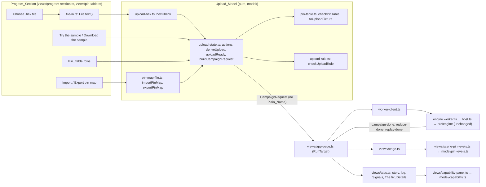
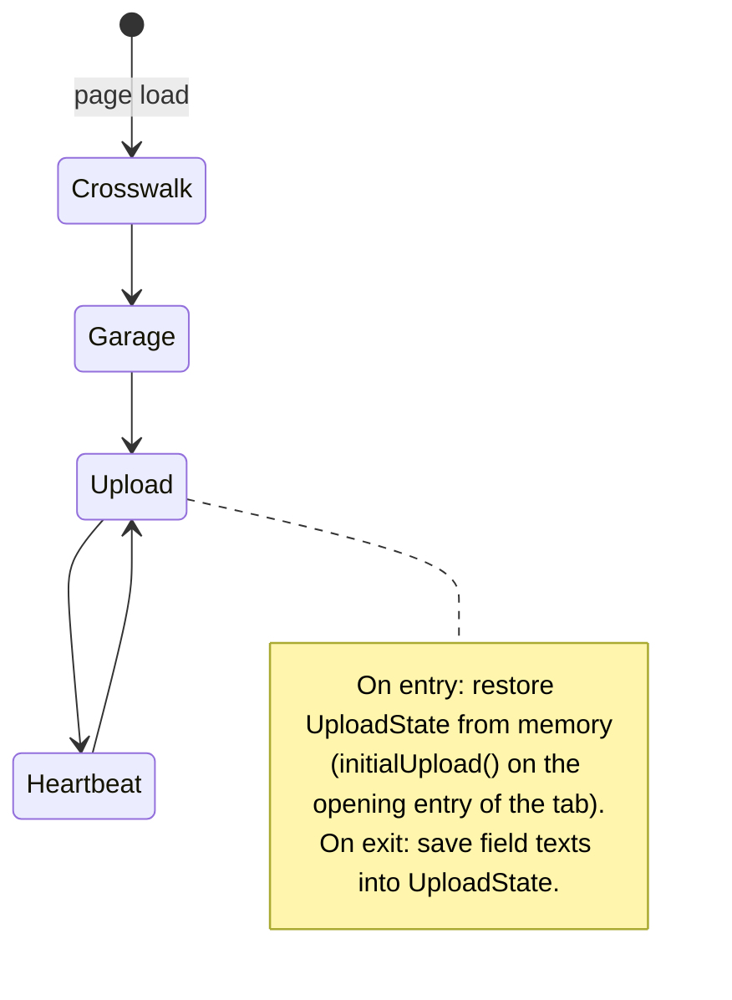

# Design Document: bench-ui-upload

## Decisions (approved)

The user approved these choices. Requirements, design and tasks follow them.

Facts measured for this design. A temporary `tsx` script ran the Worker_Host job functions (`runCampaignJob`, `runReductionJob`, `runReplayJob`) on the bundled files and was deleted afterwards. They are evidence about today's code, not proof that the final tests pass.

| Setup | Gremlin order | Run length (cycles) | Verdict | Reduction | Reduced replay fingerprint |
|---|---|---|---|---|---|
| garage buggy, garage pins and rule, 40 tries, seed 20261102 | bouncer, masher | 10,000,000 | BROKE, try 8 | 7 → 3 | `616062947f71a1ae` |
| same | masher, bouncer (catalogue order) | 10,000,000 | BROKE, try 1 | 9 → 3 | `616062947f71a1ae` |
| `serial_hello.ino.hex`, pins `LED` (PB5 output) + `BUTTON` (PD2 input, low), rule `LED is 1 must never last 500 ms or longer.`, masher, 24 tries, 16,000,000 cycles, seed 20261100 | masher | 16,000,000 | COULDN'T TELL: "The program uses the serial port (USART0), which this emulator setup does not model, so the rule cannot be checked." | none | none |
| `serial_hello.ino.with_bootloader.hex` through `hexToProgMem` | | | `invalid-hex`, "unknown record type 0x04" | | |

- **Q1 Run length.** The Run_Length_Field takes whole milliseconds, 1 to 60,000; `runCycles` = ms × 16,000. Default 1,000 ms. A2 uses 625 ms (10,000,000 cycles, written "0.6 s").
- **Q2 Analog pins.** `importPinMap` rejects any analog pin with one import error (Requirement 7.13). There is no analog row type and no analog branch anywhere in the Upload_Model or the views.
- **Q3 A3 map.** `LED` (port B, bit 5, output) and `BUTTON` (port D, bit 2, input, Pressed level Low); rule `LED is 1 must never last 500 ms or longer.`; Masher; Upload_Defaults. Measured: COULDN'T TELL naming the serial port.
- **Q4 Upload_Card border.** A solid 1 px border like the other cards. `docs/stage-design.md` does not change and `app.css` gets no dashed rule or note.
- **Q5 Bootloader HEX.** No engine change. "unknown record type 0x04" maps to "This looks like the .hex with a bootloader. Use the plain .hex instead."
- **Q6 Modelled list.** The three items of Requirement 14.2, nothing added.
- **Q7 Sample plain names.** "Try the sample" fills Plain_Names from the Friendly_Label table. "Download the sample" gives the bundled `fixture.json` text unchanged.
- **Q8 Story wording.** Uploads keep "changed <Display_Name>" and "changed it", also in the Move_Strip.
- **Q9 Default gremlin.** Masher is preselected when Compatible, until the user toggles a chip, loads the sample, or Requirement 9.2 removes Masher (D3).
- **Q10 Device grid.** 4 columns above 768 px, 2 × 2 at 768 px and below, for every device. This also changes the Examples' grid (4 columns from 769 to 899 px, 2 columns at 430 px and below).
- **Q11 Gremlin order.** `gremlinSet` always lists the selected gremlins in `GREMLIN_CATALOGUE` order (masher, bouncer, stuck, dropout, spike, drifter), whatever order the chips were toggled in. The Technical_View Details tab shows "Gremlin order: <names>" (Requirement 9.10). A2 asserts only fingerprint `616062947f71a1ae`. "Broke on try 1 of 40" and 9 → 3, as measured, are accepted for A2 and not asserted.
- **D1 No engine change.** Nothing under `src/engine/`, `examples/` or `fixtures/` changes.
- **D2 Rule compile.** The rule check compiles the rule text against the Upload_Fixture of the rows that have no pin-level Row_Error. The unmapped-signal check (Requirement 8.7) compares against every row's Signal_Name. Compiling against the whole table would add "Fixture: rejected with kind invalid-fixture." while a row is invalid.
- **D3 Masher preselection.** The preselection ends when Requirement 9.2 removes Masher, so Masher is not selected again automatically.
- **D4 Stage reset.** On the Upload_Device, any change to the Loaded_Program, Pin_Table, rule text, gremlins, tries, seed or run length returns the Stage to idle (Requirement 11.7). The Examples keep today's behaviour.
- **D5 No "pin <number>" text.** Import errors say "Entry <n> of the pins list" and a remove button with no names is "Remove row <n>", because Requirement 16.6 counts "pin" plus digits as a board pin number. The analog import error of Requirement 7.13 follows the same form.
- **D6 Gremlin_Log.** The Technical_View Signal cell of an upload reads "<Plain_Name> (<Signal_Name>)" when the Plain_Name is not blank, else "<Signal_Name>".
- **D7 Export of invalid rows.** Export writes a row that shows a Row_Error with its values: an unset port as `""` and an unset bit as `null`. Importing such a file gives the import error for a bit that is not a whole number. Requirement 7.9 covers valid tables only.
- **D8 Unholdable fields.** On import, a field a Pin_Row cannot hold is one import error (Requirement 7.7): `kind` other than "digital"; `activeLevel` other than "low"/"high"; `restState` other than "released"; any `restLevel`; any `channel`.
- **Approved additions.** The 256 KB import cap, the unholdable-field import error, the `clockHz` check, the no-port/no-bit Row_Error, 40-character Plain_Names, the bootloader error and the grid breakpoints.

## Overview

The App gets a fourth device, "Your own program". A visitor loads a compiled ATmega328P `.hex`, fills a pin table, writes a rule, picks gremlins and presses "Unleash gremlins". The run uses the existing Engine_Worker jobs (`campaign`, `reduce`, `replay`, `display-replay`) unchanged: they already take `{ hex, fixture, ruleSet, ... }` (`src/ui/app/worker/messages.ts`). The Stage shows a Pin_Levels_View in place of an illustrated Scene. A Capability_Panel in the Details tab, shown for every device, says what the checker models and what it does not.

The work is UI-only:

- New pure models under `src/ui/app/model/` (the Upload_Model, the Pin_Levels_View state, the Capability_Panel content, signal labels).
- New views under `src/ui/app/views/` and small, additive changes to existing views.
- New Node tests under `tests/ui/`.

The three Examples keep their Stage, Tabs, Player, Move_Strip, Shrink_View and verdict cards. Every changed shared function gets an optional parameter whose default gives today's output, so each Example call keeps its exact text.

Existing code this design builds on (read for this design):

| Code | Fact used |
|---|---|
| `hexToProgMem` (`src/engine/hex-parser.ts`) | Returns `{ kind: "invalid-hex", message }` with nine message forms (table in Hex_Check below). Never throws. No size check. |
| `validateFixture` (`src/engine/fixture.ts`) | Returns only the earliest error. Order: `clockHz`, each pin in order (digital: port, then bit, then `activeLevel`, then `restState`; analog: channel, duplicate channel, `restLevel`, `direction`, `activeLevel`, `restState`), then the analog/port C conflict. The bit error has no `signal` field. |
| `isSignalName` (`src/engine/rules/ir.ts`) | `^[A-Za-z][A-Za-z0-9_]{0,31}$`, not all/any, not a blocked word, any case. |
| `compileRuleSet` (`src/engine/rules/compile.ts`) | Calls `validateFixture` and returns "Fixture: rejected with kind <k>." on a bad fixture; accepts rules that name signals missing from the fixture. |
| `generateWithPrng` (`src/engine/event-list.ts`) | Draws from one PRNG per run in `gremlinSet` order. |
| `orderedSelection` (`views/app-page.ts`) | Examples: `meta.gremlinSet` order, then catalogue order. |
| Message_Codec `fixture` schema (`worker/codec.ts`) | Checks only `pins[i].signal` and copies the rest as JSON, so it would carry a `plainName` field. The design strips it before any request is built. |
| `UNMODELLED_PERIPHERALS` (`src/engine/peripherals.ts`) | 16 frozen rows with `plainName`, in reason tie order. |
| rule-checker floating reason | `input <S> was read while floating` when S passes `isSignalName`, else `an input was read while floating`. |
| `views/details.ts` | Uses `localStorage` for the Details_Switch. It is left unchanged and kept out of the Upload_Code_Paths. |
| `tests/ui/copy-scan.test.ts` | Pins `FRIENDLY_LABELS` at 13 entries and `PLAIN_STORY_LABELS` at 24 strings. Neither table changes. |
| `scripts/guard.mjs` | Scans `src/ui`, `docs`, `index.html` and README for claim words, and `src/engine` for clocks, network and entropy. |

## Architecture



### How the Upload_Device fits the existing flow

`views/app-page.ts` holds today an `ExampleBundle` in its `RunContext` and reads `c.example.buggyHex`, `c.example.fixture` and `c.example.meta.runCycles` in every job. The design adds one indirection, a `RunTarget`, and routes every job through it:

```ts
type DeviceId = ExampleId | "upload";

/** What every job of one Campaign uses. Built when "Unleash gremlins" is pressed and never changed after. */
interface RunTarget {
  device: DeviceId;
  /** The Example's buggy HEX, or the Loaded_Program text. */
  hex: string;
  /** The Example's fixed HEX; null for the Upload_Device (no Fixed_Campaign, no fix view). */
  fixedHex: string | null;
  /** The Example's Fixture, or the Upload_Fixture. */
  fixture: Fixture;
  /** meta.runCycles, or Run_Length_Field ms × 16,000. */
  runCycles: number;
  /** Where signal names come from: the Example tables, or the Pin_Table snapshot. */
  labels: SignalLabels;
  /** The Example bundle (sketches, sentences, id); null for the Upload_Device. */
  example: ExampleBundle | null;
  /** Pin_Table snapshot for the Pin_Levels_View; empty for the Examples. */
  pinRows: readonly PinLevelRow[];
}
```

For an Example the `RunTarget` holds exactly the values the page reads today (`buggyHex`, `fixedHex`, `fixture`, `meta.runCycles`, `{ kind: "example" }`), so its requests are unchanged field for field. For the Upload_Device:

- `fixedHex` is null. `canSeeFix()` gains `ctx.target.fixedHex !== null`, so "See the fix work →" is never built or enabled, no Fixed_Campaign runs, and no fixed replay is posted (Requirement 12.1, 12.2).
- `copyFor` is replaced by `CUSTOM_COPY` (Requirement 8.9), `storyEndingFor` by the custom ending, `spanSentenceFor` by `SPAN_SENTENCE.custom` (Requirement 13.3), and the BROKE card gets `exampleId: null`, so `causeLine` is never called (Requirement 12.6).
- `limitMs` is null (no garage or I'm-alive scene).

Device state in the page:



- `currentDevice: DeviceId` replaces the `id === currentId` guard of `selectExample`. Selecting an Example calls today's `applyExample(id, loadExample(id))` unchanged, which sets the rule, gremlins, tries and seed from that Example's files (Requirement 1.5). Nothing is read from `UploadState`.
- Selecting the Upload_Card calls `applyUpload()`: `leaveFix()`, `clearOutputs()`, `ctx = null`, `stage.setDevice("upload")`, phase idle, the Program_Section is mounted in the setup, `setup.setUploadMode(true)`, the rule text, patterns, picker and fields are painted from `UploadState`. On the opening entry of a tab, `UploadState` is `initialUpload()` (Upload_Defaults, empty rule text, no rows, no program).
- Before leaving the Upload_Device, the page writes the tries and seed texts of the shared `controls()` view into `UploadState.fields` (new `ControlsView.texts()`), so that Requirement 1.6 restores even an invalid text.
- `UploadState` lives in one `let` of `mountApp`. It is never written to storage, the URL or a cookie (Requirement 2.4). A reload starts from `initialUpload()` again (Requirement 15.2, 15.3).

### Job sequence for an upload

Unchanged from the Examples except that no fixed-build job exists:

```mermaid
sequenceDiagram
  participant U as User
  participant A as app-page
  participant M as Upload_Model
  participant W as Engine_Worker
  U->>A: Unleash gremlins
  A->>M: uploadReady(state, busy) ; buildCampaignRequest(state)
  M-->>A: CampaignRequest (Upload_Fixture, catalogue-ordered gremlinSet, runCycles = ms × 16,000)
  A->>W: campaign
  W-->>A: campaign-progress* → campaign-done
  alt BROKE
    A->>W: reduce (same hex, fixture, ruleSet, runCycles)
    W-->>A: reduce-progress* → reduce-done
    A->>W: replay (Reduced_List) → display-replay (violationCycle = replay v)
    A->>W: replay (original list) → display-replay
  else HELD
    A->>W: replay (run 0, rebuilt with buildEventList) 
  else COULDN'T TELL
    Note over A: card only
  end
  Note over A: Stage shows Pin_Levels_View; no "See the fix work →"
```

## Components and Interfaces

### Files

New files (all TypeScript, all under `src/ui/app/`):

| File | Role | In Upload_Code_Paths | In determinism scan |
|---|---|---|---|
| `model/upload-copy.ts` | Every new upload string table and text function | yes | yes |
| `model/upload-hex.ts` | Hex_Check, size text | yes | yes |
| `model/pin-table.ts` | Pin_Row types, row edits, `checkPinTable`, `toUploadFixture`, `previewFixture` | yes | yes |
| `model/pin-map-file.ts` | `exportPinMap`, `importPinMap` | yes | yes |
| `model/upload-rule.ts` | `checkUploadRule`, `uploadPatterns` | yes | yes |
| `model/upload-fields.ts` | `checkRunLength`, `msToCycles`, `UPLOAD_DEFAULTS` | yes | yes |
| `model/upload-state.ts` | `UploadState`, actions, `deriveUpload`, `uploadReady`, `buildCampaignRequest`, `orderGremlins`, `uploadLabels` | yes | yes |
| `model/signal-labels.ts` | `SignalLabels`, `EXAMPLE_LABELS`, `labelOf`, `plainStoryTableFor`, `exactLabelsFor` | yes | yes |
| `model/pin-levels.ts` | `pinLevelRows`, `pinLevelsAt` | yes | yes |
| `model/capability.ts` | `CAPABILITY_COPY`, `notModelledList`, `floatingReasons`, `capabilityContent` | yes | yes |
| `data/upload-sample.ts` | The Sample, built from `CROSSWALK_TEXTS` (no new raw import), `sampleDownloads` | yes | yes |
| `views/program-section.ts` | HEX controls, sample buttons, Help_Line, Hex_Error lines, pin map buttons, import error, Pin_Table mount | yes | no |
| `views/pin-table.ts` | The Pin_Table DOM (table above 600 px, stacked cards at 600 px and below) | yes | no |
| `views/file-io.ts` | `readFileText(file)` with `File.text()`, `offerDownload(name, text, type)` with `Blob` and an object URL | yes | no |
| `views/run-length-field.ts` | The Run_Length_Field input and message | yes | no |
| `views/scene-pin-levels.ts` | Pin_Levels_View SVG and HTML labels | yes | yes |
| `views/capability-panel.ts` | Capability_Panel DOM | yes | no |
| `views/signal-label.ts` | `labelNode(signal, labels)`: a lane label from `SignalLabels` | yes | no |

Changed files (each change is additive; defaults keep Example output):

| File | Change |
|---|---|
| `views/app-page.ts` | `DeviceId`, `RunTarget`, `UploadState` wiring, `applyUpload`, upload branch of `unleash` and `refresh`; Capability_Panel updates. In Upload_Code_Paths. |
| `views/setup.ts` | Upload_Card (4th card, slot removed), `onDevice(DeviceId)`, `setSelectedDevice(DeviceId)`, `setProgramSection(node)`, `setUploadMode(on)`, summary title for the upload. In Upload_Code_Paths. |
| `views/stage.ts` | `setDevice(DeviceId)` (was `setExample`), `setPinRows(rows)`, upload scene in `makeScene`, `ShownReplay.ringSignals?` |
| `views/scene-chrome.ts` | Optional `badge` in `SceneChromeSpec` (default `STAGE_TEXT.illustrative`); `setLine` uses it |
| `views/aside.ts` | Optional `noFix` in `AsideState`: no "See the fix work →" button is built |
| `views/verdict-card.ts` | `StageBrokeInput.exampleId: ExampleId \| null`; null gives no Cause_Line |
| `views/tabs.ts` | `setNoFix(on)`, `setCapability(node)`, `setGremlinOrder(line)` (a techOnly line in the Details tab, Requirement 9.10), `ReplayTabData.labels?` for the Gremlin_Log |
| `views/timeline.ts` | `setFixture(fixture, labels?)` using `labelNode`; `setFixedOffered(on)` hides the "Fixed program" toggle |
| `views/picker.ts` | `setFixture(fixture, selected, labels?)` passes labels to `pickerTile` |
| `views/rule-box.ts` | `setResetShown(on)`, `setEditShown(on)` |
| `views/move-strip.ts` | `showMoves(list, fixture, start, v, labels?)` |
| `views/panels.ts` | `ControlsView.texts()` and `setTexts(runs, seed)` (raw field text) |
| `views/icons.ts` | `deviceArt("upload")`: rounded rectangle with an upward arrow |
| `model/plain-story.ts` | Optional `labels?: SignalLabels` argument (default `EXAMPLE_LABELS`) |
| `model/moves.ts` | `movePhrase(list, i, fixture, labels?)`, `reducedMoveLines(list, fixture, labels?)` |
| `model/strip.ts` | `stripPhrase(list, i, f, labels?)`, `stripDots(list, fixture, v?, labels?)` |
| `model/gremlin-picker.ts` | `pickerTile(def, fixture, labels?)` |
| `model/story-input.ts` | `exampleStoryInput({..., labels?})`: Story_Labels override |
| `app.css` | Upload card, Program_Section, Pin_Table, Pin_Levels_View, Capability_Panel styles; device grid breakpoints (Q10); removal of `.device-slot` |

No committed test file changes: no existing test imports `setup.ts`, the device grid or the slot, and the shared functions keep their signatures with optional additions.

`views/details.ts` and `views/worker-client.ts` do not change and are not Upload_Code_Paths (`details.ts` uses `localStorage` for the Details_Switch, which Requirement 15.4 keeps).

### Hex_Check (`model/upload-hex.ts`)

```ts
export const SIZE_LIMIT = 262_144;

export interface LoadedProgram {
  /** File.name exactly, or "crosswalk-buggy.hex" for the Sample. */
  name: string;
  /** The HEX text, byte for byte as read. */
  text: string;
  /** File.size, or the UTF-8 byte length of the Sample text. */
  bytes: number;
}

export interface HexError {
  /** The plain sentence shown in both views (Requirement 3). */
  text: string;
  /** hexToProgMem's message, shown under `text` in the Technical_View only; null for name, size and read errors. */
  parser: string | null;
}

export type HexCheckResult = { ok: true; program: LoadedProgram } | { ok: false; error: HexError };

/** Name and size checks only (3.1, 3.2), in that order. The view calls this before it reads the text (2.2). */
export function hexPreCheck(name: string, bytes: number): HexError | null;

/** 3.11: name, then size, then hexToProgMem. Exactly one result; never throws. */
export function hexCheck(name: string, bytes: number, text: string): HexCheckResult;

/** Total mapping of an invalid-hex message to its plain sentence (3.3 to 3.8, 3.12). */
export function hexErrorText(message: string): string;

/** "<n> bytes" below 1,024; else "<k> KB", k = bytes / 1,024 rounded half up to one decimal. */
export function sizeText(bytes: number): string;
```

Name check: `name.toLowerCase().endsWith(".hex")` on the ASCII-lowered name (`/[A-Z]/g` → lower; non-ASCII letters are left as they are). Size check: `bytes > SIZE_LIMIT`. `sizeText` uses integers only: tenths = ⌊(bytes × 10 + 512) / 1,024⌋, written `⌊t/10⌋.(t mod 10) KB`.

Mapping of every `invalid-hex` message form in `hex-parser.ts` (Requirement 3.10). The matcher tries the rows in this order and uses full-string regular expressions:

| # | Parser message form | Pattern | Hex_Error text |
|---|---|---|---|
| 1 | `empty HEX string` | `^empty HEX string$` | This file is empty. |
| 2 | `checksum mismatch at line N` | `^checksum mismatch at line (\d+)$` | Line N has a wrong checksum. The file may be damaged or cut short. |
| 3 | `line N is too short` | `^line (\d+) is too short$` | Line N is not a valid .hex record. |
| 4 | `line N is too short for declared byte count` | `^line (\d+) is too short for declared byte count$` | Line N is not a valid .hex record. |
| 5 | `unknown record type 0x04` | `^unknown record type 0x04$` | This looks like the .hex with a bootloader. Use the plain .hex instead. |
| 6 | `unknown record type 0x<XX>` (any other, `0xNaN` included) | `^unknown record type 0x` | This file is not a valid .hex file. |
| 7 | `line does not start with ':'` | exact | This file is not a valid .hex file. |
| 8 | `data after EOF record` | exact | This file is not a valid .hex file. |
| 9 | `missing EOF record` | exact | This file is not a valid .hex file. |
| 10 | `flash overflow: address 0x… exceeds 32767` | `^flash overflow:` | This program is bigger than the chip's 32 KB of program memory. |
| – | anything else | | This file is not a valid .hex file. (3.12) |

Other Hex_Errors: name check "This is not a .hex file. Choose the compiled .hex file for your program."; size check "This file is larger than 256 KB, too big to be a program for this chip."; a read failure (Requirement 2.9) "This file could not be read. Try choosing it again." The N in the text is the parser's own decimal digits, copied, so the line count rule of 3.4 is the parser's.

### Pin_Rows and Pin_Table validation (`model/pin-table.ts`)

```ts
export const MAX_PINS = 16;
export const PLAIN_NAME_MAX = 40;

export interface DigitalRow {
  kind: "digital";
  /** Row key for the DOM; a counter in UploadState. Not exported, not compared. */
  id: number;
  signal: string;
  plainName: string;
  /** "B" | "C" | "D" from the controls; any string from an import; "" while not chosen. */
  port: string;
  /** 0..7 from the controls; any integer from an import; null while not chosen. */
  bit: number | null;
  direction: "input" | "output";
  /** Kept on outputs too, but only written and compared for inputs. */
  pressed: "low" | "high";
}

/** Every Pin_Row is a DigitalRow. There is no analog row type: an analog pin is an import error (Requirement 7.13). */
export type PinRow = DigitalRow;

export interface PinTableCheck {
  /** One list per row, index-aligned with the rows, in the order of Requirement 6.14. */
  rowErrors: string[][];
  tableErrors: string[];
  /** Rows whose pin can go into a Fixture: no error of 6.2 to 6.7 and no 5.11 error. */
  pinValid: boolean[];
  ok: boolean;
}

export function newDigitalRow(id: number): DigitalRow; // blank names, no port, no bit, input, low (5.9)
export function setDirection(row: DigitalRow, d: "input" | "output"): DigitalRow; // output → input sets "low" (5.3)
export function displayName(row: PinRow): string; // Plain_Name unless blank (""), else Signal_Name
export function portBitText(port: string, bit: number): string; // "Port D, bit 2 (PD2)"
export function checkPinTable(rows: readonly PinRow[]): PinTableCheck;
/** The Fixture posted to the worker; null while checkPinTable(rows).ok is false. Never holds plainName. */
export function toUploadFixture(rows: readonly PinRow[]): Fixture | null;
/** A Fixture of every row, unchecked, for the picker, the rule patterns and the idle Pin_Levels_View. */
export function previewFixture(rows: readonly PinRow[]): Fixture;
/** The pins of rows with pinValid true, for the rule compile of D2. */
export function validSubsetFixture(rows: readonly PinRow[], check: PinTableCheck): Fixture;
```

"Blank" means the empty string. A Plain_Name made of spaces is not blank and is shown as typed.

`checkPinTable` works row by row, so that every row gets its own errors at once (Requirement 6.13), although `validateFixture` returns only its earliest error:

1. **Signal name (6.2).** `!isSignalName(row.signal)` (which also covers empty and whitespace) gives the 6.2 text.
2. **Duplicate signal (6.3).** Rows grouped by exact `signal`, blank excluded; each row of a group of two or more gets "Another pin already uses the signal name <S>."
3. **Duplicate port/bit (6.4).** Digital rows with `port !== ""` and `bit !== null`, grouped by the pair `port + ":" + bit`; each row of a group of two or more gets "Another pin already uses <Port_Bit_Text>."
4. **Port and bit not chosen (5.11).** A digital row with `port === ""` or `bit === null` gets "Choose a port and a bit for this pin." and skips steps 5 and 6.
5. **Per-pin `validateFixture` (6.5, 6.6, 6.7).** `validateFixture({ pins: [pin] })` for the row's own pin alone. This returns the row's earliest digital error, in the engine's order:
   - `unsupported-port` → "Port <P> is not on this chip's list. Use port B, C or D." with `<P>` = `error.port`.
   - `invalid-fixture` with message `Bit index <n> is out of range; must be 0–7` → "Bit <n> is out of range. Use a bit from 0 to 7." The error has no `signal`; it belongs to this row because only this row's pin was checked.
   - any other error → its `message` unchanged.
6. **(Not used.)** There is no analog row, so there is no analog channel check. The number stays so that later steps keep theirs.
7. **(Not used.)** The analog/port C conflict cannot occur without an analog row.
8. **Plain_Name length (6.10).** `[...row.plainName].length > 40` (Unicode code points) gives "Plain name can be at most 40 characters."
9. **Table errors.** No digital input row → "Add at least one input pin." (6.8). No digital output row → "Add at least one output pin." (6.9). Zero rows give both.
10. **Whole-table backstop (6.7).** If every row is free of errors, `validateFixture({ pins })` on the whole fixture is called once more; any error it still returns becomes a Table_Error with its message. With steps 1 to 5 in place this does not happen for today's checks; it keeps the rule of 6.7 if the engine adds a check.

Each row's list is assembled in the order 6.2, 6.3, 6.4, 5.11 / 6.5 / 6.6 (one of them at most, port before bit as the engine checks), 6.10. `pinValid[i]` is true when row i has no error except the Plain_Name length error.

`toUploadFixture` maps, in table order: a digital input `{ signal, port, bit, direction: "input", activeLevel: pressed }`; a digital output `{ signal, port, bit, direction: "output" }`. No other field is ever written, so the posted Fixture never holds a Plain_Name (Requirements 7.12, 18.4). Every input carries `activeLevel`, and every Example `fixture.json` input carries `"activeLevel": "low"`, so an imported Example deep-equals its parsed file (Requirement 7.11).

### Pin_Map_File import and export (`model/pin-map-file.ts`)

```ts
/** The extra field that holds a Plain_Name in a Pin_Map_File. */
export const PLAIN_NAME_FIELD = "plainName";

/** JSON.stringify({ pins }, null, 2) + "\n", fields in a fixed order. */
export function exportPinMap(rows: readonly PinRow[]): string;

export type ImportResult =
  | { ok: true; rows: PinRow[]; nextId: number }
  | { ok: false; error: string };

/** Checks of Requirement 7.6 to 7.8 in a fixed order; the earliest failing check is the one error. */
export function importPinMap(text: string, bytes: number, firstId: number): ImportResult;
```

Why the Engine ignores `plainName`: it never receives it. `toUploadFixture` builds pin objects from a fixed field list, and the Upload_Model builds every request from `toUploadFixture`. The Message_Codec's `fixture` schema would copy an unknown field, so stripping happens before the request is built, not in the codec. The Examples' `fixture.json` files have no such field, and the Engine's `validateFixture` reads only its listed fields.

Export field order. Digital: `signal`, `port`, `bit`, `direction`, `activeLevel` (inputs only), `plainName` (only when not `""`). The object holds only `pins`. `JSON.stringify` is deterministic for the same object, so the same Pin_Table gives byte-identical Export_Text (7.3). Unset port and bit are written `""` and `null` (D7).

Import checks, in order (the earliest failure is the only error, 7.6 to 7.8). `<n>` is the 1-based index in `pins`, written "Entry <n> of the pins list" (D5):

| # | Check | Error text |
|---|---|---|
| 1 | `bytes <= SIZE_LIMIT` | This pin map file is larger than 256 KB. |
| 2 | `JSON.parse` succeeds | This file is not valid JSON. |
| 3 | top level is a plain object with an array `pins` | This file has no pins list. A pin map is an object with a "pins" array. |
| 4 | `clockHz` absent or exactly the number 16000000 | This pin map is for a clock other than 16 MHz. Hexorcist runs the chip at 16 MHz. |
| 5 | `pins.length <= 16` | This pin map has more than 16 pins. Hexorcist takes up to 16. |
| 5a | no entry has `kind` "analog" (Requirement 7.13) | Entry <n> of the pins list is an analog pin. Analog pins are not supported in the pin table. (<n> = 1-based number of the first analog entry) |
| 6 | each entry is a plain object with a string `signal` | Entry <n> of the pins list needs a signal name in quotes. |
| 7 | each entry has a string `port`, an integer `bit` and `direction` "input" or "output" | Entry <n> of the pins list needs a port letter, a whole-number bit and a direction of "input" or "output". |
| 8 | each `plainName` present is a string | Entry <n> of the pins list has a plain name that is not text. |
| 9 | each entry holds only fields a Pin_Row can hold (7.7, D8) | Entry <n> of the pins list (<signal>) has a field Hexorcist can't use here: <field>. |

Check 5a runs over the whole list before the per-entry checks, so an analog pin gives its own error even when an earlier entry has another problem; it changes nothing else (7.13). Every other entry is digital. Allowed fields: `signal`, `port`, `bit`, `direction`, `kind` = "digital", `activeLevel` ∈ {"low","high"} on an input, `restState` = "released", `plainName`. The field named in check 9 is the earliest offending key in the entry's own key order. Checks 6 to 9 run entry by entry (all checks of entry 1, then entry 2), so the earliest entry with a problem is reported. The clock check comes before the per-entry checks because it concerns the whole file.

On success each entry becomes a row in file order: digital `pressed` = `activeLevel ?? "low"` for inputs and "low" for outputs; `port` and `bit` copied as written (port "E" and bit 9 stay); `plainName` = the field's string or `""`. `restState: "released"` and `kind: "digital"` are accepted and not kept (they are the defaults). Row ids are `firstId`, `firstId + 1`, …

### Upload rule (`model/upload-rule.ts`)

```ts
export type UploadRuleCheck =
  | { ok: true; ruleSet: RuleSet; sentences: string[] }
  | { ok: false; errors: RuleError[] };

export function checkUploadRule(text: string, rows: readonly PinRow[], table: PinTableCheck): UploadRuleCheck;
export function uploadPatterns(rows: readonly PinRow[]): { form: RuleForm; sentence: string }[];
export const unmappedSignalText: (s: string) => string; // "Signal <S> is not in the pin table."
```

`checkUploadRule`:

1. `r = checkRuleBox(text, validSubsetFixture(rows, table))` (D2). This keeps today's empty-text error "Add at least one rule." (8.5), the count, length and grammar errors and their order (8.6).
2. If `r` has grammar errors (any error from `readRulesFile`), return them as they are.
3. Otherwise read the rule set (`readRulesFile(text)`; it succeeded) and walk the rules in order, and in each rule `ruleSignals(rule)` (`model/rules.ts`). For this grammar, `ruleSignals` lists signals in the left-to-right order of the sentence. Each distinct signal that is not exactly the `signal` of some row gives one `unmappedSignalText(s)` error, in that order, after any compile errors of `r` (8.7).
4. `ok` when there is no error.

`uploadPatterns(rows)` is `sentencePatterns(previewFixture(rows))`, unchanged, so the five patterns use the leading input's and output's names as typed and give none while there is no digital input or no output (8.2, 8.4).

### Upload fields (`model/upload-fields.ts`)

```ts
export const CYCLES_PER_MS = 16_000;
export const UPLOAD_DEFAULTS = { runs: 24, runLengthMs: 1000, seed: 20261100 } as const;
export const RUN_LENGTH_MESSAGE = "Run length must be a whole number of milliseconds from 1 to 60000.";
/** /^[0-9]+$/ and 1 ≤ value ≤ 60,000 (BigInt compare, as checkRuns does). */
export function checkRunLength(text: string): FieldCheck;
export function msToCycles(ms: number): number; // ms × 16,000, an integer ≤ 960,000,000
```

Tries and seed keep `checkRuns` and `checkSeed` (`model/fields.ts`, unchanged).

### Upload state and actions (`model/upload-state.ts`)

All functions are pure and return a new state. The page calls them; the acceptance tests call the same functions (Requirement 19.1).

```ts
export interface UploadState {
  program: LoadedProgram | null;
  hexError: HexError | null;
  /** Token of the file read in flight, or null (2.2, 2.5). */
  reading: number | null;
  nextToken: number;
  rows: PinRow[];
  nextRowId: number;
  importError: string | null;
  ruleText: string;
  /** Selected gremlin ids, any order; the request uses orderGremlins. */
  selected: string[];
  /** Q9 / D3: Masher is still preselected when it becomes Compatible. */
  autoMasher: boolean;
  fields: { runs: string; seed: string; runLengthMs: string };
  /** For the tries line while a field is invalid (9.9). */
  lastValid: { runs: number; runCycles: number };
}

export function initialUpload(): UploadState;

// File and sample
export function beginHexRead(s: UploadState): { state: UploadState; token: number };
export function hexChosen(s: UploadState, token: number, result: HexCheckResult): UploadState; // stale token: s unchanged
export function hexReadFailed(s: UploadState, token: number): UploadState;
export function loadSample(s: UploadState): UploadState;

// Pin_Table
export function addRow(s: UploadState): UploadState;          // no-op at MAX_PINS
export function removeRow(s: UploadState, id: number): UploadState;
export function editRow(s: UploadState, id: number, patch: RowPatch): UploadState;
export function importPins(s: UploadState, text: string, bytes: number): UploadState;

// Rule, gremlins, fields
export function setRuleText(s: UploadState, text: string): UploadState;
export function toggleGremlin(s: UploadState, id: string): UploadState;
export function setField(s: UploadState, key: "runs" | "seed" | "runLengthMs", text: string): UploadState;

// Derived
export interface UploadDerived {
  table: PinTableCheck;
  rule: UploadRuleCheck;
  patterns: { form: RuleForm; sentence: string }[];
  previewFixture: Fixture;
  uploadFixture: Fixture | null;
  runs: FieldCheck; seed: FieldCheck; runLength: FieldCheck;
  triesLine: string;
}
export function deriveUpload(s: UploadState): UploadDerived;
export function uploadReady(s: UploadState, busy: boolean): boolean;
export function buildCampaignRequest(s: UploadState): Omit<CampaignRequest, "jobId"> | null;
export function orderGremlins(ids: readonly string[]): GremlinSpec[];
/** "Gremlin order: Masher, Bouncer": display names in the order of the request's gremlinSet; null when none are selected (9.10). */
export function gremlinOrderLine(ids: readonly string[]): string | null;
export function uploadLabels(rows: readonly PinRow[]): SignalLabels;
```

Rules inside the actions:

- **Every table change** (`addRow`, `removeRow`, `editRow`, `importPins` on success, `loadSample`) ends with `pruneGremlins`: remove each selected id whose `isCompatible(def, previewFixture(rows))` is false (9.2). If Masher is removed this way, `autoMasher` becomes false (D3). Then, if `autoMasher` is still true and Masher is Compatible, `selected = ["masher"]` (9.3).
- `toggleGremlin` sets `autoMasher` false. `loadSample` sets it false and `selected = ["masher"]`.
- `hexChosen` with a pass replaces `program` and clears `hexError`; with a failure sets `hexError` and `program = null` (2.3, 2.6). Rows, rule, gremlins and fields are untouched in both cases. A token other than `reading` leaves the state as it is, so only the file chosen last applies (2.2).
- `importPins` on failure sets `importError` and changes nothing else (7.6); on success replaces `rows` and clears `importError` (7.5).
- `editRow` with `direction` uses `setDirection` (5.3).
- `setField` updates `lastValid` when the new text passes its check.
- `loadSample` sets: program = `{ name: "crosswalk-buggy.hex", text, bytes: utf8Length(text) }`, `hexError` null, rows from the parsed crosswalk fixture with Friendly_Label plain names (Q7), `ruleText` = `rules.txt` text, `selected` = ["masher"], fields = "24", "20261101", "1000", `importError` null (4.2, 4.3, 4.6). `utf8Length` uses `new TextEncoder().encode(text).length`.

`uploadReady(s, busy)` (Upload_Ready) is true when all hold: `program !== null`, `reading === null`, `table.ok`, `rule.ok`, `selected.length > 0`, the three fields pass, and `!busy`.

`buildCampaignRequest(s)` returns null unless `uploadReady(s, false)`; else:

```ts
{
  kind: "campaign",
  hex: s.program.text,
  fixture: toUploadFixture(s.rows),          // no plainName
  ruleSet: rule.ruleSet,
  gremlinSet: orderGremlins(s.selected),     // catalogue order (Q11), each { id }
  campaignSeed: seed.value,
  runs: runs.value,
  runCycles: msToCycles(runLength.value),
  measure: false,
}
```

The top-level fields are exactly those of the Examples' campaign request (18.4). The page snapshots `uploadLabels(s.rows)` and `pinLevelRows(s.rows)` into the `RunTarget` at the same moment (13.6).

### Signal labels (`model/signal-labels.ts`)

```ts
export type SignalLabels =
  | { kind: "example" }
  | { kind: "upload"; /** Signal_Name → Plain_Name ("" when blank) */ names: Readonly<Record<string, string>> };

export const EXAMPLE_LABELS: SignalLabels = { kind: "example" };

/** Example: friendlyLabel(signal). Upload: { text: Display_Name, known: plainName !== "" }; a signal with no row keeps its name. */
export function labelOf(labels: SignalLabels, signal: string): { text: string; known: boolean };
/** Example: PLAIN_STORY_LABELS. Upload: {} (Q8). */
export function plainStoryTableFor(labels: SignalLabels): Readonly<Record<string, PlainStoryLabel>>;
/** Example: storyLabelsFor(fixture). Upload: {}. */
export function exactLabelsFor(labels: SignalLabels, fixture: Fixture): Record<string, StoryLabel>;
```

The minimal change to the story code: `plainStory`, `movePhrase` and `stripPhrase` replace their direct reads of `PLAIN_STORY_LABELS` and `friendlyLabel` with `plainStoryTableFor(labels)` and `labelOf(labels, …)`, where `labels` defaults to `EXAMPLE_LABELS`. With the default the code path and every string are what they are today. For an upload, the empty story table sends every move through the existing unlabelled branch ("changed <name>" / "changed it", 13.2), and `labelOf` never reads `FRIENDLY_LABELS` (13.1), so a row named `REQUEST` with a blank Plain_Name is written "REQUEST". `stripPhrase` with upload labels returns "changed <Display_Name>" (Q8). `pickerTile` names its targets with `labelOf`. `exampleStoryInput` takes `exactLabelsFor`, so the Technical_View Exact_Story of an upload uses signal names only.

Lanes and logs: `views/signal-label.ts` exports `labelNode(signal, labels)`, which calls today's `signalLabel` for `{ kind: "example" }` and otherwise builds the same markup from `labelOf`: the Display_Name, then the Signal_Name in a `techOnly` `<code>` only when `known` is true. So the Plain_View shows the Display_Name only and the Technical_View shows the Signal_Name beside it, once (13.4, 13.5). The Technical_View Gremlin_Log follows D6.

### Pin_Levels_View (`model/pin-levels.ts`, `views/scene-pin-levels.ts`)

```ts
export interface PinLevelRow {
  signal: string;
  name: string; // Display_Name
  role: "input" | "output";
  pressed: "low" | "high"; // inputs; ignored otherwise
}

export interface PinLevelsReplay {
  events: readonly ReducerEvent[];
  outputEdges: readonly OutputEvent[];
  /** Break cycle; null when the replay holds no violation (HELD). */
  v: number | null;
  /** Outputs named by the Target_Rule (ruleSignals of the violated rule ∩ output rows). */
  ringSignals: readonly string[];
}

export interface PinLevelsState {
  waiting: boolean;
  inputs: { signal: string; name: string; state: "pressed" | "not pressed" | null; gremlinId: string | null }[];
  outputs: { signal: string; name: string; lit: boolean; notDriven: boolean; ring: boolean }[];
  /** Plain text for assistive technology and the phone line. */
  summary: string;
}

export function pinLevelRows(rows: readonly PinRow[]): PinLevelRow[];
export function pinLevelsAt(rows: readonly PinLevelRow[], replay: PinLevelsReplay | null, cursor: number): PinLevelsState;
```

`pinLevelsAt` rules, all with integer cycles:

- Latest event of a signal at or before the Cursor: highest `cycle ≤ cursor`; on equal cycles the later list entry wins (the rule of `inputLevelAt` and `levelAt` in `model/timeline.ts`).
- Digital input: "pressed" when that event has `value` equal to 0 (Pressed_Level low) or 1 (high); "not pressed" for the other level, `"release"`, or no event. `gremlinId` is the event's id when the event exists, its value is not `"release"` and its id is not `"rest"`; else null (11.3, 11.4).
- Output: `lit` when the latest edge has value 1; `notDriven` when it has value `"input"` or no edge exists (11.5).
- `ring` = `replay.v !== null && cursor >= replay.v && ringSignals.includes(signal)` (11.6).
- `replay === null` gives `waiting: true`, every input "not pressed" with no icon, every output off and not driven (11.7).

The function reads only its arguments: no clock, no random source, no emulator (11.8).

The view (`createPinLevelsScene()`) has the same `{ node, frame, update(edges, events, cursor, opts) }` shape the Stage's `makeScene` expects, plus `setRows(rows)`. Layout in the 830 × 460 viewBox: inputs in the left column, outputs in the right column, each column holding up to 16 rows at a row pitch of ⌊420 / max(n, 1)⌋ capped at 52 units, top margin 20. Each input row draws a small switch shape (SVG) that sits down when pressed; each output row draws a lamp circle, filled when lit, hollow and dashed when not driven; the coral ring is a circle around the lamp (class `conflict-ring`, the class the crosswalk Scene uses). Every text (Display_Name, "pressed" / "not pressed", "not driven", the badge) is an HTML `SceneLabel` laid over the art by `createChrome` (11.9). The gremlin icon is today's `gremlinIcon(iconName)` in an HTML label beside the input. The card is created with `createChrome({ ..., badge: PIN_LEVELS_TEXT.badge })`, which puts "Pin levels" where the Examples show "Illustrative" (11.2). At Phone_Width the chrome's existing rule hides the overlay labels and shows one line under the card: `summary` (for example "Walk button: pressed · Car light: green: off"). SVG `width: 100%; height: auto` keeps the aspect ratio.

Stage wiring: `makeScene("upload")` returns this scene; `stage.setDevice(id)` replaces `setExample`; `stage.setPinRows(rows)` forwards to the scene and redraws it with `replay = null`. `showIdle`, `showRunning`, `showShrinking`, `showNote` and `showReduceError` keep their look rules (60% while idle, as the Examples), and for the upload scene they redraw with `replay = null` so that no old lamp stays lit. `drawScene` passes `{ v: s.v finite ? s.v : null, ringSignals: s.ringSignals ?? [] }` from `ShownReplay`; `showHeld` passes `v = +∞`, which the Stage maps to null.

### No fixed build for uploads

| Place | Example behaviour (kept) | Upload behaviour |
|---|---|---|
| Aside | Button "See the fix work →" after a reduction result | `aside.render({ ..., noFix: true })` builds no button (12.1) |
| `canSeeFix()` | as today | also requires `ctx.target.fixedHex !== null` (12.2) |
| BROKE card | `causeLine(exampleId, fp)` | `exampleId: null` → no Cause_Line, also for `47078989121ebc1d` (12.6, 13.7) |
| "The fix" tab | `setFixChange(id \| null)` | `tabs.setNoFix(true)`: the panel shows only "Your own program has no fixed version to compare." (12.4) |
| Signals tab | "Fixed program" toggle | `timeline.setFixedOffered(false)` hides it (12.5) |
| Setup rule row | "Why it matters", "Change rule ▾", preset line | hidden by `setup.setUploadMode(true)`; no reset button (8.1, 12.7) |

`applyUpload` calls `leaveFix()`, so an open Fix_View closes when the Upload_Card is chosen (12.3). The Example-specific strings of 12.7 are only reachable through `example !== null` paths, so they cannot show.

### Capability_Panel (`model/capability.ts`, `views/capability-panel.ts`)

```ts
export const CAPABILITY_COPY: {
  title: "What Hexorcist can and can't check";
  modelledHeading: "Modelled";
  modelled: readonly ["digital pins on ports B, C, D", "timers 0–2", "the CPU at 16 MHz (assumed)"];
  notModelledHeading: "Not modelled";
  notModelledLine: "A program that uses one of these gets COULDN'T TELL, naming the part.";
  analogLine: "The analog input path is unit-tested only.";
  orderHeading: "How the result is chosen";
  order: readonly [string, string, string, string]; // 14.6, step 4 ends with the exact HELD text with "N"
  openWindowLine: "A rule window still open when a try ends is not judged.";
  scenesLine: "\"Illustrative\" scenes are drawings driven by real outputs; \"Pin levels\" shows real pin levels only.";
  floatingHeading: "Inputs read with no pull-up";
};

/** UNMODELLED_PERIPHERALS.map((r) => r.plainName), read at call time. */
export function notModelledList(table?: readonly PeripheralRow[]): string[];

/** Distinct floating-input reasons in the shown verdict, in order of appearance. */
export function floatingReasons(v: Verdict | null): { signal: string | null; text: string }[];

export function capabilityContent(args: {
  verdict: Verdict | null;
  labels: SignalLabels;
  table?: readonly PeripheralRow[];
}): { title: string; modelled: string[]; notModelled: string[]; lines: string[]; order: string[]; floating: string[] | null };
```

The four steps of `order`:

1. "A part that is not modelled was used (in the try that broke, at or before the break, or in any try when none broke): COULDN'T TELL."
2. "Otherwise, a broken rule: BROKE, showing the lowest-numbered try that broke."
3. "Otherwise, a rule that could not be checked, a signal not mapped to a pin, a try that did not finish, or no gremlin move in any try: COULDN'T TELL."
4. "Otherwise: HELD. No violation found in N emulated runs of this gremlin set. Not a proof."

`floatingReasons` reads `verdict.unchecked[].reason` for BROKE, or the `reason` text for COULDN'T TELL, and finds every match of `/input ([A-Za-z][A-Za-z0-9_]*) was read while floating|an input was read while floating/g` (the signal part is the `isSignalName` pattern without the word checks, which the rule-checker has already applied). Entries are made distinct by their matched text. For each entry with a signal, the shown name is `labelOf(labels, signal).text`; for the Examples that is the Friendly_Label or the signal, for an upload the Display_Name from the snapshot (14.10). The bare reason gives the entry "an input was read while floating". `floating` is null when there are no entries or no verdict (14.11).

The panel is mounted at the end of the Details tab for every device (`tabs.setCapability(node)`) and is not marked tech or plain, so it shows in both views (14.1). `app-page.ts` calls `panel.update({ verdict, labels })` when a Campaign ends (the buggy Campaign only) and with `verdict: null` on `clearOutputs()`. `notModelledList()` is called on each render, so a test that passes a changed table gets the changed list, and no `plainName` is copied into `src/ui/app/` (14.4).

### Copy (`model/upload-copy.ts`)

All new upload strings live in one module, scanned by `tests/ui/upload-copy-scan.test.ts`:

```ts
export const UPLOAD_COPY = {
  cardTitle: "Your own program",
  cardLine: "Load a compiled .hex for this chip and map its pins.",
  sectionTitle: "Program and pins",
  chooseHex: "Choose .hex file",
  helpLine: "Compile for an ATmega328P at 16 MHz and use the plain .hex, not the one with a bootloader. Other clock speeds give wrong timings.",
  trySample: "Try the sample",
  downloadSample: "Download the sample",
  loadedPrefix: "Loaded: ",
  addPin: "Add pin",
  importPins: "Import pin map",
  exportPins: "Export pin map",
  columns: { signal: "Signal name", plain: "Plain name", port: "Port", bit: "Bit", direction: "Direction", pressed: "Pressed level" },
  directions: { input: "Input", output: "Output" },
  pressedLevels: { low: "Low (button to ground)", high: "High" },
  removeNamed: "Remove {name}",
  removeRow: "Remove row {n}",
  noFix: "Your own program has no fixed version to compare.",
  exportFileName: "pin-map.json",
  gremlinOrder: "Gremlin order: {names}",
} as const;

export const HEX_ERROR_TEXT = { notHex, tooBig, empty, checksum(n), badRecord(n), bootloader, invalid, overflow, unreadable };
export const ROW_ERROR_TEXT = { signalName, duplicateSignal(s), duplicatePortBit(t), noPortBit, port(p), bit(n), plainTooLong };
export const TABLE_ERROR_TEXT = { noInput: "Add at least one input pin.", noOutput: "Add at least one output pin." };
export const IMPORT_ERROR_TEXT = { tooBig, notJson, noPins, clock, tooMany, analog(n), entrySignal(n), entryDigital(n), entryPlainName(n), entryField(n, signal, field) };
export const PIN_LEVELS_TEXT = { badge: "Pin levels", pressed: "pressed", notPressed: "not pressed", notDriven: "not driven", on: "on", off: "off" };
export const UNMAPPED_SIGNAL_TEXT = (s: string) => `Signal ${s} is not in the pin table.`;
```

`RUN_LENGTH_MESSAGE` lives in `model/upload-fields.ts`; `CAPABILITY_COPY` in `model/capability.ts`. The Pin_Levels_View idle texts reuse `STAGE_TEXT.idleTitle` and `STAGE_TEXT.idleLine`, which are the strings of Requirement 11.7. No string names a board brand, a board pin label or a claim word; Requirement 16 lists the checks.

### Views

**Upload_Card** (`setup.ts`). A fourth `button.device-card` with `data-device="upload"`, `aria-pressed`, `deviceArt("upload")` (a rounded rectangle and an upward arrow from the mockup, `aria-hidden="true"`, no text), the title and line. The empty `.device-slot` element is removed. CSS: no rule of its own while unselected (the shared 1 px solid border applies, Q4); selected, it gets the shared 2 px pumpkin edge. Busy disables it as every card (1.8).

**Program_Section** (`program-section.ts`). Mounted by `setup.setProgramSection(node)` between section 1 and the rule/gremlin columns. Contents, in order: section title; the HEX row (visually hidden `<input type="file" accept=".hex" id="hex-file">` with a `<label for="hex-file">Choose .hex file</label>` styled as a secondary button; the input stays focusable and its `:focus-visible` ring is drawn on the label), the loaded line "<name> · <size text>", the Hex_Error (`role="alert"`), and in a `techOnly` line the parser message; the Help_Line; the two sample buttons; the Pin_Table; the row with "Add pin", "Import pin map" (same hidden-input pattern, `accept=".json"`) and "Export pin map"; the import error. The view holds no state; it calls back into the page with `onHexFile(file)`, `onSample()`, `onDownloadSample()`, `onImport(file)`, `onExport()`, `onAddRow()`, `onRemoveRow(id)`, `onEditRow(id, patch)`, and paints from `paint(state, derived, busy)`. After each `change` the input's `value` is reset to `""`, so choosing the same file again fires `change` (2.2); a `change` with no file does nothing (2.10). Exactly two file inputs exist (15.6).

**File reading** (`file-io.ts`). `readFileText(file): Promise<string>` calls `file.text()` (17.6). The page: `pre = hexPreCheck(file.name, file.size)`; if `pre` is an error, apply it at once with a new token; else `beginHexRead`, then `await readFileText(file)` and `hexChosen(state, token, hexCheck(file.name, file.size, text))`, or `hexReadFailed` on a rejected promise. `offerDownload(name, text, type)` makes `new Blob([text], { type })`, an object URL, a temporary `<a download>`, clicks it, and revokes the URL. "Download the sample" calls it twice ("crosswalk-buggy.hex", "crosswalk-pins.json"); "Export pin map" once with `UPLOAD_COPY.exportFileName`.

**Pin_Table** (`pin-table.ts`). Above 600 px: `<table>` with one header row (the six column names plus an unlabelled remove column) and one `<tr>` per row. At 600 px and below the same DOM switches by CSS to stacked cards: each cell carries a `<label>` with its column name, visually hidden on wide screens and shown on cards (5.6). Port and Bit are `<select>`s with B/C/D and 0–7; when the row holds an imported value outside the list, that value is added as the selected extra option, so it shows unchanged (5.1). The Port_Bit_Text sits after the Bit control when both are set. Pressed level shows only for digital inputs (5.2). Row_Errors are listed under their row, Table_Errors under the table, both `aria-live="polite"`. The remove button's accessible name is `Remove <Display_Name>`, or `Remove row <n>` when both names are blank (5.4, D5). Text inputs fire `onEditRow` on `input`; the table is repainted in place by row id so the focused input keeps focus.

**Gremlin order line** (`tabs.ts`). While the Upload_Device is selected, the Technical_View is shown and `gremlinOrderLine(selected)` is not null, the page calls `tabs.setGremlinOrder(line)`; otherwise it calls it with null. The line is `techOnly`, so the Plain_View shows none (9.10).

**Run_Length_Field** (`run-length-field.ts`). A `<label for>` "Run length in ms", an input, and a message line; mounted next to `controls()` in the Details tab fields host (tech only) while the Upload_Device is selected.

**Rule area.** `setup.setUploadMode(true)` removes the `data-detail` mark from `rules.node` (so it shows in both views), opens the editor, hides "Edit rule", the reset button, the rule row's "Why it matters", "Change rule ▾", the "no number" line and the preset menu. `setUploadMode(false)` restores today's marks with `markDetail(rules.node, "tech")`. While busy, the Rule_Box is read-only and the Insert buttons are disabled, as today (8.8).

## Data Models

| Model | Shape | Where |
|---|---|---|
| `LoadedProgram` | `{ name, text, bytes }` | `upload-hex.ts`; memory only |
| `HexError` | `{ text, parser }` | `upload-hex.ts` |
| `PinRow` | `DigitalRow` | `pin-table.ts` |
| `PinTableCheck` | `{ rowErrors, tableErrors, pinValid, ok }` | `pin-table.ts` |
| Pin_Map_File | `{ "pins": [ { signal, port, bit, direction, activeLevel?, plainName? } ] }`, optional `clockHz` = 16000000 on import | `pin-map-file.ts` |
| Upload_Fixture | `Fixture` with `DigitalFixturePin` fields only | `toUploadFixture` |
| `UploadState` | see above | `upload-state.ts`; one per tab, in memory |
| `SignalLabels` | `{ kind: "example" } \| { kind: "upload", names }` | `signal-labels.ts` |
| `PinLevelRow`, `PinLevelsState` | see above | `pin-levels.ts` |
| Campaign request | `Omit<CampaignRequest, "jobId">`: `kind, hex, fixture, ruleSet, gremlinSet, campaignSeed, runs, runCycles, measure` | `buildCampaignRequest` |

Example Export_Text for the Sample's table after "Try the sample" (Plain_Names from Q7):

```json
{
  "pins": [
    {
      "signal": "REQUEST",
      "port": "D",
      "bit": 2,
      "direction": "input",
      "activeLevel": "low",
      "plainName": "Walk button"
    },
    {
      "signal": "CAR_GREEN",
      "port": "B",
      "bit": 0,
      "direction": "output",
      "plainName": "Car light: green"
    }
  ]
}
```

(The real export lists all six rows; two are shown.)

## Correctness Properties

*A property is a characteristic or behavior that should hold true across all valid executions of a system-essentially, a formal statement about what the system should do. Properties serve as the bridge between human-readable specifications and machine-verifiable correctness guarantees.*

This feature suits property-based testing in the Upload_Model, the Pin_Levels_View state, the signal labels and the Capability_Panel content: they are pure functions over large input spaces (file names, HEX texts, pin tables, event lists, action sequences). DOM wiring, layout and the look of the page are covered by source tests and the browser checklist instead. Passing property runs are evidence, not proof.

Reflection on the prework: the per-criterion checks of Requirement 6 (6.2 to 6.10, 6.13, 6.14, 5.11) are one reference-model property plus one locality property; readiness criteria scattered over Requirements 2, 6, 8, 9 and 10 are one property; the request criteria (5.2, 7.12, 10.1, 18.4, 18.5) are one property; the Hex_Check criteria 3.1 to 3.12 are one property; the two halves of Requirement 9 selection rules are one action-sequence property. The remove-button name (5.4) and the cause line gate for uploads (12.6) have one output each and are unit tests.

### Property 1: Hex_Check is total and ordered

*For any* file name, byte size and text, `hexCheck(name, bytes, text)` returns exactly one result, equal to the reference: when the ASCII-lowered name does not end in ".hex", the not-a-hex error with `parser` null; else when `bytes > 262,144`, the too-big error with `parser` null; else when `hexToProgMem(text)` returns an `invalid-hex` error with message m, an error with `parser === m` and `text === hexErrorText(m)`, which is one of the listed Hex_Error texts and, for the line-numbered forms, holds the parser's own digits; else a Loaded_Program whose name, text and byte size equal the inputs exactly.

**Validates: Requirements 3.1, 3.2, 3.3, 3.4, 3.5, 3.6, 3.7, 3.8, 3.9, 3.10, 3.11, 3.12, 16.8**

### Property 2: Size text

*For any* integer byte count from 0 to 2^31, `sizeText(b)` is "`b` bytes" when b < 1,024, and otherwise "`⌊t/10⌋`.`t mod 10` KB" with t = ⌊(10b + 512) / 1,024⌋, always with one digit after the point.

**Validates: Requirements 2.3**

### Property 3: The file chosen last wins, and file results touch nothing else

*For any* Upload state and any interleaving of `beginHexRead` calls with `hexChosen` / `hexReadFailed` results arriving in any order, the final `program` and `hexError` are those of the most recently begun read if it has finished (else the state before any of these results), a result for an older token changes nothing, and every result leaves `rows`, `ruleText`, `selected`, `fields` and `importError` equal to their values before it.

**Validates: Requirements 2.2, 2.3, 2.5, 2.6, 2.9**

### Property 4: Pin_Table errors match the reference, in order

*For any* list of 0 to 16 Pin_Rows drawn from a generator that mixes valid rows with invalid signal names, duplicate names (case variants included), duplicate port/bit pairs, unset port or bit, ports outside B/C/D, bits outside 0–7, and Plain_Names of 0 to 45 code points (astral characters included), `checkPinTable(rows)` equals a reference written from Requirement 6: each row's list holds exactly the applicable texts in the order 6.2, 6.3, 6.4, 5.11/6.5/6.6 (port before bit), 6.10; the table errors are exactly 6.8 and 6.9 as they apply; and `ok` is true exactly when every list is empty.

**Validates: Requirements 5.11, 6.1, 6.2, 6.3, 6.4, 6.5, 6.6, 6.7, 6.8, 6.9, 6.10, 6.13, 6.14**

### Property 5: Pin_Table errors are local to the rows involved

*For any* Pin_Table and any row r added to it that shares no non-blank Signal_Name and no port/bit pair with an existing row, the Row_Errors of every existing row are unchanged by adding r, and the Row_Errors of r equal those of r checked alone.

**Validates: Requirements 6.3, 6.4, 6.13**

### Property 6: Row edits change only what they name

*For any* Pin_Table: `addRow` appends exactly one default Digital_Row (blank names, no port, no bit, input, low) when the table has fewer than 16 rows and is a no-op at 16; `removeRow(id)` removes exactly the row with that id and keeps the others in order; `setDirection(row, "input")` on an output row gives Pressed_Level "low" whatever it held; and every other row is unchanged in all three.

**Validates: Requirements 5.3, 5.5, 5.9, 5.10**

### Property 7: Readiness

*For any* Upload state and busy flag, `uploadReady(state, busy)` is true exactly when a Loaded_Program exists, no read is in flight, the Pin_Table check is ok, the rule check is ok, at least one gremlin is selected, the tries, seed and run length texts pass their checks, and busy is false; and `buildCampaignRequest(state)` is null exactly when `uploadReady(state, false)` is false.

**Validates: Requirements 2.5, 6.11, 8.8, 9.6, 9.7, 9.8, 10.12**

### Property 8: The request holds the shown values and never a Plain_Name

*For any* ready Upload state, `buildCampaignRequest(state)` has exactly the top-level fields `kind, hex, fixture, ruleSet, gremlinSet, campaignSeed, runs, runCycles, measure`, with `hex` equal to the Loaded_Program text, `fixture` deep-equal to `toUploadFixture(rows)` (inputs carry `activeLevel` equal to their Pressed_Level, outputs carry none), `runCycles` = run length ms × 16,000 as an integer, `measure` false; no pin object holds `plainName`; the request survives `encodeMessage` then `decodeRequest` unchanged; and two states that differ only in Plain_Names give deep-equal requests.

**Validates: Requirements 5.2, 7.12, 10.1, 18.4, 18.5**

### Property 9: Gremlin order does not depend on toggle order

*For any* two sequences of `toggleGremlin` calls that end with the same set of selected gremlins, the requests built from the two states have identical `gremlinSet` arrays, listed in `GREMLIN_CATALOGUE` order, and `gremlinOrderLine` of the two states is the same text, listing those gremlins in that order.

**Validates: Requirements 9.10, 18.6**

### Property 10: Gremlin selection follows compatibility

*For any* sequence of Upload actions (row adds, removes, edits, imports, sample loads and gremlin toggles), after each action every selected gremlin is Compatible with `previewFixture(rows)`; Masher is selected by the preselection rule only while no toggle, no sample load and no compatibility removal of Masher has happened; and a gremlin removed for being incompatible is selected again only by a later toggle or sample load.

**Validates: Requirements 9.2, 9.3**

### Property 11: Pin map round trip

*For any* valid Pin_Table (2 to 16 rows, at least one input and one output, distinct Signal_Names that pass `isSignalName`, distinct port/bit pairs on B, C, D with bits 0–7, Plain_Names blank or 1 to 40 characters, any of them holding claim words or board pin labels as user text), `importPinMap(exportPinMap(rows))` succeeds and gives rows equal to the original, row for row, on Signal_Name, Plain_Name (exact string), port, bit, direction and, for inputs, Pressed_Level.

**Validates: Requirements 7.5, 7.9, 16.8, 19.6**

### Property 12: Export format and idempotence

*For any* Pin_Table, `exportPinMap` gives a JSON text whose top-level keys are only `pins`, whose pin objects have their keys in the fixed order with `plainName` present exactly when the Plain_Name is not empty, and which is the same text when called twice; and *for any* valid Pin_Table, export, import and a second export give byte-identical text.

**Validates: Requirements 7.3, 7.10**

### Property 13: A bad import changes nothing

*For any* Upload state and any text made from a valid Pin_Map_File by one corruption (invalid JSON, missing `pins`, more than 16 entries, an entry with no string `signal`, a digital entry with a bad `port`, `bit` or `direction`, a non-string `plainName`, a field a Pin_Row cannot hold, an analog pin (the error names its entry number), a `clockHz` other than 16,000,000, or a size over 256 KB), `importPins` sets exactly one import error that names the failed check (and the entry index, and for a field error the signal and the field), and leaves `program`, `rows`, `ruleText`, `selected` and `fields` unchanged.

**Validates: Requirements 7.6, 7.7, 7.8**

### Property 14: Unmapped signal errors

*For any* Pin_Table and any rule text made of 1 to 6 valid rule sentences over signal names drawn from the table and from outside it, when the text has no grammar error the rule errors after the Rule_Box_Check errors are exactly one "Signal <S> is not in the pin table." per distinct signal S that is not exactly (case-sensitively) a row's Signal_Name, ordered by each signal's earliest appearance, line by line, left to right.

**Validates: Requirements 8.7**

### Property 15: Fields and the tries line

*For any* sequence of edits to the tries, seed and run length texts (digits, signs, points, spaces, units, empty, out-of-range values), each field's check equals its reference (`checkRuns`, `checkSeed`, and for run length: only ASCII digits, value 1 to 60,000), and the tries line equals `triesLine(lastValidRuns, lastValidMs × 16,000)` where the last valid values are those of the most recent edit that passed, or the Upload_Defaults before any.

**Validates: Requirements 9.5, 9.6, 9.9, 18.1**

### Property 16: The sample does not depend on what was there before

*For any* Upload state, `loadSample(state)` gives the same program (name "crosswalk-buggy.hex", the bundled text, its UTF-8 byte length), the same rows (crosswalk pins in file order with the Friendly_Label Plain_Names), rule text, selection (Masher alone) and fields (24, 20261101, 1000) up to row ids, with no Hex_Error, no import error and `uploadReady(result, false)` true.

**Validates: Requirements 4.2, 4.3, 4.6, 4.7**

### Property 17: Pin_Levels_View matches the reference

*For any* rows (digital inputs with either Pressed_Level, outputs), any event list and edge list over those signals (equal cycles, `"release"` and `"rest"` events included), any break cycle or none, any ring signal set and any integer Cursor, `pinLevelsAt` equals the reference: the latest entry at or before the Cursor (later list entry on equal cycles) decides "pressed" (value equals the Pressed_Level), "not pressed" (other level, `"release"` or none) and the gremlin icon (present only for a non-release, non-rest latest event); lamps are lit for value 1 and "not driven" for `"input"` or no edge; rings show exactly when a break cycle exists, the Cursor is at or after it, and the output is in the ring set; and a null replay gives the waiting state.

**Validates: Requirements 11.3, 11.4, 11.5, 11.6, 11.7**

### Property 18: Pin_Levels_View is a pure function

*For any* arguments, two calls of `pinLevelsAt` with structurally equal arguments (one set a `structuredClone` of the other) return deep-equal results, and neither call changes its arguments.

**Validates: Requirements 11.8, 18.7**

### Property 19: Upload stories use the Pin_Table names only

*For any* upload labels built from Pin_Rows whose Signal_Names may equal Example signal names (REQUEST, CLOSE, BEAM_CLEAR, PULSE and others) and whose Plain_Names may be blank, and any reduced list over those signals, `plainStory`, `movePhrase` and `stripPhrase` with those labels equal a reference that writes every move "changed <Display_Name>", or "changed it" after a move on the same input, names the gremlin as the builder does, and ends with the custom ending and span sentences; and the output holds no `FRIENDLY_LABELS` value and no Example story phrase that is not part of a user-given Plain_Name.

**Validates: Requirements 13.1, 13.2, 13.3, 13.4, 13.5**

### Property 20: Default labels keep the Example text

*For any* arguments of `plainStory`, `movePhrase`, `stripPhrase` and `pickerTile`, calling the function without `labels` gives the same result as calling it with `EXAMPLE_LABELS`. The existing pinned tests (`plain-story.property.test.ts`, `stage-copy-scan.test.ts`, `examples-host.acceptance.test.ts`, unchanged) keep the Example strings themselves pinned.

**Validates: Requirements 1.5, 19.8**

### Property 21: The Not_Modelled_List mirrors the table

*For any* peripheral table (0 to 30 rows with arbitrary `plainName` strings), `notModelledList(table)` equals `table.map((r) => r.plainName)`, in order, with nothing added or left out; and the default call equals that of `UNMODELLED_PERIPHERALS`.

**Validates: Requirements 14.3, 14.4**

### Property 22: Floating-input reasons are found and named

*For any* verdict (BROKE with any `unchecked` list, COULDN'T TELL with any reason text joined from parts, or HELD) built from reason parts that include "input <S> was read while floating" for random valid signal names and "an input was read while floating", `floatingReasons` returns each distinct floating reason once, in order of appearance, and nothing else; `capabilityContent` names each signal entry by `labelOf(labels, S).text` (Display_Name for uploads, Friendly_Label or S for Examples) and shows no floating list when there is none.

**Validates: Requirements 14.9, 14.10, 14.11**

## Error Handling

| Situation | Where | What the user sees | State |
|---|---|---|---|
| Name not ".hex", size over 256 KB | `hexPreCheck` before any read | The Hex_Error | Program discarded, Unleash disabled, rest unchanged (2.6) |
| Parser error | `hexCheck` | Hex_Error; parser message under it in the Technical_View | as above |
| Read failure (`File.text()` rejects) | `hexReadFailed` | "This file could not be read. Try choosing it again." | as above (2.9) |
| A second file chosen during a read | token in `UploadState` | Only the newest file's result | stale results ignored (2.2) |
| Chooser closed with no file | view ignores the `change` | nothing changes | (2.10) |
| Pin_Table problems | `checkPinTable` | Row_Errors under their rows, Table_Errors under the table | Unleash disabled (6.11) |
| Import failure | `importPinMap` | one import error in the Program_Section | Pin_Table and everything else unchanged (7.6) |
| Rule problems | `checkUploadRule` | Rule_Box_Check errors, then unmapped-signal errors | Unleash disabled (8.8) |
| Field problems | `checkRuns`, `checkSeed`, `checkRunLength` | the field's message beside it | Unleash disabled; tries line keeps the last valid values (9.9) |
| `campaign` job error, codec error, stopped worker | `outcomeError` (unchanged) | one error text in the errors area | no verdict card; setup values kept; Unleash enabled again once ready (10.9) |
| `reduce`, `replay`, `display-replay` error | today's paths | the same error state and text as the Examples | BROKE card kept (10.11) |
| Unleash pressed while not ready (keyboard repeat, a stale click) | `unleash()` checks `uploadReady` again and `buildCampaignRequest` returns null | nothing | no request posted (10.12) |
| Very long runs (run length up to 60,000 ms, up to 1,000 tries) | engine | the progress line advances slowly | allowed by Requirement 9.6; the Campaign can take a long time, which the tries line makes visible |
| A verdict reason cut at 200 characters | `computeVerdict` (unchanged) | a floating reason cut off at the end is not listed | `floatingReasons` matches whole reasons only |

No error path writes to storage, posts outside the page's own worker or retries on its own.

## Testing Strategy

### Libraries and settings

- Vitest 1.6.0 (`npx vitest --run`), Node only: no DOM, no headless browser (Requirement 19.9, 20.10).
- fast-check 4.10.2, already a dev dependency. Every property test uses `{ numRuns: 100, seed: 20261204 }` or more runs, and reports the seed and the counterexample on failure (fast-check prints both). Each property is one `it(...)` test, tagged with a comment:
  `// Feature: bench-ui-upload, Property 11: Pin map round trip` (number and title of the property tested).
- No property-based testing code is written by hand; generators are fast-check arbitraries in `tests/ui/upload-arbitraries.ts`.
- Engine-backed tests use timeouts of 600,000 ms.
- Every test file opens with a comment saying passing runs are evidence, not proof (Requirement 19.11).

### Test files (the Upload_Tests)

| File | Kind | Covers |
|---|---|---|
| `tests/ui/upload-arbitraries.ts` | generators | rows, tables, HEX texts, corruptions, action sequences, event lists, verdicts |
| `tests/ui/upload-hex.test.ts` | property + unit | Properties 1, 2; one example per message form; 262,144 / 262,145; "prog.HEX" passes, "prog.hex.txt" fails |
| `tests/ui/pin-table.property.test.ts` | property + unit | Properties 4, 5, 6; remove-button names; Port_Bit_Text; 40 and 41 code points |
| `tests/ui/pin-map-file.property.test.ts` | property + unit | Properties 11 (A6), 12, 13; Example `fixture.json` imports (7.11); clockHz cases |
| `tests/ui/upload-state.property.test.ts` | property + unit | Properties 3, 7, 8, 9, 10, 14, 15, 16; `initialUpload()` values (8.10, 9.5, 15.2, 15.3); custom copy (8.9) |
| `tests/ui/pin-levels.property.test.ts` | property | Properties 17, 18 |
| `tests/ui/upload-labels.property.test.ts` | property | Properties 19, 20 |
| `tests/ui/capability.property.test.ts` | property + unit | Properties 21, 22; the exact strings of 14.2, 14.5 to 14.8, 14.12 |
| `tests/ui/upload-copy-scan.test.ts` | source/copy | Requirement 16.1 to 16.3, 16.6, 16.7, 10.8 |
| `tests/ui/upload-no-network.test.ts` | source | A7, Requirement 17, 18.1, 18.2, 15.6 |
| `tests/ui/upload.acceptance.test.ts` | integration | A1 to A5, 18.3, 18.7 |

### Generators (selected)

- `hexTextArb`: a valid Intel HEX built from random data records (addresses below 32,768, random lengths 0 to 32, correct checksums) plus an EOF record, with optional CRLF line ends and blank lines; mutated by `hexCorruptionArb` into each failure form (checksum byte changed, record type changed with the checksum recomputed, line cut short, missing ':', data after EOF, EOF removed, record at 0x8000, empty or whitespace-only text, non-hex characters). Property 1 also feeds arbitrary strings, since its reference calls `hexToProgMem` itself.
- `pinTableArb` (valid, Property 11): distinct Signal_Names from `fc.stringMatching(/^[A-Za-z][A-Za-z0-9_]{0,31}$/)` filtered by `isSignalName`; distinct port/bit pairs from the 24 pairs; Plain_Names `""` or 1 to 40 code points from a mix of ASCII, accented and astral characters and planted words (entries of `BANNED_WORDS`, "D13", "pin 7"), to show user text passes through unchanged; at least one input and one output.
- `messyTableArb` (Property 4): the cases listed in Property 4.
- `actionsArb` (Properties 3, 9, 10, 15): sequences of 1 to 30 actions.
- Pin_Levels event lists reuse the shape of `inputEventArb` in `tests/ui/arbitraries.ts` with equal-cycle ties.

### Acceptance tests (`tests/ui/upload.acceptance.test.ts`)

Each request goes through `encodeMessage({ ...req, jobId })`, then `decodeRequest`, and the decoded message's fields are passed to the job function, as Requirement 19.9 asks. Each failed check prints the expected and the actual value. The A-texts below are the user's, kept verbatim as test names.

| Test | Steps | Checks |
|---|---|---|
| **A1** "The sample path through the upload model (the same functions the UI calls) produces BROKE on try 4 of 24, reduction 8 -> 3, fingerprint 47078989121ebc1d." | `s = loadSample(initialUpload())`; `req = buildCampaignRequest(s)`; codec; `runCampaignJob`; BROKE trace's `eventList` and `violation` with the same `hex`, `fixture`, `ruleSet`, `runCycles` through the codec to `runReductionJob`; the Reduced_List through the codec to `runReplayJob`. | verdict BROKE; `trace.runIndex` 3 and `requestedRuns` 24; `originalEventCount` 8; `reducedEventCount` 3; fingerprint `47078989121ebc1d`. Extra (4.8): `req` deep-equals the crosswalk Example's campaign fields and `req.fixture` deep-equals the parsed `fixture.json`. Extra (18.3, 18.7): the campaign and reduction run a second time give the same verdict, try, Reduced_List and fingerprint; two `runDisplayReplayJob` calls of the Reduced_List give equal `pinLevelsAt` states at cycle 0, every event and edge cycle, and v. |
| **A2** "The garage buggy .hex with the garage pin map, rule, gremlins (bouncer, masher), 40 tries, 0.6 s, seed 20261102 through the upload model gives fingerprint 616062947f71a1ae." | `hexCheck("buggy.hex", size, text)` of `examples/garage/buggy/buggy.hex` → `hexChosen`; `importPins` of `examples/garage/fixture.json`; `setRuleText` of `rules.txt`; `toggleGremlin("bouncer")`, and `toggleGremlin("masher")` only when Masher is not already selected by the preselection, so the set is exactly the two; `setField` runs "40", run length "625" (Q1), seed "20261102"; then as A1. | Asserts the fingerprint `616062947f71a1ae` only. The try number and the move counts are not asserted (Q11). Setup checks: `uploadReady(s, false)` and `req.runCycles === 10_000_000` (625 ms). Measured with the catalogue order: BROKE try 1 of 40, 9 → 3, accepted and not asserted. |
| **A3** "fixtures/serial_hello/build/serial_hello.ino.hex with a minimal pin map gives COULDN'T TELL naming the serial port." | Hex_Check of the file; `importPins` of the Q3 map (`LED` PB5 output, `BUTTON` PD2 input low); `setRuleText("LED is 1 must never last 500 ms or longer.")`; Masher (preselected); defaults; `runCampaignJob`. | `uploadReady`; verdict COULDN'T TELL; the reason contains `UNMODELLED_PERIPHERALS` row `USART0`'s `plainName` ("serial port", read from the table, not typed). |
| **A4** "Bad hex cases (bad checksum, bad record type, data beyond 32 KB, file over 256 KB, empty file) each give a plain error and leave Unleash disabled." | From `loadSample(initialUpload())` (ready), each case: (a) the Sample HEX with one record's checksum byte changed; (b) one record's type changed to 0x05 with its checksum recomputed; (c) `:01800000007F` + `:00000001FF` (data at 0x8000); (d) name "big.hex", size 262,145; (e) name "empty.hex", size 0, text "". `beginHexRead`, `hexChosen(hexCheck(...))`. | Hex_Error text as Requirement 3 gives for that case ((a) "Line N has a wrong checksum…" with the parser's N; (b) "This file is not a valid .hex file."; (c) the 32 KB text; (d) the 256 KB text; (e) "This file is empty."); `program === null`; `uploadReady` false. |
| **A5** "Pin table cases (port E, bit 9, duplicate signal, duplicate port/bit, analog conflict, no output) each give a row error and leave Unleash disabled." | From the ready Sample state, exactly one change each: (a) `importPins` of the crosswalk map with REQUEST on port "E"; (b) the same with bit 9; (c) `editRow` CAR_YELLOW signal → "CAR_GREEN"; (d) `editRow` CAR_YELLOW port B bit 0 (same as CAR_GREEN); (e) `importPins` of the crosswalk map plus the entry `{ "signal": "KNOB", "kind": "analog", "channel": 0 }` as entry 7; (f) `importPins` of a map holding only REQUEST. | The exact Requirement 6 text on every row involved ((a) port E text on REQUEST; (b) bit 9 text; (c) duplicate-name text on both rows; (d) duplicate Port_Bit_Text on both rows; (e) not a row error: the import error "Entry 7 of the pins list is an analog pin. Analog pins are not supported in the pin table." (Requirement 7.13), with `rows`, `program` and `ruleText` equal to their values before the import; (f) the Table_Error "Add at least one output pin."). `uploadReady` is false for (a) to (d) and (f), and still true for (e), as Requirement 19.5 asks. |
| **A6** "Export then import of a pin map round-trips exactly (property test over random valid tables)." | Property 11 in `pin-map-file.property.test.ts`, fixed seed, at least 100 runs. | as Property 11; the seed and the failing table are printed on failure. |
| **A7** "The no-network source test above." | `upload-no-network.test.ts`. | see below. |
| **A8** "Every existing test and acceptance value unchanged." | `npm test -- --run` with the whole suite; `git diff --name-status <Start_Commit>` shows no change under `src/engine/`, `examples/`, `fixtures/`, no baseline file and no committed test outside `tests/ui/`, and no committed `tests/ui/` file. | every existing test passes, including crosswalk try 4 of 24 / 8 → 3 / `47078989121ebc1d`, garage try 8 of 40 / 7 → 3 / `616062947f71a1ae`, heartbeat try 2 of 24 / 2 → 1 / `19827a4e0a7ad440`, the fixed-build HELD texts and the span pins. |

Risk notes for the acceptance values:

- A1 posts the same request as the crosswalk Example test, which passes at `70a78e6`, so A1's values are the Example's.
- A2 holds under the Q1 and Q11 answers by the measurement at the top: the fingerprint is the same for both gremlin orders. Requirement 19.10 applies if it differs.
- A3 depends on Q3; the chosen map was measured.
- If any acceptance test and the system disagree, the test stays as the user wrote it, and the report gives what the test expects, what happened and the evidence (Requirement 19.10).

### No_Network_Test (`tests/ui/upload-no-network.test.ts`, A7)

```ts
/** Upload_Code_Paths (Requirement 17.3): every file this design assigns to the Program_Section, the Pin_Table,
 *  the Sample and the Upload_Model, plus the other new upload files and the two changed wiring files. */
const UPLOAD_CODE_PATHS = [
  "src/ui/app/model/upload-copy.ts",
  "src/ui/app/model/upload-hex.ts",
  "src/ui/app/model/pin-table.ts",
  "src/ui/app/model/pin-map-file.ts",
  "src/ui/app/model/upload-rule.ts",
  "src/ui/app/model/upload-fields.ts",
  "src/ui/app/model/upload-state.ts",
  "src/ui/app/model/signal-labels.ts",
  "src/ui/app/model/pin-levels.ts",
  "src/ui/app/model/capability.ts",
  "src/ui/app/data/upload-sample.ts",
  "src/ui/app/views/program-section.ts",
  "src/ui/app/views/pin-table.ts",
  "src/ui/app/views/file-io.ts",
  "src/ui/app/views/run-length-field.ts",
  "src/ui/app/views/scene-pin-levels.ts",
  "src/ui/app/views/capability-panel.ts",
  "src/ui/app/views/signal-label.ts",
  "src/ui/app/views/app-page.ts",
  "src/ui/app/views/setup.ts",
] as const;

/** Upload_Model and Pin_Levels_View files for the clock and randomness scan (Requirements 18.1, 18.2). */
const DETERMINISM_PATHS = UPLOAD_CODE_PATHS.filter((p) => p.includes("/model/") || p.includes("/data/") || p.endsWith("scene-pin-levels.ts"));
```

Matcher `findings(text): { line: number; text: string }[]` over the raw text (comments and strings included), with line numbers from the match offset:

| Form | Pattern |
|---|---|
| (a) `fetch` as a whole word, case-sensitive | `/(?<![A-Za-z0-9_$])fetch(?![A-Za-z0-9_$])/g` |
| (b) | `/(?<![A-Za-z0-9_$])(XMLHttpRequest\|WebSocket\|EventSource\|sendBeacon)(?![A-Za-z0-9_$])/g` |
| (c), (d) | each `/\bimport\s*\(/g` match; the argument text up to the matching `)` is a finding unless it is one single- or double-quoted literal (a template literal is not); a literal is a finding when it starts with `[A-Za-z][A-Za-z0-9+.-]*:` or `//` |
| 17.7 | `/\bwindow\.(parent\|opener\|top)\b/`, `/\bBroadcastChannel\b/`, `/\.(submit\|requestSubmit)\s*\(/`, `/<form\b/` |
| 17.8 | `/(?<![A-Za-z0-9_$])(localStorage\|sessionStorage\|indexedDB)(?![A-Za-z0-9_$])/`, `/document\.cookie/` |
| 18.1, 18.2 (determinism list only) | `Date.now`, `performance.now`, `setTimeout`, `setInterval`, `new Date(`, `Math.random`, `crypto.getRandomValues`, `randomUUID` |

Tests in the file:

1. The list is not empty and every listed file exists (17.3, 19.7).
2. Self-check: the matcher flags each of `fetch("x")`, `new XMLHttpRequest()`, `new WebSocket("x")`, `new EventSource("x")`, `navigator.sendBeacon("x")`, `import(name)`, `` import(`./${n}`) ``, `import("https://x")`, `import("//x")`, and flags nothing in `import("./pin-table")`; it also flags `localStorage.getItem("k")` and `window.parent.postMessage(1)`, and the determinism matcher flags `Date.now()` (17.4).
3. No finding in any Upload_Code_Path; on failure every match is listed as `<path>:<line>: <matched text>` (17.1, 17.2, 17.5, 17.7, 17.8).
4. No determinism finding in the determinism list (18.1, 18.2).
5. The file-reading code uses `.text()` (or `FileReader`) and no `fetch` of an object or file URL (17.6): `file-io.ts` contains `.text()` and no `fetch`.
6. The views hold exactly two `type: "file"` inputs, in `program-section.ts`, with `accept: ".hex"` and `accept: ".json"` (15.6).

`views/app-page.ts` uses `performance.now()` and `setTimeout` for the UI clock (elapsed seconds and the collapse wait). It is in the network list and not in the determinism list, since Requirement 18.1 scopes the clock rule to the Upload_Model and the Pin_Levels_View. No rule time comes from these calls.

### Copy scan (`tests/ui/upload-copy-scan.test.ts`)

- Word lists are imported, never written out: `BANNED_WORDS` (`src/engine/copy-rules.ts`), the hyphen-free forms of its hyphenated entries, `BOARD_BRAND_NAMES` (`tests/examples/examples-support.ts`) and the extra noun form that `copy-scan.test.ts` adds; matching uses `wholeWordMatches` (16.2).
- Tables: `UPLOAD_COPY`, `HEX_ERROR_TEXT`, `ROW_ERROR_TEXT`, `TABLE_ERROR_TEXT`, `IMPORT_ERROR_TEXT`, `PIN_LEVELS_TEXT`, `CAPABILITY_COPY`, `RUN_LENGTH_MESSAGE`, `notModelledList()`, walked at every depth.
- Text functions: the test walks every table, collects every function-valued key path, and requires a sample output for each one in a `SAMPLES` map keyed by that path, so no function is missed; it also scans `sizeText`, `portBitText`, `hexErrorText`, `unmappedSignalText`, `capabilityContent`, the remove-button label, and upload `plainStory` / `stripPhrase` outputs with neutral user names. The scan fails when a table is missing or holds no string, and prints one line per match: table, key path, word.
- Rank words: the `RANK_WORDS` list of `stage-copy-scan.test.ts` (copied into the new test as that test does), with "smallest" allowed only inside "The smallest replay this reducer found." (10.8).
- Board pin numbers (16.6): `/(?<![A-Za-z0-9])(D(?:1[0-3]|[0-9])|A[0-7])(?![A-Za-z0-9])/` and `/\bpin \d+/i` over the same strings.
- Files (16.1, 16.3, 16.7): a fixed list of every file added or changed under `src/ui/app/` by this design (the two file tables above, `app.css` included) and `index.html`; each scanned as raw text for the word lists (identifiers and comments included), for "atmega" not followed by "328P" in the exact case "ATmega328P", and for `guard-allow`.
- User text is not scanned (16.8): the samples use neutral names; Property 11 shows user names with planted words pass through unchanged.

### Unit and source tests (examples, edge cases, smoke)

- `initialUpload()`: no program, no rows, empty rule text, Upload_Defaults (8.10, 9.5, 15.2, 15.3).
- `hexReadFailed` gives the read error and discards the program (2.9).
- `checkUploadRule("", rows)` gives only "Add at least one rule." (8.5); whitespace-only text gives the rule count error (8.5); a valid rule gives `CUSTOM_COPY` headline and BROKE sentence (8.9).
- `uploadPatterns` returns `[]` with no input or no output row (8.4).
- `importPinMap` of a map with an analog entry gives the one error of 7.13 with the entry number and no rows (A5 e); `gremlinOrderLine(["bouncer","masher"])` is "Gremlin order: Masher, Bouncer" and `gremlinOrderLine([])` is null (9.10).
- `sampleDownloads()` returns the two names and the bundled strings unchanged (4.4).
- Example `RunTarget` values equal the bundle's `buggyHex`, `fixedHex`, `fixture`, `meta.runCycles` for all three Examples (1.5).
- Source checks: `deviceArt("upload")` adds no `text` element; `scene-pin-levels.ts` creates no SVG `text` element (11.9); `app.css` has the 768 px grid rule and no dashed rule for the upload card, and `setup.ts` no longer creates `.device-slot` (1.2, 1.3); no file under `src/ui/app/` imports `avr8js` (20.5, already in `source-rules.test.ts`).
- The pure-module rule of `tests/ui/source-rules.test.ts` already covers every new `model/` file (no DOM, no clock, no dynamic import).

### Browser checklist (for the user; no headless browser is run)

1. Load the page: Crosswalk selected, four cards in one row, the upload card with the same solid border as the others.
2. Narrow the window to 768 px: 2 × 2 grid.
3. Pick "Your own program": the Program_Section appears between sections 1 and 2; the rule editor is open in both views; no "Change rule ▾".
4. "Try the sample", then "Unleash gremlins": BROKE on try 4 of 24, "8 moves → 3 needed", Pin_Levels_View with "Pin levels", the walk button pressed with the Masher icon, coral rings on the green car light and the walk sign at the break, no "See the fix work →", "The fix" tab text, no "Fixed program" toggle.
5. Load a `.with_bootloader.hex`: the bootloader sentence.
6. Import, edit and export a pin map; check Row_Errors on bad rows; stacked cards at 600 px.
7. Switch to Garage and back: the upload values are restored; Garage shows its own values.
8. Details tab: the Capability_Panel for every device, in both views.

### Final check commands

Run in this order after deleting every temporary debug script (Requirement 20.7), and report each with its exit code and, for the tests, the passed, failed and skipped counts:

1. `npm test -- --run`
2. `npm run typecheck`
3. `npm run guard` (expected output: `guard: clean`)
4. `npm run build`

## Fix-ups after browser check

Made after the user's browser check. No change to the engine, the examples, the verdicts or any acceptance value (A1 to A7 and the Example pins). Where a fix-up differs from a requirement above, the fix-up wins.

- **P1. Open-window line.** `CAPABILITY_COPY.openWindowLine` is now "A rule's time limit still running when a try ends is not judged." (replaces the line of Requirement 14.7). The `\u0077` escape is gone; the source rule that forbids the DOM global's name in pure modules passes on plain text.
- **P2. Upload wording for inputs.** `plainStoryTableFor` gives every upload pin the Examples' button words with its Display_Name: "pressed <name>", "pressed and held <name>", "released <name>", and for a repeat "pressed it", "pressed and held it", "let go". The Move_Strip reads "+0 ms pressed <name>" ("let go of <name>" for a release); `StripDot.short` holds the label without the name ("+0 ms pressed"). `move-strip.ts` measures each label and, when it would take more than two lines, shows the short label with the full one as its tooltip. The plain story and the Gremlin_Log plain column use the same table. Example wording and `PINNED_STORY` are unchanged. This replaces Q8.
- **P3. Pin levels layout.** `scene-pin-levels.ts` lays two HTML columns (inputs left, outputs right) over an empty 830 × 460 card. Rows are centred and spread evenly, 28 px at the least, at most 64 px; past that the column scrolls inside the card. Each row: a 44 px switch or a 36 px lamp, the name at 16 px, the state in muted text on the same line. A 28 px gremlin slot sits left of each input. The shrink and note text sits above the columns on the stage's dark panel (`z-index`), and the columns dim with the card when idle or dimmed.
- **P4. Sample pin map with plain names.** `sampleDownloads()` writes `crosswalk-pins.json` with `exportPinMap(sampleRows(1))`, so each plain name is in the `plainName` field and "Import pin map" restores it (replaces the byte-for-byte rule of Requirement 4.4 for that file; the HEX file is unchanged). Test: `tests/ui/upload-fixups.test.ts`.
- **P5. No red errors before the visitor acts.** `UploadState.revealed` and `visibleErrors(state, derived)` decide which errors show: a row's errors after it is edited or imported, the table errors after an import, the rule errors after the rule is edited, the run length message after it is edited, and every error after a press of "Unleash gremlins" while it is not ready (`revealAll`). On the Upload_Device that button is `aria-disabled` rather than `disabled` while not ready, so the press reaches the page; it still starts nothing. A muted checklist under the Program_Section, from `uploadChecklist`, reads "To unleash: load a .hex · add an input and an output · write a rule · pick a gremlin", each step ticked when done, and hides once all are done. The derived checks, `uploadReady` and every acceptance test are unchanged.
- **P6. Rule area and reduction line.** For uploads the "Custom rule" row above the editor is hidden; the exact-text editor is the rule area. "The smallest replay this reducer found." stays technical-only in the Reduction_Card, and the live announcement speaks it only with technical details on, for every device.
- **P7. Plain not-modelled list.** `notModelledPlain()` names the engine rows `USART0`, `SPI`, `TWI`, `EEPROM`, `WDT` and `AC` by their `plainName`, then "and N low-level registers" with N = the table length minus six (10 today). The Plain_View shows that list; the Technical_View shows the full `notModelledList()`. Both read `UNMODELLED_PERIPHERALS` when the panel renders.
