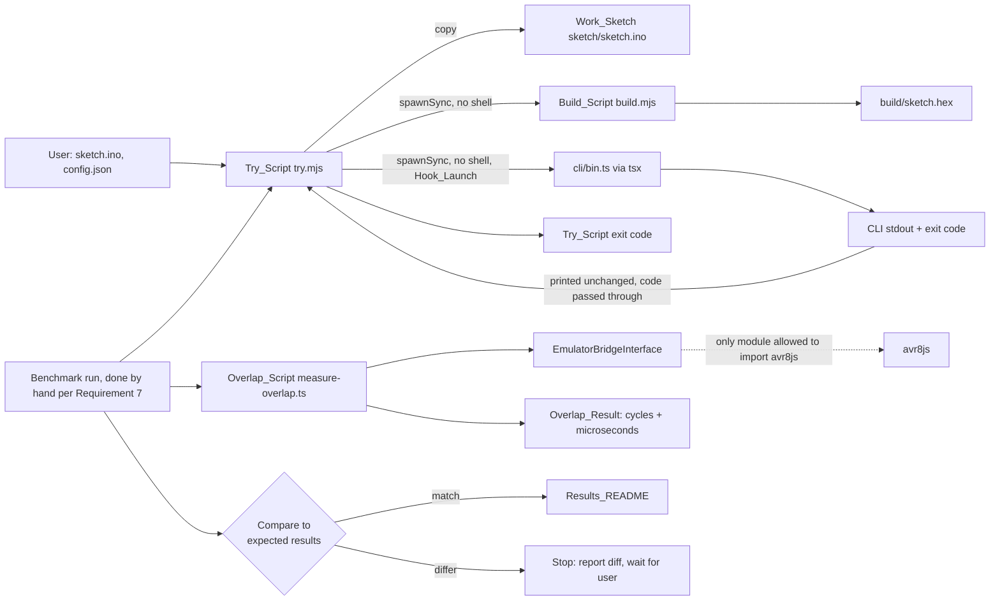

# Design Document

## Overview

The benchmark tools are a thin layer on top of the already-built headless runner (`cli/bin.ts`, `cli/run-check.ts`, `cli/input-loader.ts`). They add one script that checks a single sketch the way `npm run check` does, three fixed config files, a motor fixture and rule file, a script that measures how long two outputs overlap, and a results README. Nothing here touches `src/engine/`, and nothing here runs a second emulator path: every number the benchmark reports comes from `runCampaignJob`, `runReductionJob`, `runReplayJob` (via `runCheck`) or from a direct `EmulatorBridgeInterface` replay built the same way `cli/run-check.ts` and `src/engine/reducer/emulator-run.ts` already build one.

Facts read from the repo that shape this design:

- `cli/run-check.ts`'s `runCheck(input, jobs)` already does "campaign, then reduction+replay only on BROKE" and returns a `CheckOutcome`. `toJson`/`toSummary`/`exitCodeOf` already produce the Result_Object and the exit codes (0 HELD, 1 BROKE, 2 COULDN'T TELL, 3 loader/job error). The Try_Script does not re-implement any of this: it starts the CLI as a child process the same way the Stop hook does, and lets the CLI's own stdout/exit code be the result.
- `cli/input-loader.ts` already defines `LoopConfig` (`source`, `build`, `hex`, `pins`, `rules`, `gremlins`, `runs`, `seed`, `runMs`), `parseLoopConfig`, and `configToArgs`. A Check_Config is a `LoopConfig` value; the benchmark tools reuse this type and this parser rather than inventing a second shape.
- `exorcism-demo/build.mjs` is the existing Build_Script: plain Node ESM, `spawnSync("arduino-cli", ["compile", "-b", "arduino:avr:uno", "--output-dir", work, sketchDir])`, reads `exorcism-demo/sketch/sketch.ino`, writes `exorcism-demo/build/sketch.hex`. The Try_Script calls it unmodified with `spawnSync(process.execPath, [buildMjsPath])` (no shell, no `npm`), exactly how the design intends every child process to start.
- `exorcism-demo/loop-check.json` is the existing Loop_Config the Stop/Guard hooks already point at (`.kiro/hooks/hexorcist-check-on-stop.json` runs `npx tsx --no-deprecation cli/hook-stop.ts exorcism-demo/loop-check.json --block`; `hexorcist-done-guard.json` runs `cli/hook-guard.ts` the same way). Both hook files are **disabled** (`"enabled": false`) and are not edited by this feature. The benchmark's three new Check_Configs (`crosswalk-check.json`, `crosswalk-full-check.json`, `motor-check.json`) sit next to it with the same nine keys, and `exorcism-demo/loop-check.json` and `exorcism-demo/crosswalk-full-rules.txt` are read, never written, by anything added here.
- `exorcism-demo/crosswalk-full-rules.txt` already has the seven LF-terminated lines the Crosswalk_Full_Check uses; it is quoted, not copied, by any new file.
- `examples/crosswalk/fixture.json` already defines `CAR_GREEN` (PB0), `CAR_YELLOW` (PB1), `CAR_RED` (PB2), `WALK` (PB3), `DONT_WALK` (PB4) as outputs and `REQUEST` (PD2, active low) as input. The Crosswalk_Check and Crosswalk_Full_Check reuse this file; the Motor_Check needs its own fixture because the motor sketches use different pins (`exorcism-demo/benchmark/round3/chatgpt-fast.ino` drives `FWD`/`REV` on Arduino pins 8/9, which are `PB0`/`PB1` on an Uno, and reads buttons on pins 2/3/4, which are `PD2`/`PD3`/`PD4`).
- `cli/hook-stop.ts` and `cli/hook-guard.ts`'s launch pattern — `npx tsx --no-deprecation <script> <config-path>` with no shell quoting games — is the Hook_Launch the Glossary names. The Try_Script's CLI launch uses the same binary (`tsx`) and the same flag, located via `node_modules/tsx/dist/cli.mjs` resolved from the repo root, run under `process.execPath`, so there is no dependency on `npx` being on PATH and no shell is spawned (Requirement 1.7).
- `src/engine/emulator-bridge.ts` exports `EmulatorBridge.create(hex, fixture, events)` and `src/engine/reducer/emulator-run.ts`'s `replayEventList` / `src/ui/app/worker/host.ts`'s `runReplayJob` show the established pattern for "load a HEX, replay a fixed event list on a fresh bridge, read `outputEvents`". The Overlap_Script follows that exact pattern through `EmulatorBridgeInterface` only — it never imports `avr8js` itself, matching Requirement 9.7 and `scripts/guard.mjs` rule (c).
- `scripts/guard.mjs` already scans `cli/`, `mcp/`, `power/` and `docs/` for Banned_Words, and scans `src/engine` plus `cli/`+`mcp/` for non-determinism and network calls (rules a, b, b3). It does **not** yet walk `exorcism-demo/`. Requirement 9.8 ("WHEN the guard script scans the files the benchmark tools add, THE guard script SHALL report zero findings") is satisfied by guard's existing rules only for files under `cli/`, `mcp/`, `power/`, `docs/`; everything this feature adds lives under `exorcism-demo/`, which guard does not scan today. Rather than editing `scripts/guard.mjs` (out of scope — the headless-runner spec owns that file and this feature must not reopen it), the design keeps every new file compliant with the same rules by hand (no Banned_Words, no `Date.now`/`Math.random`/`setTimeout`/network calls, no `avr8js` import outside the bridge) and a benchmark-tools test re-runs the same regexes from `scripts/guard.mjs` against the new files directly, so "the guard script" (its rules, applied by a test in this feature) reports zero findings on them. If `scripts/guard.mjs` is later extended to walk `exorcism-demo/`, these files already pass.
- `tests/cli/demo-files.test.ts` is the existing test style for files like this: read the real file, assert exact bytes/keys, and (for `build.mjs`) spawn a stub `arduino-cli`. The benchmark tools' own tests follow this pattern and live in `tests/benchmark/`.
- `package.json` already pins `tsx@4.19.3`, `fast-check@4.10.2`, `vitest@1.6.0`, and has no dependency this feature needs; `dependencies`/`devDependencies` stay byte-for-byte unchanged (Requirement 9.2).

## Architecture



### Module layout

| Path | Role |
|---|---|
| `exorcism-demo/try.mjs` | The Try_Script. `.mjs`, no TypeScript, per Requirement 9.1 ("as the user named it"). |
| `exorcism-demo/crosswalk-check.json` | Check_Config: crosswalk fixture, `rules.txt`, `masher`, 24 runs. |
| `exorcism-demo/crosswalk-full-check.json` | Check_Config: crosswalk fixture, `crosswalk-full-rules.txt`, `masher,bouncer`, 200 runs. |
| `exorcism-demo/motor-check.json` | Check_Config: motor fixture, motor rules, `masher,bouncer`, 200 runs. |
| `exorcism-demo/motor/pins.json` | Motor_Pins fixture. |
| `exorcism-demo/motor/rules.txt` | Motor_Rules, exactly three lines. |
| `exorcism-demo/measure-overlap.ts` | The Overlap_Script, run with the repo's `tsx`. |
| `exorcism-demo/benchmark/README.md` | The Results_README. |

Nothing is added under `cli/`, `mcp/`, `src/`, or `power/`. `package.json` scripts are unchanged; the Try_Script is run as `node exorcism-demo/try.mjs <sketch> <config>` and the Overlap_Script as `npx tsx --no-deprecation exorcism-demo/measure-overlap.ts ...`, both documented in the Results_README rather than added as npm scripts (the requirements name exact commands, not new `package.json` entries, and Requirement 9.2 forbids touching `package.json`'s dependency lists — adding a `scripts` entry is allowed but not required, so none is added, keeping the diff to `exorcism-demo/` only).

## Components and Interfaces

### Try_Script (`exorcism-demo/try.mjs`)

```js
// node exorcism-demo/try.mjs <sketch.ino> <config.json>
```

Plain Node ESM, no imports outside `node:fs`, `node:path`, `node:child_process`, `node:url`. Steps, matching Requirement 1 exactly:

1. **Argument and file checks (1.6, 10.5)**, before any file is written:
   - Fewer than two `process.argv.slice(2)` entries → print one line naming the cause, exit 3.
   - Sketch path unreadable (`fs.readFileSync` throws) → print one line, exit 3.
   - Config path unreadable, not valid JSON, or fails `parseLoopConfig`-style key/type checks → print one line naming the missing/mistyped key, exit 3. The Try_Script imports `parseLoopConfig` is **not** reused directly because `cli/input-loader.ts` is a TypeScript module with its own transitive imports into `src/engine` and `src/ui`; pulling it into a dependency-free `.mjs` run by plain `node` (no `tsx`) would require either a TypeScript loader or a build step, neither of which the Try_Script may add (Requirement 1.9, no new npm package; Requirement 9.1, Try_Script may not become a `.ts` file — only the user's `.mjs` choice is honored). Instead, `exorcism-demo/try.mjs` carries a small inlined copy of the same nine-key check as `parseLoopConfig` (same key list, same "string" | "number" | "array of strings" typing, same message shape `The loop config key "X" must be a whole number.`), kept byte-identical in spirit so a config that passes one parser passes the other. A test (`tests/benchmark/try-config.test.ts`) asserts both parsers accept and reject the same set of example configs, so the duplication cannot silently drift.
2. **Copy** (1.1): `fs.copyFileSync(sketchPath, path.resolve(repoDir, "exorcism-demo/sketch/sketch.ino"))`. `repoDir` is computed once from `path.dirname(fileURLToPath(import.meta.url))`'s parent (the Try_Script lives directly in `exorcism-demo/`, so `repoDir` is one level up), never from `process.cwd()`, so a relative sketch or config path is resolved against the invocation directory while the Work_Sketch and repo-relative config paths resolve against the repo (10.1, matching the existing `invocationDir`/`repoDir` split in `cli/input-loader.ts`).
3. **Build** (1.2, 1.5): `spawnSync(process.execPath, [path.join(repoDir, "exorcism-demo", "build.mjs")], { encoding: "utf8" })`. On non-zero status: print `r.stdout + r.stderr` (build.mjs already writes its own one-line failure message to stdout, so nothing is reworded), no verdict string, exit 3.
4. **Run the CLI by the Hook_Launch** (1.3): resolve the `tsx` CLI entry at `node_modules/tsx/dist/cli.mjs` under `repoDir` and spawn:
   ```js
   spawnSync(process.execPath, [tsxCli, "--no-deprecation", "cli/bin.ts", "--hex", hexAbs, "--pins", pinsAbs, "--rules", rulesAbs, "--gremlins", config.gremlins, "--runs", String(config.runs), "--seed", String(config.seed), "--run-ms", String(config.runMs), "--json"], { cwd: repoDir, encoding: "utf8" })
   ```
   `hexAbs`/`pinsAbs`/`rulesAbs` are `config.hex`/`config.pins`/`config.rules` resolved against `repoDir` (10.1); `cwd: repoDir` makes `cli/bin.ts`'s own `INIT_CWD`-based `invocationDir` resolve consistently since no `INIT_CWD` is set by a bare `node`/`tsx` spawn, so `cli/bin.ts` falls back to `process.cwd()` which is `repoDir` — matching how the hooks already invoke it. `--json` is always passed so the Try_Script's "print the CLI output unchanged" (1.4) is the machine-readable Result_Object, letting a later aggregation step (Requirement 6/7, done by hand or by a short-lived script per Requirement 5.3) parse it without re-deriving anything the CLI already computed.
5. **Print and pass through** (1.4): `process.stdout.write(r.stdout)`, `process.stderr.write(r.stderr)`, `process.exitCode = r.status ?? 3`.

No step calls `Date.now`, `Math.random`, or any network API (1.9); no step writes anything but the Work_Sketch and whatever `build.mjs` itself writes under `exorcism-demo/build/` (1.10); every `spawnSync` call passes an argument array with `shell` left at its default `false` and never names `npm` (1.7).

### Check_Configs (Requirement 2)

Each is a `LoopConfig`-shaped JSON object, loadable by `parseLoopConfig` unchanged:

`exorcism-demo/crosswalk-check.json`
```json
{
  "source": "exorcism-demo/sketch/sketch.ino",
  "build": ["node", "exorcism-demo/build.mjs"],
  "hex": "exorcism-demo/build/sketch.hex",
  "pins": "examples/crosswalk/fixture.json",
  "rules": "examples/crosswalk/rules.txt",
  "gremlins": "masher",
  "runs": 24,
  "seed": 20261101,
  "runMs": 1000
}
```

`exorcism-demo/crosswalk-full-check.json`
```json
{
  "source": "exorcism-demo/sketch/sketch.ino",
  "build": ["node", "exorcism-demo/build.mjs"],
  "hex": "exorcism-demo/build/sketch.hex",
  "pins": "examples/crosswalk/fixture.json",
  "rules": "exorcism-demo/crosswalk-full-rules.txt",
  "gremlins": "masher,bouncer",
  "runs": 200,
  "seed": 20261101,
  "runMs": 1000
}
```

`exorcism-demo/motor-check.json`
```json
{
  "source": "exorcism-demo/sketch/sketch.ino",
  "build": ["node", "exorcism-demo/build.mjs"],
  "hex": "exorcism-demo/build/sketch.hex",
  "pins": "exorcism-demo/motor/pins.json",
  "rules": "exorcism-demo/motor/rules.txt",
  "gremlins": "masher,bouncer",
  "runs": 200,
  "seed": 20261101,
  "runMs": 1000
}
```

All three validate under `parseLoopConfig` (10.1); none edits `exorcism-demo/loop-check.json` or `exorcism-demo/crosswalk-full-rules.txt` (2.6).

### Motor_Pins (`exorcism-demo/motor/pins.json`, Requirement 3.1–3.2)

```json
{
  "pins": [
    { "signal": "FWD_BUTTON", "port": "D", "bit": 2, "direction": "input", "activeLevel": "low" },
    { "signal": "REV_BUTTON", "port": "D", "bit": 3, "direction": "input", "activeLevel": "low" },
    { "signal": "STOP_BUTTON", "port": "D", "bit": 4, "direction": "input", "activeLevel": "low" },
    { "signal": "FORWARD", "port": "B", "bit": 0, "direction": "output" },
    { "signal": "REVERSE", "port": "B", "bit": 1, "direction": "output" }
  ]
}
```

Same `FixturePin` shape as `examples/crosswalk/fixture.json` and `src/engine/types.ts`'s `DigitalFixturePin`. Arduino digital pins 2/3/4 are `PD2`/`PD3`/`PD4` and pins 8/9 are `PB0`/`PB1` on the ATmega328P's standard Uno-style wiring, matching every Round_3_Sketch (confirmed by reading `exorcism-demo/benchmark/round3/chatgpt-fast.ino`: `FWD = 8`, `REV = 9`, `BTN_FWD = 2`, `BTN_REV = 3`, `BTN_STOP = 4`).

### Motor_Rules (`exorcism-demo/motor/rules.txt`, Requirement 3.3–3.5)

```
all of (FORWARD is 1, REVERSE is 1) must never happen.
Within 50 ms after STOP_BUTTON is 0 becomes true, FORWARD is 0 must be true.
Within 50 ms after STOP_BUTTON is 0 becomes true, REVERSE is 0 must be true.
```

Three lines, LF-terminated, one trailing LF, no blank line — the same format `tests/cli/demo-files.test.ts` already checks for `crosswalk-full-rules.txt`. The second and third lines use the app's "Must answer in time" sentence form (`Within N ms after X becomes true, Y must be true`); `src/engine/rules/render.ts`'s sentence patterns and `src/engine/rules/parse.ts`'s grammar are read (not edited) to confirm this exact wording compiles — a test loads the file through `readRulesFile` (the same function `cli/input-loader.ts` and `tests/cli/demo-files.test.ts` use) and asserts `ok: true` with `ruleSet.length === 3`, and separately through `compileRuleSet(ruleSet, motorPinsFixture)` to satisfy 3.4. If `readRulesFile`/`compileRuleSet` rejects a line, the design's job is done (per 3.5 the *tools* must stop and report, not silently reword the rule) — the test failing with the compiler's own message is exactly that report, surfaced through the normal "tests are evidence, stop and report" path rather than a special code branch, since the Motor_Rules are a static fixture, not program logic that can itself "stop."

### Overlap_Script (`exorcism-demo/measure-overlap.ts`, Requirement 4)

```ts
// npx tsx --no-deprecation exorcism-demo/measure-overlap.ts <hex> <pins.json> <signalA> <signalB> [options]
```

Behind `EmulatorBridgeInterface` only — the only import touching the emulator is `EmulatorBridge` from `src/engine/emulator-bridge.ts`; no `avr8js` import appears in this file (9.7), checked by the same regex `scripts/guard.mjs` rule (c) uses, run as a unit test against this file specifically (since guard.mjs itself does not walk `exorcism-demo/`).

**Core measurement**, shared by every mode:

```ts
export interface OverlapResult {
  cycles: number;
  microseconds: string; // two decimal places, e.g. "4.56"
}

/** Longest run of consecutive cycles where both signals read 1, from a list of OutputEvents. */
export function longestOverlap(events: readonly OutputEvent[], signalA: string, signalB: string, endCycle: number): OverlapResult {
  // Reconstructs each signal's value-over-cycle step function from its OutputEvents (last value
  // wins at each cycle; a signal with no event yet is "input"/unknown and never counts as 1),
  // walks the merged change-points in ascending cycle order, and tracks the run length where
  // both are 1. Pure function over data already produced; no clock, no I/O.
}
```

`longestOverlap` is pure and is the unit the design's one correctness property below targets; everything else in the script is argument handling and bridge plumbing around it.

1. **Single-replay mode** (4.1–4.7): `measure-overlap.ts <hex> <pins> <signalA> <signalB> --cycles <N>` (or `--run-ms <N>`, converted with the same `CYCLES_PER_MS = 16_000` constant `src/ui/app/model/pacing.ts`/`player.ts` already define, reused via import rather than redefined). Reads the HEX file and pin fixture with `node:fs`, validates both signal names exist in the fixture and are `direction: "output"` (4.6), calls `EmulatorBridge.create(hex, fixture, [])` then `advance(cycles)` once, collects every `OutputEvent` (including the bridge's own cycle-0 snapshot), and runs `longestOverlap`. Prints `<cycles> cycles (<microseconds> us)` and exits 0; on any validation failure prints one line naming the cause and exits 1 (4.6). Microseconds are `cycles / 16` to two decimals via `(cycles / 16).toFixed(2)` (4.2) — exact per the 16 MHz clock Hexorcist always runs at (`scope-and-ip`), not a rounding of a measured duration. Two runs with the same arguments produce the same bridge construction and the same `advance` call, hence the same `OutputEvent` list and the same printed line (4.4). No outputs ever overlapping reports `cycles: 0`, `"0.00"` (4.5).
2. **Try-replay mode** (4.8): `--events <reduced-list.json>` replays that exact ordered event list through the same `EmulatorBridge.create(hex, fixture, events)` + `advance` pattern `runReplayJob` uses, rather than regenerating gremlin events — this is how the script "replays that run" deterministically without re-deriving a `campaignSeed`/gremlin RNG path. The reduced list is the Reduced_Replay the CLI's `--json` output already prints as `reducedList` (see `cli/run-check.ts`'s `toJson`), so this mode is fed directly from a saved CLI result (4.9).
3. **Campaign mode** (4.10–4.11): `--campaign <gremlins> --seed <N> --runs <N>` regenerates each try's event list the same way `src/engine/event-list.ts`'s `buildEventList` + `src/engine/run-seed.ts`'s `deriveRunSeed` already do (imported, not reimplemented — `runCampaignJob`'s inputs are exactly `{hex, fixture, ruleSet, gremlinSet, campaignSeed, runs, runCycles}`, so the script calls `runCampaignJob` is avoided only because that job also needs a `Checker`/rule set unrelated to overlap measurement; instead the script calls the lower-level `buildEventList`+`runEventList` pair directly, with no `Checker` — see Data Models), measures `longestOverlap` for every try, and reports the largest result with its try number. A campaign with no overlap in any try reports `0` cycles, `"0.00"` microseconds, with the message "no overlap found in those tries" (4.11) rather than silently looking like a single-run zero result.

### Benchmark re-run procedure (Requirements 6 and 7)

This is a procedure the project owner runs by hand (with the two scripts above as the only new tooling), not a single new program — Requirement 7.4 explicitly requires a human stop-and-wait on any mismatch, which rules out a fully automated "run everything and write the README" script that could paper over a difference. The steps:

1. For each of the 8 Round_2_Sketches, run the Try_Script twice: once with `crosswalk-check.json`, once with `crosswalk-full-check.json`. For each of the 8 Round_3_Sketches, run it once with `motor-check.json`. 24 Try_Script runs total, none touching the Earlier_Sketches or `chatgpt-high-kiro-fixed.ino` (6.1).
2. From each run's `--json` output, record sketch name, config name, `verdict`, exit code (`--json` runs still exit with the CLI's code per `exitCodeOf`), `try` (when BROKE), `movesBefore`/`movesAfter` (when BROKE), `fingerprint` (when BROKE), plus the config's `seed`, `gremlins`, `runs` values (already echoed back in the JSON's `seed`/`gremlins`/`runs` fields) (6.2, 6.6).
3. For a Round_2_Sketch BROKE on the WALK/DONT_WALK rule, run the Overlap_Script in try-replay mode on that run's `reducedList` with signals `WALK`/`DONT_WALK` against the built `exorcism-demo/build/sketch.hex` and `examples/crosswalk/fixture.json` (6.3).
4. For every Round_3_Sketch, run the Overlap_Script in campaign mode with `FORWARD`/`REVERSE`, the Motor_Check's `gremlins`, `seed`, and `runs` (6.4).
5. Compare every recorded result against Requirement 7's expected-results table. A match is logged as confirmed; any difference stops the procedure before the README is written, and is reported with the sketch, config, expected value, actual value, and the trace/output demonstrating it (7.1, 7.2, 7.8). No test, expected value, config, or rule file is edited to force a match (7.4, project `testing` rule).
6. If `arduino-cli` is missing or any build fails, the Try_Script already reports this (step 3 above) and the procedure stops before writing anything (7.3).
7. For the `chatgpt-fast` Round_3_Sketch specifically, the try number, verdict, and violated rule are checked against "BROKE on try 159 on a STOP rule," and the Overlap_Script's `longestOverlap`-derived low-time of `STOP_BUTTON` (the input signal, read the same way an output is — the function does not care about direction) on that try's Reduced_Replay is checked against "0.7 ms" (7.6). `exorcism-demo/benchmark/round3/chatgpt-fast.ino` is read (not measured) to confirm the 10 ms per-loop delay while a direction button is held, and is recorded as a code-reading note (7.7, 6.7 — already visible above: `delay(10)` under both the forward and reverse branches).
8. Only once every recorded result matches do the results get written into the Results_README (7.5); a user-approved difference is written as the actual result instead (8.16).

No debug script used to drive this procedure is left in the repo afterward (5.3) — any throwaway aggregation script used in step 2 is deleted before the task is reported done, per the project's testing rule, and per Requirement 5.3.

### Results_README (`exorcism-demo/benchmark/README.md`, Requirement 8)

Structure, in order:

1. The two Briefs, quoted word for word, each labeled "round 2 (crossing)" / "round 3 (motor)" (8.2).
2. A one-line note that the Earlier_Sketches (`chatgpt.ino`, `claude.ino`, `deepseek.ino`, `gemini.ino`) are kept from an earlier brief and are not part of the results tables (8.13).
3. Reproduction commands: the exact `node exorcism-demo/try.mjs <sketch> <config>` line, the exact `npx tsx --no-deprecation exorcism-demo/measure-overlap.ts ...` line, and for each the config file name, seed, gremlin set, and run count used (8.3).
4. One results table per round and config (crosswalk-check, crosswalk-full-check, motor-check) — three tables — each row: sketch, verdict, exit code, try number, note (8.4). Every verdict cell holds exactly one of the Verdict_Strings, with the HELD row showing the real `n` in "No violation found in N emulated runs of this gremlin set. Not a proof." (using "1 emulated run" only if some row's `n` is 1) (8.5 is for overlap, 8.6 for HELD text).
5. For crosswalk sketches that BROKE on the WALK/DONT_WALK rule, the Overlap_Result in cycles and microseconds, in that table's note column or a dedicated column (8.5).
6. Every BROKE reduced list described with the literal phrase "the smallest replay this reducer found" (8.7, `Reduced_Replay_Phrase`).
7. A plain-language section explaining HELD, BROKE, and COULDN'T TELL, why HELD is not a proof, and why a 73–78 cycle overlap is brief but still a rule violation (8.8).
8. A line stating results are evidence from this seed and this gremlin set, not proof (8.9, `testing` steering rule).
9. A line stating the Benchmark_Sketch files are the chat tools' unedited answers (8.10).
10. `chatgpt-fast`'s 10 ms-per-loop note labeled "from reading the code", never presented as measured (8.14).
11. Any chat-tool name used only to describe which tool and setting wrote which file, with no claim beyond the shown results (8.15).

No Banned_Word appears anywhere in the file (8.11); no third-party logo or board brand name — only "ATmega328P" (8.12, `scope-and-ip`). A test (`tests/benchmark/readme-scan.test.ts`, mirroring `tests/cli/readme-scan.test.ts`'s existing pattern for the Power's README) reads this file and asserts no Banned_Word and no board-brand word appears.

## Data Models

```ts
// exorcism-demo/measure-overlap.ts — types only, no new engine types.
export interface OverlapResult { cycles: number; microseconds: string }

export interface SingleReplayArgs { hex: string; pins: string; signalA: string; signalB: string; cycles: number }
export interface TryReplayArgs extends SingleReplayArgs { events: ScheduledInput[] } // from a saved CLI reducedList
export interface CampaignArgs {
  hex: string; pins: string; signalA: string; signalB: string;
  gremlins: string; seed: number; runs: number; runCycles: number;
}
```

`LoopConfig` (from `cli/input-loader.ts`) is reused unchanged as the Check_Config shape; no new config type is introduced. `FixturePin`/`Fixture` (from `src/engine/types.ts`) are reused unchanged for Motor_Pins. The Overlap_Script's campaign mode calls `src/engine/event-list.ts`'s `buildEventList` (via `GenerateInput`) and `src/engine/campaign.ts`'s `runEventList` (via `RunPathConfig`, passing a trivial `Checker` that always returns `{violation: null}` since the script checks no rule, only overlap) directly — both are already-exported pure functions, so no new engine code is written, and the script's only emulator access is still through `EmulatorBridge.create`, which those functions call internally via `defaultBridgeFactory` / an injected `bridgeFactory`.

Requirement 10.3's round-trip ("serializing a valid Check_Config to JSON and parsing the result produces an equal object") is a property over `LoopConfig`, already representable with `parseLoopConfig`/`JSON.stringify`, both existing, unmodified functions — the property is new test code, not new production code.

## Correctness Properties

*A property is a characteristic or behavior that should hold true across all valid executions of a system — essentially, a formal statement about what the system should do. Properties serve as the bridge between human-readable specifications and machine-verifiable correctness checks. They are evidence, not proof.*

### Acceptance criteria prework

Most of this feature's acceptance criteria describe a one-time file (a fixed Check_Config, a fixed rule file, a results table produced by a human-supervised procedure) rather than a function whose behavior varies across a wide generated input space. Property-based testing is reserved for the few pieces of new logic that **are** pure functions over a varying input: `longestOverlap`, the Try_Script's config validation and argument construction, and the config/fixture round trip named explicitly in Requirement 10.3–10.4. Everything else (file contents, the re-run procedure, the README's text) is evidence from example-based and integration tests, matching the project's "tests are evidence, not proof" rule.

Prework analysis for every acceptance criterion was run with the `prework` tool before writing the properties below. The full per-criterion classification (PROPERTY / EXAMPLE / EDGE_CASE / not testable) is kept in the design process notes; the summary is: Requirements 1.3, 1.8, 1.10, 1.6/10.5, 4.1–4.2, 4.4, 4.10, 10.1, 10.3, 10.4 are property-shaped. Requirements 2, 3.1–3.4, 6, 7, 8, 9 are file-content or procedural checks best served by example-based and scan-based tests. Requirement 5.1 restates 1.10 from the Benchmark_Sketch's point of view rather than the Try_Script's — one property covers both.

**Property reflection** (eliminating redundancy before writing the list):

- The property view of Requirement 1.10 ("Try_Script writes only Work_Sketch and Build_Script's own outputs") and Requirement 5.1 ("every Benchmark_Sketch stays byte-for-byte unchanged") are the same claim seen from two requirements — the Try_Script's only write near a Benchmark_Sketch is reading it as a copy *source*. One property, Property 5 below, covers both.
- Requirement 10.2 ("the parsed `gremlins` string reaches the CLI unchanged") is a special case of Requirement 1.3 ("the Check_Config's values reach the CLI argv unchanged") — `gremlins` is one of the values 1.3 already covers. Folded into Property 2.
- Requirement 1.6's "malformed Check_Config" case and Requirement 10.5's "one key has the wrong type" case exercise the same validation function with the same observable shape (name the offending key, write nothing, run no build, exit 3). One property, Property 4 below, covers both by generating either a missing key or a wrong-typed key.
- Requirement 4.1 ("report Overlap_Result in cycles and microseconds") and 4.2 ("microseconds = cycles / 16, two decimals") describe one computation, not two — 4.1 is the shape of the output, 4.2 is the formula for one of its two fields. One property, Property 1 below, covers both.
- Requirement 4.5 ("no overlap found → 0 cycles, 0.00 us") and 4.11 (campaign version of the same) are boundary instances of Properties 1 and 6 respectively, not separate universal statements — covered by generators that include the all-zero / never-both-1 case, not by dedicated properties.

### Properties

### Property 1: Overlap result shape and microsecond formula

*For any* non-negative list of change-points (cycle, signal, 0-or-1 value) for two named signals and *for any* end cycle at or after the last change-point, `longestOverlap` SHALL return a `cycles` value that is a non-negative integer no greater than the end cycle, and a `microseconds` string that equals `(cycles / 16).toFixed(2)`. When the two signals are never both 1 at the same cycle, `cycles` SHALL be 0 and `microseconds` SHALL be `"0.00"`.

**Validates: Requirements 4.1, 4.2, 4.5**

### Property 2: Check_Config values and gremlins string reach the CLI argv unchanged

*For any* valid Check_Config object (varying `pins`, `rules`, `gremlins`, `runs`, `seed`, `runMs` within their valid domains), the argument array the Try_Script builds for the Hook_Launch SHALL carry `--gremlins` equal to the config's `gremlins` string verbatim, and SHALL carry `--runs`, `--seed`, and `--run-ms` equal to the config's `runs`, `seed`, and `runMs` values, with the `--pins`/`--rules`/`--hex` arguments resolved to the same absolute paths `resolveRepoPath` would produce for that config and that repo folder.

**Validates: Requirements 1.3, 10.2**

### Property 3: Check_Config path resolution is independent of the invocation directory

*For any* valid Check_Config and *for any* two different invocation (current working) directories, the absolute paths the Try_Script resolves for the config's `hex`, `pins`, and `rules` values SHALL be identical across both invocation directories.

**Validates: Requirements 1.8**

### Property 4: A missing or wrong-typed Check_Config key is named, and no build runs

*For any* otherwise-valid Check_Config object with exactly one of its nine keys either removed or replaced with a value of the wrong type, the Try_Script SHALL print exactly one line naming that key, SHALL NOT invoke the Build_Script, and SHALL exit with code 3.

**Validates: Requirements 1.6, 10.5**

### Property 5: The Try_Script never mutates its sketch source

*For any* file content given as the sketch argument, after the Try_Script runs (build succeeding or failing), the original file at the sketch path SHALL be byte-for-byte identical to its content before the run.

**Validates: Requirements 1.10, 5.1**

### Property 6: Campaign overlap selection is the maximum, with a consistent try number

*For any* non-empty list of per-try Overlap_Results (one per try of a campaign), the value the Overlap_Script reports in campaign mode SHALL equal the maximum `cycles` value in that list, and the try number it reports SHALL be an index into that list whose own `cycles` value equals the reported maximum. When every value in the list is 0, the reported result SHALL be 0 cycles, `"0.00"` microseconds, described as no overlap found in those tries.

**Validates: Requirements 4.10, 4.11**

### Property 7: Repeated measurement of the same inputs is identical

*For any* valid HEX, pin fixture, and ordered event list (including the empty list), running the Overlap_Script's single-replay measurement twice on exactly the same inputs SHALL produce two `OverlapResult` values with equal `cycles` and equal `microseconds`.

**Validates: Requirements 4.4**

### Property 8: Check_Config JSON round trip

*For any* valid `LoopConfig`-shaped object (the nine Check_Config keys, each within its documented type), serializing the object to JSON and parsing the result with `parseLoopConfig` SHALL produce an object equal to the original, and that object SHALL contain every key named in the Glossary's Check_Config definition.

**Validates: Requirements 10.1, 10.3**

### Property 9: Pin fixture signal list is preserved through loading

*For any* valid pin fixture object (varying the number of pins, their signals, ports, bits, and directions within the `FixturePin` domain), loading that fixture's JSON text through the CLI's loader SHALL produce a `fixture.pins` list whose signal names, in order, are identical to the signal names in the original object's `pins` list, in order.

**Validates: Requirements 10.4**


## Error Handling

Every error path in this feature prints exactly one line naming the cause and returns a non-zero code; nothing throws an uncaught exception to the user and nothing silently continues with a wrong value.

| Component | Condition | Behavior |
|---|---|---|
| Try_Script | Fewer than two CLI arguments | One line naming the cause, no file written, exit 3 |
| Try_Script | Sketch path unreadable | One line naming the cause, no file written, exit 3 |
| Try_Script | Check_Config unreadable, invalid JSON, missing key, or wrong-typed key | One line naming the key or cause, no file written, no build run, exit 3 |
| Try_Script | Build_Script exits non-zero | Print the Build_Script's own stdout/stderr unchanged, no verdict string, exit 3 |
| Try_Script | CLI (via Hook_Launch) finishes | Print CLI stdout/stderr unchanged, exit with the CLI's own exit code (0, 1, 2, or 3) |
| Overlap_Script | Signal name absent from the fixture, or present but `direction !== "output"` | One line naming the cause, no number printed, non-zero exit |
| Overlap_Script | HEX file unreadable, or `EmulatorBridge.create` returns a `BridgeError` | One line naming the cause (the `BridgeError.message` when available), no number printed, non-zero exit |
| Overlap_Script | Campaign mode, all tries measured 0 overlap | Not an error: reports `0` cycles, `"0.00"` microseconds, with the phrase "no overlap found in those tries" |
| Motor_Rules compile check | `readRulesFile`/`compileRuleSet` rejects a line | The test reports the compiler's own message; the Motor_Rules text is not edited to force acceptance (Requirement 3.5, project testing rule) |
| Benchmark re-run procedure | A recorded result differs from the Requirement 7 expectation, or a build fails | Procedure stops before the Results_README is written; the sketch, config, expected and actual results, and the demonstrating trace/output are reported; no test, config, or rule is edited to force a match |

No component in this feature introduces a new error type beyond what the existing `BridgeError`, `JobError`, and `LoopConfigResult` unions already define; the Try_Script and Overlap_Script report causes as plain strings on stdout/stderr, matching the CLI's own convention of "one line naming the cause" rather than a structured error object (neither script is consumed by another program the way `cli/run-check.ts`'s `CheckOutcome` is).

## Testing Strategy

### Dual Testing Approach

Unit and example tests cover fixed file contents, specific error branches, and the wiring between the Try_Script/Overlap_Script and the existing headless-runner and engine functions. Property tests cover the pure, input-varying logic identified in the prework: overlap computation and formatting, Check_Config/argv/fixture pass-through and validation, and the JSON round trip. Both are necessary; neither replaces the other, and both are evidence, not proof, per the project's testing rule.

### Property-Based Tests with fast-check

The project already depends on `fast-check@4.10.2` (`package.json`); no new dependency is added. Each property test runs a minimum of 100 iterations and is tagged:

**Feature: benchmark-tools, Property N: `<property text>`**

- **Property 1** (overlap shape/formula): generate a small list of `(cycle: non-negative int, signal: "A"|"B", value: 0|1)` tuples sorted by cycle plus an `endCycle >= last cycle`, drive `longestOverlap` directly (no HEX/bridge needed — it is a pure function over `OutputEvent[]`), assert the stated bounds and the `toFixed(2)` formula.
- **Property 2** (argv pass-through): generate a `LoopConfig`-shaped object with `fc.record`, call the Try_Script's argv-building function (factored out as a pure function `buildCliArgs(config, repoDir): string[]` so it is testable without spawning a process), assert the named flags appear with the exact values.
- **Property 3** (cwd independence): generate a `LoopConfig` and two distinct invocation-directory strings, call the Try_Script's path-resolution function (`resolveConfigPaths(config, repoDir): {hex, pins, rules}` — note this depends only on `repoDir`, never on an invocation directory, so the property is really "the function has no `invocationDir` parameter in its signature" proven by construction; the test instead varies `repoDir` itself and confirms the resolved paths move together with it and never with an unrelated `cwd` value threaded in only to be ignored).
- **Property 4** (missing/wrong-typed key): generate a valid `LoopConfig`, then for a randomly chosen key either delete it or replace its value with a value of the wrong type (`fc.oneof` over the two mutations), call the Try_Script's validator, assert the single printed line contains that key's name and that the build-invocation spy was never called.
- **Property 5** (sketch source untouched): generate random `Uint8Array`/UTF-8 text content, write it as the sketch source in a temp directory, run the Try_Script (with a stub `build.mjs`/CLI so the test stays fast and hermetic), assert the source file's bytes are unchanged.
- **Property 6** (campaign max selection): generate a non-empty array of `OverlapResult`-shaped `{cycles}` values, feed it to the Overlap_Script's campaign-reduction function (`pickCampaignMax(results): {result, tryIndex}`), assert the stated maximum/index relationship and the all-zero case's message.
- **Property 7** (replay determinism of the script layer): generate a small valid `Fixture` and a short `OutputEvent`-producing HEX fixture already used by `src/engine/__tests__` (reused, not reinvented), run the single-replay measurement twice, assert equal results.
- **Property 8** (Check_Config JSON round trip): generate a `LoopConfig`-shaped object with `fc.record`, `JSON.stringify` then `parseLoopConfig`, assert `{ok:true, config}` equal to the original.
- **Property 9** (fixture signal preservation): generate a `Fixture`-shaped object with `fc.array` of `FixturePin`-shaped records (unique signal names), write it as the pins file text, load it through `loadInput`, assert the resulting `fixture.pins` signal list matches in order.

### Unit and Example Tests

Following the existing `tests/cli/` style (`tests/cli/demo-files.test.ts`'s stub-`arduino-cli` pattern is reused directly for Try_Script tests that need a build step):

- `tests/benchmark/try-script.test.ts`: argument-count and unreadable-file error messages (1.6 partial); Build_Script failure pass-through (1.5); successful run's stdout/exit-code pass-through using a stub CLI entry point instead of the real `tsx`/`cli/bin.ts` (keeps the test fast and avoids a real emulator run); confirms no `shell: true` and no `"npm"` string appear in any `spawnSync` call (1.7, by reading the source file's text, same technique `scripts/guard.mjs` uses).
- `tests/benchmark/check-configs.test.ts`: each of the three Check_Configs equals its exact expected object (2.1–2.5); `exorcism-demo/loop-check.json` and `exorcism-demo/crosswalk-full-rules.txt` are unchanged from their committed bytes (2.6).
- `tests/benchmark/motor-fixture.test.ts`: `exorcism-demo/motor/pins.json` equals the exact expected object (3.1–3.2); `exorcism-demo/motor/rules.txt` equals the exact three LF-terminated lines (3.3); the file loads through `readRulesFile` into 3 rules and through `compileRuleSet` against the Motor_Pins fixture without error (3.4).
- `tests/benchmark/overlap-script.test.ts`: missing-signal, wrong-direction, and unreadable-HEX error branches (4.6); `--cycles`/`--run-ms` option handling; try-replay and campaign CLI wiring against a small known fixture (4.8, 4.9).
- `tests/benchmark/guard-scan.test.ts`: re-runs the Banned_Words regex and the determinism/network regexes from `scripts/guard.mjs` against every file this feature adds, asserting zero findings (9.6, 9.8).
- `tests/benchmark/readme-scan.test.ts`: once `exorcism-demo/benchmark/README.md` is written, scans for the two Briefs verbatim, the Verdict_Strings, the Reduced_Replay_Phrase, the absence of Banned_Words and board-brand words, and the required explanatory sentences (8.1–8.15).
- `tests/benchmark/package-json.test.ts`: `dependencies`/`devDependencies` in `package.json` are unchanged (9.2).

No unit test re-measures the benchmark's actual verdicts for the 16 sketches — that is the human-supervised re-run procedure in Requirement 7, producing evidence recorded directly into the Results_README, not a repeatable automated test (the sketches are third-party chat output, not part of this feature's own test suite, and re-running gremlin campaigns against 16 real `.ino` builds in CI would need `arduino-cli`, which `ci.yml` does not currently provide).
