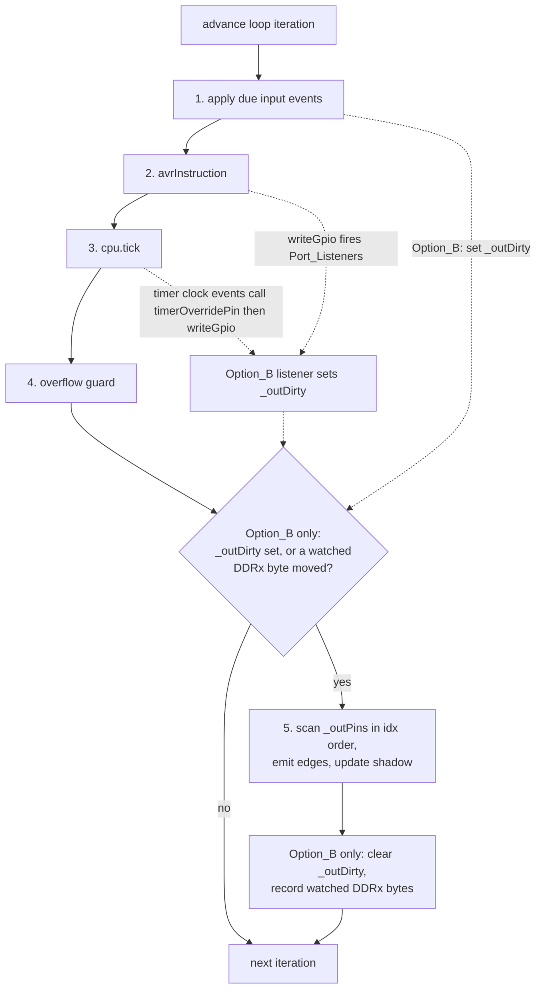
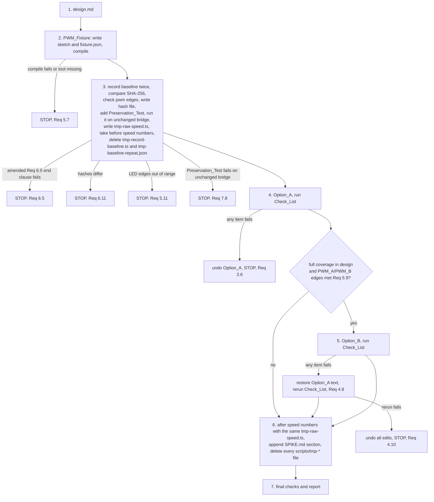

# Design Document: bridge-output-scan

## Overview

This is a speed change to step 5 of `EmulatorBridge.advance()` (the Output_Scan, `src/engine/emulator-bridge.ts` lines 402-415 today). Behaviour must not change. Today the loop visits every Fixture pin after every instruction, and for each digital output pin calls `isAnalogPin`, reads `direction`, calls `_portMap.get`, `port.pinState` and `mapPinState`.

The design has two options, built in order:

- **Option_A** builds a list of the Digital_Output_Pins once in `_build` and makes the step-5 loop walk only that list.
- **Option_B** adds a Dirty_Flag on top of Option_A. The scan runs only when a Port_Listener fired, an input event was applied, or a watched DDRx byte moved since the last scan.

Before any edit to `emulator-bridge.ts`, the work records a Preservation_Baseline of 41 cases on the unchanged bridge, writes its SHA-256 to the Baseline_Hash_File, and adds the Preservation_Test. No other test file is added. Each option is then checked against the Check_List and falls back on any difference.

Passing tests are evidence, not proof. A passing Preservation_Test shows that the 41 recorded cases match. It does not show that every HEX, Fixture and input event list matches.

### Research findings

All facts below come from reading the avr8js 0.21.1 package installed under `node_modules/avr8js` (`package.json` version field reads `0.21.1`). The line numbers were re-checked against the installed files while this design was written. Upstream project: [wokwi/avr8js](https://github.com/wokwi/avr8js).

1. **Build used for line numbers.** All line numbers in this document are from the ESM build, `node_modules/avr8js/dist/esm/`. Vitest and Vite resolve the package `module` field to it. Node and `tsx` scripts load the CJS build (`dist/cjs/`, package `main`). The code is the same. In `gpio.js` the CJS lines are 3 higher (for example `pinState` is at cjs `gpio.js:251` and `writeGpio` at cjs `gpio.js:414`).
2. **What `pinState` reads.** `AVRIOPort.pinState(index)` (`dist/esm/peripherals/gpio.js:248-260`) reads `cpu.data[DDR]` (249), `cpu.data[PORT]` (250), `this.openCollector` (253) and `this.lastValue` (255). If the DDR bit is set it returns `High` or `Low` from the `lastValue` bit (with `openCollector` turning `High` into the open state). If the DDR bit is clear it returns `InputPullUp` or `Input` from the PORT bit.
3. **What the bridge uses.** `mapPinState` in the bridge maps `High` to `1`, `Low` to `0`, and both `Input` and `InputPullUp` to `"input"`. So the mapped value of a pin depends only on three things: the DDRx bit in `cpu.data`, the port's `lastValue` bit, and the port's `openCollector` bit. The PORTx data byte changes the raw `PinState` (Input versus InputPullUp) but never the mapped value.
4. **Who writes `lastValue`.** Only `gpio.js:151` (constructor, sets 0) and `gpio.js:415` inside `writeGpio` (`gpio.js:411-421`). `writeGpio` sets `lastValue` and `lastDdr` and calls every Port_Listener (loop at `gpio.js:417`) whenever the new latch value or the DDR argument differs from what it saw last. So every change of `lastValue` fires the Port_Listeners in the same call.
5. **Who writes `openCollector`.** Only `gpio.js:154` (constructor, sets 0) and `usi.js:96` (`AVRUSI`, an ATtiny peripheral). The bridge never constructs `AVRUSI` and never hands out its `AVRIOPort` objects, so `openCollector` stays 0 for the life of a bridge.
6. **Who writes `cpu.data[DDRx]`.** The DDR write hook (`gpio.js:157-163`), reached through `cpu.writeData` (`cpu/cpu.js:57-65`, hook call at 60). It stores the byte and calls `writeGpio` at `gpio.js:160`. The other writers are direct `cpu.data[...]` stores in `instruction.js` and `interrupt.js` that bypass the write hooks (stack pushes and XCH). Those fire no Port_Listener.
7. **Timer outputs.** Every timer compare-output change goes through `AVRIOPort.timerOverridePin` (`gpio.js:277-305`), which ends with `writeGpio` at `gpio.js:303`. So timer PWM fires the Port_Listeners whenever it changes the latch. A rule like "keep scanning while a timer's COM bits are non-zero" is not needed in avr8js 0.21.1. The pwm_out Baseline_Case is the recorded evidence for this path.

### Design decisions

| # | Decision | Reason |
|---|---|---|
| D1 | The Path_Inventory is kept in this document (section "Path_Inventory"), not in a separate file. | Requirement 2.6. |
| D2 | Option_B covers the direct-write path with a per-instruction compare of each watched DDRx byte against the value recorded at the last scan. It does not decode opcodes or watch SP and Z. | The compare checks the effect (the DDR byte moved), so it does not depend on which instruction wrote it. It costs one array read and compare per watched port per instruction. Requirement 4.1 names it as a permitted check. |
| D3 | Option_B sets the Dirty_Flag on every applied input event, digital or analog. | `setPin` cannot change a mapped output value (Path_Inventory entry P9), but setting the flag costs one store per event and removes the need to rely on the exception in Requirement 4.6. |
| D4 | The Option_B Port_Listener is added after every existing listener (after step 11 of `_build`). | Listeners run in insertion order (`gpio.js:417`). Appending keeps the call order of the existing input-pin listeners and the test-hook listeners unchanged. |
| D5 | `_outDirty` starts `true`. | The scan at the initial instruction boundary then runs as it does today. The DDR compare alone would also be enough, so this costs one scan and removes one case to reason about. |
| D7 | The Preservation_Baseline is written with `JSON.stringify(baseline, null, 2)` plus a trailing `\n`, UTF-8, LF line endings. | `.gitattributes` sets `* text=auto eol=lf`, so the working copy and the committed blob hold the same bytes and the SHA-256 in the Baseline_Hash_File stays valid after the user commits. |
| D8 | Random input lists draw, per list: the event count, then for each event its cycle and then its value, and are then sorted by cycle with a stable sort. | Choice C8 fixes the ranges and list order but not the order of draws inside a list. This order is fixed here so a second reader gets the same lists from seed `20261115`. The lists are stored in the baseline anyway (choice C7). |

Decision D6 (a new property test file) was dropped: the user did not ask for one, and the work stays in scope. The numbers D7 and D8 are kept so earlier references still point at the same decisions.

## Architecture

### Where the change sits

Only step 5 of the `advance()` loop and the end of `_build` change. Steps 1-4, the PIN read hook, the input-pin listeners, `schedule`, `supports` and every error path stay as they are.



Under Option_A the diamond is absent and step 5 runs at every instruction boundary, as today, over the precomputed list.

### Order of work and stop points



## Components and Interfaces

### Path_Inventory

This section is the Path_Inventory of Requirement 2. All locations are in the ESM build, `node_modules/avr8js/dist/esm/`, avr8js 0.21.1.

**Search method (Requirement 2.9).** Files searched: every `.js` file in `dist/esm/cpu/` (`cpu.js`, `instruction.js`, `interrupt.js`) and in `dist/esm/peripherals/` (`adc.js`, `clock.js`, `eeprom.js`, `gpio.js`, `spi.js`, `timer-attiny.js`, `timer.js`, `twi.js`, `usart.js`, `usi.js`, `watchdog.js`). Patterns, in this order:

1. All files: `openCollector|lastValue|lastDdr|timerOverridePin|gpioByPort|gpioPorts|writeGpio|\.setPin\(|overrideMask|overrideValue`. Outside `gpio.js` this matches only `cpu.js:23-24` (the `gpioPorts` set and `gpioByPort` array), `timer.js:232` (external clock port lookup, which only registers an external clock listener and never writes pin state), `timer.js:582-593`, `timer-attiny.js:314, 334, 337, 340, 341` and `usi.js:96`. No match in `clock.js`, `eeprom.js`, `spi.js`, `twi.js`, `usart.js`, `watchdog.js` or `adc.js`.
2. `timer.js`: `updateCompPin|updateCompA|updateCompB|updateCompC|compPort|compPin`.
3. `instruction.js`, direct writes: `cpu\.data\[[^\]]*\]\s*(=|\|=|&=|\^=)(?!=)`, `data16\[[^\]]*\]\s*=(?!=)` and `dataView\.set`. From the matches, lines whose index is a register were dropped: `d`, `r`, `d + 1`, `r + 1`, `(opcode & 0x1f0) >> 4`, `((opcode & 0xf0) >> 4) + 16`, `cpu.data[0]`, and `dataView` offsets 0 and 24-30 (registers r0 and r24-r31). Lines writing SREG (`cpu.data[95]`) or SP (`dataView` offset 93) were dropped too.
4. `interrupt.js` and `cpu.js`: read in full.
5. `adc.js`: `cpu\.data\[`.

A reader can repeat these searches with `Select-String -Path node_modules/avr8js/dist/esm/cpu/*.js,node_modules/avr8js/dist/esm/peripherals/*.js -Pattern '<pattern>'`. (The workspace text search tool skips `node_modules`, so use PowerShell.)

**Constructed peripherals.** The bridge constructs `CPU`, `AVRIOPort` for ports B, C and D, `AVRTimer` for Timer0, Timer1 and Timer2, and `AVRADC`. It constructs no USART, SPI, TWI, EEPROM, watchdog, clock, USI or ATtiny timer. GPIO bytes on the ATmega328P are 0x23-0x2B: PINB 0x23, DDRB 0x24, PORTB 0x25, PINC 0x26, DDRC 0x27, PORTC 0x28, PIND 0x29, DDRD 0x2A, PORTD 0x2B.

**Columns.** "Listener" says whether a Port_Listener fires when the path changes the state, with the line of the listener call. "Other hook" names another bridge hook that observes the path. "Built" says whether the bridge constructs the owning peripheral. "Mapped" says whether the path can change a Digital_Output_Pin's mapped value (`1`, `0`, `"input"`). "Cover" is the Option_B means of coverage (Requirement 2.6).

| # | Pin_State_Path | Location (ESM) | Listener | Other hook | Built | Mapped | Condition if uncovered (Req 2.5) | Option_B cover |
|---|---|---|---|---|---|---|---|---|
| P1 | DDRx write through `cpu.writeData` (OUT, ST, STS, STD, SBI, CBI, and LAC, LAS, LAT at `instruction.js:349, 357, 365`) | `cpu/cpu.js:57-65` (hook call 60) then `peripherals/gpio.js:157-163` (`writeGpio` at 160) | yes, `gpio.js:417`, fires when the DDR byte or the latch differs from what `writeGpio` last saw | none | yes (B, C, D) | yes | not uncovered | Port_Listener |
| P2 | PORTx write through `cpu.writeData` | `gpio.js:164-170` (`writeGpio` at 167) | yes, `gpio.js:417` | none | yes | yes (through `lastValue` when the DDR bit is set) | not uncovered | Port_Listener |
| P3 | PINx write through `cpu.writeData` (toggles PORTx bits `value & mask`) | `gpio.js:171-179` (`writeGpio` at 177) | yes, `gpio.js:417` | none | yes | yes | not uncovered | Port_Listener |
| P4 | Timer0/1/2 output-compare override (COM bits) | `gpio.js:277-305` (`writeGpio` at 303), called from `timer.js:580-594` (`updateCompA/B/C`, `gpioByPort` at 582/587/592, `timerOverridePin` at 583/588/593). Callers of `updateCompA/B/C`: `updateCompPin` `timer.js:541-579` (calls at 570/573/576) and the COM-bit change in `updateWGMConfig` `timer.js:404-441` (calls at 422/430/439). Callers of `updateCompPin`: fast-PWM overflow in `count()` `timer.js:195, 198`; `phasePwmCount` `timer.js:481, 487, 493`; compare match in `timerUpdated` `timer.js:507, 513, 520`; FOC in `checkForceCompare` `timer.js:524-539` (532, 535, 538). Pins: Timer0 `timer.js:32` OC0A = PD6, OC0B = PD5; Timer1 `timer.js:33` OC1A = PB1, OC1B = PB2, OC1C port 0 (lookup gives `undefined`, call is a no-op); Timer2 `timer.js:43` OC2A = PB3, OC2B = PD3 | yes, `gpio.js:417`, when the override changes the latch | none | yes (Timer0, Timer1, Timer2) | yes | not uncovered | Port_Listener |
| P5 | ATtiny timer output override | `timer-attiny.js:314, 334, 340, 341` (`timerOverridePin`, then `writeGpio` at `gpio.js:303`) | yes, `gpio.js:417` | none | no | not reachable (peripheral not constructed) | not uncovered | Port_Listener (would fire if constructed) |
| P6 | USI open-collector mode | `usi.js:96` sets `port.openCollector` | none | none | no | not reachable (peripheral not constructed, `openCollector` stays 0 from `gpio.js:154`) | if it were reachable: `openCollector` bit of a Digital_Output_Pin set while its DDR bit and latch bit are 1. Not reachable, so no check | not needed: unreachable in the bridge |
| P7 | ADC result and control writes | `adc.js:128` (ADCSRA), `adc.js:153-160` (ADCL, ADCH, ADCSRA) | none | none | yes | no (writes only 0x78-0x7A, not GPIO bytes 0x23-0x2B) | none | not needed: cannot change mapped value |
| P8 | Interrupt flag writes (`setInterruptFlag`, `clearInterrupt`, `clearInterruptByFlag` in `cpu.js`) | `cpu/cpu.js` (read in full) | none | none | yes | no (write only flag registers EIFR 0x3C, PCIFR 0x3B, TIFR0-2 0x35-0x37) | none | not needed: cannot change mapped value |
| P9 | `AVRIOPort.setPin` | `gpio.js:265-271`, then `updatePinRegister` `gpio.js:306-321` | none | bridge `_applyInput` and `_presentReleased` are the only callers | yes | no. It changes `pinValue` and the PIN byte only, and may raise pin-change or external interrupt flags. It does not change DDR, PORT, `lastValue` or `openCollector` | none | not needed: cannot change mapped value. Option_B still sets the Dirty_Flag on every applied input event (D3) |
| P10 | PUSH (direct store to `cpu.data[SP]`) | `cpu/instruction.js:564` | none | none | yes (CPU) | yes, if SP addresses DDRx | SP equals 0x24, 0x27 or 0x2A at the push; effect: the DDRx byte of a watched port changes | per-instruction DDRx compare |
| P11 | CALL return-address push | `instruction.js:135, 136, 138` | none | none | yes | yes, if SP, SP-1 or SP-2 addresses DDRx | as P10 | per-instruction DDRx compare |
| P12 | RCALL return-address push | `instruction.js:574, 575, 577` | none | none | yes | yes, as P11 | as P10 | per-instruction DDRx compare |
| P13 | ICALL return-address push | `instruction.js:309, 310, 312` | none | none | yes | yes, as P11 | as P10 | per-instruction DDRx compare |
| P14 | EICALL return-address push | `instruction.js:230, 231, 232` | none | none | yes | yes, as P11 | as P10 | per-instruction DDRx compare |
| P15 | Interrupt entry push (in `cpu.tick()`) | `cpu/interrupt.js:5, 6, 8` | none | none | yes | yes, as P11 | as P10 | per-instruction DDRx compare (the compare runs after `cpu.tick()`) |
| P16 | XCH store to `data[Z]` (XMEGA opcode `0x9204 \| r << 4`, decoded for any program) | `instruction.js:854` | none | none | yes | yes, if Z addresses DDRx | Z equals 0x24, 0x27 or 0x2A; effect: the DDRx byte of a watched port changes | per-instruction DDRx compare |
| P17 | ELPM post-increment store to RAMPZ | `instruction.js:263` (`cpu.data[0x5b]`) | none | none | yes | no (0x5B is not a GPIO byte) | none | not needed: cannot change mapped value |
| P18 | Direct PORTx byte store (any of P10-P16 hitting 0x25, 0x28 or 0x2B, or PINx 0x23, 0x26, 0x29) | same lines as P10-P16 | none | none | yes | no. A direct PORT or PIN store changes no `lastValue` and no DDR byte, so the mapped value is unchanged. The next `writeGpio` call on that port uses the stored PORT byte and fires the listeners if the latch then changes | none | not needed until a later `writeGpio`, which P1-P4 cover |
| P19 | `cpu.reset()` | `cpu/cpu.js:44-50` | none | none | yes | no (sets SP, PC and interrupt state only; does not touch `data` or ports). The bridge never calls it after `_build` | none | not needed |

Classes from Requirement 2.2 with no matching code beyond the rows above: "any other peripheral pin override" has only P5 and P6. No other file matched pattern 1.

**Undetermined paths (Requirement 2.7).** None. For every row the source shows whether `writeGpio` is reached.

**Paths Option_B cannot cover (Requirement 2.8).** None. Every uncovered path (P10-P16) has a condition the bridge can read: the DDRx byte at `cpu.data[0x24]`, `cpu.data[0x27]` or `cpu.data[0x2A]`.

**Does Option_B cover every Pin_State_Path?** Yes. P1-P4 are covered by the Option_B Port_Listener. P10-P16 are covered by the per-instruction DDRx compare. P5 and P6 are not reachable because the bridge does not construct their peripherals. P7, P8, P9, P17, P18 and P19 cannot change a Digital_Output_Pin's mapped value.

**Why the DDRx compare is enough for P10-P16.** The mapped value of a Digital_Output_Pin is a function of three inputs (finding 3). `openCollector` never changes (P6). `lastValue` changes only inside `writeGpio`, which fires the listeners (finding 4). The DDRx byte changes either through the hook (P1, which also fires the listeners) or through a direct store (P10-P16), which the compare sees. A store that leaves the DDRx byte at the recorded value cannot change the mapped value, because the scan reads the current byte.

**Test-hook callers (Requirement 4.6).** `createWithTestHooks` can add `portListeners`. They are called from the same `writeGpio` loop (`gpio.js:417`) as the Option_B listener. On a port that holds a Digital_Output_Pin, the Option_B listener runs in the same loop, so the Dirty_Flag is set before the scan point. On a port with no Digital_Output_Pin, the call follows a `writeGpio` on that port only, which changes only that port's `lastValue` and `lastDdr`; a Digital_Output_Pin on another port reads its own port's DDR byte, `lastValue` and `openCollector` (P1-P3), so its mapped value cannot change. The test-hook listener receives only `(value, oldValue)`, not the port or CPU. `pinReadStubs` replace a PIN read hook and return a number; they get no port object. `adcResultListener` gets a plain result object. If any test hook wrote a DDRx byte of a watched port through a captured CPU, the DDRx compare would catch it.

### Option_A: precomputed output pins

New private field in `EmulatorBridge`:

```ts
private readonly _outPins: ReadonlyArray<OutPin>;
```

`_build` step 9 already loops over `fixture.pins` in index order to build the cycle-0 snapshot. That same loop pushes `{ idx: i, port, bit: pin.bit, signal: pin.signal }` for each pin that passes the existing `isAnalogPin` and `direction` checks. `port` is the object from `portMap.get(pin.port)`, the same object `_portMap` holds. Step 9 runs after the HEX parse (step 1), `validateFixture` (step 2) and `validateEvents` (step 3), so every error return happens before the list exists (Requirement 3.4). `validateFixture` has already accepted the port letter, so `portMap.get` cannot return `undefined` and nothing in the loop throws. The list and its entries are frozen with `Object.freeze` so no later code can change them (Requirement 3.2). The list is passed to the private constructor as one new trailing parameter.

New step 5:

```ts
// 5. Detect output pin changes in ascending fixture pin-index order
const outs = this._outPins;
const shadow = this._pinShadow;
for (let k = 0; k < outs.length; k++) {
  const o = outs[k];
  const v = mapPinState(o.port.pinState(o.bit));
  if (v !== shadow[o.idx]) {
    shadow[o.idx] = v;
    outputEvents.push({ signal: o.signal, value: v, cycle: this._cpu.cycles });
  }
}
```

The emitted object keeps the field order `{ signal, value, cycle }`. The loop has no `isAnalogPin`, no `direction` read, no `_portMap.get` and no `_fixture.pins` access (Requirement 3.3). Nothing else changes: `_portMap` is still used by `_applyInput`, `_presentReleased` and the PIN read hooks; listeners, hooks and error paths are untouched.

`Object.freeze` on a small array has no cost in the hot loop; reads from a frozen array are plain reads.

### Option_B: dirty flag and DDRx compare

On top of Option_A. New private fields:

```ts
private _outDirty: boolean = true;                    // D5
private readonly _watchDdrAddr: ReadonlyArray<number>; // DDRx address per watched port
private readonly _watchDdrSeen: number[];              // DDRx byte at the last scan
```

**Watched ports.** The distinct `port` objects in `_outPins`, in the order they appear in `_outPins`. For each, `_watchDdrAddr` holds `portBConfig.DDR` (0x24), `portCConfig.DDR` (0x27) or `portDConfig.DDR` (0x2A). A Fixture with no Digital_Output_Pin has no watched port, and both arrays are empty.

**Construction (end of `_build`).**

1. Step 11c, after the existing step 11 input-pin listeners and after step 11b: for each watched port, `port.addListener(() => { bridge._outDirty = true; })` (D4).
2. Just before `return bridge`, after step 12: fill `_watchDdrSeen[k] = cpu.data[_watchDdrAddr[k]]` for each watched port. This is the "value recorded when `_build` returned" of Requirement 4.4.

**`advance()` changes.**

- Step 1: after each input event is applied (digital or analog), `this._outDirty = true;` (D3, Requirement 4.6).
- Step 5:

```ts
let scan = this._outDirty;
if (!scan) {
  const d = this._cpu.data;
  const a = this._watchDdrAddr;
  const s = this._watchDdrSeen;
  for (let k = 0; k < a.length; k++) {
    if (d[a[k]] !== s[k]) { scan = true; break; }
  }
}
if (scan) {
  // Option_A loop, unchanged
  this._outDirty = false;
  const d = this._cpu.data;
  const a = this._watchDdrAddr;
  const s = this._watchDdrSeen;
  for (let k = 0; k < a.length; k++) s[k] = d[a[k]];
}
```

The scan point is the same as today: after `avrInstruction`, `cpu.tick()` and the overflow guard. Every Port_Listener call from P1-P4 happens inside `avrInstruction` (write hooks) or `cpu.tick()` (timer clock events), so the flag is set before the scan point of that instruction boundary (Requirement 4.3). The Option_A loop body is the same text, so emitted edges have the same `signal`, `value`, `cycle` and order (Requirement 4.5).

**Skip invariant.** At any scan point, if `_outDirty` is clear and every watched DDRx byte equals `_watchDdrSeen`, then every Digital_Output_Pin's mapped value equals its pin shadow, so the skipped scan would have emitted nothing (Requirement 4.9). Reason: at the last scan (or at `_build`, where the shadow is the snapshot), the shadow equalled the mapped value. Since then `lastValue` did not change (it would have set the flag), the DDRx byte is the same, and `openCollector` is 0. Property 2 states this for every instruction boundary; its evidence is listed under Correctness Properties.

**Fallback.** Before the Option_B edit, the Option_A text of `emulator-bridge.ts` is kept as its SHA-256 and in the session. If Option_B fails any Check_List item or differs from the baseline, the file is edited back to the Option_A text, its SHA-256 is compared with the recorded Option_A hash, and the Check_List is run again (Requirement 4.8). No git command is used for the restore (Requirement 8.7).

### PWM_Fixture

`fixtures/pwm_out/pwm_out.ino`, written new. Outline:

```cpp
// pwm_out: drives two timer PWM outputs and one plain digital output on an ATmega328P.
// PD6 = Timer0 OC0A (pin 6), PB1 = Timer1 OC1A (pin 9), PB5 = plain output (pin 13).
const uint8_t PWM_A_PIN = 6;
const uint8_t PWM_B_PIN = 9;
const uint8_t LED_PIN = 13;
const uint8_t DUTY_A[5] = {0, 64, 128, 192, 255};
const uint8_t DUTY_B[5] = {255, 192, 128, 64, 0};
const unsigned long DUTY_MS = 50;   // 800,000 cycles at 16 MHz
const unsigned long LED_MS = 100;   // 1,600,000 cycles at 16 MHz

uint8_t step = 0;
uint8_t ledLevel = LOW;
unsigned long nextDuty;
unsigned long nextLed;

void applyStep() { analogWrite(PWM_A_PIN, DUTY_A[step]); analogWrite(PWM_B_PIN, DUTY_B[step]); }

void setup() {
  pinMode(PWM_A_PIN, OUTPUT); pinMode(PWM_B_PIN, OUTPUT); pinMode(LED_PIN, OUTPUT);
  digitalWrite(LED_PIN, LOW);
  step = 0; applyStep();
  unsigned long now = millis();
  nextDuty = now + DUTY_MS; nextLed = now + LED_MS;
}

void loop() {
  unsigned long now = millis();
  if ((long)(now - nextDuty) >= 0) { nextDuty += DUTY_MS; step = (step + 1) % 5; applyStep(); }
  if ((long)(now - nextLed) >= 0) { nextLed += LED_MS; ledLevel = !ledLevel; digitalWrite(LED_PIN, ledLevel); }
}
```

The text contains "ATmega328P", no brand words, and reads no input pin (Requirement 5.3). Duty 0 and 255 make the core write the pin as a plain level and turn the timer output off, so the sketch drives the same pins through both P2 and P4 (choice C3). `next += interval` keeps the 100 ms LED period from drifting, which Requirement 5.10 needs (millis resolution is about 1 ms, inside the ±2 ms window).

`fixtures/pwm_out/fixture.json`:

```json
{
  "pins": [
    { "signal": "PWM_A", "port": "D", "bit": 6, "direction": "output" },
    { "signal": "PWM_B", "port": "B", "bit": 1, "direction": "output" },
    { "signal": "LED", "port": "B", "bit": 5, "direction": "output" }
  ]
}
```

Compile with `arduino-cli compile -b arduino:avr:uno --output-dir fixtures/pwm_out/build fixtures/pwm_out` (the board identifier is the toolchain's name for an ATmega328P target, required by Requirement 5.5). On exit 0, delete every file in `fixtures/pwm_out/build/` other than the 5 listed in Requirement 5.6. On a non-zero exit or a missing tool, stop (Requirement 5.7).

### Recorder_Script: `scripts/tmp-record-baseline.ts`

Run with `npx tsx scripts/tmp-record-baseline.ts <outPath>`. It imports only from `src/engine/` (`EmulatorBridge`, `buildEventList`, `createPrng`, `isPrngError`, `checkPlanInput`, `planTarget`, `validateFixture`) and from `tests/examples/examples-support.ts` (`loadExample`, `readHex`). It does not import avr8js, reads no clock, and makes no network call.

1. Read `node_modules/avr8js/package.json`; stop if `version` is not `0.21.1` (Requirement 6.12).
2. Check that every HEX file of Requirement 6.2-6.4 exists; stop on the missing one.
3. Build the 41 case inputs in the stored order:
   - Cases 0-23: for `id` in crosswalk, garage, heartbeat; `variant` in buggy, fixed; `runIndex` in 0-3: `loadExample(id)`, `readHex(id, variant)`, and `buildEventList({ fixture, gremlinSet: meta.gremlinSet, runCycles: meta.runCycles, campaignSeed: meta.campaignSeed, runIndex })`. Stored events are `gen.events`. Run length is `meta.runCycles` (crosswalk 16,000,000, garage 10,000,000, heartbeat 16,000,000 today).
   - Cases 24-39: one `createPrng(20261115)`. For k = 0-7 a blink_button list, then for k = 0-7 an analog_read list. Per list (D8): `count = nextInt(1, 40)`; for each event `cycle = nextInt(0, 7_999_999)` then the value (`[0, 1, "release"][nextInt(0, 2)]` for `BUTTON`, `nextInt(0, 1023)` for `POT`); then a stable sort ascending by cycle. Events are `{ signal: "BUTTON", value, cycle }` or `{ signal: "POT", analog, cycle }`. Any `PrngError` stops the script. Fixtures: choice C9 for blink_button, choice C1 inline for analog_read. Run length 8,000,000.
   - Case 40: `fixtures/pwm_out/build/pwm_out.ino.hex`, `fixtures/pwm_out/fixture.json`, no events, run length 16,000,000.
4. For each case: `EmulatorBridge.create(hexText, fixture, events.slice())`, then the replay loop below. A BridgeError from `create` or `advance` stops the script and writes nothing (Requirement 6.12). After the loop, the script checks the amended end clause of Requirement 6.5: the last stored `cycleCount` is at least `runCycles`, and the `cycleCount` before the last call (the previous step's `cycleCount`, or 0 when there is one step) is below `runCycles`. If any case fails it, the script writes nothing (see "Gap G1").
5. Check Requirement 5.10 and 5.9 on case 40 and print the result; the developer acts on it per Requirements 5.11 and 5.12.
6. Write the file (D7).

**Replay loop (shared by the Recorder_Script and the Preservation_Test).** This is `runOne` stepping without the checker (choice C6):

```ts
let prevTarget = 0;
let applied = 0;
const steps = [];
while (bridge.cycleCount < runCycles) {
  const before = bridge.cycleCount;
  const pendingCycles = events.slice(applied).map(e => e.cycle);
  const plan = { prevTarget, cycleCount: before, pendingCycles, runCycles, maxStepCycles: 160_000 };
  // checkPlanInput(plan) must return null
  const target = planTarget(plan);
  const r = bridge.advance(target - before);       // BridgeError: stop / fail
  // bridge.cycleCount must be > before
  prevTarget = target;
  applied += r.appliedInputs.length + r.appliedAnalogInputs.length;
  steps.push({ cyclesConsumed: r.cyclesConsumed, outputEvents: r.outputEvents,
               appliedInputs: r.appliedInputs, appliedAnalogInputs: r.appliedAnalogInputs,
               diagnostics: r.diagnostics, cycleCount: bridge.cycleCount });
}
```

`applied` counts entries in event order. The bridge applies events in stable cycle order, and every stored list is sorted ascending, so the count is the index of the next pending event, as `mergeApplied` gives in `runOne`. The loop runs past violations because no checker is involved.

**Gap G1 (resolved by the Requirement 6.5 amendment): the last `cycleCount` can pass the run length.** `advance()` finishes the instruction it is in, so a step can end past its target. A temporary check on the unchanged bridge while this design was written (no input events, this replay loop; the check script was deleted after use) gave these end values:

| HEX | Run length | End `cycleCount` | Steps ending past their target |
|---|---|---|---|
| `fixtures/blink_button/build/blink_button.ino.hex` | 8,000,000 | 8,000,001 | 14 of 50 |
| `examples/crosswalk/fixed/fixed.hex` | 16,000,000 | 16,000,001 | 47 of 100 |
| `examples/garage/fixed/fixed.hex` | 10,000,000 | 10,000,000 | 22 of 63 |
| `examples/heartbeat/fixed/fixed.hex` | 16,000,000 | 16,000,000 | 51 of 100 |

The earlier text of Requirement 6.5 said the `cycleCount` after the last call SHALL equal the stored run length, which the unchanged bridge does not do for the blink_button and crosswalk/fixed cases above. Requirement 6.5 now says the `cycleCount` after the last call SHALL be at least the stored run length and the `cycleCount` before the last call SHALL be below it, as in `runOne`. All four rows above meet the amended clause. The design changes neither the bridge nor the replay loop for this. The Recorder_Script checks the amended clause (last `cycleCount >= runCycles` and previous `cycleCount < runCycles`) for every case. If any case fails it, the Recorder_Script writes no Preservation_Baseline, and the developer stops before step 3 finishes and reports each failing case with its run length, the `cycleCount` before the last call and the end `cycleCount`.

**Twice-run check (Requirements 6.10, 6.11).** Run once to `src/engine/__tests__/baselines/bridge-output-scan-preservation.json` and once to `scripts/tmp-baseline-repeat.json`. Compare `Get-FileHash -Algorithm SHA256` of both. If they differ, stop, report both hashes and the earliest differing case (the script can print a per-case SHA-256 list to make this direct). If they match, write the Baseline_Hash_File. `scripts/tmp-record-baseline.ts` and `scripts/tmp-baseline-repeat.json` are deleted at the end of step 3, after the Preservation_Test has passed on the unchanged bridge and the before speed numbers are taken.

### Preservation_Test: `src/engine/__tests__/bridge-output-scan-preservation.test.ts`

- Reads the baseline with `readFileSync` from a path built from `import.meta.url` (no absolute path stored).
- Load errors: if the file is missing, unparseable, or `cases.length !== 41`, it registers one test named for the condition (`baseline missing`, `baseline not parseable`, `baseline holds N cases, expected 41`) that fails with that message, and registers no case tests (Requirement 7.9).
- Otherwise one `it` per case, named `case <index> <id> (<hex>)`, using the replay loop above on a new bridge per case, with the HEX text read as UTF-8 from the stored repo-relative path, the stored Fixture, and a deep copy of the stored events. It never calls `createPrng` or `buildEventList` and never writes a file (Requirement 7.4).
- A BridgeError fails the case with `case`, the call (`create` or `advance #n`), `kind` and `message` (Requirement 7.10).
- Comparison: `firstDifference(expectedSteps, actualSteps)` walks fields in Requirement 6.5 order: number of `advance()` calls, then per call `cyclesConsumed`, `outputEvents`, `appliedInputs`, `appliedAnalogInputs`, `diagnostics`, `cycleCount`. Within a list it compares length after entries, reporting the lowest differing index. Entries are compared by field set and `Object.is` on values. It returns `null` or `{ path, index, expected, actual }`. The test asserts the result is `null` and, on failure, the message names the case index, HEX path, field path, list index, expected and actual (Requirement 7.3).
- `const PRESERVATION_TIMEOUT_MS = 120_000;` is passed to every `it`. After the run on the unchanged bridge, the developer reads the longest per-case duration from the Vitest output; if 3 times that exceeds the constant, the constant is raised to the next multiple of 10,000 above it before any bridge edit, and stays fixed after (Requirement 7.5).
- No clock, no randomness, no network, no avr8js import, no `skip`, `only` or `todo`. The file header says a pass is evidence that the 41 recorded cases match, not proof (Requirement 7.11).

### Speed scripts

- `scripts/tmp-raw-speed.ts` (a Recorder_Script, may import avr8js per Requirement 8.6). For each of the 4 pairs in Requirement 9.2: 3 runs of a fresh `EmulatorBridge.create(hex, fixture, [])` advanced in 160,000-cycle steps to 16,000,000 cycles, timed with `performance.now()`; then 3 runs of avr8js alone (`CPU` with 2048 bytes of SRAM, `AVRIOPort` B/C/D, `AVRTimer` 0/1/2, `AVRADC`, loop `avrInstruction(cpu); cpu.tick();` until `cpu.cycles >= 16_000_000`). It prints JSON with the 3 values and the median per case, plus `process.version` and the `os` line in the same format `bench:examples` prints. A run that throws or ends below 16,000,000 cycles is reported as failed with its message and gets no figure (Requirement 9.8).
- Lifetime: `scripts/tmp-raw-speed.ts` is written once in step 3 and kept, unchanged, until the after numbers are taken in step 6. It is not deleted and recreated between the before and after runs. `tsconfig.node.json` includes `scripts/`, so `npm run typecheck` checks this file while it exists: it must pass `npm run typecheck` in step 3 before the before numbers are taken, and in every Check_List run in steps 4 and 5. `scripts/guard.mjs` does not scan `scripts/`, so its avr8js import does not affect `npm run guard`.
- Before numbers (step 3): run it on the unchanged bridge; save stdout to `scripts/tmp-speed-before.json` together with the script's SHA-256. Run `npm run bench:examples` and save stdout to `scripts/tmp-bench-examples-before.txt` with `Out-File -Encoding utf8`. Both files are kept until `SPIKE.md` is written in step 6.
- After numbers (step 6): check that the SHA-256 of `scripts/tmp-raw-speed.ts` still equals the one stored in `scripts/tmp-speed-before.json`, then run it and `npm run bench:examples` again.
- `SPIKE.md`: append `## Output scan fix` after the last line with the Requirement 9.2 table, both `bench:examples` tables labelled "before" and "after", the kept option, Node, OS and CPU lines per session, run counts, and the one-machine statement. `npm run bench` is never run (Requirement 9.7). Then delete every `scripts/tmp-*` file: `scripts/tmp-raw-speed.ts`, `scripts/tmp-speed-before.json`, `scripts/tmp-bench-examples-before.txt`, and any other `tmp-` file still there.

### Check_List runner

The developer runs, in order, and records command, exit code and pass, fail or not run:

1. `npx vitest --run src/engine/__tests__/bridge-output-scan-preservation.test.ts`
2. `npx vitest --run`
3. `npm run typecheck`
4. `npm run guard`
5. `npm run build`
6. `npm run bench:examples`

At the earliest failure, later items are recorded as not run. Item 2 passes only with 0 failed tests, all 1002 committed tests in the 58 committed files passing, and the 41 Preservation_Test cases passing (59 files and 1043 tests in total). Before each Check_List run and in the final report, `Get-FileHash -Algorithm SHA256` of the baseline is compared with the Baseline_Hash_File (Requirement 6.9). `node scripts/guard.mjs` is run before each spec task to mirror the guard hook (Requirement 8.2).

## Data Models

### `OutPin` (Option_A, bridge-private)

```ts
interface OutPin {
  readonly idx: number;        // index in fixture.pins
  readonly port: AVRIOPort;    // same object as _portMap.get(letter)
  readonly bit: number;        // fixture pin bit, 0-7
  readonly signal: string;     // fixture pin signal
}
```

Not exported. No public type changes (Requirement 1.8).

### Option_B bridge-private state

| Field | Type | Set | Cleared or updated |
|---|---|---|---|
| `_outDirty` | `boolean` | starts `true`; set by the Option_B Port_Listener and by each applied input event | set to `false` after each scan |
| `_watchDdrAddr` | `ReadonlyArray<number>` | `_build`, one DDRx address per watched port in `_outPins` order | never |
| `_watchDdrSeen` | `number[]` | end of `_build` from `cpu.data` | after each scan, from `cpu.data` |

### Preservation_Baseline file

Path: `src/engine/__tests__/baselines/bridge-output-scan-preservation.json`.

```ts
interface PreservationBaseline {
  note: string;               // "Recorded from the unchanged EmulatorBridge ... Evidence, not proof."
  avr8jsVersion: "0.21.1";    // from node_modules/avr8js/package.json
  seed: 20261115;             // choice C4
  maxStepCycles: 160000;
  cases: BaselineCase[];      // exactly 41, in Requirement 6.2-6.4 order
}

interface BaselineCase {
  id: string;                 // "crosswalk/buggy/run0", "blink_button/list0", "analog_read/list0", "pwm_out"
  hex: string;                // repo-relative, forward slashes, e.g. "examples/crosswalk/buggy/buggy.hex"
  fixture: Fixture;           // as loaded (committed fixture.json, C9, C1 inline, or pwm_out fixture.json)
  runCycles: number;
  events: ScheduledInput[];   // stored input event list, ascending cycle
  steps: BaselineStep[];      // one per advance() call, in call order
}

interface BaselineStep {      // field order of Requirement 6.5
  cyclesConsumed: number;
  outputEvents: OutputEvent[];               // includes the cycle-0 snapshot in step 0
  appliedInputs: AppliedInputEvent[];
  appliedAnalogInputs: AppliedAnalogInputEvent[];
  diagnostics: Diagnostic[];
  cycleCount: number;
}
```

No wall-clock value and no absolute path (Requirement 6.6). Written per D7.

### Baseline_Hash_File

Path: `.kiro/specs/bridge-output-scan/BASELINE-HASH.txt`. Two lines:

```text
sha256 <64 hex characters as printed by Get-FileHash>
taken <ISO 8601 local date and time with UTC offset, e.g. 2026-11-15T14:03:27+01:00>
```

The time comes from `Get-Date -Format o` in PowerShell at the moment of hashing.

### PWM fixture JSON

The `{ "pins": [ ... ] }` shape shown in "PWM_Fixture", three `DigitalFixturePin` entries with only `signal`, `port`, `bit` and `direction`. `validateFixture` must return `null` for it (Requirement 5.4); the Recorder_Script checks this before recording.

### Speed record (tmp files only)

`scripts/tmp-speed-before.json`: `{ scriptSha256, node, osLine, cases: [{ hex, fixture, bridge: { runs: number[3], median }, alone: { runs: number[3], median }, errors: string[] }] }`, whole cycles/s. `scripts/tmp-bench-examples-before.txt` holds the before `bench:examples` stdout. Both are written in step 3 and deleted in step 6 after `SPIKE.md` is written.

## Correctness Properties

*A property is a characteristic or behavior that should hold true across all valid executions of a system-essentially, a formal statement about what the system should do. Properties serve as the bridge between human-readable specifications and machine-verifiable correctness guarantees.*

In this project a passing test is evidence over the inputs it ran, not proof. This spec adds no property test file.

- **Property 1** is tested by the Preservation_Test. It uses the recorded baseline as its reference and runs over the 41 recorded cases only.
- **Properties 2-5** are statements the design relies on. No new test checks them. Their evidence is: Property 1 over the 41 cases; the committed tests that already exercise the bridge (`src/engine/__tests__/emulator-bridge.property.test.ts`, `src/engine/__tests__/emulator-bridge.analog.property.test.ts`, `src/engine/__tests__/input-pullup.property.test.ts`, `src/engine/__tests__/floating-input.test.ts` and `src/engine/__tests__/hook-chaining.test.ts`), which run unchanged in Check_List item 2; and the source reading in the Path_Inventory.

**Reflection.** The prework found testable criteria in Requirements 1, 3.4 and 4. Exact equality with the unchanged bridge (1.1, 1.3-1.6, 4.5, 4.7) needs a reference, and the only allowed reference is the baseline, so those criteria merge into Property 1. The skip invariant (4.3, 4.4, 4.6, 4.9) and the "no missed or spurious edge" part of 1.1 are one statement about every instruction boundary, so they merge into Property 2. Snapshot shape (1.3), same-cycle order (1.2), integer cycles (1.10) and cycle accounting (1.6) are all checks on one run's result list, so they merge into Property 3. Applied-input order (1.4) has its own generator focus and stays separate as Property 4. Error order (1.7, 3.4) has a direct oracle in the three validators and is Property 5. The structural criteria 3.1-3.3 are checked by reading the code; their observable effect is covered by Properties 2 and 3.

### Property 1: Replay matches the recorded baseline

*For any* Baseline_Case in the Preservation_Baseline, replaying its stored HEX, Fixture and input event list on a new EmulatorBridge with the Step_Plan to its run length gives the same number of `advance()` calls and, for each call, the same `cyclesConsumed`, `outputEvents`, `appliedInputs`, `appliedAnalogInputs`, `diagnostics` and `cycleCount`, compared with exact equality.

**Validates: Requirements 1.1, 1.3, 1.4, 1.5, 1.6, 3.5, 4.5, 4.7, 7.1, 7.2**

### Property 2: Edges track the mapped pin state at every instruction boundary

*For any* HEX and Fixture pair that `EmulatorBridge.create` accepts, any input event list on that Fixture's input pins, any prefix length S and any window of W single-instruction `advance(1)` calls after it, at the end of every `advance()` call: (a) for every Digital_Output_Pin, the value of the latest Output_Edge on its signal equals the mapped state computed from the port's DDRx bit in `cpu.data` and the port's `lastValue` bit (`1` or `0` when the DDR bit is set, `"input"` when it is clear), (b) the port's `openCollector` is 0, and (c) inside the window, every Output_Edge in a call's result has `cycle` equal to `cycleCount` after that call.

**Validates: Requirements 1.1, 1.2, 4.3, 4.4, 4.6, 4.9**

### Property 3: Result shape

*For any* HEX and Fixture pair that `EmulatorBridge.create` accepts, any input event list, and any sequence of `advance(n)` calls with n from 0 to 400,000: the initial result starts with exactly one cycle-0 Output_Edge per Digital_Output_Pin in ascending Fixture pin-index order, each with the value `mapPinState(port.pinState(bit))` gives at `_build`, which is the same value the unchanged bridge gives (normally `"input"`, because every DDR bit is 0 at reset); no later result holds an Output_Edge with cycle 0; every Output_Edge signal belongs to a Digital_Output_Pin; across the concatenated results, edge cycles are non-decreasing, and edges with equal cycle are in strictly ascending Fixture pin-index order; consecutive edges on one signal have different values; every `cycle`, `cyclesConsumed` and `cycleCount` is an integer; and `cycleCount` after each call equals `cycleCount` before it plus `cyclesConsumed`.

**Validates: Requirements 1.2, 1.3, 1.6, 1.10**

### Property 4: Applied inputs follow the scheduled list

*For any* HEX and Fixture pair that `EmulatorBridge.create` accepts, any input event list on the Fixture's input pins with integer cycles, and any sequence of `advance(n)` calls, there is one prefix P of the input list after a stable sort by cycle such that the concatenated `appliedInputs` across calls are the digital events of P in order, and the concatenated `appliedAnalogInputs` are the analog events of P in order; each entry holds the event's own fields plus an integer `appliedCycle` with `appliedCycle >= cycle`; and `appliedCycle` values are non-decreasing across calls.

**Validates: Requirements 1.4**

### Property 5: Construction errors come from the same check

*For any* HEX text, Fixture and input event list, valid or broken (bad HEX lines and checksums, Fixtures with bad ports, bits, directions or duplicate signals, events with unknown signals, negative or non-integer cycles, or out-of-range analog values), `EmulatorBridge.create` and `EmulatorBridge.createWithTestHooks(..., {})` each return a BridgeError deep-equal to the earliest non-null result of `hexToProgMem` (when it is a BridgeError), `validateFixture` and `validateEvents`, in that order, and return a bridge when all three accept the input.

**Validates: Requirements 1.7, 3.4**

## Error Handling

The bridge gains no new error path. Option_A builds its list after every existing error return, and nothing in the build loop can throw (Requirement 3.4). Option_B adds a listener and two arrays; neither can fail. All `BridgeError` kinds, messages and call sites stay as they are (Requirement 1.7).

The work itself has these stop and fallback rules:

| Condition | Action | Requirement |
|---|---|---|
| `node scripts/guard.mjs` exits non-zero before a task | Do not start the task; stop; report task, exit code, full output | 8.2 |
| `arduino-cli` or the `arduino:avr` core missing, or compile exits non-zero | Stop; report command output and exit code; install nothing | 5.7 |
| avr8js version not `0.21.1`, a HEX file missing, or a BridgeError while recording | Stop; write no baseline and no hash file | 6.12 |
| The amended Requirement 6.5 end clause fails for a case (last `cycleCount` below the run length, or the `cycleCount` before the last call not below it) | Write no baseline; stop; report each failing case's run length, `cycleCount` before the last call and end `cycleCount` | 6.5 |
| The two recordings have different SHA-256 | Stop; report both hashes and the earliest differing case; no hash file | 6.11 |
| pwm_out `LED` edges miss Requirement 5.10 | Stop before the hash file; report the `LED` edge cycles | 5.11 |
| pwm_out `PWM_A` or `PWM_B` edges miss Requirement 5.9 | Keep the case; report; skip Option_B; continue with Option_A | 5.12 |
| Preservation_Test fails on the unchanged bridge | Stop; report case, field, expected, actual; change nothing | 7.8 |
| A committed test fails with no change to `emulator-bridge.ts` | Stop; report file, test, expected, actual, vitest output | 8.3 |
| A Check_List item fails under Option_A | Mark later items not run; restore the pre-edit file and confirm its SHA-256; skip Option_B; stop and report | 3.6 |
| A Check_List item fails or the baseline differs under Option_B | Restore the Option_A text and confirm its SHA-256; rerun the Check_List; report the failing item or case and field | 4.8 |
| The Check_List fails on the restored Option_A | Undo every Option_A edit; stop and report | 4.10 |
| A needed value is not stated anywhere this spec names | Stop; report task, missing value, places checked | 8.4 |
| A speed run throws or ends below 16,000,000 cycles | Record no figure; state HEX, measurement and error in `SPIKE.md` | 9.8 |
| Final hash, diff or path check gives an unexpected result | Report the failing check with full output; do not edit or revert to make it pass | 10.8 |

A stop report includes the last completed step of the Order of work, `git status --short`, every file created or changed so far, and any `scripts/tmp-*.ts` file that remains (Requirement 8.9). Between the end of step 3 and step 6, `scripts/tmp-raw-speed.ts`, `scripts/tmp-speed-before.json` and `scripts/tmp-bench-examples-before.txt` are expected to remain. Restores are made by editing the file, never with git (Requirement 8.7).

## Testing Strategy

Tests are evidence, not proof. Passing runs show that the recorded cases and the inputs the committed tests try match. They do not show that every HEX, Fixture and input event list matches.

### Properties and their evidence

- No property test file is added by this spec. The only new test file is the Preservation_Test.
- Property 1 is tested by the Preservation_Test, which replays the 41 recorded cases. It is not a fast-check test. The case inputs come from seeded generators (the gremlin event lists and the choice C8 lists), but they are fixed samples.
- Properties 2-5 are statements the design relies on, and no new test checks them directly. Their evidence is Property 1 over the 41 cases, the committed bridge tests named under Correctness Properties (run unchanged in Check_List item 2), and the source reading in the Path_Inventory.
- Gap in that evidence: the skip invariant behind Property 2 is not checked at every instruction boundary by any test. A difference it causes shows up only if it changes an Output_Edge in one of the 41 cases or in a committed test.

### Example-based checks

- Preservation_Test: 41 tests, one per Baseline_Case (Requirement 7). Its load-error branch (Requirement 7.9) is checked by reading the code; it is not exercised by moving the baseline, because the baseline must stay unchanged.
- Recorder_Script checks on the recording: `validateFixture` accepts the pwm_out Fixture (5.4); the `LED` edge count and spacing (5.10); the `PWM_A` and `PWM_B` short-gap pairs (5.9); the amended end clause per case, last `cycleCount >= runCycles` and previous `cycleCount < runCycles` (6.5, gap G1); 41 cases in the stated order (6.2-6.4).
- Code review checklist for Option_A: the list is built in step 9 after all validations; one entry per Digital_Output_Pin in `idx` order with the `_portMap` object; frozen; the step-5 loop has no `isAnalogPin`, `direction`, `_portMap.get` or `_fixture.pins` (3.1-3.3). For Option_B: the listener is appended after step 11b; the flag is set for every applied input event; the DDRx bytes are recorded at the end of `_build` and after every scan.

### Smoke checks

- The Check_List, in order (Requirement 8.1). Expected `npx vitest --run` totals after step 3: 59 test files (58 committed plus the Preservation_Test), 1002 + 41 = 1043 tests, 0 failed, 0 skipped that run today.
- `npm run guard` covers the avr8js import rule and the clock and randomness ban in engine code (1.10, 8.6).
- `git diff --stat -- src/engine/__tests__ tests fixtures examples` and the `--cached` form are empty (1.9, 5.8, 10.2).
- `Get-FileHash -Algorithm SHA256` of the baseline equals the Baseline_Hash_File before each Check_List run and in the final report (6.9, 10.1).
- `git diff -- SPIKE.md` shows only lines added after the last existing line (9.1).

### Not tested by code

- The Path_Inventory (Requirement 2) is a document. A second reader checks it by repeating the recorded searches on the same avr8js build.
- The direct-write paths P10-P16 need firmware that pushes the stack into the I/O space or runs XCH on a DDRx address. None of the available HEX files does that, so neither the Preservation_Test nor any committed test exercises the DDRx compare on a real direct write. The coverage argument for those paths rests on the source reading in the Path_Inventory. A crafted HEX for this is out of scope for this spec.
- Speed numbers (Requirement 9) are measurements on one machine, not tests.
