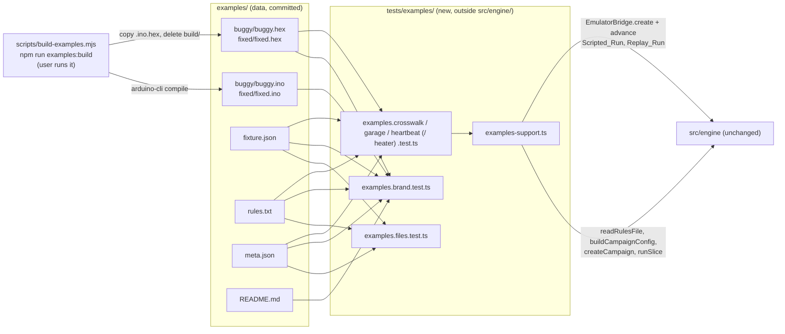

# Design Document: example-firmware

## Overview

This design adds four small ATmega328P examples (`crosswalk`, `garage`, `heartbeat` and the optional `heater`) and the tests that hold them to `requirements.md`. Each example is one sketch written twice. The Buggy_Sketch and the Fixed_Sketch differ in one code line plus the header line that names the build (Appendix A). The engine under `src/engine/` is used as it is; nothing in it changes.

What this design fixes:

- the files under `examples/`, their exact content (Fixture, rules line, meta fields, Timing_Note, README text);
- the eight sketches, with the arithmetic that places each Violation cycle v;
- the hand-written event lists (Single_Input, Minimal_Bug_Input) per example;
- the Conflicting_Outputs pairs and the lines that turn outputs off before turning another on;
- the campaign path, the span measurement, the timeouts and where the wall clock is read;
- the build script, the test files and a coverage table over Requirements 1 to 22;
- estimates of campaign time and of the chance that each gremlin set finds each bug, including the `garage` Per_Run_Odds and Miss_Chance that choose the Requirement 9, criterion 8 branch (D12);
- the `garage` Door_State: start state, every change, and the output levels that show each state.

Two limits apply throughout. The agent cannot compile, so every claim about the compiled HEX (timing, the value read past the `heater` table) is an expectation that the initial compile and test run will confirm or refute. Tests are evidence, not proof: a `HELD` means "No violation found in N runs of this gremlin set. Not a proof." and nothing more.

`heater` is optional and comes last. No file, test, helper or script behaviour depends on it (Requirement 1, criteria 12 and 13).

### Checks made while writing this design

- Every source quote is in Appendix B with its file path and line range. Each was read from the working tree and copied by a script, not retyped.
- No quote disagrees with F1 to F15 (Requirement 20, criterion 7). One note: `types.ts` lines 9 and 24 (Q1) also allow an optional `kind?: "digital"` on digital pins and `direction?: "input"` on analog pins. F1 does not list them. This is an omission, not a contradiction, and Requirement 4, criterion 5 then keeps both fields out of the example Fixtures.
- F15 was rechecked: `fixtures/blink_button/build/blink_button.ino.elf` holds 9 case-insensitive matches of the brand name, and the `.hex`, `.eep` and `.with_bootloader.*` files hold 0.
- The six rules lines, read with `readRulesFile`, rendered with `render` and compiled with `compileRuleSet` and `analyzeRuleSet` against the Fixtures of this design, gave the results in "Rules lines" below. This was a one-off `tsx` run from a temporary file that was deleted afterwards, during the earlier revision. The user accepted that run once (D10). The rules lines and Fixtures have not changed since, and the Example_Tests repeat the check.

### Process for this document (D10)

While `requirements.md`, `design.md` or `tasks.md` of this spec is being written or revised, the agent asks the user before it writes or runs any code file, temporary scripts included (Requirement 19, criterion 13). This revision wrote and ran no code file and ran no shell command that executes code. It read source files and did every number below by hand. Quotes Q43 and Q44 were added in this revision and copied by hand from the file text; the older quotes were not re-copied.

## Architecture



Data flow for one example test file:

1. Read `fixture.json`, `rules.txt`, `meta.json` and the two Build_HEX files. A missing Build_HEX fails the test with its path and `npm run examples:build` (Requirement 15, criterion 7).
2. Buggy build: `buildCampaignConfig` then `createCampaign` then one `runSlice(N)`. Expect `BROKE`; replay the trace to the Replay_End and measure the Violation_Span.
3. Fixed build: the same path, timed with the wall clock. Expect `HELD` with `heldText(N)`; check gremlin events, Triggers, no CannotCheck, no Floating_Diagnostic and the Conflicting_Outputs.
4. Scripted_Runs: the Single_Input and the Minimal_Bug_Input on fresh bridges, fed to a Rule_Checker the way `runOne` feeds it.

### Timing assumptions about the compiled sketches

These come from the core library's documented behaviour and from SPIKE.md. The initial test run confirms or refutes them.

- `millis()` advances from the timer0 overflow interrupt. With prescaler 64, one overflow is 256 × 64 = 16,384 cycles (1.024 ms). Each overflow adds 1 to the count and 3 to a fraction; when the fraction reaches 125 it adds 1 more. Over 125 overflows (128 ms) the count rises by 128, so `millis()` is exact on average and moves in steps of 1 or 2 at overflow instants. A test `now - last >= X` therefore fires between about 1 ms early and 1.1 ms late. SPIKE.md S2 measured a 100 ms toggle as 1,605,688 cycles (100.36 ms).
- A wait of 200 ms from one toggle to the next takes 195 or 196 overflows: 3,194,880 or 3,211,264 cycles, plus a loop pass of a few hundred cycles. Both lie inside the 199 ms to 202 ms band (3,184,000 to 3,232,000) of Requirement 10, criterion 3.
- `digitalWrite` and `digitalRead` take tens of cycles each. One `loop()` pass of these sketches takes well under 0.1 ms (1,600 cycles), so every input level that lasts at least 1,600 cycles is seen by at least one read. The bouncer's smallest default gap is 1,600 cycles (Q5).
- `analogRead` at the core's ADC prescaler of 128 takes 13 ADC clocks, 1,664 cycles (0.104 ms).
- The bridge records an Output_Edge after every instruction (Q29), so two `digitalWrite` calls in a row always land at two different cycles. This is what makes "off before on" visible to the tests.
- Speed: SPIKE.md measured 45.4 to 46.7 million cycles per second for campaigns in Node. Estimates below use 45,000,000.

## Components and Interfaces

### 1. Summary table

All four Fixtures have no `clockHz` (16 MHz default). Every Digital_Input has `activeLevel: "low"` and no `restState`, and every sketch configures it with `INPUT_PULLUP` before its earliest read. campaignSeed values are chosen, not tuned: they are the date-like integers below, picked before any run. The `BROKE` Recorded_Acceptance_Values are written into the tests only after the initial green run (Requirement 15, criterion 5).

| Example | Pins (signal, pin, direction, activeLevel) | rules.txt line(s) | gremlinSet | runCycles | N | campaignSeed | Buggy verdict | Fixed verdict | timingNote |
|---|---|---|---|---|---|---|---|---|---|
| `crosswalk` | REQUEST PD2 input, low; CAR_GREEN PB0 output; CAR_YELLOW PB1 output; CAR_RED PB2 output; WALK PB3 output; DONT_WALK PB4 output | `all of (CAR_GREEN is 1, WALK is 1) must never happen.` | `[{"id":"masher"}]` | 16,000,000 | 24 | 20261101 | `BROKE` | `HELD`: No violation found in 24 runs of this gremlin set. Not a proof. | `Demo timing: yellow 150 ms, all-red 50 ms, WALK 200 ms (a real crossing takes many seconds).` |
| `garage` | CLOSE PD2 input, low; BEAM_CLEAR PD3 input, low; MOTOR_CLOSE PB0 output; MOTOR_OPEN PB1 output; LAMP PB2 output | `Within 20 ms after BEAM_CLEAR is 0 becomes true, MOTOR_CLOSE is 0 must be true.` | `[{"id":"bouncer"},{"id":"masher"}]` | 10,000,000 | 40 | 20261102 | `BROKE` (expected; estimated Miss_Chance 0.22 %, section 12.1) | `HELD`: No violation found in 40 runs of this gremlin set. Not a proof. | `Demo timing: the door closes by itself after 300 ms open and takes 300 ms to close (a real door waits and moves for several seconds).` |
| `heartbeat` | PULSE PD2 input, low; HEARTBEAT PB0 output | `HEARTBEAT is 0 must never last 600 ms or longer.` and `HEARTBEAT is 1 must never last 600 ms or longer.` | `[{"id":"stuck"}]` | 16,000,000 | 24 | 20261103 | `BROKE` | `HELD`: No violation found in 24 runs of this gremlin set. Not a proof. | `Demo timing: HEARTBEAT toggles every 200 ms and a pulse wait gives up after 100 ms (a real monitor beats about once a second).` |
| `heater` (optional, last) | TEMP ADC channel 0 (PC0) analog, no restLevel (512); HEATER PB0 output | `Within 10 ms after TEMP is above 900 becomes true, HEATER is 0 must be true.` | `[{"id":"spike"}]` | 8,000,000 | 16 | 20261104 | `BROKE` (expected; depends on the byte past the table, see heater) | `HELD`: No violation found in 16 runs of this gremlin set. Not a proof. | `Demo timing: the rule gives the heater 10 ms to switch off (a real thermostat may take seconds).` |

Gremlin parameters are the catalogue defaults in every example (Q5). No entry overrides a parameter.

`garage` behaviour fixed by D11 to D13: the door closes by itself after 300 ms open (`AUTO_CLOSE_MS`, a Phase_Constant in both builds), and a CLOSE_Press while the door is closed does nothing (the D12 branch chosen in section 12, Miss_Chance 0.22 % central estimate, 0.81 % low estimate, both at or under 1 %).

### 2. Example files

Layout per Example (Requirement 1, criteria 3 and 4; OI-1, D5):

```
examples/
  README.md
  <id>/
    buggy/buggy.ino
    buggy/buggy.hex      written by the Build_Script, compiled and committed by the user
    fixed/fixed.ino
    fixed/fixed.hex      written by the Build_Script, compiled and committed by the user
    fixture.json
    rules.txt
    meta.json
```

All text files are UTF-8 with no byte-order mark and LF line endings. `rules.txt` holds exactly the lines in the summary table, each followed by one LF.

#### fixture.json

`crosswalk`:

```json
{
  "pins": [
    { "signal": "REQUEST", "port": "D", "bit": 2, "direction": "input", "activeLevel": "low" },
    { "signal": "CAR_GREEN", "port": "B", "bit": 0, "direction": "output" },
    { "signal": "CAR_YELLOW", "port": "B", "bit": 1, "direction": "output" },
    { "signal": "CAR_RED", "port": "B", "bit": 2, "direction": "output" },
    { "signal": "WALK", "port": "B", "bit": 3, "direction": "output" },
    { "signal": "DONT_WALK", "port": "B", "bit": 4, "direction": "output" }
  ]
}
```

`garage`:

```json
{
  "pins": [
    { "signal": "CLOSE", "port": "D", "bit": 2, "direction": "input", "activeLevel": "low" },
    { "signal": "BEAM_CLEAR", "port": "D", "bit": 3, "direction": "input", "activeLevel": "low" },
    { "signal": "MOTOR_CLOSE", "port": "B", "bit": 0, "direction": "output" },
    { "signal": "MOTOR_OPEN", "port": "B", "bit": 1, "direction": "output" },
    { "signal": "LAMP", "port": "B", "bit": 2, "direction": "output" }
  ]
}
```

`heartbeat`:

```json
{
  "pins": [
    { "signal": "PULSE", "port": "D", "bit": 2, "direction": "input", "activeLevel": "low" },
    { "signal": "HEARTBEAT", "port": "B", "bit": 0, "direction": "output" }
  ]
}
```

`heater` (optional):

```json
{
  "pins": [
    { "signal": "TEMP", "kind": "analog", "channel": 0 },
    { "signal": "HEATER", "port": "B", "bit": 0, "direction": "output" }
  ]
}
```

Every digital pin is on a general I/O pin (port B bits 0 to 5, port D bits 0 to 7). No two digital entries share a port and bit. `heater` uses ADC channel 0 and no digital pin on port C bit 0, so the shared-pin check of `validateFixture` (Q3) passes. Each Fixture was run through `validateFixture` while writing this design and returned `null`.

#### meta.json

Fields: `title`, `story`, `timingNote`, `gremlinSet`, `runCycles`, `campaignSeed`, `runs`, and for `crosswalk` only the Double_Press_Window fields `doublePressWindowStartMs` and `doublePressWindowEndMs` (Requirement 6, criterion 8).

```json
{
  "title": "Crosswalk",
  "story": "A crossing button. One press gives the cars yellow, then red, then WALK. Two quick presses can leave WALK on while the cars get green.",
  "timingNote": "Demo timing: yellow 150 ms, all-red 50 ms, WALK 200 ms (a real crossing takes many seconds).",
  "gremlinSet": [{ "id": "masher" }],
  "runCycles": 16000000,
  "campaignSeed": 20261101,
  "runs": 24,
  "doublePressWindowStartMs": 60,
  "doublePressWindowEndMs": 240
}
```

```json
{
  "title": "Garage door and the cat",
  "story": "The door closes by itself after 300 ms open. A cat walks through the beam and its legs break it twice in a few milliseconds. The door keeps closing.",
  "timingNote": "Demo timing: the door closes by itself after 300 ms open and takes 300 ms to close (a real door waits and moves for several seconds).",
  "gremlinSet": [{ "id": "bouncer" }, { "id": "masher" }],
  "runCycles": 10000000,
  "campaignSeed": 20261102,
  "runs": 40
}
```

```json
{
  "title": "Heartbeat",
  "story": "A heartbeat LED shows the program is running. When the pulse sensor sticks, the sketch waits for the pulse to end and the heartbeat stops.",
  "timingNote": "Demo timing: HEARTBEAT toggles every 200 ms and a pulse wait gives up after 100 ms (a real monitor beats about once a second).",
  "gremlinSet": [{ "id": "stuck" }],
  "runCycles": 16000000,
  "campaignSeed": 20261103,
  "runs": 24
}
```

```json
{
  "title": "Heater table",
  "story": "A heater looks up its setting in a table of 10 entries, one per 100 counts. A full-scale reading of 1023 reads past the end of the table.",
  "timingNote": "Demo timing: the rule gives the heater 10 ms to switch off (a real thermostat may take seconds).",
  "gremlinSet": [{ "id": "spike" }],
  "runCycles": 8000000,
  "campaignSeed": 20261104,
  "runs": 16
}
```

Field checks against Requirement 6: titles are 9 to 23 characters, stories are one line of 134 to 148 characters (crosswalk 134, heater 137, heartbeat 138, garage 148), no `\n` or `\r`. `runCycles` lie in 8,000,000 to 16,000,000 and each is at least the largest Window_Cycles (crosswalk: none; garage: 320,000; heartbeat: 9,600,000; heater: 160,000). The `garage` story contains `cat`, `beam` and `300 ms` and says the door closes by itself after 300 ms open (Requirement 9, criteria 7 and 11; D11). The `garage` timingNote contains `300 ms` and the whole word `Demo`, and says the door closes by itself after 300 ms open (Requirement 9, criterion 12; D11). None of the titles, stories or timingNotes contains a Board_Brand_Name as a whole word (the eight words of Requirement 18, criterion 3, checked one by one against each string by hand) or a word of BANNED_WORDS (`src/engine/copy-rules.ts` line 4 onward; this document does not write the words out). The tests check all of this; the counts here were made by hand.

Per-Example upper bound of `runs` (Requirement 6, criterion 7): the largest N whose estimated fixed-campaign time N × runCycles / 45,000,000 s stays at or below 12,000 ms. That is floor(540,000,000 / runCycles): crosswalk 33, garage 54, heartbeat 33 (fixed at 24 by D3), heater 67.

#### examples/README.md (Examples_README)

```markdown
# Hexorcist examples

Three small ATmega328P programs at 16 MHz, each written twice: `buggy/` has one planted bug and
`fixed/` has the same program with that bug removed. Each folder also has the pin map
(`fixture.json`), the rules (`rules.txt`, written in Hexorcist's five fixed English sentence
patterns) and the campaign settings (`meta.json`).

| Example | What goes wrong in the buggy build |
|---|---|
| crosswalk | Two quick presses can leave WALK on while the cars get green. |
| garage | Two short beam breaks in quick succession are taken as noise, so the door keeps closing. |
| heartbeat | A stuck pulse input stops the HEARTBEAT output from toggling. |

## Results at the committed seeds

| Example | Gremlins | Buggy build | Fixed build |
|---|---|---|---|
| crosswalk | masher | BROKE (run index 3, seed 20261101) | HELD: no violation found in 24 runs of this gremlin set, not a proof |
| garage | bouncer, masher | BROKE (run index 7, seed 20261102) | HELD: no violation found in 40 runs of this gremlin set, not a proof |
| heartbeat | stuck | BROKE (run index 1, seed 20261103) | HELD: no violation found in 24 runs of this gremlin set, not a proof |

In the tests, one ordinary input on its own (a single press, beam break or pulse) does not break
any buggy build. The bugs need the gremlins' timing.

## Demo timings

Timings are shorter than on a real device, so each campaign run lasts at most one second of
simulated time. Each `meta.json` has a `timingNote` that says where:

- crosswalk: Demo timing: yellow 150 ms, all-red 50 ms, WALK 200 ms (a real crossing takes many seconds).
- garage: Demo timing: the door closes by itself after 300 ms open and takes 300 ms to close (a real door waits and moves for several seconds).
- heartbeat: Demo timing: HEARTBEAT toggles every 200 ms and a pulse wait gives up after 100 ms (a real monitor beats about once a second).

## Glitch-tolerant rules

A `must never happen.` rule breaks if its condition is true for even one CPU cycle. If a short
glitch should not count, write the glitch-tolerant form instead:

    <C> must never last 1 ms or longer.

## Rebuilding the HEX files

Run `npm run examples:build`. It compiles each sketch, keeps only `<variant>.hex` next to the
sketch and deletes the `build/` folder. The tests read the committed HEX files and never compile.

A passing test is evidence, not proof.
```

The README text above is the one written in task 10 for the three Core_Examples: it says "Three" and has no `heater` row (D22). Task 12.3 edits it only if `heater` is kept: it changes "Three" to "Four" and adds this row at the end of the first table (D30: and a heater row to the results table too), and nothing else changes. If `heater` is cut, the README stays as written (Requirement 1, criterion 13).

```markdown
| heater | A reading of 1023 reads past the end of a 10-entry table. |
```

 The README contains no Board_Brand_Name as a whole word and no word of BANNED_WORDS; Requirement 21, criterion 14 checks it. Its only chip name is `ATmega328P`, which the Brand_Matcher does not flag (D15).

### 3. Rules lines (Requirement 5, Requirement 20, criterion 2)

Result of the one-off run described in the Overview, per Example, with `rules.txt` text = the lines joined by LF plus a final LF:

| Example | Line | `readRulesFile` | `render` equals the line | `compileRuleSet` | `analyzeRuleSet` plan |
|---|---|---|---|---|---|
| crosswalk | `all of (CAR_GREEN is 1, WALK is 1) must never happen.` | `{ ok: true }`, 1 Rule | yes | `ok: true` | active, 0 marks, limit `null` (never) |
| garage | `Within 20 ms after BEAM_CLEAR is 0 becomes true, MOTOR_CLOSE is 0 must be true.` | `{ ok: true }`, 1 Rule | yes | `ok: true` | active, 0 marks, limit 320,000 |
| heartbeat | `HEARTBEAT is 0 must never last 600 ms or longer.` | `{ ok: true }`, 2 Rules | yes | `ok: true` | active, 0 marks, limit 9,600,000 |
| heartbeat | `HEARTBEAT is 1 must never last 600 ms or longer.` | (same file) | yes | (same) | active, 0 marks, limit 9,600,000 |
| heater | `Within 10 ms after TEMP is above 900 becomes true, HEATER is 0 must be true.` | `{ ok: true }`, 1 Rule | yes | `ok: true` | active, 0 marks, limit 160,000 |

Each line uses one of the five templates of `render.ts` (Q22): `never`, `respond` and `notLongerThan`. `readRulesFile` splits on LF and drops a trailing CR (Q21), so the final LF adds no Rule.

### 4. Sketches, bugs and hand-written inputs

Full source of all eight sketches and the three-to-four line diffs are in Appendix A. Phase_Constants (all 50 ms to 300 ms, declared at file scope in ms):

- crosswalk: `YELLOW_MS` 150, `CLEAR_MS` 50, `WALK_MS` 200, `MIN_GREEN_MS` 100.
- garage: `CLOSE_MS` 300, `OPEN_MS` 200, `AUTO_CLOSE_MS` 300. `DEBOUNCE_MS` 10 is a debounce constant, not a Phase_Constant.
- heartbeat: `BEAT_MS` 200. `PULSE_TIMEOUT_MS` 100 is a timeout constant, not a Phase_Constant.
- heater: none. The sketch has no timed phase.

No sketch has an `#include`, a `Serial` call or a USART register access. Every sketch uses only `pinMode`, `digitalRead`, `digitalWrite`, `millis` and (heater) `analogRead`, which use GPIO, timer0 and the ADC (F14). Every pin a sketch touches is in its Fixture (Requirement 2, criterion 7).

Hand-written events use `gremlinId: "script"`. Cycles are integers below `runCycles`, in non-decreasing order. No example input has `restState: "active"`, so no list holds a Rest_Event (Requirement 16, criterion 2).

#### 4.1 crosswalk (hero)

How it works (fixed build, Appendix A.2): cars show green until a REQUEST press (falling edge seen by `digitalRead`) arrives at least `MIN_GREEN_MS` after the last green began. A crossing then runs on two timelines that the fixed build starts at the same cycle (lines 77 to 81): `crossStart` drives the car lights, `walkStart` drives the walk lights. Car lights: yellow for t < 150 ms, red for t < 450 ms, then green and the crossing ends (lines 88 to 96). Walk lights: WALK for 200 ms ≤ w < 400 ms, DONT_WALK otherwise (lines 99 to 103). The walk lights are updated only while a crossing runs (line 83 and the `return` on line 96).

The Bug (buggy lines 81 and 82): a press during a crossing restarts `walkStart` but not `crossStart`. If the second press comes d ms after the crossing started, WALK runs on the walk timeline from d + 200 to d + 400 ms. The crossing ends at 450 ms on the car timeline. If WALK is on at that moment, the `return` on buggy line 98 (fixed line 96) skips the walk update, so WALK stays on while the cars get green, and stays on until the next crossing starts (at least `MIN_GREEN_MS` later).

Second defect and whether the fix removes it (D14, Requirement 20, criterion 11). Working through the buggy loop for a second press at d ms on the car timeline:

- d < 50: WALK runs from d + 200 to d + 400 ms, which ends before 450 ms. WALK is late by d ms but shows for 200 ms. No overlap.
- 50 ≤ d ≤ 249: the Bug (overlap at 450 ms), as above.
- 250 ≤ d < 400: WALK came on at 200 ms. At d the reset makes w = 0, so line 104 (buggy `showWalk(DONT_WALK_PIN)`) turns WALK off. Until 450 ms, w stays below 200, so WALK does not come back. WALK shows for d − 200 ms (50 to 199 ms) where it should show 200 ms.
- 400 ≤ d < 450: WALK already showed from 200 to 400 ms. The reset gives w < 50, which keeps DONT_WALK. Nothing visible changes.

So the second defect is a WALK phase cut short when the second press lands 250 to 399 ms into the crossing. The earlier wording "WALK never shows" was wrong: WALK shows from 200 ms and is cut off at the second press. In the 400 to 449 ms part of the range there is no visible defect.

The fixed build removes it. With buggy lines 81 and 82 removed (the only Bug-fix lines, Appendix A.3), a press during a crossing changes nothing, `walkStart` always equals `crossStart` (fixed lines 79 and 80), and WALK shows from 200 to 400 ms in every crossing (fixed lines 99 to 103). No line beyond the Bug-fix lines is needed. No Rule is added for it (D14); `rules.txt` keeps its one line.

Window arithmetic, in `millis()` units: WALK is on at the end iff some crossing pass saw w ≥ 200 (d + 200 ≤ 449, so d ≤ 249) and no crossing pass saw w ≥ 400 (d + 400 > 449, so d ≥ 50). With up to about 1.1 ms of `millis()` slack on each side, the Double_Press_Window is fixed at 60 ms to 240 ms after the earlier press, 10 ms inside each edge. End × 16,000 = 3,840,000 < 16,000,000.

Why no Single_Input breaks it: a Single_Input is one press and one release. The release is a rising edge and the sketch acts only on falling edges, so only one press is ever seen, `walkStart` equals `crossStart`, WALK goes off at 400 ms and the cars get green at 450 ms.

Which gremlin finds it: `masher` (defaults: 1 to 6 presses, gaps of 80,000 to 2,400,000 cycles, that is 5 to 150 ms, each press released half a gap later; Q5, digital.ts lines 58 to 87). Any masher burst whose last press inside a crossing lands 50 to 249 ms after the press that started it breaks the buggy build (OI-6 covers why the `never` Rule needs no Trigger).

Single_Input (Requirement 14, criteria 1 and 2): Ordinary_Hold 50 ms = 800,000 cycles.

| cycle | signal | value | gremlinId |
|---|---|---|---|
| 4,800,000 | REQUEST | 0 (Press) | script |
| 5,600,000 | REQUEST | release | script |

The press at 300 ms is past `MIN_GREEN_MS`. WALK is on from about 500 ms to 700 ms and off at 9,600,000 + 1,600,000 = 11,200,000 cycles; CAR_GREEN goes on at about 4,800,000 + 7,200,000 = 12,000,000. No overlap.

Minimal_Bug_Input (Requirement 8, criterion 8; Rule named: `all of (CAR_GREEN is 1, WALK is 1) must never happen.`):

| cycle | signal | value | gremlinId |
|---|---|---|---|
| 4,800,000 | REQUEST | 0 (Press) | script |
| 5,600,000 | REQUEST | release | script |
| 6,400,000 | REQUEST | 0 (Press) | script |
| 7,200,000 | REQUEST | release | script |

Offset tests for Requirement 8, criterion 4 (D29): the first Press is at 4,800,000 and its Release at 5,600,000. The second Press is at 4,800,000 plus the offset: 5,760,000 (60 ms), 7,200,000 (150 ms), 8,640,000 (240 ms). The second Release is 800,000 cycles after the second Press: 6,560,000, 8,000,000, 9,440,000. Both presses are 50 ms Ordinary_Holds.
d = 6,400,000 − 4,800,000 = 1,600,000 cycles = 100 ms, inside 60 to 240 ms. Buggy: `walkStart` moves to about 400 ms, WALK turns on at about 400 + 200 = 600 ms (9,600,000 cycles). The car timeline ends at 300 + 450 = 750 ms, so v ≈ 4,800,000 + 450 × 16,000 = 12,000,000 cycles, within about ±20,000 cycles of `millis()` slack (estimate). At v, w ≈ 350 ms, so WALK is 1 and CAR_GREEN has just turned 1. v < 16,000,000. No later input exists, so the condition stays true to the Replay_End: span ≈ 16,032,000 − 12,000,000 = 4,032,000 cycles (252.000 ms), cut by replay end. Fixed: the second press is ignored, WALK is off at 700 ms and green comes at 750 ms.

#### 4.2 garage

How it works (Appendix A.4 and A.5; line numbers are the same in both builds): the door starts open (`DOOR_OPEN`). While the door is open or opening, it starts closing when a CLOSE_Press arrives with the beam clear (lines 92 and 93). An open door also closes by itself after `AUTO_CLOSE_MS` (300 ms) open with the beam clear (lines 96 and 97; D11). A closed door stays closed: line 92 tests `phase != DOOR_CLOSED`, so a CLOSE_Press while closed does nothing (D12, branch chosen in section 12.1). Closing runs MOTOR_CLOSE for `CLOSE_MS` (lines 84 and 85). While closing, each new break of the beam (a clear-to-blocked change seen by `digitalRead`) is counted, and the time of the earliest break is kept (lines 80 to 83). `DEBOUNCE_MS` after the earliest break, the fixed build reverses: MOTOR_OPEN for `OPEN_MS`, then open again (lines 86 and 87, 94 and 95).

Phase_Constants (Requirement 2, criterion 3; D11): `CLOSE_MS` 300 (line 27), `OPEN_MS` 200 (line 28) and `AUTO_CLOSE_MS` 300 (line 29), with the same values in both builds. `DEBOUNCE_MS` 10 (line 30) is a debounce constant, not a Phase_Constant.

Door_State (glossary entry; D11, D12). The Sketch variable `phase` (line 33) holds it.

| Door_State | `phase` value | MOTOR_CLOSE | MOTOR_OPEN | LAMP | Set by |
|---|---|---|---|---|---|
| `open` | `DOOR_OPEN` | 0 | 0 | 0 | `runMotor(NO_PIN)`, lines 57 and 41 to 46 |
| `closing` | `DOOR_CLOSING` | 1 | 0 | 1 | `runMotor(MOTOR_CLOSE_PIN)`, line 53 |
| `opening` | `DOOR_OPENING` | 0 | 1 | 1 | `runMotor(MOTOR_OPEN_PIN)`, line 55 |
| `closed` | `DOOR_CLOSED` | 0 | 0 | 0 | `runMotor(NO_PIN)`, line 57 |

Starting Door_State: `open`, entered in `setup()` by `enter(DOOR_OPEN, millis())` (line 67), a few thousand cycles after reset, with `phaseStart` at `millis()` ≈ 0.

Every Door_State change:

1. `open` to `closing`: a CLOSE_Press with BEAM_CLEAR 1 (lines 92 and 93), or 300 ms in `open` with BEAM_CLEAR 1 at the check (lines 96 and 97). If the beam is blocked when the 300 ms pass, the door closes at the earliest loop pass after the beam is clear again.
2. `opening` to `closing`: a CLOSE_Press with BEAM_CLEAR 1 (lines 92 and 93).
3. `opening` to `open`: 200 ms in `opening` (lines 94 and 95).
4. `closing` to `closed`: 300 ms in `closing` (lines 84 and 85). This check comes before the debounce check, so when both are due in the same pass, `closed` wins.
5. `closing` to `opening`: 10 ms after the earliest break of this close (lines 86 and 87). The fixed build always takes it. The buggy build takes it only if exactly one break was seen by then.
6. `closed`: no change leaves it. The door stays `closed` to the end of the Run (D12).

No other change exists. A CLOSE_Press while `closing` does nothing either, because the closing branch returns at line 89 before line 92.

Reading Door_State from Output_Edges: `open` and `closed` show the same levels, so the tests tell them apart by the change that led there. A fall of MOTOR_CLOSE followed within 1,000 cycles by a rise of MOTOR_OPEN, with LAMP staying 1, is `closing` to `opening`. A fall of MOTOR_CLOSE together with a fall of LAMP and no MOTOR_OPEN rise within 1,000 cycles is `closing` to `closed`. A fall of MOTOR_OPEN with a fall of LAMP is `opening` to `open`. A rise of MOTOR_CLOSE is a change to `closing`. The reset state is `open`. Three `digitalWrite` calls take a few hundred cycles, well under 1,000 (an estimate the Scripted_Runs confirm).

Debounce interval: 10 ms. CLOSE response time (Requirement 9, criterion 8): 1 ms (16,000 cycles). MOTOR_CLOSE becomes 1 within 1 ms of a CLOSE_Press that arrives while Door_State is `open` or `opening`, MOTOR_CLOSE is 0 and BEAM_CLEAR is 1. That is one loop pass plus three `digitalWrite` calls. A Trigger at c with c + 320,000 at or below `runCycles` can then fall while MOTOR_CLOSE is 1 (the Minimal_Bug_Input below shows one).

CLOSE_Press (D13): a change of CLOSE to its Press_Value 0. The Sketch sees it as `closeNow && !closeWas` (lines 72 to 74), a change between two reads. A Press event on CLOSE while CLOSE is already 0 changes nothing on the pin, so the Sketch sees no change and gives no response.

The Bug (buggy line 87): `if (breaks == 1) enter(DOOR_OPENING, now);`. Ten milliseconds after the earliest break, the buggy build reverses only if exactly one break was seen. Two or more breaks in those 10 ms are taken as noise, and because `breaks` only grows during one close, the beam is ignored until the door finishes closing. A cat's legs break the beam twice; the door keeps closing.

Why no Single_Input breaks it: one press and one release on BEAM_CLEAR is one break, so `breaks == 1` holds at the decision and the door reverses 10 ms after the break, 10 ms inside the 20 ms rule (Requirement 9, criterion 5 covers a steady block the same way). A Single_Input on CLOSE has no BEAM_CLEAR change, so the Trigger never occurs.

Which gremlin finds it: `bouncer` on BEAM_CLEAR (defaults: 2 to 8 flips, gaps of 1,600 to 48,000 cycles, 0.1 to 3 ms; Q5, Q7, Q44). Any burst with at least two presses gives two breaks at most 6 ms apart. Each of the two gremlins picks CLOSE or BEAM_CLEAR by one draw per Run (`pick(prng, ctx.eligible.digital)`, Q6 and Q7), so each reaches BEAM_CLEAR in some Runs and not in every Run (OI-5, Requirement 9, criterion 3). `masher` on CLOSE can start the close earlier, which does not change the odds (section 12). On BEAM_CLEAR its 5 to 150 ms gaps rarely put two breaks inside 10 ms, and a lone masher break during a close makes the door reverse, which spoils a later bouncer burst. Section 12 gives the Per_Run_Odds and Miss_Chance (D12).

Single_Input (Ordinary_Hold 2 ms = 32,000 cycles):

| cycle | signal | value | gremlinId |
|---|---|---|---|
| 6,400,000 | BEAM_CLEAR | 0 (Press) | script |
| 6,432,000 | BEAM_CLEAR | release | script |

The door closes by itself from about 300 ms (4,800,000) to 600 ms. The break at 400 ms is one break; the buggy build reverses at about 410 ms (6,560,000 ± 17,000), before c + 320,000 = 6,720,000.

Minimal_Bug_Input (Requirement 9, criterion 13; Rule named: the garage line):

| cycle | signal | value | gremlinId |
|---|---|---|---|
| 1,600,000 | CLOSE | 0 (Press) | script |
| 2,400,000 | CLOSE | release | script |
| 3,200,000 | BEAM_CLEAR | 0 (Press) | script |
| 3,232,000 | BEAM_CLEAR | release | script |
| 3,296,000 | BEAM_CLEAR | 0 (Press) | script |
| 3,328,000 | BEAM_CLEAR | release | script |

One CLOSE press; two blocked spans of 2 ms each (shorter than the 10 ms debounce) separated by a 4 ms clear span. The CLOSE press at 100 ms starts closing until about 400 ms (6,400,000). The Trigger c is the applied cycle of the 3,200,000 press, which is 3,200,000 or a few cycles later (the bridge applies an event at the next instruction boundary at or after its cycle, Q29 context). The respond monitor (Q36) sets v = c + 320,000 ≈ 3,520,000 because MOTOR_CLOSE is still 1 then. c + 320,000 ≤ 10,000,000. MOTOR_CLOSE stays 1 until the close ends at about 6,400,000, so the span ≈ 2,880,000 cycles (180.000 ms), not cut. Fixed: it reverses at about 210 ms (3,360,000), before v; it is `opening` until about 410 ms and `open` after that, and its next auto-close would come at about 710 ms, past the run end of 625 ms.

How the list meets Requirement 9, criterion 13: the one CLOSE Press at 1,600,000 (100 ms) lands while Door_State is `open` (the reset state; auto-close is due only at 300 ms), so it is a CLOSE_Press that starts closing under either branch of criterion 8. Two BEAM_CLEAR Press and Release pairs follow, giving blocked spans of 32,000 cycles (2 ms) each, both shorter than the 10 ms debounce, with a clear span of 64,000 cycles (4 ms) between them. Every cycle is below 10,000,000, and c + 320,000 ≈ 3,520,000 ≤ 10,000,000. The garage test checks this shape on the constant list and checks that MOTOR_CLOSE rises within 16,000 cycles of 1,600,000. Under D12 the door ends this Run `closed` at about 400 ms and stays closed.

Further garage Scripted_Runs (both builds unless noted; every event is `gremlinId` `script`):

- CLOSE_Press with the door open (Requirement 9, criterion 8, door-not-closed bullet): CLOSE Press at 1,600,000, Release at 2,400,000. Expect a MOTOR_CLOSE rise at a cycle from 1,600,000 to 1,616,000.
- CLOSE_Press with the door closed (criterion 8, the chosen D12 bullet): one CLOSE Press at 9,700,000 and nothing else. With no input the door closes by itself from about 4,800,000 to about 9,600,000 (each end within about ±34,000 cycles of `millis()` slack and startup offset), so at 9,700,000 it is `closed`. Expect MOTOR_CLOSE 0 and MOTOR_OPEN 0 at every cycle from 9,700,000 to 10,000,000 (no edge of either in that span), and the change at about 9,600,000 read as `closing` to `closed`.
- Press with no change (criterion 8, not-a-CLOSE_Press bullet; D13): BEAM_CLEAR Press at 80,000; CLOSE Press at 160,000 (beam blocked, so no close); BEAM_CLEAR Release at 320,000 (CLOSE still 0, so no change of CLOSE); CLOSE Press at 640,000 (CLOSE already 0). Expect MOTOR_CLOSE 0 at every cycle from 640,000 to 4,700,000. The auto-close at about 4,800,000 comes after this span. The Trigger at 80,000 falls while MOTOR_CLOSE is 0, so the Rule's expect Condition holds and no Violation follows.
- Auto-close (criterion 10; D11): empty event list. Expect the earliest MOTOR_CLOSE rise at a cycle from 4,784,000 to 4,832,000 (299 ms to 302 ms: 300 ms open as `millis()` counts it, with about 1 ms of `millis()` slack each way and the 1 ms CLOSE response time).
- Steady block on the buggy build (criterion 5): BEAM_CLEAR Press at 6,400,000 and Release at 6,880,000 (30 ms). The door is closing then (auto-close), one break is seen, and MOTOR_CLOSE falls by about 6,560,000 + 17,000, before 6,720,000.

#### 4.3 heartbeat

How it works (Appendix A.7 and A.8): HEARTBEAT starts LOW and toggles when `millis() - lastToggle >= BEAT_MS` (lines 33 to 37). While PULSE reads LOW, the sketch waits for the pulse to end and records its length (lines 39 to 44).

The Bug (buggy line 41): `while (digitalRead(PULSE_PIN) == LOW) {` has no timeout. If PULSE sticks, `loop()` never returns to the toggle and HEARTBEAT keeps its level. The fixed line adds `&& millis() - start < PULSE_TIMEOUT_MS` with a timeout of 100 ms. With PULSE held for any length, each fixed-build level lasts at most BEAT_MS + PULSE_TIMEOUT_MS + about 1.1 ms ≈ 301 ms, under 600 ms (Requirement 10, criterion 6).

Why no Single_Input breaks it: a Single_Input holds PULSE at most 200 ms. The wait blocks the toggle for at most that long, and when it ends the toggle check runs at once. The level that holds the press therefore lasts at most max(200 ms, time from its start to the release) + about 1.1 ms ≤ 200 + 200 + 1.1 ms, under 600 ms.

Which gremlin finds it: `stuck` (default `minSpanCycles` 1,600,000; it presses at a start in 0 to runCycles − minSpan and releases after a span drawn from minSpan to the run end, only if the release lands inside the run; Q8). A hold that keeps PULSE LOW until 600 ms after the last toggle breaks the buggy build.

Single_Input and the arithmetic of Requirement 10, criterion 9 (D7). Ordinary_Hold 100 ms = 1,600,000 cycles.

| cycle | signal | value | gremlinId |
|---|---|---|---|
| 4,000,000 | PULSE | 0 (Press) | script |
| 5,600,000 | PULSE | release | script |

With no input, toggles fall at T1 ≈ 3,200,000 and T2 ≈ 6,400,000 cycles (each interval 3,194,880 or 3,211,264 cycles plus a loop pass; the startup offset before `lastToggle = millis()` is a few thousand cycles). Assume T1 in 3,190,000 to 3,230,000.

- Span from the reset-time LOW to T1: about 3,200,000 cycles, under 9,600,000.
- Span holding the press (4,000,000) and the release (5,600,000): it starts at T1. The buggy wait returns at about 5,600,000. Then `millis() - lastToggle` is about 150 ms, so the next toggle comes on schedule at T2 ≤ T1 + 3,232,000. Span ≤ max(3,232,000, 5,600,000 + 1,000 − 3,190,000) = 3,232,000 cycles, under 9,600,000. Requirement 10, criterion 7 bounds the step after the release by 3,232,000 cycles as well.
- Later spans: 3,194,880 or 3,211,264 cycles plus a loop pass.
- Span still open at 16,000,000: it starts at the last toggle before 16,000,000, so it has run at most 3,232,000 cycles, under 9,600,000.

Every level lasts under 600 ms, so the Rule_Checker reports no Violation. The Requirement 10, criterion 7 check also uses this run: after the release, HEARTBEAT changes within 3,232,000 cycles.

Minimal_Bug_Input (Rule named: `HEARTBEAT is 1 must never last 600 ms or longer.`):

| cycle | signal | value | gremlinId |
|---|---|---|---|
| 4,000,000 | PULSE | 0 (Press) | script |

No release. HEARTBEAT is 1 from T1 ≈ 3,200,000. The buggy wait never ends, so the notLongerThan monitor (Q37) sets v = T1 + 9,600,000 ≈ 12,800,000 (12,790,000 to 12,830,000 under the T1 assumption), below 16,000,000. HEARTBEAT stays 1 to the Replay_End, so the span ≈ 16,032,000 − 12,800,000 = 3,232,000 cycles (202.000 ms), cut by replay end. Fixed: toggles continue about every 300 ms or less.

#### 4.4 heater (optional, last)

How it works (Appendix A.10 and A.11): each loop reads TEMP, computes `index = temp / 100` in integer arithmetic and writes `HEAT_TABLE[index]` to HEATER. The table has 10 entries, `{ 1, 1, 1, 1, 1, 1, 1, 1, 1, 0 }`. Index 9 covers 900 to 999 and switches HEATER off. HEATER is written HIGH in `setup()`, within 10 ms of reset (Requirement 11, criterion 8); at the rest level 512, index 5 keeps it at 1.

The Bug: at 1000 to 1023, index 10 reads one byte past the table. The fixed line `if (index > 9) index = 9;` clamps the index.

Value read past the end (Requirement 11, criterion 4): expected 1. `HEAT_TABLE` and `heaterLevel` (initial value 1) are both initialized globals, which avr-gcc places in `.data` in RAM, and the design expects `heaterLevel` to be the byte after the table. The linker is free to order them otherwise, so this is an expectation that only the compiled Build_HEX and the Minimal_Bug_Input Scripted_Run can confirm. If the byte is 0, the buggy build switches HEATER off and the Bug does not show; the agent then stops and reports under Requirement 19, criterion 6.

Why no Single_Input breaks it: an analog Single_Input is one value from 0 to 899, which gives an index of 0 to 8 and never makes `TEMP is above 900` true.

Which gremlin finds it: `spike` (default `gapMs` 1 to 20; it jumps to 0 or 1023 with one draw, then returns to the Rest_Level after the gap if that lands in the run; Q10). A jump to 1023 is enough: the respond monitor keeps its pending Trigger until HEATER is 0, and HEATER stays 1 after the spike ends (index 5).

Single_Input: one Analog_Event, cycle 1,600,000, TEMP 800, gremlinId `script`.

Minimal_Bug_Input (Rule named: the heater line): one Analog_Event, cycle 1,600,000, TEMP 1023, gremlinId `script`. c = the applied cycle (1,600,000 or a few cycles later); v = c + 160,000 ≈ 1,760,000, below 8,000,000. HEATER stays 1 to the Replay_End: span ≈ 8,032,000 − 1,760,000 = 6,272,000 cycles (392.000 ms), cut by replay end. Fixed: index 9 switches HEATER off within one loop pass (about 0.2 ms).

### 5. Conflicting outputs and off-before-on (Requirement 21, criteria 8 to 12)

Pairs fixed by this design. The six `crosswalk` pairs are exactly those of Requirement 21, criterion 8, accepted under D14, and each must hold in the fixed build. The `garage` set is the one pair below.

| Example | Pair | Why it conflicts |
|---|---|---|
| crosswalk | (CAR_GREEN, WALK) | required; cars move while people cross |
| crosswalk | (CAR_YELLOW, WALK) | cars may still be moving on yellow |
| crosswalk | (WALK, DONT_WALK) | the two walk lights say opposite things |
| crosswalk | (CAR_GREEN, CAR_YELLOW), (CAR_GREEN, CAR_RED), (CAR_YELLOW, CAR_RED) | one car light at a time |
| garage | (MOTOR_CLOSE, MOTOR_OPEN) | required; both motor directions at once |
| heartbeat, heater | none | one output each |

Where the fixed builds do it (line numbers in the fixed sketches, Appendix A):

- crosswalk `showCars` (lines 41 to 48): lines 43 to 45 write all three car lights LOW, then line 46 writes the chosen one HIGH. Each call happens only when the light changes (line 42), so a light that stays on is never pulsed. This covers the three car-light pairs.
- crosswalk `showWalk` (lines 51 to 57): lines 53 and 54 write WALK and DONT_WALK LOW, then line 55 writes one HIGH. This covers (WALK, DONT_WALK).
- crosswalk (CAR_GREEN, WALK) and (CAR_YELLOW, WALK): lines 79 and 80 start both timelines at the same `now`, so t = w. CAR_GREEN goes LOW at t ≈ 0 (line 89 into line 43); CAR_YELLOW goes LOW at t ≈ 150 ms (line 91 into line 44); WALK goes HIGH at w ≈ 200 ms (line 100 into line 55); WALK goes LOW at w ≈ 400 ms (line 102 into line 53); CAR_GREEN goes HIGH at t ≈ 450 ms (line 93 into line 46). Each "off" lands 50 ms before the matching "on".
- crosswalk at reset: `pinMode(..., OUTPUT)` on lines 61 to 65 drives every light LOW before `showWalk` (line 66) and `showCars` (line 67) drive DONT_WALK and CAR_GREEN HIGH, so every pair starts with both outputs 0.
- garage `runMotor` (lines 41 to 46): lines 42 and 43 write both motors LOW, then line 44 writes one HIGH. `pinMode` on lines 64 and 65 drives both motors LOW before `enter(DOOR_OPEN, ...)` on line 67.

Per pair, the fixed crosswalk line that turns the "other" output off before the "on" line runs:

| Pair | Off line (earlier cycle) | On line |
|---|---|---|
| (CAR_GREEN, WALK) | CAR_GREEN: line 43 via line 89 at t ≈ 0; WALK: line 53 via line 102 at w ≈ 400 ms | WALK: line 55 via line 100 at w ≈ 200 ms; CAR_GREEN: line 46 via line 93 at t ≈ 450 ms |
| (CAR_YELLOW, WALK) | CAR_YELLOW: line 44 via line 91 at t ≈ 150 ms; WALK: line 53 via line 102 at w ≈ 400 ms of the crossing before, or line 64 at reset | WALK: line 55 via line 100 at w ≈ 200 ms; CAR_YELLOW: line 46 via line 89 at t ≈ 0 |
| (WALK, DONT_WALK) | lines 53 and 54 | line 55 |
| (CAR_GREEN, CAR_YELLOW), (CAR_GREEN, CAR_RED), (CAR_YELLOW, CAR_RED) | lines 43 to 45 | line 46 |

The buggy builds use the same helpers line for line; only the Bug line differs (Requirement 21, criterion 12). The crosswalk Bug breaks (CAR_GREEN, WALK) through timing, not through the helpers.

### 6. Campaign path (Requirement 15, criteria 4 and 15; Requirement 20, criterion 10; D1)

`runCampaign` (Q20, `src/engine/campaign.ts` lines 512 to 524) is, word for word:

```ts
/** createCampaign, then one slice of N. Returns the final result. */
export function runCampaign(config: CampaignConfig): CampaignResult | CampaignError {
  const handle = createCampaign(config);
  if ("runSlice" in handle) {
    const n = resolveSettings(config) as ResolvedCampaign;
    const p = handle.runSlice(n.n);
    if ("runsCompleted" in p) {
      return p.result ?? internal("campaign did not finish after a slice of N runs");
    }
    return p;
  }
  return handle;
}
```

The tests do the same three steps: `createCampaign(config)`, then `handle.runSlice(N)` with N = `meta.runs`. `resolveSettings` gives `n = config.runs ?? DEFAULT_RUNS`, and the tests always pass `runs`, so `n.n` equals N. Where `runCampaign` returns `p.result`, the tests read `progress.result`; this is the `CampaignResult` (`runsCompleted`, `requestedRuns`, `violatingRunIndex`, `verdict`; Q2, `types.ts` lines 151 to 157) built in `progress()`. The tests also keep `progress.runs`, the N or fewer Run_Results, which `runCampaign` drops. A `null` result after the slice is the case where `runCampaign` returns `internal-error` "campaign did not finish after a slice of N runs"; the tests fail there under Requirement 15, criterion 8, with no second slice. Each Example_Campaign runs once per build.

Config: `buildCampaignConfig(ruleSet, fixture, rest)` (Q14) with `rest = { hex, gremlinSet: meta.gremlinSet, campaignSeed: meta.campaignSeed, runs: meta.runs, runCycles: meta.runCycles }`. `stopOnFirstViolation`, `maxStepCycles`, `defaultRunCycles` and `bridgeFactory` are left out, so the defaults apply: stop after the earliest violating Run (Q17), 160,000-cycle steps, `EmulatorBridge.create`.

Stop at the Violation: `runOne` breaks out of its step loop at the Step whose observation reported a Violation (Q16, `if (res.violation) { violation = res.violation; break; }`), so a `BROKE` trace's `outputEvents` end at that Step. The span therefore needs a Replay_Run.

Rule_Checker code that sets v for each template:

- `never` (Q36, `monitors.ts` lines 81 to 87): at each change point c, after the change group at c is applied, `if (live() && truth(c)) found(cycle);`. v is the change point at which the Condition is true, which is the cycle of an Output_Edge.
- `respond` (Q36, lines 89 to 107): `at` records `pendingT = c` at the earliest Trigger occurrence while `expect` is false and clears it when `expect` is true. `before(c)` reports `found(pendingT + w)` when `pendingT + w < c`, and `flush(k)` reports it when `pendingT + w <= k`. v = Trigger cycle + 320,000 (garage) or + 160,000 (heater).
- `notLongerThan` (Q37, lines 151 to 169): `spanStart` is the change point where the Condition became true; `before` and `flush` report `found(spanStart + l)`. v = span start + 9,600,000 (heartbeat).
- Q34 (`rule-checker.ts` lines 145 to 174, Step 5) shows the order: for each change point c, `m.before(c)`, then the change group at c, then `m.at(c, truth)`; after the last change point, `m.flush(newK)`.

### 7. Span measurement, Replay_End, timeouts and the wall clock

Replay_End M = `meta.runCycles` + 32,000, counted from cycle 0 (D6, D9). Event cycles stay below `runCycles`.

Replay_Run (Requirement 21, criteria 1, 4 and 5): `EmulatorBridge.create(hex, fixture, trace.eventList)` on a new bridge, then `advance(min(160,000, M − cycleCount))` until `cycleCount >= M`, collecting every `outputEvents` entry. No snapshot, no checker. Then the test compares the leading `trace.outputEvents.length` Output_Edges with `trace.outputEvents` entry for entry and fails at the earliest differing index.

Span Scripted_Run (Requirement 21, criterion 2): the Buggy_Sketch Minimal_Bug_Input Scripted_Run advances to M instead of `runCycles` and keeps every Output_Edge. Its Violation is the earliest one, at v < `runCycles`.

Output_Level(s, t): the `value` of the last Output_Edge of signal s with cycle ≤ t, with every edge at cycle t applied in list order. Values are 0, 1 or `"input"`; `"input"` is neither 0 nor 1.

Violation_Span, exact rule: let E be the sorted set of Output_Edge cycles e with v < e < M. The span end is the smallest e in E at which the end test holds, evaluated on Output_Levels at e; if none holds, the end is M and the span is "cut by replay end". Span = end − v. Cycle v counts, the end cycle does not (the span is [v, end)). Edges at or after M are ignored (`advance` may run a few cycles past M). End tests:

- `<C> must never happen.` (crosswalk): `<C>` is false.
- `Within <ms> ms after <E>, <C> must be true.` (garage, heater): `<C>` (the expect Condition) is true.
- `<C> must never last <ms> ms or longer.` (heartbeat): `<C>` is false.

`<C>` is evaluated with the same meaning as `evalCondition` in `src/engine/rules/trace.ts`: `eq` compares with 0 or 1, `all` needs every member. All watched Conditions name outputs only, so Output_Edges alone give the span. The test expects span ≥ 16,000, also when cut, and prints one line:

```
span <id> | <Canonical_Sentence> | v=<v> | <span> cycles | <span/16000 to 3 decimals> ms | cut by replay end: <yes|no>
```

Timeouts: every new test that runs an Example_Campaign, a Scripted_Run or a Replay_Run is declared `it(name, { timeout: TEST_TIMEOUT_MS }, fn)` with `TEST_TIMEOUT_MS = 120_000` and no literal timeout value (D3, D9 interpretation (a), changed by D25). No existing test, timeout or Vitest setting changes. The repository has no Vitest config file; Vitest runs with its defaults, which pick up `**/*.test.ts`.

Wall clock (D21; same design as `tasks.md` 3.2): `runExampleCampaign(ex, variant, clock?: () => number)` takes an optional clock function. Only the Fixed_Sketch Example_Campaign test in each of the four example test files passes one, and it passes `performance.now`. When `clock` is supplied, the helper calls `clock()` immediately before `createCampaign` and immediately after `runSlice(N)`, and returns `durationMs = Math.round(after - before)`. When `clock` is not supplied, the helper calls nothing and returns no `durationMs`. The helper receives a function and never names a wall-clock API (`performance`, `Date` and `process.hrtime` do not appear in `examples-support.ts`); the API is named only in the four `tests/examples/examples.<id>.test.ts` files. Calling an injected function is not reading a clock by name, which is what D21 allows. The Campaign_Duration is `durationMs`, and the test prints it as:

```
campaign <id> fixed | N=<N> | runCycles=<runCycles> | <ms> ms
```

The wall clock API is named only in `tests/examples/examples.<id>.test.ts`, which is outside `src/engine/`; this is what Requirement 15, criterion 11 requires (D19, D21). No file under `src/engine/` names it, and neither does `examples-support.ts`. The reading feeds no cycle, rule, event or verdict and fails no test. The move is driven by the wording of Requirement 15, criterion 11, not by a guard failure: `scripts/guard.mjs` rule b already skips engine paths with a `__tests__` segment, and the guard does not scan `tests/` at all. The limits are judged on the standalone `npm run bench:examples` time of the Fixed_Sketch campaign (D24). Over 12,000 ms: the agent reports it and continues. Over 30,000 ms: the agent stops and reports (D3, changed by D24). A time printed by a Vitest test is for information only and never stops a task.

### 8. Build script (Requirement 7; OI-1, OI-9, D5)

File `scripts/build-examples.mjs`, plain Node, no dependency. `package.json` gains one script: `"examples:build": "node scripts/build-examples.mjs"`. The agent writes the script and never runs it (Requirement 7, criterion 6).

```js
// Compiles every example sketch and keeps only its HEX. Plain Node, no dependencies.
// Run with: npm run examples:build
import { spawnSync } from "node:child_process";
import { copyFileSync, existsSync, readdirSync, rmSync, statSync } from "node:fs";
import { join, relative, sep } from "node:path";
import { fileURLToPath } from "node:url";

const root = join(fileURLToPath(new URL(".", import.meta.url)), "..");
const examples = join(root, "examples");
const VARIANTS = ["buggy", "fixed"];
const rel = (p) => relative(root, p).split(sep).join("/");
const isDir = (p) => existsSync(p) && statSync(p).isDirectory();

const dirs = [];
if (isDir(examples)) {
  for (const id of readdirSync(examples).filter((n) => isDir(join(examples, n))).sort()) {
    for (const variant of VARIANTS) {
      const dir = join(examples, id, variant);
      if (isDir(dir)) dirs.push({ id, variant, dir });
    }
  }
}
if (dirs.length === 0) {
  console.log("examples:build: no sketch directory found under examples/");
  process.exit(1);
}

let passed = 0;
const failed = [];
for (const { id, variant, dir } of dirs) {
  const build = join(dir, "build");
  const r = spawnSync("arduino-cli", ["compile", "-b", "arduino:avr:uno", "--output-dir", build, dir], {
    encoding: "utf8",
  });
  const built = join(build, `${variant}.ino.hex`);
  let ok = r.error === undefined && r.status === 0;
  let why = r.error ? `arduino-cli could not be started: ${r.error.message}` : `${r.stdout ?? ""}${r.stderr ?? ""}`;
  if (ok && !existsSync(built)) {
    ok = false;
    why = `compile passed but ${rel(built)} is missing`;
  }
  if (ok) copyFileSync(built, join(dir, `${variant}.hex`));
  rmSync(build, { recursive: true, force: true });
  if (ok) {
    passed++;
    console.log(`PASS ${rel(dir)}`);
  } else {
    failed.push({ id, variant });
    console.log(`FAIL ${rel(dir)}`);
    console.log(why.trimEnd());
  }
}
console.log(`examples:build: ${passed} passed, ${failed.length} failed`);
for (const f of failed) console.log(`  not rebuilt: ${f.id} ${f.variant}`);
process.exit(failed.length === 0 ? 0 : 1);
```

Behaviour against Requirement 7:

- Order: Example ids in ascending order, `buggy` before `fixed` (criterion 2). Each `<dir>` is one argument in the `spawnSync` array, with no shell, so a path with spaces compiles the same way.
- Output: one `PASS <dir>` or `FAIL <dir>` line after each compile and before the next (criterion 3). On failure the compiler output or the start error follows (criterion 4). A closing summary line, then one `not rebuilt: <id> <variant>` line per failure.
- Failure path: `build/` is deleted whether the compile passed or failed (criteria 10 and 12); the old `<variant>.hex` is left as it was because the copy runs only on a pass; the loop goes on to the remaining directories; exit code 1 (criterion 4). A pass with no `<variant>.ino.hex` counts as a failure and names the missing path (criterion 11).
- No Sketch_Directory: message and exit code 1 before any compile (criterion 8).
- Success: exit code 0 (criterion 7).
- Writes only `<dir>/build/` and `<dir>/<variant>.hex` (criterion 9).
- The board text of the compile command appears only in this file (criterion 5). The Brand_Check never scans `scripts/`.
- Acceptance (Requirement 7, criterion 13; checkpoint CP1, task 2 of `tasks.md`): one clean `npm run examples:build` by the user with every Sketch_Directory rebuilt and exit code 0.

`.gitignore` entry, added only in the later task that `tasks.md` names (Requirement 1, criterion 7):

```
# Example build folders (only <variant>.hex is kept)
examples/**/build/
```

The existing `build/Release` line does not match `examples/<id>/<variant>/build/`, so the new line is needed.

### 9. Test support and test files

All new test code lives in `tests/examples/` (D19), a new root-level folder outside `src/engine/` because the example test files name the wall clock API and Requirement 15, criterion 11 bans that under `src/engine/`. No root-level `tests/` folder exists today.

Facts checked while writing this section (read from the working tree, no code run):

- No `vite.config.*` or `vitest.config.*` exists in the repository (a file search found only `src/vite-env.d.ts`). `package.json` has `"test": "vitest"` and vitest 1.6.0. The Vitest 1.6.0 defaults, `node_modules/vitest/dist/config.js` lines 10 to 11, are `defaultInclude = ["**/*.{test,spec}.?(c|m)[jt]s?(x)"]` and `defaultExclude = ["**/node_modules/**", "**/dist/**", "**/cypress/**", "**/.{idea,git,cache,output,temp}/**", "**/{karma,rollup,webpack,vite,vitest,jest,ava,babel,nyc,cypress,tsup,build,eslint,prettier}.config.*"]`. So `tests/examples/*.test.ts` is collected with no config change, and the helper file `examples-support.ts` (no `.test.` in its name) is not collected as a test.
- `scripts/guard.mjs` scans claim words in `index.html`, `src/ui`, `README.md` and `docs/`; rules b and b2 (determinism, network, entropy) in `src/engine/**` excluding any path with a `__tests__` segment; rule c (only `src/engine/emulator-bridge.ts` may import `avr8js`) and rule c2 (`createWithTestHooks` only in the bridge and `src/engine/__tests__/`) across `src/**`; and the brand word in `index.html` and `src/ui`. It walks nothing else, so `tests/` and `examples/` are not scanned. `src/engine/__tests__/rules-source.test.ts` scans only `src/engine/rules/**/*.ts` and `src/engine/spike/led-timeout-monitor.ts`. The guard therefore does not flag clock use in tests, here or under `src/engine/__tests__/`.

Consequences for the new files:

- Imports into the engine use relative paths from `tests/examples/*.ts`, which is two levels below the repo root: `../../src/engine/campaign`, `../../src/engine/emulator-bridge`, `../../src/engine/rules/config-builder` and so on.
- Paths to data resolve from the repo root: `const HERE = fileURLToPath(new URL(".", import.meta.url))` and `const ROOT = resolve(HERE, "..", "..")` (`HERE` is `<root>/tests/examples`; D27 replaces `__dirname`, which `tsx` does not provide to an ES module), `EXAMPLES_DIR = resolve(ROOT, "examples")`. They do not resolve from `src/engine`.
- The example tests do not use `createWithTestHooks`. They build bridges with `EmulatorBridge.create`, and `scriptedRun` uses the exported `checkPlanInput`, `planTarget` and `mergeApplied`. Rule c2 therefore plays no part.
- The example tests and helpers do not import `avr8js`; all emulation goes through `EmulatorBridge`. Rule c does not scan `tests/`, so this is a design choice and not a guard result.
- Existing tests load HEX with `readFileSync` and `resolve(__dirname, ...)` (for example `floating-input.test.ts`); the new helper reads HEX the same way, with the root-based paths above built from `HERE` (D27).
- Type checking (D20, resolved). `tsconfig.json` includes only `src` and excludes `src/**/__tests__/**`, so it never sees `tests/`. `tsconfig.node.json` includes `scripts`, `bench`, `src/**/__tests__/**/*.ts` and `src/vite-env.d.ts`, so before this spec it did not see `tests/examples/` either. D20 closes that gap with one change to `tsconfig.node.json`, made in task 3, shown in section 9.1.

#### 9.1 The `tsconfig.node.json` change (D20, Requirement 19, criteria 5 and 14)

The current line, quoted from `tsconfig.node.json` line 19:

```
"include": ["scripts", "bench", "src/**/__tests__/**/*.ts", "src/vite-env.d.ts"],
```

The change, one line only (`git diff -U0` form):

```diff
--- tsconfig.node.json
+++ tsconfig.node.json
@@ -19 +19 @@
-  "include": ["scripts", "bench", "src/**/__tests__/**/*.ts", "src/vite-env.d.ts"],
+  "include": ["scripts", "bench", "src/**/__tests__/**/*.ts", "tests", "src/vite-env.d.ts"],
```

Rules for the change:

- It is an approved exception to "committed files stay unchanged" (D20). It is made in task 3, with the helper file, so the helper is type-checked from its first write. No other line of `tsconfig.node.json` and no other tsconfig file changes. The CP3 report names this edit.
- In a TypeScript `include` array, the entry `"tests"` is a directory name and means every supported source file under `tests/`, at any depth, so it covers `tests/examples/examples-support.ts` and every `tests/examples/*.test.ts`. It is not limited to `tests/examples/`.
- The command is `npm run typecheck`, which `package.json` defines as `tsc --noEmit && tsc --noEmit -p tsconfig.node.json`. It must pass with `tests/examples/` included, and the CP3 report states the result.
- If it fails on a file in `tests/examples/`, the agent fixes the new example files, by an addition or a helper fix, and never by loosening an assertion, a tolerance or an acceptance value (D17), and runs it again. If it fails on a file that existed before this spec, the agent stops, reports the file, the error text and the cause, and changes nothing until the user replies (Requirement 19, criterion 14).

Compatibility of the `tsconfig.node.json` settings with the new test files, from the files as they are (no `tsc` run was made for this note, per D10):

- `types: ["node"]` and no `vitest/globals`. The new tests import `describe`, `expect` and `it` by name from `"vitest"`, as `src/engine/__tests__/prng.test.ts` line 4 and `rules-source.test.ts` line 7 already do under this same config, so no global Vitest types are needed. A test that used `describe` or `it` without the import would not compile under this config; the design's tests import them.
- `__dirname`. `node_modules/@types/node/module.d.ts` line 501 declares `var __dirname: string` (the installed `@types/node` is 20.17.57), so `resolve(__dirname, "..", "..")` type-checks. `src/engine/__tests__/rules-source.test.ts` line 8 already uses `__dirname` that way. Other existing tests instead declare `const __dirname = dirname(fileURLToPath(import.meta.url))`, which also compiles because `module` is `ESNext`. Either form works under this config. At run time Vitest supplies `__dirname` for both forms. `examples-support.ts` no longer uses `__dirname` (D27): it uses `fileURLToPath(new URL(".", import.meta.url))`, which works under Vitest and under `tsx`, and the bench imports the helper normally.
- `lib` includes `DOM`, so `performance.now` has a type; `@types/node` types it too. The config has `strict: true` and `noImplicitAny: false`, the same as the existing `__tests__` files.
- `allowImportingTsExtensions` and `moduleResolution: "bundler"` let `../../src/engine/campaign` (no extension) and `.ts` imports both resolve, as in the existing tests.
- Whether `tsc` accepts every new file is only known when `npm run typecheck` runs in task 3 and at each later checkpoint. This note does not claim it will pass.

`examples-support.ts` (helper, not a test) exports:

- `EXAMPLES_DIR`, `exampleIds()` (the directories that exist, sorted; `heater` included only if present), `loadExample(id)` (parsed Fixture, rules text, Rule_Set, meta, with typed errors naming the Example and file), `readHex(id, variant)` (fails with the path and `npm run examples:build`).
- `TEST_TIMEOUT_MS = 120_000` (D25), `cyclesPerMs = 16_000`, `replayEnd(meta)`.
- `runExampleCampaign(ex, variant, clock?: () => number)`: `buildCampaignConfig`, `createCampaign`, one `runSlice(N)`; returns `{ result, runs }`, plus `durationMs` only when `clock` was supplied, or throws with Example, build and reasons (Requirement 15, criteria 4, 8, 10, 11 and 15; D21). With a `clock`, the helper calls it immediately before `createCampaign` and immediately after `runSlice(N)` and returns the rounded difference. The helper never names a wall-clock API; the Fixed_Sketch campaign test passes `performance.now` (section 7).
- `scriptedRun(ex, variant, events, endCycle)`: a fresh `EmulatorBridge.create(hex, fixture, events)`, a Rule_Checker from `compileRuleSet(ruleSet, fixture)`, and the `runOne` loop of Q16 rebuilt from the exported `checkPlanInput`, `planTarget` (`step-plan.ts`) and `mergeApplied` (`campaign.ts`) with `maxStepCycles` 160,000, then the end-of-run call. When `endCycle` is the Replay_End it keeps stepping past the earliest Violation (to measure the span) but records that Violation. Returns Violations, CannotChecks, Output_Edges, applied inputs and Diagnostics.
- `replayRun(hex, fixture, eventList, endCycle)`: the Replay_Run of section 7.
- `outputLevelAt`, `violationSpan(rule, v, edges, M)`, `bothOnAt(pair, edges)`: pure functions on edge lists.
- `wholeWordMatches(text, words)`: the Brand_Matcher of Requirement 18, criterion 4 (D15). It returns every match as `{ word, offset, line }`. A match is a position where a listed word appears ignoring ASCII letter case, and each side of it is the start of the text, the end of the text, or a character that is not an ASCII letter (`A`-`Z`, `a`-`z`) or digit (`0`-`9`). `line` is 1 plus the number of LF bytes before the match. Overlapping candidates are all checked; with these eight words no two matches can overlap, because a match needs a non-alphanumeric boundary on both sides. The Brand_Check over files and the Examples_README test of Requirement 21, criterion 14 both call it, the README test with BANNED_WORDS as well.
- `BOARD_BRAND_NAMES = ["Arduino", "Genuino", "Uno", "Nano", "Mega", "Leonardo", "Duemilanove", "Diecimila"]`, exactly the eight words of Requirement 18, criterion 3 (D15). `ATmega328P` does not match `Mega`: the letter `T` touches the start of `mega` and the digit `3` touches its end. `ARDUINO_AVR_UNO` matches both `Arduino` and `Uno`, because `_` is not an ASCII letter or digit.
- Brand_Matcher unit test strings (Requirement 18, criteria 8 to 10; D15), run in memory with no file read:
  - String A: `Target: ATmega328P at 16 MHz, port B bit 5.` Expected: zero matches, so it passes the Brand_Check (criterion 9).
  - String B: `Mega and ATmega328P, then MEGA.` Expected: exactly two matches, word `Mega` at offset 0 and word `Mega` at offset 26, both on line 1 (criterion 10). The `mega` inside `ATmega328P` at offset 11 is not a match. Offsets counted by hand: `Mega and ` is 9 characters, `ATmega328P` runs from 9 to 18, `, then ` from 19 to 25, `MEGA` from 26 to 29.

Test files, what each checks, and the requirement numbers it covers, are listed under Testing Strategy. The coverage table is at the end of that section.

### 10. Per-input, per-gremlin constraint entries (Requirement 20, criterion 3)

Each entry names the criteria of Requirements 3, 12, 13 and 14 that apply and what they rest on.

| Example | Input | Gremlin | Targets the pin? | How the criteria are met |
|---|---|---|---|---|
| crosswalk | REQUEST | masher | yes, the only Digital_Input (F3, Q6) | 3.1, 3.2: `INPUT_PULLUP` on line 60 before the earliest read on line 73 (F5, Q31). 3.3: `activeLevel` low, so a Release is valued 1 (F6, Q38 to Q40). 12.1, 12.6: masher's eligible list holds REQUEST, so it never skips `no-target-pin`; masher has no `run-too-short` skip (Q6). 12.7: every Run gets at least the masher press at `start` < runCycles (Q6). 12.2, 12.3, 13.5: the only Rule is `never`, so no Trigger applies (OI-6); 8.9 and 8.10 stand in. 14: section 4.1. |
| garage | CLOSE | bouncer | yes, in some Runs (one draw picks CLOSE or BEAM_CLEAR; OI-5, Q7) | 3.1 to 3.3 as above (lines 62 and 72). 12.1: CLOSE is a Digital_Input. When bouncer is on CLOSE it causes no Trigger itself; 12.2 holds through Runs where bouncer is on BEAM_CLEAR (below). |
| garage | CLOSE | masher | yes, in some Runs (OI-5, Q6) | 3.1 to 3.3 as above. Masher on CLOSE starts a close only while Door_State is `open` or `opening` (9.8; D12, D13); a press while `closing` or `closed` does nothing. It causes no Trigger itself. |
| garage | BEAM_CLEAR | bouncer | yes, in some Runs | 3.1 to 3.3: `INPUT_PULLUP` on line 63 before the read on line 75. 12.2: a Run with bouncer on BEAM_CLEAR whose earliest press c has c + 320,000 ≤ 10,000,000 triggers the Rule (Q25, F9); 12.2 (a) needs only an event of the Gremlin in that Run. 12.6: no skip (both gremlins skip only on `no-target-pin`). 14: section 4.2. |
| garage | BEAM_CLEAR | masher | yes, in some Runs | as for bouncer. |
| heartbeat | PULSE | stuck | yes, the only Digital_Input (Q8) | 3.1 to 3.3: `INPUT_PULLUP` on line 25 before the read on line 39. 12.6: `run-too-short` needs runCycles < 1,600,001; runCycles is 16,000,000. 12.7: the press at `start` ≤ 14,400,000 < runCycles. 12.2, 12.3, 13.5: HEARTBEAT toggles in every Run, so each `notLongerThan` Condition starts and ends a span inside the Run (Q25, F9). 14: section 4.3. |
| heater | TEMP | spike | yes, the only Analog_Input (Q10) | 3.1 to 3.3: no Digital_Input, so no floating read is possible. 12.2: a Run where spike jumps to 1023 at c with c + 160,000 ≤ 8,000,000 triggers the Rule; each Run picks 0 or 1023 with one draw. 12.7: the jump at `start` < runCycles. 14: section 4.4. |

Whole-Example entries:

- 3.5 to 3.7: every sketch enables pull-ups in `setup()` before `loop()` reads anything, and no sketch reads a port with a released input that has no pull-up, so the PIN read hook (Q30) should emit no Floating_Diagnostic. The tests assert this in every Run_Result and Scripted_Run.
- 13.1 to 13.4: section 6 path; no CannotCheck because every `runCycles` exceeds every rule limit (Q35, F8) and no read floats; gremlin events exist in every Run.
- 13.7: estimates in section 11.
- 3.4: no example uses `dropout`, so no input needs `restState: "active"`.

### 11. Estimated campaign time (Requirement 13, criterion 7)

Fixed-build campaigns run all N Runs to `runCycles`. At 45,000,000 cycles per second:

| Example | N × runCycles | Estimate | Over 12,000 ms? |
|---|---|---|---|
| crosswalk | 24 × 16,000,000 = 384,000,000 | 384,000,000 / 45,000,000 = 8.533 s = 8,533 ms | no |
| garage | 40 × 10,000,000 = 400,000,000 | 8.889 s = 8,889 ms | no |
| heartbeat | 24 × 16,000,000 = 384,000,000 | 8.533 s = 8,533 ms | no |
| heater | 16 × 8,000,000 = 128,000,000 | 2.844 s = 2,844 ms | no |

D11 and D12 do not change these numbers: the fixed `garage` campaign still runs 40 Runs of 10,000,000 cycles. Buggy campaigns stop at the earliest violating Run, so they take at most as long. For `garage` the expected number of Runs up to the earliest violating one is about 1/p ≈ 7 (p from section 12), about 7 × 10,000,000 / 45,000,000 ≈ 1.6 s. These are estimates; the measured Campaign_Duration alone decides the actions of Requirement 15, criteria 12 and 13 (Requirement 15, criterion 17; D16). Each test file also runs two to three Scripted_Runs and one Replay_Run of at most `runCycles` + 32,000 cycles each (about 0.36 s each at 16,000,000). The per-test timeout is `TEST_TIMEOUT_MS` = 120,000 ms (D25). Vitest runs test files in parallel workers; if the machine has fewer free cores than files, wall time per campaign can rise above these estimates (see Risks).

### 12. How each gremlin set is expected to find each bug

These are estimates from the parameter ranges and draw order in Q5 to Q10 and Q41. They assume uniform draws (the PRNG's bounded draw is uniform by construction, `prng.ts`) and treat timing as continuous. The initial Buggy_Sketch campaign confirms or refutes them; the seed is fixed before that run and is not changed afterwards.

- crosswalk, masher, N = 24, runCycles 1,000 ms. A Run breaks when a masher press starts a crossing at s with 100 ms ≤ s ≤ 550 ms (past `MIN_GREEN_MS`, and the crossing ends before 1,000 ms), and the last press inside that crossing lands 50 to 249 ms after s. P(s in range) ≈ 0.45. Given the burst size n (1 to 6, uniform) and gaps of 5 to 150 ms, P(last press offset in 50 to 249 ms) is about 0, 0.69, 0.8, 0.5, 0.3 and 0.2 for n = 1 to 6, mean ≈ 0.42. Per Run ≈ 0.19. P(no `BROKE` in 24 Runs) ≈ 0.81^24 ≈ 0.6 %.
- garage, bouncer + masher, N = 40: Per_Run_Odds p ≈ 0.142 and Miss_Chance ≈ 0.22 % under the door-closed-does-nothing behaviour. Section 12.1 gives the working (D12).
- heartbeat, stuck, N = 24, runCycles 1,000 ms. With s uniform in 0 to 900 ms, x = s − (last toggle) uniform in 0 to 200 ms and the span uniform from 100 ms to the run end, the Run breaks when the hold lasts at least 600 − x ms and the toggle-plus-600 ms point lies inside the run. Integrating gives ≈ 0.20 per Run. P(no `BROKE` in 24 Runs) ≈ 0.8^24 ≈ 0.5 %.
- heater, spike, N = 16, runCycles 500 ms. A jump to 1023 (probability 1/2) at a start with c + 10 ms inside the run (≈ 0.98) breaks it, if the byte past the table is not 0. Per Run ≈ 0.49. P(no `BROKE` in 16 Runs) ≈ 0.002 %.

#### 12.1 garage Per_Run_Odds and Miss_Chance under D12 (Requirement 9, criteria 8 and 9)

Behaviour assumed: the door-closed-does-nothing branch (line 92 tests `phase != DOOR_CLOSED`). Everything below is hand arithmetic on a model; no code was run (D10).

Model inputs, from the source:

- Draw order per Run (Q41, Q44, Q43): the bouncer entry draws pin, edge (0 or 1), flip count (2 to 8), start (0 to `runCycles` − 1) and one gap (1,600 to 48,000 cycles) per later flip; then the masher entry draws pin, press count n (1 to 6), start (0 to `runCycles` − 1) and n − 1 gaps (80,000 to 2,400,000 cycles). Each masher Release lands half a gap after its Press. Defaults from Q5.
- Pin choice: each gremlin draws CLOSE or BEAM_CLEAR from `ctx.eligible.digital` (Q6, Q7), each with probability 1/2.
- Assumptions: every bounded draw is uniform over its range and the draws are independent; timing is continuous in ms; `runCycles` 10,000,000 = 625 ms; the 40 Runs, whose Run_Seeds come from `deriveRunSeed(20261102, runIndex)`, are treated as 40 independent samples of this model.
- Sketch timing with no input: `open` 0 to 300 ms, `closing` 300 to 600 ms, `closed` 600 to 625 ms. Under D12 a `closed` door never closes again, so a Run holds one closing phase, plus a later one only after a reversal.

When a buggy Run breaks (Q36 and the Sketch): the earliest break of a close at b, with a second break before the 10 ms debounce decision, and MOTOR_CLOSE still 1 at b + 20 ms. With S the closing start and the close ending at S + 300 ms (about ±1 ms), that needs S ≤ b < S + 279 ms. The bouncer start is drawn apart from S, so P(b in that window) = 279/625 = 0.446 for any S up to 346 ms, and b + 20 ms stays inside the run.

Breaks in one bouncer burst, from Q44 (the last flip is a Press for edge 0 and a Release for edge 1; values alternate backwards; a Release on a released pin changes nothing, so breaks = Presses):

| flips | edge 0 | edge 1 |
|---|---|---|
| 2 | 1 | 1 |
| 3 | 2 | 1 |
| 4 | 2 | 2 |
| 5 | 3 | 2 |
| 6 | 3 | 3 |
| 7 | 4 | 3 |
| 8 | 4 | 4 |

11 of the 14 equally likely cells have at least two breaks: 11/14 = 0.786. The second Press comes two gaps after the earlier one, at most 2 × 48,000 = 96,000 cycles (6 ms), so it lands before the 10 ms decision.

Cases by pin choice (each 1/4):

- A. Bouncer on BEAM_CLEAR, masher on CLOSE. The masher only moves S earlier (a CLOSE_Press before 300 ms in `open`); its later presses fall in `closing` or `closed` and do nothing (D12). P_A = 0.446 × 0.786 = 0.350.
- B. Both on BEAM_CLEAR. A masher break in the close before b is a lone break, so the door reverses 10 ms later and the bouncer burst then meets MOTOR_CLOSE 0. Masher Presses arrive at about E[n] × 0.9 / 625 = 3.5 × 0.9 / 625 = 0.00504 per ms (0.9 allows for Presses pushed past the run end). With L = b − S uniform on 0 to 279 ms and a Poisson approximation, P(no masher Press in [S, b)) = (1 − e^(−1.406)) / 1.406 = (1 − 0.245) / 1.406 = 0.537. Masher Presses come in bursts, which can only raise the chance of none, so 0.537 is on the low side. A bound that needs no Poisson step: P(at least one) ≤ expected count, so P(none) ≥ 1 − 0.00504 × 139.5 = 0.297. Two masher breaks less than 10 ms apart can also break the Run on their own: P(one gap ≤ 152,000 cycles) = 72,001 / 2,320,001 = 0.031, times E[n − 1] = 2.5 pairs, times 0.40 for the earlier Press falling in a close window, times about 0.6 for it being the earliest break of that close, gives about 0.019; with the bouncer spoiling about half of these, about 0.010. P_B ≈ 0.446 × 0.786 × 0.537 + 0.010 = 0.198 (low bound 0.446 × 0.786 × 0.297 = 0.104).
- C. Bouncer on CLOSE, masher on BEAM_CLEAR. Only the masher-alone path: P_C ≈ 0.019.
- D. Both on CLOSE. No BEAM_CLEAR event, so no Trigger: P_D = 0.

Results:

| Estimate | p = (P_A + P_B + P_C + P_D) / 4 | Miss_Chance = (1 − p)^40 |
|---|---|---|
| central | (0.350 + 0.198 + 0.019 + 0) / 4 = 0.142 | 0.858^40 = e^(40 × ln 0.858) = e^(−6.126) ≈ 0.0022 = 0.22 % |
| low (P_B bound, no masher-alone terms) | (0.350 + 0.104) / 4 = 0.1135 | 0.8865^40 = e^(−4.819) ≈ 0.0081 = 0.81 % |
| case A only (to show what the margin rests on) | 0.350 / 4 = 0.0876 | 0.9124^40 = e^(−3.667) ≈ 0.026 = 2.6 % |

The 1 % line: (1 − p)^40 ≤ 0.01 when p ≥ 1 − 0.01^(1/40) = 1 − e^(−0.11513) = 0.1088.

Choice (D12): the central Miss_Chance is 0.22 % and the low estimate is 0.81 %, both at or under 1 %, so this design takes the door-closed-does-nothing branch of Requirement 9, criterion 8. The Example_Tests test that branch (Requirement 9, criterion 9). The margin rests on case B: case A alone would give 2.6 %. The earlier 9.8 behaviour could only add closing phases after `closed`, so its p is at least this p; it was not needed for the choice. The earlier 0.16 figure used a rougher model and is replaced by this one.

What the numbers mean: they are probabilities over the model, not a property of seed 20261102. The PRNG is deterministic, so with that seed and N = 40 either some Run breaks or none does, and only running the campaign shows which. The initial Buggy_Sketch campaign confirms or refutes the estimate. If it returns anything other than `BROKE`, the agent stops and reports with no re-tuning (Requirement 15, criterion 16; D16).

Fixed-build coverage needs for `HELD` (Requirement 12, criteria 2 and 7; Requirement 8, criteria 9 and 10) are near certain over N Runs: every gremlin emits at least one event below `runCycles` in every Run, garage gets a BEAM_CLEAR Trigger in about 3/4 of Runs, heartbeat Triggers both Rules in every Run, and crosswalk sees a masher press and a WALK edge in most Runs.

## Data Models

Example data as the tests see it (TypeScript, in `examples-support.ts`):

```ts
import type { Fixture, OutputEvent, RunResult, CampaignResult, ScheduledInput } from "../../src/engine/types";
import type { GremlinSpec } from "../../src/engine/gremlins/catalogue";
import type { RuleSet } from "../../src/engine/rules/ir";

export type ExampleId = "crosswalk" | "garage" | "heartbeat" | "heater";
export type Variant = "buggy" | "fixed";

export interface ExampleMeta {
  title: string;
  story: string;
  timingNote: string;
  gremlinSet: GremlinSpec[];
  runCycles: number;
  campaignSeed: number;
  runs: number;
  /** crosswalk only */
  doublePressWindowStartMs?: number;
  /** crosswalk only */
  doublePressWindowEndMs?: number;
}

export interface LoadedExample {
  id: ExampleId;
  fixture: Fixture;
  rulesText: string;
  ruleSet: RuleSet;
  lines: string[];
  meta: ExampleMeta;
}

export interface CampaignOutcome {
  result: CampaignResult;      // SliceProgress.result, the shape runCampaign returns
  runs: RunResult[];           // SliceProgress.runs
  durationMs?: number;         // set only when the caller passed a clock function (D21); test output only
}

export interface ScriptedOutcome {
  violations: { rule: string; cycle: number }[];   // in report order; [0] is the earliest
  cannotCheck: { rule: string; reason: string }[];
  outputEdges: OutputEvent[];
  diagnostics: { kind: string; signal: string; cycle: number }[];
  endCycle: number;
}

export interface SpanResult {
  v: number;
  end: number;
  spanCycles: number;
  cutByReplayEnd: boolean;
}

/** Hand-written inputs; gremlinId is "script". */
export type ScriptedEvents = ScheduledInput[];
```

Per-Example constants written in the test files (from this design): Single_Input, Minimal_Bug_Input, the Rule named for each Minimal_Bug_Input, the Conflicting_Outputs pairs, the expected Bug-fix diff lines, and, after the initial green run, the Recorded_Acceptance_Values `violatingRunIndex`, `trace.violation.cycle` and the event count (entries of `trace.eventList` whose `gremlinId` is not `"rest"`, OI-8).

## Correctness Properties

*A property is a characteristic or behavior that should hold true across all valid executions of a system-essentially, a formal statement about what the system should do. Properties serve as the bridge between human-readable specifications and machine-verifiable correctness guarantees.*

In this feature, most criteria are about eight fixed programs and a few fixed inputs. Each emulator run costs about 0.2 to 0.4 s, so those criteria are example and campaign tests (see Testing Strategy), not property-based tests. Property-based tests apply to the pure helpers the example tests rely on. If a helper is wrong, every example check built on it is wrong, so these properties protect the evidence itself. Passing them is evidence, not proof.

### Property 1: Brand matcher agrees with a reference scan

For any text built from random ASCII and LF characters with Board_Brand_Names and the string `ATmega328P` planted in random letter case next to random neighbours, `wholeWordMatches(text, BOARD_BRAND_NAMES)` returns exactly the matches that a naive scan returns: every position where a listed word appears ignoring case and each side is the text edge or a character that is not an ASCII letter or digit. Each match's line equals 1 plus the number of LF characters before it. The two fixed strings of section 9 (Requirement 18, criteria 9 and 10) are example tests next to this property, not part of it.

**Validates: Requirements 18.1, 18.4, 18.5, 18.9, 18.10, 21.14**

### Property 2: Violation_Span helper agrees with a cycle-by-cycle reference

For any small list of Output_Edges (signals from one example's outputs, values 0, 1 or `"input"`, cycles from 0 to M), any Rule of the three templates used here and any v below M, `violationSpan(rule, v, edges, M)` returns the same end, span and "cut by replay end" flag as a reference that evaluates the end test of section 7 at every cycle from v + 1 to M − 1 and stops at the earliest cycle where it holds.

**Validates: Requirements 21.1, 21.2, 21.3, 21.6**

### Property 3: Overlap helper agrees with a cycle-by-cycle reference

For any small list of Output_Edges and any pair of output signals, `bothOnAt(pair, edges)` returns the earliest cycle at which both Output_Levels are 1, or `null`, the same as a reference that computes both Output_Levels at every cycle from 0 to the last edge cycle.

**Validates: Requirements 21.10, 21.11**

### Property 4: Scripted event lists are well formed

For any Fixture of this design and any list of hand-written events with integer cycles from 0 to `runCycles` − 1, the event-list builder returns a list in non-decreasing cycle order, with every cycle an integer below `runCycles`, every `restState: "active"` input's Rest_Event (`gremlinId` `"rest"`, cycle 0) ahead of every other event, and the hand-written events otherwise in their given order.

**Validates: Requirements 16.2, 16.5**

### Campaign-level statements (seeded runs, not property-based tests)

These statements are checked over the N seeded Runs of each Fixed_Sketch Example_Campaign and over the Scripted_Runs. They are evidence about the inputs those runs generate, not about all inputs:

- For every Run_Result of a fixed campaign: no Violation, no CannotCheck, no Floating_Diagnostic, and no cycle at which both outputs of a Conflicting_Outputs pair are 1 (Requirements 3.5, 13.1 to 13.3, 21.10).
- For every example: running the same Scripted_Run twice on fresh bridges gives the same Violations at the same cycles (Requirements 14.6, 16.6).

## Error Handling

| Situation | Where | What happens |
|---|---|---|
| Build_HEX missing | `readHex` in `examples-support.ts` | The test fails, not skips, before `buildCampaignConfig`, naming `examples/<id>/<variant>/<variant>.hex` and `npm run examples:build` (Requirements 15.7, 16.7). File validation tests do not read HEX files (17.7). |
| `fixture.json` or `meta.json` not JSON, or a data file missing | `loadExample` | Fails for that Example, naming the Example id and file; other Examples are still checked (17.5). No campaign starts from a bad meta (6.10). |
| `validateFixture` returns a `BridgeError` | files test | Message names the Example, file and the error (17.6). |
| `readRulesFile`, `compileRuleSet` or `analyzeRuleSet` reports a problem | files test | Message shows every Reason with its line number or Rule index; the agent stops and leaves the line, Fixture and test unchanged (5.6). |
| `resolveParams` returns an `EngineError` | files test | Message gives the entry index, `id` and the error (17.6). |
| `buildCampaignConfig` returns reasons, or `createCampaign`/`runSlice` returns a `CampaignError`, or `progress.result` is `null` | `runExampleCampaign` | The test fails naming the Example, build and reasons or error; it is never reported as a verdict and no second slice runs (15.8, 15.15). |
| Wrong verdict | example tests | The message prints expected and returned verdict and text, plus the `BROKE` trace or the `COULDN'T TELL` reason; the agent stops (15.9, 13.6). |
| Floating_Diagnostic found | example tests | Fails naming Example, build, Run_Index or Scripted_Run name and the signal (3.7). |
| Replay prefix differs from the trace | span test | Fails with the earliest differing index and both entries (21.5). |
| Span below 16,000 cycles (any Example, `garage` included) | span test | Fails with Example, Rule, v, span in cycles and ms, cut flag and the trace or event list; the agent stops and reports, changing nothing (21.7, 19.11; D16). |
| Buggy campaign returns `HELD` or `COULDN'T TELL` (the seed misses) | buggy campaign test | Fails with the expected and returned verdict; the agent stops and reports, with no change to `campaignSeed`, `runs`, `runCycles` or any gremlin parameter (15.9, 15.16; D16). |
| `heater` byte past the table is 0 | heater Minimal_Bug_Input test on the buggy build | The test fails (no Violation). The agent cuts the Optional_Example under 1.10 and reports the cut and the value (11.10; D16). |
| Brand_Matcher unit test gives the wrong matches for string A or B | brand test | Fails listing the expected and returned matches with offsets (18.8 to 18.10). |
| Garage Door_State reading finds an edge pattern outside the four of section 4.2 | garage test | Fails naming the Scripted_Run, the cycles and the edges (9.8, 9.10). |
| Conflicting outputs both 1 | overlap test | Fails with Example, Run_Index or Scripted_Run name, the pair and the earliest cycle (21.11). |
| Gremlin made no event below `runCycles`, or skipped | coverage test | Fails naming Example, Gremlin id, `runsCompleted` and every `skipped` entry (12.8). |
| crosswalk 8.9 or 8.10 not met | crosswalk test | Fails naming the criterion and the number of Run_Results checked (8.12). |
| Recorded_Acceptance_Value differs | buggy campaign test | Strict-equality failure; the agent stops, reports expected and returned values and the trace, and leaves the literal (15.6). |
| Bench Campaign_Duration over 12,000 ms / over 30,000 ms (D24) | `npm run bench:examples` (the Vitest test prints it for information only) | Never fails a test. The agent reports and continues / stops and waits (15.11 to 15.13). |
| Brand or banned word found | brand test, README test | Lists every match with file and line (18.5); the agent stops (18.7). |
| Build script: compile fails, cannot start, or HEX missing after a pass | `scripts/build-examples.mjs` | Deletes `build/`, keeps the old HEX, prints the error, continues, exits 1 (7.4, 7.11, 7.12). |

## Testing Strategy

Tests are evidence, not proof. Unit and example tests check the fixed programs and inputs. Property-based tests (fast-check 4.10.2, already a dev dependency) check the pure helpers, with at least 100 runs each. Campaign tests check seeded gremlin runs.

Property test rules:

- One property-based test per property, `fc.assert(..., { numRuns: 100 })` or more.
- Each test carries a comment in the form `// Feature: example-firmware, Property <n>: <property text>`.
- Generators keep cycle ranges small (M ≤ 2,000) so the cycle-by-cycle references stay cheap.

No property-based test runs the emulator: a fixed program has no input space worth 100 generated runs beyond what the seeded campaign already gives, and each run costs about 0.3 s.

### Test files

All in `tests/examples/`, all new. Each test that runs an emulator sets `{ timeout: TEST_TIMEOUT_MS }` (120,000 ms, D25), with no literal timeout value.

| File | What it checks | Requirements |
|---|---|---|
| `examples-support.ts` | Shared helpers (not a test file). | 15.4, 15.15, 16.1, 16.5, 21.3, 21.4 (used by the tests below) |
| `examples.files.test.ts` | Layout of the five data and sketch files per Example (the committed-file set of Requirement 1, criterion 5 is not tested: the agent reports `git ls-files` and `git status` for `examples/` at each checkpoint, D23); HEX existence is not checked here, so these tests pass or fail the same way with or without HEX files (17.7), and a missing HEX fails the example tests instead (15.7); sketch text rules (no `#include`, no `Serial`, no USART registers, header comment shape, Phase_Constant values 50 to 300, pin numbers only from the Fixture via a pin-number map: PD0..PD7 = 0..7, PB0..PB5 = 8..13, ADC0..ADC5 = A0..A5); the Bug-fix diff of each pair equals the lines listed in Appendix A; Fixture shape and `validateFixture`, with the allowed keys per pin kind (no `kind` on a digital pin, no `direction` on an analog pin; 4.5, D16); rules read, render round trip, compile, analyze, encoding; meta fields, ranges, Double_Press_Window, timingNote; the `garage` story holds `cat`, `beam` and `300 ms`, and its timingNote holds `300 ms` and the whole word `demo` in any case (9.7, 9.11, 9.12; D11); `resolveParams` per entry; every gremlin has an eligible pin; core test files do not mention `heater`; `package.json` has `examples:build` and unchanged dependency lists; every new example test that runs an emulator uses `TEST_TIMEOUT_MS` (120,000 ms, D25) with no literal timeout value. | 1.1-1.4, 1.9, 1.13, 2.1-2.7, 3.1-3.4, 4.1-4.7, 5.1-5.7, 6.1-6.10, 7.1, 8.1-8.3, 8.7, 8.8, 9.1-9.3, 9.7, 9.10 (Phase_Constant part), 9.11, 9.12, 10.1, 10.2, 10.4, 10.8, 11.1-11.3, 12.1, 15.1, 17.1-17.8, 19.12, 20.8, 21.12, 22.1-22.6 |
| `examples.brand.test.ts` | Brand_Check over `.ino`, `.json`, `.txt`, `.hex` under `examples/`, every match listed with path and line; fails when no file is found; `BOARD_BRAND_NAMES` equals the eight words of 18.3; a separate in-memory test of the Brand_Matcher on string A (zero matches) and string B (matches at offsets 0 and 26) of section 9, reading no file; README exists, holds `<C> must never last 1 ms or longer.`, and has no Board_Brand_Name and no BANNED_WORDS word. | 7.5, 18.1-18.6, 18.8-18.10, 21.13, 21.14 |
| `examples.crosswalk.test.ts` | Buggy campaign `BROKE` + Recorded_Acceptance_Values + Replay_Run span; fixed campaign `HELD` with `heldText(24)`, timing line, no CannotCheck, no Floating_Diagnostic, empty Untriggered list, gremlin events and no skips, REQUEST gremlin press (8.9), WALK edge above cycle 0 (8.10), Conflicting_Outputs in every Run_Result; Scripted_Runs: Single_Input on buggy, Minimal_Bug_Input on buggy (to the Replay_End, span) and on fixed, repeat run equality, overlap on fixed Scripted_Runs; extra second-press offsets of 60, 150 and 240 ms on buggy (8.4). | 3.5-3.7, 8.4-8.6, 8.9-8.12, 12.2-12.4, 12.6-12.8, 13.1-13.5, 13.7, 14.1-14.4, 14.6, 15.2-15.15, 16.1-16.7, 21.1-21.11 |
| `examples.garage.test.ts` | The same set for garage, plus the Scripted_Runs of section 4.2 on both builds unless noted: a 30 ms steady block on buggy stops MOTOR_CLOSE within 320,000 cycles (9.5); a CLOSE_Press with the door open raises MOTOR_CLOSE within 16,000 cycles (9.8); a CLOSE_Press with the door closed leaves MOTOR_CLOSE and MOTOR_OPEN at 0 to the run end (9.8, D12 branch); a repeated CLOSE Press with no change gives no response (9.8, D13); the empty input auto-closes with the MOTOR_CLOSE rise in 4,784,000 to 4,832,000 (9.10, D11); the Minimal_Bug_Input has the shape of 9.13 and its CLOSE Press raises MOTOR_CLOSE; on buggy it keeps MOTOR_CLOSE at 1 through c + 320,000 (9.4). Door_State is read from Output_Edges by the rules of section 4.2. | 3.5-3.7, 9.4-9.6, 9.8, 9.10, 9.13, 12.2-12.8, 13.1-13.5, 13.7, 14.1-14.4, 14.6, 15.2-15.15, 16.1-16.7, 21.1-21.11 |
| `examples.heartbeat.test.ts` | The same set for heartbeat, plus: empty-input run on both builds with every span in 3,184,000 to 3,232,000 (10.3); Single_Input on buggy with every span under 9,600,000 and a change within 3,232,000 cycles of the release on both builds (10.7, 10.9); fixed with PULSE held from 4,000,000 to the run end and for 150 ms keeps every span, open span included, under 9,600,000 (10.6). | 3.5-3.7, 10.3, 10.5-10.7, 10.9, 12.2-12.8, 13.1-13.5, 13.7, 14.1-14.4, 14.6, 15.2-15.15, 16.1-16.7, 21.1-21.7 |
| `examples.heater.test.ts` (optional, added last) | The same set for heater, plus TEMP values 901, 950, 999, 1000 and 1023 on fixed and 901 and 999 on buggy (11.5 to 11.7), and HEATER at 1 from cycle 160,000 at rest (11.8). | 11.4-11.8, plus the shared set |
| `examples.helpers.property.test.ts` | Properties 1 to 4; helper edge cases: missing HEX message, missing or broken JSON, broken meta fields, campaign error message, span and overlap failure messages, Door_State reading on hand-written edge lists. | 6.10, 15.7, 15.8, 16.2, 16.5, 17.5, 17.6, 18.4, 18.9, 18.10, 21.3, 21.7, 21.10, 21.11 |

Run command for the example tests alone: `npx vitest --run tests/examples`.

Recorded_Acceptance_Values: each buggy campaign test asserts `BROKE`, a non-null `violatingRunIndex` and the trace, and prints `violatingRunIndex`, `trace.violation.cycle` and the event count. After it passes for the initial time, the agent writes those three values into the test as literals checked with `toBe`, changes nothing else, and stops for the user to commit (Requirement 15, criterion 5).

### Coverage table

"Process" means the criterion governs the agent's work or a document and is checked by review or by the user, not by a test.

| Req | Criteria | Covered by |
|---|---|---|
| 1 | 1.1-1.4, 1.9, 1.13 | files test |
| 1 | 1.5 | checkpoint report item (`git ls-files` and `git status` for `examples/`), not a test (D23) |
| 1 | 1.6, 1.7, 1.8, 1.10-1.12 | process (tasks.md order; `.gitignore` line in its task; no edits under `fixtures/`) |
| 2 | 2.1-2.7 | files test |
| 2 | 2.8 | process |
| 3 | 3.1-3.4 | files test |
| 3 | 3.5-3.7 | crosswalk, garage, heartbeat (heater) tests |
| 4 | 4.1-4.7 | files test |
| 5 | 5.1-5.7 | files test |
| 6 | 6.1-6.9 | files test |
| 6 | 6.10 | files test, helpers test |
| 7 | 7.1, 7.5 | files test, brand test |
| 7 | 7.2-7.4, 7.7-7.12 | user's run of `npm run examples:build` (CP1, task 2 of `tasks.md`) and review of section 8 |
| 7 | 7.6, 7.13 | process |
| 8 | 8.1-8.3, 8.7, 8.8 | files test |
| 8 | 8.4-8.6, 8.9-8.12 | crosswalk test |
| 9 | 9.1-9.3, 9.7, 9.11, 9.12 | files test |
| 9 | 9.4-9.6, 9.8, 9.10, 9.13 | garage test (9.10 Phase_Constant value also files test) |
| 9 | 9.9 | this document (section 12.1) |
| 10 | 10.1, 10.2, 10.4, 10.8 | files test |
| 10 | 10.3, 10.5-10.7, 10.9 | heartbeat test |
| 11 | 11.1-11.3 | files test (heater present only) |
| 11 | 11.4-11.8 | heater test |
| 11 | 11.9 | process |
| 11 | 11.10 | process (cut and report), triggered by the heater Minimal_Bug_Input test on the buggy build |
| 12 | 12.1 | files test |
| 12 | 12.2-12.4, 12.6-12.8 | example tests |
| 12 | 12.5 | process (stop rule), with 12.2 as its check |
| 13 | 13.1-13.5, 13.7 | example tests (fixed campaign) |
| 13 | 13.6 | process |
| 14 | 14.1-14.4, 14.6 | example tests (Scripted_Runs) |
| 14 | 14.5 | process |
| 15 | 15.1 | files test, plus `git diff` of committed tests during review |
| 15 | 15.2-15.15 | example tests; 15.7, 15.8 also helpers test; 15.10, 15.11: `clock` argument supplied by the test files, never read by the helper (section 7, D21) |
| 15 | 15.16, 15.17 | process (stop on a seed miss with no re-tuning; act on measured times only) |
| 16 | 16.1-16.7 | example tests; 16.2, 16.5 also Property 4 |
| 17 | 17.1-17.8 | files test; 17.5, 17.6 also helpers test |
| 18 | 18.1-18.6 | brand test; 18.4 also Property 1 |
| 18 | 18.7 | process |
| 18 | 18.8-18.10 | brand test (in-memory strings A and B); 18.9, 18.10 also Property 1 |
| 19 | 19.1-19.4, 19.6-19.11, 19.13 | process (19.13: section "Process for this document") |
| 19 | 19.5 (the `tsconfig.node.json` exception, D20) | section 9.1 (the diff); the change itself is made in task 3 and named in the CP3 report |
| 19 | 19.12 | files test |
| 19 | 19.14 | process: `npm run typecheck` with `tests/examples/` included, result in the CP3 report (section 9.1) |
| 20 | 20.1-20.7, 20.9-20.11 | this document (review); 20.11 in section 4.1 |
| 20 | 20.8 | files test (diff check) |
| 21 | 21.1-21.11 | example tests; 21.3, 21.10, 21.11 also Properties 2 and 3 |
| 21 | 21.12 | files test (diff check) |
| 21 | 21.13, 21.14 | brand test |
| 22 | 22.1-22.6 | files test; 22.6 also this document |

## Risks and open issues

### Open issues for the user

1. Thin margin under the low garage estimate. The central Miss_Chance is 0.22 % and the low estimate is 0.81 %, so the D12 rule picks door-closed-does-nothing either way. The low estimate is close to the 1 % line, and the result rests on Runs where both gremlins pick BEAM_CLEAR (section 12.1). This needs no decision now; it is listed so that a miss in the initial buggy run is not a surprise. A miss still means stop and report (D16).
2. Wording of the second crosswalk defect. D14 described it as "WALK not shown when the second press lands 250-450 ms into a crossing". Working through the sketch (section 4.1) shows WALK comes on at 200 ms and is cut off at the second press when it lands 250 to 399 ms in, and nothing visible changes when it lands 400 to 449 ms in. The fixed build removes it with the Bug-fix lines alone, and no Rule is added. Confirm the corrected description.

3. Type-check gap for `tests/examples/`: resolved by D20. Task 3 adds `"tests"` to the `include` of `tsconfig.node.json` (diff in section 9.1), and `npm run typecheck` must pass with the example tests included. No decision is open here.

### Handled (D16 and D11 to D15)

| Item | Action |
|---|---|
| Garage auto-close (old open issue 1) | Accepted (D11). `AUTO_CLOSE_MS` 300 is a Phase_Constant in both builds; story and timingNote say so. |
| CLOSE press when the door is closed (old open issue 2) | D12 rule applied in section 12.1: door-closed-does-nothing, line 92 in both builds. |
| Meaning of "Press" for CLOSE (old open issue 3) | Accepted (D13): a CLOSE_Press is a change of CLOSE to 0; a repeated Press gets no response, and a garage Scripted_Run checks it. |
| Extra crosswalk pairs (old open issue 4) | Accepted (D14); all six pairs hold in the fixed build (section 5) and are checked in every fixed Run_Result and Scripted_Run. |
| Extra brand words (old open issue 5) | Accepted (D15); whole-word, case-insensitive; `ATmega328P` is never flagged; strings A and B test it. |
| Byte read past the `heater` table (old risk 7) | Expected 1 (`heaterLevel`). If the compiled build reads 0, the agent cuts `heater` under Requirement 1, criterion 10 and reports the cut and the value (Requirement 11, criterion 10). |
| Gremlin odds and seed misses (old risk 8) | Estimates only: crosswalk 0.19 per Run, garage 0.142, heartbeat 0.20, heater 0.49; miss chances 0.6 %, 0.22 %, 0.5 %, under 0.01 %. A buggy campaign that does not return `BROKE` stops the agent with no re-tuning (Requirement 15, criterion 16). |
| Short garage span (old risk 9) | A Trigger in the last 1 ms of the 280 ms window gives a span under 1 ms, about 1/280 ≈ 0.4 % of violating Runs. If it happens, the span test fails and the agent stops and reports (Requirement 21, criterion 7). |
| Campaign time and parallel workers (old risk 10) | Measured Campaign_Duration alone decides (Requirement 15, criterion 17). Running `npx vitest --run tests/examples` alone gives cleaner numbers. |
| Second crosswalk defect (old risk 11) | Answered in section 4.1 (removed by the fix, no extra line, no Rule); see open issue 2 for the wording. |
| F1 omission (old risk 15) | No `kind` on digital pins and no `direction` on analog pins in any Fixture (Requirement 4, criterion 5); the files test checks the allowed keys. |

### Risks that the initial compile and test run will settle

3. Timing on the compiled HEX. The `millis()` slack (about 1 ms early to 1.1 ms late), the loop time (well under 0.1 ms) and the startup offset are assumptions. If a toggle interval falls outside 199 ms to 202 ms, the garage auto-close rise falls outside 4,784,000 to 4,832,000, or a window edge moves, the tests fail and the agent stops.
4. ADC full scale. The design assumes an Analog_Event of 1023 reads back as 1023 through `analogCountToVolts` and avr8js (covered by the existing `adc-roundtrip.test.ts`). The heater Minimal_Bug_Input run confirms it.
5. Windows process start. `spawnSync("arduino-cli", ...)` without a shell relies on Windows finding `arduino-cli.exe` on PATH. The user's CP1 run (task 2 of `tasks.md`) confirms it; if it fails, every compile is reported "could not be started" and the script exits 1.
6. Scripted_Runs past `runCycles`. The span Scripted_Run passes the Replay_End to the step planner as its run end. Only its earliest Violation, below `runCycles`, is used; observations past `runCycles` have no campaign meaning.
7. Door_State reading. The 1,000-cycle window that tells `closing` to `opening` from `closing` to `closed` assumes three `digitalWrite` calls take a few hundred cycles. The garage Scripted_Runs confirm it.

## Decisions applied

| Decision | Where in this design |
|---|---|
| OI-1 (keep only HEX; brand scan scope) | Example files layout; section 8; brand test |
| OI-2 (Single_Input) | section 4, each Single_Input table |
| OI-3 (INPUT_PULLUP on every gremlin-touched input) | section 10; sketches lines cited there |
| OI-4 (activeLevel low; BEAM_CLEAR) | garage Fixture; section 4.2 |
| OI-5 (gremlins reach pins in some Runs; garage bouncer + masher) | section 4.2; section 10 |
| OI-6 (`never` has no Trigger; crosswalk 8.9 and 8.10) | section 4.1; section 10; crosswalk test |
| OI-7, D3 (heartbeat 16,000,000 and N = 24; timing thresholds; 30,000 ms timeouts; thresholds and timeout changed by D24 and D25) | summary table; sections 7 and 11 |
| OI-8 (event count = gremlin events) | Data Models; Recorded_Acceptance_Values |
| OI-9 (compile command only in the script) | section 8 |
| D1 (createCampaign + runSlice(N), one pass) | section 6 |
| D2 (gremlin event check on the fixed build) | section 10; example tests |
| D4 (199 ms to 202 ms for HEARTBEAT only) | Timing assumptions; heartbeat test |
| D5 (build failure path; four interpretations) | section 8; files and brand tests |
| D6, D9 (Replay_End; span runs; "cut by replay end") | section 7 |
| D7 (heartbeat Single_Input arithmetic) | section 4.3 |
| D8 (wording) | the old phrase is not used in this document |
| D10 (ask before writing or running code during spec documents) | Overview, "Process for this document"; no code was written or run for this revision |
| D11 (garage auto-close 300 ms; story and timingNote) | summary table; garage meta.json; section 4.2 (Phase_Constants, Door_State); Appendix A.4 and A.5 lines 11, 12 and 29 |
| D12 (door closed: CLOSE does nothing, if Miss_Chance ≤ 1 %) | section 12.1 (numbers and choice); section 4.2; line 92 of both garage sketches |
| D13 (CLOSE_Press is a change to the pressed level) | section 4.2 (CLOSE_Press, repeated-Press Scripted_Run) |
| D14 (six crosswalk pairs; second defect; no new Rule) | section 5; section 4.1 (second defect) |
| D15 (eight brand words, whole word, `ATmega328P` never flagged; unit test) | section 9 (Brand_Matcher, strings A and B); Property 1; brand test |
| D16 (risks handled) | Risks and open issues, "Handled"; Error Handling rows; section 12.1 |
| D18 ("Phase F" means the whole implementation of this spec; Requirement 7, criterion 13 build acceptance is CP1, task 2) | section 8 (acceptance bullet); coverage table row for Requirement 7; Risks, item 5 |
| D19 (example tests live in `tests/examples/`, outside `src/engine/`, because they name the wall clock API) | Architecture diagram; section 7 (wall clock); section 9; Test files |
| D20 (add `"tests"` to `include` in `tsconfig.node.json` in task 3; `npm run typecheck` must pass with the example tests) | section 9.1 (diff, rules, compatibility note); Risks, open issue 3 (resolved); coverage rows for Requirement 19, criteria 5 and 14 |
| D21 (optional `clock` argument supplied by the test files; the helper never names a clock) | section 7 (wall clock); section 9 (`runExampleCampaign`); Data Models (`durationMs`); coverage row for 15.10, 15.11 |
| D22 (README says "Three", becomes "Four" with the `heater` row in task 12.3 only if `heater` is kept) | section 2 (README text and the heater addition) |
| D23 (the `git ls-files` check is a checkpoint report item, not a test) | Test files table (`examples.files.test.ts` row); coverage row for 1.5 |
| D24 (limits judged on the standalone `npm run bench:examples` time of each Fixed_Sketch campaign: report above 12,000 ms, stop above 30,000 ms; Vitest times are information only) | section 7 (wall clock); section 11; Test files table |
| D25 (`TEST_TIMEOUT_MS` = 120,000 ms; every emulator test uses the constant, no literal timeout) | section 9; section 11; Test files table |
| D26 (dispatch prompts must not introduce values that are not in the spec; if a value is missing the agent stops and asks) | none; process rule |
| D27 (`examples-support.ts` takes its folder from `fileURLToPath(new URL(".", import.meta.url))`, not `__dirname`; bench imports the helper normally) | section 9 |
| D28 (tasks 6 and 8 each get a sub-task that adds the Fixed_Sketch campaign to `bench/example-campaign-bench.ts` and reports its time against D24) | none; applied in `tasks.md` (sub-tasks 6.8 and 8.8) |
| D29 (Requirement 8, criterion 4 option B: second Press at 4,800,000 plus the offset, second Release 800,000 cycles later, both 50 ms Ordinary_Holds) | section 4.1 |
| D30 (README text replaced: results table, demo timings, five sentence patterns; heater row goes in both tables in 12.3) | section 2 (README text) |
| D31 (brand test asserts 0 banned-word matches in `.ino`, `.json`, `.txt` under `examples/`) | brand test |
| D32 (test, scan and build results are reported as "N passed, M failed", never with verdict strings) | none; process rule |
| D33 (heater cut: buggy build drives HEATER to 0 at cycle 1,602,262 after TEMP 1023, and the buggy campaign at seed 20261104 returned HELD; `examples/heater/` and its test removed; README keeps "Three", no heater row; heater-only checks in the files test stay and do not run) | none; the Core_Examples are the whole set |

## Appendix A: Sketch sources and diffs

The diffs are line diffs (`git diff --no-index -U0`) of the sources below. Each changed line is labelled here:

- crosswalk: line 1 is the header line that names the build as fixed; buggy lines 81 and 82 are removed to remove the Bug.
- garage: line 1 is the header line; line 87 is the Bug fix. Lines 11, 12 and 92 carry the D12 behaviour (a closed door ignores CLOSE) and are the same in both builds, so they are not in the diff.
- heartbeat: line 1 is the header line; line 41 is the Bug fix.
- heater: line 1 is the header line; fixed line 27 is added to remove the Bug.

### A.1 `examples/crosswalk/buggy/buggy.ino`

```cpp
// crosswalk, buggy build
// A pedestrian crossing on an ATmega328P at 16 MHz.
// Pin map:
//   REQUEST    PD2  input, INPUT_PULLUP, button to ground (active low)
//   CAR_GREEN  PB0  output
//   CAR_YELLOW PB1  output
//   CAR_RED    PB2  output
//   WALK       PB3  output
//   DONT_WALK  PB4  output
//
// Behavior:
//   - Cars see green until REQUEST is pressed.
//   - A press gives the cars yellow, then red. WALK shows inside the red phase.
//   - After a crossing, cars keep green for at least MIN_GREEN_MS.
//   - Every light change turns lights off before it turns one on.
//
// Implementation: millis()-based, no blocking waits.

const uint8_t REQUEST_PIN = 2;     // PD2
const uint8_t CAR_GREEN_PIN = 8;   // PB0
const uint8_t CAR_YELLOW_PIN = 9;  // PB1
const uint8_t CAR_RED_PIN = 10;    // PB2
const uint8_t WALK_PIN = 11;       // PB3
const uint8_t DONT_WALK_PIN = 12;  // PB4
const uint8_t NO_PIN = 255;        // no light on yet

const unsigned long YELLOW_MS = 150;     // cars: yellow
const unsigned long CLEAR_MS = 50;       // all red before and after WALK
const unsigned long WALK_MS = 200;       // pedestrians: WALK
const unsigned long MIN_GREEN_MS = 100;  // cars: least green time between crossings

bool crossing = false;
unsigned long crossStart = 0;  // car timeline of the crossing
unsigned long walkStart = 0;   // walk timeline of the crossing
unsigned long greenSince = 0;
bool lastRequest = HIGH;
uint8_t carLight = NO_PIN;
uint8_t walkLight = NO_PIN;

// Off before on: every car light goes LOW, then one goes HIGH.
void showCars(uint8_t pin) {
  if (pin == carLight) return;
  digitalWrite(CAR_GREEN_PIN, LOW);
  digitalWrite(CAR_YELLOW_PIN, LOW);
  digitalWrite(CAR_RED_PIN, LOW);
  digitalWrite(pin, HIGH);
  carLight = pin;
}

// Off before on: both walk lights go LOW, then one goes HIGH.
void showWalk(uint8_t pin) {
  if (pin == walkLight) return;
  digitalWrite(WALK_PIN, LOW);
  digitalWrite(DONT_WALK_PIN, LOW);
  digitalWrite(pin, HIGH);
  walkLight = pin;
}

void setup() {
  pinMode(REQUEST_PIN, INPUT_PULLUP);
  pinMode(CAR_GREEN_PIN, OUTPUT);
  pinMode(CAR_YELLOW_PIN, OUTPUT);
  pinMode(CAR_RED_PIN, OUTPUT);
  pinMode(WALK_PIN, OUTPUT);
  pinMode(DONT_WALK_PIN, OUTPUT);
  showWalk(DONT_WALK_PIN);
  showCars(CAR_GREEN_PIN);
  greenSince = millis();
}

void loop() {
  unsigned long now = millis();
  bool request = digitalRead(REQUEST_PIN);
  bool pressed = (request == LOW && lastRequest == HIGH);
  lastRequest = request;

  if (pressed && !crossing && now - greenSince >= MIN_GREEN_MS) {
    crossing = true;
    crossStart = now;
    walkStart = now;
  } else if (pressed && crossing) {
    walkStart = now;  // a new press restarts the walk countdown
  }

  if (!crossing) return;

  unsigned long t = now - crossStart;
  unsigned long w = now - walkStart;

  if (t < YELLOW_MS) {
    showCars(CAR_YELLOW_PIN);
  } else if (t < YELLOW_MS + CLEAR_MS + WALK_MS + CLEAR_MS) {
    showCars(CAR_RED_PIN);
  } else {
    showCars(CAR_GREEN_PIN);
    greenSince = now;
    crossing = false;
    return;
  }

  if (w >= YELLOW_MS + CLEAR_MS && w < YELLOW_MS + CLEAR_MS + WALK_MS) {
    showWalk(WALK_PIN);
  } else {
    showWalk(DONT_WALK_PIN);
  }
}
```
### A.2 `examples/crosswalk/fixed/fixed.ino`

```cpp
// crosswalk, fixed build
// A pedestrian crossing on an ATmega328P at 16 MHz.
// Pin map:
//   REQUEST    PD2  input, INPUT_PULLUP, button to ground (active low)
//   CAR_GREEN  PB0  output
//   CAR_YELLOW PB1  output
//   CAR_RED    PB2  output
//   WALK       PB3  output
//   DONT_WALK  PB4  output
//
// Behavior:
//   - Cars see green until REQUEST is pressed.
//   - A press gives the cars yellow, then red. WALK shows inside the red phase.
//   - After a crossing, cars keep green for at least MIN_GREEN_MS.
//   - Every light change turns lights off before it turns one on.
//
// Implementation: millis()-based, no blocking waits.

const uint8_t REQUEST_PIN = 2;     // PD2
const uint8_t CAR_GREEN_PIN = 8;   // PB0
const uint8_t CAR_YELLOW_PIN = 9;  // PB1
const uint8_t CAR_RED_PIN = 10;    // PB2
const uint8_t WALK_PIN = 11;       // PB3
const uint8_t DONT_WALK_PIN = 12;  // PB4
const uint8_t NO_PIN = 255;        // no light on yet

const unsigned long YELLOW_MS = 150;     // cars: yellow
const unsigned long CLEAR_MS = 50;       // all red before and after WALK
const unsigned long WALK_MS = 200;       // pedestrians: WALK
const unsigned long MIN_GREEN_MS = 100;  // cars: least green time between crossings

bool crossing = false;
unsigned long crossStart = 0;  // car timeline of the crossing
unsigned long walkStart = 0;   // walk timeline of the crossing
unsigned long greenSince = 0;
bool lastRequest = HIGH;
uint8_t carLight = NO_PIN;
uint8_t walkLight = NO_PIN;

// Off before on: every car light goes LOW, then one goes HIGH.
void showCars(uint8_t pin) {
  if (pin == carLight) return;
  digitalWrite(CAR_GREEN_PIN, LOW);
  digitalWrite(CAR_YELLOW_PIN, LOW);
  digitalWrite(CAR_RED_PIN, LOW);
  digitalWrite(pin, HIGH);
  carLight = pin;
}

// Off before on: both walk lights go LOW, then one goes HIGH.
void showWalk(uint8_t pin) {
  if (pin == walkLight) return;
  digitalWrite(WALK_PIN, LOW);
  digitalWrite(DONT_WALK_PIN, LOW);
  digitalWrite(pin, HIGH);
  walkLight = pin;
}

void setup() {
  pinMode(REQUEST_PIN, INPUT_PULLUP);
  pinMode(CAR_GREEN_PIN, OUTPUT);
  pinMode(CAR_YELLOW_PIN, OUTPUT);
  pinMode(CAR_RED_PIN, OUTPUT);
  pinMode(WALK_PIN, OUTPUT);
  pinMode(DONT_WALK_PIN, OUTPUT);
  showWalk(DONT_WALK_PIN);
  showCars(CAR_GREEN_PIN);
  greenSince = millis();
}

void loop() {
  unsigned long now = millis();
  bool request = digitalRead(REQUEST_PIN);
  bool pressed = (request == LOW && lastRequest == HIGH);
  lastRequest = request;

  if (pressed && !crossing && now - greenSince >= MIN_GREEN_MS) {
    crossing = true;
    crossStart = now;
    walkStart = now;
  }

  if (!crossing) return;

  unsigned long t = now - crossStart;
  unsigned long w = now - walkStart;

  if (t < YELLOW_MS) {
    showCars(CAR_YELLOW_PIN);
  } else if (t < YELLOW_MS + CLEAR_MS + WALK_MS + CLEAR_MS) {
    showCars(CAR_RED_PIN);
  } else {
    showCars(CAR_GREEN_PIN);
    greenSince = now;
    crossing = false;
    return;
  }

  if (w >= YELLOW_MS + CLEAR_MS && w < YELLOW_MS + CLEAR_MS + WALK_MS) {
    showWalk(WALK_PIN);
  } else {
    showWalk(DONT_WALK_PIN);
  }
}
```
### A.3 Diff `crosswalk` buggy to fixed (`diff -U0`)

```diff
--- examples/crosswalk/buggy/buggy.ino
+++ examples/crosswalk/fixed/fixed.ino
@@ -1 +1 @@
-// crosswalk, buggy build
+// crosswalk, fixed build
@@ -81,2 +80,0 @@ void loop() {
-  } else if (pressed && crossing) {
-    walkStart = now;  // a new press restarts the walk countdown
```

### A.4 `examples/garage/buggy/buggy.ino`

```cpp
// garage, buggy build
// A garage door opener on an ATmega328P at 16 MHz.
// Pin map:
//   CLOSE       PD2  input, INPUT_PULLUP, button to ground (active low)
//   BEAM_CLEAR  PD3  input, INPUT_PULLUP, reads HIGH when the beam is clear, LOW when blocked
//   MOTOR_CLOSE PB0  output
//   MOTOR_OPEN  PB1  output
//   LAMP        PB2  output, on while a motor runs
//
// Behavior:
//   - The door starts open. It closes when CLOSE is pressed or after AUTO_CLOSE_MS
//     open, both only with the beam clear. Once closed, it stays closed.
//   - Closing runs MOTOR_CLOSE for CLOSE_MS.
//   - A break of the beam while closing is confirmed DEBOUNCE_MS later; then the
//     door reverses (MOTOR_OPEN for OPEN_MS) and is open again.
//   - Every motor change turns both motors off before it turns one on.
//
// Implementation: millis()-based, no blocking waits.

const uint8_t CLOSE_PIN = 2;        // PD2
const uint8_t BEAM_PIN = 3;         // PD3
const uint8_t MOTOR_CLOSE_PIN = 8;  // PB0
const uint8_t MOTOR_OPEN_PIN = 9;   // PB1
const uint8_t LAMP_PIN = 10;        // PB2
const uint8_t NO_PIN = 255;         // both motors off

const unsigned long CLOSE_MS = 300;       // door travel, closing
const unsigned long OPEN_MS = 200;        // door travel, reversing
const unsigned long AUTO_CLOSE_MS = 300;  // door stays open this long, then closes
const unsigned long DEBOUNCE_MS = 10;     // a beam break is confirmed after this long

enum Phase { DOOR_OPEN, DOOR_CLOSING, DOOR_OPENING, DOOR_CLOSED };
Phase phase = DOOR_OPEN;
unsigned long phaseStart = 0;
bool closeWas = false;
bool wasBlocked = false;
unsigned int breaks = 0;     // beam breaks seen in this close
unsigned long breakAt = 0;   // time of the earliest break in this close

// Off before on: both motors go LOW, then one goes HIGH.
void runMotor(uint8_t pin) {
  digitalWrite(MOTOR_CLOSE_PIN, LOW);
  digitalWrite(MOTOR_OPEN_PIN, LOW);
  if (pin != NO_PIN) digitalWrite(pin, HIGH);
  digitalWrite(LAMP_PIN, pin != NO_PIN ? HIGH : LOW);
}

void enter(Phase next, unsigned long now) {
  phase = next;
  phaseStart = now;
  if (next == DOOR_CLOSING) {
    breaks = 0;
    runMotor(MOTOR_CLOSE_PIN);
  } else if (next == DOOR_OPENING) {
    runMotor(MOTOR_OPEN_PIN);
  } else {
    runMotor(NO_PIN);
  }
}

void setup() {
  pinMode(CLOSE_PIN, INPUT_PULLUP);
  pinMode(BEAM_PIN, INPUT_PULLUP);
  pinMode(MOTOR_CLOSE_PIN, OUTPUT);
  pinMode(MOTOR_OPEN_PIN, OUTPUT);
  pinMode(LAMP_PIN, OUTPUT);
  enter(DOOR_OPEN, millis());
}

void loop() {
  unsigned long now = millis();
  bool closeNow = (digitalRead(CLOSE_PIN) == LOW);
  bool closePressed = closeNow && !closeWas;
  closeWas = closeNow;
  bool blocked = (digitalRead(BEAM_PIN) == LOW);
  bool newBreak = blocked && !wasBlocked;
  wasBlocked = blocked;

  if (phase == DOOR_CLOSING) {
    if (newBreak) {
      if (breaks == 0) breakAt = now;
      breaks++;
    }
    if (now - phaseStart >= CLOSE_MS) {
      enter(DOOR_CLOSED, now);
    } else if (breaks > 0 && now - breakAt >= DEBOUNCE_MS) {
      if (breaks == 1) enter(DOOR_OPENING, now);  // several quick breaks look like noise
    }
    return;
  }

  if (closePressed && !blocked && phase != DOOR_CLOSED) {
    enter(DOOR_CLOSING, now);
  } else if (phase == DOOR_OPENING && now - phaseStart >= OPEN_MS) {
    enter(DOOR_OPEN, now);
  } else if (phase == DOOR_OPEN && !blocked && now - phaseStart >= AUTO_CLOSE_MS) {
    enter(DOOR_CLOSING, now);
  }
}
```
### A.5 `examples/garage/fixed/fixed.ino`

```cpp
// garage, fixed build
// A garage door opener on an ATmega328P at 16 MHz.
// Pin map:
//   CLOSE       PD2  input, INPUT_PULLUP, button to ground (active low)
//   BEAM_CLEAR  PD3  input, INPUT_PULLUP, reads HIGH when the beam is clear, LOW when blocked
//   MOTOR_CLOSE PB0  output
//   MOTOR_OPEN  PB1  output
//   LAMP        PB2  output, on while a motor runs
//
// Behavior:
//   - The door starts open. It closes when CLOSE is pressed or after AUTO_CLOSE_MS
//     open, both only with the beam clear. Once closed, it stays closed.
//   - Closing runs MOTOR_CLOSE for CLOSE_MS.
//   - A break of the beam while closing is confirmed DEBOUNCE_MS later; then the
//     door reverses (MOTOR_OPEN for OPEN_MS) and is open again.
//   - Every motor change turns both motors off before it turns one on.
//
// Implementation: millis()-based, no blocking waits.

const uint8_t CLOSE_PIN = 2;        // PD2
const uint8_t BEAM_PIN = 3;         // PD3
const uint8_t MOTOR_CLOSE_PIN = 8;  // PB0
const uint8_t MOTOR_OPEN_PIN = 9;   // PB1
const uint8_t LAMP_PIN = 10;        // PB2
const uint8_t NO_PIN = 255;         // both motors off

const unsigned long CLOSE_MS = 300;       // door travel, closing
const unsigned long OPEN_MS = 200;        // door travel, reversing
const unsigned long AUTO_CLOSE_MS = 300;  // door stays open this long, then closes
const unsigned long DEBOUNCE_MS = 10;     // a beam break is confirmed after this long

enum Phase { DOOR_OPEN, DOOR_CLOSING, DOOR_OPENING, DOOR_CLOSED };
Phase phase = DOOR_OPEN;
unsigned long phaseStart = 0;
bool closeWas = false;
bool wasBlocked = false;
unsigned int breaks = 0;     // beam breaks seen in this close
unsigned long breakAt = 0;   // time of the earliest break in this close

// Off before on: both motors go LOW, then one goes HIGH.
void runMotor(uint8_t pin) {
  digitalWrite(MOTOR_CLOSE_PIN, LOW);
  digitalWrite(MOTOR_OPEN_PIN, LOW);
  if (pin != NO_PIN) digitalWrite(pin, HIGH);
  digitalWrite(LAMP_PIN, pin != NO_PIN ? HIGH : LOW);
}

void enter(Phase next, unsigned long now) {
  phase = next;
  phaseStart = now;
  if (next == DOOR_CLOSING) {
    breaks = 0;
    runMotor(MOTOR_CLOSE_PIN);
  } else if (next == DOOR_OPENING) {
    runMotor(MOTOR_OPEN_PIN);
  } else {
    runMotor(NO_PIN);
  }
}

void setup() {
  pinMode(CLOSE_PIN, INPUT_PULLUP);
  pinMode(BEAM_PIN, INPUT_PULLUP);
  pinMode(MOTOR_CLOSE_PIN, OUTPUT);
  pinMode(MOTOR_OPEN_PIN, OUTPUT);
  pinMode(LAMP_PIN, OUTPUT);
  enter(DOOR_OPEN, millis());
}

void loop() {
  unsigned long now = millis();
  bool closeNow = (digitalRead(CLOSE_PIN) == LOW);
  bool closePressed = closeNow && !closeWas;
  closeWas = closeNow;
  bool blocked = (digitalRead(BEAM_PIN) == LOW);
  bool newBreak = blocked && !wasBlocked;
  wasBlocked = blocked;

  if (phase == DOOR_CLOSING) {
    if (newBreak) {
      if (breaks == 0) breakAt = now;
      breaks++;
    }
    if (now - phaseStart >= CLOSE_MS) {
      enter(DOOR_CLOSED, now);
    } else if (breaks > 0 && now - breakAt >= DEBOUNCE_MS) {
      enter(DOOR_OPENING, now);
    }
    return;
  }

  if (closePressed && !blocked && phase != DOOR_CLOSED) {
    enter(DOOR_CLOSING, now);
  } else if (phase == DOOR_OPENING && now - phaseStart >= OPEN_MS) {
    enter(DOOR_OPEN, now);
  } else if (phase == DOOR_OPEN && !blocked && now - phaseStart >= AUTO_CLOSE_MS) {
    enter(DOOR_CLOSING, now);
  }
}
```
### A.6 Diff `garage` buggy to fixed (`diff -U0`)

```diff
--- examples/garage/buggy/buggy.ino
+++ examples/garage/fixed/fixed.ino
@@ -1 +1 @@
-// garage, buggy build
+// garage, fixed build
@@ -87 +87 @@ void loop() {
-      if (breaks == 1) enter(DOOR_OPENING, now);  // several quick breaks look like noise
+      enter(DOOR_OPENING, now);
```

### A.7 `examples/heartbeat/buggy/buggy.ino`

```cpp
// heartbeat, buggy build
// A heartbeat LED next to a pulse input on an ATmega328P at 16 MHz.
// Pin map:
//   PULSE      PD2  input, INPUT_PULLUP, sensor pulls it to ground during a pulse (active low)
//   HEARTBEAT  PB0  output
//
// Behavior:
//   - HEARTBEAT toggles every BEAT_MS to show the program is running.
//   - While PULSE is LOW the sketch waits for the pulse to end and times it.
//   - At startup: HEARTBEAT is LOW.
//
// Implementation: millis()-based toggling; the pulse wait is a busy loop.

const uint8_t PULSE_PIN = 2;       // PD2
const uint8_t HEARTBEAT_PIN = 8;   // PB0

const unsigned long BEAT_MS = 200;           // HEARTBEAT toggle interval
const unsigned long PULSE_TIMEOUT_MS = 100;  // longest wait for one pulse

unsigned long lastToggle = 0;
bool beat = LOW;
unsigned long lastPulseMs = 0;  // length of the latest pulse

void setup() {
  pinMode(PULSE_PIN, INPUT_PULLUP);
  pinMode(HEARTBEAT_PIN, OUTPUT);
  digitalWrite(HEARTBEAT_PIN, beat);
  lastToggle = millis();
}

void loop() {
  unsigned long now = millis();
  if (now - lastToggle >= BEAT_MS) {
    beat = !beat;
    digitalWrite(HEARTBEAT_PIN, beat);
    lastToggle = now;
  }

  if (digitalRead(PULSE_PIN) == LOW) {
    unsigned long start = millis();
    while (digitalRead(PULSE_PIN) == LOW) {  // wait for the pulse to end
    }
    lastPulseMs = millis() - start;
  }
}
```
### A.8 `examples/heartbeat/fixed/fixed.ino`

```cpp
// heartbeat, fixed build
// A heartbeat LED next to a pulse input on an ATmega328P at 16 MHz.
// Pin map:
//   PULSE      PD2  input, INPUT_PULLUP, sensor pulls it to ground during a pulse (active low)
//   HEARTBEAT  PB0  output
//
// Behavior:
//   - HEARTBEAT toggles every BEAT_MS to show the program is running.
//   - While PULSE is LOW the sketch waits for the pulse to end and times it.
//   - At startup: HEARTBEAT is LOW.
//
// Implementation: millis()-based toggling; the pulse wait is a busy loop.

const uint8_t PULSE_PIN = 2;       // PD2
const uint8_t HEARTBEAT_PIN = 8;   // PB0

const unsigned long BEAT_MS = 200;           // HEARTBEAT toggle interval
const unsigned long PULSE_TIMEOUT_MS = 100;  // longest wait for one pulse

unsigned long lastToggle = 0;
bool beat = LOW;
unsigned long lastPulseMs = 0;  // length of the latest pulse

void setup() {
  pinMode(PULSE_PIN, INPUT_PULLUP);
  pinMode(HEARTBEAT_PIN, OUTPUT);
  digitalWrite(HEARTBEAT_PIN, beat);
  lastToggle = millis();
}

void loop() {
  unsigned long now = millis();
  if (now - lastToggle >= BEAT_MS) {
    beat = !beat;
    digitalWrite(HEARTBEAT_PIN, beat);
    lastToggle = now;
  }

  if (digitalRead(PULSE_PIN) == LOW) {
    unsigned long start = millis();
    while (digitalRead(PULSE_PIN) == LOW && millis() - start < PULSE_TIMEOUT_MS) {
    }
    lastPulseMs = millis() - start;
  }
}
```
### A.9 Diff `heartbeat` buggy to fixed (`diff -U0`)

```diff
--- examples/heartbeat/buggy/buggy.ino
+++ examples/heartbeat/fixed/fixed.ino
@@ -1 +1 @@
-// heartbeat, buggy build
+// heartbeat, fixed build
@@ -41 +41 @@ void loop() {
-    while (digitalRead(PULSE_PIN) == LOW) {  // wait for the pulse to end
+    while (digitalRead(PULSE_PIN) == LOW && millis() - start < PULSE_TIMEOUT_MS) {
```

### A.10 `examples/heater/buggy/buggy.ino`

```cpp
// heater, buggy build
// A heater controller on an ATmega328P at 16 MHz.
// Pin map:
//   TEMP    ADC0 (PC0)  analog input, 0..1023
//   HEATER  PB0         output
//
// Behavior:
//   - Every loop reads TEMP and looks up HEATER in a 10-entry table, one entry
//     per 100 counts: entries 0..8 heat, entry 9 (900 and up) does not.
//
// Implementation: polling with analogRead(); no blocking waits.

const uint8_t TEMP_CHANNEL = A0;  // ADC0, PC0
const uint8_t HEATER_PIN = 8;     // PB0

const uint8_t HEAT_TABLE[10] = { 1, 1, 1, 1, 1, 1, 1, 1, 1, 0 };
uint8_t heaterLevel = 1;  // last level written to HEATER

void setup() {
  pinMode(HEATER_PIN, OUTPUT);
  digitalWrite(HEATER_PIN, heaterLevel);
}

void loop() {
  int temp = analogRead(TEMP_CHANNEL);
  int index = temp / 100;
  heaterLevel = HEAT_TABLE[index];
  digitalWrite(HEATER_PIN, heaterLevel ? HIGH : LOW);
}
```
### A.11 `examples/heater/fixed/fixed.ino`

```cpp
// heater, fixed build
// A heater controller on an ATmega328P at 16 MHz.
// Pin map:
//   TEMP    ADC0 (PC0)  analog input, 0..1023
//   HEATER  PB0         output
//
// Behavior:
//   - Every loop reads TEMP and looks up HEATER in a 10-entry table, one entry
//     per 100 counts: entries 0..8 heat, entry 9 (900 and up) does not.
//
// Implementation: polling with analogRead(); no blocking waits.

const uint8_t TEMP_CHANNEL = A0;  // ADC0, PC0
const uint8_t HEATER_PIN = 8;     // PB0

const uint8_t HEAT_TABLE[10] = { 1, 1, 1, 1, 1, 1, 1, 1, 1, 0 };
uint8_t heaterLevel = 1;  // last level written to HEATER

void setup() {
  pinMode(HEATER_PIN, OUTPUT);
  digitalWrite(HEATER_PIN, heaterLevel);
}

void loop() {
  int temp = analogRead(TEMP_CHANNEL);
  int index = temp / 100;
  if (index > 9) index = 9;  // 1000..1023 use the last entry
  heaterLevel = HEAT_TABLE[index];
  digitalWrite(HEATER_PIN, heaterLevel ? HIGH : LOW);
}
```
### A.12 Diff `heater` buggy to fixed (`diff -U0`)

```diff
--- examples/heater/buggy/buggy.ino
+++ examples/heater/fixed/fixed.ino
@@ -1 +1 @@
-// heater, buggy build
+// heater, fixed build
@@ -26,0 +27 @@ void loop() {
+  if (index > 9) index = 9;  // 1000..1023 use the last entry
```


## Appendix B: Source quotes

Each excerpt Q1 to Q42 below was copied by a script from the working tree at the file path and line range given, during the earlier revision. Q43 and Q44 were added in this revision and copied by hand from the file text, with no script (D10); their line numbers were counted from the top of `digital.ts`. Q1 to Q41 are cited by number in the text. Quotes cover Requirement 20, criterion 1: Fixture types (Q1), validateFixture (Q3), GremlinSpec (Q4) and the six gremlins with ids, targets, parameter names and defaults (Q5) and their eligible pin sets (Q6 to Q11), pressValue (Q12), buildCampaignConfig (Q14), runOne, createCampaign, runSlice and runCampaign (Q15 to Q20), readRulesFile (Q21) and the templates (Q22), heldText and computeVerdict (Q23, Q24), the Trigger rules (Q25, Q26), and the Output_Edge recording in advance (Q27 to Q29).

### Q42. Header comment style

`fixtures/blink_button/blink_button.ino` lines 1 to 11

```cpp
// blink_button.ino
// GPIO setup:
//   D2 (PD2) = INPUT_PULLUP (external button, active-low)
//   D13 (PB5) = OUTPUT (LED)
//
// Behavior:
//   - When button is held (D2 reads LOW): LED toggles every 100 ms
//   - When button is released (D2 reads HIGH): LED toggles every 500 ms
//   - At startup: LED is OFF (D13 drives LOW initially)
//
// Implementation: Uses millis()-based non-blocking timing
```

### Q1. Fixture types

`src/engine/types.ts` lines 5 to 34

```ts
export interface DigitalFixturePin {
  signal: string;
  port: "B" | "C" | "D";
  bit: 0 | 1 | 2 | 3 | 4 | 5 | 6 | 7;
  direction: "output" | "input";
  kind?: "digital";
  /** Input pins only; default "low". */
  activeLevel?: "low" | "high";
  /** Input pins only; default "released". */
  restState?: "released" | "active";
}

export interface AnalogFixturePin {
  signal: string;
  kind: "analog";
  /** Integer 0..5. */
  channel: number;
  /** Integer 0..1023; default 512. */
  restLevel?: number;
  direction?: "input";
  port?: undefined;
  bit?: undefined;
}

export type FixturePin = DigitalFixturePin | AnalogFixturePin;

export interface Fixture {
  clockHz?: number;
  pins: FixturePin[];
}
```

### Q2. Run and Campaign data

`src/engine/types.ts` lines 122 to 167

```ts
/** Everything needed to show the lowest violating Run. */
export interface BrokeTrace {
  runIndex: number;
  runSeed: number;
  eventList: GeneratedEvent[];
  outputEvents: OutputEvent[];
  violation: Violation;
}

export type Verdict =
  | { verdict: "BROKE"; trace: BrokeTrace; unchecked: CannotCheck[] }
  | { verdict: "HELD"; text: string; runs: number }
  | { verdict: "COULDN'T TELL"; reason: string };

export interface RunResult {
  runIndex: number;
  runSeed: number;
  eventList: GeneratedEvent[];
  skipped: SkippedEntry[];
  /** Digital and analog merged, in application order. */
  appliedInputs: AppliedInput[];
  outputEvents: OutputEvent[];
  diagnostics: Diagnostic[];
  cannotCheck: CannotCheck[];
  violation: Violation | null;
  /** Bridge cycleCount at the stop point. */
  endCycle: number;
}

export interface CampaignResult {
  runsCompleted: number;
  requestedRuns: number;
  /** Earliest violating Run_Index, or null. */
  violatingRunIndex: number | null;
  verdict: Verdict;
}

export interface SliceProgress {
  runsCompleted: number;
  total: number;
  finished: boolean;
  nextRunIndex: number;
  runs: RunResult[];
  /** Set when finished, otherwise null. */
  result: CampaignResult | null;
}
```

### Q3. validateFixture

`src/engine/fixture.ts` lines 116 to 144

```ts
export function validateFixture(fixture: Fixture): BridgeError | null {
  if (fixture.clockHz !== undefined && fixture.clockHz <= 0) {
    return { kind: 'invalid-fixture', message: 'clockHz must be positive' };
  }

  const seenChannels = new Set<number>();
  for (const pin of fixture.pins) {
    const err = isAnalogPin(pin)
      ? validateAnalogPin(pin, seenChannels)
      : validateDigitalPin(pin);
    if (err) return err;
  }

  // On the ATmega328P, ADC channel N is port C bit N. Earliest conflict wins.
  for (const analog of fixture.pins) {
    if (!isAnalogPin(analog)) continue;
    for (const other of fixture.pins) {
      if (isAnalogPin(other)) continue;
      if (other.port === 'C' && other.bit === analog.channel) {
        return invalid(
          `analog pin "${analog.signal}" (channel ${analog.channel}) and digital pin ` +
            `"${other.signal}" (port C, bit ${other.bit}) are on the same physical pin`,
        );
      }
    }
  }
  return null;
}

```

### Q4. GremlinSpec

`src/engine/gremlins/catalogue.ts` lines 43 to 46

```ts
export interface GremlinSpec {
  id: string;
  params?: Record<string, number | { min: number; max: number }>;
}
```

### Q5. The six gremlins, targets, parameters and defaults

`src/engine/gremlins/catalogue.ts` lines 82 to 134

```ts
export const GREMLIN_CATALOGUE: readonly GremlinDefinition[] = [
  {
    id: "masher",
    iconName: "gremlin-masher",
    targets: [{ kind: "digital" }],
    params: [
      range("pressCount", "count", [1, 6], [1, 32]),
      range("gapCycles", "cycles", [80_000, 2_400_000], [2, MAX_GAP_CYCLES]),
    ],
    generate: generateMasher,
  },
  {
    id: "bouncer",
    iconName: "gremlin-bouncer",
    targets: [{ kind: "digital" }],
    params: [
      range("flipCount", "count", [2, 8], [2, 64]),
      range("gapCycles", "cycles", [1_600, 48_000], [1, 1_600_000]),
    ],
    generate: generateBouncer,
  },
  {
    id: "stuck",
    iconName: "gremlin-stuck",
    targets: [{ kind: "digital" }],
    params: [scalar("minSpanCycles", "cycles", 1_600_000, [1, MAX_GAP_CYCLES])],
    generate: generateStuck,
  },
  {
    id: "dropout",
    iconName: "gremlin-dropout",
    targets: [{ kind: "digital", restState: "active" }],
    params: [range("gapCycles", "cycles", [16_000, 800_000], [1, MAX_GAP_CYCLES])],
    generate: generateDropout,
  },
  {
    id: "spike",
    iconName: "gremlin-spike",
    targets: [{ kind: "analog" }],
    params: [range("gapMs", "ms", [1, 20], [1, 1_000])],
    generate: generateSpike,
  },
  {
    id: "drifter",
    iconName: "gremlin-drifter",
    targets: [{ kind: "analog" }],
    params: [
      range("durationMs", "ms", [50, 500], [1, 10_000]),
      scalar("steps", "steps", 8, [2, 32]),
    ],
    generate: generateDrifter,
  },
];
```

### Q6. masher: eligible pins

`src/engine/gremlins/digital.ts` lines 58 to 66

```ts
export const generateMasher: GenerateFn = (ctx, params, prng): GenerateOutcome | EngineError => {
  const id = "masher";
  if (ctx.eligible.digital.length === 0) return { kind: "skipped", reason: "no-target-pin" };
  const pressCount = rangeParam(params, "pressCount");
  const gap = rangeParam(params, "gapCycles");

  const pin = pick(prng, ctx.eligible.digital);
  if (isError(pin)) return pin;
  const n = draw(prng, pressCount.min, pressCount.max);
```

### Q7. bouncer: eligible pins

`src/engine/gremlins/digital.ts` lines 97 to 106

```ts
export const generateBouncer: GenerateFn = (ctx, params, prng): GenerateOutcome | EngineError => {
  const id = "bouncer";
  if (ctx.eligible.digital.length === 0) return { kind: "skipped", reason: "no-target-pin" };
  const flipCount = rangeParam(params, "flipCount");
  const gap = rangeParam(params, "gapCycles");

  const pin = pick(prng, ctx.eligible.digital);
  if (isError(pin)) return pin;
  const edge = draw(prng, 0, 1);
  if (typeof edge !== "number") return edge;
```

### Q8. stuck

`src/engine/gremlins/digital.ts` lines 133 to 148

```ts
export const generateStuck: GenerateFn = (ctx, params, prng): GenerateOutcome | EngineError => {
  const id = "stuck";
  if (ctx.eligible.digital.length === 0) return { kind: "skipped", reason: "no-target-pin" };
  const minSpan = scalarParam(params, "minSpanCycles");
  if (ctx.runCycles < minSpan + 1) return { kind: "skipped", reason: "run-too-short" };

  const pin = pick(prng, ctx.eligible.digital);
  if (isError(pin)) return pin;
  const start = draw(prng, 0, ctx.runCycles - minSpan);
  if (typeof start !== "number") return start;
  const span = draw(prng, minSpan, ctx.runCycles - start);
  if (typeof span !== "number") return span;

  const events: GeneratedEvent[] = [event(id, pin, pressValue(pin), start)];
  if (start + span < ctx.runCycles) events.push(event(id, pin, "release", start + span));
  return { kind: "events", events };
```

### Q9. dropout

`src/engine/gremlins/digital.ts` lines 156 to 170

```ts
export const generateDropout: GenerateFn = (ctx, params, prng): GenerateOutcome | EngineError => {
  const id = "dropout";
  if (ctx.eligible.restActive.length === 0) return { kind: "skipped", reason: "no-target-pin" };
  const gap = rangeParam(params, "gapCycles");

  const pin = pick(prng, ctx.eligible.restActive);
  if (isError(pin)) return pin;
  const start = draw(prng, 0, ctx.runCycles - 1);
  if (typeof start !== "number") return start;
  const g = draw(prng, gap.min, gap.max);
  if (typeof g !== "number") return g;

  const events: GeneratedEvent[] = [event(id, pin, "release", start)];
  if (start + g < ctx.runCycles) events.push(event(id, pin, pressValue(pin), start + g));
  return { kind: "events", events };
```

### Q10. spike

`src/engine/gremlins/analog.ts` lines 55 to 72

```ts
export const generateSpike: GenerateFn = (ctx, params, prng): GenerateOutcome | EngineError => {
  const id = "spike";
  if (ctx.eligible.analog.length === 0) return { kind: "skipped", reason: "no-target-pin" };
  const gapMs = rangeParam(params, "gapMs");

  const pin = pick(prng, ctx.eligible.analog);
  if (isError(pin)) return pin;
  const v = draw(prng, 0, 1);
  if (typeof v !== "number") return v;
  const start = draw(prng, 0, ctx.runCycles - 1);
  if (typeof start !== "number") return start;
  const ms = draw(prng, gapMs.min, gapMs.max);
  if (typeof ms !== "number") return ms;

  const events: GeneratedEvent[] = [analogEvent(id, pin, v === 0 ? 0 : HIGH_COUNT, start)];
  const back = start + msToCycles(ms);
  if (back < ctx.runCycles) events.push(analogEvent(id, pin, restLevelOf(pin), back));
  return { kind: "events", events };
```

### Q11. drifter: eligible pins

`src/engine/gremlins/analog.ts` lines 119 to 125

```ts
export const generateDrifter: GenerateFn = (ctx, params, prng): GenerateOutcome | EngineError => {
  const id = "drifter";
  if (ctx.eligible.analog.length === 0) return { kind: "skipped", reason: "no-target-pin" };
  const durationMs = rangeParam(params, "durationMs");
  const steps = scalarParam(params, "steps");

  const pin = pick(prng, ctx.eligible.analog);
```

### Q12. pressValue

`src/engine/gremlins/pins.ts` lines 34 to 36

```ts
export function pressValue(pin: DigitalFixturePin): 0 | 1 {
  return pin.activeLevel === "high" ? 1 : 0;
}
```

### Q13. msToCycles

`src/engine/gremlins/pins.ts` lines 54 to 56

```ts
export function msToCycles(ms: number, clockHz: number = DEFAULT_CLOCK_HZ): number {
  return floorDiv(ms * clockHz, 1000);
}
```

### Q14. buildCampaignConfig

`src/engine/rules/config-builder.ts` lines 17 to 27

```ts
export function buildCampaignConfig(ruleSet: unknown, fixture: Fixture, rest: CampaignConfigRest): BuildResult {
  try {
    const compiled = compileRuleSet(ruleSet, fixture);
    if (!compiled.ok) return { ok: false, reasons: compiled.reasons };
    const { checker, checkerSignals, findUntriggeredRules } = compiled.compiled;
    const config: CampaignConfig = { ...rest, fixture, checker, checkerSignals, findUntriggeredRules };
    return { ok: true, config };
  } catch {
    return { ok: false, reasons: ["Rule set: the campaign settings could not be read."] };
  }
}
```

### Q15. runOne: event list and bridge

`src/engine/campaign.ts` lines 156 to 164

```ts
export function runOne(cfg: RunConfig, runIndex: number): RunResult | EngineError {
  const gen = buildEventList({
    fixture: cfg.fixture,
    gremlinSet: cfg.gremlinSet,
    runCycles: cfg.runCycles,
    campaignSeed: cfg.campaignSeed,
    runIndex,
  });
  if (isEngineError(gen)) return gen;
```

### Q16. runOne: step loop and stop at the Violation

`src/engine/campaign.ts` lines 192 to 236

```ts
  while (bridge.cycleCount < cfg.runCycles) {
    const before = bridge.cycleCount;
    const pending: number[] = [];
    for (let i = appliedCount; i < gen.events.length; i++) pending.push(gen.events[i].cycle);
    const planInput = {
      prevTarget,
      cycleCount: before,
      pendingCycles: pending,
      runCycles: cfg.runCycles,
      maxStepCycles: cfg.maxStepCycles,
    };
    const planErr = checkPlanInput(planInput);
    if (planErr) return internal(planErr.message);
    const target = planTarget(planInput);
    const r = bridge.advance(target - before);
    if (isBridgeError(r)) {
      return { kind: "bridge-error", runIndex, error: r, message: r.message };
    }
    if (bridge.cycleCount <= before) {
      return internal(`bridge did not advance at cycle ${before}`);
    }
    prevTarget = target;
    const merged = mergeApplied(gen.events, appliedCount, r);
    if (isEngineError(merged)) return merged;
    appliedCount += merged.length;
    appliedInputs.push(...merged);
    outputEvents.push(...r.outputEvents);
    diagnostics.push(...r.diagnostics);

    const res = callChecker(cfg.checker, {
      runIndex,
      stepIndex: stepIndex++,
      endOfRun: false,
      cycle: bridge.cycleCount,
      outputEvents: Object.freeze(r.outputEvents.slice()),
      appliedInputs: Object.freeze(merged.slice()),
      diagnostics: Object.freeze(r.diagnostics.slice()),
    });
    if (!res.ok) return res.error;
    collect(res.cannotCheck);
    if (res.violation) {
      violation = res.violation;
      break;
    }
  }
```

### Q17. resolveSettings: stop default

`src/engine/campaign.ts` lines 339 to 343

```ts
  const stop = config.stopOnFirstViolation ?? true;
  if (typeof stop !== "boolean") {
    return invalidCampaign("stopOnFirstViolation must be a boolean");
  }
  return { n, runCycles, maxStepCycles, stopOnFirstViolation: stop };
```

### Q18. runSlice

`src/engine/campaign.ts` lines 452 to 475

```ts
    runSlice(k: number): SliceProgress | CampaignError {
      if (!isPositiveInteger(k)) {
        return invalidCampaign(`slice size must be a positive integer, got ${String(k)}`);
      }
      if (failure !== null) return failure;
      if (isFinished()) return progress();

      const count = Math.min(k, settings.n - runs.length);
      for (let j = 0; j < count; j++) {
        const out = runOne(runCfg, runs.length);
        if (isEngineError(out)) {
          failure = out;
          return out;
        }
        runs.push(out);
        if (settings.stopOnFirstViolation && out.violation !== null) break;
      }
      return progress();
    },
    state(): CampaignState {
      return { nextRunIndex: runs.length, runs: structuredClone(runs) };
    },
  };
}
```

### Q19. createCampaign

`src/engine/campaign.ts` lines 477 to 483

```ts
export function createCampaign(config: CampaignConfig): CampaignHandle | CampaignError {
  const settings = resolveSettings(config);
  if (isEngineError(settings)) return settings;
  const bad = probeBridge(config);
  if (bad !== null) return bad;
  return makeHandle(config, settings, { nextRunIndex: 0, runs: [] });
}
```

### Q20. runCampaign

`src/engine/campaign.ts` lines 512 to 524

```ts
/** createCampaign, then one slice of N. Returns the final result. */
export function runCampaign(config: CampaignConfig): CampaignResult | CampaignError {
  const handle = createCampaign(config);
  if ("runSlice" in handle) {
    const n = resolveSettings(config) as ResolvedCampaign;
    const p = handle.runSlice(n.n);
    if ("runsCompleted" in p) {
      return p.result ?? internal("campaign did not finish after a slice of N runs");
    }
    return p;
  }
  return handle;
}
```

### Q21. readRulesFile, steps 4 to 6

`src/engine/rules/rules-file.ts` lines 31 to 67

```ts
    // Step 4: one sentence per line.
    const lines = body.split("\n");
    const rules: Rule[] = [];
    const lineOfRule: number[] = [];
    const failures: string[] = [];
    for (let i = 0; i < lines.length; i++) {
      let line = lines[i] as string;
      if (line.endsWith("\r")) line = line.slice(0, -1);
      if (/^[ \t]*$/.test(line)) continue;
      if (line.charAt(0) === "#") continue;
      const parsed = parse(line);
      if (parsed.ok) {
        rules.push(parsed.rule);
        lineOfRule.push(i + 1);
      } else {
        // Step 5: the line number stays when the Reason is cut.
        failures.push(cutReason(`Line ${i + 1}: ${parsed.reason}`));
      }
    }
    if (failures.length > 0) return { ok: false, reasons: failures };

    // Step 6: count and repeated sentences.
    const reasons: string[] = [];
    if (rules.length < 1 || rules.length > MAX_RULES) {
      reasons.push(`Found ${rules.length} rules; a rules file needs 1 to ${MAX_RULES}.`);
    }
    const groups = new Map<string, number[]>();
    for (let k = 0; k < rules.length; k++) {
      const r = render(rules[k]);
      if (!r.ok) continue;
      const list = groups.get(r.sentence);
      if (list) list.push(lineOfRule[k] as number);
      else groups.set(r.sentence, [lineOfRule[k] as number]);
    }
    for (const [sentence, lineNumbers] of groups) {
      if (lineNumbers.length < 2) continue;
      reasons.push(cutReason(`Lines ${lineNumbers.join(", ")} repeat the sentence "${sentence}"`));
```

### Q22. The five templates

`src/engine/rules/render.ts` lines 29 to 44

```ts
function sentence(rule: Rule): string {
  switch (rule.form) {
    case "never":
      return `${condition(rule.condition)} must never happen.`;
    case "respond":
      return `Within ${formatDuration(rule.withinMs)} ms after ${edge(rule.trigger)}, ${condition(rule.expect)} must be true.`;
    case "count": {
      const unit = rule.max === 1 ? "time" : "times";
      return `${edge(rule.edge)} may happen at most ${String(rule.max)} ${unit} in any ${formatDuration(rule.windowMs)} ms.`;
    }
    case "hold":
      return `After ${edge(rule.after)}, ${condition(rule.expect)} must stay true for ${formatDuration(rule.durationMs)} ms.`;
    case "notLongerThan":
      return `${condition(rule.condition)} must never last ${formatDuration(rule.ms)} ms or longer.`;
  }
}
```

### Q23. heldText

`src/engine/verdict.ts` lines 11 to 12

```ts
export const heldText = (n: number): string =>
  `No violation found in ${n} runs of this gremlin set. Not a proof.`;
```

### Q24. computeVerdict: COULDNT TELL and HELD

`src/engine/verdict.ts` lines 91 to 121

```ts
  // 2. COULDN'T TELL.
  const parts: string[] = [];
  for (const c of unchecked) {
    parts.push(`Rule "${c.rule}" could not be checked: ${c.reason}`);
  }
  const triggerSeen = new Set<string>();
  for (const s of untriggered) {
    if (triggerSeen.has(s)) continue;
    triggerSeen.add(s);
    parts.push(`Rule "${s}" could not be checked: ${triggerReason(runs.length)}`);
  }
  if (input.unmappedSignals.length > 0) {
    parts.push(`Signals not mapped to a pin: ${input.unmappedSignals.join(", ")}`);
  }
  if (input.unsupportedPeripherals.length > 0) {
    parts.push(`Peripherals not supported: ${input.unsupportedPeripherals.join(", ")}`);
  }
  if (runs.length !== input.requestedRuns) {
    parts.push(`Only ${runs.length} of ${input.requestedRuns} runs completed`);
  }
  const anyEvent = runs.some((r) => r.eventList.some((e) => e.gremlinId !== "rest"));
  if (!anyEvent) {
    parts.push("No gremlin produced an event in any run");
  }
  if (parts.length > 0) {
    return { verdict: VERDICT_COULDNT_TELL, reason: buildReason(parts) };
  }

  // 3. HELD.
  return { verdict: "HELD", text: heldText(runs.length), runs: runs.length };
}
```

### Q25. Trigger rules per template

`src/engine/rules/trigger.ts` lines 76 to 105

```ts
    while (i < changes.length && changes[i].cycle === c) {
      const ch = changes[i++];
      values[ch.signal] = ch.value;
    }

    if (edge !== null) {
      const now = truth(edge.cond);
      const occurs = edge.rising ? !prev && now : prev && !now;
      prev = now;
      if (occurs) {
        switch (rule.form) {
          case "count":
            return true;
          case "respond":
            // The earliest Occurrence decides: if it does not fit, no later one does.
            return limit !== null && c + limit <= endCycle;
          case "hold":
            return limit !== null && c + limit - 1 <= endCycle;
        }
      }
    } else if (spanCond !== null) {
      if (truth(spanCond)) {
        if (spanStart === null) {
          spanStart = c;
          if (limit !== null && spanStart + limit <= endCycle) return true;
        }
      } else if (spanStart !== null) {
        return true; // the span ended in the Run, at a cycle after its start
      }
    }
```

### Q26. untriggeredRules

`src/engine/rules/trigger.ts` lines 120 to 141

```ts
export function untriggeredRules(ruleSet: RuleSet, fixture: Fixture, runs: readonly TriggerRun[]): string[] {
  const out: string[] = [];
  let plans;
  try {
    if (validateFixture(fixture) !== null) return out;
    plans = analyzeRuleSet(ruleSet, fixture).plans;
  } catch {
    return out;
  }
  for (const p of plans) {
    if (!p.active || p.rule.form === "never") continue;
    let triggered = false;
    for (const run of runs) {
      if (triggerOccurred(p.rule, fixture, run)) {
        triggered = true;
        break;
      }
    }
    if (!triggered) out.push(p.sentence);
  }
  return out;
}
```

### Q27. Initial Output_Edges at cycle 0

`src/engine/emulator-bridge.ts` lines 264 to 276

```ts
    // 9. Build initial snapshot (cycle-0 events for every output pin, including "input" state)
    const pinShadow: Array<PinValue> = new Array(fixture.pins.length).fill('input' as PinValue);
    const initialSnapshot: OutputEvent[] = [];
    for (let i = 0; i < fixture.pins.length; i++) {
      const pin = fixture.pins[i];
      if (isAnalogPin(pin)) continue;
      if (pin.direction !== 'output') continue;
      const port = portMap.get(pin.port)!;
      const raw = port.pinState(pin.bit);
      const value = mapPinState(raw);
      pinShadow[i] = value;
      // Always emit cycle-0 event for every output pin (including "input" state)
      initialSnapshot.push({ signal: pin.signal, value, cycle: 0 });
```

### Q28. Initial edges go out on the earliest advance

`src/engine/emulator-bridge.ts` lines 359 to 362

```ts
    if (this._firstAdvance) {
      outputEvents.push(...this._initialSnapshot);
      this._firstAdvance = false;
    }
```

### Q29. advance: Output_Edge after every instruction

`src/engine/emulator-bridge.ts` lines 402 to 414

```ts
      // 5. Detect output pin changes in ascending fixture pin-index order
      for (let i = 0; i < this._fixture.pins.length; i++) {
        const pin = this._fixture.pins[i];
        if (isAnalogPin(pin)) continue;
        if (pin.direction !== 'output') continue;
        const port = this._portMap.get(pin.port)!;
        const raw = port.pinState(pin.bit);
        const newValue = mapPinState(raw);
        if (newValue !== this._pinShadow[i]) {
          this._pinShadow[i] = newValue;
          outputEvents.push({ signal: pin.signal, value: newValue, cycle: this._cpu.cycles });
        }
      }
```

### Q30. PIN read hook and floating diagnostic

`src/engine/emulator-bridge.ts` lines 301 to 339

```ts
    // 11b. Chained PIN read hook, ports in the order B, C, D.
    //
    //     Limit: detection is per PIN register read, not per bit. Any read of PINx counts
    //     as covering every released, non-pulled-up input on that port, so a diagnostic can
    //     appear for a pin the firmware did not mean to read. It may over-report and never
    //     under-reports. Also, avr8js pinState() does not model the MCUCR PUD bit, so a
    //     pull-up that PUD disables on real hardware is still treated as a pull-up here.
    //     The wrapper returns the value of the previous hook (or cpu.data) unchanged.
    for (const letter of ['B', 'C', 'D'] as const) {
      const port = portMap.get(letter)!;
      const pinIdxs: number[] = [];
      for (let i = 0; i < fixture.pins.length; i++) {
        const fp = fixture.pins[i];
        if (isAnalogPin(fp)) continue;
        if (fp.port === letter && fp.direction === 'input') pinIdxs.push(i);
      }
      if (pinIdxs.length === 0) continue;
      const pinAddr = letter === 'B' ? portBConfig.PIN : letter === 'C' ? portCConfig.PIN : portDConfig.PIN;
      const register = PIN_REGISTER_NAME[letter];
      const prev = cpu.readHooks[pinAddr];
      cpu.readHooks[pinAddr] = (addr: number): number => {
        const original = prev ? prev(addr) : cpu.data[addr];
        for (const i of pinIdxs) {
          const p = fixture.pins[i];
          if (isAnalogPin(p)) continue;
          if (extState[i] !== 'released') continue;
          if (bridge._floatingReported.has(p.signal)) continue;
          if (port.pinState(p.bit) !== PinState.Input) continue;
          bridge._floatingReported.add(p.signal);
          bridge._pendingDiagnostics.push({
            kind: 'floating-input',
            signal: p.signal,
            cycle: cpu.cycles,
            register,
          });
        }
        return original;
      };
    }
```

### Q31. _presentReleased

`src/engine/emulator-bridge.ts` lines 451 to 457

```ts
  private _presentReleased(pinIdx: number): void {
    const pin = this._fixture.pins[pinIdx];
    if (isAnalogPin(pin)) return;
    const port = this._portMap.get(pin.port)!;
    const state = port.pinState(pin.bit);
    if (state === PinState.High || state === PinState.Low) return;
    port.setPin(pin.bit, state === PinState.InputPullUp);
```

### Q32. supports

`src/engine/emulator-bridge.ts` lines 489 to 505

```ts
  supports(capability: string): true | BridgeError {
    const wired = new Set([
      'gpio',
      'external-interrupt',
      'pin-change-interrupt',
      'timer0',
      'timer1',
      'timer2',
      'adc',
    ]);
    if (wired.has(capability)) return true;
    return {
      kind: 'unsupported-capability',
      capability,
      message: `Capability "${capability}" is not wired by this bridge`,
    };
  }
```

### Q33. Rule_Checker step 3

`src/engine/rules/rule-checker.ts` lines 110 to 132

```ts
    // Step 3: floating diagnostics, read before any change of this call is settled.
    let firstFloating: string | null = null;
    for (const d of observation.diagnostics) {
      if (d.kind !== "floating-input") continue;
      if (!plan.digitalInputSignals.has(d.signal)) continue;
      if (firstFloating === null) firstFloating = d.signal;
      const prior = state.cutoff.get(d.signal);
      if (prior === undefined || d.cycle < prior) state.cutoff.set(d.signal, d.cycle);
      for (const m of state.monitors) {
        if (!m.plan.signals.includes(d.signal)) continue;
        if (d.cycle < m.cutoff) m.cutoff = d.cycle;
        applyCutoff(m);
      }
    }
    if (firstFloating !== null && !state.floatingSeen) {
      state.floatingSeen = true;
      const reason = isSignalName(firstFloating)
        ? `input ${firstFloating} was read while floating`
        : "an input was read while floating";
      for (const p of plan.plans) {
        if (p.active) cannotCheck.push({ rule: p.sentence, reason });
      }
    }
```

### Q34. Rule_Checker step 5

`src/engine/rules/rule-checker.ts` lines 145 to 174

```ts
    // Step 5: settle every cycle up to the new frontier.
    const newK = endOfRun ? cycle : cycle - 1;
    if (newK > state.frontier) {
      const truth = (c: CompiledCondition): boolean => evalCondition(c, state.values);
      const needZero = state.frontier === -1 && newK >= 0;
      let i = 0;
      let zeroDone = !needZero;
      for (;;) {
        const nextPending = i < state.pending.length && state.pending[i].cycle <= newK ? state.pending[i].cycle : null;
        let c: number;
        if (!zeroDone && (nextPending === null || nextPending > 0)) {
          c = 0;
          zeroDone = true;
        } else if (nextPending !== null) {
          c = nextPending;
          if (c === 0) zeroDone = true;
        } else {
          break;
        }
        for (const m of state.monitors) m.before(c);
        while (i < state.pending.length && state.pending[i].cycle === c) {
          const ch = state.pending[i++];
          state.values[ch.signal] = ch.value;
        }
        for (const m of state.monitors) m.at(c, truth);
      }
      state.pending.splice(0, i);
      for (const m of state.monitors) m.flush(newK);
      state.frontier = newK;
    }
```

### Q35. Rule_Checker step 7

`src/engine/rules/rule-checker.ts` lines 184 to 191

```ts
    // Step 7: run end.
    if (endOfRun) {
      for (const p of plan.plans) {
        if (!p.active || p.limit === null) continue;
        if (chosen !== null && chosen.plan === p) continue;
        if (p.limit > cycle) cannotCheck.push({ rule: p.sentence, reason: "run shorter than the rule window" });
      }
    }
```

### Q36. never and respond monitors (set v)

`src/engine/rules/monitors.ts` lines 81 to 107

```ts
    case "never": {
      const c = cond(rule.condition);
      monitor.at = (cycle, truth) => {
        if (live() && truth(c)) found(cycle);
      };
      break;
    }

    case "respond": {
      const w = limitOf(plan);
      const trigger = new EdgeTracker(compileEdge(rule.trigger, table), initialTruth);
      const expect = cond(rule.expect);
      let pendingT: number | null = null;
      monitor.before = (c) => {
        if (live() && pendingT !== null && pendingT + w < c) found(pendingT + w);
      };
      monitor.at = (c, truth) => {
        if (!live()) return;
        const occurs = trigger.step(truth);
        if (truth(expect)) pendingT = null;
        else if (occurs && pendingT === null) pendingT = c;
      };
      monitor.flush = (k) => {
        if (live() && pendingT !== null && pendingT + w <= k) found(pendingT + w);
      };
      break;
    }
```

### Q37. notLongerThan monitor (sets v)

`src/engine/rules/monitors.ts` lines 151 to 169

```ts
    case "notLongerThan": {
      const l = limitOf(plan);
      const c0 = cond(rule.condition);
      let spanStart: number | null = null;
      monitor.before = (c) => {
        if (live() && spanStart !== null && spanStart + l <= c) found(spanStart + l);
      };
      monitor.at = (c, truth) => {
        if (!live()) return;
        if (truth(c0)) {
          if (spanStart === null) spanStart = c;
        } else {
          spanStart = null;
        }
      };
      monitor.flush = (k) => {
        if (live() && spanStart !== null && spanStart + l <= k) found(spanStart + l);
      };
      break;
```

### Q38. Release valued at Inactive_Level (initial state)

`src/engine/rules/trace.ts` lines 109 to 118

```ts

  // Rest_Events, in list order, for referenced digital inputs.
  for (const a of appliedInputs) {
    if (!isRest(a) || !("value" in a)) continue;
    const s = table.index.get(a.signal);
    if (s === undefined) continue;
    const kind = table.kinds[s];
    if (kind === undefined || kind.kind !== "digital-input") continue;
    values[s] = a.value === "release" ? kind.inactiveLevel : a.value;
  }
```

### Q39. Release valued at Inactive_Level (changes)

`src/engine/rules/trace.ts` lines 133 to 157

```ts

  outputEvents.forEach((e, i) => {
    if (skipOutputs.has(i)) return;
    const s = table.index.get(e.signal);
    if (s === undefined) return;
    const kind = table.kinds[s];
    if (kind === undefined || kind.kind !== "output") return;
    changes.push({ cycle: e.cycle, signal: s, value: e.value, seq: seq++ });
  });

  for (const a of appliedInputs) {
    if (isRest(a)) continue;
    const s = table.index.get(a.signal);
    if (s === undefined) continue;
    const kind = table.kinds[s];
    if (kind === undefined) continue;
    if ("analog" in a) {
      if (kind.kind !== "analog") continue;
      changes.push({ cycle: a.appliedCycle, signal: s, value: a.analog, seq: seq++ });
    } else {
      if (kind.kind !== "digital-input") continue;
      const value = a.value === "release" ? inactiveLevelOf(kind) : a.value;
      changes.push({ cycle: a.appliedCycle, signal: s, value, seq: seq++ });
    }
  }
```

### Q40. kindOf

`src/engine/rules/bind.ts` lines 88 to 92

```ts
function kindOf(pin: FixturePin): SignalKind {
  if (isAnalogPin(pin)) return { kind: "analog", restLevel: pin.restLevel ?? DEFAULT_REST_LEVEL };
  if (pin.direction === "output") return { kind: "output" };
  return { kind: "digital-input", inactiveLevel: pin.activeLevel === "high" ? 0 : 1 };
}
```

### Q41. Rest_Events and generator order

`src/engine/event-list.ts` lines 86 to 102

```ts
  const generated: GeneratedEvent[] = [];
  const skipped: SkippedEntry[] = [];

  for (const pin of ctx.eligible.restActive) {
    generated.push({ signal: pin.signal, value: pressValue(pin), cycle: 0, gremlinId: "rest" });
  }

  for (const entry of resolved) {
    const outcome = entry.definition.generate(ctx, entry.params, prng);
    if (outcome.kind === "skipped") {
      skipped.push({ gremlinId: entry.definition.id, reason: outcome.reason });
    } else if (outcome.kind === "events") {
      for (const ev of outcome.events) generated.push(ev);
    } else {
      return outcome;
    }
  }
```

### Q43. masher: start, gaps and releases

`src/engine/gremlins/digital.ts` lines 67 to 87

```ts
  if (typeof n !== "number") return n;
  const start = draw(prng, 0, ctx.runCycles - 1);
  if (typeof start !== "number") return start;
  const gaps: number[] = [];
  for (let k = 0; k < n - 1; k++) {
    const g = draw(prng, gap.min, gap.max);
    if (typeof g !== "number") return g;
    gaps.push(g);
  }

  const press = pressValue(pin);
  const all: GeneratedEvent[] = [];
  let at = start;
  for (let j = 0; j < n; j++) {
    const gapForRelease = j < n - 1 ? (gaps[j] as number) : n > 1 ? (gaps[n - 2] as number) : gap.min;
    const delay = floorDiv(gapForRelease, 2);
    all.push(event(id, pin, press, at));
    all.push(event(id, pin, "release", at + delay));
    if (j < n - 1) at += gaps[j] as number;
  }
  return { kind: "events", events: cutAtRunEnd(all, ctx.runCycles) };
```

### Q44. bouncer: flips, start, gaps and values

`src/engine/gremlins/digital.ts` lines 107 to 125

```ts
  const flips = draw(prng, flipCount.min, flipCount.max);
  if (typeof flips !== "number") return flips;
  const start = draw(prng, 0, ctx.runCycles - 1);
  if (typeof start !== "number") return start;
  const cycles: number[] = [start];
  for (let k = 1; k < flips; k++) {
    const g = draw(prng, gap.min, gap.max);
    if (typeof g !== "number") return g;
    cycles.push((cycles[k - 1] as number) + g);
  }

  const press = pressValue(pin);
  const lastValue: InputValue = edge === 0 ? press : "release";
  const otherValue: InputValue = edge === 0 ? "release" : press;
  const all: GeneratedEvent[] = cycles.map((cycle, k) => {
    const fromEnd = flips - 1 - k;
    return event(id, pin, fromEnd % 2 === 0 ? lastValue : otherValue, cycle);
  });
  return { kind: "events", events: cutAtRunEnd(all, ctx.runCycles) };
```
