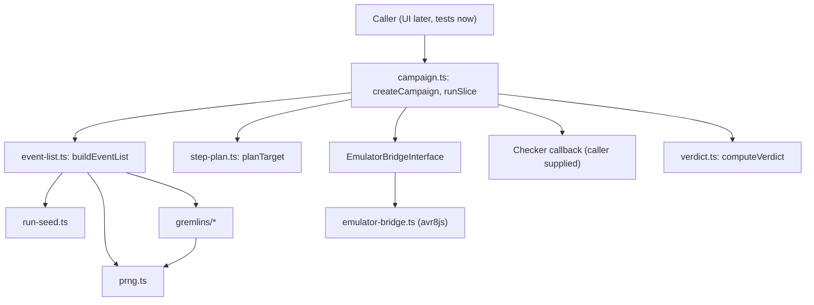
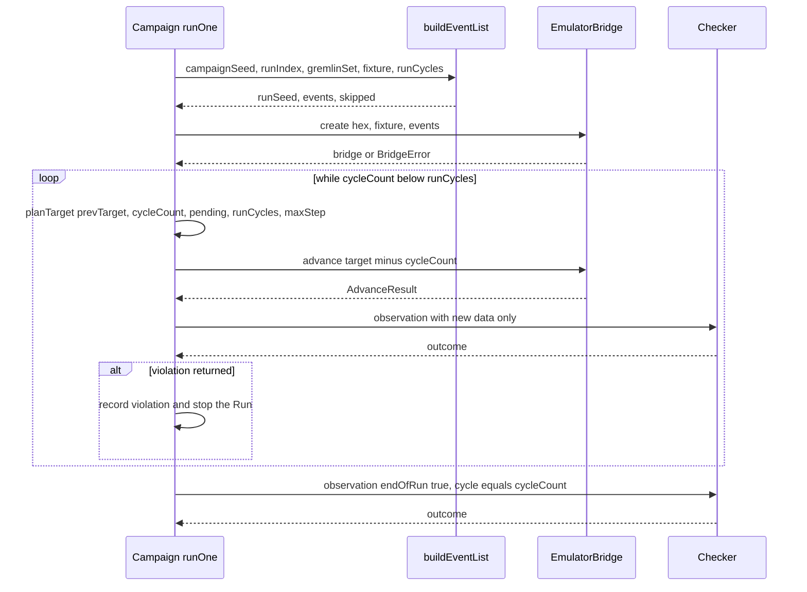
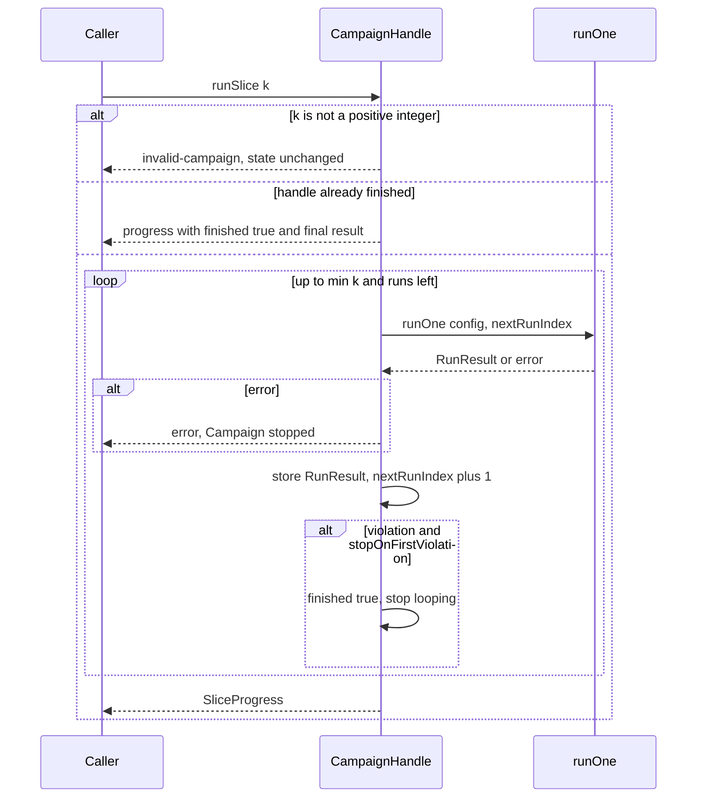

# Design Document: gremlin-engine

## Overview

The Gremlin_Engine turns a seed into a list of timed input disturbances ("gremlins"), runs a precompiled ATmega328P program against that list on a fresh EmulatorBridge, and reports what a Checker callback saw. A Campaign is up to N Runs. A Run stops at the earliest Violation. The engine adds no rule language; the rule-compiler spec later supplies the Checker. The shrinker is out of scope.

This design is additive to `emulator-bridge` and `input-pullup`. It touches the bridge in four ways: analog pins and an ADC, digital `kind` / `activeLevel` / `restState` fields, an optional `gremlinId` on events, and two new error kinds (`invalid-analog-value`, `pin-kind-mismatch`) plus an optional `signal` field on the existing `invalid-fixture` error. Everything else in `src/engine/emulator-bridge.ts` keeps its behaviour. Evidence is gathered from the real files: `src/engine/emulator-bridge.ts`, `src/engine/types.ts`, `src/engine/hex-parser.ts`, `src/engine/spike/led-timeout-monitor.ts`, `scripts/guard.mjs`, `package.json`, the existing tests and fixtures, and the installed avr8js 0.21.1 under `node_modules/avr8js/dist/esm/`.

Key decisions, each with a reason:

| # | Decision | Reason |
|---|----------|--------|
| D1 | PRNG is PCG32 (XSH-RR, 64-bit state), seeded as `srandom(initstate = seed, initseq = 54)`. | Published reference output exists for `(42, 54)`, so a single 32-bit seed maps straight onto published vectors. See "PRNG and Run Seeds". |
| D2 | Bounded draws use PCG's published rejection method (drop outputs below `(2^32 - bound) mod bound`, return `r mod bound`). Width 2^32 returns the raw output. | No modulo bias, and the same source publishes coin and dice output that exercises this exact method. |
| D3 | Run_Seed = `fmix32((fmix32(Campaign_Seed) + Run_Index) mod 2^32)`. | Each stage is a bijection of 32-bit integers, so distinct Run_Index values give distinct Run_Seed values for one Campaign_Seed by construction. |
| D4 | Analog count `c` is stored in `channelValues` as the mid-bin voltage `((2c + 1) * 5) / 2048`. | The quoted conversion formula floors `(v / 5) * 1024`; mid-bin leaves a margin of half a count against floating point error. All 1024 counts are checked by an exhaustive test. |
| D5 | Analog applied entries go in a new `AdvanceResult.appliedAnalogInputs` array. `appliedInputs` keeps its current type. | Widening `appliedInputs` to a union breaks type checking of existing tests that must stay unchanged (Finding F4). |
| D6 | The step loop uses absolute targets and always clamps the last target to Run_Cycles. | The clamp is what makes the end cycle identical for any `maxStepCycles` (Finding F2 corrects the usual reading of why). |
| D7 | The Event_List is sorted with a decorated key `(cycle, generation index)`. | Does not depend on the sort being stable. |
| D8 | Run_Cycles above 2^32 (4294967296) is rejected with `invalid-campaign` (R8.6). Decided; resolves Q1 and Finding F9. | The widest draw is `nextInt(0, Run_Cycles - 1)`, a width of Run_Cycles values. With Run_Cycles at most 2^32 every draw width stays within the PRNG limit of 2^32 (R1.3), so no generator can hit `invalid-range`. |

Words and style: simulated time is integer CPU cycles; no wall-clock call, no `Math.random`, no network. Tests are evidence, not proof.

## Architecture

### File layout under `src/engine/`

```
src/engine/
  emulator-bridge.ts      MODIFIED  only file that imports avr8js (AVRADC, adcConfig added)
  types.ts                MODIFIED  additive types (see Data Models)
  fixture.ts              NEW       validateFixture, validateEvents, isAnalogPin helpers (pure, no avr8js)
  adc-scale.ts            NEW       ADC_FULL_SCALE_VOLTS, analogCountToVolts (pure, no avr8js)
  hex-parser.ts           unchanged
  prng.ts                 NEW       PCG32, createPrng, nextU32, nextInt, drawCount
  run-seed.ts             NEW       fmix32, deriveRunSeed
  errors.ts               NEW       EngineError union, isEngineError
  gremlins/
    catalogue.ts          NEW       six GremlinDefinition entries, parameter specs, resolveParams
    digital.ts            NEW       masher, bouncer, stuck, dropout generators
    analog.ts             NEW       spike, drifter generators
    pins.ts               NEW       eligible pin lists, press value, rest level, msToCycles
  event-list.ts           NEW       buildEventList (rest events, gremlin loop, decorated stable sort)
  step-plan.ts            NEW       planTarget (pure)
  campaign.ts             NEW       runOne, createCampaign, resumeCampaign, runSlice
  checker.ts              NEW       Checker types only
  verdict.ts              NEW       computeVerdict, verdict strings
  copy-rules.ts           NEW       one constant holding the banned-word list used by the copy test (R10.13); this file is the only engine file allowed to contain the words
  spike/                  unchanged (temporary monitor, replaced by the rule-compiler spec)
  __tests__/              existing tests unchanged; new test files listed in Testing Strategy
```

`adc-scale.ts` holds the count-to-volts function; `gremlins/analog.ts` holds the analog generators.

Dependency rules:

- Only `emulator-bridge.ts` imports avr8js. `scripts/guard.mjs` check "c" walks all of `src/` (tests included) and flags any other file importing it, so new tests cannot import avr8js either. The ADC tests therefore observe the ADC through a test-only bridge hook (see "Bridge changes").
- The campaign runner depends on `EmulatorBridgeInterface` and a `BridgeFactory` function, not on the concrete class, so tests can inject a failing bridge for R8.19.
- Generators, PRNG, run seed, planner and verdict import no emulator code.



## avr8js ADC Evidence

Installed package: `node_modules/avr8js/package.json` line 3, `"version": "0.21.1"`, and line 9, `"license": "MIT"`. `package.json` (repo root) pins `"avr8js": "0.21.1"`. All line numbers below are for the ESM build under `node_modules/avr8js/dist/esm/`. Quotes are copied from those files. Anything not quoted is marked UNVERIFIED.

### Status table

| Item | Status | Evidence |
|------|--------|----------|
| ADC class and constructor signature | VERIFIED | `peripherals/adc.d.ts:55`, `:81`; `peripherals/adc.js:65-66`; exported at `index.d.ts:5` |
| Config object (`adcConfig`) fields: register addresses, vector, channels, references | VERIFIED | `peripherals/adc.d.ts:40-52`; `peripherals/adc.js:35-52` |
| `channelValues` type, indexing, units | VERIFIED | `peripherals/adc.d.ts:58-63`; `peripherals/adc.js:74` |
| How a conversion reads the value; delay in cycles; ADCL/ADCH writes; 10-bit formula | VERIFIED | `peripherals/adc.js:88-112`, `:123-146`, `:148-162`, `:209-211` |
| Vref, ADMUX and ADLAR handling | VERIFIED | `peripherals/adc.js:136-141`, `:152-159`, `:186-208` |
| Clock or tick hook and how it is wired | VERIFIED | `peripherals/adc.js:111`, `:133`; `cpu/cpu.js:138-141`, `:193-200`; bridge `src/engine/emulator-bridge.ts:356` |
| Arduino core leaves ADLAR clear and selects the AVCC reference in `analogRead` | UNVERIFIED | Not in the repo. Evidence will come from the through-bridge test, which records ADMUX at each conversion (see Testing Strategy). |
| Real chip behaviour of the ADC (accuracy, sample and hold) | UNVERIFIED | avr8js is a model; this design makes no claim about the chip. |
| Test-hook wrapper of `completeADCRead` is honoured | VERIFIED by reading, UNVERIFIED by running | The two call sites use `this.completeADCRead(...)` at fire time (`adc.js:111`, `:133`), so an own property on the instance takes precedence. A smoke test must confirm. |

### Quotes

Class and constructor (`peripherals/adc.d.ts:55`, `:81`):

```ts
export declare class AVRADC {
...
    constructor(cpu: CPU, config: ADCConfig);
```

Config interface (`peripherals/adc.d.ts:40-52`):

```ts
export interface ADCConfig {
    ADMUX: u8;
    ADCSRA: u8;
    ADCSRB: u8;
    ADCL: u8;
    ADCH: u8;
    DIDR0: u8;
    adcInterrupt: u8;
    numChannels: u8;
    muxInputMask: u8;
    muxChannels: ADCMuxConfiguration;
    adcReferences: ADCReference[];
}
```

Config values for the ATmega328P (`peripherals/adc.js:35-52`):

```js
export const adcConfig = {
    ADMUX: 0x7c,
    ADCSRA: 0x7a,
    ADCSRB: 0x7b,
    ADCL: 0x78,
    ADCH: 0x79,
    DIDR0: 0x7e,
    adcInterrupt: 0x2a,
    numChannels: 8,
    muxInputMask: 0xf,
    muxChannels: atmega328Channels,
    adcReferences: [
        ADCReference.AREF,
        ADCReference.AVCC,
        ADCReference.Reserved,
        ADCReference.Internal1V1,
    ],
};
```

Channels 0 to 7 are single ended inputs (`adc.js:19-26`); channel 8 is the temperature sensor, 14 a 1.1 V constant, 15 a 0 V constant (`adc.js:27-29`). Any mux value not in that table reads a 0 V constant (`adc.js:31-34`, `:141`).

`channelValues` (`peripherals/adc.d.ts:58-63`, `peripherals/adc.js:74`):

```ts
    /**
     * ADC Channel values, in voltage (0..5). The number of channels depends on the chip.
     *
     * Changing the values here will change the ADC reading, unless you override onADCRead() with a custom implementation.
     */
    readonly channelValues: any[];
```

```js
        this.channelValues = new Array(this.config.numChannels);
```

So: type `any[]`, indexed by channel number, length 8 for this config, units are volts in 0..5. A new array has no values stored, so an untouched channel reads as `undefined`, which the read path turns into 0 V (`adc.js:97`, quoted below).

Reference voltages (`peripherals/adc.js:75-78`):

```js
        /** AVCC Reference voltage */
        this.avcc = 5;
        /** AREF Reference voltage */
        this.aref = 5;
```

How a conversion reads the value (`peripherals/adc.js:88-112`, lines 96-98 and 109-111):

```js
                case ADCMuxInputType.SingleEnded:
                    voltage = (_a = this.channelValues[input.channel]) !== null && _a !== void 0 ? _a : 0;
                    break;
...
            const rawValue = (voltage / this.referenceVoltage) * 1024;
            const result = Math.min(Math.max(Math.floor(rawValue), 0), 1023);
            this.cpu.addClockEvent(() => this.completeADCRead(result), this.sampleCycles);
```

Start of a conversion (`peripherals/adc.js:123-146`, lines 130-145):

```js
            if (!this.converting && value & ADSC) {
                if (!(value & ADEN)) {
                    // Special case: reading while the ADC is not enabled should return 0
                    this.cpu.addClockEvent(() => this.completeADCRead(0), this.sampleCycles);
                    return true;
                }
                let channel = this.cpu.data[this.config.ADMUX] & MUX_MASK;
                if (cpu.data[config.ADCSRB] & MUX5) {
                    channel |= 0x20;
                }
                channel &= config.muxInputMask;
                const muxInput = (_a = config.muxChannels[channel]) !== null && _a !== void 0 ? _a : fallbackMuxInput;
                this.converting = true;
                this.onADCRead(muxInput);
                return true; // don't update
            }
```

Result registers (`peripherals/adc.js:148-162`, lines 152-160):

```js
        if (this.cpu.data[ADMUX] & ADLAR) {
            this.cpu.data[ADCL] = (value << 6) & 0xff;
            this.cpu.data[ADCH] = value >> 2;
        }
        else {
            this.cpu.data[ADCL] = value & 0xff;
            this.cpu.data[ADCH] = (value >> 8) & 0x3;
        }
        this.cpu.data[ADCSRA] &= ~ADSC;
```

Conversion delay (`peripherals/adc.js:113-114`, `:126`, `:151`, `:209-211`):

```js
        this.conversionCycles = 25;
...
                this.conversionCycles = 25;   // set when ADEN goes from 0 to 1 (line 126)
...
        this.conversionCycles = 13;           // set on completion (line 151)
...
    get sampleCycles() {
        return this.conversionCycles * this.prescaler;
    }
```

The prescaler getter (`adc.js:163-185`) reads `adcsra & ADPS_MASK` and returns:

```js
            case 0:
            case 1:
                return 2;
...
            case 6:
                return 64;
            case 7:
            default:
                return 128;
```

(cases 2 to 5 return 4, 8, 16 and 32 at `adc.js:171-178`).

Mux fallback (`peripherals/adc.js:31-34`, `:141`): a mux value with no table entry reads a constant 0 V.

```js
const fallbackMuxInput = {
    type: ADCMuxInputType.Constant,
    voltage: 0,
};
```

Reference selection (`peripherals/adc.js:186-208`, lines 189-193 and 196-207):

```js
        let refs = (this.cpu.data[ADMUX] >> REFS_SHIFT) & REFS_MASK;
        if (adcReferences.length > 4 && this.cpu.data[ADMUX] & REFS2) {
            refs |= 0x4;
        }
        return (_a = adcReferences[refs]) !== null && _a !== void 0 ? _a : ADCReference.Reserved;
...
            case ADCReference.AVCC:
                return this.avcc;
            case ADCReference.AREF:
                return this.aref;
            case ADCReference.Internal1V1:
                return 1.1;
            case ADCReference.Internal2V56:
                return 2.56;
            default:
                return this.avcc;
```

With `adcReferences` as quoted above, REFS bits 00 give AREF, 01 give AVCC, 10 give Reserved (which falls to the `default` and reads `avcc`), 11 give the 1.1 V internal reference.

Clock hook wiring. The ADC schedules its completion with `cpu.addClockEvent` (`adc.js:111`, `:133`). That function stores the event at the current cycle plus the delay (`cpu/cpu.js:140`):

```js
        cycles = this.cycles + Math.max(1, cycles);
```

The event runs from `cpu.tick()` (`cpu/cpu.js:193-200`):

```js
    tick() {
        const { nextClockEvent } = this;
        if (nextClockEvent && nextClockEvent.cycles <= this.cycles) {
            nextClockEvent.callback();
            this.nextClockEvent = nextClockEvent.next;
```

The ADC needs nothing besides `new AVRADC(cpu, adcConfig)`: its ADCSRA write hook runs inside `avrInstruction`, and its completion runs inside `cpu.tick()`. The bridge already calls `avrInstruction(this._cpu)` then `this._cpu.tick()` for every instruction (`src/engine/emulator-bridge.ts:353`, `:356`). `tick()` runs at most one due clock event per call (`cpu.js:194-201`), so two events due at once finish on consecutive instructions; this is deterministic and not affected by Step size.

### Count to volts and back

Goal: an integer count `c` in 0..1023 set by the engine must read back as the same integer `c` from the ADC result, for the AVCC and AREF references where the reference is 5 V (`adc.js:75-78`).

The quoted formula is `result = min(max(floor((v / ref) * 1024), 0), 1023)` with `ref = 5`. The bridge stores:

```
analogCountToVolts(c) = ((2 * c + 1) * ADC_FULL_SCALE_VOLTS) / 2048      // ADC_FULL_SCALE_VOLTS = 5
```

Then `(v / 5) * 1024` is `c + 0.5` up to floating point error far below 1e-9, so `floor` returns `c` and the clamp never acts (the range is 0.5 to 1023.5). The margin is half a count against an error of order 1e-13.

Design-time check, run during this design session as a throwaway Node one-liner (nothing kept in the repo): the quoted formula was evaluated for all 1024 counts with this mapping, with 0 mismatches. The simpler mapping `c * 5 / 1024` also gave 0 mismatches in that run, but it sits exactly on a bin edge with no margin, so it is not used. This check is evidence, not proof. The design proves nothing more than the tests below:

1. `adc-scale.test.ts` (pure): for every `c` in 0..1023, evaluate a copy of the quoted formula on `analogCountToVolts(c)` and expect `c`. The copy is labelled "mirror of adc.js:109-110".
2. `adc-roundtrip.test.ts` (through the bridge): for every `c` in 0..1023 apply an Analog_Event and read the ADC result delivered to the firmware, using the test-only hook below and the user-compiled `analog_read` fixture. This is the exhaustive example test; it is feasible because one conversion with a prescaler of 128 takes 1,664 cycles (13 x 128) and the initial one after enabling takes 3,200 (25 x 128), so 1024 values at 8,000 cycles apart need about 8.2 million cycles in one run.

Findings on read-back (details in Findings F6 and F7):

- Exact read-back holds only while ADMUX selects AREF (REFS 00) or AVCC (REFS 01). REFS 10 falls to the `avcc` default and also reads back. REFS 11 selects 1.1 V (`adc.js:201-202`); then `c` reads as `min(1023, floor((c + 0.5) * 5 / 1.1))`, so counts of 225 and above read as 1023 and counts below 225 do not read back. This is a finding, not an error: the engine presents a voltage, not a count.
- ADLAR (`adc.js:152`) only changes how the same 10-bit value is placed in ADCH:ADCL. With ADLAR clear the value is `ADCL | (ADCH << 8)`; with ADLAR set it is `(ADCH << 2) | (ADCL >> 6)`. Firmware that reads only ADCH sees fewer bits; that is firmware behaviour.
- A conversion samples `channelValues` at the moment ADSC is written (`adc.js:143` calls `onADCRead` immediately) and delivers the result `sampleCycles` later. An Analog_Event applied after ADSC but before completion does not change that conversion. With a prescaler of 128 the skew is up to 3,200 cycles.

### Bridge test hook for the ADC

`createWithTestHooks` (`emulator-bridge.ts:144`) gains one optional hook, `adcResultListener`. The bridge installs it by assigning an own `completeADCRead` on the `AVRADC` instance that calls the listener after the original, passing `{ cycle, value, adcl, adch, admux }` where `cycle` is `cpu.cycles` and the registers are read from `cpu.data` using the addresses from `adcConfig`. The guard script already limits `createWithTestHooks` to the bridge and `src/engine/__tests__/` (check "c2"), so no change is needed there.

## PRNG and Run Seeds

### Algorithm: PCG32 (XSH-RR 64/32)

- Author: Melissa O'Neill. Site: https://www.pcg-random.org.
- Reference code: `pcg_basic.c`, https://raw.githubusercontent.com/imneme/pcg-c-basic/master/pcg_basic.c. Licence: Apache License 2.0 (stated in that file's header). The engine's TypeScript is written new from the published algorithm; no code is copied.
- Planned work (Q8, decided yes; for tasks, not done by this design): `PRIOR_WORK.md` gets one entry reading, in substance: "Algorithms re-implemented, no code copied: PCG32 XSH-RR (M. O'Neill; reference implementation is Apache-2.0; test vectors from imneme/pcg-c, `check-pcg32.out`) and the MurmurHash3 fmix32 finalizer (A. Appleby, public domain)." No edit to `PRIOR_WORK.md` happens before `tasks.md` is approved.
- Reference vectors source: https://raw.githubusercontent.com/imneme/pcg-c/master/test-high/expected/check-pcg32.out (pcg-c, `test-high/expected/check-pcg32.out`). The `pcg-c-basic` demo (https://raw.githubusercontent.com/imneme/pcg-c-basic/master/pcg32-demo.c) states in its header that it was generated from `tests/check-pcg32.c` and seeds with `pcg32_srandom_r(&rng, 42u, 54u)`. A fetch of `pcg32-demo.out` from the `pcg-c-basic` repository returned HTTP 404, so the vectors come from `pcg-c`. I did not compile or run the C demo.

Constants: multiplier `6364136223846793005`; stream id `54`, so `inc = (54 << 1) | 1 = 109`.

Pseudocode (all state arithmetic is modulo 2^64; outputs are unsigned 32-bit):

```
state: u64
inc:   u64 (odd)

step() -> u32:
    old   = state
    state = old * 6364136223846793005 + inc            (mod 2^64)
    xorshifted = u32( ((old >> 18) XOR old) >> 27 )
    rot        = u32( old >> 59 )
    return u32( (xorshifted >> rot) OR (xorshifted << ((-rot) AND 31)) )

createPrng(seed):                      // seed integer in [0, 2^32 - 1]
    state = 0
    inc   = (54 << 1) OR 1             // = 109
    step()
    state = state + seed               (mod 2^64)
    step()
```

This is `pcg32_srandom_r(rng, initstate = seed, initseq = 54)` from `pcg_basic.c`. A single 32-bit seed therefore maps onto the published vectors when `seed = 42`; no test-only constructor is needed. The stream id is fixed, so the engine uses one stream; different seeds give different starting states.

Implementation note (design only): use `BigInt` for the 64-bit state. `tsconfig.json` sets `"target": "ES2020"`, which permits BigInt literals. I did not check the Vite build target.

### Unbiased bounded range

Method: rejection sampling, as published in `pcg_basic.c` (`pcg32_boundedrand_r`): reject outputs below `threshold = (2^32 - bound) mod bound`, then return `r mod bound`. Every remaining output block holds the same number of values per residue, so there is no modulo bias.

```
nextInt(min, max):
    validate: min and max are integers within +/-(2^53 - 1), min <= max,
              width = max - min + 1 <= 2^32
              else return { kind: "invalid-range" } and leave state and drawCount unchanged
    if width == 2^32: return min + step()           // raw output, already uniform
    bound     = width
    threshold = (2^32 - bound) mod bound             // exact in doubles (< 2^32)
    loop:
        r = step()
        if r >= threshold: return min + (r mod bound)
```

Notes: a width of 1 still consumes one output, as the reference does. A binary draw is `nextInt(0, 1)`, which is the low bit of one output (threshold 0). Every call to `step()` increments `drawCount`, rejected outputs included, so tests can count draws exactly.

### Reference vectors (copied from the pcg-c URL above)

Seed 42 (stream 54). In the demo each round draws 6 raw outputs, then 65 coin flips (`boundedrand(2)`, H when non-zero), then 33 dice (`boundedrand(6) + 1`), then a 52-card shuffle with `boundedrand(i)` for `i` from 52 down to 2. Round 1:

```
32bit: 0xa15c02b7 0x7b47f409 0xba1d3330 0x83d2f293 0xbfa4784b 0xcbed606e
Coins: HHTTTHTHHHTHTTTHHHHHTTTHHHTHTHTHTTHTTTHHHHHHTTTTHHTTTTTHTTTTTTTHT
Rolls: 3 4 1 1 2 2 3 2 4 3 2 4 3 3 5 2 3 1 3 1 5 1 4 1 5 6 4 6 6 2 6 3 3
```

Raw outputs of rounds 2 and 3 (the test must replay the 52-card shuffle draws of the previous rounds to stay aligned):

```
Round 2 32bit: 0x74ab93ad 0x1c1da000 0x494ff896 0x34462f2f 0xd308a3e5 0x0fa83bab
Round 3 32bit: 0x39af5f9f 0x04196b18 0xc3c3eb28 0xc076c60c 0xc693e135 0xf8f63932
```

Status of these vectors: the text above is copied from the fetched source file (VERIFIED as copied). As a transcription check, the pseudocode above was evaluated in a throwaway Node snippet during this session and reproduced the round 1 raw outputs, coins and rolls, and the round 2 and round 3 raw outputs, exactly. That snippet is not kept. Vectors apply only to seed 42 with stream 54, which is what `createPrng(42)` produces.

### Run_Seed derivation

Name: "fmix32 offset mix".

```
fmix32(h):                              // MurmurHash3 32-bit finalizer
    h = h XOR (h >>> 16)
    h = imul(h, 0x85ebca6b)
    h = h XOR (h >>> 13)
    h = imul(h, 0xc2b2ae35)
    h = h XOR (h >>> 16)
    return h >>> 0

deriveRunSeed(campaignSeed, runIndex):
    validate campaignSeed in [0, 2^32 - 1] else { kind: "invalid-seed" }
    validate runIndex     in [0, 2^32 - 1] else { kind: "invalid-run-index" }
    k = fmix32(campaignSeed)
    return fmix32( (k + runIndex) >>> 0 )
```

Source: Austin Appleby, MurmurHash3, https://raw.githubusercontent.com/aappleby/smhasher/master/src/MurmurHash3.cpp, function `fmix32`; the file header states the code is in the public domain.

How distinctness is ensured: for a fixed Campaign_Seed, `k` is a constant, so `runIndex -> (k + runIndex) mod 2^32` is a translation of the integers modulo 2^32, which is a bijection. `fmix32` is a bijection: `h XOR (h >>> s)` is invertible, and multiplication by an odd constant is invertible modulo 2^32 (`0x85ebca6b` and `0xc2b2ae35` are both odd). The composition of bijections is a bijection, so the 2^32 possible Run_Index values map to 2^32 distinct Run_Seed values. The test over 10,000 indices and 4 Campaign_Seed values is evidence; the assurance comes from this construction.

A second piece of evidence for the construction: the inverse of `fmix32` is `h ^= h >>> 16; h = imul(h, 0x7ed1b41d); h ^= (h >>> 13) ^ (h >>> 26); h = imul(h, 0xa5cb9243); h ^= h >>> 16`. The two multipliers are the modular inverses of `0xc2b2ae35` and `0x85ebca6b` modulo 2^32 (computed in a throwaway snippet this session), and 2,000,000 sampled values round-tripped with 0 mismatches. A test can repeat that sampled round trip.

Using `fmix32(campaignSeed)` as the offset, not the raw seed, stops the Run_Seed sequence of Campaign_Seed S from being a shifted copy of the sequence of S + 1.

## Components and Interfaces

All fallible functions return `T | ErrorValue`, matching the bridge (`advance(): AdvanceResult | BridgeError`, `create(): EmulatorBridge | BridgeError`). Nothing throws for an expected condition. No success value has a top-level `kind` property, because `isBridgeError` (`emulator-bridge.ts:70`) treats any object with a `kind` as an error; verdicts use the key `verdict` for that reason.

### Bridge changes (additive)

Existing code references use `src/engine/emulator-bridge.ts`.

1. Types (`types.ts`, see Data Models): `FixturePin` becomes a union of `DigitalFixturePin` and `AnalogFixturePin`. The analog member carries `direction?: "input"`, `port?: undefined` and `bit?: undefined` so code that reads `pin.direction` or `pin.signal` on the union still type checks (the existing property test reads `p.direction` on `fixture.pins`). `InputEvent` keeps its shape and gains `gremlinId?: string`. New `AnalogInputEvent`, `ScheduledInput`, `AppliedAnalogInputEvent`. `AdvanceResult` gains `appliedAnalogInputs`. `BridgeError` gains `invalid-analog-value` and `pin-kind-mismatch`, and `invalid-fixture` gains an optional `signal`.
2. Validation (`fixture.ts`, called from `_build`, replacing lines 166-186 with the same checks in the same order for digital pins): per pin, in order, a digital pin gets the existing port and bit checks, then `activeLevel` and `restState` checks (value must be in the allowed set; allowed only on `direction: "input"` digital pins). An analog pin gets: `channel` an integer 0..5, no duplicate channel among analog pins, `restLevel` (when present) an integer 0..1023, `direction` absent or `"input"`, no `activeLevel` or `restState`. Every new failure is `invalid-fixture` with the signal named in the message and in the new `signal` field, except the shared-pin failure described next. Fixtures with no new fields hit exactly the old checks and messages (R2.11, R3.2).

   Shared physical pin check (R2.12), run after every per-pin check above has passed, so any earlier error keeps its precedence. On the ATmega328P, ADC channel N is port C bit N (A0 to A5 are PC0 to PC5). For each analog pin in Fixture order, then for each non-analog pin in Fixture order (a Digital_Input or an output pin), the check rejects the Fixture when the non-analog pin has `port: "C"` and `bit` equal to the analog pin's `channel`. The error is `invalid-fixture` and the message names both signals, for example: `analog pin "POT" (channel 0) and digital pin "SENSE" (port C, bit 0) are on the same physical pin`. The `invalid-fixture` member in `src/engine/types.ts` carries only a `message` field today (line 36); this design adds the optional `signal` field for the single-signal failures only. For the shared-pin failure `signal` stays absent, because one field cannot name two signals; the message is the only carrier of both names, and tests match both names in the message. Only the earliest conflict found is reported. A digital pin on port C at a bit that no analog pin uses, and an analog pin on a channel with no matching port C pin, are accepted.
3. Event validation (`fixture.ts`, called from `_build` step 3 at lines 188-198 and from `schedule()`): per event, in list order: unknown signal gives `unmapped-pin` (same text as today, R2.9); analog event on a digital pin or digital event on an analog pin gives `pin-kind-mismatch`; analog value not an integer 0..1023 gives `invalid-analog-value`. A type guard `isAnalogInputEvent(ev)` is `'analog' in ev`. All checks run before the CPU is built, so no event is applied from a rejected list.
4. ADC wiring (after the timers at line 229): `const adc = new AVRADC(cpu, adcConfig)`, kept as `_adc`. For each analog pin, `adc.channelValues[pin.channel] = analogCountToVolts(pin.restLevel ?? 512)` before any instruction runs (R2.5). Channels with no analog pin stay untouched.
5. Applying events (`advance`, lines 343-349): analog events call `_applyAnalog(pinIdx, count)`, which assigns `channelValues[channel] = analogCountToVolts(count)`, and push `{ ...ev, appliedCycle }` to a local `appliedAnalog` array. Digital events keep the existing path and `{ ...ev, appliedCycle }` copies every field including `gremlinId` (R3.11). Nothing else reads `gremlinId`.
6. `supports()` (lines 450-461): add `'adc'` to the `wired` set. Other capabilities are unchanged (R2.11).
7. Existing loops that read `pin.port`, `pin.bit` or `pin.direction` (lines 171-185, 247-257, 281-318) get a digital-pin guard so analog pins are skipped. Analog pins have no cycle-0 snapshot entry, no listener and no PIN read hook.
8. `createWithTestHooks`: new optional `adcResultListener` (see ADC Evidence).

Bridge `advance` semantics, checked against the code (the engine relies on them):

| Behaviour | Evidence | Matches the assumption? |
|-----------|----------|------------------------|
| `cycleCount` is `cpu.cycles` | `emulator-bridge.ts:89-91` | Yes |
| `advance(n)` runs whole instructions while `cpu.cycles - startCycles < n`, so it can finish above the target | loop at `:340`, `avrInstruction` at `:353`, `cpu.tick()` at `:356`, `cyclesConsumed` returned from `cpu.cycles - startCycles` | Yes. Overshoot is at most one instruction plus any interrupt dispatch. Existing emulator-bridge Property 4 says `advance(N)` consumes at least N. |
| Due input events are applied only at the top of each loop iteration, before the next instruction, with `appliedCycle = cpu.cycles` | `:343-349` | Yes, "earliest instruction boundary at or after the event cycle". |
| `advance(n)` with `n <= 0` returns at once and applies nothing | `:334-336` | Partly. The engine never calls it with `n <= 0`, but it also cannot use `advance(0)` to flush due events (Finding F3). |
| The initial output snapshot is added on the initial `advance` call, whatever its size | `:329-332` | Yes |
| Events are pre-sorted with `Array.prototype.sort` by cycle | `:242` | Yes. The sort is specified as stable since ES2019. The engine passes a list already in order, so any order-preserving sort leaves it unchanged. |
| Diagnostics are returned and cleared per `advance` call | `_takeDiagnostics` at `:335`, `:385`, `:389` | Yes |
| The chunking of `advance` calls does not change the instruction stream | The loop body at `:341-373` is the same whatever `n` is; a new call starts by re-checking due inputs (`:343-349`) | Yes. This is the property R11.10 relies on. |

### `prng.ts`

```ts
export type PrngError =
  | { kind: "invalid-seed";  message: string }
  | { kind: "invalid-range"; message: string };

export interface Prng {
  /** Next unsigned 32-bit integer. Increments drawCount by 1. */
  nextU32(): number;
  /** Inclusive range, rejection sampling. Returns an error and leaves state unchanged when invalid. */
  nextInt(min: number, max: number): number | PrngError;
  /** Number of nextU32 steps taken, rejected outputs included. Read-only; used by tests. */
  readonly drawCount: number;
}

export function createPrng(seed: number): Prng | PrngError;
export function isPrngError(x: unknown): x is PrngError;
```

The PRNG is created once per Run and passed explicitly (R1.12, R7.1). The module exposes no global instance.

### `run-seed.ts`

```ts
export function fmix32(h: number): number;
export function deriveRunSeed(
  campaignSeed: number,
  runIndex: number,
): number | { kind: "invalid-seed" | "invalid-run-index"; message: string };
```

### `errors.ts`

```ts
export type EngineError =
  | PrngError
  | { kind: "invalid-run-index";        message: string }
  | { kind: "unknown-gremlin";          gremlinId: string; message: string }
  | { kind: "invalid-gremlin-parameter"; gremlinId: string; parameter: string; message: string }
  | { kind: "invalid-campaign";         message: string }
  | { kind: "bridge-error";             runIndex: number; error: BridgeError; message: string }
  | { kind: "checker-error";            runIndex: number; cycle: number; message: string }
  | { kind: "internal-error";           message: string };

export type CampaignError = EngineError | BridgeError;   // BridgeError surfaces unchanged for a bad HEX or Fixture before any Run
export function isEngineError(x: unknown): x is EngineError;
```

`internal-error` covers only a broken engine invariant (for example the applied-input merge disagreeing with the Event_List). It is not reachable from user input.

### Gremlins (`gremlins/`)

Eligible pin lists, all in Fixture pin order (`pins.ts`):

- `digitalInputs`: pins with `kind` absent or `"digital"` and `direction: "input"`.
- `restActiveInputs`: `digitalInputs` with `restState: "active"`.
- `analogInputs`: pins with `kind: "analog"`.
- Press value: `activeLevel === "high" ? 1 : 0`. Release value: the string `"release"`.
- Rest_Level of an analog pin: `restLevel ?? 512`.
- `msToCycles(ms, clockHz) = floor(ms * clockHz / 1000)` with integers (16,000 per ms at 16 MHz; 0.1 ms is 1,600 cycles).

Catalogue entry (R4.2):

```ts
export type GremlinId = "masher" | "bouncer" | "stuck" | "dropout" | "spike" | "drifter";

export interface RangeParamSpec {
  name: string; shape: "range"; unit: "count" | "cycles" | "ms";   // unit of both min and max
  default: { min: number; max: number };
  allowed: { min: number; max: number };        // both inclusive
}
export interface ScalarParamSpec {
  name: string; shape: "scalar"; unit: "cycles" | "steps";
  default: number;
  allowed: { min: number; max: number };
}
export type ParamSpec = RangeParamSpec | ScalarParamSpec;

export interface GremlinDefinition {
  id: GremlinId;
  iconName: string;                              // "gremlin-masher" and so on; the SVG art is a UI task
  targets: ReadonlyArray<{ kind: "digital" | "analog"; restState?: "active" }>;
  params: readonly ParamSpec[];
  generate(ctx: GenerateContext, params: ResolvedParams, prng: Prng): GenerateOutcome | EngineError;
}

export interface GenerateContext {
  fixture: Fixture;
  runCycles: number;
  eligible: { digital: FixturePin[]; restActive: FixturePin[]; analog: FixturePin[] };
}

export type SkipReason = "no-target-pin" | "run-too-short";
export type GenerateOutcome =
  | { kind: "events";  events: GeneratedEvent[] }
  | { kind: "skipped"; reason: SkipReason };
```

`GenerateOutcome` has a `kind` key but is never returned to a caller of the public API; `generate` is internal, and its result type is always unwrapped by `buildEventList`.

Catalogue. Q2 is resolved as decided: the allowed ranges proposed in the earlier draft are accepted, and the default draw ranges are exactly the ones in R5 and R6. Icons and targets:

| id | icon | targets |
|----|------|---------|
| masher | gremlin-masher | digital inputs |
| bouncer | gremlin-bouncer | digital inputs |
| stuck | gremlin-stuck | digital inputs |
| dropout | gremlin-dropout | digital inputs with restState active |
| spike | gremlin-spike | analog inputs |
| drifter | gremlin-drifter | analog inputs |

Parameter table (the one place that lists every parameter of every Gremlin). Units are `count`, `ms`, `cycles` and `steps`. A range parameter has a default min and max and an allowed range that bounds both. Millisecond values convert at 16 000 cycles per millisecond (R4.5), so 0.1 ms is 1 600 cycles. The cycle values in the "default" column are the exact figures of R5 and R6; the catalogue test compares them with literal numbers copied from the requirements.

| gremlin | parameter | default (min/max or value) | allowed range | unit |
|---------|-----------|----------------------------|---------------|------|
| masher | `pressCount` | 1 / 6 (R5.1) | 1 to 32 | count |
| masher | `gapCycles` | 80 000 / 2 400 000 (5 ms to 150 ms, R5.1) | 2 to 160 000 000 | cycles |
| bouncer | `flipCount` | 2 / 8 (R5.3) | 2 to 64 | count |
| bouncer | `gapCycles` | 1 600 / 48 000 (0.1 ms to 3 ms, R5.3) | 1 to 1 600 000 | cycles |
| stuck | `minSpanCycles` | 1 600 000 (100 ms, R5.5) | 1 to 160 000 000 | cycles |
| dropout | `gapCycles` | 16 000 / 800 000 (1 ms to 50 ms, R5.7) | 1 to 160 000 000 | cycles |
| spike | `gapMs` | 1 / 20 (R6.1) | 1 to 1 000 | ms |
| drifter | `durationMs` | 50 / 500 (R6.3) | 1 to 10 000 | ms |
| drifter | `steps` | 8 (R6.8) | 2 to 32 | steps |

Notes on the table:

- Masher: `gapCycles` is the name of the gap parameter. Its resolved minimum also sets the release delay of a single Press, `floor(gapCycles.min / 2)` (40,000 cycles at the default), not a literal 80,000 (Q4, resolved).
- Stuck: the span runs from `minSpanCycles` (100 ms by default) to the end of the run. The upper end is `Run_Cycles - start`, which depends on the Run, so it is not a parameter and has no row. There is no user-set maximum for the span (Q3, resolved). The Stuck skip test is `Run_Cycles < minSpanCycles + 1`, which is `Run_Cycles < 1 600 001` at the default (R5.6).
- Drifter `steps` is a scalar and is never drawn (R6.3). Every other row except Stuck is a range whose min and max are each drawn with `nextInt` over `[min, max]`.
- Every range parameter is checked as min and max both inside the allowed range and min at most max. A gap or duration minimum below 1 cycle (digital; below 2 cycles for the Masher gap) or 1 ms (Spike, Drifter) is outside the allowed range (R5.10, R6.9).
- All allowed upper bounds are at most 160 000 000 cycles (10 s), so every drawn width stays far below 2^32 and no parameter draw can return `invalid-range`.

Parameter resolution (R4.6, R4.7, R5.10, R6.8, R6.9): the caller's `GremlinSpec` is `{ id: string; params?: Record<string, number | { min: number; max: number }> }`. Resolution runs for every entry, in listed order, before any draw: an unknown `id` gives `unknown-gremlin`; an unknown parameter name, a non-integer value, a value outside `allowed`, a range with `min > max`, or a scalar given as a range (or the reverse) gives `invalid-gremlin-parameter` naming the Gremlin and parameter. The earliest error in listed order is returned and no events are generated for the Run. For the Drifter, the defensive check `durationMs.min * cyclesPerMs < steps` also returns `invalid-gremlin-parameter` (R6.5); see Finding F8 on its reach.

Decision (override check order inside one entry): the override names are checked in catalogue order, which is the parameter table order for that Gremlin, not the order of the caller's keys. Names not in the catalogue for that Gremlin come after all known names, in sorted string order. The same overrides therefore always give the same first error, whatever the key order.

Draw orders. Every draw is `prng.nextInt(min, max)`. Range widths never exceed 2^32 because `Run_Cycles` is at most 2^32 (R8.6, decision D8, Finding F9 resolved). The widest draw is `start = nextInt(0, runCycles - 1)` with a width of `runCycles`; at `runCycles = 2^32` it takes the raw-output path of `nextInt`. Stuck and Drifter ranges are narrower still. "pick(list)" means `nextInt(0, list.length - 1)`.

| Gremlin | Skip checks (before any draw) | Draws in order | Events |
|---------|-------------------------------|----------------|--------|
| masher | no `digitalInputs` gives `no-target-pin` | (a) `pick(digitalInputs)`; (b) `n = nextInt(pressCount.min, pressCount.max)`; (c) `start = nextInt(0, runCycles - 1)`; (d) `n - 1` gaps `g1..g(n-1)`, each `nextInt(gap.min, gap.max)` | Press j at `P1 = start`, `P(j+1) = Pj + gj`. Release j at `Pj + floor(gj / 2)`, using `g(n-1)` for the last Press when `n > 1`, and `floor(gapCycles.min / 2)` when `n = 1`, where `gapCycles.min` is the resolved minimum of the Masher `gapCycles` parameter (default 80,000, so 40,000 cycles; with an override of 1,000 it is 500). No literal 80,000 appears in the generator (R5.1, Q4 resolved). Emit in order Press1, Release1, Press2, and so on, then cut at the initial event with `cycle >= runCycles` and drop it and all later ones. |
| bouncer | no `digitalInputs` gives `no-target-pin` | (a) `pick`; (b) `edge = nextInt(0, 1)` (0 press edge, 1 release edge); (c) `F = nextInt(flipCount.min, flipCount.max)`; (d) `start = nextInt(0, runCycles - 1)`; (e) `F - 1` gaps `nextInt(gap.min, gap.max)` | Flip 1 at `start`, flip k+1 at flip k plus its gap. Values alternate backwards from the final flip: flip F carries the Press value (edge 0) or `"release"` (edge 1), flip F-1 the other, and so on. Values are assigned over the full list, then flips with `cycle >= runCycles` are dropped (earlier flips unchanged). This is the decided behaviour (Q5, resolved; Finding F15). |
| stuck | `no-target-pin`; then `runCycles < minSpanCycles + 1` gives `run-too-short` | (a) `pick`; (b) `start = nextInt(0, runCycles - minSpanCycles)`; (c) `span = nextInt(minSpanCycles, runCycles - start)` | Press at `start`; Release at `start + span` only when `start + span < runCycles`. |
| dropout | no `restActiveInputs` gives `no-target-pin` | (a) `pick(restActiveInputs)`; (b) `start = nextInt(0, runCycles - 1)`; (c) `gap = nextInt(gap.min, gap.max)` | Release at `start`; Press (Active_Level value) at `start + gap` when `< runCycles`. |
| spike | no `analogInputs` gives `no-target-pin` | (a) `pick(analogInputs)`; (b) `v = nextInt(0, 1)` (0 means 0, 1 means 1023); (c) `start = nextInt(0, runCycles - 1)`; (d) `ms = nextInt(gapMs.min, gapMs.max)` | Analog event `v` at `start`; Analog event Rest_Level at `start + msToCycles(ms)` when `< runCycles`. |
| drifter | no `analogInputs` gives `no-target-pin` | (a) `pick(analogInputs)`; (b) `t = nextInt(0, 1)` (0 means target 0, 1 means target 1023); (c) `ms = nextInt(durationMs.min, durationMs.max)`, `D = msToCycles(ms)`; then if `runCycles - 1 - D < 0`: skip as `run-too-short` and stop; (d) `start = nextInt(0, runCycles - 1 - D)` | For `i = 1..S`: cycle `start + floor(D * i / S)`, analog `rest + trunc((target - rest) * i / S)`. Integer division is written without float division: `floorDiv(a, b)` for `a >= 0`, `truncDiv(a, b) = (a - a % b) / b` (JavaScript `%` keeps the sign of the dividend, so this truncates toward zero). `S` is a parameter and is not drawn. The last event is the target and nothing returns the pin to Rest_Level (R6.7). |

Decision (Drifter after the drift): no return-to-rest event follows the drift, unlike the Spike. Early steps whose value equals Rest_Level because of truncation are legal.

Masher gap minimum is 2 cycles, so floor(g/2) is in [1, g-1] and every Release falls strictly between its Press and the next Press (R5.8).

Digital Press events carry the Press value of the chosen pin (0 for `activeLevel` low or absent, 1 for high). Release events carry `"release"`. Every event carries the `gremlinId` of its entry.

Skip timing (R4.10, R4.12, R5.6, R5.11, R6.3, R6.11, R7.7; Finding F1, resolved by the reworded requirements):

| Skip | When it is decided | Draws made by that Gremlin |
|------|--------------------|----------------------------|
| `no-target-pin` (any Gremlin) | before any draw, from the Fixture alone | 0 |
| Stuck `run-too-short` | before any draw, from `runCycles` and `minSpanCycles` alone | 0 |
| Drifter `run-too-short` | after draws (a) pin, (b) direction and (c) duration, because D is needed to decide | 3 `nextInt` calls; draw (d) is not made |

In every case the same PRNG instance passes unchanged to the next entry, so later entries see only the draws actually made. Masher, Bouncer, Dropout and Spike never skip for run length; they cut events at `Run_Cycles` instead (R4.12).

Skip precedence when a Gremlin could be skipped for two reasons: `no-target-pin` wins, because it depends only on the Fixture (Finding F10). For the Drifter this means a Fixture with no analog pin skips with zero draws, and the three-draw skip applies only when an analog pin exists.

### `event-list.ts`

```ts
export interface GenerateInput {
  fixture: Fixture;
  gremlinSet: readonly GremlinSpec[];
  runCycles: number;
  campaignSeed: number;
  runIndex: number;
}
export interface SkippedEntry { gremlinId: string; reason: SkipReason }
export type GeneratedEvent = (InputEvent | AnalogInputEvent) & { gremlinId: string };
export interface GeneratedRun { runSeed: number; events: GeneratedEvent[]; skipped: SkippedEntry[] }

export function buildEventList(input: GenerateInput): GeneratedRun | EngineError;
```

Steps:

1. Resolve all entries (errors as above). Nothing is drawn yet.
2. `runSeed = deriveRunSeed(campaignSeed, runIndex)`; `prng = createPrng(runSeed)`. One PRNG for the Run (R7.1).
3. Rest events: for each pin in `digitalInputs` with `restState: "active"`, in Fixture order, one event `{ signal, value: pressValue, cycle: 0, gremlinId: "rest" }`. No draws (R7.2). Emitted even when `runCycles` is 1 (R4.13).
4. For each entry in listed order, call `generate`. `events` are appended; `skipped` appends `{ gremlinId, reason }`. The same `prng` is passed on (R7.7). Repeated ids run as separate instances (R4.9).
5. Sort by key `(cycle, sequenceIndex)`, where `sequenceIndex` is the position in generation order, with rest events leading. This gives the stable order of R7.3 whatever the platform sort does.
6. Defensive filter check: every event cycle is an integer in `[0, runCycles)`; a failure returns `internal-error`.

`buildEventList` reads nothing from any other Run (R7.5): its inputs are exactly the arguments.

### `step-plan.ts` (pure)

```ts
export interface PlanInput {
  prevTarget: number;                       // 0 before the initial Step
  cycleCount: number;                       // bridge cycleCount after the previous Step (0 before the initial Step)
  pendingCycles: readonly number[];         // cycles of Input_Events not yet applied, ascending
  runCycles: number;
  maxStepCycles: number;
}
/** Returns the next absolute target, always greater than cycleCount and never above runCycles. */
export function planTarget(i: PlanInput): number;
```

```
planTarget:
    t = prevTarget
    loop:
        a = smallest pendingCycles entry > t, or infinity
        target = min(a, runCycles, t + maxStepCycles)
        if target > cycleCount: return target
        t = target                       // overshoot already passed it: skip, derive the next from the skipped target
```

It terminates because `runCycles > cycleCount` while the Run is active, and `t` strictly increases when a candidate is skipped (a candidate is greater than `t` by construction). A skipped target causes no `advance` and no Checker call (R8.10).

### Checker contract (`checker.ts`)

```ts
export interface CheckerObservation {
  readonly runIndex: number;
  readonly stepIndex: number;          // 0 on the initial call of a Run; the end-of-run call continues the numbering
  readonly endOfRun: boolean;
  readonly cycle: number;              // bridge cycleCount after the Step; for endOfRun, the end-of-run cycle
  readonly outputEvents: readonly OutputEvent[];            // only data produced since the previous call in this Run
  readonly appliedInputs: readonly AppliedInput[];          // digital and analog, in application order
  readonly diagnostics: readonly Diagnostic[];
}
export interface Violation { rule: string; cycle: number }           // cycle is an integer, 0 <= cycle <= observation.cycle
export interface CannotCheck { rule: string; reason: string }        // the Checker's own words
export interface CheckerOutcome { violation: Violation | null; cannotCheck?: readonly CannotCheck[] }
export type Checker = (observation: CheckerObservation) => CheckerOutcome;
```

- The Checker receives no clock, no PRNG and no network handle; the observation holds data only (R8.21). `runIndex` and `stepIndex` are included so a Checker that keeps state can reset it when `stepIndex` is 0 (Finding F14). Arrays are frozen shallow copies.
- The engine calls the Checker once per Step (R8.11) and, when the Run ends without a Violation, once more with `endOfRun: true` and `cycle` equal to the bridge `cycleCount` at that point (R8.13). The data in that final call is whatever was produced since the previous call, which is empty because the Step call just before it already consumed everything (Finding F11).
- A thrown exception, or an outcome that is malformed (a `violation` with an empty `rule`, a non-integer `cycle`, or a `cycle` above `observation.cycle`), gives `checker-error` with the Run_Index and `observation.cycle` (R8.20).
- The Violation `cycle` is the cycle at which the rule was observed to fail, chosen by the Checker. A Checker that returns the Step's `cycle` as the Violation cycle depends on Step boundaries; R11.10 will fail for it by design.
- `cannotCheck` reports are collected from every call in a Run, de-duplicated by `(rule, reason)` in order of earliest appearance, and stored in the Run_Result.

### Campaign runner (`campaign.ts`)

```ts
export type BridgeFactory = (hex: string, fixture: Fixture, events: ScheduledInput[]) => EmulatorBridgeInterface | BridgeError;

export interface CampaignConfig {
  hex: string;
  fixture: Fixture;
  gremlinSet: readonly GremlinSpec[];
  campaignSeed: number;
  checker: Checker;
  runs?: number;                       // N, default 64
  runCycles?: number;                  // default: defaultRunCycles ?? 8_000_000
  defaultRunCycles?: number;           // the selected example's value (R8.3)
  stopOnFirstViolation?: boolean;      // default true
  maxStepCycles?: number;              // default 160_000
  checkerSignals?: readonly string[];  // signals the Checker names, for the unmapped-signal verdict (R10.7)
  bridgeFactory?: BridgeFactory;       // test seam; default EmulatorBridge.create
}

export interface CampaignHandle {
  runSlice(k: number): SliceProgress | CampaignError;
  state(): CampaignState;              // plain data only
}

export function createCampaign(config: CampaignConfig): CampaignHandle | CampaignError;
export function resumeCampaign(config: CampaignConfig, state: CampaignState): CampaignHandle | CampaignError;
export function runCampaign(config: CampaignConfig): CampaignResult | CampaignError;   // createCampaign + runSlice(N)
```

`createCampaign` validates and resolves defaults (R8.2 to R8.6), then probes the HEX and Fixture once with `bridgeFactory(hex, fixture, [])`. A bridge error (`invalid-hex`, `invalid-fixture`, `unsupported-port`) is returned unchanged before any Run, with no Campaign_Result (R8.7). This costs one extra bridge construction (Finding F12).

Run step loop (`runOne`), written as pseudocode:

```
runOne(cfg, runIndex):
    gen = buildEventList({...})                       // EngineError -> return it
    bridge = cfg.bridgeFactory(cfg.hex, cfg.fixture, gen.events)
    if BridgeError -> return { kind: "bridge-error", runIndex, error }
    prevTarget = 0; appliedCount = 0; stepIndex = 0
    acc = empty RunResult buffers
    while bridge.cycleCount < cfg.runCycles:
        pending = gen.events[appliedCount..].map(cycle)
        target  = planTarget({ prevTarget, cycleCount: bridge.cycleCount, pendingCycles: pending,
                               runCycles: cfg.runCycles, maxStepCycles: cfg.maxStepCycles })
        r = bridge.advance(target - bridge.cycleCount)
        if BridgeError -> return { kind: "bridge-error", runIndex, error }
        prevTarget = target
        merged = mergeApplied(gen.events, appliedCount, r)         // see below
        appliedCount += merged.length
        append r.outputEvents, merged, r.diagnostics to acc
        outcome = callChecker(observation{ runIndex, stepIndex++, endOfRun: false,
                                           cycle: bridge.cycleCount, new data })
        if throws or malformed -> return checker-error
        collect outcome.cannotCheck
        if outcome.violation: acc.violation = outcome.violation; break
    if no violation:
        outcome = callChecker(observation{ endOfRun: true, cycle: bridge.cycleCount, empty data })
        (same handling)
    acc.endCycle = bridge.cycleCount
    return RunResult
```

Merging applied entries: the bridge applies events in the order of the sorted list it was given, and the engine gave it the Event_List already sorted. In one Step, `n = appliedInputs.length + appliedAnalogInputs.length` events were applied, and they are `gen.events[appliedCount .. appliedCount + n)`. For each, take the next entry from `appliedAnalogInputs` when the event is analog, else from `appliedInputs`. The two arrays must be exactly consumed, otherwise `internal-error`. This rebuilds a single ordered `AppliedInput` list without changing the digital `appliedInputs` type (D5).

How the end cycle equals bridge `cycleCount`, and why it does not depend on `maxStepCycles` (R8.10, R8.13, R11.10):

1. The bridge executes a fixed sequence of instruction boundaries for a given HEX, Fixture and Event_List. `advance` only decides where its loop exits; each call re-checks due inputs before the next instruction (`emulator-bridge.ts:343-349`), so chunking does not alter inputs, instructions, output events or diagnostics.
2. Every target is at most `runCycles` (candidate b), and a Step ends at the earliest boundary at or above its target. The Run continues while `cycleCount < runCycles`. So the Run ends at the earliest boundary at or above `runCycles`, whatever the Step sizes. That boundary is the end-of-run cycle, and the engine reads it from `bridge.cycleCount`, not from the last event.
3. Overshoot is handled by absolute targets: the next target is derived from the previous target (or a skipped target), not from `cycleCount`, so a 2-cycle overshoot at one Step does not push every later Step by 2 cycles (R8.9).

Finding F2 explains that point 2, the clamp, not point 3, is what fixes the end cycle.

Slice handling (`runSlice(k)`):

- `k` not a positive integer (zero, negative, fractional, NaN, infinite) gives `invalid-campaign`; state is untouched (R9.8).
- Finished handle: return the final progress with `finished: true` and the Campaign_Result; run nothing; stored Run_Results unchanged (R9.6).
- Otherwise run `min(k, N - completed)` Runs in ascending Run_Index order. With `stopOnFirstViolation` true, end the Slice at the violating Run and set `finished` (R9.7). An engine or bridge error stops the Campaign: the handle records the error, the failed Run is not stored, and later `runSlice` calls return the same error (Q6, resolved: keep this behaviour, no retry of that Run).
- Between Slices the handle holds only `{ nextRunIndex, runs }`, plain data; no bridge survives a Slice because `runOne` creates and drops its own (R9.3).
- Resume (R9.4): `resumeCampaign(config, { nextRunIndex, runs })` checks `nextRunIndex === runs.length` and that `runs[i].runIndex === i`; otherwise `invalid-campaign`. Event_Lists are regenerated from seeds, never read from stored results (R7.5). This stores Run_Results only, not emulator state, so the "no snapshots" rule is untouched.





### Verdict (`verdict.ts`)

```ts
export const VERDICT_BROKE = "BROKE";
export const VERDICT_COULDNT_TELL = "COULDN'T TELL";
export const heldText = (n: number) => `No violation found in ${n} runs of this gremlin set. Not a proof.`;

export interface VerdictInput {
  requestedRuns: number;
  runs: readonly RunResult[];                  // completed Runs in order
  finished: boolean;
  unmappedSignals: readonly string[];          // checkerSignals not present in the Fixture
  unsupportedPeripherals: readonly string[];   // named by the Checker through cannotCheck; see Finding F13
}
export type Verdict =
  | { verdict: "BROKE"; trace: BrokeTrace; unchecked: CannotCheck[] }
  | { verdict: "HELD"; text: string; runs: number }
  | { verdict: "COULDN'T TELL"; reason: string };
export function computeVerdict(input: VerdictInput): Verdict | null;   // null while not finished
```

Selection (R10.11), applied in this order, when `finished` is true:

1. Any Run with a Violation: `BROKE` with the trace of the lowest violating Run_Index (`runIndex`, `runSeed`, `eventList`, `outputEvents`, `violation`), plus every unchecked rule with its reason, unchanged by them (R10.2, R10.3, R10.9).
2. Otherwise `COULDN'T TELL` when any of: a Run reported a `cannotCheck` rule; a signal in `checkerSignals` is not in the Fixture; the Checker reported an unsupported peripheral; or no Gremlin generated any event in any Run (events whose `gremlinId` is not `"rest"`). The reason is 1 to 200 characters, built from the rule and what was missing, truncated deterministically at 200 characters; an empty reason is replaced by a fixed plain sentence (R10.5 to R10.8).
3. Otherwise `HELD` with `heldText(N)` where N equals the completed and requested count (R10.4).

When not finished, the function returns `null`, so `HELD` cannot appear early (R10.10). It reads only its argument, with no clock, randomness or network (R10.1). 
Copy rules (R10.13). User-visible strings (verdict text, COULDN'T TELL reasons, exported text constants) avoid the words in `copy-rules.ts`. The list is one constant in that file and is not repeated in this document. The copy test covers user-visible strings only. It does not cover code comments, identifiers or this document. The "docs" part of R10.13 is covered separately by check "a" of `scripts/guard.mjs`, which scans `README.md` and `docs/**` for claim words (F24). The set of strings the copy test checks is exactly:

- the exported text constants (`VERDICT_BROKE`, `VERDICT_COULDNT_TELL` and any other exported constant that holds text shown to a user);
- the HELD sentence produced by `heldText(n)`, for a spread of `n` values;
- the COULDN'T TELL reasons that `computeVerdict` generates, including the fixed plain sentence used when a reason would be empty, for every reason path in "Selection" above.

Text that the caller or the Checker supplies (a rule name, a Checker's own `reason`) is data the engine passes through. The engine does not write it, so the test feeds neutral inputs for those parts. Separately, and unrelated to the copy rule, engine comments must not name the APIs that `scripts/guard.mjs` scans for (see Determinism Notes).

## Data Models

```ts
// types.ts (additive)
export interface DigitalFixturePin {
  signal: string;
  port: "B" | "C" | "D";
  bit: 0 | 1 | 2 | 3 | 4 | 5 | 6 | 7;
  direction: "output" | "input";
  kind?: "digital";
  activeLevel?: "low" | "high";          // input pins only; default "low"
  restState?: "released" | "active";     // input pins only; default "released"
}
export interface AnalogFixturePin {
  signal: string;
  kind: "analog";
  channel: number;                       // integer 0..5
  restLevel?: number;                    // integer 0..1023; default 512
  direction?: "input";
  port?: undefined;
  bit?: undefined;
}
export type FixturePin = DigitalFixturePin | AnalogFixturePin;

export interface InputEvent       { signal: string; value: InputValue; cycle: number; gremlinId?: string }
export interface AnalogInputEvent { signal: string; analog: number;    cycle: number; gremlinId?: string }
export type ScheduledInput = InputEvent | AnalogInputEvent;
export interface AppliedInputEvent       extends InputEvent       { appliedCycle: number }   // unchanged shape
export interface AppliedAnalogInputEvent extends AnalogInputEvent { appliedCycle: number }
export type AppliedInput = AppliedInputEvent | AppliedAnalogInputEvent;

export interface AdvanceResult {
  cyclesConsumed: number;
  outputEvents: OutputEvent[];
  appliedInputs: AppliedInputEvent[];            // digital only, type unchanged
  appliedAnalogInputs: AppliedAnalogInputEvent[]; // new, always present, possibly empty (Q10, resolved: also when the Fixture has no analog pin)
  diagnostics: Diagnostic[];
}

export type BridgeError =
  | /* existing members unchanged, with invalid-fixture gaining an optional signal */
    { kind: "invalid-fixture"; message: string; signal?: string }
  | { kind: "invalid-analog-value"; signal: string; message: string }
  | { kind: "pin-kind-mismatch";    signal: string; message: string };
```

```ts
// Run and Campaign data. Plain JSON: no undefined, no NaN, no BigInt, no Date, no class instances; absent values are null.
export interface RunResult {
  runIndex: number;
  runSeed: number;
  eventList: GeneratedEvent[];
  skipped: SkippedEntry[];
  appliedInputs: AppliedInput[];       // digital and analog merged, application order
  outputEvents: OutputEvent[];
  diagnostics: Diagnostic[];
  cannotCheck: CannotCheck[];
  violation: Violation | null;
  endCycle: number;                    // bridge cycleCount at the stop point
}

export interface CampaignResult {
  runsCompleted: number;
  requestedRuns: number;
  violatingRunIndex: number | null;    // earliest violating Run_Index
  verdict: Verdict;
}

export interface SliceProgress {
  runsCompleted: number;
  total: number;
  finished: boolean;
  nextRunIndex: number;
  runs: RunResult[];
  result: CampaignResult | null;      // set when finished
}

export interface CampaignState { nextRunIndex: number; runs: RunResult[] }
```

The existing `AdvanceResult` consumers keep working: `appliedInputs` has its old type, and the new field is extra (existing tests use `toMatchObject` on whole results, for example `input-pullup.property.test.ts:123`). The unchanged suite must confirm this; see Risk R2.

### Fixture sketch required for the ADC tests (user compiles)

The project takes precompiled input only and bans hand-assembled HEX (`input-pullup/tasks.md`). The exhaustive ADC test therefore needs one new compiled example, `fixtures/analog_read/build/analog_read.ino.hex`, built by the user. Q9 is resolved as decided: a task writes the sketch `fixtures/analog_read/analog_read.ino` and then STOPS, so the user can compile it into `fixtures/analog_read/build`, the same way `fixtures/floating_input` was done. This design writes no sketch. The sketch:

- `setup()`: configure D13 (PB5) as output.
- `loop()`: store `analogRead(A0)` in a volatile variable and drive D13 high when the reading is above 600.
- Fixture used by tests: LED on port B bit 5 (output) and an analog pin `POT` on channel 0.

Dependency: the ADC emulator tests (`adc-roundtrip.test.ts`, the through-bridge half of Property 23, and the ADMUX recording that settles the UNVERIFIED row in the ADC evidence table) depend on that HEX. Tasks that need it come after the stop point and do not start until the HEX exists. The pure ADC tests (`adc-scale.test.ts`) and every non-ADC task do not depend on it. If the HEX is missing when a dependent task runs, work stops and the user is asked to compile it. There is no fallback.

## Correctness Properties

*A property is a characteristic or behavior that should hold true across all valid executions of a system-essentially, a formal statement about what the system should do. Properties serve as the bridge between human-readable specifications and machine-verifiable correctness checks.*

Passing these properties is evidence, not proof. Each property runs under fast-check 4.10.2 (`package.json`) with an explicit `seed` and `numRuns`.

Redundancy review: several prework items collapsed into one property: 3.5, 3.6 and 3.7 into Property 5; 4.1, 4.4, 4.13 and 5.9 into Property 2; 4.10, 5.11, 6.11, 7.2 and 7.7 into Property 16; 6.4 to 6.7 into Property 18; 10.1 to 10.12 into Property 22. R11.1 and 7.4 are the same statement and share Property 1. Properties 1 to 13 follow R11.1 to R11.13 in order. Properties 14 and later are added by this design (Property 27 covers generated Fixtures).

### Property 1: Event list determinism

*For any* Campaign_Seed, Gremlin_Set, Fixture, Run_Cycles and Run_Index, calling `buildEventList` twice returns lists identical in length and, at every position, in cycle, signal, value or analog, and gremlinId, and identical Skipped_Lists.

**Validates: Requirements 7.4, 4.14, 11.1**

### Property 2: Targets, kinds and cycle range

*For any* generated Event_List, every event targets a Fixture input pin whose kind matches the producing Gremlin's targets (or the pin of a Rest_Event); Dropout events target only pins with `restState: "active"`; every cycle is an integer in `[0, Run_Cycles)`; the list begins with one Rest_Event at cycle 0 per active-rest digital input, in Fixture order, including when Run_Cycles is 1.

**Validates: Requirements 4.1, 4.4, 4.13, 5.9, 11.2**

### Property 3: Analog values in range

*For any* generated Analog_Event, `analog` is an integer from 0 to 1023 inclusive.

**Validates: Requirements 6.12, 11.3**

### Property 4: Sorted and stable

*For any* generated Event_List, cycles are non-decreasing, and events with equal cycles appear in generation order (Rest_Events ahead of all Gremlin events, then Gremlin entries in listed order).

**Validates: Requirements 7.3, 11.4**

### Property 5: Digital values

*For any* generated digital event on pin P, its value is either P's Active_Level value (0 for low or absent, 1 for high) or the string `"release"`.

**Validates: Requirements 3.5, 3.6, 3.7, 11.5**

### Property 6: Gremlin ids

*For any* generated Event_List and Gremlin_Set, every event's `gremlinId` is the id of an entry in the set, or `"rest"` for a Rest_Event, and no Rest_Event carries a Gremlin id.

**Validates: Requirements 4.3, 11.6**

### Property 7: Slice invariance

*For any* small Campaign (blink_button or floating_input HEX, 1 to 3 Runs, Run_Cycles from 30,000 to 150,000, the level-timeout Checker defined in "Violation coverage for emulator properties" with limit L from 20,000 to 400,000), both values of `stopOnFirstViolation`, and any slice size `k` from 1 to N, running in one call or in Slices of `k` gives identical Run_Results, an identical Campaign_Result and an identical Event_List for each Run. Resuming from `{ nextRunIndex, runs }` gives the same results as an uninterrupted Campaign. The test counts the violating and the non-violating Runs it saw across all generated cases and fails when either count is 0, so a Violation and a clean Run are both compared.

**Validates: Requirements 9.1, 9.2, 9.4, 7.6, 11.7**

### Property 8: Replay

*For any* Run, including Fixtures with an analog pin, replaying the recorded Event_List on a fresh bridge with the same HEX and Fixture gives identical output events, applied inputs (digital and analog, with the same `analog` values at the same cycles) and diagnostics.

**Validates: Requirements 3.10, 11.8**

### Property 9: Floating-input rule intact

*For any* Run on the floating_input Fixture with generated events, there is at most one `floating-input` diagnostic per signal, and the diagnostics of the Run equal those of a replay of the recorded applied events through the unchanged event path.

**Validates: Requirements 3.8, 3.9, 11.9**

### Property 10: Step size invariance

*For any* Run (HEX and Fixture from the existing fixtures, generated Gremlin_Set and seeds, Run_Cycles from 30,000 to 399,000, level-timeout Checker with limit L from 20,000 to 400,000), results with `maxStepCycles` 160,000 and 16,000 are identical in: output events, applied inputs, diagnostics and Violation (rule and cycle). When a Violation is recorded, lists are compared only up to the Violation cycle (rule: output events with `cycle <= v.cycle`; diagnostics and applied inputs with `cycle` and `appliedCycle` strictly below `v.cycle`, see Finding F5). When no Violation is recorded, `endCycle` is also identical. The number of Checker calls is excluded. The Checker used is the level-timeout Checker, a pure function of the content observed so far, and it returns a Violation cycle computed from output event cycles, never from the Step's cycle. The Violation, when present, must also be present in the other step-size result (a Violation in one result and none in the other is a failure). The test counts the violating and the non-violating Runs across all generated cases (taken from the 160,000 result) and fails when either count is 0, so the "up to the Violation cycle" comparison and the "end cycle" comparison are both exercised.

**Validates: Requirements 8.9, 8.10, 8.11, 8.12, 8.13, 8.14, 8.15, 11.10**

### Property 11: Reference vectors and existing tests

The suite includes the PCG32 reference vectors, the existing `emulator-bridge` and `input-pullup` tests unchanged, and one example test per Gremlin range. This entry is example based; it is listed to keep the numbering aligned with R11.

**Validates: Requirements 1.7, 5.1, 5.3, 5.5, 5.7, 6.1, 6.3, 11.11**

### Property 12: Run_Seed is a pure function

*For any* Campaign_Seed and Run_Index in `[0, 2^32 - 1]`, `deriveRunSeed` called twice returns the same value, and the value does not depend on call order or on earlier calls.

**Validates: Requirements 1.9, 11.12**

### Property 13: Range draw bounds

*For any* seed and integers `min <= max` with width at most 2^32 (including `min = max` and `[0, 4294967295]`), `nextInt(min, max)` returns an integer `r` with `min <= r <= max`.

**Validates: Requirements 1.3, 11.13**

### Property 14: PRNG determinism and error handling

*For any* seed, two generators give identical results over 1,000 `nextU32` calls and 1,000 `nextInt` calls. *For any* invalid range (min above max, a non-integer bound, width above 2^32), `nextInt` returns `invalid-range` and the next outputs and `drawCount` equal those of an untouched twin. *For any* seed that is not an integer in `[0, 2^32 - 1]`, `createPrng` returns `invalid-seed`.

**Validates: Requirements 1.2, 1.5, 1.6, 1.8**

### Property 15: Run_Seed distinctness and validation

*For any* Campaign_Seed, Run_Index 0 through 9,999 give 10,000 distinct Run_Seed values; this is checked for at least 4 Campaign_Seed values (0, 1, 42, 4294967295, plus generated ones). *For any* Campaign_Seed or Run_Index outside `[0, 2^32 - 1]`, the matching typed error is returned. `fmix32` composed with the test-side inverse is the identity on sampled values.

**Validates: Requirements 1.10, 1.11**

### Property 16: Skips draw nothing (with one named exception)

*For any* Fixture and Gremlin_Set, a Gremlin skipped as `no-target-pin`, or as Stuck `run-too-short`, makes zero draws: `drawCount` after the whole set equals the sum of draws counted from a scripted PRNG for the non-skipped entries alone, and the draws of every later entry are those it would make with the skipped entry removed. A Run with an empty Gremlin_Set draws zero values. The Drifter skipped as `run-too-short` is the exception and makes exactly three `nextInt` calls (a) to (c) and not draw (d), as R6.3 and R7.7 state; the test counts `nextInt` calls on a scripted PRNG, because `drawCount` can exceed 3 if a rejected output occurs. A Stuck skipped as `run-too-short` is decided before any draw (R5.6).

**Validates: Requirements 4.10, 4.12, 5.6, 5.11, 6.11, 7.2, 7.7**

### Property 17: Run independence

*For any* inputs, `buildEventList` for Run_Index `i` returns the same result whether it is called alone, after other Run_Index values, or in any order.

**Validates: Requirements 7.5**

### Property 18: Drifter arithmetic

*For any* Rest_Level, target in {0, 1023}, `S` in 2..32, `D >= S` and `start`, the emitted steps `i = 1..S` have cycle `start + floor(D * i / S)` and analog `rest + trunc((target - rest) * i / S)`, computed against a BigInt reference; cycles are strictly increasing; step `S` has cycle `start + D` and value `target`; the last event is the target; no return-to-rest event follows the drift (early steps equal to rest through truncation are legal); when `rest == target`, all `S` events still appear.

**Validates: Requirements 6.4, 6.5, 6.6, 6.7**

### Property 19: Digital Gremlin shape

*For any* seed, Fixture and Run_Cycles long enough that no event is cut, each Gremlin's events match the draw order, ranges and structure in the table above: Masher has 1 to 6 Press events, each followed by its Release (a single Press is released `floor(gapCycles.min / 2)` cycles later, for the default and for any overridden minimum); Bouncer has 2 to 8 flips that alternate and end on its edge value; Stuck has a Press then (when it fits) a Release at least 1,600,000 cycles later; Dropout has a Release then a Press at the Active_Level 16,000 to 800,000 cycles later; Spike has a spike value then the Rest_Level 16,000 to 320,000 cycles later (the digital and analog generators are checked together here). Per Gremlin instance and pin, no two events share a cycle. For short runs, every kept event is a prefix of the uncut list.

**Validates: Requirements 5.1, 5.2, 5.3, 5.4, 5.5, 5.7, 5.8, 6.1, 6.2**

### Property 20: Step planner

*For any* `prevTarget`, `cycleCount` (including overshoot of up to 8 cycles above `prevTarget`), ascending pending cycles, `runCycles > cycleCount` and `maxStepCycles >= 1`, `planTarget` returns a value strictly above `cycleCount` and at most `runCycles`, and equals the target a reference loop computes by the R8.9 and R8.10 rules; a sequence of targets built by repeated calls with simulated overshoot is strictly increasing and ends at `runCycles`.

**Validates: Requirements 8.9, 8.10**

### Property 21: Checker feed

*For any* small Run with a recording Checker that never returns a Violation, the concatenation of all observations' `outputEvents`, `appliedInputs` and `diagnostics` equals the Run_Result lists (no repeats, no gaps); the final observation has `endOfRun: true` and `cycle` equal to the Run_Result `endCycle`; and the Checker is called exactly once per executed Step plus once at the end. *For any* Checker that returns a Violation at Step `j`, no call follows it and the Run has `j + 1` Step calls. Three branches are all exercised and counted across the generated cases, and the test fails when any count is 0: (a) the recording Checker with no Violation; (b) a scripted violator that returns a Violation at a drawn Step `j` from 0 to 2 (Run_Cycles of at least 30,000 with `maxStepCycles` 16,000 gives at least 2 Steps; the scripted violator is only used when the Run has at least `j + 1` Steps, and the generator draws `j` below the planned Step count); (c) the level-timeout Checker with a limit that the open level exceeds, whose Violation arrives on the end-of-run call, where the feed equality and the `endOfRun: true` call are checked with a Violation recorded.

**Validates: Requirements 8.11, 8.12, 8.13, 8.14**

### Property 22: Verdict function

*For any* `VerdictInput`, `computeVerdict` is pure (same input, same output, input not mutated); returns `null` when not finished; returns exactly one of `BROKE`, the HELD text with the real N, or `COULDN'T TELL`; follows the priority BROKE, then COULDN'T TELL, then HELD; the BROKE trace is the lowest violating Run_Index; unchecked rules never change a BROKE verdict; a COULDN'T TELL reason has 1 to 200 characters; HELD never appears while runs completed is below N.

**Validates: Requirements 10.1, 10.2, 10.3, 10.4, 10.5, 10.6, 10.7, 10.8, 10.9, 10.10, 10.11, 10.12**

### Property 23: ADC count round trip

*For all* integer counts 0 to 1023 (exhaustive, so a single example test enumerates the domain), applying the count with `analogCountToVolts` and running the quoted conversion formula returns the same count; and, through the bridge with the `analog_read` HEX, the value delivered to the ADC result registers, decoded with ADLAR taken from the recorded ADMUX, equals the applied count for every count, with REFS bits recorded as 00 or 01. If a count fails to read back, the test reports it as a finding and the work stops for a decision.

**Validates: Requirements 2.4, 2.5**

### Property 24: Run_Result JSON round trip

*For any* Run_Result produced by a generated Run, `JSON.parse(JSON.stringify(x))` is deeply equal to `x`. This is an emulator property: each case runs one Run on the real bridge (blink_button or floating_input, a generated Gremlin_Set and seeds, Run_Cycles at most 100,000, a Fixture that may add an analog pin so analog applied inputs appear in the result), because a hand-built Run_Result would not show the `undefined`, `NaN` or class-instance values a real Run could leak.

**Validates: Requirements 9.5**

### Property 25: Bridge ignores gremlinId

*For any* event list, running the bridge with and without `gremlinId` on the events gives identical output events and diagnostics, and every applied entry carries the original `gremlinId` unchanged.

**Validates: Requirements 3.11**

### Property 26: Invalid fixtures and events are rejected before execution

*For any* Fixture containing a duplicate analog channel, an out-of-range channel or `restLevel`, a bad `activeLevel` or `restState`, or one of those fields on an analog or output pin, `EmulatorBridge.create` returns `invalid-fixture` naming the signal. *For any* Fixture with an analog pin on channel N (0 to 5) and a non-analog pin (input or output) with `port: "C"` and `bit` N, `create` returns `invalid-fixture` whose `message` contains both signal names, and starts no Run. *For any* event list containing an analog value outside 0..1023 or non-integer, `create` returns `invalid-analog-value`; for any kind mismatch, `pin-kind-mismatch`; and `cycleCount` stays 0 with no event applied.

**Validates: Requirements 2.7, 2.8, 2.9, 2.10, 2.12, 3.4, 3.14**

### Property 27: Generated fixtures are valid

*For any* Fixture produced by `arbFixture`, `validateFixture` accepts it. In particular no generated analog pin on channel N shares a physical pin with a generated digital pin on port C bit N, so the shared-pin rejection (R2.12) is never tripped by a generated Fixture. The generator builds the Fixture so that this holds by construction (it removes port C bit N from the digital choices for each analog channel N already placed, or draws analog channels from those not used by a port C digital pin), not by filtering after the fact with an unbounded retry.

**Validates: Requirements 2.10, 2.12**

## Error Handling

| Kind | Raised by | When | Fields | Effect |
|------|-----------|------|--------|--------|
| `invalid-seed` | `createPrng`, `deriveRunSeed` | seed not an integer in `[0, 2^32 - 1]` | message | no generator, no Run_Seed |
| `invalid-range` | `Prng.nextInt` | `min > max`, a non-integer bound, or width above 2^32 | message | state and `drawCount` unchanged |
| `invalid-run-index` | `deriveRunSeed` | Run_Index not an integer in `[0, 2^32 - 1]` | message | no Run_Seed |
| `unknown-gremlin` | `buildEventList` | id not one of the six | `gremlinId` | no events for the Run |
| `invalid-gremlin-parameter` | `buildEventList` | override outside allowed range, `min > max`, non-integer, unknown name, Drifter duration too short for the step count | `gremlinId`, `parameter` | no events for the Run |
| `invalid-campaign` | `createCampaign`, `runSlice`, `resumeCampaign` | N, Run_Cycles, `maxStepCycles` or `stopOnFirstViolation` invalid; Run_Cycles above 2^32 = 4294967296 (R8.6, D8); `k` not a positive integer; resume state inconsistent | message | no Run starts; handle state unchanged |
| `invalid-hex` (BridgeError) | `createCampaign` probe | HEX fails parsing or bridge load | message | returned unchanged; no Campaign_Result; never `HELD` |
| `invalid-fixture`, `unsupported-port` (BridgeError) | `createCampaign` probe | Fixture rejected | message, optional `signal` | returned unchanged before any Run |
| `invalid-fixture` (BridgeError), shared pin | bridge `create`, `createCampaign` probe | an analog pin on channel N and a non-analog pin with port C and bit N (R2.12) | `message` only, naming both signals; `signal` absent | no Run starts; the earliest conflict in Fixture order is reported |
| `invalid-analog-value`, `pin-kind-mismatch` (BridgeError) | bridge `create`, `schedule` | analog value or event kind invalid | `signal` | no event applied; `cycleCount` unchanged |
| `unmapped-pin` (BridgeError) | bridge `create`, `schedule` | analog or digital event names a signal not in the Fixture | `signal` | same as today |
| `bridge-error` | `runOne` | bridge `create` or `advance` returned a BridgeError during a Run | `runIndex`, `error` | Campaign stops; never `HELD` |
| `checker-error` | `runOne` | Checker threw, or returned a malformed outcome | `runIndex`, `cycle` | Campaign stops; never `HELD` |
| `internal-error` | `buildEventList`, `runOne` | an engine invariant broke (event outside `[0, Run_Cycles)`, applied-entry merge mismatch) | message | Campaign stops; report as a bug |

A bad HEX is detected before any Run by one probe construction. The same HEX failing mid-Campaign (it cannot, the HEX is the same) would surface as `bridge-error`.

## Determinism Notes and Guard Script

- Time is integer cycles everywhere. The engine reads `bridge.cycleCount` and nothing else for time. There is no wall-clock or timer call; there is no `Math.random`; there is no network use. The Checker observation holds data only.
- Randomness comes from the one PRNG created in `buildEventList`, seeded by `deriveRunSeed`. The PRNG is passed as an argument.
- Replay is a fresh bridge with the same HEX, Fixture and ordered Event_List. The only stored state between Slices is Run_Results, which are data, not emulator snapshots.
- Sorting uses a decorated key, so it does not rely on platform sort stability (D7).
- `scripts/guard.mjs` already covers the new files: check "b" walks all of `src/engine` recursively and skips only directories named `__tests__` (`guard.mjs`, determinism check), and check "c" flags any file other than `src/engine/emulator-bridge.ts` that imports avr8js, tests included. Neither needs extending for new files.
- Pitfall: check "b" scans raw lines, comments included, and has no `guard-allow` escape (only the claim-word check honours it). A comment in an engine file that names one of the flagged APIs, even to say it is not used, fails the guard. Engine comments must describe the rule without naming those calls.
- Planned work for tasks (Q7, decided yes; not done by this design, and `scripts/guard.mjs` is not edited before `tasks.md` is approved): extend `scripts/guard.mjs` with a new check on the same file set as check "b" (everything under `src/engine`, `__tests__` excluded). It flags `fetch(`, `XMLHttpRequest`, `WebSocket`, imports of `http`, `https` or `net` (bare or with the `node:` prefix, by `import`, dynamic `import()` or `require`), `crypto.getRandomValues`, `randomUUID` and `randomBytes`. It prints findings as `file:line: message` and exits 2 on any finding, like the other checks. The reason: R8.21 and the determinism rule forbid network calls and uncontrolled entropy, and the current check "b" looks only at clock and `Math.random` calls. The task that adds it also confirms by a throwaway violating file (removed afterwards) that the check fires, and that the current tree stays clean.
- Comment pitfall for these new names too: the guard scans raw lines, comments included, so engine comments must not name any of the flagged APIs either, even to say they are not used. Describe the rule in other words.
- The claim-word check ("a") scans only `index.html`, `src/ui`, `README.md` and `docs/`, not `.kiro/` or `src/engine/`. The copy test required by R10.13 scans only the engine's user-visible strings (exported text constants and generated verdict and reason strings) against the constant in `copy-rules.ts`; it does not scan source files or comments. Check "a" and the copy test are therefore separate: check "a" covers UI, README and docs files, the copy test covers engine text. The comment rule that remains for the engine is the guard one above: comments must not name the APIs that check "b" and the planned new check scan for.

## Testing Strategy

PBT applies: the generators, PRNG, run seed, planner and verdict are pure functions, and the emulator-backed checks are determinism and equality properties over a small input space. The ADC exhaustive test, vectors and examples are example-based.

Library: fast-check 4.10.2 with vitest 1.6.0 (both pinned in `package.json`). No property-test machinery is written by hand. Each property is one `fc.assert(fc.property(...), { numRuns, seed })` with a fixed seed, and carries the tag comment `Feature: gremlin-engine, Property N: <text>`.

| Property group | numRuns | Notes |
|----------------|---------|-------|
| 1-6, 12-19, 22, 26, 27 (no emulator) | 200 | Pure functions; cheap. Minimum required is 100. Property 26 and 27 use the bridge's validation only, with no CPU run, so they are non-emulator. |
| 20 (planner) | 200 | Pure. |
| 7, 8, 9, 10, 21, 24, 25 (emulator) | 20 | Each case is small (per-property Run_Cycles and N in "Test time budget"). Minimum required is 20. Cost is controlled by Run_Cycles and N, never by lowering `numRuns`. |
| 23 (ADC) | exhaustive (1024 values), one run | Not randomised. |

Generators:

- `arbSeed`: `fc.integer({ min: 0, max: 0xFFFFFFFF })`, biased toward `0`, `1`, `0xFFFFFFFF` with `fc.constantFrom`.
- `arbFixture` (non-emulator): 0 to 6 pins with distinct signal names; digital pins with random direction, port, bit, `activeLevel` (absent, low, high) and `restState` (absent, released, active; inputs only); 0 to 3 analog pins on distinct channels with optional `restLevel`. Generated fixtures pass `validateFixture` (Property 27), and in particular never put an analog pin on channel N together with a digital pin on port C bit N (R2.12): the generator draws the analog channels, then draws each digital pin's (port, bit) from the allowed set that excludes port C with a bit equal to any drawn channel. A separate generator `arbSharedPinFixture` builds the opposite case on purpose, for Property 26.
- `arbGremlinSet`: 0 to 5 entries from the six ids, each with optional overrides drawn inside `allowed`.
- `arbRunCycles`: `fc.integer({ min: 1, max: 50_000_000 })` plus `fc.constantFrom(1, 1_600_000, 1_600_001, 8_000_000, 4_294_967_296)` for boundary cases (emulator properties use the per-property ranges in "Test time budget", all at most 400,000). The 2^32 case is used by the pure generator properties only; no test runs an emulator for 2^32 cycles.
- `arbRunIndex`: `fc.integer({ min: 0, max: 0xFFFFFFFF })`; small values (0 to 9) for emulator properties.
- Emulator fixtures: `blink_button` (BUTTON on port D bit 2 input with `activeLevel: "low"`, LED on port B bit 5 output; `fixtures/blink_button/build/blink_button.ino.hex`) and `floating_input` (LED port B bit 5, D3_IN port D bit 3, D4_IN port D bit 4; `fixtures/floating_input/build/floating_input.ino.hex`), both already present. The analog replay case (Property 8) adds an analog pin `POT` on channel 0 to the blink_button Fixture; the firmware does not read it, so this checks the bridge's analog application and recording, not the firmware's reaction. The reaction check uses `analog_read` (Property 23). Tests read HEX files with `readFileSync` and no fallback, like `floating-input.test.ts` does.
- Checkers for Properties 7, 10, 21: the level-timeout Checker defined in "Violation coverage for emulator properties" below, plus a never-violating recorder and a scripted violator (Property 21 only).

Unit and example tests (non-property):

- PRNG vectors: seed 42 rounds 1 to 3 as listed above (raw outputs, coins, rolls, and the replayed card-shuffle draws for alignment).
- PRNG distribution: width 6 with a fixed seed, 60,000 draws, chi-square against the 0.001 critical value for 5 degrees of freedom (20.515); plus a scripted-source test for the rejection path (for bound 6 the threshold is 4, so scripted outputs 0 and 3 are rejected and 4 is returned as 4).
- Gremlin range examples per R5 and R6 (one per Gremlin, scripted PRNG returning minimum and maximum of each range).
- Skip and boundary examples: Stuck with Run_Cycles 1,600,000 and 1,600,001; Drifter with a Run_Cycles smaller than `D + 1`; Dropout and Spike with no eligible pin; Run_Cycles 1.
- Bridge: analog fixture acceptance and rejection examples, `supports("adc")` true, other `supports()` and `unsupported-capability` results unchanged.
- Shared pin examples (R2.12, `emulator-bridge.analog.test.ts`): analog `POT` on channel 0 with a digital input on port C bit 0 is rejected, and the message contains both `POT` and the digital signal; the same with an output pin on port C bit 0; analog channel 3 with a digital pin on port C bit 3 is rejected (a non-zero channel); analog channel 0 with a digital pin on port C bit 1, and with a digital pin on port B bit 0, is accepted; the error has no `signal` field; when the Fixture also has an earlier per-pin error (for example a duplicate channel), that earlier error is the one returned.
- Masher single Press (R5.1, Q4): `n = 1` with default parameters releases at start plus 40,000; with `gapCycles` min overridden to 1,000 it releases at start plus 500; neither case contains the literal 80,000.
- Level-timeout Checker (`led-level-checker.test.ts`, pure, no emulator): the cases listed under "Violation coverage for emulator properties".
- ADC: `adc-scale.test.ts` (pure, all 1024), `adc-roundtrip.test.ts` (through the bridge with `analog_read`; events 8,000 cycles apart; for each count only conversions delivered in the second half of its interval are checked; ADMUX REFS bits recorded and asserted to be 00 or 01 so the test cannot pass on a reference it does not model).
- Catalogue (`catalogue.test.ts`): a table-driven example test compares every default and allowed range in the parameter table with literal numbers copied from R5 and R6 (for example Masher gap 80 000 and 2 400 000 cycles, Bouncer gap 1 600 and 48 000, Dropout gap 16 000 and 800 000, Stuck 1 600 000, Spike 1 and 20 ms, Drifter 50 and 500 ms, steps 2 to 32 with default 8); checks the conversions (`msToCycles(1)` is 16 000 cycles; the Bouncer minimum of 0.1 ms is the integer constant 1 600 cycles, not a float product); and checks that each override at, just inside and just outside every allowed bound is accepted or rejected with `invalid-gremlin-parameter`.
- Run_Cycles bound (R8.6): `createCampaign` accepts 4,294,967,296 and rejects 4,294,967,297, 0, negative, fractional, NaN and infinite values with `invalid-campaign`. `buildEventList` with `runCycles` 4,294,967,296 returns events and never `invalid-range` for each Gremlin (pure, no emulator).
- Campaign: defaults (N 64, Run_Cycles 8,000,000 or the example's, `maxStepCycles` 160,000, `stopOnFirstViolation` true), `invalid-campaign` cases, invalid HEX (no `HELD`), bridge failure through `bridgeFactory`, a throwing Checker, a malformed Checker outcome, slice edge cases (`k` of 0, negative, fractional, NaN, infinite, finished handle, stop at violation).
- Copy (`copy-rules.test.ts`): the test scans only the user-visible strings listed under "Copy rules" in the Verdict section (the exported user-visible text constants, `heldText(n)` for several `n`, and the COULDN'T TELL reasons and verdict strings that `computeVerdict` generates) for the constant in `copy-rules.ts`, as whole words, case-insensitively. It does not read source files or comments, so `copy-rules.ts` needs no skip rule. One example feeds a known banned word in a string to the scanner to show that the scanner itself fires.
- Existing tests (`emulator-bridge.*`, `input-pullup.*`, `floating-input`, `hook-chaining`, `spike-monitor`, `ui-input-pullup.source`) run unchanged, together with `npm run typecheck`, which covers `src/**/__tests__` through `tsconfig.node.json`.

Stop point for `analog_read` (Q9): the task that writes `fixtures/analog_read/analog_read.ino` ends there and work stops until the user has compiled it into `fixtures/analog_read/build`. `adc-roundtrip.test.ts` and the through-bridge part of Property 23 depend on `fixtures/analog_read/build/analog_read.ino.hex`.

### Violation coverage for emulator properties

Why this is needed: on blink_button and floating_input the LED changes level rarely (blink_button toggles about every 8,000,000 cycles per `SPIKE.md`; floating_input keeps its LED low until its pull-up switches on at about 1,600,000 cycles). A rule like "LED on longer than 300 ms" (4,800,000 cycles) can therefore never fire in the short runs the test budget allows, and Properties 7, 10 and 21 would only ever compare clean Runs. The rule below fires inside 20,000 to 400,000 cycles.

Checker `makeLevelTimeoutChecker({ signal: "LED", limitCycles: L })`, a test helper in `src/engine/__tests__/led-level-checker.ts` (not a test file; it imports no avr8js and no engine internals other than the `Checker` type). Rule text: `LED stays at one level longer than ${L} cycles`.

- Level: the `value` of an `OutputEvent` for the watched signal (`0`, `1` or `"input"`; the bridge emits a cycle-0 snapshot for every output pin, `emulator-bridge.ts:244-257`, and later events only on a change, `:375-377`). An event whose value equals the current level is ignored and does not move the level start.
- Initial level start: the cycle of the earliest output event observed for the watched signal in the Run. With the bridge's snapshot this is cycle 0. It is taken from event data and is not set to 0 by assumption; a Run that never shows an event for the signal has no level and yields no Violation.
- State: `currentLevel` and `levelStart`, held inside the Checker and reset when `observation.stepIndex === 0`, so one Checker instance can serve every Run, every Slice and every resumed Campaign.
- Per call, walk `observation.outputEvents` in order. For an event that changes the level, close the segment: the segment length is `event.cycle - levelStart`. When the length is greater than L, return the Violation `{ rule, cycle: levelStart + L }` at once. Otherwise set `currentLevel` to the new value and `levelStart` to `event.cycle`.
- End-of-run call (`endOfRun: true`): when a level is known, no Violation has been reported yet in this Run, and `observation.cycle - levelStart > L`, return the Violation `{ rule, cycle: levelStart + L }`. This is the only place `observation.cycle` is read, and it is read as the end-of-run cycle, which is identical for every `maxStepCycles` (design section "Campaign runner"). The reported cycle is never `observation.cycle`.
- Intermediate calls never read `observation.cycle` and never report an open level. A level that is still open at a Step boundary is reported at the end-of-run call or when its closing event arrives, so the result does not depend on where Step boundaries fall.
- Pure function of observation content: the sequence of reported Violations depends only on the ordered output events of the Run, plus the end-of-run cycle. Step size changes only which call carries an event, and the segment test uses event cycles, so Property 10's equality holds. The reported cycle satisfies `cycle <= observation.cycle` (the `levelStart + L` of a closed segment is below its closing event's cycle; at end-of-run it is below the end cycle), so the engine's malformed-outcome check never fires.

Unit cases for `led-level-checker.test.ts`: a segment of exactly L cycles is not a Violation and one of L + 1 is, reported at `levelStart + L`; the end-of-run call reports an open level at `levelStart + L`; the end-of-run call with an open level of exactly L cycles reports nothing; events split across two calls give the same Violation as one call; a repeated value does not move the level start; a reset at `stepIndex` 0 forgets the previous Run; two anchor Runs on blink_button (fixed example tests, outside any property): Run_Cycles 60,000 with L 20,000 gives a Violation at the end-of-run call, Run_Cycles 60,000 with L 100,000 gives none.

Branch coverage in Properties 7 and 10 (and the counters of Property 21):

- Generator: each case draws `branch` from `fc.constantFrom("violating", "clean")`, then Run_Cycles, then L from the branch. Property 7: Run_Cycles in [30,000, 150,000]. Property 10: Run_Cycles in [30,000, 399,000]. Violating: L in [20,000, Run_Cycles - 10,000] (the 10,000 margin covers the cycles the setup code spends before the final level starts). Clean: L in [Run_Cycles + 64, 400,000] (the margin of 64 covers overshoot of the end cycle past Run_Cycles; one instruction plus an interrupt dispatch is far below that). L stays inside the stated 20,000 to 400,000 range in both branches. Because a gremlin can toggle the LED, the branch is an intent and the counters below use the observed outcome.
- Counters: two `let` counters, `violatingRuns` and `cleanRuns`, declared before `fc.assert` in the test body. Inside the property, after the reference execution, add one per Run_Result of that reference execution: a Run_Result with a non-null `violation` adds to `violatingRuns`, a Run_Result with a null `violation` adds to `cleanRuns`. The reference execution is, for Property 7, the single-call Campaign with `stopOnFirstViolation` false (every Run is counted exactly once, the sliced and resumed executions are not counted again), and for Property 10, the `maxStepCycles` 160,000 result.
- Assertion after the property: after `fc.assert(...)` returns, `expect(violatingRuns).toBeGreaterThan(0)` and `expect(cleanRuns).toBeGreaterThan(0)`. Each message states which branch was never seen and the counts. A count of 0 is a test failure.
- Stability: each `fc.assert` carries a fixed `seed` (recorded in the test file) and a `numRuns` of 20. With a fixed seed the sequence of cases is the same on every run, so the counts are the same on every run. The branch draw is a fair two-way choice, so the chance that 20 cases all land on one branch is about 2 in 2^20 for a given seed, and the fixed seed removes the variation altogether.
- Deterministic fallback: the two anchor Runs in `led-level-checker.test.ts` are independent of the random generators. They show the Checker can produce each outcome on the real HEX, so a failing counter points at the property's generator or seed and not at the Checker.
- If a counter check fails: it is a test failure and it is reported as one. Do not lower `numRuns`, do not delete the assertion and do not re-pick a seed only to make it pass. Read the counts, then repair the generator ranges so the branch occurs by design (for example the margins above), and only then record the seed that the repaired generator uses. If the repaired generator still cannot produce a branch on a Fixture, record that as a finding for the user.

### Test time budget

Limit: all new gremlin-engine tests together add at most 60 seconds to `npx vitest --run` on this machine. The budget is met by lowering Run_Cycles and N for emulator properties. `numRuns` stays at or above the minimums (200 for non-emulator properties, 20 for emulator properties) and is never reduced to save time.

Throughput figures (cited, not assumed): `SPIKE.md` records 160,000,000 cycles in 3.393 wall seconds on this machine (Windows_NT 10.0.26200 x64, avr8js 0.21.1), which is 2.95 simulated seconds per real second, about 47,000,000 cycles per second, produced by `bench/benchmark.ts` (10 runs of 16,000,000 cycles of blink_button, one `advance` call per run, no Checker). That figure leaves out bridge construction, the step loop, the Checker calls and test overhead. Sizing therefore uses a planning rate of 10,000,000 emulated cycles per second, about one fifth of the measured rate. This planning rate is UNVERIFIED for the full test path until the final checkpoint measures it.

Sizing arithmetic. Emulated cycles per property are `numRuns` x bridge executions per case x Runs per execution x Run_Cycles upper bound. Seconds are cycles divided by 10,000,000.

| Property | numRuns | N per case | Executions per case | Run_Cycles max | Cycles (upper bound) | Seconds at planning rate |
|----------|---------|-----------|---------------------|----------------|----------------------|--------------------------|
| 7 slice invariance | 20 | 3 | 6 (one call, sliced, and resumed, for each of the 2 `stopOnFirstViolation` values) | 150,000 | 54,000,000 | 5.4 |
| 8 replay | 20 | 1 | 2 (record, replay) | 400,000 | 16,000,000 | 1.6 |
| 9 floating-input rule | 20 | 1 | 2 (run, replay of applied events) | 400,000 | 16,000,000 | 1.6 |
| 10 step size invariance | 20 | 1 | 2 (160,000 and 16,000) | 399,000 | about 16,000,000 | 1.6 |
| 21 checker feed | 20 | 1 | 3 (recorder, scripted violator, level-timeout) | 300,000 | 18,000,000 | 1.8 |
| 24 Run_Result JSON round trip | 20 | 1 | 1 (one Run) | 100,000 | 2,000,000 | 0.2 |
| 25 bridge ignores `gremlinId` | 20 | 1 | 2 (with, without) | 200,000 | 8,000,000 | 0.8 |
| 23 ADC round trip (example) | n/a | 1 | 1 | about 8,200,000 | 8,200,000 | 0.8 |
| campaign and bridge example tests | n/a | up to 4 | about 25 executions | 200,000 | about 20,000,000 | 2.0 |
| Total emulated cycles | | | | | about 158,000,000 | about 15.8 |

Other costs, estimated and UNVERIFIED until measured:

- Bridge construction: about 820 constructions (Property 7 alone: 6 executions x 3 Runs plus a probe per Campaign, about 24 per case, 480 in all; Property 24 adds 20, one per case; the other properties and examples about 320). At an assumed 10 ms each, about 8.2 seconds. Construction time was not measured.
- Non-emulator properties: about 14 property files of 200 cases each, plus PRNG distribution (60,000 draws), Run_Seed distinctness (4 seeds x 10,000 indices), and the `fmix32` round trip sampled at 100,000 values in the test (not the 2,000,000 used in the design-time check). Budget of 10 seconds in total.
- Test file collection and transform: 17 new files at about 0.4 seconds each, spread over vitest workers; budget 7 seconds if not parallel.
- Estimated total: 15.8 + 8.2 + 10 + 7 = 41.0, about 41 seconds, which leaves about 19 seconds of margin under 60. This is an estimate, not a result.
- Levers when the measured total is above 60 seconds, in this order: lower Run_Cycles (Property 7 down to 60,000, Properties 8 and 9 down to 200,000), then lower N (Property 7 to 2), then trim the example Campaigns to 100,000 cycles. Each Run_Cycles floor stays above 30,000 so both branches of "Violation coverage" can occur with L of at least 20,000. `numRuns` is not a lever.
- Per-test timeout: vitest's default timeout for one test is 5 seconds (assumption about the installed vitest 1.6.0 default, not checked in the repo). Each emulator property and the ADC test sets an explicit timeout of 60,000 ms through the third argument of `it`, so a slow but within-budget test is not reported as a failure by the default timeout.

Measuring command (the final checkpoint task runs it and reports the numbers; it creates a temporary output file outside the repository and deletes it afterwards):

```
npx vitest --run --reporter=verbose --reporter=json --outputFile.json=$env:TEMP\hexorcist-vitest.json
```

- The verbose reporter lists each test with its duration; the summary line `Duration` gives the wall time of the whole run. The JSON file has `startTime` and `endTime` (milliseconds) for each file in `testResults`; the task prints `name` and `endTime - startTime` for each of the new gremlin-engine test files and the sum. If `--outputFile.json` is not accepted by the installed vitest, use `--reporter=json --outputFile=<path>` with a second plain run for the verbose list; the choice is recorded in the report.
- Added time is the wall `Duration` of the full `npx vitest --run` with the new files minus the `Duration` of the same command with the new files excluded (`--exclude` for each of the new files, plus `**/node_modules/**`, because `--exclude` replaces the default list). Both numbers, the difference, and the per-file durations are reported. The check is: difference at most 60 seconds. A result above 60 seconds is reported to the user with the per-file table before any other change; the levers above are applied only after the user agrees.
- The measured emulated cycles per second (sum of the Run_Cycles that the emulator tests executed, divided by their summed test time) is also reported, so the planning rate can be corrected.

Planned new test files: `catalogue.test.ts`, `prng.test.ts`, `prng.property.test.ts`, `run-seed.property.test.ts`, `gremlins.test.ts`, `event-list.property.test.ts`, `step-plan.property.test.ts`, `verdict.property.test.ts`, `copy-rules.test.ts`, `emulator-bridge.analog.test.ts`, `emulator-bridge.analog.property.test.ts`, `adc-scale.test.ts`, `adc-roundtrip.test.ts`, `campaign.test.ts`, `campaign.property.test.ts`, `led-level-checker.test.ts` (with the helper `led-level-checker.ts`, which is not a test file), `gremlin-baseline.test.ts` (reads the baseline file, regenerates Event_Lists for all three Fixtures, the synthetic one without any HEX, and compares; see "Baseline file policy"). That is 17 new test files, the count used in the time budget.

### Traceability

| Requirement criteria | Covered by |
|----------------------|------------|
| R1.1, 1.12 | reference vectors; guard script; source-scan test |
| R1.2, 1.3 | Properties 13, 14 |
| R1.4 | distribution example; scripted rejection example; method named in this design |
| R1.5, 1.6, 1.8 | Property 14 |
| R1.7 | Property 11 (vector tests) |
| R1.9, 1.10, 1.11 | Properties 12, 15 |
| R2.1, 2.2, 2.5, 2.6 | `emulator-bridge.analog.test.ts` examples; Property 23 |
| R2.3 | "avr8js ADC Evidence" section of this document |
| R2.4 | Properties 23, 8 |
| R2.7, 2.8, 2.9, 2.10 | Property 26 |
| R2.12 | Property 26 (shared-pin clause); Property 27 (generated Fixtures never trip it); shared pin examples in `emulator-bridge.analog.test.ts` |
| R2.11 | existing suite unchanged; optional recorded baseline (see below). Approved exception: input-pullup.property supports() assertion updated for adc (superseded by R2.2), approved by the user |
| R3.1, 3.2, 3.3, 3.12, 3.13 | fixture acceptance examples; existing suite |
| R3.4, 3.14 | Property 26 |
| R3.5, 3.6, 3.7 | Property 5 |
| R3.8, 3.9 | Property 9; existing floating-input and input-pullup tests |
| R3.10 | Property 8 |
| R3.11 | Property 25 |
| R3.15, R4.13 | Property 2; event-list examples |
| R4.1, 4.2 | catalogue example (`catalogue.test.ts`); Property 2 |
| R4.3 | Property 6 |
| R4.4 | Property 2 |
| R4.5 | `msToCycles` example (0.1 ms is 1,600); `catalogue.test.ts` |
| R4.6, 4.7, 4.8 | parameter resolution examples and invalid-input generators (inside Property 26 style tests for the engine) |
| R4.9 | repeated-id example |
| R4.10, 4.12 | Property 16; boundary examples |
| R4.11 | scripted-PRNG draw trace example |
| R4.14 | Property 1 |
| R5.1 to 5.8 | Property 19; range examples; boundary examples; Masher single Press examples (40,000 and overridden minimum) |
| R5.9 | Property 2 |
| R5.10 | invalid-range examples |
| R5.11 | Property 16 |
| R6.1, 6.2 | Property 19 |
| R6.3 | draw trace example; Property 16 (exception) |
| R6.4 to 6.7 | Property 18 |
| R6.8, 6.9 | invalid-parameter examples |
| R6.10 | Rest_Level examples (present, absent) |
| R6.11 | Property 16 |
| R6.12 | Property 3 |
| R7.1 | scripted PRNG records one instance in set order |
| R7.2, 7.7 | Property 16 |
| R7.3 | Property 4 |
| R7.4 | Property 1 |
| R7.5 | Property 17 |
| R7.6 | Property 7 |
| R8.1 to 8.5 | campaign defaults examples |
| R8.6, 8.7 | campaign invalid-input examples; Run_Cycles bound examples (2^32 accepted, 2^32 + 1 rejected) |
| R8.8 | Property 7 (fresh bridge per Run) |
| R8.9, 8.10 | Properties 20, 10 |
| R8.11, 8.12, 8.13 | Property 21 |
| R8.14 | Properties 21, 24 |
| Violation and clean branch coverage (R11.7, R11.10) | counters in Properties 7 and 10, three-branch counters in Property 21, anchors in `led-level-checker.test.ts` |
| Test time budget | final checkpoint measurement (see "Test time budget") |
| R8.15 | Property 10 |
| R8.16, 8.17, 8.18 | campaign examples with scripted Checkers |
| R8.19 | `bridgeFactory` failure example |
| R8.20 | throwing and malformed Checker examples |
| R8.21 | guard script; observation type check |
| R9.1 | Property 7; slice examples |
| R9.2, 9.4 | Property 7 |
| R9.3 | `state()` returns plain data only (example) |
| R9.5 | Property 24 |
| R9.6, 9.7, 9.8 | slice edge-case examples |
| R10.1 to 10.12 | Property 22; HELD text example for several N |
| R10.13 | `copy-rules.test.ts` for user-visible strings; `scripts/guard.mjs` check "a" for docs (`README.md` and `docs/**`); see F24 |
| R11.1 to 11.13 | Properties 1 to 13 |
| R11.14 | process rule, not automated |

### Baseline file policy

This design itself records no baseline. One task records `src/engine/__tests__/baselines/gremlin-eventlists.json`, holding Event_Lists for fixed inputs (Campaign_Seed 0, 1, 42 and 4294967295; Run_Index 0 to 2; the full six-Gremlin set; three Fixtures: the two existing ones, blink_button and floating_input, and one synthetic Fixture described below; Run_Cycles 8,000,000). The same seeds and Run_Index values are used for all three Fixtures. It catches a silent change of draw order across commits, which Property 1 (same process) cannot see. The existing baseline directory already holds `input-pullup-preservation.json`, so the file sits beside it.

Policy:

- The recording task writes the JSON file from the current generator and adds `gremlin-baseline.test.ts`, which reads the baseline file, regenerates the Event_Lists for all three Fixtures with `buildEventList` (same seeds, Run_Index values, Gremlin set and Run_Cycles as recorded in the file), and compares them with the file. The synthetic Fixture needs no HEX and no emulator, so the test builds Event_Lists only. Any helper script used to write the file is temporary and is deleted before the task is reported done.
- The task then STOPS. The user reviews and commits the file. No later task starts until the user says the commit is done. The agent never commits.
- The task runs only after every generator, the catalogue and `buildEventList` are written and their own tests pass, and before the campaign runner tasks, so the file records the final draw order. It records the post-Q4 Masher behaviour (a single Press released after `floor(gapCycles.min / 2)`).
- After the commit, a later failure of `gremlin-baseline.test.ts` means the draw order or an event changed. The agent does not regenerate or edit the file to make the test pass. It reports what the baseline holds, what the generator now produces and the evidence, and waits for the user's decision.
- The PRNG vectors are inline constants, not a baseline.

Third, synthetic Fixture (used only for event generation, never run on an emulator, so it has no HEX; Finding F21 resolved by it). Name in the baseline file: `synthetic_events`. Clock 16,000,000 Hz. Pins:

| signal | kind | port and bit, or channel | direction | other fields |
|--------|------|--------------------------|-----------|--------------|
| BUTTON | digital | port D, bit 2 | input | `activeLevel: "low"` |
| BEAM | digital | port D, bit 3 | input | `activeLevel: "high"`, `restState: "active"` |
| POT | analog | channel 0 | input (implicit) | `restLevel: 300` |
| LED | digital | port B, bit 5 | output | none |

Validation check against the rules in "Bridge changes" item 2 (design-time reading, not a run): signals are distinct; BUTTON and BEAM are digital inputs on ports D bits 2 and 3, so `activeLevel` and `restState` are allowed on them; LED is an output with neither field; POT has channel 0 (integer in 0..5), `restLevel` 300 (integer in 0..1023), no duplicate channel, no `activeLevel` or `restState`. Shared pin rule (R2.12): POT on channel 0 is port C bit 0, and the Fixture has no digital pin on port C, so there is no conflict. The `validateFixture` call in `gremlin-baseline.test.ts` accepts it before any list is built.

Effect on the baseline: BUTTON gives Masher, Bouncer and Stuck a digital target; BEAM (rest state active) gives Dropout a target and produces a Rest_Event at cycle 0 with value 1; POT gives Spike and Drifter a target with Rest_Level 300. Spike, Drifter and Dropout therefore appear with real events, not only as skips. Skips can still occur by design; for example the Drifter skips as `run-too-short` only when its drawn duration equals Run_Cycles (500 ms is 8,000,000 cycles), and that is recorded as it falls out of the seeds. On blink_button and floating_input, Spike and Drifter still appear as `no-target-pin` skips, and Dropout depends on whether the Fixture has an active-rest input.

## Implementation order constraints

These constraints bind `tasks.md` when it is written. They are ordering rules only; this design creates no tasks.

- Tasks run one at a time, in order. A task does not start while an earlier task is unfinished or stopped.
- Nothing is committed by the agent, ever. Where a task stops for a commit, the user commits.
- Guard extension (Q7) and the `PRIOR_WORK.md` entry (Q8) are early tasks: both come before any new file is added under `src/engine`, so the new files are checked from the start and the PCG32 and `fmix32` entry exists before code that re-implements them.
- The `analog_read` sketch task writes `fixtures/analog_read/analog_read.ino` and STOPS so the user can compile it into `fixtures/analog_read/build`. Work resumes only after the user confirms the HEX exists.
- ADC through-bridge tests (`adc-roundtrip.test.ts`, the through-bridge half of Property 23, the ADMUX recording) come after that stop. The pure ADC tests (`adc-scale.test.ts`) and non-ADC tasks do not depend on it. A missing HEX stops the dependent task; there is no fallback.
- The baseline task (see "Baseline file policy") STOPS for the user to commit the file before any later task runs.
- The final checkpoint task runs the full suite, the typecheck, the guard script and the timing measurement (see "Test time budget"), and reports; it changes no test.
- Acceptance tests written by the user are never changed, weakened or deleted to make them pass. A disagreement stops work and is reported.

## Out of Scope

- The shrinker and any reduced-replay text ("the smallest replay this reducer found" belongs to that spec).
- UI, SVG icon art, progress bars and example pickers. Icon names are strings only.
- The rule compiler. The Checker is a plain callback.
- Compiling sketches. All HEX is precompiled or uploaded.
- Boards other than the ATmega328P at 16 MHz; peripherals other than the ones the bridge already wires plus the ADC.
- Modelling the ADC beyond avr8js (no noise, no source impedance).

## Known Limitations

- 1.1 V reference saturates counts from 225 up (Finding F6, accepted). When firmware selects the internal 1.1 V reference (REFS bits 11), the engine's count `c` is presented as the mid-bin voltage `((2c + 1) * 5) / 2048`, and the ADC reads `min(1023, floor((c + 0.5) * 5 / 1.1))`. Every count from 225 to 1023 therefore reads as 1023, and counts below 225 do not read back as `c`. Exact read-back holds only for the AREF and AVCC references (5 V). The engine presents a voltage, not a count, and this follows the avr8js model (`adc.js:201-202`). The ADC round-trip test asserts REFS 00 or 01 so it cannot pass on a reference it does not model, and user-facing text must show this limit when a sketch selects the internal reference.

## Findings (requirements versus real code or avr8js)

Status marks: accepted means the owner agreed with the design's handling; resolved means the requirements were changed or the question was decided. F1, F9, F21 and F24 are resolved; F2, F3, F4, F5 and F6 are accepted. Findings without a mark were not part of that decision round and keep their text.

- F1 (RESOLVED, requirements reworded). R4.12 and R7.7 now agree with R6.3: a skip for no target pin draws nothing; the Stuck decides `run-too-short` before any draw (R5.6); the Drifter decides `run-too-short` after draws (a) to (c) because D comes from draw (c). The draw-order and skip sections and Property 16 follow this.
- F2 (ACCEPTED). Absolute targets are not what makes the end cycle identical for `maxStepCycles` 160,000 and 16,000. The clamp at Run_Cycles plus the bridge's chunk-independent loop does: any scheme that never asks past Run_Cycles ends at the earliest boundary at or above it. Absolute targets make the list of Step targets a function of `maxStepCycles`, event cycles and Run_Cycles only, and keep overshoot from shifting later Steps. R8.9 stays as written.
- F3 (ACCEPTED). The bridge applies due inputs only inside `advance` when it asks for a positive number of cycles (`emulator-bridge.ts:334-349`). `advance(0)` applies nothing. An event with cycle below Run_Cycles whose earliest boundary is also at or above Run_Cycles is never applied, and R8.9's "applied before the next Step" has no next Step to apply it in. It stays in the Event_List and is missing from applied inputs. This is the same for every `maxStepCycles`, so Property 10 holds. It can only affect events in the last few cycles.
- F4 (ACCEPTED). R2.6 asks for applied-input entries for analog events, but `AdvanceResult.appliedInputs` elements are read as `.value` by existing tests (`input-pullup.test.ts:139`, `spike-monitor.test.ts:95` and `:177`), which must stay unchanged and are covered by `npm run typecheck` (`tsconfig.node.json`). A union element type would fail that check. The design adds `appliedAnalogInputs` and merges in the engine (D5).
- F5 (ACCEPTED). R11.10 compares data "up to the Violation cycle" but does not say what happens at the boundary. A Run stops at the end of the Step that returned the Violation, and a due input is applied at the next advance, stamped `appliedCycle` equal to that boundary; a diagnostic from a read in the next instruction is stamped at or above that boundary (LDS and IN read the register inside the instruction: `node_modules/avr8js/dist/esm/cpu/instruction.js:372-376` and `:323-327`; the cycle counter moves at the points listed there, for example `cpu.cycles++` at line 374 before the LDS read). Output events are stamped at the end of the instruction that changed them. The design compares output events with `cycle <= v.cycle` and applied inputs and diagnostics with their stamp strictly below `v.cycle`.
- F6 (ACCEPTED, recorded under Known Limitations). The read-back of an analog count holds only for the AREF and AVCC references (5 V). REFS 11 selects 1.1 V (`adc.js:201-202`) and saturates counts from 225 upward. R2.4 says only "set the ADC channel value to `analog`". Count-to-voltage is the engine's model.
- F7. A channel with no analog pin reads 0 V silently, because `channelValues` has no entry for it (`adc.js:74`, `:97`). The bridge cannot say "an unmapped channel was read" without an extra hook, and R10.7 asks for `COULDN'T TELL` rather than a guess. The design adds no such hook; a Checker can declare it through `cannotCheck`.
- F8. R6.5 (error when D is below S) cannot be reached through the public parameters: the smallest allowed duration is 1 ms, which is 16,000 cycles, while S is at most 32. The check stays as a defence and is tested through the internal generator function.
- F9 (RESOLVED, Q1 decided). The earlier R8.6 accepted Run_Cycles up to 2^53 - 1, but R1.3 limits a PRNG range to 2^32 values and the generators draw `start` from `0..Run_Cycles - 1`. The updated R8.6 now rejects Run_Cycles above 2^32 (4294967296) with `invalid-campaign`, and the design matches it (D8, Error Handling, Testing Strategy). 2^32 cycles is about 268 seconds at 16 MHz.
- F10. R4.10 and R5.6 both skip before any draw but do not say which reason wins when a Fixture has no target pin and the run is also too short. The design picks `no-target-pin`.
- F11. R8.13 asks for one more Checker call "with the data produced since the previous Checker call". That data is empty, since the Step call before it already received everything. The final call exists only for the `endOfRun` marker and the end cycle.
- F12. R8.7 needs a bridge probe to detect "the EmulatorBridge rejects it when loading". That costs one extra bridge construction per Campaign.
- F13. R10.7 mentions a HEX that uses a peripheral the bridge does not support. The engine has no way to detect that from the HEX alone. It only learns of it from the Checker's `cannotCheck` reports, and the Checker's signal list (`checkerSignals`) is an addition to R8.1's list of inputs.
- F14. R8.1 and R8.11 give the Checker no signal that a new Run began. The design adds `runIndex` and `stepIndex` to the observation. These are plain integers, not clock, PRNG or network handles.
- F15. R5.4 says the final flip is "the last kept flip" after discarding, which can be read as reassigning values, but also says earlier flips are "unchanged". The design assigns values over the full flip list and then cuts (Q5).
- F16. R10.4's exact sentence reads "1 runs" when N is 1. R10.12 forbids other strings, so the design keeps it unchanged.
- F17. `FixturePin` as a union forces existing bridge code to narrow on pin kind. The design keeps `port`, `bit` and `direction` readable on the union so existing tests that read `direction` still type check; `npm run typecheck` must confirm this in the initial task that changes `types.ts`.
- F18. Engine ranges are given in cycles at 16 MHz (80,000 and so on) and are not scaled by `clockHz`. Only millisecond parameters use `fixture.clockHz`. The scope rule limits the product to 16 MHz, so this does not matter in practice.
- F19. `types.ts` line 36 gives `invalid-fixture` only a `message` field. This design adds an optional `signal` for single-signal failures; the shared-pin failure (R2.12) leaves it absent and names both signals in the message (Bridge changes, item 2).
- F20. The level-timeout Checker reads `observation.cycle` only on the end-of-run call, so an open level is reported at the end of the Run and not at the Step where it passes the limit. A Run with such a Violation therefore still executes to Run_Cycles. This is the price of a Checker whose result does not depend on Step boundaries.
- F21 (RESOLVED). Neither existing Fixture has an analog pin, so on those two the baseline covers Spike and Drifter only as skips. The baseline now has a third, synthetic Fixture (BUTTON, BEAM, POT, LED; see "Baseline file policy") with the same seeds and Run_Index values, so Spike, Drifter and Dropout appear with real events. It passes the Fixture validation rules, including the shared-pin rule (POT channel 0 is port C bit 0 and no digital pin is on port C).
- F22. The emulator-property time budget was lowered by cutting Run_Cycles (Property 7 to at most 150,000, Property 10 to at most 399,000, down from 600,000 and 1,000,000) and N (to at most 3 for Property 7). R11.7 and R11.10 set only the 20-run minimum, so no requirement changes.
- F24 (RESOLVED, owner decision: keep R10.13 as written). R10.13 says "the Gremlin_Engine, its user-visible strings and its docs" must not contain the banned words. Coverage is split in two. User-visible strings (verdict text, COULDN'T TELL reasons, exported text constants) are covered by the copy test in `copy-rules.test.ts`. Docs are covered by check "a" of `scripts/guard.mjs`, which scans `index.html`, `src/ui`, `README.md` and every file under `docs/` for claim words. Confirmed by reading the script: the check-"a" word list matches the product rule's list (it also flags "realtime"), it matches whole words case-insensitively, and a line with `guard-allow` is skipped. If `docs/` does not exist the check scans nothing there. The copy test does not scan source files or comments, and the spec documents under `.kiro/` are not scanned by anything. `requirements.md` is not edited. `tasks.md` task 23.3 uses wider wording ("Scan engine source files and verdict strings"); it is not edited here and should be aligned with this split when tasks are next revised.
- F23. R2.12 names the shared pin by `port: "C"` and `bit` N. Channels 6 and 7 are outside the allowed channel range (R2.10), so only bits 0 to 5 of port C can conflict.

## Open Questions and Risks

Resolved (decided by the owner):

- Q1 (RESOLVED). Run_Cycles above 2^32 (4294967296) is rejected with `invalid-campaign`, matching the updated R8.6. R1.3 and the generators stay as they are. Finding F9 is resolved.
- Q2 (RESOLVED). The proposed allowed ranges are accepted. The default draw ranges are exactly: Masher 1 to 6 presses, 5 to 150 ms apart; Bouncer 2 to 8 flips, 0.1 to 3 ms apart; Stuck span 100 ms to the end of the run; Dropout gap 1 to 50 ms; Spike gap 1 to 20 ms; Drifter duration 50 to 500 ms, steps 2 to 32 with default 8. The single parameter table in "Gremlins" lists all of them.
- Q7 (RESOLVED, planned work for tasks). Extend `scripts/guard.mjs` with the network and entropy check described in Determinism Notes. No edit before `tasks.md` is approved.
- Q8 (RESOLVED, planned work for tasks). `PRIOR_WORK.md` gets the PCG32 and MurmurHash3 fmix32 entry described in "PRNG and Run Seeds". No edit before `tasks.md` is approved.
- Q9 (RESOLVED). A task writes `fixtures/analog_read/analog_read.ino` and stops; the user compiles it into `fixtures/analog_read/build`. ADC emulator tests depend on that HEX.

- Q3 (RESOLVED). Stuck has no user-set maximum for its span. `minSpanCycles` is its only parameter; the upper bound is `Run_Cycles - start`.
- Q4 (RESOLVED). A single Masher Press is released after `floor(gapCycles.min / 2)` cycles, where `gapCycles.min` is the resolved minimum of the Masher gap parameter (default 80,000, so 40,000 cycles), not a literal 80,000. R5.1 is updated to match; the Masher gap parameter is named `gapCycles` in the parameter table.
- Q5 (RESOLVED, keep the design). Bouncer values are assigned over the full flip list and then flips at or above Run_Cycles are cut (F15).
- Q6 (RESOLVED, keep the design). After a `bridge-error` or `checker-error`, later `runSlice` calls return the same error; the failed Run is not retried.
- Q10 (RESOLVED, keep the design). `appliedAnalogInputs` is always present on `AdvanceResult`, possibly empty, including for Fixtures with no analog pin.

No question is open.

Risks:

- R1. avr8js is the only evidence for ADC behaviour; the real chip may differ. All claims above are about avr8js 0.21.1.
- R2. Adding a field to `AdvanceResult` and widening `FixturePin` could break an existing test at type level or in a whole-object equality. Observed uses are `toMatchObject` and field reads, but only a full run of the unchanged suite and `npm run typecheck` will show it.
- R3. Emulator-backed properties are slow. The budget, per-property sizes and the planning rate are in "Test time budget"; the estimate there (about 41 seconds) is not a measurement, and the final checkpoint measures it.
- R4. `BigInt` PRNG arithmetic is slower than two-limb integer math. A Campaign draws a few dozen values per Run, so this should not matter; not measured.
- R5. Checker authors must reset state at `stepIndex` 0 and must not derive the Violation cycle from the Step's cycle; the rule-compiler spec must carry both rules.
- R6. The Arduino core's `analogRead` register setup (ADLAR clear, AVCC reference) is UNVERIFIED until the through-bridge test records ADMUX.
- R7. Dropout on an active-high pin with no pull-up releases into a floating input, so a `floating-input` diagnostic can appear. That is R3.8's behaviour, not a bug, but it may surprise a user.
