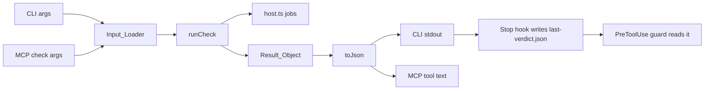

# Design Document

## Overview

The headless runner is a thin Node layer over `runCampaignJob`, `runReductionJob` and `runReplayJob` in `src/ui/app/worker/host.ts`. Those functions are pure (no clock, no random source, no DOM), so the CLI, the MCP server, the Action and the hooks all call one function, `runCheck`, and print one serialized Result_Object. Nothing new touches the emulator.

Facts read from the repo that shape the design:

- `host.ts` signatures: `runCampaignJob({hex, fixture, ruleSet, gremlinSet, campaignSeed, runs, runCycles})` returns `{ok:true, result: CompactCampaignResult} | {ok:false, error:{kind,message}}`. `result.verdict` is the engine `Verdict`: `BROKE` (with `trace.eventList`, `trace.violation`, `trace.runIndex`), `HELD` (`text`, `runs`) or `COULDN'T TELL` (`reason`). `runReductionJob({hex, fixture, ruleSet, originalList, violation, runCycles})` returns a `ReducerResult` with `originalEventCount`, `reducedEventCount`, `reducedList`. `runReplayJob({hex, fixture, ruleSet, events, runCycles})` returns `fingerprint`, `outputEdges`, `violation`.
- Example files: `examples/<id>/fixture.json` is `{pins:[{signal, port, bit, direction, activeLevel?}]}`. `meta.json` has `gremlinSet` (`[{id}]`), `runCycles`, `campaignSeed`, `runs`, plus text fields.
- `src/ui/app/data/examples.ts` and `crosswalk.ts` import files with Vite's `?raw`. That does not work under `tsx`, so the Input_Loader reads files with `node:fs` and parses them with the pure `parseExample` (`data/example.ts`), `readRulesFile` (`engine/rules/rules-file.ts`) and `JSON.parse`.
- Upload defaults are `UPLOAD_DEFAULTS = {runs: 24, runLengthMs: 1000, seed: 20261100}` and `msToCycles` in `model/upload-fields.ts`. Gremlin order follows `GREMLIN_CATALOGUE` (`engine/gremlins/catalogue.ts`), as `orderGremlins` does on the page.
- The page fingerprint comes from `runReplayJob` on the reduced list. The CLI reports that same value. Try number is `violatingRunIndex + 1` of `requestedRuns`.

## Architecture



### Module layout

| Path | Role |
|---|---|
| `cli/input-loader.ts` | The one Input_Loader. `loadInput(args, fs)` returns `{ok:true, input}` or `{ok:false, reason}`. Imported by `cli/` and `mcp/`. |
| `cli/run-check.ts` | `runCheck(input, jobs = host)` runs the three jobs and builds the Result_Object. `exitCodeOf`, `toJson`, `toSummary`. |
| `cli/main.ts` | `main(argv, io)` parses flags, calls the loader and `runCheck`, prints, returns the exit code. A two-line `cli/bin.ts` sets `process.exitCode`. |
| `cli/hook-stop.ts`, `cli/hook-guard.ts` | The two hook commands. |
| `cli/step-summary.ts` | Writes the Action's Markdown summary. |
| `mcp/server.ts` | `handleMessage(msg, deps)` is pure JSON-RPC handling. `mcp/bin.ts` owns stdin and stdout. |
| `action.yml` | Composite action `hexorcist-gate`. |
| `.kiro/hooks/hexorcist-stop.json`, `hexorcist-guard.json` | Hook files, using only the fields in the existing hook files. |

`package.json` gets two scripts and nothing else: `"check": "tsx cli/bin.ts"` and `"mcp": "tsx mcp/bin.ts"`. `mcp/` imports `cli/input-loader.ts` and `cli/run-check.ts`; it never imports `cli/main.ts`.

## Components and Interfaces

```ts
// cli/input-loader.ts
export interface CheckArgs {
  example?: "crosswalk" | "garage" | "heartbeat"; fixed?: boolean;
  hex?: string; pins?: string; rules?: string;          // file paths
  gremlins?: string; runs?: number; seed?: number; runMs?: number;
}
export interface CheckInput extends CampaignJobInput { /* host.ts type */ ruleSentences: string[] }
export type LoadResult = { ok: true; input: CheckInput } | { ok: false; reason: string };
export function loadInput(args: CheckArgs, readText: (path: string) => string): LoadResult;
```

`loadInput` rejects bad combinations before reading files (Requirement 1.7, 1.8). Example mode reads `examples/<id>/{buggy/buggy.hex|fixed/fixed.hex, fixture.json, rules.txt, meta.json}`; omitted values come from `meta.json` (`runCycles` is used as is). Upload mode takes defaults from `UPLOAD_DEFAULTS`, `runCycles = msToCycles(runMs)`, and gremlins default to `masher` when it fits the pin table, otherwise exit 3 (same rule as the page's preselection). Unknown gremlin ids are checked against `GREMLIN_CATALOGUE`. HEX text has a BOM and CR characters stripped before it is passed on, so Windows and Linux checkouts give the same input.

```ts
// cli/run-check.ts
export type CheckOutcome =
  | { ok: true; result: ResultObject }
  | { ok: false; job: "campaign" | "reduction" | "replay"; error: JobError };
export function runCheck(input: CheckInput, jobs?: Jobs): CheckOutcome;
```

Flow: `runCampaignJob` once. On `BROKE`: `runReductionJob` with `originalList = trace.eventList` and `violation = trace.violation`, then `runReplayJob` with `events = reducedList`. On `HELD` or `COULDN'T TELL` nothing else runs. A failed job returns `{ok:false, job, error}` and no verdict.

### Result_Object

Built by writing object literals in a fixed order, then `JSON.stringify(obj, null, 2) + "\n"`. No sorting step and no `undefined` values. Output is UTF-8 with no BOM. Nothing in it is a timestamp, absolute path, host name or duration. These common keys open the object, in this order:

1. `toolVersion` (the `version` field of `package.json`)
2. `verdict` (`"BROKE"`, `"HELD"` or `"COULDN'T TELL"`)
3. `seed`
4. `runs` (requested runs)
5. `gremlins` (ids, in catalogue order)
6. `rules` (canonical sentences)

Then, by verdict:

| Verdict | Remaining keys, in order |
|---|---|
| BROKE | `try`, `movesBefore`, `movesAfter`, `fingerprint`, `violation` (`{rule, cycle}`), `reducedList` (events as the engine gives them), `outputEdges` |
| HELD | `n`, `text` (the engine's `heldText`, passed through) |
| COULDN'T TELL | `reason` (the engine's string, passed through), `peripherals` (the ids from `result.peripheralUses`, `[]` when none) |

`movesBefore` and `movesAfter` are `originalEventCount` and `reducedEventCount`. The plain-text summary says "the smallest replay this reducer found" and lists the same fields as lines; it contains the same strings as the JSON.

### Exit codes

| Condition | Code |
|---|---|
| `HELD` | 0 |
| `BROKE` | 1 |
| `COULDN'T TELL` | 2 |
| loader reason, job error, or any thrown error | 3 (stderr only, no verdict string) |

`exitCodeOf(outcome)` is a total function over `CheckOutcome` plus the loader failure.

### COULDN'T TELL for serial_hello

No CLI logic. `runCampaignJob` returns `verdict: "COULDN'T TELL"` with the engine's `reason`. That reason comes from `peripheralReason("USART0")` in `src/engine/peripherals.ts` (text: "The program uses the serial port (USART0), which this emulator setup does not model, so the rule cannot be checked."), selected by `engine/verdict.ts` when the run touched a listed register. The CLI copies `verdict.reason` and, from `result.peripheralUses`, the peripheral ids. For acceptance test 9.5 the pin map needs LED PB5 and BUTTON PD2 (pressed low), and `fixtures/serial_hello/fixture.json` has only LED. The test therefore writes a temporary pins file to the OS temp directory and deletes it afterwards. The existing fixture is not edited.

### Hook state file

Path: `.hexorcist/last-verdict.json` at the repo root (added to `.gitignore` during implementation). Content, fixed key order, no time fields:

```json
{ "verdict": "BROKE", "exitCode": 1, "hexSha256": "…", "fingerprint": "47078989121ebc1d" }
```

`fingerprint` is `null` for HELD and COULDN'T TELL.

- Config: `.hexorcist/check.json` names the check the hooks run: `{ "hex", "pins", "rules", "gremlins?", "runs?", "seed?" }`, the same names as the CLI flags.
- `hook-stop.ts` (Stop hook): if the config is missing, print "No check ran: .hexorcist/check.json is missing." and exit 0. If the SHA-256 of the HEX file equals `hexSha256` in the state file, print "No check ran: the program has not changed." Otherwise call `loadInput`, `runCheck`, write the state file, and print one line: `BROKE` with the reduced trace, or `COULDN'T TELL` with the reason, or `HELD` text. Exit 3 cases print the reason with no verdict string and leave the state file as it was.
- `hook-guard.ts` (PreToolUse hook): reads the hook's JSON from stdin, and acts only when the call marks a task done (the tool name and status field are read from an existing hook payload at implementation time; see Open Points). It reads the state file and hashes the current HEX. It exits 2 with a stderr message when the file is missing, the hash differs, or the verdict is not `HELD`. It starts no emulator and makes no network call.

### MCP message flow

Transport: newline-delimited JSON-RPC 2.0 on stdin and stdout, hand-written. Only responses go to stdout; diagnostics go to stderr.

| Request | Response |
|---|---|
| `initialize` | `{protocolVersion: <client's, or the server's own if unsupported>, capabilities: {tools: {}}, serverInfo: {name: "hexorcist", version}}` |
| `notifications/initialized` | none |
| `tools/list` | `{tools: [check, capabilities]}`, each with `name`, `description`, `inputSchema` |
| `tools/call` `check` | `loadInput`, `runCheck`, then `{content: [{type: "text", text: toJson(result)}], isError: false}`. The `text` is byte-identical to the CLI's `--json` output. |
| `tools/call` `capabilities` | The 5 sentence forms, gremlin ids from `GREMLIN_CATALOGUE`, and unmodelled peripheral ids with plain names from `UNMODELLED_PERIPHERALS`, as JSON text. |

Errors: unparseable line `-32700` (id null); not a request object `-32600`; unknown method `-32601`; unknown tool or loader failure `-32602` with the cause in `message`. A job error returns a normal result with `isError: true` and the failing job named in the text. The loop never exits on a bad request. The sentence forms come from `RuleForm` (`engine/rules/ir.ts`) and `sentencePatterns` in `ui/app/model/rule-box.ts`; the implementation checks that this module loads under `tsx` and otherwise moves the five templates into a pure module.

### action.yml flow

Composite action `hexorcist-gate`; required inputs `hex`, `pins`, `rules`; optional `gremlins`, `runs`, `seed`.

1. Validate step (bash): if a required input is empty, write the reason to `$GITHUB_STEP_SUMMARY`, then `exit 1`. Later steps carry `if: success()`.
2. `npm ci` with `working-directory: ${{ github.action_path }}`.
3. Run step (bash, `set +e`): resolve the three paths against `$GITHUB_WORKSPACE`, run `npm run check -- --json ... > "$RUNNER_TEMP/hexorcist.json"`, save `$?` as the `code` step output.
4. Summary step (`if: always()` after a successful `npm ci`): `tsx cli/step-summary.ts` reads the JSON file and the code and appends Markdown (verdict, exit code, seed, runs) to `$GITHUB_STEP_SUMMARY`.
5. Final step: `exit` non-zero when `code` is not 0.

## Data Models

`ResultObject` is the table above. `CheckArgs`, `CheckInput` and `CheckOutcome` are the types shown. `HookState` is the JSON file above. Nothing is persisted elsewhere.

## Correctness Properties

*A property is a characteristic or behavior that should hold true across all valid executions of a system. Properties serve as the bridge between human-readable specifications and machine-verifiable checks. They are evidence, not proof.*

The engine runs are too slow for 100 iterations each, so the properties run on the pure layer (`toJson`, `exitCodeOf`, `handleMessage`, `main`, `loadInput`, `hook-guard`) with `runCheck` replaced by a generated `CheckOutcome`. Real-engine behavior is covered by the example tests below.

### Property 1: Serialization is deterministic and stable

*For any* generated Result_Object, `toJson` called twice returns the identical string; the string has a fixed key order (the keys of `JSON.parse` of it, in order, equal the table order for its verdict), no BOM, no CR, and exactly one trailing LF; and `JSON.parse` of it equals the object.

**Validates: Requirements 3.2, 3.3, 3.4, 9.6**

### Property 2: Exit code follows the verdict

*For any* `CheckOutcome` or loader failure, `exitCodeOf` returns 0 for HELD, 1 for BROKE, 2 for COULDN'T TELL, and 3 for job errors and loader failures. For 3, stdout holds none of the three verdict strings.

**Validates: Requirements 4.1, 4.2, 4.3, 4.4, 4.5, 2.4**

### Property 3: CLI and MCP agree

*For any* valid `CheckArgs` and any generated outcome from a stubbed `runCheck`, the `text` returned by MCP `tools/call check` equals the stdout of `main` with `--json` for the same arguments.

**Validates: Requirements 2.6, 6.3, 9.7**

### Property 4: Bad input starts no run

*For any* argument set that names an unknown gremlin, mixes `--example` with `--hex`, `--pins` or `--rules`, gives `--fixed` without `--example`, or gives a non-integer number, `loadInput` returns a failure, the stubbed `runCheck` is never called, and `main` returns 3.

**Validates: Requirements 1.7, 1.8**

### Property 5: Jobs run only as the verdict needs

*For any* generated campaign verdict, the reduction and replay stubs are each called once when it is BROKE and never otherwise; the campaign stub is called exactly once.

**Validates: Requirements 2.1, 2.2, 2.3**

### Property 6: The Pre Tool Use guard allows only a current HELD

*For any* state file content (missing, malformed, any verdict, matching or differing `hexSha256`), `hook-guard` exits 0 only when the verdict is HELD and the hash matches the current HEX, and exits 2 otherwise.

**Validates: Requirements 7.5, 7.6**

## Error Handling

- Loader failures: one stderr line, exit 3, no run (Requirement 1.7, 1.8).
- Job failure: stderr names the job (`campaign`, `reduction` or `replay`) and the engine's `error.message`; exit 3; no verdict string.
- Thrown exceptions anywhere in `main` are caught, reported on stderr as one line, and map to exit 3. The CLI never prints a stack trace.
- MCP: bad requests get a JSON-RPC error and the loop continues. A thrown error inside a tool call becomes `isError: true`.
- Hooks: a missing config, unchanged program, or exit 3 prints the reason with no verdict string. A malformed state file counts as "no verdict recorded".

## Testing Strategy

Property-based testing applies to the pure layer only, using `fast-check` (already a devDependency), at least 100 iterations per property, each as a single test tagged `Feature: headless-runner, Property N: <title>`. Tests live under `tests/cli/` and `tests/mcp/` and run with `vitest --run`.

Example tests (evidence, not proof):

- Acceptance 9.1 to 9.4: run `main` on each buggy and fixed example with the committed HEX files; compare exit code, fingerprint, try number and moves with the pinned values in the requirements; fixed builds print the exact HELD text. These values are not edited if a run disagrees; a mismatch is reported with expected, actual and the trace.
- Acceptance 9.5: serial_hello with a temporary pins file, the rule "LED is 1 must never last 500 ms or longer.", gremlin masher; expect exit 2 and a reason containing "serial port".
- Acceptance 9.6: run the same example twice and compare stdout bytes; compare the fingerprint to the one `runReplayJob` gives in the page's test path (`tests/ui/examples-host.acceptance.test.ts`).
- Acceptance 9.7: spawn `mcp/bin.ts`, send `initialize`, `tools/list`, `tools/call`, and compare the `text` to CLI output.
- Smoke: `package.json` dependency lists unchanged and exactly two new scripts; `action.yml` has the three required inputs; hook files use only fields found in existing hook files; `node scripts/guard.mjs` reports zero findings for `cli/` and `mcp/` (the implementation checks that the guard scans those folders); a text scan of new user-facing strings for the banned words.
- Action: no local runner. `action.yml` is checked by reading it, and the script steps are kept thin so `step-summary.ts` can be unit tested.
- Debug scripts used while building are deleted before the task is reported done.

## Open Points

- The PreToolUse payload that marks a task done: the tool name and status value are read from a real payload when `hook-guard` is written. Until then the matcher is a placeholder.
- `rule-box.ts` may import browser-only code; the capabilities tool falls back to a pure template module if it does.
