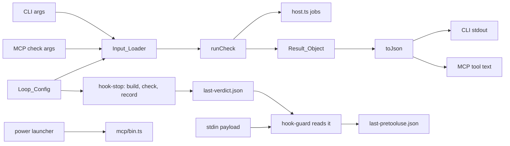

# Design Document

## Overview

The headless runner is a thin Node layer over `runCampaignJob`, `runReductionJob` and `runReplayJob` in `src/ui/app/worker/host.ts`. Those functions are pure (no clock, no random source, no DOM), so the CLI, the MCP server, the Action and the hooks all call one function, `runCheck`, and print one serialized Result_Object. Nothing new touches the emulator, and `src/engine/` is not edited (this includes `REASON_MAX_LENGTH = 200` in `src/engine/verdict.ts`).

Facts read from the repo that shape the design:

- `host.ts` signatures: `runCampaignJob({hex, fixture, ruleSet, gremlinSet, campaignSeed, runs, runCycles})` returns `{ok:true, result: CompactCampaignResult} | {ok:false, error:{kind,message}}`. `result.verdict` is the engine `Verdict`: `BROKE` (with `trace.eventList`, `trace.violation`, `trace.runIndex`), `HELD` (`text`, `runs`) or `COULDN'T TELL` (`reason`). `runReductionJob({hex, fixture, ruleSet, originalList, violation, runCycles})` returns a `ReducerResult` with `originalEventCount`, `reducedEventCount`, `reducedList`. `runReplayJob({hex, fixture, ruleSet, events, runCycles})` returns `fingerprint`, `outputEdges`, `violation`.
- Example files: `examples/<id>/fixture.json` is `{pins:[{signal, port, bit, direction, activeLevel?}]}`. `meta.json` has `gremlinSet` (`[{id}]`), `runCycles`, `campaignSeed`, `runs`, plus text fields.
- `src/ui/app/data/examples.ts` and `crosswalk.ts` import files with Vite's `?raw`. That does not work under `tsx`, so the Input_Loader reads files with `node:fs` and parses them with the pure `parseExample` (`data/example.ts`), `readRulesFile` (`engine/rules/rules-file.ts`) and `JSON.parse`.
- Upload defaults are `UPLOAD_DEFAULTS = {runs: 24, runLengthMs: 1000, seed: 20261100}` and `msToCycles` in `model/upload-fields.ts`. Gremlin order follows `GREMLIN_CATALOGUE` (`engine/gremlins/catalogue.ts`), as `orderGremlins` does on the page.
- The page fingerprint comes from `runReplayJob` on the reduced list. The CLI reports that same value. Try number is `violatingRunIndex + 1` of `requestedRuns`.
- The engine truncates a COULDN'T TELL reason inside a private function (`truncateReason`) and returns only the cut string. It exposes no "was cut" flag. See "reasonTruncated" below.
- `scripts/build-examples.mjs` compiles with `spawnSync("arduino-cli", ["compile", "-b", "arduino:avr:uno", "--output-dir", build, dir])` and keeps `<name>.ino.hex`. `scripts/guard.mjs` finds its root from its own location, has a `walk`/`scan` helper pair, prints `file:line: message`, and exits 2 on findings.
- The two hook files `.kiro/hooks/hexorcist-check-on-stop.json` (Stop, `npx tsx --no-deprecation cli/hook-stop.ts exorcism-demo/loop-check.json --block`) and `.kiro/hooks/hexorcist-done-guard.json` (PreToolUse, matcher `spec`, `npx tsx --no-deprecation cli/hook-guard.ts exorcism-demo/loop-check.json`) already exist and stay byte-for-byte unchanged.
- Real PreToolUse payload (observed Nov 24, 2026, from Requirement 7): JSON on stdin. Marking a spec task done arrives as `{"tool_name":"task_update","tool_input":{"tasksFilePath":…,"taskId":…,"status":…}}`. Exit code 2 blocks the call and the agent sees stderr.

## Architecture



### Module layout

| Path | Role |
|---|---|
| `cli/input-loader.ts` | The one Input_Loader. `loadInput(args, env)` returns `{ok:true, input}` or `{ok:false, reason}`. Imported by `cli/` and `mcp/`. Also holds the pure `invocationDirOf`, `resolveUserPath`, `resolveRepoPath` and `parseLoopConfig`. |
| `cli/run-check.ts` | `runCheck(input, jobs = host)` runs the three jobs and builds the Result_Object. `exitCodeOf`, `toJson`, `toSummary`, `isReasonTruncated`. |
| `cli/entry.ts` | `isEntryPoint(moduleUrl, argv1)`, the one entry-point test used by every runnable module. |
| `cli/main.ts` | `main(argv, io)` parses flags, calls the loader and `runCheck`, prints, returns the exit code. `cli/bin.ts` sets `process.exitCode`. |
| `cli/hook-stop.ts` | Stop hook command. Exports `decideStop` (pure) and `run(argv, io)`. |
| `cli/hook-guard.ts` | PreToolUse hook command. Exports `classifyPayload` and `decideGuard` (pure) and `run(argv, io)`. |
| `cli/verdict-record.ts` | `serializeRecord`, `parseRecord`, `hexSha256` (shared by both hooks). |
| `cli/action-report.ts` | Reads the CLI's JSON file and exit code, appends the Markdown summary to `$GITHUB_STEP_SUMMARY` and the `verdict` and `exit-code` outputs to `$GITHUB_OUTPUT`. Replaces the earlier `step-summary.ts` plan. |
| `mcp/server.ts` | `handleMessage(msg, deps)` is pure JSON-RPC handling. `mcp/bin.ts` owns stdin and stdout. |
| `action.yml` | Composite action `hexorcist-gate`. |
| `.github/workflows/gate-demo.yml` | Runs the Action on the Crosswalk fixed and buggy builds. |
| `exorcism-demo/build.mjs`, `exorcism-demo/crosswalk-full-rules.txt`, `exorcism-demo/loop-check.json` | Demo build script, demo rules, loop config. |
| `power/hexorcist/` | The Power: `plugin.json`, `mcp.json` (holds the inline Launcher), `README.md`, `skills/check-firmware/SKILL.md`. No separate launcher file. |
| `scripts/guard.mjs` | Extended with scans of `cli/`, `mcp/`, `power/`. |

`package.json` gets two scripts and nothing else: `"check": "tsx --no-deprecation cli/bin.ts"` and `"mcp": "tsx --no-deprecation mcp/bin.ts"`. `dependencies` and `devDependencies` are untouched; node built-ins (`node:fs`, `node:path`, `node:crypto`, `node:child_process`, `node:os`, `node:url`) are the only new imports. `mcp/` imports `cli/input-loader.ts`, `cli/run-check.ts` and `cli/entry.ts`; it never imports `cli/main.ts`. `cli/` and `mcp/` import the Input_Loader module only from that one path (Requirement 8.5).

### Entry-point check (Requirement 14.1)

```ts
// cli/entry.ts
const norm = (p: string) => path.resolve(p).replace(/\\/g, "/").toLowerCase();
export function isEntryPoint(moduleUrl: string, argv1: string | undefined): boolean {
  return argv1 !== undefined && norm(fileURLToPath(moduleUrl)) === norm(argv1);
}
```

Windows gives `import.meta.url` as `file:///C:/…` and `process.argv[1]` as `c:\…` with a different drive-letter case, so a plain string compare fails and the module would silently do nothing. The function resolves both, turns backslashes into slashes and lowercases. `cli/bin.ts`, `cli/hook-stop.ts`, `cli/hook-guard.ts` and `mcp/bin.ts` each end with `if (isEntryPoint(import.meta.url, process.argv[1])) process.exitCode = await run(...)`. Tests import `run`, `main` and `handleMessage` without side effects. Lowercasing can in theory treat two paths that differ only by case as equal on a case-sensitive file system. The repo has no such pair of runnable modules.

### Deprecation warnings (Requirement 14.2 to 14.4)

Both npm scripts and both hook command lines pass `--no-deprecation` to `tsx`. The inline Launcher passes it too. No code writes warnings itself. The smoke test runs `npm run check -- --example heartbeat --fixed` and the hook commands and asserts that stderr contains no `DeprecationWarning`. This depends on the installed Node and tsx versions, so a pass is evidence for this machine only.

## Components and Interfaces

### Path resolution (Requirements 1.9 to 1.11, 13.6)

`npm run` changes the working directory to the package root, so a relative path typed by the user would resolve against the wrong folder. npm records the real folder in `INIT_CWD`.

```ts
// cli/input-loader.ts
export interface LoaderEnv {
  readText(absPath: string): string;
  readBytes?(absPath: string): Uint8Array;
  invocationDir: string;   // from invocationDirOf(process.env, process.cwd())
  repoDir: string;         // folder that holds package.json, from the module location
}
export const invocationDirOf = (env: Record<string, string | undefined>, cwd: string): string =>
  env.INIT_CWD !== undefined && env.INIT_CWD !== "" ? env.INIT_CWD : cwd;
export const resolveUserPath = (env: LoaderEnv, p: string) => path.resolve(env.invocationDir, p);
export const resolveRepoPath = (env: LoaderEnv, p: string) => path.resolve(env.repoDir, p);
```

| Path kind | Resolved against |
|---|---|
| `--hex`, `--pins`, `--rules` (CLI) and the same inputs of MCP `check` | `invocationDir` |
| Bundled `examples/<id>/…` | `repoDir`, whatever `invocationDir` is |
| Hook argument (the Loop_Config path) | `invocationDir` |
| `hex`, `pins`, `rules`, `source` and `build` working folder read from the Loop_Config | `repoDir` |
| `.hexorcist/…` state files | `repoDir` |

`repoDir` is computed once at the edge from `import.meta.url` of `cli/bin.ts` or the hook module (parent of `cli/`), never from the working directory. The MCP server reads `INIT_CWD` too; when the inline Launcher starts it, the Launcher sets `INIT_CWD` to its own working folder unless that variable is already set. Kiro starts the Launcher in the user's powers folder, so relative paths sent by a client resolve against that folder unless the client sets `INIT_CWD`; absolute paths are unaffected. Absolute paths pass through `path.resolve` unchanged, which is what the Action relies on.

### Loader

```ts
export interface CheckArgs {
  example?: "crosswalk" | "garage" | "heartbeat"; fixed?: boolean;
  hex?: string; pins?: string; rules?: string;          // file paths
  gremlins?: string; runs?: number; seed?: number; runMs?: number;
}
export interface CheckInput extends CampaignJobInput { /* host.ts type */ ruleSentences: string[] }
export type LoadResult = { ok: true; input: CheckInput } | { ok: false; reason: string };
export function loadInput(args: CheckArgs, env: LoaderEnv): LoadResult;
```

`loadInput` rejects bad combinations before reading files (Requirements 1.7, 1.8). Example mode reads `examples/<id>/{buggy/buggy.hex|fixed/fixed.hex, fixture.json, rules.txt, meta.json}`; omitted values come from `meta.json` (`runCycles` is used as is). Upload mode takes defaults from `UPLOAD_DEFAULTS`, `runCycles = msToCycles(runMs)`, and gremlins default to `masher` when it fits the pin table, otherwise exit 3 (same rule as the page's preselection). Unknown gremlin ids are checked against `GREMLIN_CATALOGUE`. `gremlins` is always a comma-separated string, from the flag or from the Loop_Config, split by one shared function. HEX text has a BOM and CR characters stripped before it is passed on, so Windows and Linux checkouts give the same input.

### Run flow

```ts
// cli/run-check.ts
export type CheckOutcome =
  | { ok: true; result: ResultObject }
  | { ok: false; job: "campaign" | "reduction" | "replay"; error: JobError };
export function runCheck(input: CheckInput, jobs?: Jobs): CheckOutcome;
```

`runCampaignJob` once. On `BROKE`: `runReductionJob` with `originalList = trace.eventList` and `violation = trace.violation`, then `runReplayJob` with `events = reducedList`. On `HELD` or `COULDN'T TELL` nothing else runs. A failed or throwing job returns `{ok:false, job, error}` and no verdict.

### Result_Object

Built by writing object literals in a fixed order, then `JSON.stringify(obj, null, 2) + "\n"`. No sorting step and no `undefined` values. Output is UTF-8 with no BOM and LF line endings. Nothing in it is a timestamp, absolute path, host name or duration. These common keys open the object, in this order:

1. `toolVersion` (the `version` field of `package.json`)
2. `verdict` (`"BROKE"`, `"HELD"` or `"COULDN'T TELL"`, ASCII apostrophe)
3. `seed`
4. `runs` (requested runs)
5. `gremlins` (ids, in catalogue order)
6. `rules` (canonical sentences)

Then, by verdict:

| Verdict | Remaining keys, in order |
|---|---|
| BROKE | `try`, `movesBefore`, `movesAfter`, `fingerprint`, `violation` (`{rule, cycle}`), `reducedList` (events as the engine gives them), `outputEdges` |
| HELD | `n`, `text` (the engine's `heldText`, passed through) |
| COULDN'T TELL | `reason`, `reasonTruncated`, `peripherals` |

`movesBefore` and `movesAfter` are `originalEventCount` and `reducedEventCount`. The plain-text summary says "the smallest replay this reducer found" and lists the same fields as lines; it contains the same strings as the JSON.

#### reason and reasonTruncated (Requirements 3.7, 3.9, 3.10)

`reason` is the engine's string, copied with no rewording or further cutting. `peripherals` holds the ids from `result.peripheralUses` (`[]` when none). `reasonTruncated` sits directly after `reason`.

The engine does not report whether it cut the text, and it is not edited. The runner derives the flag with one pure function:

```ts
import { REASON_MAX_LENGTH } from "../src/engine/verdict";
export const isReasonTruncated = (reason: string): boolean => reason.length >= REASON_MAX_LENGTH;
```

The engine cuts only when the full text is longer than 200 UTF-16 units, and the result is 200 units long, or 199 when the cut would split a surrogate pair. The derivation has two blind spots:

- A full reason that is exactly 200 units long and was not cut reads `true`.
- A cut that backed off one unit to keep a surrogate pair whole (199 units) reads `false`.

Reasons are built from rule sentences, signal names and fixed English phrases, so the second case needs a non-BMP character in a rule or signal name. The first case needs the full text to land on exactly 200. Both are unlikely but possible. An exact flag would need an engine change, which Requirement 3.10 rules out, so the rule `reason.length >= 200` stands as decided (Requirement 3.9). The blind spots are covered by example tests that record them as expected values.

The Power documents the field in `README.md` and `SKILL.md`, each with this exact sentence: "true when the reason reached the 200-character limit, so it may have been cut" (Requirement 10.8). A test reads both files and checks for the sentence.

### Exit codes

| Condition | Code |
|---|---|
| `HELD` | 0 |
| `BROKE` | 1 |
| `COULDN'T TELL` | 2 |
| loader reason, job error, or any thrown error | 3 (stderr only, no verdict string) |

`exitCodeOf(outcome)` is a total function over `CheckOutcome` plus the loader failure.

### COULDN'T TELL for serial_hello

No CLI logic. `runCampaignJob` returns `verdict: "COULDN'T TELL"` with the engine's `reason`. That reason comes from `peripheralReason("USART0")` in `src/engine/peripherals.ts` (text: "The program uses the serial port (USART0), which this emulator setup does not model, so the rule cannot be checked."), selected by `engine/verdict.ts` when the run touched a listed register. For acceptance test 9.5 the pin map needs LED PB5 and BUTTON PD2 (pressed low), and `fixtures/serial_hello/fixture.json` has only LED. The test therefore writes a temporary pins file to the OS temp directory and deletes it afterwards. The existing fixture is not edited. The reason is under 200 units, so `reasonTruncated` is `false` there.

### Demo files (Requirement 13)

- `exorcism-demo/sketch/sketch.ino` is the sketch the demo builds. (The sketch itself is outside this runner's scope; the build script requires the file to exist and reports a missing file as a compile failure.)
- `exorcism-demo/build.mjs` is plain Node ESM with no dependencies. It runs `spawnSync("arduino-cli", ["compile", "-b", "arduino:avr:uno", "--output-dir", out, sketchDir], {encoding: "utf8"})`, the same invocation and 16 MHz ATmega328P target as `scripts/build-examples.mjs`, with `out = exorcism-demo/build/`. On success it copies `sketch.ino.hex` to `build/sketch.hex`, prints one line, exits 0. On any failure (compiler missing, non-zero status, missing output) it prints the compiler output and exits 1. If `scripts/build-examples.mjs` exports no shared function, the invocation is copied, not refactored, to keep that script unchanged.
- `exorcism-demo/crosswalk-full-rules.txt` has exactly the seven lines of Requirement 13.4, LF-terminated, no BOM. A test reads the file and compares the bytes and also parses it with `readRulesFile`.
- `exorcism-demo/loop-check.json`:

```json
{
  "source": "exorcism-demo/sketch/sketch.ino",
  "build": ["node", "exorcism-demo/build.mjs"],
  "hex": "exorcism-demo/build/sketch.hex",
  "pins": "examples/crosswalk/fixture.json",
  "rules": "exorcism-demo/crosswalk-full-rules.txt",
  "gremlins": "masher,bouncer",
  "runs": 24,
  "seed": 20261101,
  "runMs": 1000
}
```

`parseLoopConfig(text)` returns `{ok:true, config}` or `{ok:false, reason}` where the reason names the unreadable JSON or the missing or mistyped key. `configToArgs(config)` maps it to `CheckArgs` (`gremlins` stays a string, shared with `--gremlins`), and `loadInput` resolves the paths against `repoDir`.

### Hook files and state

The two hook files are not created or edited. This runner supplies the two commands they name. Both hooks receive the Loop_Config path as `argv[2]`, resolved against `invocationDir` (the hook runs from the repo, so this is the repo-relative path the files give).

State lives in `<repoDir>/.hexorcist/`, created on first write, listed with `exorcism-demo/build/` in `.gitignore`:

| File | Writer | Content |
|---|---|---|
| `last-verdict.json` (Verdict_Record) | Stop hook | `{ "verdict": "BROKE", "exitCode": 1, "hexSha256": "…", "fingerprint": "47078989121ebc1d" }` in this key order, UTF-8, LF, one trailing LF. `fingerprint` is `null` for HELD and COULDN'T TELL. |
| `last-pretooluse.json` | Guard hook | The raw stdin text of the last PreToolUse call, written before any decision, so the payload shape can be inspected. |
| `stop-blocks.json` | Stop hook | `{ "count": 2 }`, the number of blocks in a row. |

`hexSha256` is the lowercase hex SHA-256 of the raw bytes of the HEX file (Hex_Hash), read with no BOM or CR normalisation. `parseRecord(text)` returns the record or `null` for anything unreadable, unparseable or with the wrong key types; `null` means "no verdict recorded". No file holds a time value.

#### hook-stop.ts

Arguments: `<config> [--block] [--max-blocks N]` (default 3).

1. Read and parse the Loop_Config. On failure: no-check outcome (below).
2. Run `build` with `spawnSync(build[0], build.slice(1), {cwd: repoDir, shell: false, encoding: "utf8"})`. A spawn error or non-zero status is a no-check outcome that includes the build's last stderr line.
3. Read the HEX file. Missing: no-check outcome.
4. `loadInput`, `runCheck`. An exit-3 outcome (loader failure or job error) is a no-check outcome, reported as its reason.
5. Write the Verdict_Record, print exactly one verdict line (`BROKE` with the reduced trace, `HELD` with HELD_Text, or `COULDN'T TELL` with the reason), then apply `decideStop`.

No-check outcome: print one line starting "No check ran:" with the cause, no verdict string; delete any existing `last-verdict.json` so an older HELD cannot unlock the guard; leave the block counter alone; exit 0 (nothing the agent can retry by being blocked).

```ts
// pure
export function decideStop(p: {
  verdict: "BROKE" | "HELD" | "COULDN'T TELL"; block: boolean; count: number; max: number;
}): { exitCode: 0 | 2; nextCount: number; limitReached: boolean };
```

| Condition | exit | nextCount |
|---|---|---|
| verdict HELD | 0 | 0 |
| not `--block` | 0 | `count` |
| BROKE or COULDN'T TELL, `--block`, `count < max` | 2 (verdict line on stderr) | `count + 1` |
| BROKE or COULDN'T TELL, `--block`, `count >= max` | 0, prints a line saying the limit was reached | `count` |

With exit 0 the verdict line goes to stdout. A malformed `stop-blocks.json` reads as count 0.

#### hook-guard.ts

Argument: `<config>` (only to locate the HEX file). Steps:

1. Read all of stdin as text and write it unchanged to `.hexorcist/last-pretooluse.json` (a failure to write is reported on stderr and does not change the decision).
2. `classifyPayload(text)`:

```ts
export function classifyPayload(text: string): "task-done" | "other" {
  // JSON.parse failure, non-object, or any other shape → "other"
  // "task-done" iff tool_name === "task_update"
  //   && typeof tool_input === "object" && tool_input.status ∈ {"completed", "done"}
}
```

3. `"other"`: exit 0.
4. `"task-done"`: read the Verdict_Record (`parseRecord`), read the Loop_Config and the current HEX bytes, then `decideGuard`:

```ts
export function decideGuard(record: VerdictRecord | null, currentHash: string | null):
  { exitCode: 0 } | { exitCode: 2; message: string };
```

| Condition | Result |
|---|---|
| record is `null` | exit 2, stderr says no verdict is recorded and the agent should run the check (Stop hook command or `npm run check`) |
| record verdict is not HELD | exit 2, stderr names the recorded verdict and says to fix the program and check again |
| HEX missing, or `currentHash` differs from `record.hexSha256` | exit 2, stderr says the recorded check is out of date and to run it again |
| HELD and hashes equal | exit 0 |

An unreadable Loop_Config on a task-done call counts as "HEX missing" (exit 2, out of date). The guard starts no emulator, imports no engine code, reads no clock and makes no network call. Its only imports are `node:fs`, `node:path`, `node:crypto` and `cli/verdict-record.ts`, `cli/entry.ts`, `cli/input-loader.ts` (for `parseLoopConfig` and path helpers).

### MCP message flow

Transport: newline-delimited JSON-RPC 2.0 on stdin and stdout, hand-written. Only responses go to stdout; diagnostics go to stderr.

| Request | Response |
|---|---|
| `initialize` | `{protocolVersion: <client's, or the server's own if unsupported>, capabilities: {tools: {}}, serverInfo: {name: "hexorcist", version}}` |
| `notifications/initialized` | none |
| `tools/list` | `{tools: [check, capabilities]}`, each with `name`, `description`, `inputSchema` |
| `tools/call` `check` | `loadInput`, `runCheck`, then `{content: [{type: "text", text: toJson(result)}], isError: false}`. The `text` is byte-identical to the CLI's `--json` output. |
| `tools/call` `capabilities` | The 5 sentence forms, gremlin ids from `GREMLIN_CATALOGUE`, and unmodelled peripheral ids with plain names from `UNMODELLED_PERIPHERALS`, as JSON text. |

Errors: unparseable line `-32700` (id null); not a request object `-32600`; unknown method `-32601`; unknown tool or loader failure `-32602` with the cause in `message`. A job error returns a normal result with `isError: true` and the failing job named in the text. The loop never exits on a bad request. The sentence forms come from `RuleForm` (`engine/rules/ir.ts`) and `sentencePatterns` in `ui/app/model/rule-box.ts`; the implementation checks that this module loads under `tsx` and otherwise moves the five templates into a pure module.

### action.yml flow

Composite action `hexorcist-gate`; required inputs `hex`, `pins`, `rules`; optional `gremlins`, `runs`, `seed`. Outputs `verdict` and `exit-code`, with `value: ${{ steps.run.outputs.verdict }}` and `${{ steps.run.outputs.code }}`.

1. Validate step (bash): if a required input is empty, write the reason to `$GITHUB_STEP_SUMMARY`, then `exit 1`. Later steps use the default `success()` condition, so none runs after a failure.
2. Install step (`id: install`): `npm ci` with `working-directory: ${{ github.action_path }}`, written as `npm ci || { echo "reason" >> "$GITHUB_STEP_SUMMARY"; exit 1; }`.
3. Run step (`id: run`, bash, `set +e`): resolve the three paths to absolute paths against `$GITHUB_WORKSPACE` (the Action runs `npm run check` from `github.action_path`, so a relative path would resolve against the Action, not the caller), run `npm run check -- --json ... > "$RUNNER_TEMP/hexorcist.json"`, save `$?`, and `exit 0` so the steps after it still run.
4. Report step: `npx tsx --no-deprecation cli/action-report.ts "$RUNNER_TEMP/hexorcist.json" "$code"` reads the JSON (an empty or invalid file reads as no verdict), appends the Markdown summary (verdict, exit code, seed, runs, or the stderr reason when the code is 3) to `$GITHUB_STEP_SUMMARY`, and appends `verdict=` and `exit-code=` lines to `$GITHUB_OUTPUT`. For exit code 3 `verdict` is empty.
5. Final step: `exit "$code"` when the code is not 0.

The outputs are written in step 4, before the failing step 5, so a later step in the same job can read them (Requirement 5.8).

### .github/workflows/gate-demo.yml

Triggers: `push` and `workflow_dispatch`. Two jobs on `ubuntu-latest`, each: `actions/checkout`, `actions/setup-node` (Node version as in `ci.yml`), then the Action.

- `fixed`: `uses: ./` with `hex: examples/crosswalk/fixed/fixed.hex`, `pins: examples/crosswalk/fixture.json`, `rules: examples/crosswalk/rules.txt`. The job passes when the Action step passes.
- `buggy`: the same step with `id: gate`, `continue-on-error: true` and the buggy HEX. A later step runs `if [ "${{ steps.gate.outputs.verdict }}" != "BROKE" ] || [ "${{ steps.gate.outputs.exit-code }}" != "1" ]; then exit 1; fi`. Both values are passed through `env:` rather than interpolated into the script, since they come from program output.

No step makes a network call other than checkout, setup-node and `npm ci`.

### Power (Requirement 10)

```
power/hexorcist/
  plugin.json
  mcp.json
  README.md
  skills/check-firmware/SKILL.md
```

There is no launcher file. Kiro starts power servers from the user's powers folder and the Power may not use absolute paths or a plugin-root variable, so the repo folder comes from the environment variable `HEXORCIST_ROOT`, which the user sets once.

- `mcp.json` declares one server with `"command": "node"` and `"args": ["-e", "<inline script>"]`. It never names `npm`, holds no absolute path and uses no plugin-root variable. The script is a single CommonJS string with no dependencies, written so it reads cleanly as one JSON string (no template literals that need escaping).
- The inline Launcher does this, in order:
  1. `root = process.env.HEXORCIST_ROOT` when set and non-empty, otherwise `process.cwd()`.
  2. Check that `<root>/mcp/bin.ts` and `<root>/node_modules/tsx/dist/cli.mjs` exist. If either is missing, log the cause and exit 1.
  3. `spawn(process.execPath, [tsxCli, "--no-deprecation", "mcp/bin.ts"], {cwd: root, stdio: "inherit", env: {...process.env, INIT_CWD: process.env.INIT_CWD || process.cwd()}})`, where `process.cwd()` is read before the child starts. Running the tsx entry file under `node` avoids the `.cmd` shim that cannot be spawned directly on Windows. `stdio: "inherit"` passes stdin, stdout and stderr through to the child unchanged.
  4. On the child's `error` event, log and exit 1. On `exit`, exit with the child's code (or 1 when it ended on a signal).
  5. Startup errors are appended with `fs.appendFileSync(path.join(os.tmpdir(), "hexorcist-launcher.log"), message + "\n")`. The Launcher writes nothing to stdout, and nothing to stderr other than what the child writes. Log lines carry no time value. If the log write itself fails, the Launcher still exits 1 and stays silent on stdout.
- `README.md` says that the user sets `HEXORCIST_ROOT` once, to the repo folder, with one example for PowerShell and one for a POSIX shell, and names the log file `hexorcist-launcher.log` in the OS temp folder. It documents `reasonTruncated` with the exact sentence given above.
- `SKILL.md` tells the agent, in this order: call `capabilities` before any other tool; write rules only in the five sentence forms it returns; call `check` after the rules are written; quote HELD_Text word for word; call a BROKE reduced list "the smallest replay this reducer found". It also documents `reasonTruncated` with the same exact sentence as the README.
- Power text avoids the Banned_Words. The Launcher's no-clock, no-random, no-network and no-install rules (10.7) are checked by a text scan of the script string inside `mcp.json`, run in its test, since `guard.mjs` applies the code-pattern rules to `cli/` and `mcp/` only. The guard does scan `power/` for Banned_Words.

### scripts/guard.mjs changes (Requirement 12)

Three additions to the existing script, in the style of its other rules (same `walk`, `scan`, `file:line: message` output, exit 2 on any finding, exit 0 and "0 findings" when clean):

1. Claim words: add `walk(cli)`, `walk(mcp)`, `walk(power)` filtered to `.ts .mjs .json .md .yml` to the existing `claimFiles` list, so the same regex and `guard-allow` escape apply. The scan reads whole files, so a banned word in a code comment or identifier also counts. Words inside longer identifiers (`safeParse`, `first-run`) are not matched, as with the existing rule.
2. Determinism: add a rule over `.ts` and `.mjs` files under `cli/` and `mcp/` with the existing regex plus nothing new, since it already names `Date.now`, `performance.now`, `setTimeout`, `setInterval`, `Math.random` and `new Date(`.
3. Network: a rule over the same files for `fetch(`, `XMLHttpRequest`, `WebSocket`, and imports of `http`, `https`, `net`, `dgram`, `dns` (with or without `node:`), for `from "x"`, `import("x")` and `require("x")`.

Test files live under `tests/`, which these rules do not walk. Tests that run the script copy `scripts/guard.mjs` into a temporary folder that mimics the repo layout (the script finds its root from its own location), so the real repo is not touched.

## Data Models

`ResultObject` is the table above. `CheckArgs`, `CheckInput`, `CheckOutcome` are the types shown. `LoopConfig = {source, build: string[], hex, pins, rules, gremlins: string, runs: number, seed: number, runMs: number}`. `VerdictRecord = {verdict, exitCode, hexSha256, fingerprint: string | null}`. `BlockCounter = {count: number}`. Nothing else is persisted.

## Correctness Properties

*A property is a characteristic or behavior that should hold true across all valid executions of a system. Properties serve as the bridge between human-readable specifications and machine-verifiable checks. They are evidence, not proof.*

The engine runs are too slow for 100 iterations each, so the properties run on the pure layer (`toJson`, `exitCodeOf`, `isReasonTruncated`, `handleMessage`, `main`, `loadInput`, path helpers, `isEntryPoint`, `classifyPayload`, `decideGuard`, `decideStop`, `parseRecord`, `parseLoopConfig`) with `runCheck` replaced by a generated `CheckOutcome`. Real-engine behavior is covered by the example tests below.

### Property 1: Serialization is deterministic and stable

*For any* generated Result_Object, `toJson` called twice returns the identical string; the string has a fixed key order (the keys of `JSON.parse` of it, in order, equal the table order for its verdict, with `reasonTruncated` directly after `reason` for COULDN'T TELL), no BOM, no CR, and exactly one trailing LF; and `JSON.parse` of it equals the object.

**Validates: Requirements 3.2, 3.3, 3.4, 3.9, 9.6**

### Property 2: Exit code follows the verdict

*For any* `CheckOutcome` or loader failure, `exitCodeOf` returns 0 for HELD, 1 for BROKE, 2 for COULDN'T TELL, and 3 for job errors and loader failures. For 3, stdout holds none of the three verdict strings.

**Validates: Requirements 4.1, 4.2, 4.3, 4.4, 4.5, 2.4**

### Property 3: CLI and MCP agree

*For any* valid `CheckArgs` and any generated outcome from a stubbed `runCheck`, the `text` returned by MCP `tools/call check` equals the stdout of `main` with `--json` for the same arguments.

**Validates: Requirements 2.6, 6.3, 9.7**

### Property 4: Bad input starts no run

*For any* argument set that names an unknown gremlin, mixes `--example` with `--hex`, `--pins` or `--rules`, gives `--fixed` without `--example`, or gives a non-integer number, `loadInput` returns a failure, the stubbed `runCheck` is never called, and `main` returns 3.

**Validates: Requirements 1.7, 1.8**

### Property 5: Jobs run only as the verdict needs

*For any* generated campaign verdict, the reduction and replay stubs are each called once when it is BROKE and never otherwise; the campaign stub is called exactly once.

**Validates: Requirements 2.1, 2.2, 2.3**

### Property 6: Paths resolve against the right folder

*For any* invocation folder, repo folder and relative path `p` (and any absolute path), user-supplied file paths from CLI flags, MCP `check` input and the hook's Loop_Config argument resolve to `path.resolve(invocationDir, p)`; paths read from inside the Loop_Config, state files and bundled example files resolve to `path.resolve(repoDir, p)` and do not change when `invocationDir` changes. And *for any* environment, `invocationDirOf` returns `INIT_CWD` when it is set and non-empty, and the working directory otherwise.

**Validates: Requirements 1.9, 1.10, 1.11**

### Property 7: Entry-point check ignores case and separators

*For any* absolute file path, `isEntryPoint(fileUrlOf(path), variant(path))` is true when `variant` changes letter case or swaps `/` and `\` separators, and is false for *any* two paths that differ by more than case and separators.

**Validates: Requirements 14.1**

### Property 8: reasonTruncated reports the engine's cut

*For any* COULDN'T TELL reason produced by `computeVerdict` from generated ASCII inputs whose untruncated text is not exactly 200 units long, `isReasonTruncated(reason)` is true exactly when the untruncated text is longer than 200 units; the printed `reason` equals the engine's string; and `reason.length <= 200`. Generators avoid the exactly-200 case, which is covered by an example test that documents the blind spot.

**Validates: Requirements 3.9, 3.10**

### Property 9: Guard payload classification

*For any* stdin text, `classifyPayload` returns `"task-done"` if and only if the text parses to an object with `tool_name` equal to `"task_update"` and an object `tool_input` whose `status` is `"completed"` or `"done"`. Invalid JSON, other tool names, other status values, missing fields and non-object JSON all return `"other"`, and for `"other"` the guard exits 0 whatever the Verdict_Record holds.

**Validates: Requirements 7.10, 7.11**

### Property 10: The guard allows a done task only on a current HELD

*For any* Verdict_Record (missing, malformed, any verdict, any hash) and any current hash (including a missing HEX file), `decideGuard` returns exit 0 only when the record's verdict is HELD and its `hexSha256` equals the current hash, and exit 2 with a non-empty message otherwise. The message names the recorded verdict when one exists, says none is recorded when the record is `null`, and says the check is out of date when the hash differs or the HEX is missing.

**Validates: Requirements 7.12, 7.13, 7.14**

### Property 11: Stop decision and block counter

*For any* verdict, `--block` flag, counter value and `--max-blocks` value, `decideStop` returns: exit 0 and `nextCount` 0 for HELD; exit 0 and an unchanged counter without `--block`; exit 2 and `nextCount = count + 1` for BROKE or COULDN'T TELL with `--block` while `count < max`; exit 0, an unchanged counter and `limitReached` once `count >= max`. Repeated application to a never-HELD verdict stops blocking after exactly `max` blocks.

**Validates: Requirements 7.7, 7.8, 7.9**

### Property 12: Verdict_Record round trip

*For any* valid record, `parseRecord(serializeRecord(r))` equals `r`, the serialized text has the key order `verdict, exitCode, hexSha256, fingerprint` and ends in exactly one LF, and `hexSha256` is 64 lowercase hex characters. *For any* text that is not a valid record, `parseRecord` returns `null`.

**Validates: Requirements 7.5, 7.12**

### Property 13: Loop_Config parsing and gremlin lists

*For any* valid Loop_Config, `parseLoopConfig` succeeds and the resulting `CheckArgs` has the same values; removing or mistyping any one key makes it fail with a reason that names that key. *For any* list of gremlin ids, the loader gives the same gremlin set from `--gremlins a,b,c` and from a Loop_Config `gremlins` value `"a,b,c"`.

**Validates: Requirements 7.6, 13.5, 13.6**

## Error Handling

- Loader failures: one stderr line, exit 3, no run (Requirements 1.7, 1.8).
- Job failure: stderr names the job (`campaign`, `reduction` or `replay`) and the engine's `error.message`; exit 3; no verdict string.
- Thrown exceptions anywhere in `main` are caught, reported on stderr as one line, and map to exit 3. The CLI never prints a stack trace.
- MCP: bad requests get a JSON-RPC error and the loop continues. A thrown error inside a tool call becomes `isError: true`.
- Stop hook: an unreadable or incomplete Loop_Config, a failed build, a missing HEX file or an exit-3 outcome prints one "No check ran:" line with the cause and no verdict string, removes the old Verdict_Record, and exits 0.
- Guard hook: invalid stdin JSON, or any non-task-done call, exits 0. A failure to write `last-pretooluse.json` is reported on stderr and does not change the decision. A malformed record counts as "no verdict recorded".
- Demo build: compiler missing or failing prints the compiler output and exits 1.
- Inline Launcher: missing `mcp/bin.ts`, missing `tsx`, or a spawn failure is appended to `hexorcist-launcher.log` in the OS temp folder; stdout stays empty; exit 1.
- Action: a missing input or failed `npm ci` writes the reason to the step summary and fails the job without running the CLI.

## Testing Strategy

Property-based testing applies to the pure layer only, using `fast-check` (already a devDependency), at least 100 iterations per property, each as a single test tagged `Feature: headless-runner, Property N: <title>`. Tests live under `tests/cli/` and `tests/mcp/` and run with `vitest --run`. Generators for Property 6 build paths with `path.win32` and `path.posix` variants on the host separator only; no test depends on the machine's drive letters.

Example tests (evidence, not proof):

- Acceptance 9.1 to 9.4: run `main` on each buggy and fixed example with the committed HEX files; compare exit code, fingerprint, try number and moves with the pinned values in the requirements; fixed builds print the exact HELD text. These values are not edited if a run disagrees; a mismatch is reported with expected, actual and the trace.
- Acceptance 9.5: serial_hello with a temporary pins file, the rule "LED is 1 must never last 500 ms or longer.", gremlin masher; expect exit 2, a reason containing "serial port", and `reasonTruncated` false.
- Acceptance 9.6: run the same example twice and compare stdout bytes; compare the fingerprint to the one `runReplayJob` gives in the page's test path (`tests/ui/examples-host.acceptance.test.ts`).
- Acceptance 9.7: spawn `mcp/bin.ts`, send `initialize`, `tools/list`, `tools/call`, and compare the `text` to CLI output.
- `reasonTruncated` boundaries: a 199-unit, a 200-unit uncut, a 201-unit cut, and a surrogate-pair cut, with the blind spots written out as expected values.
- Path resolution: run the CLI from a different working folder with `INIT_CWD` set to a folder holding a relative `--hex`; bundled examples still load.
- Hook commands (temporary copy of the repo layout or temp state folder): Stop hook with a stub build command writes the record, counter and verdict line; build failure prints "No check ran:", prints no verdict string and removes the record; `--block` gives exit 2 for BROKE and exit 0 on the fourth block with the default limit; Guard hook with a captured `task_update` payload (status `completed`) is blocked with no record, blocked on a changed HEX, allowed on a current HELD, and every call writes `last-pretooluse.json`.
- The two existing hook files are compared against their committed bytes (git blob hash) to prove they are unchanged.
- Demo files: `crosswalk-full-rules.txt` bytes, `loop-check.json` values, and `build.mjs` exit codes with a stubbed compiler on `PATH`.
- Power: file list is exactly `plugin.json`, `mcp.json`, `README.md`, `skills/check-firmware/SKILL.md` (no launcher file); `mcp.json` has command `node`, args starting `-e`, no absolute path, no plugin-root variable and no `npm`; the test extracts the inline script from `mcp.json` and runs it with `node -e`: with `HEXORCIST_ROOT` at an empty temp folder it exits non-zero, writes the log and prints nothing to stdout; with `HEXORCIST_ROOT` unset and the working folder set to the repo it answers an `initialize` request; with `HEXORCIST_ROOT` set to the repo and a different working folder it does the same; text scan of the script for clock, random, network and install calls; text scan of `SKILL.md` for the instructions in Requirements 10.9 to 10.12; `README.md` and `SKILL.md` each contain the exact `reasonTruncated` sentence; `README.md` names `HEXORCIST_ROOT` and the log file.
- Guard script: run a temporary copy of `scripts/guard.mjs` over a fake layout with a banned word, a clock call and a `node:http` import under `cli/`, `mcp/` and `power/`; expect findings with file, line and word, non-zero exit; then a clean layout gives zero findings and exit 0; then the real repo reports zero findings.
- Smoke: `package.json` dependency lists unchanged and exactly two new scripts, both with `--no-deprecation`; `.gitignore` lists `.hexorcist/` and `exorcism-demo/build/`; `action.yml` has the three required inputs and the two outputs; `gate-demo.yml` has the buggy step with `continue-on-error: true` and the later check on both outputs; a text scan of new user-facing strings for the banned words; deprecation-warning check on `npm run check`, `npm run mcp` and both hook command lines.
- Action: no local runner. `action.yml` and the workflow are checked by reading them, and the script steps are kept thin so `action-report.ts` can be unit tested with temp files for `$GITHUB_STEP_SUMMARY` and `$GITHUB_OUTPUT`.
- Debug scripts used while building are deleted before the task is reported done.

## Open Points

- `ui/app/model/rule-box.ts` may import browser-only code; the `capabilities` tool falls back to a pure template module if it does.
- `node_modules/tsx/dist/cli.mjs` is the assumed tsx entry file for the inline Launcher. The implementation reads the `bin` field of the repo's `tsx/package.json` instead if the path differs, and keeps the script short enough to stay readable as a JSON string.
