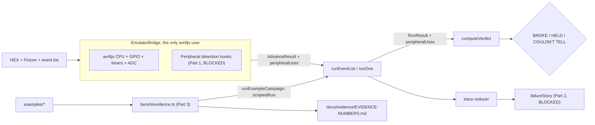

# Design Document: Honest Verdicts

## Overview

Honest Verdicts has three parts (see `requirements.md`):

- **Part 1, unmodelled peripheral detection** (Requirements 1 to 8). The design lists the modelled and unmodelled ATmega328P peripherals (the Peripheral_Table below), calibrates the detection on the committed programs, records a Peripheral_Diagnostic in the Emulator_Bridge, and turns the verdict into COULDN'T TELL when the program uses an Unmodelled_Peripheral before (or without) a Violation.
- **Part 2, failure story wording** (Requirements 9 to 15). New wording in `src/engine/reducer/story.ts`: Cycle_Text, "the program broke this rule", "The violation lasted ...", Story_Labels and "and held".
- **Part 3, evidence bench** (Requirements 16 to 19). `bench/evidence.ts` sweeps seeds and single presses over the three Examples and writes `docs/evidence/EVIDENCE-NUMBERS.md`.

### Status at design time

Two STOP conditions fired while this design was written. They block the implementation of Parts 1 and 2. They do not block the Peripheral_Table, the calibration or Part 3.

| Work | Requirements | Status | Why |
|---|---|---|---|
| Peripheral_Table and CannotCheck_Path quotes | 1 | Done in this document | |
| Calibration | 2 | Can run now | Runs with `src/` unchanged |
| Peripheral detection, verdict, new fixtures, Part 1 tests | 3 to 8 | **BLOCKED** by STOP OI-1 (Requirement 23.8) | avr8js 0.21.1 models INT0, INT1 and the pin-change interrupts, so `fixtures/ext_interrupt` cannot give COULDN'T TELL as Requirement 8.2 expects |
| Failure story wording and its tests | 9 to 15 | **BLOCKED** by STOP OI-2 (Requirement 23.9) | `reducer-story.property.test.ts` Property 11 and `refStory` in `reducer-arbitraries.ts` encode today's wording; neither file is a Pre_Approved_Edit |
| Evidence bench and doc | 16 to 19 | Can run now | Uses only existing Campaign and Run code |
| Global acceptance | 20 | Partly: only for unblocked work | Requirement 23.12 |

The blocked sections are still designed in full, so that work can start as soon as the user decides. Each one is marked **BLOCKED** where it starts. The decision options are in "Decisions the user needs to make".

### Research summary

Sources read for this design (all local, versions pinned by `package.json` and the installed core):

- avr8js 0.21.1 under `node_modules/avr8js/dist/esm/` (version in `node_modules/avr8js/package.json`). Peripheral configs and hooks: `peripherals/gpio.js`, `timer.js`, `adc.js`, `usart.js`, `spi.js`, `twi.js`, `eeprom.js`, `watchdog.js`, `clock.js`; the CPU in `cpu/cpu.js`, `cpu/instruction.js`, `cpu/interrupt.js`; exports in `index.js`.
- The Arduino AVR core arduino:avr 1.8.8 under `%LOCALAPPDATA%\Arduino15\packages\arduino\hardware\avr\1.8.8\cores\arduino` (written `<core>` below): `wiring.c` `init()` at lines 241-392, `HardwareSerial.cpp`, `WInterrupts.c`.
- The avr-libc device header shipped with the same install, `%LOCALAPPDATA%\Arduino15\packages\arduino\tools\avr-gcc\7.3.0-atmel3.6.1-arduino7\avr\include\avr\iom328p.h` (written `iom328p.h` below). It gives every register address and bit number with a line. `_SFR_IO8(x)` is data-space address `x + 0x20`; `_SFR_MEM8(x)` is data-space address `x`.
- The ATmega328P datasheet, cited by section title. I could not open a datasheet PDF from this environment, so section numbers are not given (see NC-1 under "New conflicts found").

Key findings that shape the design:

1. `cpu.readData` calls `readHooks[addr]` for `addr >= 32` and `cpu.writeData` calls `writeHooks[addr]` and skips the store only when the hook returns a truthy value (`cpu/cpu.js` lines 51-65). So a hook that returns the previous hook's result, or `cpu.data[addr]` for reads and `false` for writes, leaves every value unchanged.
2. Every load, store, `IN`, `OUT`, `SBI`, `CBI`, `SBIC` and `SBIS` goes through `readData`/`writeData` (`cpu/instruction.js` lines 145-150, 324-326, 551-552, 653-676). `PUSH`, `POP` (lines 555-567), `XCH` (lines 850-855) and interrupt entry (`cpu/interrupt.js` lines 3-13) write `cpu.data` directly; they touch the stack or the register file, not an I/O register, in a normal program.
3. `SLEEP` and `SPM` are "not implemented" (`cpu/instruction.js` lines 714-725). `WDR` only calls `cpu.onWatchdogReset`, which is empty unless an `AVRWatchdog` is built (`cpu/cpu.js` lines 29-31, `cpu/instruction.js` lines 845-848).
4. avr8js has classes for the USART, SPI, TWI, EEPROM, watchdog and clock prescaler (`index.js` lines 7-16), but `src/engine/emulator-bridge.ts` builds none of them.
5. The core's `init()` writes `UCSR0B = 0` (`<core>/wiring.c` line 390) after timer and ADC setup. It touches no other register of an Unmodelled_Peripheral. The committed sketches use no Serial, EEPROM, Wire, SPI, watchdog, sleep or interrupt calls (searched in every `.ino` under `fixtures/` and `examples/`).
6. `HardwareSerial::begin` writes `UCSR0A`, `UBRR0H`, `UBRR0L`, `UCSR0C`, then sets `RXEN0`, `TXEN0`, `RXCIE0` in `UCSR0B` by read-modify-write (`<core>/HardwareSerial.cpp` lines 121-149). In the emulator `UDRE0` never becomes 1 and the data-register-empty interrupt never fires, so `Serial.print` fills the 64-byte buffer and then spins forever in `HardwareSerial::write` (lines 232-275). A serial sketch therefore stalls in the emulator where a chip keeps running.

## Architecture



Design decisions:

- **D1. The table is engine data, the hooks live in the bridge.** The Peripheral_Table becomes a frozen data module `src/engine/peripherals.ts` with a pure classifier and a pure recorder. Only `src/engine/emulator-bridge.ts` installs avr8js hooks, and the hooks call the pure recorder (Requirement 3.8). The classifier and recorder can be tested without an emulator.
- **D2. One rule for every unmodelled register.** Every read is a Use_Access. A write is a Disable_Write only when the register has a Disable_Mask and the written byte has every Disable_Mask bit clear; every other write is a Use_Access. So no access can be "other" (Requirement 2.6 and OI-6 cannot fire for a table register).
- **D3. New optional field, not a new Diagnostic kind.** Peripheral_Diagnostics travel in a new optional field `peripheralUses`, present only when non-empty. Adding a kind to the existing `Diagnostic` union would reach every Checker through `CheckerObservation.diagnostics` and change existing results.
- **D4. Peripheral use overrides BROKE.** Requirement 4.1 and 4.2 put the peripheral check ahead of today's BROKE branch in `computeVerdict`.
- **D5. Part 3 reuses the example test helpers.** `bench/evidence.ts` imports `loadExample`, `readHex`, `runExampleCampaign`, `buildScriptedEvents` and `scriptedRun` from `tests/examples/examples-support.ts`, as `bench/example-campaign-bench.ts` already does (its line 20). No engine logic is copied.

## Peripheral_Table (Requirement 1)

Source keys used in the table:

- `gpio.js:N` and the like: `node_modules/avr8js/dist/esm/peripherals/<file>:<line>`; `cpu.js:N`, `instruction.js:N`: `node_modules/avr8js/dist/esm/cpu/<file>:<line>`.
- `bridge:N`: `src/engine/emulator-bridge.ts` line N.
- `iom328p.h:N`: the avr-libc header named in the research summary.
- `DS "<title>"`: the ATmega328P datasheet section with that title. Section numbers are pending (NC-1).

### Modelled_Peripheral rows

Every row gives the avr8js class, the config, and the line in `src/engine/emulator-bridge.ts` where the component is constructed (Requirements 1.1, 1.2). Addresses are data-space addresses.

| Row | Peripheral_ID | Plain_Name | avr8js class | Config | Built at | Registers | Sources |
|---|---|---|---|---|---|---|---|
| M1 | CPU | CPU core | `CPU` | none: `new CPU(progMem, 2048)` | bridge:217 | SREG 0x5F, SPH 0x5E, SPL 0x5D | cpu.js:66-77 (SP and SREG kept in `cpu.data`), cpu.js:193-210 (interrupt dispatch); DS "AVR CPU Core". Not a peripheral class; listed so the register map is complete. |
| M2 | PORTB | GPIO port B | `AVRIOPort` | `portBConfig` | bridge:220 | PINB 0x23, DDRB 0x24, PORTB 0x25 | gpio.js:52-59, gpio.js:157-180 (DDR, PORT, PIN write hooks); DS "I/O-Ports" |
| M3 | PORTC | GPIO port C | `AVRIOPort` | `portCConfig` | bridge:221 | PINC 0x26, DDRC 0x27, PORTC 0x28 | gpio.js:60-67, gpio.js:157-180; DS "I/O-Ports" |
| M4 | PORTD | GPIO port D | `AVRIOPort` | `portDConfig` | bridge:222 | PIND 0x29, DDRD 0x2A, PORTD 0x2B | gpio.js:68-75, gpio.js:157-180; DS "I/O-Ports" |
| M5 | EXINT | external interrupts INT0 and INT1 | `AVRIOPort` (port D) | `portDConfig.externalInterrupts = [null, null, INT0, INT1]` | bridge:222 | EICRA 0x69, EIMSK 0x3D, EIFR 0x3C | gpio.js:3-18 (INT0, INT1), gpio.js:74, gpio.js:181-199 (hooks on EICRA, EIMSK, EIFR), gpio.js:306-354 (pin change raises INT0/INT1), gpio.js:362-384, gpio.js:385-400 (low-level check); bridge:556 (`supports('external-interrupt')`); iom328p.h:162, 166, 403; DS "External Interrupts" |
| M6 | PCINT | pin-change interrupts PCINT0 to PCINT2 | `AVRIOPort` (ports B, C, D) | `portBConfig.pinChange = PCINT0`, `portCConfig.pinChange = PCINT1`, `portDConfig.pinChange = PCINT2` | bridge:220-222 | PCICR 0x68, PCIFR 0x3B, PCMSK0 0x6B, PCMSK1 0x6C, PCMSK2 0x6D | gpio.js:19-45, gpio.js:57, 65, 73, gpio.js:200-232 (hooks on PCIFR, PCMSK), gpio.js:355-360 (pin change raises PCINTn); bridge:557 (`supports('pin-change-interrupt')`); iom328p.h:157, 398, 409, 419, 428; DS "External Interrupts" |
| M7 | TC0 | timer 0 | `AVRTimer` | `timer0Config` | bridge:244 | TIFR0 0x35, TCCR0A 0x44, TCCR0B 0x45, TCNT0 0x46, OCR0A 0x47, OCR0B 0x48, TIMSK0 0x6E | timer.js:32; DS "8-bit Timer/Counter0 with PWM" |
| M8 | TC1 | timer 1 | `AVRTimer` | `timer1Config` | bridge:245 | TIFR1 0x36, TIMSK1 0x6F, TCCR1A 0x80, TCCR1B 0x81, TCCR1C 0x82, TCNT1 0x84-0x85, ICR1 0x86-0x87, OCR1A 0x88-0x89, OCR1B 0x8A-0x8B | timer.js:33, timer.js:295-312 (ICR as TOP); DS "16-bit Timer/Counter1 with PWM" |
| M9 | TC2 | timer 2, synchronous clock | `AVRTimer` | `timer2Config` | bridge:246 | TIFR2 0x37, TIMSK2 0x70, TCCR2A 0xB0, TCCR2B 0xB1, TCNT2 0xB2, OCR2A 0xB3, OCR2B 0xB4 | timer.js:34-43; DS "8-bit Timer/Counter2 with PWM and Asynchronous Operation" |
| M10 | ADC | analog-to-digital converter | `AVRADC` | `adcConfig` | bridge:249 | ADCL 0x78, ADCH 0x79, ADCSRA 0x7A, ADCSRB 0x7B, ADMUX 0x7C | adc.js:35-52, adc.js:123 (ADCSRA hook); DS "Analog-to-Digital Converter" |

Rows M5 and M6 are the Requirement 1.7 rows: INT0, INT1 and the pin-change interrupts meet the Requirement 1.7 meaning of "emulated" twice over. The `AVRIOPort` constructor installs write hooks on EICRA, EIMSK, EIFR, PCIFR and PCMSKn (gpio.js:181-232), and `updatePinRegister` calls `toggleInterrupt` on every PIN bit change (gpio.js:306-320), which calls `cpu.setInterruptFlag` for INT0/INT1 (gpio.js:347-349) and for PCINTn (gpio.js:355-359). The bridge itself already reports both as wired (bridge:553-569). **This fires STOP OI-1** (Requirement 1.7, Requirement 23.8): Requirements 3 to 8 are blocked. Requirement 1.3's list therefore holds no EXINT or PCINT row.

ADCSRB (row M10) also holds the analog comparator bit ACME (bit 6). It stays in the ADC row so that each register sits in one row. An ACME write alone changes nothing a program can see: the comparator result is only visible through an ACSR read or the ACIE/ACIC bits, and those are Use_Accesses of row U6.

### Unmodelled_Peripheral rows

Row order U1 to U16 is the Peripheral_Table row order used for ties (Requirement 5.4). Every Peripheral_Reason built from these rows is 108 to 139 UTF-16 units long and holds no Banned_Words entry (Requirement 5.6; lengths computed with the Requirement 5.3 template).

| Row | Peripheral_ID | Plain_Name | Registers (data-space address) | Why it counts as unmodelled | Sources |
|---|---|---|---|---|---|
| U1 | USART0 | serial port | UCSR0A 0xC0, UCSR0B 0xC1, UCSR0C 0xC2, UBRR0L 0xC4, UBRR0H 0xC5, UDR0 0xC6 | `AVRUSART` exists (usart.js:50) but the bridge does not build it | usart.js:3-13; iom328p.h:737, 747, 757, 771, 781, 787; DS "USART0" |
| U2 | SPI | SPI bus | SPCR 0x4C, SPSR 0x4D, SPDR 0x4E | `AVRSPI` exists (spi.js:23), not built | spi.js:16-21; iom328p.h:287, 297, 302; DS "SPI - Serial Peripheral Interface" |
| U3 | TWI | two-wire bus | TWBR 0xB8, TWSR 0xB9, TWAR 0xBA, TWDR 0xBB, TWCR 0xBC, TWAMR 0xBD | `AVRTWI` exists (twi.js:64), not built | twi.js:34-42; iom328p.h:680, 690, 699, 709, 719, 728; DS "2-wire Serial Interface" |
| U4 | EEPROM | data EEPROM | EECR 0x3F, EEDR 0x40, EEARL 0x41, EEARH 0x42 | `AVREEPROM` exists (eeprom.js:34), not built | eeprom.js:18-26; iom328p.h:180, 188, 200, 210; DS "AVR Memories", EEPROM Data Memory |
| U5 | WDT | watchdog timer | WDTCSR 0x60 | `AVRWatchdog` exists (watchdog.js:20), not built; `WDR` does nothing (cpu.js:29-31) | watchdog.js:15-19; iom328p.h:353-361; DS "System Control and Reset", Watchdog Timer |
| U6 | AC | analog comparator | ACSR 0x50, DIDR1 0x7F | no avr8js class references ACSR or DIDR1 | iom328p.h:312-320, 512-514; DS "Analog Comparator" |
| U7 | DIDR0 | digital input disable on analog pins | DIDR0 0x7E | `adcConfig` names DIDR0 (adc.js:41) but no hook reads it; `AVRIOPort` ignores it, so PINC bits of disabled pins do not read 0 as on the chip | adc.js:41; iom328p.h:504-510; DS "Analog-to-Digital Converter", Digital Input Disable Register 0 |
| U8 | ASSR | timer 2 async clock | ASSR 0xB6 | timer.js never references ASSR (no AS2, EXCLK or busy flags) | iom328p.h:671-678; DS "8-bit Timer/Counter2 with PWM and Asynchronous Operation" |
| U9 | GTCCR | timer prescaler reset | GTCCR 0x43 | timer.js never references GTCCR (only timer-attiny.js does, for another chip) | iom328p.h:216-219; DS "Timer/Counter0 and Timer/Counter1 Prescalers" |
| U10 | PRR | power reduction register | PRR 0x64 | no avr8js class references PRR; timers and ADC keep running when their PRR bit is set | iom328p.h:370-377; DS "Power Management and Sleep Modes" |
| U11 | SLEEP | sleep mode | SMCR 0x53 | `SLEEP` is not implemented (instruction.js:714-717), so the CPU keeps running where the chip would stop | iom328p.h:322-326; DS "Power Management and Sleep Modes" |
| U12 | CLKPR | clock prescaler | CLKPR 0x61 | `AVRClock` exists (clock.js:13) but is not built; the bridge runs every cycle at the Fixture clock | clock.js:4-6, clock.js:21-30; iom328p.h:363-368; DS "System Clock and Clock Options", System Clock Prescaler |
| U13 | MCUCR | chip control register | MCUCR 0x55 | no avr8js class references MCUCR: PUD is not modelled (bridge:328-329), IVSEL does not move the vectors (interrupt.js:13 jumps to the fixed vector), BODS has no sleep to act on | iom328p.h:334-339; DS "I/O-Ports" (PUD), "Interrupts" (IVSEL, IVCE), "Power Management and Sleep Modes" (BODS, BODSE) |
| U14 | MCUSR | reset flags | MCUSR 0x54 | only `AVRWatchdog` writes MCUSR (watchdog.js:55), and it is not built; a read returns 0 where the chip shows the reset cause | watchdog.js:17; iom328p.h:328-332; DS "System Control and Reset" |
| U15 | SPM | flash self-programming | SPMCSR 0x57 | `SPM` is not implemented (instruction.js:718-725) | iom328p.h:341-351; DS "Boot Loader Support - Read-While-Write Self-Programming" |
| U16 | OSCCAL | oscillator calibration | OSCCAL 0x66 | no avr8js class references OSCCAL; a read returns 0 where the chip returns its factory calibration byte | iom328p.h:388; DS "System Clock and Clock Options" |

### Use_Access and Disable_Write (Requirements 1.5, 1.6)

Rule D2 applies to every register above:

- **Every read** of a listed register is a Use_Access. Reason: the emulator returns the stored byte, not the chip's status bits (UDRE0, SPIF, TWINT, EEPE, ACO, reset flags, the factory OSCCAL byte), so any read can change the program's path.
- **A write** is a Disable_Write when the register has a Disable_Mask and `(value & Disable_Mask) == 0`. Every other write is a Use_Access. A register without a Disable_Mask has no Disable_Write ("none").

Because reads are always Use_Accesses and a write is either one or the other by the mask test, no single access matches both (Requirement 1.5).

| Row | Register | Use_Access | Disable_Write (Disable_Mask) | Rationale | Sources |
|---|---|---|---|---|---|
| U1 | UCSR0B | read; write with any of RXCIE0 (7), TXCIE0 (6), UDRIE0 (5), RXEN0 (4), TXEN0 (3) set | write with bits 7:3 all 0 (mask 0xF8). The core start-up write `UCSR0B = 0` is a Disable_Write (Requirement 1.6). | With the enable and interrupt bits clear the USART neither drives TXD/RXD nor raises an interrupt; UCSZ02, RXB80, TXB80 then have no effect | iom328p.h:747-755; `<core>/wiring.c`:384-391; DS "USART0" |
| U1 | UCSR0A, UCSR0C, UBRR0L, UBRR0H, UDR0 | read; every write | none | Only code that sets up or uses the port writes these (`<core>/HardwareSerial.cpp`:104-144, 242-246); classing them as use is the conservative reading | iom328p.h:737, 757, 771, 781, 787 |
| U2 | SPCR | read; write with SPIE (7) or SPE (6) set | write with bits 7:6 both 0 (mask 0xC0) | SPE 0 turns the SPI off; SPIE 0 means no interrupt | iom328p.h:287-295; DS "SPI - Serial Peripheral Interface" |
| U2 | SPSR, SPDR | read; every write | none | SPDR starts a transfer; SPSR holds SPI2X | iom328p.h:297-307 |
| U3 | TWCR | read; write with TWEN (2) or TWIE (0) set | write with bits 2 and 0 both 0 (mask 0x05) | TWEN 0 turns the TWI off and frees SDA/SCL | iom328p.h:719-726; DS "2-wire Serial Interface" |
| U3 | TWBR, TWSR, TWAR, TWDR, TWAMR | read; every write | none | setup and data registers | iom328p.h:680-728 |
| U4 | EECR | read; write with any of EERIE (3), EEMPE (2), EEPE (1), EERE (0) set | write with bits 3:0 all 0 (mask 0x0F) | with those bits clear no EEPROM read, write or interrupt starts; EEPM bits alone do nothing | iom328p.h:180-186; DS "AVR Memories" |
| U4 | EEDR, EEARL, EEARH | read; every write | none | address and data of an EEPROM access | iom328p.h:188-210 |
| U5 | WDTCSR | read; write with WDIE (6) or WDE (3) set | write with bits 6 and 3 both 0 (mask 0x48) | WDE and WDIE are the two enables. The change-enable write of `wdt_disable()` sets WDE, so a program that calls `wdt_disable()` gets COULDN'T TELL (conservative; see Choices C3) | iom328p.h:353-361; watchdog.js:73-83; DS "System Control and Reset" |
| U6 | ACSR | read; write with ACIE (3) or ACIC (2) set | write with bits 3:2 both 0 (mask 0x0C) | the comparator result is visible only through an ACSR read, its interrupt, or the timer 1 capture link | iom328p.h:312-320; DS "Analog Comparator" |
| U6 | DIDR1 | read; write with AIN1D (1) or AIN0D (0) set | write with bits 1:0 both 0 (mask 0x03) | a set bit makes the PD6/PD7 PIN bit read 0 on the chip | iom328p.h:512-514 |
| U7 | DIDR0 | read; write with any of ADC5D to ADC0D (5:0) set | write with bits 5:0 all 0 (mask 0x3F) | a set bit makes the PINC bit read 0 on the chip | iom328p.h:504-510 |
| U8 | ASSR | read; write with EXCLK (6) or AS2 (5) set | write with bits 6:5 both 0 (mask 0x60) | AS2 0 and EXCLK 0 keep timer 2 on the CPU clock, which TC2 models | iom328p.h:671-678 |
| U9 | GTCCR | read; write with TSM (7), PSRASY (1) or PSRSYNC (0) set | write with bits 7, 1, 0 all 0 (mask 0x83) | those bits stop or reset the prescalers | iom328p.h:216-219 |
| U10 | PRR | read; write with any of PRTWI (7), PRTIM2 (6), PRTIM0 (5), PRTIM1 (3), PRSPI (2), PRUSART0 (1), PRADC (0) set | write with those bits all 0 (mask 0xEF) | every set bit turns a peripheral off on the chip | iom328p.h:370-379 |
| U11 | SMCR | read; write with SE (0) set | write with SE 0 (mask 0x01) | `SLEEP` acts only when SE is 1 | iom328p.h:322-326 |
| U12 | CLKPR | read; write with any of CLKPS3:0 (3:0) set | write with bits 3:0 all 0 (mask 0x0F), which is the CLKPCE-only write and the divide-by-1 write | divide-by-1 keeps the 16 MHz clock the emulator runs at | iom328p.h:363-368; clock.js:21-30 |
| U13 | MCUCR | read; write with BODS (6), PUD (4) or IVSEL (1) set | write with bits 6, 4, 1 all 0 (mask 0x52) | IVCE and BODSE alone only open a timed change window | iom328p.h:334-339 |
| U14 | MCUSR | read; every write | none | conservative: the emulator's reset flags never match the chip's | iom328p.h:328-332 |
| U15 | SPMCSR | read; every write | none | conservative: `SPM` is not implemented | iom328p.h:341-351 |
| U16 | OSCCAL | read; every write | none | conservative: reads differ from the chip and writes retune the internal oscillator | iom328p.h:388 |

### Registers left out of the table

| Register | Address | Why it is not a row | Source |
|---|---|---|---|
| GPIOR0, GPIOR1, GPIOR2 | 0x3E, 0x4A, 0x4B | general-purpose storage; `cpu.data` holds them as the chip does | iom328p.h:170, 267, 277; DS "AVR Memories" |
| reserved addresses | e.g. 0xC3, 0xB7 | no function | DS register summary |

### Known gaps inside modelled rows (not detected)

These are gaps in Modelled_Peripherals that the per-register rule cannot catch without classing ordinary accesses of a modelled register as use. They are reported, not handled (NC-3).

| Gap | Evidence |
|---|---|
| Timer 1 input capture (ICP1 pin, ICES1, ICNC1, ICIE1) never sets ICF1 | `captureInterrupt: 0x14` appears only in `timer1Config` (timer.js:33); no other line of timer.js mentions capture |
| ADC auto-trigger (ADATE in ADCSRA, ADTS in ADCSRB) | adc.js never mentions ADATE or ADTS; the ADCSRB read at adc.js:137 is for MUX5 only |
| Setting a PCIE bit in PCICR while its PCIFR flag is set does not queue the interrupt | gpio.js:211-232 hooks PCIFR and PCMSKn only; PCICR has no write hook |

## The existing CannotCheck_Path (Requirement 1.9)

`src/engine/checker.ts` lines 27-36:

```ts
/** `reason` is the Checker's own words. */
export interface CannotCheck {
  rule: string;
  reason: string;
}

export interface CheckerOutcome {
  violation: Violation | null;
  cannotCheck?: readonly CannotCheck[];
}
```

`src/engine/campaign.ts` lines 198-205 (inside `runEventList`, lines 176-269):

```ts
  const collect = (list: CannotCheck[]): void => {
    for (const c of list) {
      const key = JSON.stringify([c.rule, c.reason]);
      if (seen.has(key)) continue;
      seen.add(key);
      cannotCheck.push(c);
    }
  };
```

and lines 245-250 and 263-268:

```ts
    if (!res.ok) return res.error;
    collect(res.cannotCheck);
    if (res.violation) {
      violation = res.violation;
      break;
    }
```

```ts
    if (!res.ok) return res.error;
    collect(res.cannotCheck);
    violation = res.violation;
  }

  return { appliedInputs, outputEvents, diagnostics, cannotCheck, violation, endCycle: bridge.cycleCount };
```

`src/engine/verdict.ts` lines 17 and 38-50:

```ts
export const REASON_MAX_LENGTH = 200;
```

```ts
/** Cut at 200 UTF-16 units, never leaving half of a surrogate pair. */
function truncateReason(text: string): string {
  if (text.length <= REASON_MAX_LENGTH) return text;
  let end = REASON_MAX_LENGTH;
  const last = text.charCodeAt(end - 1);
  if (last >= 0xd800 && last <= 0xdbff) end -= 1;
  return text.slice(0, end);
}

function buildReason(parts: readonly string[]): string {
  const joined = parts.join("; ").trim();
  return truncateReason(joined === "" ? EMPTY_REASON_TEXT : joined);
}
```

`src/engine/verdict.ts` lines 52-73, 88-95 and 115-120 (`computeVerdict`, lines 52-121):

```ts
export function computeVerdict(input: VerdictInput): Verdict | null {
  if (!input.finished) return null;

  const { runs } = input;

  // 1. BROKE: lowest violating Run_Index, with every unchecked rule listed.
  let lowest: RunResult | null = null;
  const unchecked: CannotCheck[] = [];
  const seen = new Set<string>();
  for (const run of runs) {
    if (run.violation !== null && (lowest === null || run.runIndex < lowest.runIndex)) {
      lowest = run;
    }
    for (const c of run.cannotCheck) {
      const key = JSON.stringify([c.rule, c.reason]);
      if (seen.has(key)) continue;
      seen.add(key);
      unchecked.push({ rule: c.rule, reason: c.reason });
    }
  }
  const untriggered = input.untriggeredRules ?? [];
  if (lowest !== null && lowest.violation !== null) {
```

```ts
    return { verdict: VERDICT_BROKE, trace, unchecked };
  }

  // 2. COULDN'T TELL.
  const parts: string[] = [];
  for (const c of unchecked) {
    parts.push(`Rule "${c.rule}" could not be checked: ${c.reason}`);
  }
```

```ts
  if (parts.length > 0) {
    return { verdict: VERDICT_COULDNT_TELL, reason: buildReason(parts) };
  }

  // 3. HELD.
  return { verdict: "HELD", text: heldText(runs.length), runs: runs.length };
```

Precedence today: unfinished gives `null`; then BROKE whenever any Run has a Violation (a CannotCheck only adds to `unchecked`); then COULDN'T TELL when any reason part exists; then HELD. The `unsupportedPeripherals` input (verdict.ts lines 26-27, 105-107) exists but `campaign.ts` line 450 always passes `[]`.

**Decision: the Peripheral_Diagnostic verdict path does not reuse the CannotCheck_Path.** It does reuse `buildReason` and `truncateReason` unchanged (Requirement 5.5). Reasons:

1. A CannotCheck never overrides BROKE: in `computeVerdict` lines 61-73 a violating Run wins and the CannotCheck only lands in `unchecked`. Requirement 4.1 and 4.2 need peripheral use to turn a would-be BROKE into COULDN'T TELL.
2. A CannotCheck is keyed by `[rule, reason]` (campaign.ts lines 198-205, verdict.ts lines 65-70) and carries no cycle. Requirement 4.2 and 4.3 compare the Peripheral_Diagnostic `cycle` with the Violation_Cycle, and Requirement 5.4 orders by cycle.
3. The CannotCheck part text is `Rule "<rule>" could not be checked: <reason>` (verdict.ts line 94). Requirement 5.2 fixes a different sentence, and Requirement 5.4 puts it before every other part. `unsupportedPeripherals` has the same order problem (its part comes after the CannotCheck parts, verdict.ts lines 105-107) and no cycle.
4. CannotChecks come from the Checker. Peripheral use is seen by the bridge, below the Checker, and must not change what Checkers receive (Requirement 3.5, 8.4).

## Components and Interfaces

### C1. Calibration_Script (Requirement 2) — can run now

File `scripts/tmp-calibrate.ts`, run with `npx tsx scripts/tmp-calibrate.ts`, deleted before the task is reported done (Requirement 21). It runs while every file under `src/` is unchanged (Requirement 2.1).

**How it logs without changing behaviour (Requirement 2.7).** Options compared:

| Option | Behaviour risk | Notes |
|---|---|---|
| (a) Copy the bridge build in the script with its own avr8js CPU | high: a second build can drift from the bridge | rejected |
| (b) `EmulatorBridge.createWithTestHooks` | none, but its hooks cover only PIN reads, port listeners and ADC results | cannot log USART and the rest |
| (c) `EmulatorBridge.create`, then wrap `readHooks`/`writeHooks` of the table addresses on the bridge's private `_cpu` before any `advance()` | none: see research finding 1 | **chosen**; no change to `src/`, no avr8js import (a structural type is enough) |

The script passes a `bridgeFactory` to the existing `runOne` (campaign.ts lines 272-297):

```ts
type HookCpu = {
  readHooks: Array<((addr: number) => number) | undefined>;
  writeHooks: Array<((v: number, old: number, addr: number, mask: number) => boolean | void) | undefined>;
  data: Uint8Array;
  cycles: number;
};
const loggingFactory: BridgeFactory = (hex, fixture, events) => {
  const b = EmulatorBridge.create(hex, fixture, events);
  if (isBridgeError(b)) return b;
  const cpu = (b as unknown as { _cpu: HookCpu })._cpu;
  for (const reg of TABLE_REGISTERS) {          // every register of rows U1-U16
    const prevR = cpu.readHooks[reg.addr];
    cpu.readHooks[reg.addr] = (addr) => {
      const v = prevR ? prevR(addr) : cpu.data[addr];
      log.push({ register: reg.name, addr, cycle: cpu.cycles, access: "read", value: v });
      return v;
    };
    const prevW = cpu.writeHooks[reg.addr];
    cpu.writeHooks[reg.addr] = (value, old, addr, mask) => {
      log.push({ register: reg.name, addr, cycle: cpu.cycles, access: "write", value });
      return prevW ? prevW(value, old, addr, mask) : false;
    };
  }
  return b;
};
```

**Runs.**

| Program | Runs | Event list | Length |
|---|---|---|---|
| `crosswalk`, `garage`, `heartbeat`, buggy and fixed (6 builds) | Run_Index 0, 1, 2, 3 each (24 Runs) | built by `runOne` through `buildEventList` with the Example's `fixture.json`, `gremlinSet` and committed `campaignSeed` (Requirement 2.2) | the Example's `runCycles`; the Checker is `() => ({ violation: null })`, so no Run stops early |
| `blink_button`, `analog_read`, `pwm_out`, `floating_input` | one per distinct Fixture found by the inventory below (Requirement 2.3) | the empty list (Choices C5) | the longest run any Committed_Test_File or committed `bench/` script makes with that HEX, found by the inventory |

Inventory step (before running): for each of the four HEX files, list every Committed_Test_File and committed `bench/` script that reads it (the files that mention `blink_button`, `analog_read`, `pwm_out` or `floating_input`, for example `bench/campaign-bench.ts`, `bench/example-campaign-bench.ts`, `src/engine/__tests__/rules-arbitraries-campaign.ts` lines 14-30), and record each distinct Fixture literal with its file and line, and the longest run length. Where a property test builds Fixtures from a generator, the inventory records the generator's base pin-map literal and says so (NC-4). The Report lists, per run: Fixture, file and line, event list, run length (Requirement 2.3).

**Output.** One log entry per access: register, address, cycle, access, value (Requirement 2.1), then a per-program classification table (Use_Access / Disable_Write / other, Requirement 2.4). Expected result from the sources (not a substitute for the run): every program logs exactly one access, the Disable_Write `UCSR0B = 0` from `init()`.

**STOP conditions.** A Use_Access by any Calibration_Set program (Requirement 2.5, 23.2); an "other" access (Requirement 2.6; cannot happen under D2, but the script still checks); a load or bridge error (Requirement 2.8). Each STOP reports program, Run_Index or Fixture, register, cycle, access, value or error.

### C2. Peripheral detection in the bridge (Requirements 3.1-3.5, 3.7-3.9) — **BLOCKED by STOP OI-1**

New pure module `src/engine/peripherals.ts` (no avr8js import):

```ts
export interface PeripheralRegister { readonly name: string; readonly addr: number; readonly disableMask?: number }
export interface PeripheralRow { readonly id: string; readonly plainName: string; readonly registers: readonly PeripheralRegister[] }
export const UNMODELLED_PERIPHERALS: readonly PeripheralRow[];      // rows U1..U16 in table order, frozen
export function peripheralReason(row: PeripheralRow): string;      // Requirement 5.2, 5.3 template
export function isUseAccess(reg: PeripheralRegister, access: "read" | "write", value: number): boolean;
//   read -> true; write -> reg.disableMask === undefined || (value & reg.disableMask) !== 0
export class PeripheralRecorder {
  /** Called by the bridge hooks. Records the earliest Use_Access per peripheral; ignores Disable_Writes. */
  access(addr: number, access: "read" | "write", value: number, cycle: number): void;
  /** Diagnostics recorded since the last take, ascending cycle. */
  take(): PeripheralDiagnostic[];
}
```

In `src/engine/emulator-bridge.ts`, a new step 11d after step 11c (near line 381) and before step 12:

```ts
// 11d. Peripheral detection. Wraps the read and write hooks of every unmodelled
//      register. Each wrapper returns what the previous hook (or cpu.data) returns,
//      so values, cycles and output are unchanged (Requirement 3.5).
for (const row of UNMODELLED_PERIPHERALS) for (const reg of row.registers) {
  const prevR = cpu.readHooks[reg.addr];
  cpu.readHooks[reg.addr] = (addr) => {
    const v = prevR ? prevR(addr) : cpu.data[addr];
    bridge._peripherals.access(addr, "read", v, cpu.cycles);
    return v;
  };
  const prevW = cpu.writeHooks[reg.addr];
  cpu.writeHooks[reg.addr] = (value, old, addr, mask) => {
    bridge._peripherals.access(addr, "write", value, cpu.cycles);
    return prevW ? prevW(value, old, addr, mask) : false;
  };
}
```

`advance()` returns `peripheralUses: this._peripherals.take()` only when the list is non-empty (D3). `cpu.cycles` is the integer cycle count when the instruction runs (Requirement 3.4, 6.2). Detection sees only the cycles the Run executes (Requirement 3.9). A test seam `createWithTestHooks(..., { peripheralDetection: false })` builds a bridge without step 11d, for the transparency property (Property 1).

### C3. Campaign plumbing (Requirement 3.6) — **BLOCKED by STOP OI-1**

`runEventList` appends `r.peripheralUses ?? []` to a local list after each `advance()` and returns it as `peripheralUses` only when non-empty. `runOne` copies it into the RunResult the same way. Checkers do not receive it. The bridge's recorder lives for one Run, so at most one entry per peripheral reaches the RunResult, in ascending cycle order. The reducer's Run_Path ignores the field.

### C4. Verdict (Requirements 4, 5, 6) — **BLOCKED by STOP OI-1**

New step in `computeVerdict` between line 53 (`if (!input.finished) return null;`) and line 55:

```ts
// 0. Peripheral use (Requirement 4.1, 4.2).
const blocking: PeripheralDiagnostic[] = [];
for (const run of runs) {
  for (const d of run.peripheralUses ?? []) {
    if (run.violation === null || d.cycle <= run.violation.cycle) blocking.push(d);
  }
}
if (blocking.length > 0) {
  const parts = [...peripheralReasons(blocking), ...todayCouldntTellParts(input)];
  return { verdict: VERDICT_COULDNT_TELL, reason: buildReason(parts) };
}
// steps 1-3 unchanged
```

- `peripheralReasons` gives one Peripheral_Reason per distinct `peripheral` in `blocking`, ordered by the lowest `cycle` of that peripheral among the blocking diagnostics, ties by table row order (Requirement 5.1, 5.4; Choices C7). An id that is not in the table (impossible from the bridge, possible in a hand-built input) uses its id as the Plain_Name and sorts after every table row.
- `todayCouldntTellParts(input)` is today's branch 2 part list (verdict.ts lines 92-114), moved into a helper with no change, so the remaining parts follow the leading Peripheral_Reason (Requirement 5.4; Choices C6).
- With no blocking diagnostic, steps 1 to 3 run as today on the same input and ignore `peripheralUses`, so the result is deep-equal to the result with every Peripheral_Diagnostic removed (Requirement 4.3, 4.4). An unfinished Campaign still returns `null` before step 0 (Requirement 4.6).
- The function stays pure: it reads only its argument, builds new arrays, and uses no clock or random source (Requirement 6).

### C5. New fixtures (Requirement 7) — **BLOCKED by STOP OI-1**

| File | Content (choices in Choices C8) |
|---|---|
| `fixtures/serial_hello/serial_hello.ino` | `Serial.begin(9600)` in `setup()`; `loop()` calls `Serial.print("hello ")`, toggles LED on PB5 (pin 13), then `delay(100)`; comment names the chip "ATmega328P" |
| `fixtures/serial_hello/fixture.json` | `{ "pins": [ { "signal": "LED", "port": "B", "bit": 5, "direction": "output" } ] }` |
| `fixtures/ext_interrupt/ext_interrupt.ino` | `pinMode(2, INPUT_PULLUP)`; `attachInterrupt(digitalPinToInterrupt(2), onEdge, CHANGE)`; `onEdge` toggles LED on PB5; `pinMode(13, OUTPUT)` |
| `fixtures/ext_interrupt/fixture.json` | `{ "pins": [ { "signal": "TRIGGER", "port": "D", "bit": 2, "direction": "input" }, { "signal": "LED", "port": "B", "bit": 5, "direction": "output" } ] }` |

Both compile with `arduino-cli compile -b arduino:avr:uno --output-dir fixtures/<name>/build fixtures/<name>` and must leave exactly the Build_File_Set (Requirement 7.6, 7.7). A compile failure is STOP 23.5.

### C6. Failure story (Requirements 9 to 13) — **BLOCKED by STOP OI-2**

Changes in `src/engine/reducer/story.ts`:

- `export function cycleText(n: number): string`: `String(n)` with a comma (U+002C) inserted before each group of 3 digits from the right, written with string operations only, never `toLocaleString` (Requirement 9.1).
- Line 224 becomes `` `At ${msText(vcycle)} (cycle ${cycleText(vcycle)}), the program broke this rule: ${rule}` `` (Requirement 9.1, 9.2, 9.4, 9.5).
- Line 226 becomes `` `The violation lasted ${span.cut ? "at least " : ""}${msText(span.lengthCycles)}.` `` (Requirement 10).
- `StoryInput` gains `labels?: Readonly<Record<string, StoryLabel>>`.
- Labels check, right after the `violationSpan` check (Choices C9), inside its own `try`: when `labels` is present it must be a non-null, non-array object; every own entry must be a non-null object with string `active` and `inactive` that pass `badName` (non-empty, no LF, CR, U+2028, U+2029, no leading or trailing space) and hold no Banned_Words entry or "smallest" as a whole word, ignoring case. Any failure returns `invalidInput("Field labels: ...", { field: "labels" })` (Requirement 11.6, 11.7, 11.10, 13.6). The entries are copied into a `Map` keyed by own property names, so inherited names such as `constructor` are never looked up.
- Held_Press flags are computed on the full Reduced_List: event `i` (digital, `value` equal to its pin's Press_Value) is held when no `j > i` has the same signal and `value === "release"`, whatever its `gremlinId` (Requirement 12.4).
- `eventPhrase` uses this table (Requirement 11.2-11.4, 12.1-12.3); `{g}` gremlinId, `{S}` signal, `{t}` Ms_Text:

| Event | No label for `{S}` | Label `{active, inactive}` for `{S}` |
|---|---|---|
| press, later release in list | `{g} pressed {S} at {t}` | `{g} {active} at {t}` |
| press, Held_Press | `{g} pressed and held {S} at {t}` | `{g} {active} and held at {t}` |
| `"release"` | `{g} released {S} at {t}` | `{g} {inactive} at {t}` |
| 0 or 1 that is not the Press_Value | `{g} drove {S} to {v} at {t}` | `{g} {inactive} at {t}` |
| analog | `{g} set {S} to {a} at {t}` | unchanged |

- The Summary_Form is unchanged (Requirement 11.5). Packing, the 30-word limit (which now counts "and held" and label words), the form choice and the "does not fit" error are unchanged (Requirement 12.5, 13.5).

### C7. Pre_Approved_Edits (Requirement 15) — **BLOCKED by STOP OI-2**

Built by applying Requirements 9 to 12 to each old string and its test's inputs, not copied from output (Requirement 15.6). In `src/engine/__tests__/reducer-story.test.ts` every test uses `violation.cycle` 15,648,000: Ms_Text `978.0 ms`, Cycle_Text `15,648,000`. No test passes `labels`. No Detailed_Form test holds a Held_Press: the presses at lines 29 and 68 are each followed by a release on the same signal; the only unreleased presses (line 75-76) are in a Summary_Form case, which "and held" does not change. In the table, `…rule: R` stands for `…rule: all of (CAR_GREEN is 1, WALK is 1) must never happen.`.

| Line | Old string (changed part) | New string (changed part) |
|---|---|---|
| 37 | `At 978.0 ms, the chip broke this rule: R` | `At 978.0 ms (cycle 15,648,000), the program broke this rule: R` |
| 53 | `At 978.0 ms, the chip broke this rule: R` | `At 978.0 ms (cycle 15,648,000), the program broke this rule: R` |
| 60 | `At 978.0 ms, the chip broke this rule: R The rule stayed broken for 600.0 ms.` | `At 978.0 ms (cycle 15,648,000), the program broke this rule: R The violation lasted 600.0 ms.` |
| 63 | `At 978.0 ms, the chip broke this rule: R The rule stayed broken for at least 600.0 ms.` | `At 978.0 ms (cycle 15,648,000), the program broke this rule: R The violation lasted at least 600.0 ms.` |
| 70 | `At 978.0 ms, the chip broke this rule: R` | `At 978.0 ms (cycle 15,648,000), the program broke this rule: R` |
| 78 | `At 978.0 ms, the chip broke this rule: R The rule stayed broken for 1.0 ms.` | `At 978.0 ms (cycle 15,648,000), the program broke this rule: R The violation lasted 1.0 ms.` |

The part before "At 978.0 ms" is unchanged on every line. Lines 19-23 (`msText`) and 86-90 (the "does not fit" error; still unchanged because the long ids exceed 30 words in both forms) need no edit. `src/engine/__tests__/reducer-examples.test.ts` holds no expected story string (it only builds and prints the story at lines 82-83 and 95), so it gets no edit (OI-4, Requirement 15.5).

### C8. Evidence_Bench (Requirements 16 to 19) — can run now

`package.json` gains `"bench:evidence": "tsx bench/evidence.ts"` (Requirement 16.1). Dependencies stay unchanged.

```text
bench/evidence.ts            the bench: sweeps, wall clock, machine info, writes the doc
bench/evidence-stats.ts      pure helpers: sweepStarts, medianText, renderEvidenceDoc, findForbiddenWords
```

The helper file holds no wall-clock read, so the wall clock is read only in `bench/evidence.ts` (Requirement 16.3).

**Seed_Sweep (Requirement 17).** For each Example id in the order `crosswalk`, `garage`, `heartbeat`: `ex = loadExample(id)`. For each `campaignSeed` s from 1 to 100 on the buggy build, and 1 to 20 on the fixed build: `runExampleCampaign({ ...ex, meta: { ...ex.meta, campaignSeed: s } }, variant)`. That runs `buildCampaignConfig` with the committed HEX, `fixture.json`, `rules.txt`, `gremlinSet`, `runs` and `runCycles`, then `createCampaign` and one `runSlice` (Requirement 16.2). Count the three verdicts. For BROKE Campaigns of the buggy build, collect the Violating_Run_Number `violatingRunIndex + 1` and report min, median, max. A thrown error prints Example, build, seed and message, exits with code 1 and writes no doc (Requirement 17.7). A BROKE on a fixed build prints Example, seed and the BROKE trace as JSON, and the bench exits with code 3 after all sweeps without writing the doc (Requirement 17.8; Choices C10).

**Single_Press_Sweep (Requirement 18).** Single_Input constants, from `.kiro/specs/example-firmware/tasks.md` tasks 4.5, 6.5, 8.5 and the committed tests (`tests/examples/examples.garage.test.ts` line 188, `tests/examples/examples.heartbeat.test.ts` line 258):

| Example | Signal | Press | Release | Hold_Cycles | runCycles | Sweep_Starts (count) |
|---|---|---|---|---|---|---|
| crosswalk | REQUEST | 4,800,000 | 5,600,000 | 800,000 | 16,000,000 | 160,000 to 15,040,000 (94) |
| garage | BEAM_CLEAR | 6,400,000 | 6,432,000 | 32,000 | 10,000,000 | 160,000 to 9,920,000 (62) |
| heartbeat | PULSE | 4,000,000 | 5,600,000 | 1,600,000 | 16,000,000 | 160,000 to 14,240,000 (89) |

For each Example, build and Sweep_Start s in ascending order: `events = buildScriptedEvents(ex.fixture, [{ signal, value: pressValue(pin), cycle: s }, { signal, value: "release", cycle: s + hold }], ex.meta.runCycles)`, then `scriptedRun(ex, variant, events, ex.meta.runCycles, { untilEnd: true })`. `buildScriptedEvents` puts the Fixture's rest events before the press and adds no gremlin event (Requirement 18.6); `scriptedRun` uses a fresh bridge and the compiled `rules.txt` checker (Requirement 18.2). `untilEnd: true` makes every Run reach `runCycles` and make its end-of-run Checker call (Choices C11). Record: Sweep_Start count, Runs with a Violation and their Sweep_Starts, Runs with a CannotCheck (Requirement 18.4). A non-zero Violation count is a finding for the Report, not a STOP (Requirement 18.5). Peripheral_Diagnostics are not reported because they do not exist while Part 1 is blocked.

**Evidence_Doc.** `renderEvidenceDoc(results)` returns the text; the bench creates `docs/evidence/` with `mkdirSync(..., { recursive: true })` and writes the file only when every sweep ended without error or fixed-build BROKE, and `findForbiddenWords(text)` returns an empty list (Requirement 19.4-19.6). Layout:

The doc layout, shown indented so its headings are not read as headings of this design:

```text
    [H1] Evidence numbers

    These numbers come from emulated runs of the ATmega328P examples. They are evidence, not a proof.
    Rerun with `npm run bench:evidence`.

    [H2] Machine and run
    | Item | Value |
    | OS | <os.type()> <os.release()> (<os.arch()>) |
    | CPU | <os.cpus()[0].model>, <os.cpus().length> cores |
    | Node | <process.version> |
    | avr8js | <version from node_modules/avr8js/package.json> |
    | Date of run | <YYYY-MM-DD> |
    | Seed ranges | buggy 1-100, fixed 1-20 |
    | Wall-clock time | seed sweep <s> s, single-press sweep <s> s, whole bench <s> s |

    [H2] Seed sweep
    | Example | Build | Seeds | BROKE | HELD | COULDN'T TELL | Violating run number (min / median / max) |
    HELD texts seen: "No violation found in 24 emulated runs of this gremlin set. Not a proof." (example)

    [H2] Single-press sweep
    | Example | Build | Press signal | Hold (cycles) | Sweep_Starts | Runs with a violation | Their Sweep_Starts | Runs with a CannotCheck |
```

`[H1]` and `[H2]` stand for `#` and `##` headings in the real file. Verdicts are written with the Verdict_Strings; the HELD line quotes the exact HELD texts the bench saw, with their real N (Requirement 19.3). The doc names no board brand, and its run column is called "Violating run number" so that no heading needs a Banned_Words entry (Requirement 19.4). Expected run time on the machine in `SPIKE.md` (about 65M cycles/s after the bridge-output-scan work): roughly 23 billion cycles for the fixed sweep and 7 billion for the single-press sweep, so about 10 to 15 minutes. This is an estimate, not an acceptance value.

## Data Models

Part 1 (**BLOCKED by STOP OI-1**), in `src/engine/types.ts`:

```ts
/** Earliest Use_Access of one Unmodelled_Peripheral in one Run. */
export interface PeripheralDiagnostic {
  peripheral: string;           // Peripheral_ID, e.g. "USART0"
  register: string;             // datasheet register name, e.g. "UBRR0L"
  cycle: number;                // integer CPU cycle of the access
  access: "read" | "write";
}

export interface AdvanceResult {
  // ...existing fields unchanged...
  /** Present only when non-empty. Ascending cycle. */
  peripheralUses?: PeripheralDiagnostic[];
}

export interface RunResult {
  // ...existing fields unchanged...
  /** Present only when non-empty. At most one per peripheral, ascending cycle. */
  peripheralUses?: PeripheralDiagnostic[];
}
```

`RunPathResult` in `campaign.ts` gets the same optional field. The field is optional and omitted when empty so that every existing RunResult, AdvanceResult and baseline comparison stays deep-equal (Requirement 8.4; Choices C1). The name does not clash with `diagnostics`.

Peripheral_Table data (`src/engine/peripherals.ts`): `PeripheralRow { id, plainName, registers }`, `PeripheralRegister { name, addr, disableMask? }`, 16 frozen rows U1 to U16 in table order.

Part 2 (**BLOCKED by STOP OI-2**), in `src/engine/reducer/story.ts`:

```ts
export interface StoryLabel { active: string; inactive: string }
export interface StoryInput {
  reducedList: readonly ReducerEvent[];
  fixture: Fixture;
  violation: Violation;
  outputEdges: readonly OutputEvent[];
  violationSpan?: { lengthCycles: number; cut: boolean };
  labels?: Readonly<Record<string, StoryLabel>>;
}
```

Part 3, in `bench/evidence-stats.ts`:

```ts
export interface SeedSweepRow {
  example: string; build: "buggy" | "fixed"; seeds: [number, number];
  broke: number; held: number; couldntTell: number;
  violatingRunNumbers: number[];        // buggy only; 1-based
  heldTexts: string[];                  // distinct HELD texts seen
}
export interface PressSweepRow {
  example: string; build: "buggy" | "fixed"; signal: string; holdCycles: number;
  starts: number; violationStarts: number[]; cannotCheckRuns: number;
}
export interface EvidenceResults {
  machine: { os: string; cpu: string; cores: number; node: string; avr8js: string };
  date: string;                         // YYYY-MM-DD
  seconds: { seedSweep: number; pressSweep: number; total: number };
  seedRows: SeedSweepRow[]; pressRows: PressSweepRow[];
}
export function sweepStarts(runCycles: number, holdCycles: number, step?: number): number[];
export function medianText(values: readonly number[]): string;   // "none" for []
export function renderEvidenceDoc(r: EvidenceResults): string;
export function findForbiddenWords(text: string): string[];      // BANNED_WORDS, "realtime", "Arduino", "guard-allow"
```

## Correctness Properties

*A property is a characteristic or behavior that should hold true across all valid executions of a system-essentially, a formal statement about what the system should do. Properties serve as the bridge between human-readable specifications and machine-verifiable correctness guarantees.*

Properties 1 to 5 belong to Part 1 and are **BLOCKED by STOP OI-1**. Properties 6 to 9 belong to Part 2 and are **BLOCKED by STOP OI-2**. Properties 10 to 12 belong to Part 3 and can be implemented now. Passing property tests are evidence, not proof.

### Property 1: Every unmodelled access is exactly one of Use_Access and Disable_Write

*For any* register of rows U1 to U16, any access kind and any byte value 0 to 255, `isUseAccess` returns true for every read, and for a write returns false exactly when the register has a Disable_Mask and `value & Disable_Mask` is 0. No access is classed as both, and none as neither.

**Validates: Requirements 1.5, 1.6**

### Property 2: The recorder keeps the earliest Use_Access per peripheral

*For any* sequence of accesses with non-decreasing cycles, mixing table addresses (Use_Accesses and Disable_Writes) and non-table addresses, the recorder's output equals a reference model: one entry per peripheral that had at least one Use_Access, holding the register name, cycle and access kind of its earliest Use_Access, in ascending cycle order; Disable_Writes and non-table addresses add nothing; taking in several chunks gives the same concatenated list as taking once.

**Validates: Requirements 3.1, 3.2, 3.3, 3.4, 3.6**

### Property 3: Detection is transparent and replays deep-equal

*For any* HEX from the committed corpus plus the New_Fixtures, any event list from `buildEventList` for its Fixture, and any run length up to 400,000 cycles stepped like `runEventList`, a detecting bridge and a bridge built with detection off give equal `cyclesConsumed`, `outputEvents`, `appliedInputs`, `appliedAnalogInputs`, `diagnostics` and `cycleCount` on every step and equal `cpu.data` bytes at the end; two detecting runs give deep-equal `peripheralUses`; and every recorded cycle is at most the final `cycleCount`.

**Validates: Requirements 3.5, 3.7, 3.9**

### Property 4: Peripheral use decides COULDN'T TELL, and nothing else changes

*For any* VerdictInput (finished or not) whose Runs carry arbitrary `peripheralUses` with cycles placed before, at, one after and well after their Run's Violation_Cycle: when the input is finished and some Run has a blocking diagnostic (no Violation, or `cycle <= violation.cycle`), the verdict is COULDN'T TELL; otherwise the verdict is deep-equal to the verdict for the same input with every `peripheralUses` removed. The input is unchanged after the call and a second call returns a deep-equal verdict.

**Validates: Requirements 4.1, 4.2, 4.3, 4.4, 4.5, 4.6, 5.7, 6.1, 8.3, 8.6**

### Property 5: The Reason leads with the Peripheral_Reasons in order

*For any* finished VerdictInput with at least one blocking diagnostic, the Reason equals `buildReason` of the reference part list: one Peripheral_Reason per distinct blocking peripheral, ordered by its lowest blocking cycle with ties in table row order, followed by today's COULDN'T TELL parts; so the Reason starts with the leading Peripheral_Reason in full and is at most 200 UTF-16 units long.

**Validates: Requirements 5.1, 5.4, 5.5**

### Property 6: Cycle_Text round trip

*For any* integer n from 0 to `Number.MAX_SAFE_INTEGER`, removing the commas from `cycleText(n)` gives `String(n)`, the leading group has 1 to 3 digits, every later group has exactly 3 digits, and the only separator is U+002C.

**Validates: Requirements 9.1**

### Property 7: The story matches the phrase table

*For any* valid story input with optional valid Story_Labels (including entries for signals with no digital Gremlin_Event, releases by `"rest"` events, and releases at an equal cycle), `failureStory` returns the text a reference model builds from the phrase table in component C6, the violation sentence `At <Ms_Text> (cycle <Cycle_Text>), the program broke this rule: <rule>`, and the span sentence `The violation lasted [at least ]<Ms_Text>.` when a Violation_Span is given; labels never change Summary_Form or analog wording.

**Validates: Requirements 9.1, 10.1, 10.2, 10.3, 11.2, 11.3, 11.4, 11.5, 11.8, 12.1, 12.2, 12.3, 12.4**

### Property 8: The story keeps its rules of form

*For any* valid story input with optional valid Story_Labels, the text has 2 to 4 sentences, at most 30 words per sentence outside the rule text ("and held" and label words included), begins with "In the smallest replay this reducer found,", holds "the smallest replay this reducer found" once, holds "the program broke this rule" once and neither "the chip broke this rule" nor "The rule stayed broken for" outside the rule text, holds no Banned_Words entry, and every number outside the rule, names and label texts is an allowed Story_Number or a digit group of the violation Cycle_Text; a second call on a deep copy gives the same text and the input is unchanged.

**Validates: Requirements 9.3, 9.5, 10.4, 11.9, 12.5, 13.1, 13.2, 13.3, 13.4, 13.5**

### Property 9: Malformed labels are rejected without throwing

*For any* otherwise valid story input whose `labels` is null, an array, a primitive, or an object with at least one entry (used or not) that is not an object, lacks a string `active` or `inactive`, or has a text that is empty, holds LF, CR, U+2028 or U+2029, has a leading or trailing space, or holds a Banned_Words entry or "smallest" as a whole word in any letter case, `failureStory` returns a Reducer_Error of kind `invalid-input` with field `labels` and does not throw; and for any value at all, `failureStory` does not throw.

**Validates: Requirements 11.6, 11.7, 11.10, 13.6**

### Property 10: Median text

*For any* list of positive integers, `medianText` returns "none" for the empty list; for an odd count, the middle value of the ascending list; for an even count, the mean of the two middle values, written without a decimal point when it is an integer and with one decimal (".5") otherwise; and the reported min and max are the list's extremes with min <= median <= max.

**Validates: Requirements 17.2, 17.3, 17.4, 17.5**

### Property 11: Sweep starts and their event lists

*For any* runCycles from 1 to 2^32 and hold from 1 to runCycles, `sweepStarts(runCycles, hold)` is the ascending list of every k × 160,000 with k >= 1 and k × 160,000 + hold < runCycles; and for any Example and any start in that list, the built event list is the Fixture's rest events, then the Press at the start, then the Release at start + hold, with no gremlin event.

**Validates: Requirements 18.2, 18.6**

### Property 12: The Evidence_Doc wording

*For any* EvidenceResults whose machine strings hold no forbidden word, the rendered doc names "ATmega328P", says the numbers are evidence and not a proof, writes BROKE and COULDN'T TELL and quotes each HELD text exactly as seen, and holds no Banned_Words entry, "realtime", "Arduino" or "guard-allow"; and for any EvidenceResults at all, the doc gate either refuses to write or the text passes `findForbiddenWords` with an empty list.

**Validates: Requirements 19.3, 19.4, 19.6**

## Error Handling

| Where | Condition | Handling |
|---|---|---|
| Calibration (C1) | Use_Access by a Calibration_Set program | print program, Run_Index or Fixture, register, cycle, access, value; exit non-zero; STOP (Requirement 2.5, 23.2) |
| Calibration (C1) | access classed "other" | print it; exit non-zero; STOP (Requirement 2.6) |
| Calibration (C1) | HEX, Fixture or `meta.json` cannot load, or a bridge error | print program, Run_Index or Fixture and the error; exit non-zero; change nothing under `src/` (Requirement 2.8) |
| Bridge hooks (C2) | access to a non-table address | cannot happen (hooks are installed only on table addresses); the recorder ignores unknown addresses |
| Bridge hooks (C2) | any access | the hooks only look up a `Map` and push to an array; they never throw and never change the returned value |
| Verdict (C4) | `peripheralUses` absent | treated as empty (every committed input) |
| Verdict (C4) | a diagnostic names an id that is not a table row | its id is used as the Plain_Name and it sorts after every table row (Choices C12) |
| Story (C6) | malformed `labels`, or reading `labels` throws | `invalid-input` with field `labels` (Requirement 11.6, 11.10, 13.6) |
| Story (C6) | a label holds a Banned_Words entry or "smallest" | `invalid-input` with field `labels` (Requirement 11.7) |
| Bench (C8) | a Seed_Sweep Campaign throws | print Example, build, seed, error; exit 1; no doc (Requirement 17.7) |
| Bench (C8) | a fixed build gives BROKE | print Example, seed, BROKE trace; finish the sweeps; exit 3; no doc; STOP (Requirement 17.8, 23.4; Choices C10) |
| Bench (C8) | a Scripted_Run throws | print Example, build, Sweep_Start, error; exit 1; no doc (Choices C15) |
| Bench (C8) | the rendered doc holds a forbidden word | print the words and lines; exit 4; no doc (Requirement 19.4-19.6) |
| Any task | `npm run guard` finding, Pinned_Literal or Baseline change, compile failure, missing acceptance value | STOP as Requirement 23.1, 23.3, 23.5, 23.6 |

## Testing Strategy

Libraries already in `devDependencies`: Vitest 1.6.0 and fast-check 4.10.2. No new dependency (Requirement 20.4). Every property test runs at least 100 iterations with a fixed seed, as the committed property tests do (`{ seed, numRuns }`), and starts with the tag comment `// Feature: honest-verdicts, Property <N>: <property title>`. Each property is implemented by a single property-based test. Every test file is new: no Committed_Test_File changes except the Pre_Approved_Edits (Requirement 15, 20.2). Passing tests are evidence, not proof (Requirement 20.6).

| Test file (new) | Part | Kind | Covers |
|---|---|---|---|
| `src/engine/__tests__/honest-peripherals.test.ts` | 1, BLOCKED | unit examples | table has USART0, SPI, TWI, EEPROM, WDT, AC and no EXINT/PCINT row (1.3); ids and addresses distinct (1.4); UCSR0B write 0 is a Disable_Write (1.6); USART0 reason exact (5.2); every row's reason follows the template, is at most 200 units and holds no Banned_Words entry (5.3, 5.6) |
| `src/engine/__tests__/honest-peripherals.property.test.ts` | 1, BLOCKED | properties | Property 1, Property 2 |
| `src/engine/__tests__/honest-bridge.property.test.ts` | 1, BLOCKED | property on the real bridge | Property 3, with a 120,000 ms timeout |
| `src/engine/__tests__/honest-verdict.property.test.ts` | 1, BLOCKED | properties | Property 4, Property 5 |
| `src/engine/__tests__/honest-verdict.test.ts` | 1, BLOCKED | unit and integration | boundary BROKE at Violation_Cycle + 1 (8.3); COULDN'T TELL at the Violation_Cycle (8.6); `serial_hello` Campaign gives COULDN'T TELL with the USART0 reason (8.1); New_Fixture file checks (7.3-7.5, 7.7, 7.8); `ext_interrupt` test (8.2) is not written while OI-1 stands (8.5) |
| `src/engine/__tests__/honest-story.test.ts` | 2, BLOCKED | unit examples | 15,647,543 sentence (9.2); cycle 0 and 16,000 (9.4); both span sentences; labelled press and release; Held_Press with and without labels; each malformed `labels` case; no labels keeps today's verbs (14.1, 14.2) |
| `src/engine/__tests__/honest-story.property.test.ts` and `honest-story-arbitraries.ts` | 2, BLOCKED | properties and reference model | Property 6, 7, 8, 9 |
| `tests/evidence/evidence-stats.property.test.ts` | 3 | properties | Property 10, 11, 12 |
| `tests/evidence/evidence-stats.test.ts` | 3 | unit examples | Sweep_Start counts 94, 62, 89 (18.1, 18.2); Single_Input constants (18.1); doc gate refuses on error, fixed BROKE or forbidden word (17.7, 17.8, 19.4); renderer holds every count and the machine block (18.4, 19.1, 19.2) |

Why property tests fit here: the classifier, recorder, verdict, Cycle_Text, story text and bench statistics are pure functions with large input spaces (byte values, access sequences, campaign shapes, event lists, label texts). Property 3 runs the real emulator, so it uses short runs (at most 400,000 cycles) to keep 100 iterations within the timeout.

Not tested by properties: document content (Requirements 1.1, 1.2, 1.7-1.9), the calibration run (Requirement 2, a one-time script), the bench run itself (Requirements 16.4, 17.1, 17.6, 18.3), STOP and Report rules (Requirements 15, 20-23). These are checked by review, by running the commands of Requirement 20.1, and by the Report.

Existing evidence that must stay green: `src/engine/__tests__/held-text-preservation.test.ts` (verdict baseline), `bridge-output-scan-preservation.test.ts` (bridge baseline, which compares only the six named step fields, so the optional `peripheralUses` field does not affect it), `gremlin-baseline.test.ts`, `input-pullup` baselines, `reducer-examples.test.ts` Pinned_Literals, and the example tests under `tests/examples/` (Requirement 8.4, 20.3).

## Decisions the user needs to make

### OI-1: INT0, INT1 and pin-change interrupts are modelled (blocks Requirements 3 to 8)

Evidence: rows M5 and M6 above (gpio.js:3-45, 52-75, 181-232, 306-360; bridge:220-222, 556-557). Requirement 8.2 expects `fixtures/ext_interrupt` to give COULDN'T TELL, which cannot happen if the table follows the source. Options (not ranked, none chosen):

- **(a) Keep EXINT and PCINT modelled.** Change Requirement 8.2: either give `ext_interrupt` the verdict its rule actually produces, or replace it with a fixture that uses an unmodelled peripheral (for example the watchdog timer or the data EEPROM). The rest of Part 1 can then go ahead as designed.
- **(b) Treat EXINT and PCINT as unmodelled anyway.** Every program that calls `attachInterrupt` or sets PCMSKn would get COULDN'T TELL, although avr8js emulates these interrupts. This contradicts Requirement 1.7's definition, so Requirement 1.7 and the table would change too.
- **(c) Drop `fixtures/ext_interrupt` and Requirement 8.2.** Part 1 goes ahead with `serial_hello` only.

### OI-2: committed story property test encodes today's wording (blocks Requirements 9 to 15)

Evidence: `src/engine/__tests__/reducer-story.property.test.ts` line 33 compares the story with `refStory`; `src/engine/__tests__/reducer-arbitraries.ts` lines 740-741 build "the chip broke this rule" and "The rule stayed broken for"; the number check at `reducer-story.property.test.ts` lines 69-83 allows only Ms_Text numbers, analog values, 0, 1 and counts, so the digit groups of a Cycle_Text fail it. New finding: the `refStory` phrase builder at `reducer-arbitraries.ts` lines 705-713 writes "pressed" for every press, so every generated case with an unreleased press in the Detailed_Form also fails once "and held" exists (NC-2). Options (not ranked, none chosen):

- **(a) Approve edits to both files:** `refStory` lines 705-713 (held presses) and 740-741 (new wording), and the allowed-number set at `reducer-story.property.test.ts` lines 69-80 (add the digit groups of the violation Cycle_Text). The check itself stays as strict as today.
- **(b) Keep Property 11 unchanged** and drop or defer the Part 2 wording. Requirements 9 to 12 are then not met.
- **(c) Retire Property 11** in favour of the new Properties 6 to 9. This removes a committed test, so it needs the user's explicit approval under the workspace testing rule.

### OI-3: mixed campaigns

The design follows the literal reading in Requirement 4.1: a non-violating Run with a Peripheral_Diagnostic gives COULDN'T TELL even when another Run broke a rule before any peripheral use. No action unless the user wants a different rule.

## Execution plan under the known STOPs

| Order | Work | Runs now? | Output |
|---|---|---|---|
| 1 | Peripheral_Table and CannotCheck_Path quotes (Requirement 1) | done in this document | `design.md` sections above |
| 2 | Calibration (Requirement 2) with `scripts/tmp-calibrate.ts`, `src/` unchanged; delete the script after | yes | Report: inventory, logs, classification; STOP if any Use_Access |
| 3 | Part 3: `bench/evidence-stats.ts`, `bench/evidence.ts`, `package.json` script, tests for Properties 10-12, then `npm run bench:evidence` | yes | `docs/evidence/EVIDENCE-NUMBERS.md`, findings of Requirement 18.5 |
| 4 | Requirement 20 commands (`npx vitest --run`, `npm run typecheck`, `npm run guard`, `npm run build`) for the unblocked work | yes | Report |
| 5 | Part 1 (Requirements 3-8) | **waits for the OI-1 decision** | |
| 6 | Part 2 (Requirements 9-15) | **waits for the OI-2 decision** | |
| 7 | Final Report listing every STOP (OI-1 at Requirement 1.7/23.8, OI-2 at Requirement 15.4/23.9, plus any from steps 2-4) | after steps 2-4 | Requirement 23.13 |

Part 3 needs no result of Parts 1 or 2: it reads verdicts, Violations and CannotChecks only. If Part 1 lands later, the Evidence_Bench can be rerun; no committed Example uses an Unmodelled_Peripheral (research finding 5), so its numbers are not expected to move, but only a rerun would show that.

## Choices I made

Non-acceptance values chosen under Requirement 23.10, most conservative where there was a choice:

- **C1.** `peripheralUses` is optional and omitted when empty, on AdvanceResult, RunPathResult and RunResult. Committed tests build RunResult literals without it (for example `src/engine/__tests__/rules-verdict.test.ts` line 23, `held-text.property.test.ts` line 18) and `tsconfig.node.json` typechecks tests, so a required field would break `npm run typecheck`; an always-present `[]` could break deep-equal checks.
- **C2.** Plain_Names: "two-wire bus" for TWI (avoids a third-party trademark name), "SPI bus", "data EEPROM", "watchdog timer", "analog comparator", and the rest as in rows U1-U16. Peripheral_IDs for register-only features are the register names (DIDR0, ASSR, GTCCR, PRR, CLKPR, MCUCR, MCUSR, OSCCAL); SLEEP and SPM name the instruction they gate.
- **C3.** The WDTCSR change-enable write (WDCE and WDE set) is a Use_Access, so `wdt_disable()` gives COULDN'T TELL.
- **C4.** Every read of a table register is a Use_Access, and every write to UCSR0A, UCSR0C, UBRR0L/H, UDR0, SPSR, SPDR, TWBR, TWSR, TWAR, TWDR, TWAMR, EEDR, EEARL/H, MCUSR, SPMCSR and OSCCAL is a Use_Access.
- **C5.** Calibration runs of `blink_button`, `analog_read`, `pwm_out` and `floating_input` use the empty event list (inputs at their released level).
- **C6.** After the Peripheral_Reasons, the Reason holds today's COULDN'T TELL parts (verdict.ts lines 92-114), computed from the same input.
- **C7.** Peripheral_Reason order uses the lowest cycle among the blocking diagnostics only.
- **C8.** New fixture details: LED on PB5 (pin 13) in both; `serial_hello` prints `"hello "` and waits `delay(100)` per loop; `ext_interrupt` uses `INPUT_PULLUP` on PD2 with mode `CHANGE` and signal name `TRIGGER`. Test settings for Requirement 8.1: rule `LED is 1 must never last 600 ms or longer.`, `gremlinSet` empty (the Fixture has no input), `runs` 2, `runCycles` 1,600,000.
- **C9.** The `labels` check runs right after the `violationSpan` check; messages are "Field labels: must be absent or an object whose entries each hold one-line active and inactive texts." and "Field labels: a label text holds a word the story may not use."
- **C10.** On a fixed-build BROKE the bench finishes every sweep, prints every such seed and trace, exits with code 3 and writes no doc.
- **C11.** Single_Press_Sweep runs use `scriptedRun` with `untilEnd: true`, so each Run reaches `runCycles`.
- **C12.** A Peripheral_Diagnostic whose id is not a table row uses its id as the Plain_Name and sorts after every table row.
- **C13.** The calibration script reaches the bridge's private `_cpu` through a cast and a structural type; it imports nothing from avr8js.
- **C14.** The Evidence_Doc date is the UTC date from `new Date().toISOString()`, read in `bench/evidence.ts` only.
- **C15.** Bench exit codes: 1 for an error, 3 for a fixed-build BROKE, 4 for a forbidden word in the doc.

## New conflicts found

- **NC-1. Datasheet section numbers (Requirement 1.8).** I could not open an ATmega328P datasheet here, so sources cite datasheet section titles without numbers. Every address and bit also has a line source in avr8js or in `iom328p.h`. `iom328p.h` is part of the avr-gcc toolchain installed with arduino:avr 1.8.8, not of the Arduino AVR core, so it is not one of the source kinds Requirement 1.8 lists. The user can accept `iom328p.h` as a source, or the Agent fills in section numbers from a datasheet copy the user provides.
- **NC-2. OI-2 is wider than the requirements say.** Besides the wording (lines 740-741) and the number check, the `refStory` phrase builder (`reducer-arbitraries.ts` lines 705-713) has no "and held" case, so Property 11 fails for any generated Detailed_Form case with an unreleased press.
- **NC-3. Gaps inside modelled peripherals are not detected.** Timer 1 input capture, ADC auto-trigger and the PCICR enable path (table "Known gaps inside modelled rows") can still lead to HELD for a program that relies on them. Catching them would mean classing ordinary accesses to TIMSK1, TIFR1, ADCSRA, ADCSRB or PCICR as use.
- **NC-4. Requirement 2.3 is open-ended for generated Fixtures.** Some property tests build Fixtures from generators, so "each distinct Fixture" has no finite list. The calibration uses each generator's base pin-map literal and says so in the Report.
- **NC-5. `serial_hello` stalls in the emulator.** With no USART model, `Serial.print` fills its 64-byte buffer and then spins (research finding 6), so the LED stops toggling after about 11 loops. Without Part 1, a timing rule on that LED would give BROKE for a reason the chip would not show. This supports the purpose of Part 1; it needs no decision.
- **NC-6. Unrelated mismatch noticed.** `SupportedCapability` in `src/engine/types.ts` lines 85-91 lists `"usart"`, `"eeprom"` and `"watchdog"`, but `supports()` rejects them (bridge:553-569). Reported only; out of scope.
