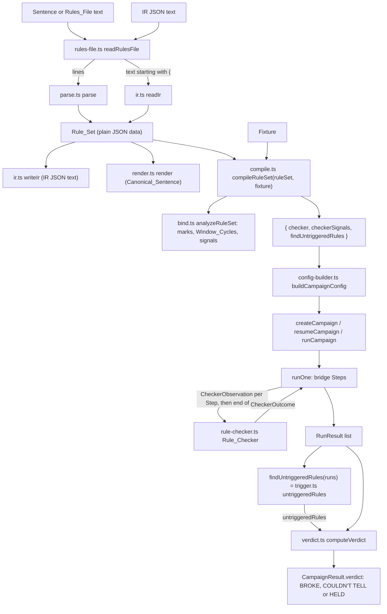

# Design Document: rule-compiler

## Overview

The Rule_Compiler turns plain-English rule sentences (or the same rules as versioned JSON IR) into one deterministic `Checker` for the existing gremlin-engine Campaign. It adds, under `src/engine/rules/`: the IR types with the IR_Reader and IR_Writer, the Renderer, the Sentence_Parser, the Rules_File_Reader, the Window_Cycles arithmetic, signal binding, the incremental Rule_Checker with one Rule_Monitor per Rule_Form, the Trigger_Evaluator with the Untriggered_Rule function, and the Campaign_Config_Builder. It changes three existing files, each additively: `verdict.ts` gains one optional `VerdictInput` field, `campaign.ts` gains one optional `CampaignConfig` field, and `spike/led-timeout-monitor.ts` becomes a thin wrapper around one compiled Rule.

There is no second verdict function and no new verdict string. The Campaign verdict is still chosen by `computeVerdict` in `src/engine/verdict.ts`. The UI chip builder and a CLI entry point are out of scope; they will consume the Renderer, the Rules_File_Reader and the Campaign_Config_Builder later.

Rules carried over from earlier specs and the steering files: avr8js stays behind the EmulatorBridge (only `src/engine/emulator-bridge.ts` imports it); replay is a fresh emulator plus the same HEX, Fixture and ordered event list, with no snapshots; simulated time is integer CPU cycles; engine code calls no wall clock, no timer and no `Math.random`; the Checker contains no AI and makes no network call; the Rule_Compiler draws no random values and takes no PRNG. Every type quoted below is copied from the source files named next to it. Tests are evidence, not proof.

Key decisions, each with its reason:

| # | Decision | Reason |
|---|----------|--------|
| D1 | Window_Cycles is computed by decimal-digit BigInt scaling: the ECMAScript Number-to-String digits of the Duration_Ms, with any exponent expanded, become a BigInt numerator M and a power of ten 10^k; then `W = M × Clock_Rate / (1000 × 10^k)` in BigInt, with a remainder check. The exact BigInt is kept on the compiled Rule. Monitors compare cycles with a number `limit` that equals W when W ≤ 2^53 − 1 and is `Infinity` otherwise. | Req 5.1 asks for an exact result for every accepted Duration_Ms and every positive integer Clock_Rate, including results above 2^53 − 1. Every cycle the Rule_Checker ever compares is at most 2^53 − 1 (the bridge stops with `cycle-overflow` above that, `emulator-bridge.ts:393-400`), so `Infinity` gives the same answer as the exact BigInt in every comparison. See "Window_Cycles arithmetic". |
| D2 | The Sentence_Parser is a character-level matcher that simulates the fixed grammar as a small set of live states, each state known to have at least one completion. P is the number of characters read while at least one state is live. The allowed characters at P are the union of the next characters the live states accept. | This gives P and the Allowed_Characters of Req 3.4 and 3.9 directly, with no backtracking and no guessing. |
| D3 | The parser returns a Rule only after checking `render(rule) === input`. | Req 3.6 (no silent change) then holds by construction, and Property 3 tests it. |
| D4 | Monitors work on change points only. Settled_State is constant between two consecutive change cycles, so no monitor loops cycle by cycle over a quiet stretch. | A Run can be 2^32 cycles long; per-cycle work would be far too slow. |
| D5 | The Rule_Checker keeps a frontier K, the highest Final_Cycle. K is X − 1 after a non-end-of-run call with `cycle` X and X after the end-of-run call. Changes above K wait in a pending buffer. | Fact F3: an input applied at cycle X arrives in the next observation, so cycle X is not settled until then. |
| D6 | A floating-input diagnostic sets a per-Rule cut-off d. A Rule that references the floating signal reports only a Violation below d, and stops for the rest of the Run. | Req 11.6. Its Step-size behaviour is explained in "Step-size invariance and floating inputs". |
| D7 | A call that breaks the call order (Req 10.11), a non-integer or out-of-range `cycle`, or a change that arrives for a cycle already final makes the Rule_Checker throw an `Error` whose message names the mismatch. `callChecker` turns that into `checker-error`. | `runOne` never produces such a call (facts F1 and F3); a `bridgeFactory` test double can. Throwing stops the Campaign instead of giving a verdict built on data the checker cannot place in time. |
| D8 | New field names: `VerdictInput.untriggeredRules?: readonly string[]` and `CampaignConfig.findUntriggeredRules?: (runs: readonly RunResult[]) => readonly string[]`. | Req 12.4 and 13.2 each ask for exactly one optional field. |
| D9 | The Campaign calls `findUntriggeredRules` once per handle, when the handle becomes finished, and keeps the returned list. A throw or a malformed return is kept as a sticky `internal-error`. | Req 13.8 asks for the same `CampaignResult` on every later `runSlice`; Req 13.9 asks for no `CampaignResult` after a failure. |
| D10 | Every success value of a new fallible function has the shape `{ ok: true, ... }` and every failure `{ ok: false, ... }`. No success value has a top-level `kind` key. | `isBridgeError` (`emulator-bridge.ts:88-90`) treats any object with a `kind` key as an error. A boolean `ok` lets a caller tell a Reason from a result without reading text (Req 2.7). |
| D11 | The settled-state machinery (`rules/trace.ts`) is shared by the Rule_Checker and the Trigger_Evaluator. The Reference_Evaluator used by Properties 4, 7 and 8 is test-only, imports none of it, and replays every cycle directly. | One implementation of Req 7 and 8 for the product code; an independent oracle for the tests. |
| D12 | The new spike test (Req 14.4) runs an empty Gremlin_Set with `runs: 1`. No baseline file is written by this spec. | With no gremlin, BUTTON stays released and the LED toggles about every 8,000,000 cycles (`SPIKE.md`, and the recorded events `8012192` and `16007524` in `input-pullup.property.test.ts:104-107`), so Run 0 breaks the 300 ms rule inside 20,000,000 cycles whatever the seed. The recorded `campaignSeed` sits in the test file. |

## Architecture

### File layout under `src/engine/`

```
src/engine/
  rules/                    NEW     Rule_Compiler; imports only modules under src/engine/, never avr8js
    ir.ts                   NEW     IR types, limits, isSignalName, validateRule, validateRuleSet, readIr, writeIr
    reason.ts               NEW     cutReason (200 UTF-16 units, no half surrogate pair), jsonTypeName, path text
    duration.ts             NEW     durationDigits, formatDuration, isDurationMs, clockRate, windowCycles (BigInt)
    render.ts               NEW     render (Renderer)
    parse.ts                NEW     parse (Sentence_Parser), allowedAt (exported for tests)
    rules-file.ts           NEW     readRulesFile (Rules_File_Reader)
    bind.ts                 NEW     analyzeRuleSet, analyzeRule: compile-time marks, Window_Cycles, signal list
    trace.ts                NEW     signal table, Initial_State, change buffer, condition evaluation, change points
    monitors.ts             NEW     makeMonitor for never, respond, count, hold, notLongerThan
    rule-checker.ts         NEW     makeRuleChecker: the incremental Checker (call order, frontier, floating, run end)
    compile.ts              NEW     compileRuleSet (Rule_Compiler wiring function, Req 6.1 and 13.1)
    trigger.ts              NEW     triggerOccurred (Trigger_Evaluator), untriggeredRules (Untriggered_Rule function)
    config-builder.ts       NEW     buildCampaignConfig (Campaign_Config_Builder)
  verdict.ts                CHANGED one optional VerdictInput field, two exported helpers; existing output unchanged
  campaign.ts               CHANGED one optional CampaignConfig field, read in makeHandle when finished
  spike/led-timeout-monitor.ts CHANGED same exports, body replaced by a call into the Rule_Compiler
  everything else           unchanged
  __tests__/                committed files unchanged; new files listed in "Testing Strategy"
```

Dependency rules:

- No file under `src/engine/rules/` imports avr8js, `emulator-bridge.ts`, `prng.ts` or anything outside `src/engine/`. `config-builder.ts` needs the `CampaignConfig` type and uses `import type { CampaignConfig } from "../campaign"`, which TypeScript erases, so no runtime import of `campaign.ts` (and so of `emulator-bridge.ts`) happens from the Rule_Compiler. `compile.ts` and `trigger.ts` import `type RunResult` the same way.
- Runtime imports allowed from `src/engine/rules/`: `../fixture` (`validateFixture`, `isAnalogPin`), `../copy-rules` (`BANNED_WORDS`), `../gremlins/pins` (`DEFAULT_CLOCK_HZ`, `DEFAULT_REST_LEVEL`), and each other. `pins.ts` imports types only.
- `verdict.ts` gains no import. `campaign.ts` gains no import. `spike/led-timeout-monitor.ts` imports `../rules/compile` and `../rules/ir`.
- `scripts/guard.mjs` check "b" and "b2" scan every `.ts` file under `src/engine/` outside `__tests__/`, which covers the new folder with no change to the script. Source comments in the new files do not name the APIs those checks look for (Req 15.1 covers comments).

### Data flow



## Code Evidence

Every block in this section is copied from the file named in its heading, at the line numbers given (line numbers are from the working tree at commit `0756ff8`; they are approximate once files change). Nothing here is restated from memory.

### `src/engine/checker.ts` (lines 1-38, whole file)

All five Checker contract types live in `checker.ts`. `types.ts` imports `CannotCheck` and `Violation` from it (`types.ts:1`).

```ts
// Checker contract. Types only.
// The observation holds data and nothing else: no time source, no number
// source and no network handle reach the Checker through it.

import type { AppliedInput, Diagnostic, OutputEvent } from "./types";

export interface CheckerObservation {
  readonly runIndex: number;
  /** 0 on the initial call of a Run; the end-of-run call continues the numbering. */
  readonly stepIndex: number;
  readonly endOfRun: boolean;
  /** Bridge cycleCount after the Step; for endOfRun, the end-of-run cycle. */
  readonly cycle: number;
  /** Only data produced since the previous call in this Run. */
  readonly outputEvents: readonly OutputEvent[];
  /** Digital and analog, in application order. */
  readonly appliedInputs: readonly AppliedInput[];
  readonly diagnostics: readonly Diagnostic[];
}

/** `cycle` is an integer, 0 <= cycle <= observation.cycle. */
export interface Violation {
  rule: string;
  cycle: number;
}

/** `reason` is the Checker's own words. */
export interface CannotCheck {
  rule: string;
  reason: string;
}

export interface CheckerOutcome {
  violation: Violation | null;
  cannotCheck?: readonly CannotCheck[];
}

export type Checker = (observation: CheckerObservation) => CheckerOutcome;
```

### `src/engine/types.ts`

Fixture and pins (lines 5-34):

```ts
export interface DigitalFixturePin {
  signal: string;
  port: "B" | "C" | "D";
  bit: 0 | 1 | 2 | 3 | 4 | 5 | 6 | 7;
  direction: "output" | "input";
  kind?: "digital";
  /** Input pins only; default "low". */
  activeLevel?: "low" | "high";
  /** Input pins only; default "released". */
  restState?: "released" | "active";
}

export interface AnalogFixturePin {
  signal: string;
  kind: "analog";
  /** Integer 0..5. */
  channel: number;
  /** Integer 0..1023; default 512. */
  restLevel?: number;
  direction?: "input";
  port?: undefined;
  bit?: undefined;
}

export type FixturePin = DigitalFixturePin | AnalogFixturePin;

export interface Fixture {
  clockHz?: number;
  pins: FixturePin[];
}
```

Output and input events (lines 36-72):

```ts
export type PinValue = 0 | 1 | "input";

export interface OutputEvent {
  signal: string;
  value: PinValue;
  cycle: number;
}

/** External state a caller can apply to an input pin. "release" stops driving it. */
export type InputValue = 0 | 1 | "release";

export interface InputEvent {
  signal: string;
  value: InputValue;
  cycle: number;
  gremlinId?: string;
}

export interface AnalogInputEvent {
  signal: string;
  /** Integer ADC count, 0..1023. */
  analog: number;
  cycle: number;
  gremlinId?: string;
}

export type ScheduledInput = InputEvent | AnalogInputEvent;

export interface AppliedInputEvent extends InputEvent {
  appliedCycle: number;
}

export interface AppliedAnalogInputEvent extends AnalogInputEvent {
  appliedCycle: number;
}

export type AppliedInput = AppliedInputEvent | AppliedAnalogInputEvent;
```

Diagnostics (lines 93-106):

```ts
/**
 * A released input pin with no pull-up was read. Detection is per PIN register,
 * not per bit, so it may over-report and never under-reports.
 */
export interface FloatingInputDiagnostic {
  kind: "floating-input";
  signal: string;
  /** Integer CPU cycle of the earliest covering PIN register read. */
  cycle: number;
  /** "PINB", "PINC" or "PIND". */
  register: string;
}

export type Diagnostic = FloatingInputDiagnostic;
```

Run and Campaign data (lines 119-172):

```ts
// Run and Campaign data. Plain JSON shapes: no undefined, NaN, BigInt, Date or
// class instances. Absent values are null.

/** Everything needed to show the lowest violating Run. */
export interface BrokeTrace {
  runIndex: number;
  runSeed: number;
  eventList: GeneratedEvent[];
  outputEvents: OutputEvent[];
  violation: Violation;
}

export type Verdict =
  | { verdict: "BROKE"; trace: BrokeTrace; unchecked: CannotCheck[] }
  | { verdict: "HELD"; text: string; runs: number }
  | { verdict: "COULDN'T TELL"; reason: string };

export interface RunResult {
  runIndex: number;
  runSeed: number;
  eventList: GeneratedEvent[];
  skipped: SkippedEntry[];
  /** Digital and analog merged, in application order. */
  appliedInputs: AppliedInput[];
  outputEvents: OutputEvent[];
  diagnostics: Diagnostic[];
  cannotCheck: CannotCheck[];
  violation: Violation | null;
  /** Bridge cycleCount at the stop point. */
  endCycle: number;
}

export interface CampaignResult {
  runsCompleted: number;
  requestedRuns: number;
  /** Earliest violating Run_Index, or null. */
  violatingRunIndex: number | null;
  verdict: Verdict;
}

export interface SliceProgress {
  runsCompleted: number;
  total: number;
  finished: boolean;
  nextRunIndex: number;
  runs: RunResult[];
  /** Set when finished, otherwise null. */
  result: CampaignResult | null;
}

export interface CampaignState {
  nextRunIndex: number;
  runs: RunResult[];
}
```

### `src/engine/fixture.ts`, `validateFixture` (lines 116-147)

```ts
export function validateFixture(fixture: Fixture): BridgeError | null {
  if (fixture.clockHz !== undefined && fixture.clockHz <= 0) {
    return { kind: 'invalid-fixture', message: 'clockHz must be positive' };
  }

  const seenChannels = new Set<number>();
  for (const pin of fixture.pins) {
    const err = isAnalogPin(pin)
      ? validateAnalogPin(pin, seenChannels)
      : validateDigitalPin(pin);
    if (err) return err;
  }

  // On the ATmega328P, ADC channel N is port C bit N. Earliest conflict wins.
  for (const analog of fixture.pins) {
    if (!isAnalogPin(analog)) continue;
    for (const other of fixture.pins) {
      if (isAnalogPin(other)) continue;
      if (other.port === 'C' && other.bit === analog.channel) {
        return invalid(
          `analog pin "${analog.signal}" (channel ${analog.channel}) and digital pin ` +
            `"${other.signal}" (port C, bit ${other.bit}) are on the same physical pin`,
        );
      }
    }
  }
  return null;
}
```

What this means for the Rule_Compiler:

- `clockHz` values that `validateFixture` accepts include `NaN`, `Infinity`, `16000000.5` and non-number values (each makes `<= 0` false). Req 5.4 handles them with `clock rate is not a whole number of hertz`.
- `clockHz: null` is rejected by `validateFixture`, because `null <= 0` is `true` in JavaScript. So `compileRuleSet` never sees a `null` Clock_Rate; it returns the Fixture Reason of Req 6.11 instead. The `null` branch of Req 5.2 is still implemented in `clockRate()`. Decision OQ1 (Nov 13): the `null` default of Req 5.2 applies only to direct `windowCycles` and `triggerOccurred` calls, which resolve the Clock_Rate through `clockRate()` without `validateFixture`. `compileRuleSet` (and so `buildCampaignConfig`) returns the Fixture Reason `Fixture: rejected with kind invalid-fixture.` for `clockHz: null`, which matches the EmulatorBridge: it rejects the same Fixture.
- Signal strings are never checked, and two pins may share one `signal` (fact F8). Req 6.5 handles the second case.

### `src/engine/campaign.ts`

`CampaignConfig` (lines 277-297):

```ts
export interface CampaignConfig {
  hex: string;
  fixture: Fixture;
  gremlinSet: readonly GremlinSpec[];
  campaignSeed: number;
  checker: Checker;
  /** N, default 64. */
  runs?: number;
  /** Default: defaultRunCycles, else 8,000,000. */
  runCycles?: number;
  /** The selected example's Run_Cycles. */
  defaultRunCycles?: number;
  /** Default true. */
  stopOnFirstViolation?: boolean;
  /** Default 160,000. */
  maxStepCycles?: number;
  /** Signals the Checker names, for the unmapped-signal verdict. */
  checkerSignals?: readonly string[];
  /** Test seam, default EmulatorBridge.create. */
  bridgeFactory?: BridgeFactory;
}
```

`callChecker` outcome validation (lines 109-153, the part that checks a Violation, fact F7):

```ts
function callChecker(checker: Checker, obs: CheckerObservation): CheckResult {
  let outcome: unknown;
  try {
    outcome = checker(obs);
  } catch (e) {
    const text = e instanceof Error ? e.message : String(e);
    return checkerError(obs.runIndex, obs.cycle, `checker threw: ${text}`);
  }
  ...
    if (typeof v.rule !== "string" || v.rule.length === 0) {
      return checkerError(obs.runIndex, obs.cycle, "violation has an empty rule");
    }
    if (typeof v.cycle !== "number" || !Number.isInteger(v.cycle) || v.cycle < 0) {
      return checkerError(obs.runIndex, obs.cycle, "violation cycle is not a non-negative integer");
    }
    if (v.cycle > obs.cycle) {
      return checkerError(obs.runIndex, obs.cycle, "violation cycle is above the observation cycle");
    }
```

`runOne` Checker calls (lines 192-247). The Step call carries only that Step's data; the end-of-run call carries the last `cycle` and empty lists, and is made only when no Violation was returned:

```ts
  while (bridge.cycleCount < cfg.runCycles) {
    ...
    const merged = mergeApplied(gen.events, appliedCount, r);
    if (isEngineError(merged)) return merged;
    appliedCount += merged.length;
    appliedInputs.push(...merged);
    outputEvents.push(...r.outputEvents);
    diagnostics.push(...r.diagnostics);

    const res = callChecker(cfg.checker, {
      runIndex,
      stepIndex: stepIndex++,
      endOfRun: false,
      cycle: bridge.cycleCount,
      outputEvents: Object.freeze(r.outputEvents.slice()),
      appliedInputs: Object.freeze(merged.slice()),
      diagnostics: Object.freeze(r.diagnostics.slice()),
    });
    if (!res.ok) return res.error;
    collect(res.cannotCheck);
    if (res.violation) {
      violation = res.violation;
      break;
    }
  }

  if (violation === null) {
    const res = callChecker(cfg.checker, {
      runIndex,
      stepIndex: stepIndex++,
      endOfRun: true,
      cycle: bridge.cycleCount,
      outputEvents: Object.freeze([]),
      appliedInputs: Object.freeze([]),
      diagnostics: Object.freeze([]),
    });
    if (!res.ok) return res.error;
    collect(res.cannotCheck);
    violation = res.violation;
  }
```

`collect` de-duplicates `CannotCheck` entries by `(rule, reason)` in order of earliest appearance (lines 183-190). The `RunResult` is built at lines 253-264 with `endCycle: bridge.cycleCount`.

`makeHandle` verdict wiring (lines 368-408). This is where the new optional field is read:

```ts
function makeHandle(
  config: CampaignConfig,
  settings: ResolvedCampaign,
  initial: CampaignState,
): CampaignHandle {
  const runs: RunResult[] = initial.runs.map((r) => structuredClone(r));
  let failure: EngineError | null = null;
  const unmapped = unmappedSignals(config);

  const isFinished = (): boolean =>
    runs.length >= settings.n || (settings.stopOnFirstViolation && earliestViolation(runs) !== null);

  const progress = (): SliceProgress => {
    const finished = isFinished();
    let result: CampaignResult | null = null;
    if (finished) {
      const verdict = computeVerdict({
        requestedRuns: settings.n,
        runs,
        finished: true,
        unmappedSignals: unmapped,
        unsupportedPeripherals: [],
      });
      if (verdict !== null) {
        result = {
          runsCompleted: runs.length,
          requestedRuns: settings.n,
          violatingRunIndex: earliestViolation(runs),
          verdict,
        };
      }
    }
    return {
      runsCompleted: runs.length,
      total: settings.n,
      finished,
      nextRunIndex: runs.length,
      runs: structuredClone(runs),
      result,
    };
  };
```

`runSlice` (lines 422-440):

```ts
    runSlice(k: number): SliceProgress | CampaignError {
      if (!isPositiveInteger(k)) {
        return invalidCampaign(`slice size must be a positive integer, got ${String(k)}`);
      }
      if (failure !== null) return failure;
      if (isFinished()) return progress();

      const count = Math.min(k, settings.n - runs.length);
      for (let j = 0; j < count; j++) {
        const out = runOne(runCfg, runs.length);
        if (isEngineError(out)) {
          failure = out;
          return out;
        }
        runs.push(out);
        if (settings.stopOnFirstViolation && out.violation !== null) break;
      }
      return progress();
    },
```

Signatures (lines 447, 455, 483):

```ts
export function createCampaign(config: CampaignConfig): CampaignHandle | CampaignError {
export function resumeCampaign(config: CampaignConfig, state: CampaignState): CampaignHandle | CampaignError {
export function runCampaign(config: CampaignConfig): CampaignResult | CampaignError {
```

`unmappedSignals(config)` (lines 351-358) reads `config.checkerSignals` and keeps every name that no Fixture pin carries, in `checkerSignals` order, once each.

### `src/engine/verdict.ts` (lines 1-99, whole file)

```ts
// Verdict selection. Pure: reads only its argument and never changes it.

import type { CannotCheck } from "./checker";
import type { BrokeTrace, RunResult, Verdict } from "./types";

export type { BrokeTrace, Verdict };

export const VERDICT_BROKE = "BROKE";
export const VERDICT_COULDNT_TELL = "COULDN'T TELL";

export const heldText = (n: number): string =>
  `No violation found in ${n} runs of this gremlin set. Not a proof.`;

/** Used when a reason would otherwise be empty. */
export const EMPTY_REASON_TEXT = "The rules could not be checked with the signals and run length available.";

export const REASON_MAX_LENGTH = 200;

export interface VerdictInput {
  requestedRuns: number;
  /** Completed Runs in order. */
  runs: readonly RunResult[];
  finished: boolean;
  /** Checker signals that are not in the Fixture. */
  unmappedSignals: readonly string[];
  /** Peripherals the Checker named as unsupported. */
  unsupportedPeripherals: readonly string[];
}

/** Cut at 200 UTF-16 units, never leaving half of a surrogate pair. */
function truncateReason(text: string): string {
  if (text.length <= REASON_MAX_LENGTH) return text;
  let end = REASON_MAX_LENGTH;
  const last = text.charCodeAt(end - 1);
  if (last >= 0xd800 && last <= 0xdbff) end -= 1;
  return text.slice(0, end);
}

function buildReason(parts: readonly string[]): string {
  const joined = parts.join("; ").trim();
  return truncateReason(joined === "" ? EMPTY_REASON_TEXT : joined);
}

export function computeVerdict(input: VerdictInput): Verdict | null {
  if (!input.finished) return null;

  const { runs } = input;

  // 1. BROKE: lowest violating Run_Index, with every unchecked rule listed.
  let lowest: RunResult | null = null;
  const unchecked: CannotCheck[] = [];
  const seen = new Set<string>();
  for (const run of runs) {
    if (run.violation !== null && (lowest === null || run.runIndex < lowest.runIndex)) {
      lowest = run;
    }
    for (const c of run.cannotCheck) {
      const key = JSON.stringify([c.rule, c.reason]);
      if (seen.has(key)) continue;
      seen.add(key);
      unchecked.push({ rule: c.rule, reason: c.reason });
    }
  }
  if (lowest !== null && lowest.violation !== null) {
    const trace: BrokeTrace = {
      runIndex: lowest.runIndex,
      runSeed: lowest.runSeed,
      eventList: lowest.eventList.map((e) => ({ ...e })),
      outputEvents: lowest.outputEvents.map((e) => ({ ...e })),
      violation: { ...lowest.violation },
    };
    return { verdict: VERDICT_BROKE, trace, unchecked };
  }

  // 2. COULDN'T TELL.
  const parts: string[] = [];
  for (const c of unchecked) {
    parts.push(`Rule "${c.rule}" could not be checked: ${c.reason}`);
  }
  if (input.unmappedSignals.length > 0) {
    parts.push(`Signals not mapped to a pin: ${input.unmappedSignals.join(", ")}`);
  }
  if (input.unsupportedPeripherals.length > 0) {
    parts.push(`Peripherals not supported: ${input.unsupportedPeripherals.join(", ")}`);
  }
  if (runs.length !== input.requestedRuns) {
    parts.push(`Only ${runs.length} of ${input.requestedRuns} runs completed`);
  }
  const anyEvent = runs.some((r) => r.eventList.some((e) => e.gremlinId !== "rest"));
  if (!anyEvent) {
    parts.push("No gremlin produced an event in any run");
  }
  if (parts.length > 0) {
    return { verdict: VERDICT_COULDNT_TELL, reason: buildReason(parts) };
  }

  // 3. HELD.
  return { verdict: "HELD", text: heldText(runs.length), runs: runs.length };
}
```

### `src/engine/emulator-bridge.ts` excerpts for facts F1, F3 and F8

F1, cycle-0 snapshot. Step 9 of `_build` (lines 264-277) emits one cycle-0 event for every digital output pin, including the `"input"` state:

```ts
    // 9. Build initial snapshot (cycle-0 events for every output pin, including "input" state)
    const pinShadow: Array<PinValue> = new Array(fixture.pins.length).fill('input' as PinValue);
    const initialSnapshot: OutputEvent[] = [];
    for (let i = 0; i < fixture.pins.length; i++) {
      const pin = fixture.pins[i];
      if (isAnalogPin(pin)) continue;
      if (pin.direction !== 'output') continue;
      const port = portMap.get(pin.port)!;
      const raw = port.pinState(pin.bit);
      const value = mapPinState(raw);
      pinShadow[i] = value;
      // Always emit cycle-0 event for every output pin (including "input" state)
      initialSnapshot.push({ signal: pin.signal, value, cycle: 0 });
    }
```

`advance()` puts the snapshot at the head of the output list of its initial call (lines 359-362):

```ts
    if (this._firstAdvance) {
      outputEvents.push(...this._initialSnapshot);
      this._firstAdvance = false;
    }
```

`runOne` passes that Step's `r.outputEvents` in the `stepIndex` 0 observation (quoted above, `campaign.ts:221-229`). Every later output event is recorded after an instruction and a tick (lines 402-414), so its cycle is at least 1:

```ts
      // 5. Detect output pin changes in ascending fixture pin-index order
      for (let i = 0; i < this._fixture.pins.length; i++) {
        const pin = this._fixture.pins[i];
        if (isAnalogPin(pin)) continue;
        if (pin.direction !== 'output') continue;
        const port = this._portMap.get(pin.port)!;
        const raw = port.pinState(pin.bit);
        const newValue = mapPinState(raw);
        if (newValue !== this._pinShadow[i]) {
          this._pinShadow[i] = newValue;
          outputEvents.push({ signal: pin.signal, value: newValue, cycle: this._cpu.cycles });
        }
      }
```

F3, inputs are applied before the instruction. In the `advance()` loop (lines 369-391), due inputs are applied with `appliedCycle: this._cpu.cycles`, and only then does one instruction run:

```ts
    while ((this._cpu.cycles - startCycles) < requestedCycles) {
      // 1. Apply pending inputs where event.cycle <= cpu.cycles
      while (
        this._nextInputIdx < this._sortedInputs.length &&
        this._sortedInputs[this._nextInputIdx].cycle <= this._cpu.cycles
      ) {
        const ev = this._sortedInputs[this._nextInputIdx++];
        const pin = this._fixture.pins.find(p => p.signal === ev.signal)!;
        if (isAnalogInputEvent(ev)) {
          if (isAnalogPin(pin)) this._adc.channelValues[pin.channel] = analogCountToVolts(ev.analog);
          appliedAnalogInputs.push({ ...ev, appliedCycle: this._cpu.cycles });
        } else {
          this._applyInput(this._fixture.pins.indexOf(pin), ev.value);
          appliedInputs.push({ ...ev, appliedCycle: this._cpu.cycles });
        }
      }

      // 2. Execute one instruction
      avrInstruction(this._cpu);
```

Every avr8js instruction ends by adding at least one cycle. The last statements of `avrInstruction` in `node_modules/avr8js/dist/esm/cpu/instruction.js` (lines 857-858) are:

```js
    cpu.pc = (cpu.pc + 1) % cpu.progMem.length;
    cpu.cycles++;
```

So, for a Step that starts at cycle X′ (the previous observation's `cycle`, 0 for `stepIndex` 0) and ends at X: every applied input has X′ ≤ `appliedCycle` ≤ X − 1, and every output event other than the snapshot has X′ + 1 ≤ `cycle` ≤ X. An input due at cycle X is applied at the top of the next Step's loop and arrives in the next observation.

F8, floating-input diagnostics. Step 11b of `_build` (lines 301-340, hook body at 321-338) wraps the PIN read hook of each port that has a Digital_Input. It pushes one diagnostic per signal per bridge, with `cycle: cpu.cycles` at the moment of the read:

```ts
      cpu.readHooks[pinAddr] = (addr: number): number => {
        const original = prev ? prev(addr) : cpu.data[addr];
        for (const i of pinIdxs) {
          const p = fixture.pins[i];
          if (isAnalogPin(p)) continue;
          if (extState[i] !== 'released') continue;
          if (bridge._floatingReported.has(p.signal)) continue;
          if (port.pinState(p.bit) !== PinState.Input) continue;
          bridge._floatingReported.add(p.signal);
          bridge._pendingDiagnostics.push({
            kind: 'floating-input',
            signal: p.signal,
            cycle: cpu.cycles,
            register,
          });
        }
        return original;
      };
```

`pinIdxs` holds only Fixture pins that are digital with `direction: 'input'` (line 315). The read happens inside an instruction: for `IN` the read is at `instruction.js:325` before the trailing `cpu.cycles++` at line 858; for `LDS` one cycle is added at line 374 before the read at line 375, and the trailing increment still follows. So a diagnostic produced in a Step that starts at X′ and ends at X has X′ ≤ `cycle` ≤ X − 1, the same placement as an applied input. Diagnostics are handed out per `advance` call by `_takeDiagnostics` (line 426).

Rest values, from the Gremlin_Engine: `event-list.ts:90` generates, for every Digital_Input with `restState: "active"`, `{ signal: pin.signal, value: pressValue(pin), cycle: 0, gremlinId: "rest" }`, and the decorated sort at line 105 keeps Rest_Events ahead of every Gremlin event at cycle 0. `pressValue` (`gremlins/pins.ts:34-36`) returns `pin.activeLevel === "high" ? 1 : 0`. Analog rest: `_build` step 6b (lines 230-235) presents `pin.restLevel ?? 512` before any instruction.

### `src/engine/spike/led-timeout-monitor.ts` (lines 1-73, current body)

```ts
// SPIKE: temporary monitor harness - to be replaced by the rule-compiler spec

import type { OutputEvent } from '../types.js';

export interface MonitorViolation {
  verdict: 'BROKE';
  violationCycle: number;
}

export interface MonitorClean {
  verdict: 'no violation in this run';
}

export type MonitorResult = MonitorViolation | MonitorClean;

export function checkLedTimeout(
  events: OutputEvent[],
  runEndCycle: number,
  signal = 'LED',
  maxOnCycles = 4_800_000,
): MonitorResult {
  // Current LED state: initially unknown ("input")
  let ledState: 0 | 1 | 'input' = 'input';
  // Cycle at which LED last transitioned to ON
  let onCycle = -1;

  for (const ev of events) {
    if (ev.signal !== signal) continue;

    if (ledState === 1 && onCycle >= 0 && ev.cycle >= onCycle + maxOnCycles) {
      return { verdict: 'BROKE', violationCycle: onCycle + maxOnCycles };
    }

    // Detect transition to ON from a non-1 state
    if (ev.value === 1 && ledState !== 1) {
      onCycle = ev.cycle;
    }

    // Update state
    ledState = ev.value as 0 | 1 | 'input';

    if (ledState === 1 && onCycle >= 0 && ev.cycle >= onCycle + maxOnCycles) {
      return { verdict: 'BROKE', violationCycle: onCycle + maxOnCycles };
    }
  }

  if (ledState === 1 && onCycle >= 0 && runEndCycle >= onCycle + maxOnCycles) {
    return { verdict: 'BROKE', violationCycle: onCycle + maxOnCycles };
  }

  return { verdict: 'no violation in this run' };
}
```

(The block above keeps every code line; the doc comment at lines 16-29 and three explanatory comments are left out for length.) The end-of-run test `runEndCycle >= onCycle + maxOnCycles` is the same boundary as the `notLongerThan` rule of Req 9.5: a true span of exactly L cycles is a Violation at s + L.

### Facts F1 to F8 checked against the code

| Fact | Status | Evidence |
|------|--------|----------|
| F1 cycle-0 snapshot in the `stepIndex` 0 observation | Holds | `emulator-bridge.ts:264-277`, `:359-362`; `campaign.ts:221-229` |
| F2 `appliedCycle` and `gremlinId` on applied inputs; Rest_Events carry `"rest"` | Holds | `emulator-bridge.ts:380`, `:383` copy every field with `{ ...ev, appliedCycle }`; `event-list.ts:90` |
| F3 outputs ≤ X, inputs ≤ X − 1, same-cycle data in two observations | Holds | `emulator-bridge.ts:369-391`, `:402-414`; `instruction.js:857-858` |
| F4 Run_Result contents | Holds | `types.ts:136-149` |
| F5 verdict today | Holds | `verdict.ts:44-99`; `campaign.ts:384-390` passes `unsupportedPeripherals: []` |
| F6 no Run_Cycles in the observation | Holds | `checker.ts:7-19`; the bridge can overshoot Run_Cycles by one instruction plus interrupt dispatch (gremlin-engine design, "Bridge advance semantics") |
| F7 outcome validation | Holds | `campaign.ts:109-153` |
| F8 floating diagnostics only for Fixture Digital_Inputs, once per signal per bridge; signals unchecked | Holds | `emulator-bridge.ts:301-340`, `:315`; `fixture.ts` checks no `signal` string |
| Added: a diagnostic in a Step from X′ to X has X′ ≤ `cycle` ≤ X − 1 | Holds | `emulator-bridge.ts:333`; `instruction.js:325`, `:374-375`, `:858` |

## Components and Interfaces

All new functions are pure unless stated. None throws for an expected condition, except the Rule_Checker for a broken call order (D7) and `checkLedTimeout` for rejected arguments (Req 14.7). A Reason is a `string` of 1 to 200 UTF-16 code units built from fixed wording (see "Error Handling").

### IR (`rules/ir.ts`)

```ts
export type Condition =
  | { op: "eq"; signal: string; value: 0 | 1 }
  | { op: "above"; signal: string; value: number }    // integer 0..1022
  | { op: "below"; signal: string; value: number }    // integer 1..1023
  | { op: "all"; of: Condition[] }                    // 2..8 members
  | { op: "any"; of: Condition[] };                   // 2..8 members

export type Edge = { op: "rise"; of: Condition } | { op: "fall"; of: Condition };

export type Rule =
  | { form: "never"; condition: Condition }
  | { form: "respond"; trigger: Edge; withinMs: number; expect: Condition }
  | { form: "count"; edge: Edge; windowMs: number; max: number }          // max integer 0..65535
  | { form: "hold"; after: Edge; durationMs: number; expect: Condition }
  | { form: "notLongerThan"; condition: Condition; ms: number };

export type RuleForm = Rule["form"];
export type RuleSet = Rule[];                                              // 1..32 Rules
export interface IrDocument { version: 1; rules: RuleSet }

export const IR_VERSION = 1;
export const MAX_RULES = 32;
export const MAX_NESTING_DEPTH = 4;
export const MIN_MEMBERS = 2;
export const MAX_MEMBERS = 8;
export const MAX_COUNT = 65_535;

export type ReadResult = { ok: true; ruleSet: RuleSet } | { ok: false; reasons: string[] };
export type WriteResult = { ok: true; text: string } | { ok: false; reason: string };

/** Signal_Name test of Req 1.7: pattern, not all or any, not a BANNED_WORDS entry ignoring case. */
export function isSignalName(x: unknown): x is string;
/** Reasons for one Rule value, paths from the Rule root. Empty array means valid (Req 1.2 to 1.7). */
export function validateRule(x: unknown): string[];
/** Reasons for a Rule_Set value, paths from the document root ("rules[i]..."). Empty array means valid. */
export function validateRuleSet(x: unknown): string[];
/** IR_Reader (Req 1.8 to 1.11, 1.14, 1.15, 1.17). Never throws. */
export function readIr(text: string): ReadResult;
/** IR_Writer (Req 1.12, 1.16). Never throws. */
export function writeIr(ruleSet: unknown): WriteResult;
```

IR_Reader steps, in the order of Req 1.14. Each step returns only its own Reasons when its condition holds.

1. `JSON.parse(text)` inside `try`. A throw gives the one Reason `The text is not valid JSON.`
2. If the value is a non-array object: `version` absent (own property test with `Object.prototype.hasOwnProperty.call`) gives `version is missing.`; `version` present and not the number 1 gives `version must be the number 1; found <type>.`, where `<type>` is `a string`, `a boolean`, `null`, `an array`, `an object`, or `the number <String(v)>`. No string value is copied (Req 1.8).
3. Structure check by `validateRuleSet`, which walks the value in document order and emits at most one Reason per offending value, each starting with its JSON path. Field names in paths come from the fixed list of Req 1.1 to 1.5 only. A field not in that list is reported once per holding object as `<path of the object>: has a field that is not allowed.` (Req 1.9), and its name is never written out. The top-level value not being an object gives `The document must be a JSON object; found <type>.` A Rule whose `form` is not one of the five names gives one Reason for `form` and is not checked further, because its field list is unknown. The same holds for a Condition or Edge with an unknown `op`.
4. Repeated sentences: render every Rule; for each Canonical_Sentence held by two or more Rules, one Reason `rules <i>, <j>, ... repeat the sentence "<sentence>"`, indexes ascending, with the sentence cut so the Reason fits 200 units (indexes come before the sentence so they always survive the cut).
5. Otherwise `{ ok: true, ruleSet }`, where `ruleSet` is a fresh copy holding only the listed fields, in IR order.

Integer fields accept a JSON number whose parsed value passes `Number.isInteger(v) && !Object.is(v, -0)` and is inside its range, so `1`, `1.0` and `1e0` read as 1 and `-0` is rejected (Req 1.5). Duration_Ms fields use `isDurationMs` (next section) on the parsed number, never on the text (Req 1.6). Duplicate JSON keys follow `JSON.parse`, which keeps the later value; the text is not inspected further. A key named `__proto__` is an own property after `JSON.parse` and is reported as a field that is not allowed.

IR_Writer: `validateRuleSet(ruleSet)` plus the repeated-sentence check; any Reason gives `{ ok: false, reason }` with the earliest Reason. Otherwise the document `{ version: 1, rules }` is rebuilt with keys in this fixed order and written with `JSON.stringify(doc, null, 2) + "\n"`:

| Object | Key order |
|--------|-----------|
| document | `version`, `rules` |
| `never` | `form`, `condition` |
| `respond` | `form`, `trigger`, `withinMs`, `expect` |
| `count` | `form`, `edge`, `windowMs`, `max` |
| `hold` | `form`, `after`, `durationMs`, `expect` |
| `notLongerThan` | `form`, `condition`, `ms` |
| Edge | `op`, `of` |
| `eq`, `above`, `below` | `op`, `signal`, `value` |
| `all`, `any` | `op`, `of` |

`JSON.stringify` writes numbers with Number-to-String, so a Duration_Ms of 5e-7 is written `5e-7` and reads back as the same number; the round trip of Req 1.13 is exact because every field is a string, an integer or such a number.

### Window_Cycles arithmetic (`rules/duration.ts`)

```ts
/** Number-to-String digits of a finite x > 0, exponent expanded: integer part (no leading zero except a lone "0") and fraction (no trailing zero). null for other x. */
export function durationDigits(x: number): { int: string; frac: string } | null;
/** Req 1.6: finite number > 0, int part at most 9,999,999 (7 digits), frac at most 7 digits. */
export function isDurationMs(x: unknown): x is number;
/** Req 2.4 text: int, then "." and frac when frac is not empty. */
export function formatDuration(ms: number): string;
/** Req 5.2: fixture.clockHz when neither undefined nor null, else DEFAULT_CLOCK_HZ (16,000,000). Returns the raw value. */
export function clockRate(fixture: Fixture): unknown;
export type WindowResult =
  | { ok: true; cycles: bigint }
  | { ok: false; reason: "window not a whole number of cycles" | "clock rate is not a whole number of hertz" };
/** Req 5.1, 5.3, 5.4. Exact. */
export function windowCycles(ms: number, clock: unknown): WindowResult;
/** Number used by monitors: Number(cycles) when cycles <= 2^53 - 1, else Infinity. */
export function cycleLimit(cycles: bigint): number;
```

Method, named for Req 5.1: decimal-digit BigInt scaling.

1. `s = String(ms)`. For a value accepted by Req 1.6, `s` matches `^(\d+)(?:\.(\d+))?(?:e([+-]\d+))?$`. Values from 1e-6 up are written positionally by Number-to-String; smaller ones (for example `5e-7`, `1.5e-7`) use a negative exponent. The integer part is at most 9,999,999, far below 1e21, so a positive exponent never appears.
2. Mantissa digits `m = int + frac` and exponent `e = (exp ?? 0) − frac.length`, so the value is m × 10^e exactly as a decimal. If e ≥ 0, the integer part is `m` followed by e zeros and the fraction is empty. If e < 0, k = −e; `m` is padded on the left with zeros to more than k digits; the fraction is the last k digits and the integer part the rest. Leading zeros of the integer part are removed (a lone `0` is kept) and trailing zeros of the fraction are removed.
3. `isDurationMs`: `typeof x === "number"`, finite, `x > 0`, integer part at most 7 digits, fraction at most 7 digits. `0.30000000000000004` has a 17-digit fraction and fails; `10000000` has an 8-digit integer part and fails.
4. Clock check: `typeof clock === "number" && Number.isInteger(clock) && clock > 0`, else `clock rate is not a whole number of hertz` (Req 5.4). `BigInt(clock)` is exact for every integer-valued number, including values above 2^53.
5. M = `BigInt(int + frac)` and k = `frac.length`. Numerator N = M × `BigInt(clock)`; denominator Q = 1000n × 10n ** BigInt(k). If N % Q ≠ 0n the result is `window not a whole number of cycles` (Req 5.3), else W = N / Q.

Examples at 16,000,000 Hz (Req 5.5 and 5.7): 300 → M 300, k 0 → 4,800,000. 0.1 → M 1, k 1 → 1,600. 0.0000625 → M 625, k 7 → 625 × 16,000,000 / 10^10 = 1. 0.0001 → 16,000,000 / 10^7, remainder 6,000,000 → mark. 0.0000001 → mark. 9,999,999.9999999 → 159,999,999,999.9984 → mark. 9,999,999 → 159,999,984,000.

Why the `Infinity` limit keeps Req 5.1: W stays an exact BigInt on the compiled Rule (`RulePlan.windowCycles`), and example tests compare it with BigInt literals. Monitors compare W only against cycles: `t + W ≤ K`, `s + L ≤ c`, `e − W + 1 > front`, `W > observation.cycle`. Every K, c, t, s, e and `observation.cycle` is an integer from 0 to 2^53 − 1, because the bridge returns `cycle-overflow` once `cpu.cycles` passes that value (`emulator-bridge.ts:393-400`) and `MAX_RUN_CYCLES` is 2^32 (`campaign.ts:275`). If W > 2^53 − 1, every such comparison has the same truth value whether W is exact or `Infinity`. If W ≤ 2^53 − 1 but t + W is above 2^53 − 1, the floating-point sum rounds to a value of at least 2^53 (rounding is monotonic and 2^53 is representable), which is still above every reachable cycle, so the comparison is again correct; when a comparison succeeds, the exact sum is at most 2^53 − 1 and the reported Violation cycle is exact. A `hold` or `count` Rule with such a window is still checked: `hold` can fail at the Occurrence cycle itself, and a `count` window then covers the whole Run. Each timed Rule whose W exceeds the end-of-run cycle also gets `run shorter than the rule window` (Req 11.1).

### Renderer (`rules/render.ts`)

```ts
export type RenderResult = { ok: true; sentence: string } | { ok: false; reason: string };
export function render(rule: unknown): RenderResult;
```

`render` calls `validateRule(rule)`; any Reason gives `{ ok: false, reason: "Not a valid rule: " + reasons[0] }`, cut to 200. Paths are from the Rule root (`trigger.of.value`; the root itself is `the rule`). Otherwise it fills the templates of Req 2.1 to 2.3:

| IR | Text |
|----|------|
| `eq` | `S is v` |
| `above` / `below` | `S is above n` / `S is below n` |
| `all` / `any` | `all of (C1, C2, ...)` / `any of (C1, C2, ...)` |
| `rise` / `fall` | `C becomes true` / `C becomes false` |
| `never` | `C must never happen.` |
| `respond` | `Within d ms after E, C must be true.` |
| `count` | `E may happen at most k time in any d ms.` when k is 1, else `... k times in any d ms.` |
| `hold` | `After E, C must stay true for d ms.` |
| `notLongerThan` | `C must never last d ms or longer.` |

Integers are written with `String(n)` (valid integers are non-negative and not `-0`, so there is no sign, separator or leading zero). Duration_Ms uses `formatDuration`. `render` reads fields by name, so object key order and earlier calls have no effect (Req 2.6), and it never writes to its argument.

### Sentence_Parser (`rules/parse.ts`)

```ts
/** One named item of a parser Reason: an inclusive character range (from === to for one character) or the end of the text. */
export type AllowedItem = { from: string; to: string } | { end: true };
export type ParseResult =
  | { ok: true; rule: Rule }
  | { ok: false; reason: string; position: number; allowed: AllowedItem[] };
export function parse(sentence: string): ParseResult;
/** For tests: every printable ASCII character, plus the end of the text, allowed after the prefix, or null when the prefix is not viable. */
export function allowedAt(prefix: string): { chars: string[]; end: boolean } | null;
```

Grammar (tokens are separated by exactly one U+0020 space; `,` and `.` and `)` attach to the token before them; `(` attaches to the token after it):

```
Sentence  := Cond " must never happen."
           | Cond " must never last " Dur " ms or longer."
           | "Within " Dur " ms after " Edge ", " Cond " must be true."
           | Edge " may happen at most " Count " " ("time" | "times") " in any " Dur " ms."
           | "After " Edge ", " Cond " must stay true for " Dur " ms."
Edge      := Cond " becomes " ("true" | "false")
Cond(h)   := Sig " is " ("0" | "1")
           | Sig " is above " Int(0..1022)
           | Sig " is below " Int(1..1023)
           | ("all" | "any") " of (" Cond(h-1) (", " Cond(h-1)){1,7} ")"      only when h >= 2
Sig       := [A-Za-z][A-Za-z0-9_]{0,31}, not "all" or "any", not a BANNED_WORDS entry ignoring case
Int(a..b) := "0" | [1-9][0-9]*, value from a to b
Count     := Int(0..65535); "time" exactly when the value is 1
Dur       := ("0" | [1-9][0-9]{0,6}) ("." [0-9]{0,6}[1-9])?, value > 0
```

`Cond` at the top of a Rule, inside an Edge and as `expect` starts with depth budget h = 4. A leaf costs 1, so at most three `all`/`any` levels nest.

Matching method (D2). The parser keeps a list of live states. A state is a position in one of the five sentence templates plus a stack of open `all`/`any` lists (each with its remaining depth budget and its member count), plus the partial value of the token being read (signal characters so far, digits so far, fraction digits so far) and the partial Rule built so far. `step(state, ch)` returns the states that can follow after reading `ch`; it returns a state only if that state can still be completed into a Canonical_Sentence of a valid Rule. That check is local because every limit is local:

- Signal: a letter starts it; up to 32 characters from `[A-Za-z0-9_]`; the space that ends it is accepted only when the name is not `all`, `any` or a BANNED_WORDS entry ignoring case. At a position where `all of (` or `any of (` is allowed (budget h ≥ 2), the characters `all`/`any` keep both a signal state and a list state alive; the space then decides (`o` for a list, nothing for a signal named `all`).
- Integer: `0` must be followed by the token end; digits after a leading non-zero digit are accepted while the value can still be in range (for `above`, `102` is viable and `1023` is not; the end after `102` is viable).
- Count: `1` is followed by ` time ` only; any other value by ` times `.
- Duration: up to 7 integer digits; the fraction accepts a `0` only while a later non-zero digit can still fit in the 7 places; the token ends only on a non-zero last fraction digit or with no fraction; the value `0` must be followed by `.`.
- Lists: `,` is accepted only while fewer than 8 members are complete; `)` only once at least 2 are.

P is the number of characters read while the live list is non-empty; `allowed` is the union over the live states at P of the printable ASCII characters `step` accepts, plus the end of the text when some live state is complete. Because each state can be completed, a non-empty live list at P means the prefix is a prefix of some Canonical_Sentence, and an empty list after one more character means it is not, so P matches Req 3.4 exactly, and the allowed set is never empty at P (the completion the state carries provides at least one character or the end). When the input is fully read and some state is complete, the parser takes that state's Rule and returns it only if `render(rule).sentence === input` (D3); otherwise it returns a Reason at position `input.length`. No case folding, trimming or normalization happens anywhere (Req 3.3), so a tab, CR, LF, non-breaking space, curly quote or non-ASCII digit stops every state at its position.

Reason text (1 to 200 units, no input text copied): `No rule template matches at position <P> (counting from 0); allowed there: <items>.` Items come from `allowed`, merged into ranges of consecutive code points, in code point order, with the end of the text last. At most 6 items are named (the data field `allowed` holds exactly the named items, Req 3.9). Item text: `"A" to "Z"` for a range, `"("` for one character, `a space` for U+0020, `the end of the text` for the end.

Why at most one Rule can match (the grammar is unambiguous):

- Tokens contain no space. Signal_Names, keywords and numbers contain no `(`, `)`, `,` or `.`, except the decimal point of a Duration, which is always followed by a digit and then ` ms`. So token boundaries are fixed by the text.
- A `Cond` is self-delimiting: after `S is ` comes `0`, `1`, `above n` or `below n`, and then a space, `,` or `)`; a list ends at its matching `)`. A Condition never continues after its last value, because the grammar has no infix operator.
- Sentence start. `Within ` followed by a digit can only be `respond`; a signal named `Within` is followed by ` is `, never by a digit. For `After `: the condition reading (signal `After`) needs the second token to be `is` and the third to be `0`, `1`, `above` or `below`; the `hold` reading needs a Condition after `After `, whose second token is a signal name followed by `is` as the third token. Both readings would need the third token to be `is` and one of `0`, `1`, `above`, `below` at once, which cannot happen. Every other start is a Condition.
- After a leading Condition, the next token tells the form: `must` then `happen.` (`never`) or `last` (`notLongerThan`); `becomes` (an Edge, so `count`).
- In `respond` and `hold`, the Edge ends at `true` or `false` followed by `,` at list depth 0; commas inside the Edge's Condition are always inside parentheses.
- `all` and `any` cannot be signal names, so `all of (` always opens a list.

Every parse function is therefore deterministic once the live states are followed, and since `render` is a function, two different Rules cannot share a Canonical_Sentence unless they are deep-equal; Property 1 and Property 3 test both directions.

Prefix_Oracle (test only, `src/engine/__tests__/rules-prefix-oracle.ts`, used by Property 9): a separate implementation written from Req 1 and 2, importing only `render` and `BANNED_WORDS`. It tokenizes the prefix at spaces, matches complete tokens against the five templates with a small backtracking matcher, and for the last, possibly partial, token checks whether some valid token starts with it (signal, integer in range, count, duration, keyword, punctuation). When it answers "viable", it also builds a witness Rule by filling every remaining hole with a fixed valid value, and the test checks `render(witness).sentence.startsWith(prefix)` (and equality when the oracle says the end of the text is allowed). It does not import `parse.ts`.

### Rules_File_Reader (`rules/rules-file.ts`)

```ts
export const MAX_RULES_FILE_UNITS = 65_536;
export function readRulesFile(text: string): ReadResult;    // same result type as readIr
```

Steps, in order (Req 4):

1. If `text.charCodeAt(0) === 0xfeff`, drop that one code unit (Req 4.8).
2. If the remaining length is above 65,536, return the one Reason `The text is longer than 65536 UTF-16 code units.` (Req 4.9).
3. Find the initial character that is not U+0020, U+0009, U+000D or U+000A. If it is `{`, return `readIr(rest)` unchanged, leading whitespace included (Req 4.1).
4. Otherwise split at every LF; remove one CR at the end of each line; skip a line that is empty or holds only spaces and tabs; skip a line whose character at index 0 is `#`; parse every other line exactly as written (Req 4.2).
5. Failing lines give `Line <n>: <parser reason>`, ascending, with the parser reason cut so the whole Reason fits 200 units and the line number is kept (Req 4.3). Line numbers count every LF-separated line of the text left by step 1.
6. All lines parse: if the count is 0 or above 32, a Reason `Found <n> rules; a rules file needs 1 to 32.`; for each sentence on two or more lines, a Reason `Lines <a>, <b>, ... repeat the sentence "<sentence>"`. Both kinds are returned together when both apply (Req 4.4, 4.6). Otherwise the Rule_Set in line order (Req 4.5).

No file input or output happens here (Req 4.7).

### Signal binding and compile-time marks (`rules/bind.ts`)

```ts
export type SignalKind =
  | { kind: "output" }
  | { kind: "digital-input"; inactiveLevel: 0 | 1 }
  | { kind: "analog"; restLevel: number };

export interface RulePlan {
  index: number;                    // position in the Rule_Set
  rule: Rule;
  sentence: string;                 // Canonical_Sentence
  signals: string[];                // distinct, in sentence order
  marks: CannotCheck[];             // compile-time entries, Req 6.7 order
  active: boolean;                  // marks.length === 0
  windowCycles: bigint | null;      // null for never, or when a Req 5 mark is set
  limit: number | null;             // cycleLimit(windowCycles)
}

export interface RuleSetPlan {
  plans: RulePlan[];
  checkerSignals: string[];          // Req 6.1
  kinds: Map<string, SignalKind>;    // only signals mapped to exactly one pin
  digitalInputSignals: Set<string>;  // signal of every Fixture Digital_Input, for Floating_Diagnostic tests (Req 11.2, 11.3)
}

/** Requires a valid Rule_Set and a Fixture accepted by validateFixture. */
export function analyzeRuleSet(ruleSet: RuleSet, fixture: Fixture): RuleSetPlan;
/** Single-Rule form used by the Trigger_Evaluator. */
export function analyzeRule(rule: Rule, fixture: Fixture): RulePlan;
```

For each Rule, in Rule_Set order:

1. `signals`: every Signal_Name in the order it appears in the Canonical_Sentence (for `respond` and `hold`, the Edge's signals come before the `expect` signals), once each. `checkerSignals` concatenates these lists across Rules, keeping the earliest appearance, including Rules that get marks (Req 6.1).
2. For each signal in `signals`, count the Fixture pins with that exact `signal` (case-sensitive):
   - 0 pins: `signal <S> is not mapped to a pin` (Req 6.2).
   - 2 or more pins: `signal <S> is mapped to more than one pin`; no kind check for S (Req 6.5).
   - 1 pin: analog pin named by any `eq` in the Rule gives `<S> is an analog input; use above or below` (Req 6.3); a digital input or output pin named by any `above` or `below` gives `<S> is not an analog input` (Req 6.4). A pin has one kind, so at most one of these applies.
3. For a Rule with a Duration_Ms: `windowCycles(ms, clockRate(fixture))`; a failure adds its reason as the last mark (Req 5.3, 5.4, 6.7). A `never` Rule gets no Req 5 mark (Req 5.8).
4. Each mark is `{ rule: sentence, reason }`.

`kinds`: an output pin gives `output`; a digital input gives `digital-input` with `inactiveLevel` 1 when `activeLevel` is `"low"` or absent and 0 when `"high"`; an analog pin gives `analog` with `restLevel ?? DEFAULT_REST_LEVEL` (512).

### What the monitor sees, per signal kind

| Signal kind | Initial_State value | Later changes | Where the value comes from in the code |
|-------------|--------------------|---------------|----------------------------------------|
| Output_Pin | `value` of the earliest `OutputEvent` for the signal with `cycle` 0 in the `stepIndex` 0 observation; `"input"` when there is none (Req 7.1, 7.2) | every other `OutputEvent` for the signal, at its `cycle`, value 0, 1 or `"input"` (Req 7.3) | snapshot `emulator-bridge.ts:264-277`; prepended `:359-362`; later changes `:402-414`; passed in the `stepIndex` 0 observation `campaign.ts:221-229` |
| Digital_Input | Inactive_Level: 1 when `activeLevel` is `"low"` or absent, 0 when `"high"` (Req 7.4); then each Rest_Event (`gremlinId === "rest"`) for the signal in the `stepIndex` 0 observation sets its `value` | each applied digital input (has `value`) with `gremlinId !== "rest"`, at `appliedCycle`: 0 → 0, 1 → 1, `"release"` → Inactive_Level (Req 7.6, 7.9) | `activeLevel` `types.ts:11-12`; Rest_Events `event-list.ts:90` with `pressValue` `gremlins/pins.ts:34-36`; applied at `appliedCycle` `emulator-bridge.ts:381-384`; merged in order `campaign.ts:65-103` |
| Analog_Input | `restLevel ?? 512` from the Fixture (Req 7.7) | each applied analog input (has `analog`) at `appliedCycle`, integer 0..1023 (Req 7.8) | `types.ts:21-22`; bridge rest `emulator-bridge.ts:230-235`; applied `:378-380` |

`restState` is never read (Req 7.5): an `"active"` rest reaches the Rule_Checker only as its Rest_Event. A Digital_Input is modelled by its external state, not by what the firmware reads (Req 7.10). Rest_Events outside the `stepIndex` 0 observation, which `runOne` never produces, are ignored, as Req 8.1 counts only non-Rest_Event inputs as changes.

### Settled-state machinery (`rules/trace.ts`)

```ts
export type SignalValue = 0 | 1 | "input" | number;
export interface Change { cycle: number; signal: number; value: SignalValue; seq: number }
export interface SignalTable { names: string[]; index: Map<string, number>; kinds: SignalKind[] }
export type CompiledCondition =
  | { op: "eq"; signal: number; value: 0 | 1 }
  | { op: "above" | "below"; signal: number; value: number }
  | { op: "all" | "any"; of: CompiledCondition[] };

export function makeSignalTable(signals: readonly string[], kinds: ReadonlyMap<string, SignalKind>): SignalTable;
export function compileCondition(c: Condition, table: SignalTable): CompiledCondition;
export function evalCondition(c: CompiledCondition, values: readonly SignalValue[]): boolean;
/** Initial_State from the stepIndex 0 lists (or a RunResult's lists). Returns the values and the indexes of the outputEvents consumed as snapshot entries. */
export function initialState(
  table: SignalTable,
  outputEvents: readonly OutputEvent[],
  appliedInputs: readonly AppliedInput[],
): { values: SignalValue[]; snapshotUsed: ReadonlySet<number> };
/** Changes for referenced signals, Rest_Events and snapshot entries left out, in Application_Order, with seq from `nextSeq`. */
export function toChanges(
  table: SignalTable,
  outputEvents: readonly OutputEvent[],
  appliedInputs: readonly AppliedInput[],
  skipOutputs: ReadonlySet<number>,
  nextSeq: number,
): Change[];
```

- `evalCondition`: `eq` is true only when the value is the number v (so `"input"` makes both `eq(S, 0)` and `eq(S, 1)` false, Req 8.8); `above` is `value > n`, `below` is `value < n` (Req 8.3); `all` and `any` evaluate every member on the same values (Req 8.4).
- Application_Order: `toChanges` takes `outputEvents` in list order and `appliedInputs` in list order. An output signal and an input signal are different pins, so the relative order of the two lists does not matter for any one signal. `seq` grows across calls of one Run, so call order is kept.
- Change points: changes are grouped by `cycle` after a stable sort on `(cycle, seq)`. Within a group, the change with the highest `seq` for each signal wins (Req 8.9, 7.11). Settled_State is constant between consecutive groups, so a condition's truth value only needs re-evaluating at a group, and only for conditions that read a changed signal.
- Confluence (Req 8.7): reordering changes to different signals within one cycle changes no per-signal "last change wins" result, and splitting a cycle's changes across two observations keeps their relative order for one signal (call order). Settled_State(c) and the Occurrences therefore do not depend on either.

### Rule_Checker (`rules/rule-checker.ts`)

```ts
export function makeRuleChecker(plan: RuleSetPlan): Checker;
```

State, held in the closure of one `makeRuleChecker` call (so two compiled checkers share nothing, Req 15.6):

```
last:     { stepIndex, cycle, endOfRun } | null       // previous call, for call-order checks
run:      per-Run state, replaced at every stepIndex 0 call (Req 10.2):
  K:        highest Final_Cycle so far, -1 before any
  values:   Settled_State(K) for every referenced signal (Initial_State before cycle 0 is final)
  pending:  Change[] with cycle > K, kept sorted by (cycle, seq)
  seq:      next Application_Order number
  floatingSeen: boolean                                // Req 11.2 once per Run
  cutoff:   Map<signal, lowest diagnostic cycle>       // Req 11.6
  monitors: one per Active_Rule, in Rule_Set order
```

One call, step by step:

1. Call-order check (Req 10.11, D7). Throw `Error` when: `cycle` is not an integer from 0 to 2^53 − 1; `stepIndex` is neither 0 nor `last.stepIndex + 1`; `last.endOfRun` is true and `stepIndex` is not 0; a non-end-of-run call has `cycle <= last.cycle` (for `stepIndex` > 0); an end-of-run call has `cycle < last.cycle`. The message names the mismatch, for example `rule checker: stepIndex 3 does not follow stepIndex 1`. No outcome is returned.
2. If `stepIndex` is 0: build a fresh `run`. `initialState` reads this observation's `outputEvents` (earliest cycle-0 entry per referenced output; `"input"` when absent) and its `appliedInputs` with `gremlinId === "rest"`. Add every compile-time mark of every plan, in Rule_Set order, to this call's `cannotCheck` (Req 6.7).
3. Diagnostics. For each entry with `kind === "floating-input"` whose `signal` is in `plan.digitalInputSignals` (a Floating_Diagnostic; any other diagnostic is ignored, Req 11.3): record `cutoff[signal] = min(existing, cycle)` and lower the cut-off of every monitor whose Rule references that signal. If `floatingSeen` is false, set it and add one entry per Active_Rule, in Rule_Set order, with reason `input <S> was read while floating` when S passes `isSignalName`, else `an input was read while floating`, S being this diagnostic's `signal` (it is the earliest in Application_Order because no earlier observation carried one). Diagnostics are read before any change of this call is settled, so a cut-off is known before step 5 judges a Violation.
4. Changes. `toChanges` for this observation (snapshot entries used in step 2 are skipped). A change with `cycle <= K` throws (D7). Others go into `pending`.
5. Settle. `newK = endOfRun ? cycle : cycle - 1`. When K is −1 and newK ≥ 0, cycle 0 is processed as a change point even with no change, so every monitor sees Settled_State(0). For each change group at cycle c ≤ newK in ascending order: every live monitor runs `before(c)` (deadline checks that can only find Violations below c); then the group is applied to `values`; then every live monitor runs `at(c, truths)`. Afterwards every live monitor runs `flush(newK)`. Set K = newK. Changes above newK stay pending.
6. Choose. Among monitors that hold a found Violation not yet reported, take the one with the lowest cycle, then the lowest Rule_Set index (Req 10.6). Mark it reported. Every found Violation has cycle ≤ K, so it is reportable (Req 10.4).
7. Run end. If `endOfRun`: for each Active_Rule of form `respond`, `count`, `hold` or `notLongerThan`, in Rule_Set order, with `limit > cycle`, add `{ rule, reason: "run shorter than the rule window" }`, except the Rule whose Violation this call returns (Req 11.1).
8. Return `{ violation }` when this call's `cannotCheck` list is empty, else `{ violation, cannotCheck }`. Entries are in the order: compile-time marks, floating entries, run-shorter entries. `violation` is `{ rule: sentence, cycle }` or `null`.

A monitor is live until it finds its Violation or is cut off. When a monitor finds a Violation at cycle v and `v >= cutoff` (the lowest diagnostic cycle among the floating signals its Rule references), it drops the Violation and stops for the rest of the Run (Req 11.6). Monitors find Violations in ascending cycle order, so the dropped one was the lowest and every later one would also be at or above the cut-off.

Final_Cycle handling (Req 10.3, 10.10): after a non-end-of-run call with `cycle` X, cycles 0 to X − 1 are final; after the end-of-run call, cycles 0 to X. Since `runOne` places inputs and diagnostics at most X − 1 and outputs at most X in an observation with `cycle` X (fact F3 and the F8 row above), no change for a final cycle ever arrives later, so step 4 never throws for a `runOne` sequence (Req 10.8).

End of run (Req 9.7, 9.8, 10.5): `flush(X)` at the end-of-run call reports a `respond` window only when t + W ≤ X and a `notLongerThan` span only when s + L ≤ X; anything later is an open window, which adds no Violation and no `CannotCheck`. X is the end-of-run `observation.cycle`, which can be a few cycles above Run_Cycles (fact F6); Run_Cycles is never consulted.

Violation cycles are always computed from change cycles and limits (Req 9.6): 0, an `OutputEvent` `cycle`, an `appliedCycle`, an Occurrence cycle, or an Occurrence cycle or span start plus Window_Cycles. `observation.cycle` is used only as the bound X or X − 1 of the frontier and for the run-shorter test.

Every outcome passes `callChecker` (Req 10.8): `rule` is a non-empty Canonical_Sentence, `cycle` is an integer with 0 ≤ cycle ≤ K ≤ `observation.cycle`, and `cannotCheck` is absent or an array of string pairs.

### Monitors (`rules/monitors.ts`)

```ts
export interface Monitor {
  readonly plan: RulePlan;
  found: number | null;          // lowest Violation cycle found, <= K
  reported: boolean;
  cutoff: number;                // Infinity until a referenced signal floats
  dead: boolean;
  before(c: number): void;       // called before the change group at c is applied
  at(c: number, truth: (cond: CompiledCondition) => boolean): void;  // after Settled_State(c) is known
  flush(k: number): void;        // every cycle <= k is final
}
export function makeMonitor(plan: RulePlan, table: SignalTable, initialTruth: (cond: CompiledCondition) => boolean): Monitor;
```

Each monitor keeps the truth value of its Condition(s) at the previous change point (initialised from the Initial_State, the "preceding state" of cycle 0, Req 8.5). An Occurrence of `rise(C)` at c is "false before, true at c"; of `fall(C)` "true before, false at c"; at most one per cycle by construction (Req 8.6). `found(v)` below means: if `v >= cutoff` then `dead = true`, else `found = v`; either way the monitor stops. W, D and L are the Rule's `limit`.

| Form | State | `before(c)` | `at(c)` | `flush(k)` | Work per change point |
|------|-------|-------------|---------|------------|------------------------|
| `never(C)` | none | none | if C true at c: `found(c)` | none | O(size of C) |
| `respond(E, W, C)` | `pendingT`: the earliest unmet Occurrence since C was last true, or null | if `pendingT !== null && pendingT + W < c`: `found(pendingT + W)` | if C true at c: `pendingT = null` (every pending Occurrence is met at c ≤ its t + W); else if E occurs at c and `pendingT === null`: `pendingT = c` | if `pendingT !== null && pendingT + W <= k`: `found(pendingT + W)` | O(1) besides evaluation |
| `count(E, W, k)` | deque of Occurrence cycles inside the window, at most k + 1 entries | none | if E occurs at c: drop entries `< c - W + 1` from the front, push c; if the deque holds more than k entries: `found(c)` | none | amortised O(1) |
| `hold(E, D, C)` | `until`: the highest t + D − 1 over Occurrences so far, −1 at start | none | if E occurs at c: if C false at c: `found(c)`, else `until = max(until, c + D - 1)`; else if C false at c and C was true before and `c <= until`: `found(c)` | none | O(1) |
| `notLongerThan(C, L)` | `spanStart`: start of the current true span, or null | if `spanStart !== null && spanStart + L <= c`: `found(spanStart + L)` | if C true at c and `spanStart === null`: `spanStart = c` (s = 0 when C is true in Settled_State(0), else a rise); if C false at c: `spanStart = null` | if `spanStart !== null && spanStart + L <= k`: `found(spanStart + L)` | O(1) |

Why each table row gives the cycle of Req 9:

- `never`: Settled_State only changes at change points (and cycle 0 is always one), so the lowest true cycle is a change point.
- `respond`: Occurrences while C is false queue up behind `pendingT`; all of them have deadlines at or after `pendingT + W`. If C turns true at some c ≤ `pendingT + W`, that c lies inside every pending window (each pending t is below c), so all are met. Otherwise the lowest unmet deadline is `pendingT + W`, reported once it is final: by `before(c)` when the next change point is later, or by `flush(k)`. An Occurrence at a cycle where C is true is met at once (c = t is inside its window). The met check includes c = t + W, so `before` uses `<` and `flush` uses `<=`.
- `count`: the deque holds exactly the Occurrences in `[c − W + 1, c]` after the drop, so "more than k" is Req 9.3's test at the Occurrence c; scanning Occurrences in ascending order makes c the lowest such e. With k = 0 the earliest Occurrence fails at once. With W = `Infinity`, nothing is dropped.
- `hold`: ranges `[t, t + D − 1]` start at Occurrences, so their union up to now is covered by `until` for every cycle from the latest range start. A false C inside a range either happens at an Occurrence (checked in the Occurrence branch) or begins at a change point where C turns false (checked in the other branch). A later Occurrence only raises `until`, never lowers it (Req 9.4).
- `notLongerThan`: a span that stays true through s + L − 1 fails at s + L whatever C is at s + L, so `before(c)` uses `spanStart + L <= c` and a fall at exactly s + L still counts; a fall at s + L − 1 does not (Req 9.5).

Cost: work is proportional to the number of change points of the referenced signals, never to the number of cycles. A Run of 2^32 cycles with a few hundred changes costs a few hundred monitor steps.

### Step-size invariance and floating inputs

Claim for Property 5: for one Campaign run with two different `maxStepCycles`, the Verdict string, `violation.rule` and `violation.cycle` (when BROKE) and the HELD text (when HELD) are the same. The bridge executes the same instructions and produces the same events under any Step size (gremlin-engine Property 10), and the Rule_Checker's monitors depend only on change cycles and the end-of-run cycle (Req 10.9), so the lowest Violation of a Run is the same.

The one place where Step size shows through is the `floating-input` `CannotCheck` entry in a BROKE Run. `runOne` stops calling the Checker at the call that returns the Violation (`campaign.ts:232-235`). A floating-input diagnostic produced in a later Step is never delivered, so whether the Run's `cannotCheck` list holds a floating entry can depend on where Step boundaries fall, and so the BROKE Verdict's `unchecked` list can differ between Step sizes.

That difference cannot reach the Verdict string, `Violation.rule` or `Violation.cycle`. Take a diagnostic at cycle d and a Violation at cycle v of a Rule that references the floating signal, with d ≤ v. The read at d happens inside an instruction of the Step whose range covers d, so the diagnostic arrives in an observation with `cycle` X ≥ d + 1 (F8 row above). A Violation at v becomes final only at a call with `observation.cycle` > v ≥ d (a non-end-of-run call), or at the end-of-run call. Steps cover the cycles in order with no gap, so any call with `observation.cycle` > d comes at or after the call that delivers the diagnostic. So the cut-off of Req 11.6 is always known before v can be reported, and it removes the same Violations under every split. A diagnostic at d > v does not affect v under any split. Property 5 therefore compares the Verdict string, `violation.rule`, `violation.cycle` and the HELD text, and does not compare `unchecked`. In a Run without a Violation, every observation is delivered, so floating entries are the same under every split; Property 4 compares them for such Runs.

### Trigger_Evaluator and Untriggered_Rule function (`rules/trigger.ts`)

```ts
export type TriggerRun = Pick<RunResult, "outputEvents" | "appliedInputs" | "endCycle">;
/** Req 12.1, 12.2. Pure; false for an invalid Rule, a Fixture that validateFixture rejects, a non-Active Rule, or a never Rule. Never throws. */
export function triggerOccurred(rule: Rule, fixture: Fixture, run: TriggerRun): boolean;
/** Req 12.3, 12.7. Canonical_Sentences in Rule_Set order, once each, Active_Rules only, never Rules excluded. */
export function untriggeredRules(ruleSet: RuleSet, fixture: Fixture, runs: readonly TriggerRun[]): string[];
```

`triggerOccurred` runs `analyzeRule`; if the Rule is not Active, or is `never`, it returns false. It builds the Initial_State with `initialState` from the whole `outputEvents` and `appliedInputs` of the Run (Req 12.2), takes the changes with `toChanges`, and walks change points from 0 to `endCycle` with the same truth evaluation as the monitors (D11). It ignores `diagnostics`. With E the Rule's Edge and W, D, L its limit:

| Form | Trigger occurs when |
|------|---------------------|
| `respond` | the earliest Occurrence t of the `trigger` Edge has t + W ≤ `endCycle` (if the earliest one does not fit, none does) |
| `hold` | the earliest Occurrence t of the `after` Edge has t + D − 1 ≤ `endCycle` |
| `count` | any Occurrence of the `edge` Edge |
| `notLongerThan` | some span start s (0 when C is true in Settled_State(0), else a rise of C) has s + L ≤ `endCycle`, or the span ends in the Run (C false at a change point c with s < c ≤ `endCycle`) |
| `never` | never (no Trigger) |

`untriggeredRules` returns, in Rule_Set order, the sentence of every Active_Rule other than `never` for which `triggerOccurred` is false for every Run in the list (all of them for an empty list).

### `verdict.ts` changes (additive)

```ts
export interface VerdictInput {
  requestedRuns: number;
  runs: readonly RunResult[];
  finished: boolean;
  unmappedSignals: readonly string[];
  unsupportedPeripherals: readonly string[];
  /** Canonical_Sentences of Untriggered_Rules, in Rule_Set order. Absent or empty: today's behaviour. */
  untriggeredRules?: readonly string[];
}

/** "1 run" for 1, "N runs" for every other N, 0 included. */
export const runCountPhrase = (n: number): string => (n === 1 ? "1 run" : `${n} runs`);
/** "trigger never happened in <R>". */
export const triggerReason = (n: number): string => `trigger never happened in ${runCountPhrase(n)}`;
```

Changes inside `computeVerdict`, with N = `runs.length` (Req 12.10):

- BROKE branch: after the existing loop has built `unchecked` (and before building the return value), for each sentence s of `untriggeredRules ?? []` in field order, push `{ rule: s, reason: triggerReason(N) }` unless the key `JSON.stringify([s, reason])` is already in `seen` (Req 12.6). `trace` is built exactly as today.
- COULDN'T TELL branch: right after the loop over `unchecked` and before the unmapped-signal part, push `Rule "${s}" could not be checked: ${triggerReason(N)}` once per distinct s, in field order (Req 12.5). `buildReason` and `truncateReason` are reused unchanged.
- `finished` false still returns `null` before anything else is read (Req 12.11). An absent or empty field leaves every branch exactly as today (Req 12.9), so `verdict.property.test.ts` passes unchanged.
- No new verdict string; HELD is reachable only when no part exists, so a non-empty field can never give HELD (Req 12.5, 12.8).

### `campaign.ts` changes (additive)

```ts
export interface CampaignConfig {
  // ... every existing field unchanged ...
  /** Returns the Canonical_Sentences of Untriggered_Rules for the completed Runs. Called once, when the Campaign finishes. */
  findUntriggeredRules?: (runs: readonly RunResult[]) => readonly string[];
}
```

Inside `makeHandle` only:

```
let untriggered: readonly string[] | undefined = undefined;   // memo, D9

resolveUntriggered(): readonly string[] | undefined | EngineError
    if config.findUntriggeredRules is undefined: return undefined
    if untriggered !== undefined: return untriggered
    try out = config.findUntriggeredRules(structuredClone(runs))
    catch: return internal("untriggered-rule function failed: it threw")
    if !Array.isArray(out) or some element is not a string:
        return internal("untriggered-rule function failed: it returned a value that is not an array of strings")
    untriggered = out.slice(); return untriggered

progress(): SliceProgress | EngineError
    finished = isFinished()
    if finished:
        u = resolveUntriggered()
        if u is an EngineError: failure = u; return u
        verdict = computeVerdict({ ...same fields as today..., ...(u === undefined ? {} : { untriggeredRules: u }) })
    ... rest unchanged
```

`runSlice` returns `progress()` at both of its current return points; `failure` is already checked at the top, so after a failure every later `runSlice` returns the same `internal-error` and no `CampaignResult` (Req 13.9), while `state()` is untouched. With the field absent, `computeVerdict` receives the exact same object as today, so `RunResult`s, `SliceProgress` values and `CampaignResult`s are deep-equal to the current code (Req 13.3). `runs` holds every completed Run in Run_Index order, including Runs restored by `resumeCampaign` (Req 13.8). `CampaignState` still holds only `nextRunIndex` and `runs` (Req 13.5); no other type gains a field (Req 13.2). The memo is per handle, so a resumed handle calls the function once again when it finishes; the function is pure, so the result is the same.

### Rule_Compiler wiring function (`rules/compile.ts`)

```ts
export interface CompiledRuleSet {
  checker: Checker;
  checkerSignals: string[];
  findUntriggeredRules: (runs: readonly RunResult[]) => string[];
}
export type CompileResult = { ok: true; compiled: CompiledRuleSet } | { ok: false; reasons: string[] };
/** Req 6.1, 6.9, 6.11, 13.1, 13.7. Never throws. */
export function compileRuleSet(ruleSet: unknown, fixture: Fixture): CompileResult;
```

Steps: `validateRuleSet(ruleSet)` plus the repeated-sentence check; Reasons are prefixed `Rule set: `. Then `validateFixture(fixture)` inside `try` (a Fixture that is not an object would make it throw); an error gives the one Reason `Fixture: rejected with kind <kind>.`, with no `message` or `signal` text copied (Req 6.11). Then `analyzeRuleSet`, `makeRuleChecker`, and `findUntriggeredRules = (runs) => untriggeredRules(ruleSet, fixture, runs)` over a private deep copy of the Rule_Set and the Fixture taken at compile time, so later changes by the caller cannot alter the compiled checker.

### Campaign_Config_Builder (`rules/config-builder.ts`)

```ts
export type CampaignConfigRest = Omit<CampaignConfig, "fixture" | "checker" | "checkerSignals" | "findUntriggeredRules">;
export type BuildResult = { ok: true; config: CampaignConfig } | { ok: false; reasons: string[] };
/** Req 13.10, 13.11. Never throws. */
export function buildCampaignConfig(ruleSet: unknown, fixture: Fixture, rest: CampaignConfigRest): BuildResult;
```

On success: `{ ...rest, fixture, checker, checkerSignals, findUntriggeredRules }`, where `fixture` is the given value itself and the other three come from `compileRuleSet(ruleSet, fixture)`. A caller who wires `compileRuleSet` by hand gets no Fixture equality check (Req 13.12).

### Spike wrapper (`spike/led-timeout-monitor.ts`)

Exports, names, parameter order, defaults and string literals stay as quoted above (Req 14.1). The body becomes:

```
checkLedTimeout(events, runEndCycle, signal = 'LED', maxOnCycles = 4_800_000):
    reject (throw new Error(reason)) when, in this order (Req 14.7):
        signal fails isSignalName                              -> "signal must be a signal name ..."
        maxOnCycles not an integer from 1 to 159,999,999,999   -> "maxOnCycles must be an integer from 1 to 159999999999"
        runEndCycle not a non-negative integer                 -> "runEndCycle must be a non-negative integer"
        runEndCycle > Number.MAX_SAFE_INTEGER                  -> "runEndCycle must be at most 9007199254740991"
        for the elements of events whose signal equals signal, at original index i:
            cycle not an integer                               -> "events[i].cycle must be an integer"
            cycle > Number.MAX_SAFE_INTEGER                    -> "events[i].cycle must be at most 9007199254740991"
                                                                  (replaces the above-runEndCycle Reason for that element)
            cycle above runEndCycle                            -> "events[i].cycle is above runEndCycle"
            cycle below the previous such element's cycle      -> "events[i].cycle is below the cycle of the previous element for the signal"
    rule    = { form: "notLongerThan", condition: { op: "eq", signal, value: 1 }, ms: maxOnCycles / 16_000 }
    fixture = { clockHz: 16_000_000, pins: [{ signal, port: "B", bit: 5, direction: "output" }] }
    compiled = compileRuleSet([rule], fixture)                 // always ok after the checks above
    mine = events.filter(e => e.signal === signal)
    o1 = checker({ runIndex: 0, stepIndex: 0, endOfRun: false, cycle: runEndCycle,
                   outputEvents: mine, appliedInputs: [], diagnostics: [] })
    if o1.violation: return { verdict: 'BROKE', violationCycle: o1.violation.cycle }
    o2 = checker({ runIndex: 0, stepIndex: 1, endOfRun: true, cycle: runEndCycle,
                   outputEvents: [], appliedInputs: [], diagnostics: [] })
    if o2.violation: return { verdict: 'BROKE', violationCycle: o2.violation.cycle }
    return { verdict: 'no violation in this run' }            // also when a CannotCheck was returned
```

Why the window is exactly `maxOnCycles`: m / 16,000 = m × 625 / 10^7, a decimal with at most 7 fraction digits and, for m ≤ 159,999,999,999, at most 14 significant digits and an integer part of at most 9,999,999. Number-to-String returns those same digits for the nearest double (a decimal with at most 15 significant digits reads back unchanged), so `windowCycles` gives m × 625 × 16,000,000 / 10^10 = m exactly. With the defaults, the sentence is `LED is 1 must never last 300 ms or longer.` (Req 14.2). The `stepIndex` 0 call makes cycles below `runEndCycle` final and the end-of-run call makes `runEndCycle` final, so a span with s + L = `runEndCycle` is reported by the second call, matching the old `runEndCycle >= onCycle + maxOnCycles` (Req 14.6). The header comment changes to say the file now wraps one compiled Rule.

Range checks (Req 14.7, decision OQ4). The Rule_Checker throws `rule checker: ...` for a `cycle` above 2^53 − 1 (D7), and that throw stays. The wrapper checks the range itself before it calls `compileRuleSet` or the Rule_Checker, so the Rule_Checker's message never reaches a caller of `checkLedTimeout`. Req 14.7 states the two cases as:

- "`runEndCycle` is an integer above `Number.MAX_SAFE_INTEGER` (9,007,199,254,740,991). The Reason SHALL be exactly `runEndCycle must be at most 9007199254740991`;"
- "an element of `events` for `signal` has a `cycle` that is an integer above `Number.MAX_SAFE_INTEGER`. The Reason SHALL be exactly `events[<i>].cycle must be at most 9007199254740991`, where <i> is the zero-based index of that element in `events`, and this Reason SHALL replace the `cycle` above `runEndCycle` Reason for that element."

Both are thrown as `new Error(reason)`, like the other Req 14.7 cases. Every value the wrapper passes on is then an integer from 0 to 2^53 − 1, so the Rule_Checker's range check never fires from the wrapper. Elements whose `signal` differs from `signal` are not checked and not passed on.

Known limit (decision OQ4). The Req 11.6 cut-off relies on each floating-input diagnostic arriving no later than `runOne` delivers it (cycle at most X − 1 in the observation with `cycle` X, fact F3). A `bridgeFactory` test double that delivers such a diagnostic late can let through a Violation that the cut-off would have removed, because that Violation may already be final and reported. The Rule_Checker does not detect this case. `runOne` never produces it.

## Data Models

All Rule_Compiler data that can leave a function is plain JSON data (Req 15.5): Rules, Rule_Sets, Violations, `CannotCheck` entries, Reasons, `AllowedItem`s, and the result objects listed above. They hold only objects, arrays, strings, finite numbers, booleans and `null`, with no `undefined`-valued field (optional keys are left out, never set to `undefined`), so `JSON.parse(JSON.stringify(x))` deep-equals x. BigInt appears only inside `RulePlan.windowCycles`, which is internal to a compiled checker and never part of a `RunResult`, `CampaignState` or Verdict.

IR example (`writeIr` output for the spike Rule_Set):

```json
{
  "version": 1,
  "rules": [
    {
      "form": "notLongerThan",
      "condition": {
        "op": "eq",
        "signal": "LED",
        "value": 1
      },
      "ms": 300
    }
  ]
}
```

| Type | Module | Shape | Plain JSON |
|------|--------|-------|------------|
| `Condition`, `Edge`, `Rule`, `RuleSet`, `IrDocument` | `rules/ir.ts` | as listed under "IR" | yes |
| `ReadResult`, `WriteResult`, `RenderResult`, `ParseResult`, `CompileResult` (failure side), `BuildResult` (failure side) | `rules/*.ts` | `{ ok: true, ... }` or `{ ok: false, reason(s) }` | the failure side and the Rule data are; the success side of `CompileResult` and `BuildResult` holds functions |
| `AllowedItem` | `rules/parse.ts` | `{ from, to }` or `{ end: true }` | yes |
| `RulePlan`, `RuleSetPlan`, `SignalTable`, `Change`, `Monitor` | `rules/bind.ts`, `trace.ts`, `monitors.ts` | internal | no (BigInt, Map, closures); never stored in Run data |
| `CannotCheck`, `Violation` | `checker.ts` (unchanged) | `{ rule, reason }`, `{ rule, cycle }` | yes |
| `VerdictInput.untriggeredRules` | `verdict.ts` | `readonly string[]`, optional | yes |
| `CampaignConfig.findUntriggeredRules` | `campaign.ts` | optional function | not stored in `CampaignState` |

Limits used everywhere: Rule_Set 1 to 32 Rules; Condition depth at most 4; `all`/`any` 2 to 8 members; `eq` value 0 or 1; `above` 0 to 1022; `below` 1 to 1023; `max` 0 to 65,535; Duration_Ms integer part at most 9,999,999 and at most 7 fraction digits; Signal_Name `^[A-Za-z][A-Za-z0-9_]{0,31}$`, not `all`/`any`, not a BANNED_WORDS entry ignoring case; Reason 1 to 200 UTF-16 units; Rules_File at most 65,536 UTF-16 units after one leading U+FEFF is removed.

## Correctness Properties

*A property is a characteristic or behavior that should hold true across all valid executions of a system-essentially, a formal statement about what the system should do. Properties serve as the bridge between human-readable specifications and machine-verifiable correctness checks.*

Properties 1 to 9 are the ones Requirement 16 fixes, in its numbering. The prework folded several criteria into them instead of adding new properties: Req 2.5 and 2.6 (sentence shape, key-order independence) are checked inside Property 1; Req 1.12 (writer determinism) inside Property 2; Req 15.5, 15.6 and 15.7 (plain JSON, independent compiled checkers, same arguments give same results) inside Properties 1, 2, 4 and 8; Req 5.6 and 6.8 (marked Rules never violate) inside Property 4, whose Reference_Evaluator treats marked Rules as inactive. Req 14.6 is covered by a supplementary fast-check test listed under "Testing Strategy"; it is not numbered here.

Shared conventions for every property test (Req 16.1, 16.2):

- fast-check, one `fc.assert(fc.property(...), { seed, numRuns })` per property, in a new test file, with the `seed` written as a literal in that file and the tag comment `Feature: rule-compiler, Property N: <title>`.
- `numRuns` is 200 for Properties 1, 2, 3, 6, 7, 8 and 9, 100 for Property 4 (its Reference_Evaluator replays every cycle, see "Test time budget"), and 20 for Property 5, which runs the emulator.
- Named counters are declared with `let` before `fc.assert`, incremented inside the property from the outcome actually observed in each case (never from what the generator aimed for), and checked after `fc.assert` returns with `expect(counter, message).toBeGreaterThan(0)`, where the message names the outcome never seen and lists every counter's value.
- A counter of 0 is a test failure. The fix is a generator repair that makes the outcome occur by construction; `numRuns`, assertions, counters and the recorded seed are not changed as the fix. If the repaired generator still cannot produce the outcome, work stops and the finding goes to the user.
- Generators live in the new helper `src/engine/__tests__/rules-arbitraries.ts`. The committed `arbitraries.ts` is not edited (it may be imported).

### Property 1: Sentence round trip

*For any* generated valid Rule r, `parse(render(r).sentence)` returns `{ ok: true, rule }` with `rule` deep-equal to r. In the same case: the sentence is printable ASCII with single spaces, one final period and no other period outside Duration_Ms values (Req 2.5); `render` of a copy of r with every object's keys in reversed order gives the same sentence, and r is deep-equal to a clone taken before the call (Req 2.6); calling `render` and `parse` twice gives deep-equal results, and `JSON.parse(JSON.stringify(rule))` deep-equals `rule` (Req 15.5, 15.7).

Generator: `arbRule` draws every field from the full range of Req 1.2 to 1.7: Conditions nested to depth 1 through 4 (`fc.letrec` with the depth budget passed down, and a forced deep branch in a quarter of cases so depth 4 appears), `all` and `any` with 2 to 8 members, `eq` 0 or 1, `above` 0 to 1022, `below` 1 to 1023, `max` 0 to 65,535 with extra weight on 0, 1 and 2, and Duration_Ms built from an integer part 0 to 9,999,999 and 0 to 7 fraction digits (last digit non-zero, value above 0) converted with `Number(text)`. Signal names come from the Signal_Name pattern, filtered by `isSignalName`-equivalent test code, with extra weight on template words (`is`, `above`, `below`, `of`, `becomes`, `true`, `false`, `must`, `never`, `last`, `or`, `longer`, `Within`, `After`).

Counters: `never`, `respond`, `count`, `hold`, `notLongerThan`; `eq`, `above`, `below`, `all`, `any` (each counted when the op occurs anywhere in r); `maxIsOne`, `maxNotOne` (count Rules); `durationWhole`, `durationFraction`.

File: `src/engine/__tests__/rules-sentence.property.test.ts`.

**Validates: Requirements 3.5, 3.1, 2.5, 2.6, 15.5, 15.7**

### Property 2: IR round trip

*For any* generated valid Rule_Set of 1 to 32 Rules in which no two Rules share a Canonical_Sentence, `readIr(writeIr(set).text)` returns `{ ok: true, ruleSet }` with `ruleSet` deep-equal to the original, and `writeIr` called twice returns the same text.

Generator: `fc.uniqueArray(arbRule, { minLength: 1, maxLength: 32, selector: (r) => render(r).sentence })`, with half the cases drawn at length 1.

Counters: one per Rule_Form (`never`, `respond`, `count`, `hold`, `notLongerThan`), `setOfOne`, `setOfMany`.

File: `src/engine/__tests__/rules-ir.property.test.ts`.

**Validates: Requirements 1.13, 1.12, 1.15**

### Property 3: No silent change

*For any* string s drawn from (a) mutations of the Canonical_Sentence of a generated valid Rule, where a mutation is one or more character inserts, deletes, replaces, case changes, whitespace changes (tab, CR, LF, NBSP, doubled space, leading or trailing space) or number changes (leading zero, sign, exponent, `.0`, digit-group separators `,` and `_`, out-of-range values), or (b) an arbitrary string of 0 to 300 UTF-16 code units, `parse(s)` returns without throwing, and returns either `{ ok: false }` with a `reason` of 1 to 200 characters and no `rule`, or `{ ok: true, rule }` with `render(rule).sentence === s`.

Generator: `fc.oneof(arbMutatedSentence, fc.string({ unit: "binary", maxLength: 300 }))`. Some number mutations land on another valid value (for example `above 5` to `above 6`), which gives the `accepted` outcome by construction.

Counters: `rejected` (a Reason was returned), `accepted` (a Rule was returned for a mutated s that differs from its source sentence).

File: `src/engine/__tests__/rules-sentence.property.test.ts` (second `it` in the same file as Property 1).

**Validates: Requirements 3.2, 3.6, 3.3, 3.7**

### Property 4: Differential check against the Reference_Evaluator

*For any* generated Fixture accepted by `validateFixture`, Rule_Set of 1 to 4 Rules naming only that Fixture's signals with Window_Cycles from 1 to 20,000, and observation stream shaped as `runOne` produces it, with an end-of-run cycle E from 1 to 20,000 and Step boundaries drawn at random, the compiled Rule_Checker and the Reference_Evaluator agree on whether a Violation occurs, on `Violation.cycle` and on `Violation.rule`; and, for a Run with no Violation, on the list of `floating-input` `CannotCheck` entries collected over the Run (de-duplicated by `(rule, reason)` in order of appearance, as `runOne` does). In the same case: every outcome passes the `callChecker` checks of fact F7, every `CannotCheck` reason has 1 to 200 characters and a Canonical_Sentence as `rule`; a second compiled checker fed the same stream, with its calls interleaved with those of the other one, returns deep-equal outcomes (Req 15.6).

Stream generator (`arbCheckerCase`):

1. Fixture: 1 to 5 pins with distinct signals from a small pool (`LED`, `OUT2`, `BTN`, `BEAM`, `POT`, `KNOB`), output pins and digital inputs with `activeLevel` absent, `"low"` or `"high"` and `restState` absent or `"active"`, analog pins on distinct channels with `restLevel` absent or 0 to 1023; `clockHz` absent. One case in ten adds a second pin with an existing signal, and one in ten gives a Rule a signal of the wrong kind, so marked Rules appear.
2. Rules: each form; Conditions of depth 1 to 3 over the Fixture's signals; Window_Cycles W drawn from 1 to 20,000 and Duration_Ms = W / 16,000 (exact, at most 7 fraction digits), so the Reference_Evaluator uses W directly.
3. Trace: E from 1 to 20,000; cycle-0 snapshot entries, one per output pin, value 0, 1 or `"input"`; output changes at cycles 1 to E; Rest_Events at cycle 0 for active-rest inputs (value `pressValue`); applied digital inputs (0, 1, `"release"`) and analog inputs (0 to 1023) at `appliedCycle` 0 to E − 1, some at shared cycles across different signals in shuffled order and some at the same cycle for one signal; Floating_Diagnostics for referenced Digital_Inputs, for unreferenced Digital_Inputs, for two signals in one Run, and `floating-input` diagnostics whose signal is not a Fixture Digital_Input, at cycles 0 to E − 1.
4. Split: strictly ascending boundaries X0 < X1 < ... < Xm = E, drawn as a mix of random cycles and cycles that equal an input's `appliedCycle` (so data of one cycle arrives in two observations), with the one-Step split `[E]` forced in a fifth of cases. Observation j (`stepIndex` j, `cycle` Xj) carries output events with `cycle` in (X(j−1), Xj] (the snapshot in observation 0), and applied inputs and diagnostics with cycle in [X(j−1), Xj − 1], with X(−1) = 0. Then the end-of-run call with `cycle` E and empty lists. The driver stops at the call that returns a Violation, as `runOne` does.

Reference_Evaluator (`src/engine/__tests__/rules-reference.ts`, test-only; imports types, `render` for sentences, and nothing from `rules/bind.ts`, `rules/trace.ts`, `rules/monitors.ts`, `rules/rule-checker.ts` or `rules/trigger.ts`):

- Reads the whole trace at once. Decides Active_Rules by its own pin lookup (unmapped, mapped twice, wrong kind; Window_Cycles is the generator's W).
- Builds Initial_State from Req 7 text, then, for every cycle c from 0 to E, applies that cycle's changes in list order and stores `state[c]` (an array copy per cycle). Truth arrays `truth[c]` per Condition, Occurrences by comparing with `truth[c − 1]` (Initial for c = 0).
- Per form, by direct loops over cycles: `never` lowest true c; `respond` lowest t + W ≤ E with no true in [t, t + W]; `count` lowest e with more than k Occurrences in [e − W + 1, e]; `hold` lowest false c in [t, min(t + D − 1, E)] over all t; `notLongerThan` lowest s + L ≤ E with all true in [s, s + L − 1].
- Floating (Req 11.2, 11.3, 11.6): d per Fixture Digital_Input signal is its lowest diagnostic cycle; a Rule that references S keeps a Violation only below d; non-Fixture diagnostics are ignored; floating entries are one per Active_Rule, with the signal of the earliest Floating_Diagnostic in stream order.
- The Run's Violation is the lowest (cycle, Rule_Set index) over Active_Rules.

Counters: `neverViolating`, `neverClean`, `respondViolating`, `respondClean`, `countViolating`, `countClean`, `holdViolating`, `holdClean`, `notLongerThanViolating`, `notLongerThanClean` (one per Rule in the case, from the Reference_Evaluator's per-Rule result after the floating cut-off), and `floatingEntry` (a Run with no Violation for which the Reference_Evaluator gives floating entries).

File: `src/engine/__tests__/rules-checker.property.test.ts`.

**Validates: Requirements 7.1, 7.2, 7.3, 7.4, 7.5, 7.6, 7.7, 7.8, 7.9, 7.10, 7.11, 8.1, 8.2, 8.3, 8.4, 8.5, 8.6, 8.7, 8.8, 8.9, 9.1, 9.2, 9.3, 9.4, 9.5, 9.6, 9.7, 9.8, 9.9, 10.3, 10.4, 10.5, 10.6, 10.7, 10.8, 10.9, 10.10, 11.2, 11.3, 11.4, 11.5, 11.6, 5.6, 6.8, 15.6**

### Property 5: Step-size invariance on the bridge

*For any* generated Campaign on `blink_button`, `floating_input` or `analog_read` with 1 to 3 Runs, Run_Cycles from 30,000 to 400,000 and a Rule_Set compiled and wired through `compileRuleSet`, running with `maxStepCycles` 160,000 and with 16,000 gives the same `verdict` string; when the Verdict is BROKE, the same `trace.violation.rule` and `trace.violation.cycle`; and when it is HELD, the same `text`. The BROKE `unchecked` list is not compared (see "Step-size invariance and floating inputs").

Generator: HEX from the three files (`fixtures/<name>/build/<name>.ino.hex`, read with `readFileSync`, no fallback). Fixtures: blink_button `BUTTON` D2 input, `LED` B5 output; floating_input `LED` B5 output, `D3_IN` D3 input, `D4_IN` D4 input; analog_read `POT` analog channel 0, `LED` B5 output. Gremlin_Sets drawn from the catalogue entries that have targets on that Fixture. Rules drawn per HEX from templates over its signals, with a branch drawn from `fc.constantFrom("aimBroke", "aimClean")`: the LED settles low early on all three sketches (blink_button drives it low at cycle 263, `input-pullup.property.test.ts:105`; floating_input mirrors a low D4; analog_read compares a rest of 512 with its threshold of 600), so `LED is 0 must never last d ms or longer.` with W from 1,600 to Run_Cycles − 10,000 aims at BROKE, and W above Run_Cycles + 64 aims at a clean Run. Each case adds 0 to 2 further Rules from the per-HEX templates (`respond` on an input and the LED, `count` on an input edge, `hold` after an input edge, `never` on the analog value). `campaignSeed` from `fc.integer({ min: 0, max: 0xffffffff })`.

Counters: `broke`, `notBroke` (from the 160,000 result), `blinkButton`, `floatingInput`, `analogRead` (cases run on each HEX).

File: `src/engine/__tests__/rules-campaign.property.test.ts`, test timeout 120,000 ms.

**Validates: Requirements 10.9, 13.1, 13.5**

### Property 6: Verdict honesty

*For any* generated `VerdictInput` with `finished` true, 0 to 8 completed Runs, `requestedRuns` from 1 to 8 and the `untriggeredRules` field absent, empty or non-empty, `computeVerdict` returns BROKE only when some Run has a non-null `violation`, with the trace of the lowest violating Run_Index; returns HELD only when the completed count n is at least 1 and equals `requestedRuns`, with `text` equal to `heldText(n)` and `runs` equal to n; and, with an empty `untriggeredRules`, returns a value deep-equal to the one for the same input without the field.

Generator: synthetic `RunResult`s (Run_Index 0..7 in order, random `violation` null or `{ rule, cycle }`, `cannotCheck` lists from a small pool, `eventList` with and without non-rest events), `unmappedSignals` and `unsupportedPeripherals` empty in half the cases, `untriggeredRules` from `fc.option(fc.array(sentencePool, { maxLength: 4 }))` with an explicit empty-array branch.

Counters: `broke`, `held`, `couldntTell`.

File: `src/engine/__tests__/rules-verdict.property.test.ts`.

**Validates: Requirements 12.4, 12.5, 12.6, 12.8, 12.9**

### Property 7: Trigger check through the verdict

*For any* generated Rule_Set of Active_Rules over a fixed test Fixture and list of 1 to 8 synthetic completed `RunResult`s, passed through `untriggeredRules` and then `computeVerdict` (with `requestedRuns` equal to the list length or larger), where each Rule's Trigger per Run is decided by the Reference_Evaluator's trigger check (the window-fit rule of Req 12.1): (a) for a Rule whose Trigger occurs in no Run, the Verdict is not HELD; if no Run has a Violation it is COULDN'T TELL; if some Run has a Violation it is BROKE with `unchecked` containing `{ rule: <sentence>, reason: "trigger never happened in <R>" }`, R being the Run_Count_Phrase for the number of Runs in the list; (b) for a Rule whose Trigger occurs in at least one Run, the Verdict carries no such reason text and no such `unchecked` entry.

Generator: Rules of forms `respond`, `count`, `hold`, `notLongerThan` (plus `never`, which must never appear in the list) over the Fixture's signals with W from 1 to 2,000; synthetic `RunResult`s with `endCycle` 1 to 5,000, output and input changes drawn so that per Rule some Runs contain a fitting Trigger, some contain an Occurrence whose window does not fit, and some contain none; `violation` set on some Runs. The (b) check looks for the trigger text in the COULDN'T TELL `reason` and in every `unchecked` entry; the exact COULDN'T TELL part text and its order are covered by the examples in `rules-verdict.test.ts`.

Counters: `neverSeenClean`, `neverSeenBroke`, `seenInAll`, `seenInSome`, `oneRun`, `manyRuns`.

File: `src/engine/__tests__/rules-verdict.property.test.ts` (second `it`).

**Validates: Requirements 12.1, 12.2, 12.3, 12.5, 12.6, 12.7, 12.10, 11.5**

### Property 8: Trigger_Evaluator against the reference

*For any* generated Rule of form `respond`, `count`, `hold` or `notLongerThan` and synthetic `RunResult` with `endCycle` from 1 to 20,000, `triggerOccurred(rule, fixture, run)` returns the same occurred or not-occurred result as the Reference_Evaluator's trigger check; called twice it returns the same value, and `run` is deep-equal to a clone taken before the call.

Generator: as for Property 7, with W from 1 to 20,000 and Occurrences placed near `endCycle − W` so that the window-cut outcome appears.

Counters: `occurred`, `notOccurred`, `windowCut` (an Occurrence or span start exists in the Run, no window fits, and the Reference_Evaluator reports not occurred).

File: `src/engine/__tests__/rules-trigger.property.test.ts`.

**Validates: Requirements 12.1, 12.2, 15.7**

### Property 9: Rejection position

*For any* generated valid Rule r, index i and single-character change of `s0 = render(r).sentence` at i (insert of a printable ASCII character at 0 ≤ i ≤ length, or delete, or replace with a different printable ASCII character at 0 ≤ i < length), with s the changed string: if `parse(s)` returns a Reason, its `position` P satisfies P ≥ i, every character the Reason names (each character of each named range) is an Allowed_Character at P of s according to the Prefix_Oracle, a named end of the text is allowed at P of s according to the Prefix_Oracle, and the Reason text names the same P and items as the data fields; if `parse(s)` returns a Rule, `render` of that Rule equals s.

Generator: `arbRule`, then `fc.nat()` reduced modulo the valid index range, then the change kind and character.

Counters: `rejected`, `accepted` (the change produced another Canonical_Sentence and `parse` returned a Rule whose `render` equals s; digit replacements inside numbers produce it by construction).

File: `src/engine/__tests__/rules-prefix.property.test.ts`, with the oracle in `src/engine/__tests__/rules-prefix-oracle.ts`.

**Validates: Requirements 3.4, 3.9**

## Error Handling

### Reasons

Every Reason is a `string` of 1 to 200 UTF-16 code units, built from fixed wording plus the allowed inserts of Req 15.9 (JSON paths from listed field names and indexes, JSON type names, numbers, character positions and named characters, line numbers, Rule counts, the length limit, and Canonical_Sentences). No Reason copies any other string value or field name from its input. `cutReason` (in `rules/reason.ts`) cuts at 200 units without leaving half of a surrogate pair, the same rule as `truncateReason` in `verdict.ts`. Fixed wording avoids every BANNED_WORDS entry, which the copy test checks.

| Producer | When | Reason text (fixed parts) |
|----------|------|---------------------------|
| `readIr` | not JSON | `The text is not valid JSON.` |
| `readIr` | `version` absent / wrong | `version is missing.` / `version must be the number 1; found <type>.` |
| `readIr`, `validateRuleSet` | top level not an object | `The document must be a JSON object; found <type>.` |
| `validateRuleSet`, `validateRule` | missing field | `<path>: is missing.` |
| same | unlisted field | `<path of the holding object>: has a field that is not allowed.` (`The top-level object has a field that is not allowed.` at the root) |
| same | wrong JSON type | `<path>: must be <expected>; found <type>.` |
| same | out of range | `<path>: must be an integer from <a> to <b>.` / `<path>: must be 0 or 1.` / `<path>: must be a duration above 0 ms with at most 7 digits before and 7 after the decimal point.` / `<path>: must be a signal name: a letter, then up to 31 letters, digits or _, and not all, any or a blocked word.` / `<path>: must hold 2 to 8 conditions.` / `<path>: conditions are nested deeper than 4.` / `rules: must hold 1 to 32 rules; found <n>.` / `<path>: must be one of never, respond, count, hold, notLongerThan.` / `<path>: must be one of eq, above, below, all, any.` / `<path>: must be rise or fall.` |
| `readIr`, `writeIr`, `compileRuleSet` | repeated sentence | `rules <i>, <j>, ... repeat the sentence "<sentence>"` (cut) |
| `writeIr` | invalid value | the earliest Reason above |
| `render` | invalid value | `Not a valid rule: <reason with paths from the Rule root>` |
| `parse` | no template matches | `No rule template matches at position <P> (counting from 0); allowed there: <items>.` |
| `readRulesFile` | too long | `The text is longer than 65536 UTF-16 code units.` |
| `readRulesFile` | line fails | `Line <n>: <parser reason>` (parser reason cut, line number kept) |
| `readRulesFile` | count | `Found <n> rules; a rules file needs 1 to 32.` |
| `readRulesFile` | repeated sentence | `Lines <a>, <b>, ... repeat the sentence "<sentence>"` (cut) |
| `compileRuleSet`, `buildCampaignConfig` | invalid Rule_Set | `Rule set: <reason>` |
| `compileRuleSet`, `buildCampaignConfig` | Fixture rejected | `Fixture: rejected with kind <kind>.` (`kind` of the `BridgeError`; no `message` or `signal` copied) |
| `checkLedTimeout` (thrown `Error`) | rejected argument | `signal must be a signal name ...`, `maxOnCycles must be an integer from 1 to 159999999999`, `runEndCycle must be a non-negative integer`, `runEndCycle must be at most 9007199254740991`, `events[<i>].cycle must be an integer`, `events[<i>].cycle must be at most 9007199254740991`, `events[<i>].cycle is above runEndCycle`, `events[<i>].cycle is below the cycle of the previous element for the signal` |

### `CannotCheck` reason strings

`rule` is always the Canonical_Sentence of the Rule concerned. `<S>` is a Signal_Name, which Req 1.7 keeps free of BANNED_WORDS entries.

| Reason (exact) | Produced by | When | Returned at |
|----------------|-------------|------|-------------|
| `window not a whole number of cycles` | `bind.ts` via `windowCycles` | Window_Cycles not an integer (Req 5.3) | `stepIndex` 0 call of every Run (Req 6.7) |
| `clock rate is not a whole number of hertz` | `bind.ts` via `windowCycles` | Clock_Rate not an integer above 0, for every Rule with a Duration_Ms (Req 5.4) | `stepIndex` 0 call |
| `signal <S> is not mapped to a pin` | `bind.ts` | no Fixture pin has signal S (Req 6.2) | `stepIndex` 0 call |
| `signal <S> is mapped to more than one pin` | `bind.ts` | two or more pins have signal S (Req 6.5) | `stepIndex` 0 call |
| `<S> is an analog input; use above or below` | `bind.ts` | `eq` on an analog pin (Req 6.3) | `stepIndex` 0 call |
| `<S> is not an analog input` | `bind.ts` | `above` or `below` on a digital input or output pin (Req 6.4) | `stepIndex` 0 call |
| `run shorter than the rule window` | `rule-checker.ts` | end-of-run call, timed Active_Rule with Window_Cycles above `observation.cycle`, not the Rule whose Violation that call returns (Req 11.1) | end-of-run call |
| `input <S> was read while floating` | `rule-checker.ts` | the earliest Floating_Diagnostic of the Run, S a valid Signal_Name; one entry per Active_Rule (Req 11.2) | the call whose observation carries it |
| `an input was read while floating` | `rule-checker.ts` | as above, when the diagnostic's signal is not a valid Signal_Name | same |
| `trigger never happened in 1 run` / `trigger never happened in <N> runs` | `verdict.ts` (`triggerReason`) | BROKE `unchecked` entry for each Untriggered_Rule (Req 12.6); the same text follows `Rule "<sentence>" could not be checked: ` in a COULDN'T TELL part (Req 12.5) | `computeVerdict`, not the Rule_Checker |

### Thrown errors and engine errors

| Source | Condition | Effect |
|--------|-----------|--------|
| Rule_Checker | call-order break of Req 10.11, `cycle` not an integer from 0 to 2^53 − 1, or a change for a final cycle (D7) | throws `Error("rule checker: ...")`; `callChecker` returns `checker-error` with `checker threw: rule checker: ...`; the Campaign stops |
| `checkLedTimeout` | argument rejected by Req 14.7, including a `runEndCycle` or an event `cycle` above `Number.MAX_SAFE_INTEGER` | throws `Error(reason)` before any Rule_Checker call; no `MonitorResult`; the Rule_Checker's own message never surfaces |
| `makeHandle` | `findUntriggeredRules` throws or returns a value that is not an array of strings | `runSlice` returns `{ kind: "internal-error", message: "untriggered-rule function failed: ..." }` on that call and every later call; `state()` still returns every completed `RunResult` (Req 13.9) |

Every other new function returns a result object and never throws, for any argument value (Req 1.14, 1.16, 2.7, 3.2, 4.7, 6.9, 6.11, 12.2, 13.7, 13.11).

## Testing Strategy

PBT applies: the IR reader and writer, the Renderer and Sentence_Parser, Window_Cycles, the monitors, the Trigger_Evaluator and the verdict extension are pure functions over large input spaces with round-trip, differential and invariance properties. Wiring, the spike files and process checks are example or integration tests. Tests are evidence, not proof; reports name the test files run, the pass, fail and skip counts, and `seed` and `numRuns` for each property test.

Library: fast-check 4.10.2 and vitest 1.6.0, both pinned in `package.json`. No property-testing machinery is written by hand, and no package is added (Req 15.4).

### Property tests

| Property | File | numRuns | Emulator |
|----------|------|---------|----------|
| 1 Sentence round trip | `rules-sentence.property.test.ts` | 200 | no |
| 3 No silent change | `rules-sentence.property.test.ts` | 200 | no |
| 2 IR round trip | `rules-ir.property.test.ts` | 200 | no |
| 4 Differential check | `rules-checker.property.test.ts` | 100 | no |
| 5 Step-size invariance | `rules-campaign.property.test.ts` | 20 | yes |
| 6 Verdict honesty | `rules-verdict.property.test.ts` | 200 | no |
| 7 Trigger check through the verdict | `rules-verdict.property.test.ts` | 200 | no |
| 8 Trigger_Evaluator against the reference | `rules-trigger.property.test.ts` | 200 | no |
| 9 Rejection position | `rules-prefix.property.test.ts` | 200 | no |
| S1 Spike wrapper equals the spike algorithm (Req 14.6, supplementary) | `rules-spike-wrapper.test.ts` | 200 | no |

S1: *for any* `events` list for one signal with at most one element per cycle, ascending cycles from 0 to `runEndCycle`, values 0, 1 or `"input"`, `runEndCycle` from 0 to 50,000 and `maxOnCycles` from 1 to 20,000, `checkLedTimeout` returns the result of a test-only function written from the Req 14.6 text. Counters `broke`, `clean`, `offAtLimit` (an LED turned off exactly at onCycle + maxOnCycles), `offBeforeLimit` (turned off at onCycle + maxOnCycles − 1).

### Example tests (new files)

| File | Covers |
|------|--------|
| `rules-templates.test.ts` | Req 2.1 to 2.4 and 2.7 to 2.11: one example per Rule_Form template, `time`/`times` for k 0, 1 and 2, number formats (300, 0.1, 0.0000005, 2.5), the listed invalid values for `render`; Req 3.3, 3.7, 3.8 parser rejections and template-word signal names |
| `rules-ir.test.ts` | Req 1.1 to 1.11, 1.14, 1.16, 1.17: `1.0` and `1e0`, `-0` and `-0.0` with paths, the Duration examples of Req 1.6, one `version` example per JSON type, invalid JSON, nested paths, unlisted fields (with marker text that must not appear in any Reason), repeated sentences, check order |
| `rules-duration.test.ts` | Req 5.1 to 5.5, 5.7, 5.8: 4,800,000n, 1,600n, 1n; the marks for 0.0001, 0.0000001 and 9,999,999.9999999; 159,999,984,000n for 9,999,999; a result above 2^53 − 1 with a large integer clock; `clockHz` undefined, null, 0, −1, 16,000,000.5, NaN, Infinity and a string |
| `rules-file.test.ts` | Req 4.1 to 4.9: `{` after whitespace, comments and blank lines, `#` after a space is parsed, CR removal, two failing lines in order, a long parser Reason cut with the line number kept, 0 and 33 Rules, repeated sentences with line numbers, both Reasons together, one leading U+FEFF removed and a second kept, 65,536 and 65,537 units with and without U+FEFF |
| `rules-compile.test.ts` | Req 6.1 to 6.11, 13.1, 13.7: `checkerSignals` order, each compile-time reason, precedence of the mapped-twice reason, entries only at `stepIndex` 0 and in the order of Req 6.7, an all-marked Rule_Set, comparison with an Active-only compile, Fixture rejection Reason without message text |
| `rules-monitor.test.ts` | Req 7.2, 7.4, 7.10, 8.3, 8.8, 9.1 to 9.9, 10.2 to 10.7, 10.11, 11.1 to 11.6: boundary examples per form (span of L and L − 1; `respond` met at t + W; `count` with k = 0; `hold` false at t), a Violation at X waiting for the next call, end-of-run with X above Run_Cycles, ties broken by Rule_Set order, each call-order break throws, reset after a cut Run, run-shorter entries (and the exception for the violating Rule), floating text fallback, non-Fixture diagnostics ignored |
| `rules-verdict.test.ts` | Req 12.5, 12.6, 12.9, 12.11: `trigger never happened in 1 run` and `in 2 runs` in both COULDN'T TELL and BROKE, part order, de-duplication, `finished` false gives `null` |
| `rules-wiring.test.ts` | Req 13.3, 13.4, 13.8, 13.9, 13.10 to 13.12 with a `bridgeFactory` test double where the emulator is not needed: field absent equals today; function called once with every completed Run including resumed ones; same `CampaignResult` on later `runSlice`; throwing and non-array functions give a sticky `internal-error`; the unmapped path on blink_button with a short Rule; Campaign_Config_Builder output and Reasons |
| `rules-spike-campaign.test.ts` | Req 14.4 (the new spike IR test, below) |
| `rules-spike-wrapper.test.ts` | Req 14.2, 14.5 to 14.7 examples (defaults give the 300 ms sentence; `maxOnCycles` 1 and 159,999,999,999 accepted, 0 and 160,000,000,000 rejected; each argument rejection; an element at `runEndCycle`; a `CannotCheck` still gives `'no violation in this run'`), plus S1 |
| `rules-copy.test.ts` | Req 15.8, 15.9: every fixed Reason text, every `CannotCheck` reason (with a neutral signal name), the Reasons from the rejection examples, and rendered sentences from generated Rules, scanned for `BANNED_WORDS` (imported from `copy-rules.ts`) with the matcher of `copy-rules.test.ts` |
| `rules-source.test.ts` | Req 13.6, 15.1 to 15.4: each file under `src/engine/rules/` and the changed spike file imports only relative modules under `src/engine/`, never `avr8js`, `emulator-bridge`, `prng` or a runtime import of `campaign`; none contains the guard patterns or `process.hrtime`, `setImmediate`, `queueMicrotask` or a bare `Date(` |

New spike IR test (`rules-spike-campaign.test.ts`, Req 14.4): reads `fixtures/blink_button/build/blink_button.ino.hex`; parses `LED is 1 must never last 300 ms or longer.`; writes the one-Rule Rule_Set with `writeIr`, reads it back with `readIr`, checks deep equality and uses the read-back set from then on; compiles it against `{ pins: [BUTTON D2 input, LED B5 output] }` (no `clockHz`); runs `createCampaign` followed by `runSlice` (not `runCampaign`, which returns no `RunResult`; the test needs the violating `RunResult` and its `endCycle`) with the compiled `checker` and `checkerSignals`, `gremlinSet: []`, `runs: 1`, `runCycles: 20_000_000` and a `campaignSeed` literal recorded in the file (D12); takes the Run whose `runIndex` equals `violatingRunIndex`; checks the Verdict is BROKE and `violation.rule` equals the sentence; checks `violation.cycle` equals onCycle + 4,800,000, with onCycle the latest `LED` event of value 1 whose preceding `LED` event has another value, among events with `cycle` ≤ `violation.cycle` − 4,800,000; and checks `violation.cycle` equals `checkLedTimeout(outputEvents, endCycle).violationCycle` for that Run. Timeout 120,000 ms.

### Committed files, baselines and process

- Committed test files, helpers (`arbitraries.ts`, `input-pullup.cases.ts`, `led-level-checker.ts`), baselines (`gremlin-eventlists.json`, `input-pullup-preservation.json`) and fixtures stay byte-for-byte unchanged; `git diff --exit-code HEAD -- src/engine/__tests__/` and `git diff --exit-code HEAD -- fixtures/` report no difference at the end of every task. In particular `spike-monitor.test.ts` (all four tests must pass against the wrapper), `verdict.property.test.ts`, `copy-rules.test.ts` and every `campaign*.test.ts` run unchanged.
- Every new test goes in a file that `git ls-files` did not list when the task started, named `*.test.ts` under `src/engine/__tests__/` so `npx vitest --run` collects it. New helpers (`rules-arbitraries.ts`, `rules-reference.ts`, `rules-prefix-oracle.ts`) are not test files.
- This design needs no baseline file. Recorded values (seeds, the spike test's `campaignSeed`) are literals in the test files. If a task ever creates or changes a file under `src/engine/__tests__/baselines/`, it ends there, reports the path, and waits for the user to commit.
- A task is done only after one `npx vitest --run` over the whole suite with no filter, `npm run typecheck` and `npm run guard` with no finding that names a Rule_Compiler file or `src/engine/campaign.ts`. Debug scripts are deleted before the report. The agent makes no commit.
- If a test that implements a user-written criterion (for example Req 2.8, 5.5, 14.4 or Properties 1 to 9) or any committed test fails, work stops and the report gives the test file and name, the expected value, the produced value, the command and its output, and for property tests the seed and counterexample. The test is not changed.

### Test time budget

Target: the new rule-compiler tests together add at most 60 seconds to `npx vitest --run`. Planning rate for emulated cycles: about 45,000,000 per second, the standalone figure measured by the campaign bench (`npm run bench:campaign`, `SPIKE.md` section "Campaign speed", Nov 13 2026, Node v26.13.1): Campaign with default `maxStepCycles` 45,420,004 and 45,567,329 cycles per second over two runs; raw `advance` 45,648,453 and 46,453,364. Inside the suite the rate is lower, because vitest runs test files in parallel and they share the CPU. The estimates below use the measured figure, and the 60-second cap stays as before; the margin is the gap between the total (about 20.5 s) and the cap, about 39.5 s. At one fifth of the measured rate (about 9,000,000 cycles per second) the three emulated items would take about 7.2 s together and the total would be about 26 s, still under the cap.

| Item | Size | Estimate |
|------|------|----------|
| Property 5 | 20 cases × 2 step sizes × up to 3 Runs × up to 400,000 cycles = at most 48,000,000 cycles (BROKE Runs stop early) | about 1.1 s |
| Spike IR test | 1 Run, stops at about 12,800,000 cycles (onCycle about 8,012,192 plus 4,800,000) | about 0.3 s |
| Wiring examples on blink_button | about 10 Campaigns of 1 to 2 Runs × 200,000 cycles = at most 4,000,000 cycles | about 0.1 s |
| Property 4 | 100 cases; the Reference_Evaluator stores up to 20,001 states and loops each Rule over at most E cycles per Occurrence, with at most 40 Occurrences per Rule: at most about 4 × 40 × 20,000 = 3,200,000 steps per case | about 5 s |
| Other properties and examples (pure) | 7 properties × 200 cases, plus examples | about 8 s |
| File collection and transform | 16 new test files | about 6 s |
| Total | | about 20.5 s, an estimate, not a result |

If the measured total is above 60 seconds, the report gives the per-file times and the levers are, in order: lower Property 5 Run_Cycles to 200,000, lower the Property 4 Occurrence cap to 20; `numRuns` is not a lever. The final checkpoint measures with the command used by the gremlin-engine design (`npx vitest --run --reporter=verbose`, with and without the new files) and reports both durations and the difference.

### Traceability

| Requirement | Covered by |
|-------------|------------|
| 1 IR | Property 2; `rules-ir.test.ts` |
| 2 Templates | Property 1; `rules-templates.test.ts` |
| 3 Sentence_Parser | Properties 1, 3, 9; `rules-templates.test.ts` |
| 4 Rules_File | `rules-file.test.ts` |
| 5 Durations | `rules-duration.test.ts`; Property 4 (marked Rules) |
| 6 Binding | `rules-compile.test.ts`; Property 4 |
| 7, 8, 9 Monitor semantics | Property 4; `rules-monitor.test.ts` |
| 10 Incremental contract | Properties 4 and 5; `rules-monitor.test.ts` |
| 11 Run-level reasons | Property 4; `rules-monitor.test.ts` |
| 12 Trigger check | Properties 6, 7, 8; `rules-verdict.test.ts` |
| 13 Wiring | Property 5; `rules-wiring.test.ts`; committed campaign tests unchanged |
| 14 Spike | committed `spike-monitor.test.ts`; `rules-spike-campaign.test.ts`; `rules-spike-wrapper.test.ts` (S1) |
| 15 Determinism and copy | `rules-source.test.ts`; `rules-copy.test.ts`; `npm run guard`; checks inside Properties 1, 2, 4, 8 |
| 16 Properties | this section |
| 17 Process | "Committed files, baselines and process" above; checked at the end of each task with `git diff`, `git status --porcelain --untracked-files=all` and `git rev-parse HEAD` |

## Decisions

Requirements decisions of Nov 13 (see "Decisions (Nov 13)" in `requirements.md`) and where this design applies them:

| Decision | Where in this design |
|----------|----------------------|
| Q1 `notLongerThan` fails on a true span of L cycles or more; template `... must never last d ms or longer.` | Monitors table, `notLongerThan` row; spike wrapper |
| Q2 to Q7 no Trigger for `never`; `hold` starts at t; open windows give nothing at run end; unmapped signals reported both ways; one optional `CampaignConfig` field; run length from the end-of-run `observation.cycle` | Trigger table; monitors; Rule_Checker steps 5 and 7; `campaign.ts` changes |
| Q8 and B floating entry for every Active_Rule once per Run, signal of the earliest diagnostic; cut-off for Rules that reference it | Rule_Checker step 3; "Step-size invariance and floating inputs" |
| Q9 one reason `window not a whole number of cycles` | `duration.ts`; reason table |
| Q10 banned Signal_Names rejected; no input text in Reasons | `isSignalName`; Error Handling |
| Q11 mapped-twice reason replaces kind checks | `bind.ts` step 2 |
| Q12 `above` 0 to 1022, `below` 1 to 1023 | IR types; parser grammar |
| Q13 one leading U+FEFF removed, then the length check | `rules-file.ts` steps 1 and 2 |
| Q14 `1 run` / `N runs` | `runCountPhrase` in `verdict.ts` |
| Q15 spike test round-trips through IR | New spike IR test |
| Q16 failing Untriggered_Rule function gives `internal-error` | `campaign.ts` changes, D9 |
| Q17 Campaign_Config_Builder builds the whole config from one Fixture | `config-builder.ts` |
| Q18, Q19 property bounds; a generator repair keeps the seed | Correctness Properties conventions |
| Q20 committed fixtures protected | Testing Strategy |
| Q21 untriggered Rule gives COULDN'T TELL, or BROKE plus an `unchecked` entry | `verdict.ts` changes |
| Q22 durations are JSON numbers judged by Number-to-String digits | `duration.ts` |
| Q23 `-0` rejected in integer fields | IR_Reader |
| Q24 IR field names and limits | IR types |
| Q25 no UI chip builder or CLI here | Overview |
| A Trigger counts only when its window fits | Trigger table |
| C parser Reason names P and an Allowed_Character | Sentence_Parser; Property 9 |
| D own spec ID in `.config.kiro` | not touched by this design |

Design-level decisions D1 to D12 are listed in the Overview.

## Design review decisions (Nov 13)

- OQ1. Accepted. The `null` default of Req 5.2 applies only to direct `windowCycles` and `triggerOccurred` calls. `compileRuleSet` returns the Fixture Reason for `clockHz: null`, because `validateFixture` rejects it (`null <= 0` is `true`); this matches the EmulatorBridge. Recorded under "`src/engine/fixture.ts`, `validateFixture`".
- OQ2. Accepted as written: the `Signals not mapped to a pin: ...` part of Req 13.4 can be cut by the 200-unit limit when earlier parts are long; the 13.4 example test uses a short Rule.
- OQ3. Accepted as written: the design follows Req 8.1, so a second cycle-0 `OutputEvent` of one signal is a change at cycle 0.
- OQ4. The Rule_Checker keeps throwing on late changes and on out-of-range cycles (D7). `checkLedTimeout` rejects a `runEndCycle` or an event `cycle` above `Number.MAX_SAFE_INTEGER` with its own Req 14.7 Reason before any Rule_Checker call, so the Rule_Checker's message never surfaces through the wrapper. Known limit: a test double that delivers a floating-input diagnostic late can let through a Violation the Req 11.6 cut-off would have removed. See "Spike wrapper".
- Time budget. The planning rate is now the measured standalone figure of about 45,000,000 cycles per second (`npm run bench:campaign`, Nov 13 2026) in place of 10,000,000. Estimates were recomputed; the 60-second cap stays, and the final checkpoint reports measured times.
