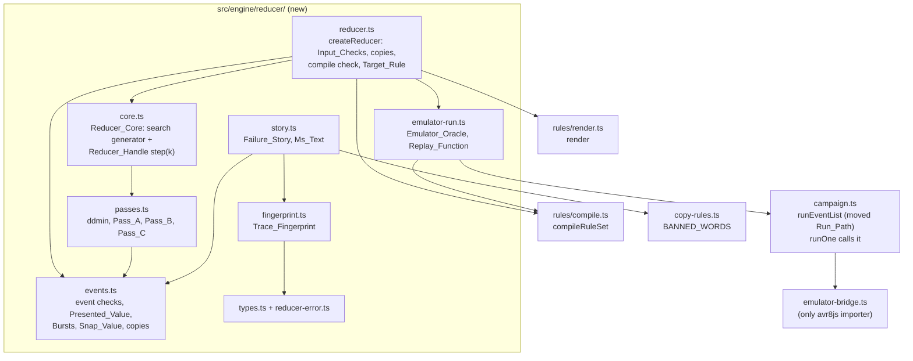

# Design Document: trace-reducer

## Overview

The Trace_Reducer takes a BROKE trace and looks for a smaller event list that still breaks the same Rule. It has five parts, all new files under `src/engine/reducer/`:

1. The Reducer_Core: a pure search over event lists that talks only to an Oracle. It is written as a generator that yields one Candidate per Oracle call, driven by a Reducer_Handle with `step(k)`.
2. The Emulator_Oracle and the Replay_Function: they run an event list on a fresh EmulatorBridge through the existing Run_Path of `src/engine/campaign.ts`, with a Checker built by `compileRuleSet`.
3. `createReducer`: the Input_Checks, the private copies, the Target_Rule lookup, and the wiring of the Reducer_Core to the Emulator_Oracle.
4. The Failure_Story function: 2 to 4 plain sentences built from fixed templates.
5. The Trace_Fingerprint function: FNV-1a 64-bit over the Output_Edges, returned as 16 hex characters.

The only change to existing code is a behavior-preserving extraction in `src/engine/campaign.ts`: the step loop of `runOne` moves into a new exported function `runEventList(cfg, events, runIndex)`, and `runOne` calls it after `buildEventList`.

Users see the reduced list only as "the smallest replay this reducer found". Time is integer CPU cycles everywhere. No engine file reads a clock or draws a random value. Test results in this spec are evidence, not proof.

### Facts quoted from the source

The requirements list facts F1 to F10. The two pieces of code this design reuses are quoted here exactly, with file and line numbers as they are at the start of this spec.

**`runOne` and its step loop, `src/engine/campaign.ts` lines 155 to 265 (fact F1):**

```ts
155: /** Runs one Run on a fresh bridge. Returns plain data, or an error that stops the Campaign. */
156: export function runOne(cfg: RunConfig, runIndex: number): RunResult | EngineError {
157:   const gen = buildEventList({
158:     fixture: cfg.fixture,
159:     gremlinSet: cfg.gremlinSet,
160:     runCycles: cfg.runCycles,
161:     campaignSeed: cfg.campaignSeed,
162:     runIndex,
163:   });
164:   if (isEngineError(gen)) return gen;
165: 
166:   const factory = cfg.bridgeFactory ?? defaultBridgeFactory;
167:   const made = factory(cfg.hex, cfg.fixture, gen.events.slice());
168:   if (isBridgeError(made)) {
169:     return { kind: "bridge-error", runIndex, error: made, message: made.message };
170:   }
171:   const bridge = made;
172: 
173:   const appliedInputs: AppliedInput[] = [];
174:   const outputEvents: OutputEvent[] = [];
175:   const diagnostics: Diagnostic[] = [];
176:   const cannotCheck: CannotCheck[] = [];
177:   const seen = new Set<string>();
178:   let violation: Violation | null = null;
179:   let prevTarget = 0;
180:   let appliedCount = 0;
181:   let stepIndex = 0;
182: 
183:   const collect = (list: CannotCheck[]): void => {
184:     for (const c of list) {
185:       const key = JSON.stringify([c.rule, c.reason]);
186:       if (seen.has(key)) continue;
187:       seen.add(key);
188:       cannotCheck.push(c);
189:     }
190:   };
191: 
192:   while (bridge.cycleCount < cfg.runCycles) {
193:     const before = bridge.cycleCount;
194:     const pending: number[] = [];
195:     for (let i = appliedCount; i < gen.events.length; i++) pending.push(gen.events[i].cycle);
196:     const planInput = {
197:       prevTarget,
198:       cycleCount: before,
199:       pendingCycles: pending,
200:       runCycles: cfg.runCycles,
201:       maxStepCycles: cfg.maxStepCycles,
202:     };
203:     const planErr = checkPlanInput(planInput);
204:     if (planErr) return internal(planErr.message);
205:     const target = planTarget(planInput);
206:     const r = bridge.advance(target - before);
207:     if (isBridgeError(r)) {
208:       return { kind: "bridge-error", runIndex, error: r, message: r.message };
209:     }
210:     if (bridge.cycleCount <= before) {
211:       return internal(`bridge did not advance at cycle ${before}`);
212:     }
213:     prevTarget = target;
214:     const merged = mergeApplied(gen.events, appliedCount, r);
215:     if (isEngineError(merged)) return merged;
216:     appliedCount += merged.length;
217:     appliedInputs.push(...merged);
218:     outputEvents.push(...r.outputEvents);
219:     diagnostics.push(...r.diagnostics);
220: 
221:     const res = callChecker(cfg.checker, {
222:       runIndex,
223:       stepIndex: stepIndex++,
224:       endOfRun: false,
225:       cycle: bridge.cycleCount,
226:       outputEvents: Object.freeze(r.outputEvents.slice()),
227:       appliedInputs: Object.freeze(merged.slice()),
228:       diagnostics: Object.freeze(r.diagnostics.slice()),
229:     });
230:     if (!res.ok) return res.error;
231:     collect(res.cannotCheck);
232:     if (res.violation) {
233:       violation = res.violation;
234:       break;
235:     }
236:   }
237: 
238:   if (violation === null) {
239:     const res = callChecker(cfg.checker, {
240:       runIndex,
241:       stepIndex: stepIndex++,
242:       endOfRun: true,
243:       cycle: bridge.cycleCount,
244:       outputEvents: Object.freeze([]),
245:       appliedInputs: Object.freeze([]),
246:       diagnostics: Object.freeze([]),
247:     });
248:     if (!res.ok) return res.error;
249:     collect(res.cannotCheck);
250:     violation = res.violation;
251:   }
252: 
253:   return {
254:     runIndex,
255:     runSeed: gen.runSeed,
256:     eventList: gen.events.map((e) => ({ ...e })),
257:     skipped: gen.skipped.map((s) => ({ ...s })),
258:     appliedInputs,
259:     outputEvents,
260:     diagnostics,
261:     cannotCheck,
262:     violation,
263:     endCycle: bridge.cycleCount,
264:   };
265: }
```

`callChecker` is module-private (`src/engine/campaign.ts` line 109, `function callChecker(checker: Checker, obs: CheckerObservation): CheckResult {`). It validates the Checker outcome (lines 110 to 152) and turns a throw or a malformed outcome into a `checker-error`. `RunConfig` is at lines 39 to 49 and holds `hex`, `fixture`, `gremlinSet`, `campaignSeed`, `checker`, `runCycles`, `maxStepCycles` and an optional `bridgeFactory`.

**`compileRuleSet`, `src/engine/rules/compile.ts` lines 15 to 26 and 48 to 55 (fact F2):**

```ts
15: export interface CompiledRuleSet {
16:   checker: Checker;
17:   checkerSignals: string[];
18:   findUntriggeredRules: (runs: readonly RunResult[]) => string[];
19: }
20: 
21: export type CompileResult = { ok: true; compiled: CompiledRuleSet } | { ok: false; reasons: string[] };
22: 
23: const RULE_SET_PREFIX = "Rule set: ";
24: 
25: /** Req 6.1, 6.9, 6.11, 13.7. Never throws. */
26: export function compileRuleSet(ruleSet: unknown, fixture: Fixture): CompileResult {
...
48:     // Private copies, so later changes by the caller cannot alter the compiled checker.
49:     const ruleSetCopy = structuredClone(ruleSet as RuleSet);
50:     const fixtureCopy = structuredClone(fixture);
51:     const plan = analyzeRuleSet(ruleSetCopy, fixtureCopy);
52:     const checker = makeRuleChecker(plan);
53:     const findUntriggeredRules = (runs: readonly RunResult[]): string[] =>
54:       untriggeredRules(ruleSetCopy, fixtureCopy, runs);
55:     return { ok: true, compiled: { checker, checkerSignals: plan.checkerSignals.slice(), findUntriggeredRules } };
```

Lines 32 to 35 reject repeated Canonical_Sentences (`findRepeatedSentences`), so one Canonical_Sentence names at most one Rule index. The Rule_Checker sets `rule` to the Canonical_Sentence (`src/engine/rules/rule-checker.ts` line 194, `const violation = chosen === null ? null : { rule: chosen.plan.sentence, cycle: chosen.found as number };`). The Rule_Checker made by `makeRuleChecker` keeps Run state in its closure, so the Emulator_Oracle compiles a new Checker for every Candidate (Requirement 3.1).

### Measured sizes of the Example_Traces

A Temporary_Script (`scripts/tmp-trace-sizes.ts`, deleted right after) ran `runExampleCampaign` on each buggy build with the committed `meta.json` values on the machine of `SPIKE.md`. These numbers are only for the cost estimates in the Testing Strategy. They are not acceptance values.

| Example | BROKE Run_Index | Events in `trace.eventList` | Gremlin_Events | Rest_Events | Violation cycle | Campaign wall time |
|---|---|---|---|---|---|---|
| crosswalk | 3 | 8 | 8 (`masher`) | 0 | 15,647,543 | 0.96 s |
| garage | 7 | 7 | 7 (`bouncer`, `masher`) | 0 | 5,768,101 | 1.04 s |
| heartbeat | 1 | 2 | 2 (`stuck`) | 0 | 12,811,661 | 0.35 s |

None of the three Fixtures has an analog pin, so Pass_C never makes an Oracle call on the Examples. Pass_C is exercised by the Pure_Properties.

## Architecture



Import rules that the design keeps:

- `core.ts`, `passes.ts`, `events.ts`, `story.ts`, `fingerprint.ts`, `types.ts` and `reducer-error.ts` have no runtime import of `emulator-bridge.ts`, `campaign.ts`, `emulator-run.ts` or `reducer.ts`. The Reducer_Core (`core.ts` and everything it imports at runtime) therefore never reaches avr8js (Requirement 2.2).
- `events.ts` imports nothing at runtime. `core.ts` imports `passes.ts`, `events.ts` and `reducer-error.ts`. `story.ts` imports `events.ts`, `fingerprint.ts` (for the edge checks), `reducer-error.ts` and `../copy-rules`. `fingerprint.ts` imports `reducer-error.ts` only.
- `emulator-run.ts` imports `../campaign` (for `runEventList`), `../rules/compile`, `../rules/render`, `../emulator-bridge` only as `import type`, `events.ts` and `reducer-error.ts`.
- No file under `src/engine/reducer/` has a runtime import of `../prng`, `../run-seed` or `../event-list` (Requirement 12.6). `campaign.ts` imports `event-list.ts` at runtime, and choice 50 of the requirements allows that transitive import.
- Every import in `src/engine/reducer/` is a relative path to a module under `src/engine/` outside `__tests__` (Requirement 12.4). No file names `avr8js` (Requirement 12.5).

### Flow of one reduction

```mermaid
sequenceDiagram
  participant W as Caller (test, later the Worker)
  participant H as Reducer_Handle
  participant G as search generator
  participant O as Oracle
  W->>H: createReducer(input, options)
  Note over H: Input_Checks, copies, compile, Target_Rule.<br/>No Oracle call.
  W->>H: step(k)
  H->>G: next()  (computes the Confirmation_Run Candidate)
  G-->>H: Probe {part: "confirm", entries}
  loop until k calls, or the end
    H->>O: oracle(deep copy of Candidate)
    O-->>H: Oracle_Outcome
    Note over H: normalize; Candidates_Tried += 1;<br/>apply to Best_List; progress callback
    H->>G: next(accepted)
    G-->>H: next Probe, or done
    Note over H: done -> Round with no Accepted_Change, stoppedAtBudget false.<br/>Probe and Candidates_Tried = Budget -> stoppedAtBudget true.
  end
  H-->>W: Step_Report
```

## Components and Interfaces

### 1. Run_Path extraction in `src/engine/campaign.ts`

This is the only edit to a committed file under `src/engine/` (Requirement 19.2). It adds two types and one function and shortens `runOne`. `callChecker`, `mergeApplied`, `RunConfig`, `RunResult`, the Campaign handle and every other line stay as they are.

**After:**

```ts
/** The RunConfig fields the Run_Path reads. A RunConfig is a RunPathConfig. */
export type RunPathConfig = Pick<
  RunConfig,
  "hex" | "fixture" | "checker" | "runCycles" | "maxStepCycles" | "bridgeFactory"
>;

/** The Run_Path part of a RunResult. */
export interface RunPathResult {
  appliedInputs: AppliedInput[];
  outputEvents: OutputEvent[];
  diagnostics: Diagnostic[];
  cannotCheck: CannotCheck[];
  violation: Violation | null;
  endCycle: number;
}

/**
 * The Run_Path: one ordered event list on a fresh bridge, stopping at the earliest
 * Violation, with one end-of-run Checker call when none was found. runOne calls this
 * after buildEventList; the Trace_Reducer calls it with a Candidate.
 */
export function runEventList(
  cfg: RunPathConfig,
  events: readonly GeneratedEvent[],
  runIndex: number,
): RunPathResult | EngineError {
  const factory = cfg.bridgeFactory ?? defaultBridgeFactory;
  const made = factory(cfg.hex, cfg.fixture, events.slice());
  // ... old lines 168 to 251, unchanged except that `gen.events` is written `events`
  //     (old lines 195 and 214) ...
  return { appliedInputs, outputEvents, diagnostics, cannotCheck, violation, endCycle: bridge.cycleCount };
}

/** Runs one Run on a fresh bridge. Returns plain data, or an error that stops the Campaign. */
export function runOne(cfg: RunConfig, runIndex: number): RunResult | EngineError {
  const gen = buildEventList({
    fixture: cfg.fixture,
    gremlinSet: cfg.gremlinSet,
    runCycles: cfg.runCycles,
    campaignSeed: cfg.campaignSeed,
    runIndex,
  });
  if (isEngineError(gen)) return gen;

  const path = runEventList(cfg, gen.events, runIndex);
  if (isEngineError(path)) return path;

  return {
    runIndex,
    runSeed: gen.runSeed,
    eventList: gen.events.map((e) => ({ ...e })),
    skipped: gen.skipped.map((s) => ({ ...s })),
    appliedInputs: path.appliedInputs,
    outputEvents: path.outputEvents,
    diagnostics: path.diagnostics,
    cannotCheck: path.cannotCheck,
    violation: path.violation,
    endCycle: path.endCycle,
  };
}
```

**Why every Run_Result and every error stays deep-equal (Requirement 3.5):**

1. Same events. `runOne` passes `gen.events` itself, so inside `runEventList` the name `events` refers to the same array that old lines 167, 195 and 214 read. `events.slice()` gives the bridge the same shallow copy as `gen.events.slice()` did.
2. Same order of effects. In both versions the order is `buildEventList`, the bridge factory, the step loop, the end-of-run call, then the copies of `eventList` and `skipped`. The old copies happened in the return literal after the loop; the new copies happen in `runOne` after `runEventList` returns, which is the same point relative to every bridge and Checker call. If the bridge changed a shared event object, the copy sees the same change in both versions.
3. Same errors. Every `return` inside old lines 166 to 251 returns one of `bridge-error`, `internal-error` (from `internal` or `mergeApplied`) or `checker-error` (from `callChecker`). All three kinds are in `ENGINE_ERROR_KINDS` (`src/engine/errors.ts`) with a string `message`, so `isEngineError(path)` is true and `runOne` returns the same object. A `RunPathResult` has no `kind` field, so `isEngineError` is false for it.
4. Same result. `runOne` builds the literal with the same keys in the same order (`runIndex`, `runSeed`, `eventList`, `skipped`, `appliedInputs`, `outputEvents`, `diagnostics`, `cannotCheck`, `violation`, `endCycle`), and the four arrays are the same arrays the loop filled, not copies. `endCycle` is the `bridge.cycleCount` read at the same point (after the end-of-run call or the break).
5. Same `runIndex` reaches every Checker observation and every error, because `runOne` passes its own `runIndex`.
6. No new clock, random source or I/O.

The evidence for this argument is: every committed test (including `campaign.*.test.ts`, `gremlin-baseline.test.ts`, `bridge-output-scan-preservation.test.ts` and `tests/examples/*`) passes unchanged, and the new property test of Property 16 compares `runOne` with a verbatim copy of the old `runOne` kept only in a test file.

### 2. `src/engine/reducer/types.ts`

Types only. Full definitions are in Data Models.

### 3. `src/engine/reducer/reducer-error.ts`

```ts
export function isReducerError(x: unknown): x is ReducerError;
export function invalidInput(message: string, extra?: { field?: string; index?: number; reasons?: string[] }): ReducerError;
```

`isReducerError` is true for an object whose `kind` is one of the five Reducer_Error kinds and whose `message` is a string. A Step_Report has no `kind` field, so callers tell the two apart with `isReducerError`.

### 4. `src/engine/reducer/events.ts` (pure, no runtime imports)

```ts
export const REST_ID = "rest";
export const UNLIMITED_BUDGET = 9007199254740991; // 2^53 - 1
export const DEFAULT_BUDGET = 300;
export const DEFAULT_MAX_STEP_CYCLES = 160_000;   // same value as campaign.ts; not imported, see choice D9
export const MAX_RUN_CYCLES = 4294967296;          // 2^32, same value as campaign.ts

export function isRest(e: ReducerEvent): boolean;          // gremlinId === "rest"
export function gremlinCount(list: readonly ReducerEvent[]): number;
export function copyEvent(e: ReducerEvent): ReducerEvent;  // { ...e }; every field is a primitive
export function copyList(list: readonly ReducerEvent[]): ReducerEvent[];

/** Requirement 1.5 / 3.11 / 13.19 checks. Returns null or the lowest failing index with a field name. */
export function checkEventList(
  list: readonly unknown[],
  fixture: Fixture,
  opts: { runCycles: number | null },   // null: no upper bound on cycle (Reducer_Core, Failure_Story)
): { index: number; field: string; message: string } | null;

/** Presented_Value before each index, per signal (Requirement 6.1). */
export function presentedValues(list: readonly ReducerEvent[], fixture: Fixture): (InputValue | number)[];
/** Indexes of No_Change_Events (Requirement 6.4). */
export function noChangeIndexes(list: readonly ReducerEvent[], fixture: Fixture): number[];
/** Bursts in order of their earliest index; each Burst is a list of indexes (Requirement 7.1). */
export function findBursts(list: readonly ReducerEvent[]): number[][];
/** Nearest of 0, 512, 1023; 256 gives 512 (Requirement 8.4). */
export function snapValue(x: number): 0 | 512 | 1023;
export function isSnapEligible(e: ReducerEvent): boolean;  // analog Gremlin_Event, analog not 0/512/1023
```

`checkEventList` checks, for each index j in order and stopping at the lowest failing j: the element is an object (a hole of a sparse array, `null` and a throwing read count as "not an object"); its own keys are a subset of `cycle`, `signal`, `gremlinId`, `value`, `analog` (choice D6); `cycle` is an integer from 0 (to `runCycles − 1` when `runCycles` is given); `cycle` is not lower than the cycle at j − 1; `gremlinId` is a string; `signal` is a string that names a pin of the Fixture that is an input (a digital pin with `direction: "input"`, or an analog pin); exactly one of the own properties `value` and `analog` is present; a digital event has `value` `0`, `1` or `"release"` and a digital pin; an analog event has an integer `analog` from 0 to 1023 and an analog pin. The field names in the returned message are `cycle`, `gremlinId`, `signal`, `value`, `analog` or `event`.

`snapValue(x)`: `x <= 255 → 0`, `256 <= x <= 767 → 512`, `x >= 768 → 1023`. (0 is nearer than 512 for x up to 255; 256 is a tie and goes to 512; 767 is nearer to 512 by 1 than to 1023 by 256; 768 is nearer to 1023 by 255 than to 512 by 256.)

### 5. `src/engine/reducer/core.ts`: the Reducer_Core

```ts
export interface CoreInput {
  originalList: readonly ReducerEvent[];
  fixture: Fixture;
  sentence: string;          // the Target_Rule's Canonical_Sentence
  budget: number;            // 1 .. 2^53 - 1
  oracle: Oracle;
}
export interface CoreOptions {
  onProgress?: (report: ProgressReport) => void;
}
export function createReducerCore(input: CoreInput, options?: CoreOptions): ReducerHandle | ReducerError;
```

`createReducerCore` never throws. It checks, in this order: the Oracle is a function; `sentence` is a non-empty string; `budget` is an integer from 1 to 2^53 − 1; the Fixture is an object with a `pins` array; `originalList` is an array; `checkEventList(originalList, fixture, { runCycles: null })` (Requirements 2.8 and 6.6); `options.onProgress` is a function or absent. Any failure gives `invalid-input` naming the field or the event index, and no Oracle call. Then it takes private copies (`copyList`, `structuredClone(fixture)` inside a `try`).

#### Why a generator

The search is nested loops (Rounds, ddmin granularity, the passes, the candidates of each pass). `step(k)` must stop after exactly k Oracle calls and resume later at the same point. Two ways to do that:

| | Explicit state machine | Generator (`function*`) |
|---|---|---|
| Stop after exactly k calls | Yes, by hand-encoding every loop position (ddmin `n`, chunk index, phase, pass, burst, `m`) as state fields | Yes: every Oracle call is one `yield`, so the driver resumes exactly once per call |
| Code shape | Loops turned inside out into a switch over positions | Straight-line loops as in the algorithm text |
| Risk | Position bugs that only show under some slice sizes | The driver is the only place that counts and stops |
| Determinism | Deterministic | Deterministic: synchronous, no scheduler, no Promise |
| Serializable state | Possible | Not needed: the handle lives in one process (the later Worker keeps it in memory) |

The design picks the generator. It is the simpler of the two for the same behavior, and slicing invariance (Requirement 10.4) follows from one fact: the generator's sequence of yielded Candidates depends only on the answers it receives, not on how the driver groups the `next` calls. TypeScript targets ES2020, so generators need no transform.

#### Internal state

```ts
interface Entry { src: number; ev: ReducerEvent }   // src = index in the Original_List
interface CoreState {
  readonly original: readonly Entry[];
  readonly fixture: Fixture;
  best: Entry[];                // the Best_List
  bestViolation: Violation | null;
  tried: number;                // Candidates_Tried
}
interface Probe { part: CandidatePart; entries: Entry[] }
```

`src` is the Source_Event identity. It lives only in `Entry`, never in a Candidate, so a Candidate event has exactly the properties of its Source_Event (Requirement 4.3). Rest_Events are never removed, so their `src` values survive in every list.

#### The search generator

```ts
function* search(st: CoreState): Generator<Probe, void, boolean> {
  yield { part: "confirm", entries: st.best };           // Confirmation_Run (Requirement 5.1)
  // The driver stops before resuming when the Confirmation_Run is not a Same_Rule_Break.
  for (;;) {                                              // Rounds (Requirement 5.3)
    let changed = false;
    if (yield* ddmin(st)) changed = true;
    if (yield* passA(st)) changed = true;
    if (yield* passB(st)) changed = true;
    if (yield* passC(st)) changed = true;
    if (!changed) return;                                 // Requirement 5.4
  }
}
```

Each part returns `true` when it had at least one Accepted_Change. All four parts run in every Round (no short-circuit). The value sent back into each `yield` is `accepted: boolean`; the driver has already made the Candidate the Best_List when it is `true`, so the parts read `st.best` after every `yield`.

Termination: an Accepted_Change either lowers the Gremlin_Event count (ddmin, Pass_A, Pass_B) or lowers the count of Snap_Eligible_Events with the Gremlin_Event count unchanged (Pass_C). Both counts are finite and never rise, so the number of Rounds is finite.

#### ddmin over the Gremlin_Events

`G` is the list of Best_List positions of Gremlin_Events, in list order, recomputed after each Accepted_Change. `L = |G|`. Chunks split `G` into `n` contiguous parts in list order; part i has `floor(L / n) + (i < L mod n ? 1 : 0)` items. "Keep chunk i" removes every Gremlin_Event outside chunk i; "remove chunk i" removes the Gremlin_Events of chunk i. Rest_Events always stay.

```
ddmin(st):
  changed = false
  n = 2
  loop:
    L = gremlin count of st.best
    if L == 0: return changed                          # Requirement 5.8, no call
    if n > L: n = L
    if n == 1:                                         # L == 1
      test "remove chunk 0" (the empty Gremlin_Event list)   # Requirement 5.8
      if accepted: changed = true; continue loop       # L becomes 0, loop returns
      return changed
    for i in 0 .. n-1:                                 # reduce to subset
      test "keep chunk i"
      if accepted: changed = true; n = 2; continue loop
    if n >= 3:
      for i in 0 .. n-1:                               # reduce to complement
        test "remove chunk i"
        if accepted: changed = true; n = max(n - 1, 2); continue loop
    if n < L: n = min(2 * n, L); continue loop
    return changed                                     # n == L, nothing accepted
```

At `n == 2` the complements equal the subsets, so they are not tested twice. When the loop returns with `n == L`, it has tested on the final Best_List every Candidate that removes exactly one Gremlin_Event (for `L >= 3`, the complements of single chunks; for `L == 2`, the two subsets; for `L == 1`, the empty list), and none was accepted. That is Requirement 5.12, and with the final Round having no Accepted_Change it gives 1-minimality (Requirement 5.9). Every ddmin Candidate removes at least one Gremlin_Event, so none equals the Best_List (Requirement 5.13).

#### Pass_A: No_Change_Events

```
passA(st):
  nce = noChangeIndexes(st.best) mapped to src ids     # computed once (choice 27 of the requirements)
  if nce is empty: return false                        # Requirement 6.3, no call
  test: Best_List minus every event in nce             # Requirement 6.2
  if accepted: return true
  if |nce| < 2: return false                           # choice 26: the single one is not retried
  changed = false
  for id in nce in increasing list index:              # Requirement 6.5
    test: current Best_List minus the event with src id
    if accepted: changed = true
  return changed
```

Removing a No_Change_Event leaves every later Presented_Value unchanged, because the removed value equals the value already presented. So the events found at the start stay No_Change_Events while Pass_A runs.

#### Pass_B: Bursts

```
passB(st):
  start = findBursts(st.best)                          # Pass_B_Start_List; ordered by earliest index
  if start is empty: return false                      # Requirement 7.3, no call
  changed = false
  for each burst b in start:
    lastId = src of the last event of b                # the last event is never removed
    m = 1
    loop:
      cur = the Burst of findBursts(st.best) whose last event has src lastId   # Requirement 7.1
      if cur is missing or m >= |cur|: break
      test: current Best_List minus the |cur| - m earliest events of cur      # Requirement 7.2
      if accepted: changed = true; break
      m = 2 * m
  return changed
```

For a Burst of n events the Candidates keep its last 1, 2, 4, … events, while that count is below n, until one is accepted. Each Candidate removes from 1 to n − 1 events of exactly one Burst and keeps its last event. Every Burst of the start list gets at least the "keep last 1" Candidate, which gives Requirement 7.4 when the pass is not cut by the Budget. Removing earlier events of one Burst never joins two Bursts, because the events that split Bursts belong to other `gremlinId` values and are not removed.

#### Pass_C: analog snapping

```
passC(st):
  ids = src of every Snap_Eligible_Event of st.best, in list order
  if ids is empty: return false                        # Requirement 8.3, no call
  test: Best_List with every event of ids at its Snap_Value     # covers Requirement 8.5
  if accepted: return true
  if |ids| < 2: return false
  changed = false
  for id in ids:
    test: current Best_List with only the event src id at its Snap_Value
    if accepted: changed = true
  return changed
```

A snapped value is 0, 512 or 1023, so a Snapped_Event of an accepted Candidate is never eligible again and keeps its Snap_Value until a later removal (Requirement 8.6). Every Pass_C Candidate changes at least one value, so it differs from the Best_List.

#### Candidate building

```ts
function removeIds(best: Entry[], ids: ReadonlySet<number>): Entry[];   // drops Gremlin_Events only
function snapIds(best: Entry[], ids: ReadonlySet<number>): Entry[];     // { ...ev, analog: snapValue(ev.analog) }
```

Both keep list order and copy each kept event with `copyEvent`. Neither can touch a Rest_Event: `removeIds` and `snapIds` are only called with ids of Gremlin_Events, and `removeIds` also skips Rest_Events as a second check.

#### The driver: `step(k)`

```ts
export interface ReducerHandle {
  step(k: number): StepReport | ReducerError;
}
```

```
create:
  gen = search(st); pending = null; final = null (a StepReport once ended)

step(k):
  if final != null: return deep copy of final          # Requirements 10.8, 10.10, 11.8
  if k is not an integer from 1 to 2^53 - 1:
    return invalid-input naming k                      # Requirement 10.7, state unchanged
  calls = 0
  loop:
    if pending == null: pending = gen.next(lastAnswer) # computes the next Probe, no Oracle call
    if pending.done: end with Reducer_Result, stoppedAtBudget false     # Requirement 5.4 / 9.5
    if st.tried == budget: end with Reducer_Result, stoppedAtBudget true # Requirement 9.4
    if calls == k: return Step_Report (ended false)
    candidate = toEvents(pending.value.entries)        # fresh deep copy (Requirement 2.6)
    st.tried += 1; calls += 1                          # Requirement 9.2
    try: raw = oracle(candidate)
    catch thrown: end with oracle-error ("threw", cause from thrown)    # Requirement 2.5
    out = normalize(raw)
    if out is malformed: end with oracle-error ("malformed")
    accepted = out.kind == "breaks" && out.violation.rule === sentence  # Requirement 2.3
    if accepted: st.best = pending.value.entries (owned copy); st.bestViolation = copy of out.violation
    if onProgress: try onProgress(report) catch: end with callback-error  # Requirements 10.5, 10.9
    if part == "confirm" && !accepted: end with original-does-not-break  # Requirement 5.2
    lastAnswer = accepted; pending = null
```

"End with X" stores `final = { ended: true, candidatesTried, bestGremlinCount, result | error }`, sets `gen` to a finished state, and returns a deep copy of `final`. The `pending` Probe is computed right after each Oracle call (`pending == null` at the top of the loop), so a reduction that has no further Candidate ends in the same `step` call as its last Oracle call. That makes the Step_Report's `ended` flag true exactly when the reduction has ended (Requirement 10.3), and a `step(k)` call makes fewer than k calls only when it ends (Requirement 10.2).

Budget semantics follow from the loop order. After the call that makes `tried == budget`, the next loop pass computes the next Probe. If the generator is done, the Round had no Accepted_Change and the result has `stoppedAtBudget: false` (Requirement 9.5). If a Probe exists, it is the Pending_Candidate, the Oracle is not called on it, and the result has `stoppedAtBudget: true`, `candidatesTried == budget` (Requirement 9.4). An error on that last call wins, because errors end the loop before the next Probe is computed (Requirement 9.7). The budget counter lives in `st` and is shared by every `step` call (Requirement 9.8).

`normalize(raw)` returns the Oracle_Outcome or "malformed". Malformed (the glossary's Malformed_Outcome): not a non-null object; has a `then` property that is a function (checked before anything else, so a Promise is malformed); `kind` is neither `"does-not"` nor `"breaks"`; or `kind` is `"breaks"` and `violation` is not an object with a string `rule` and a `cycle` that is an integer from 0 to 2^53 − 1. A read that throws while normalizing counts as malformed (choice D4). Extra properties are ignored.

The Progress_Report for a call holds `candidatesTried` (counting that call), `bestGremlinCount`, `bestList` (a fresh deep copy), `part` and `accepted`. It is built after the Best_List update and before the next Oracle call. No progress call is made for a call that ends in `oracle-error` (Requirement 10.6). The Confirmation_Run gets a progress call even when it leads to `original-does-not-break` (choice 40 of the requirements); if that callback throws, the error is `callback-error`.

### 6. `src/engine/reducer/emulator-run.ts`: Emulator_Oracle and Replay_Function

```ts
export interface EmulatorOracleContext {
  hex: string;
  fixture: Fixture;            // private copy
  ruleSet: RuleSet;            // private copy, already accepted by compileRuleSet
  target: TargetRule;          // { index, sentence }
  runCycles: number;
  maxStepCycles: number;
  bridgeFactory?: BridgeFactory;   // test seam; default EmulatorBridge.create
}
export function makeEmulatorOracle(ctx: EmulatorOracleContext): Oracle;

export interface ReplayInput {
  hex: string; fixture: Fixture; ruleSet: unknown;
  events: readonly ReducerEvent[]; runCycles: number; maxStepCycles: number;
  bridgeFactory?: BridgeFactory;   // test seam
}
export interface ReplayResult { violation: Violation | null; outputEdges: OutputEvent[] }
export function replayEventList(input: unknown): ReplayResult | ReducerError;
```

`makeEmulatorOracle` computes once, at creation, `targetMatches = render(ruleSet[target.index])` is `ok` with `sentence === target.sentence`. For each Candidate the Oracle:

1. calls `compileRuleSet(ctx.ruleSet, ctx.fixture)` and takes `compiled.checker`, a new Checker with no Run state (Requirement 3.1);
2. calls `runEventList({ hex, fixture, checker, runCycles, maxStepCycles, bridgeFactory }, copyList(candidate), 0)`, which creates one new EmulatorBridge (Requirements 3.3, 3.4; Run_Index 0 per choice 54);
3. on an `EngineError` (kinds `bridge-error`, `internal-error`, `checker-error`) throws the plain object `{ kind, message }`, which the Reducer_Core turns into `oracle-error` with that `cause` (Requirement 3.9);
4. returns `{ kind: "breaks", violation: { rule, cycle } }` when the Run's Violation has `rule === target.sentence` and `targetMatches` is true (Requirement 3.7), and `{ kind: "does-not" }` otherwise (Requirement 3.8). A compile failure here cannot happen after the compile check of `createReducer`; if it did, the Oracle throws `{ kind: "compile-error", message }`.

The Run_Path stops after the Step with the Violation and makes no end-of-run call then (Requirement 3.6). The Oracle holds no state between calls; its output is a function of the Candidate (Requirements 3.13, 12.8).

`replayEventList` never throws (an outer `try` turns any throw into `replay-error` with cause kind `internal-error`). It checks, in order: the input is an object; `hex` is a string; `fixture` is an object with a `pins` array; `runCycles` is an integer from 1 to 2^32; `maxStepCycles` is an integer of at least 1; `compileRuleSet(ruleSet, fixture)` is `ok` (else `invalid-input` with `reasons`); `events` is an array that passes `checkEventList(events, fixture, { runCycles })`. Any failure gives `invalid-input` naming the field or event index, with no bridge created (Requirement 3.11). Then it runs `runEventList` once on a copy of the list. A Run_Path error gives `replay-error` holding `{ kind, message }` and no edges (Requirement 3.12). Otherwise it returns `{ violation: copy or null, outputEdges: copies of path.outputEvents }`, which are every edge the bridge reported, from the cycle-0 snapshot through the last Step, including edges of that Step after the Violation cycle (Requirement 3.10).

### 7. `src/engine/reducer/reducer.ts`: `createReducer`

```ts
export interface ReductionInput {
  hex: string;
  fixture: Fixture;
  ruleSet: RuleSet;
  originalList: ReducerEvent[];
  violation: Violation;          // the target Violation
  runCycles: number;
  maxStepCycles?: number;        // default 160,000
  budget?: number;               // default 300
}
export interface ReducerOptions {
  onProgress?: (report: ProgressReport) => void;
  bridgeFactory?: BridgeFactory; // test seam only
}
export function createReducer(input: unknown, options?: ReducerOptions): ReducerHandle | ReducerError;
```

`createReducer` never throws (an outer `try` gives `invalid-input` with field `input` if anything unexpected throws). The Input_Checks run in the order of Requirement 1.9. Each field is read once, inside a `try`; a throwing read gives `invalid-input` naming that field.

1. `input` is a non-null object, not an array.
2. `hex` is a string.
3. `fixture` is a non-null object with an array `pins`; it is copied with `structuredClone` (a throw gives `invalid-input`, field `fixture`).
4. `ruleSet`: the read succeeds and `structuredClone` succeeds (field `ruleSet`). Its content is checked by step 9.
5. `originalList` is an array.
6. `violation` is a non-null object with a string `rule` and an integer `cycle >= 0`.
7. `runCycles` is an integer from 1 to 2^32.
8. `maxStepCycles` is `undefined` (default 160,000) or an integer from 1 to 2^53 − 1. `budget` is `undefined` (default 300) or an integer from 1 to 2^53 − 1. `null` is checked, not defaulted (Requirement 1.8).
9. Compile check: `compileRuleSet(ruleSetCopy, fixtureCopy)`; `ok: false` gives `invalid-input` with `reasons` copied in order (Requirement 3.2).
10. Event checks: `checkEventList(originalList, fixtureCopy, { runCycles })` (Requirement 1.5); then `copyList`.
11. Target_Rule: the one index i with `render(ruleSetCopy[i])` ok and `sentence === violation.rule` (Requirement 1.2); none gives `invalid-input` "the Violation names no Rule of the Rule_Set" (Requirement 1.3).
12. Options: `options` is `undefined` or an object; `onProgress` is a function or absent; `bridgeFactory` is a function or absent (choice D10).

A second export, `createEmulatorOracle(input: unknown, options?: { bridgeFactory?: BridgeFactory }): Oracle | ReducerError`, runs checks 1 to 11 and returns the Emulator_Oracle for that Reduction_Input. The acceptance test uses it for the 1-minimality check of Requirement 16.5, so that check uses an Emulator_Oracle "built from the same Reduction_Input" and not a second hand-made one.

Then `createReducer` builds `makeEmulatorOracle` with the copies and returns `createReducerCore({ originalList, fixture, sentence, budget, oracle }, { onProgress })`. No Oracle call happens before the earliest `step` (Requirements 1.10, 10.1). The core's own checks repeat a subset of these and always pass here.

### 8. `src/engine/reducer/story.ts`: Failure_Story

```ts
export interface StoryInput {
  reducedList: readonly ReducerEvent[];
  fixture: Fixture;
  violation: Violation;
  outputEdges: readonly OutputEvent[];
  violationSpan?: { lengthCycles: number; cut: boolean };
}
export function failureStory(input: unknown): string | ReducerError;
export function msText(cycles: number): string;   // precondition: integer 0 .. 2^53 - 1
```

`msText(c)`: `t = (BigInt(c) + 800n) / 1600n` (BigInt division truncates, which is floor for non-negative values), text `${t / 10n}.${t % 10n} ms`. Examples: 0 → `0.0 ms`, 799 → `0.0 ms`, 800 → `0.1 ms`, 24,000 → `1.5 ms`, 15,647,543 → `978.0 ms`. BigInt is used only inside the function; the return value is a string.

**Fixed wording.** In the templates, `{t}` is an Ms_Text, `{S}` a signal name, `{g}` a `gremlinId`, `{n}` an integer in base 10 with no separators, `{rule}` the Violation's `rule` text.

| Piece | Template | Story_Words outside names and `{rule}` |
|---|---|---|
| Opening lead | `In the smallest replay this reducer found, ` | 7 |
| No-event opening (whole sentence) | `In the smallest replay this reducer found, no gremlin event was needed.` | 12 |
| Event phrase, press value | `{g} pressed {S} at {t}` | 6 counting `{g}` and `{S}` as one word each |
| Event phrase, `"release"` | `{g} released {S} at {t}` | 6 counting `{g}` and `{S}` as one word each |
| Event phrase, the other digital value | `{g} drove {S} to {n} at {t}` | 8 counting `{g}` and `{S}` as one word each |
| Event phrase, analog | `{g} set {S} to {n} at {t}` | 8 counting `{g}` and `{S}` as one word each |
| Detailed continuation lead | `Then ` | 1 |
| Summary pair phrase, count 1 | `{g} acted on {S} 1 time at {t}` | 9 counting `{g}` and `{S}` as one word each |
| Summary pair phrase, count c ≥ 2 | `{g} acted on {S} {c} times from {t1} to {t2}` | 12 counting `{g}` and `{S}` as one word each |
| Summary continuation lead | `Also, ` | 1 |
| Violation sentence | `At {t}, the chip broke this rule: {rule}` | 8 |
| Span sentence, cut false | `The rule stayed broken for {t}.` | 7 |
| Span sentence, cut true | `The rule stayed broken for at least {t}.` | 9 |

A `{g}` or `{S}` that holds spaces counts as as many Story_Words as it has; the packing counts words on the built text by splitting on the space character. Event phrases describe only Gremlin_Events. The press value of a digital pin is 1 for `activeLevel: "high"` and 0 for `"low"` or absent. The `{t}` of an event phrase is `msText(event.cycle)`. For the Summary, a pair is (`gremlinId`, `signal`); pairs are listed in the order of their earliest event; `t1` and `t2` are the Ms_Texts of the pair's earliest and latest event cycles.

**Lists.** A list of phrases p1 … pm is written `p1` (m = 1), `p1 and p2` (m = 2), or `p1, p2, …, and pm` (m ≥ 3). The word `and` adds 1 Story_Word; commas attach to the word before them.

**Packing (both forms).** Phrases are taken in order and packed greedily. The opening sentence is the opening lead plus a list, then a period. Each later event sentence is the continuation lead plus a list, then a period. A phrase joins the current sentence when the sentence's Story_Word count stays at most 30 with it; otherwise a new sentence starts. A phrase that does not fit in an empty sentence makes the form not fit. The number of event sentences may be at most 3 without a Violation_Span and at most 2 with one. The violation sentence follows the event sentences, and the span sentence, when a span is given, ends the story. Sentences are joined by one space.

**Form choice.** The Detailed_Form is used when it fits. Otherwise the Summary_Form is used when it fits (Requirement 13.12). Otherwise the function returns `invalid-input` with the message "the story does not fit in 4 sentences of at most 30 words" (Requirement 13.18). Zero Gremlin_Events always uses the no-event opening (Requirement 13.8).

Example (Detailed_Form, crosswalk-like input): `In the smallest replay this reducer found, masher pressed REQUEST at 766.4 ms and masher released REQUEST at 781.2 ms. At 978.0 ms, the chip broke this rule: all of (CAR_GREEN is 1, WALK is 1) must never happen.`

None of the template words is a BANNED_WORDS entry, and the word "smallest" appears only in the leads. The story function checks names and the rule text (below), so the whole text holds no BANNED_WORDS entry (Requirement 13.14).

**Input checks, in order, each giving `invalid-input` naming the field, event index or edge index (Requirements 13.15, 13.16, 13.19):** the input is an object; `fixture` is an object with a `pins` array; `reducedList` is an array passing `checkEventList(list, fixture, { runCycles: null })`; `violation` is an object with a non-empty string `rule` that ends with `.` and a `cycle` that is an integer from 0 to 2^53 − 1; `outputEdges` passes the Trace_Fingerprint edge checks (Requirement 14.5); `violationSpan` is absent or an object with an integer `lengthCycles` from 0 to 2^53 − 1 and a boolean `cut`; every `gremlinId` and signal name the story will write is non-empty, has no line break (`\n`, `\r`, U+2028, U+2029) and no leading or trailing space, and the `rule` has no line break (choice D13); no written `gremlinId`, written signal name or the `rule` contains a BANNED_WORDS entry (matched as whole words, ignoring case, with the copy test's pattern `(?<![A-Za-z0-9_-])word(?![A-Za-z0-9_-])`). The function reads its arguments and never writes them.

### 9. `src/engine/reducer/fingerprint.ts`: Trace_Fingerprint

```ts
export function traceFingerprint(edges: unknown): string | ReducerError;
/** The FNV-1a 64-bit step over raw bytes, as 16 lowercase hex digits. */
export function fingerprintBytes(bytes: Uint8Array): string;
```

`traceFingerprint` checks the input (Requirement 14.5): not an array gives "the input is not a list"; then for each index i in order, the element is an object (holes, `null` and a throwing read are "not an object"), then `cycle` is an integer from 0 to 2^53 − 1, then `signal` is a string, then `value` is `0`, `1` or `"input"` (strict). The error names the lowest failing index and the field. Then it builds the Fingerprint_Bytes: for each edge, `JSON.stringify([cycle, signal, value]) + "\n"`, joined, encoded as UTF-8 with `TextEncoder` (a global in Node and browsers; no import). `JSON.stringify` writes lone surrogates as escapes, so the text is valid UTF-16 and the encoding is exact.

`fingerprintBytes`: `h = 0xcbf29ce484222325n`; for each byte `h = ((h ^ BigInt(b)) * 0x100000001b3n) & 0xffffffffffffffffn`; return `h.toString(16).padStart(16, "0")`. BigInt is local to the function; only the hex text leaves it. `fingerprintBytes(new Uint8Array())` is `cbf29ce484222325` and `fingerprintBytes(new Uint8Array([0x61]))` is `af63dc4c8601ec8c` (Requirement 14.3).

Every exported name holds "fingerprint" and none holds the four letters h-a-s-h in that order, in any case (Requirement 14.6). No file under `src/engine/reducer/` contains those four letters at all, which a source test checks.

## Data Models

All values below are plain JSON data: no `undefined` field values (optional fields are left out), no `NaN`, infinities, BigInt, Date, functions or class instances.

```ts
// src/engine/reducer/types.ts
import type { Violation } from "../checker";
import type { GeneratedEvent } from "../gremlins/generate-types";

/** An event of an event list: GeneratedEvent with exactly these own keys. */
export type ReducerEvent = GeneratedEvent;

export type CandidatePart = "confirm" | "ddmin" | "passA" | "passB" | "passC";

export type OracleOutcome =
  | { kind: "does-not" }
  | { kind: "breaks"; violation: Violation };

/** Synchronous. Gets a fresh deep copy of the Candidate. */
export type Oracle = (candidate: ReducerEvent[]) => OracleOutcome;

export interface TargetRule { index: number; sentence: string }

export interface ProgressReport {
  candidatesTried: number;
  bestGremlinCount: number;
  bestList: ReducerEvent[];
  part: CandidatePart;
  accepted: boolean;
}

export interface ReducerResult {
  originalEventCount: number;     // Gremlin_Events of the Original_List
  reducedEventCount: number;      // Gremlin_Events of the Reduced_List
  candidatesTried: number;        // 1 .. Budget
  stoppedAtBudget: boolean;
  reducedList: ReducerEvent[];    // Rest_Events included
  violation: Violation;           // recorded at the latest Accepted_Change or the Confirmation_Run
}

export interface StepReport {
  ended: boolean;
  candidatesTried: number;
  bestGremlinCount: number;
  result?: ReducerResult;         // present only when ended with a result
  error?: ReducerError;           // present only when ended with an error
}

export type ReducerErrorKind =
  | "invalid-input" | "oracle-error" | "original-does-not-break" | "callback-error" | "replay-error";

export interface ReducerError {
  kind: ReducerErrorKind;
  message: string;
  field?: string;                 // invalid-input: the failing field ("input", "hex", "fixture", "ruleSet",
                                  // "originalList", "violation", "runCycles", "maxStepCycles", "budget",
                                  // "oracle", "sentence", "k", "onProgress", "bridgeFactory", "events",
                                  // "reducedList", "outputEdges", "violationSpan", "edges", or an event field)
  index?: number;                 // invalid-input: event or edge index
  reasons?: string[];             // invalid-input from the compile check
  candidate?: number;             // oracle-error, callback-error: 1-based Oracle call number
  how?: "threw" | "malformed";    // oracle-error
  cause?: { kind: string; message: string };   // oracle-error from a run error; replay-error
  candidatesTried?: number;       // original-does-not-break (1), callback-error
}
```

Message wording is fixed text plus numbers, field names and, for `cause`, the error's own kind and message. Examples: `Candidate 4: the oracle threw (bridge-error: ...).`, `Candidate 2: the oracle returned a malformed outcome.`, `The original list does not break the target rule.`, `Candidate 3: the progress callback threw.`, `Field budget: must be an integer from 1 to 9007199254740991.`, `Event 5: field signal names no input pin of the fixture.` No message holds a BANNED_WORDS entry; a test checks every message built by the error paths.

Internal only (never returned): `Entry`, `CoreState`, `Probe` of the Reducer_Core section.


## Correctness Properties

*A property is a characteristic or behavior that should hold true across all valid executions of a system-essentially, a formal statement about what the system should do. Properties serve as the bridge between human-readable specifications and machine-verifiable correctness guarantees.*

In this project a passing property test is evidence, not proof. Properties 1 to 15 are Pure_Properties (Synthetic_Oracles, no EmulatorBridge). Property 16 runs the real bridge through `runOne`. Property 17 is the Emulator_Property.

Reflection before writing: the prework marked about 120 criteria as testable. Most of them are views of a few facts about one reduction, so they are merged. Edit rules for Candidates (Requirements 4, 5.1, 5.13, 7.2, 8.1, 8.2, 8.6) are one property over the Oracle_Log. Result fields, counts, JSON shape and the subsequence map (Requirements 11, 5.6, 5.7, 5.11) are one soundness property. Determinism, slicing, invalid k and handle independence (Requirements 5.10, 10.2 to 10.4, 10.7, 12.1, 12.7) are one property, because each is "two ways of driving the handle give the same log". Answer handling (throws, malformed values, other-rule breaks, callback throws) is one property. The Story requirements split into structure and errors; the fingerprint requirements split into the model and errors. Requirement 15 and Requirements 16 to 19 are process rules and acceptance tests, not properties.

### Property 1: Every Candidate is the Original_List or one edit of the Best_List

*For any* generated Fixture, Original_List, Budget and Synthetic_Oracle, the Oracle_Log of the reduction satisfies: entry 1 is deep-equal to the Original_List with part `confirm`; no Oracle call happens before the earliest `step`; and every later entry, compared with the Best_List held at that call (the Original_List, or the `bestList` of the latest Progress_Report), is either a Removal_Change (part `ddmin`, `passA` or `passB`: a strict subsequence in order that drops at least one Gremlin_Event, keeps every Rest_Event, and keeps every kept event field-for-field with no added property) or a Snap_Change (part `passC`: same length, only `analog` values of Snap_Eligible_Events changed, each to its Snap_Value); and no entry after the Confirmation_Run is deep-equal to the Best_List at its call.

**Validates: Requirements 1.10, 2.1, 4.1, 4.2, 4.3, 4.4, 4.5, 4.6, 5.1, 5.13, 7.2, 8.1, 8.2, 8.6**

### Property 2: A Reducer_Result is sound

*For any* generated case whose reduction ends with a Reducer_Result, calling the same Oracle once more on a copy of the Reduced_List gives `breaks` with `rule` equal to the Target_Rule's Canonical_Sentence and `rule` and `cycle` equal to the result's Violation; the result's Violation equals the Oracle's answer to the latest accepted Candidate in the Oracle_Log (or the Confirmation_Run when none was accepted); `originalEventCount` and `reducedEventCount` are the Gremlin_Event counts of the Original_List and the Reduced_List with `reducedEventCount <= originalEventCount`; the Reduced_List maps to the Original_List as a subsequence under Requirement 11.6 with every Rest_Event kept; with no Accepted_Change the Reduced_List is deep-equal to the Original_List; an Original_List with no Gremlin_Event gives `candidatesTried` 1; `candidatesTried` is from 1 to the Budget and equals the Oracle_Log length; and `JSON.parse(JSON.stringify(result))` is strictly deep-equal to the result, with every number a finite integer and every object a plain object or array.

**Validates: Requirements 5.6, 5.7, 5.11, 9.2, 9.9, 11.1, 11.2, 11.3, 11.4, 11.5, 11.6, 11.7, 12.2, 15.3, 15.4, 15.5**

### Property 3: An unbudgeted end is 1-minimal

*For any* generated case whose reduction ends with `stoppedAtBudget` false, for each Gremlin_Event of the Reduced_List, the Oracle called on a copy of the Reduced_List with only that event removed does not give a Same_Rule_Break; and each of those single-removal lists appears in the Oracle_Log after the last Accepted_Change (so the final ddmin tested it on the final list).

**Validates: Requirements 5.4, 5.8, 5.9, 5.12, 15.6**

### Property 4: Rounds and passes follow the fixed order

*For any* generated case, the parts of the Oracle_Log after the Confirmation_Run form the pattern (`ddmin`* `passA`* `passB`* `passC`*)+ of Rounds, and a reference model of the search (a test-side reimplementation of Round, ddmin and the three passes from the text of this design, driven by the same Oracle) produces the same Oracle_Log, the same part labels and the same Reducer_Result. In addition, checked directly on the log: each maximal run of `passA` entries opens with the Candidate that removes every No_Change_Event of the Best_List at its start and continues with single removals in increasing index order; each maximal run of `passB` entries tests at least one Candidate for every Burst of its start list unless the run is cut by the Budget; each maximal run of `passC` entries opens with the Candidate that snaps every Snap_Eligible_Event; and when the reduction ends with `stoppedAtBudget` false, the final Round makes a `passA`, `passB` or `passC` call whenever the Reduced_List holds a No_Change_Event, a Burst or a Snap_Eligible_Event respectively, and makes none otherwise.

**Validates: Requirements 5.3, 5.5, 6.2, 6.3, 6.5, 7.3, 7.4, 8.3, 8.5**

### Property 5: Determinism and slicing invariance

*For any* generated case and any generated sequence of slice sizes (integers from 1 to the Budget) with invalid k values (0, −1, 1.5, `NaN`, `"3"`, `Infinity`) mixed in, two reductions on fresh handles with deep copies of the input give deep-equal Oracle_Logs, Progress_Report lists and Reducer_Results or Reducer_Errors; a third reduction driven by the slice sequence gives the same three values as one `step(Budget)` call; every invalid k returns `invalid-input` naming `k` with no Oracle call and no progress call; every valid `step(k)` makes at most k Oracle calls and fewer only in the call whose Step_Report has `ended` true; each Step_Report's `candidatesTried` and `bestGremlinCount` match the latest Progress_Report; and two handles stepped in a generated interleaving give each handle the same three values as running it alone.

**Validates: Requirements 5.10, 9.8, 10.2, 10.3, 10.4, 10.7, 12.1, 12.7, 15.7**

### Property 6: A Budget cuts the unbudgeted run at the same point

*For any* generated case run with the Unlimited_Budget that ends with a Reducer_Result after T Oracle calls, rerunning with Budget T and with Budget T + 1 gives a Reducer_Result deep-equal to the unlimited one with `stoppedAtBudget` false; and when T >= 2, rerunning with Budget T − 1 and with one generated Budget B from 1 to T − 1 gives, for each such Budget b, an Oracle_Log equal to the leading b entries of the unlimited log, Progress_Reports equal to the leading b unlimited reports, `candidatesTried` b, `stoppedAtBudget` true, and a Reduced_List and Violation deep-equal to the `bestList` of unlimited Progress_Report b and the Violation recorded at that point; and every later `step` call on an ended handle makes no Oracle call.

**Validates: Requirements 9.1, 9.3, 9.4, 9.5, 9.6, 11.7, 15.8**

### Property 7: Oracle answers are handled as specified

*For any* generated Original_List and any generated script of Oracle answers indexed by call number (Same_Rule_Break, `does-not`, `breaks` of another Rule, a throw of an `Error`, a throw of `{ kind, message }`, and Malformed_Outcomes: `null`, a number, a Promise, an object with a `then` function, an unknown `kind`, a `breaks` with a non-string `rule`, a negative, fractional or too large `cycle`), plus an optional call number at which the progress callback throws: the Best_List changes only on Same_Rule_Breaks (an other-rule `breaks` counts as `does-not`); a Confirmation_Run that is not a Same_Rule_Break (and does not throw or return a Malformed_Outcome) ends with `original-does-not-break` and `candidatesTried` 1; the earliest throw or Malformed_Outcome at call c ends with `oracle-error` naming candidate c, saying `threw` or `malformed`, holding `cause` exactly when a `{ kind, message }` object was thrown, with no progress call for call c and no further Oracle call; a throwing callback at call c ends with `callback-error` naming c with `candidatesTried` c; an error at the call that reaches the Budget is returned in place of a result; every later `step` returns a deep-equal error with no calls; and changing the Violation object after the Oracle returned it does not change the recorded Violation.

**Validates: Requirements 2.3, 2.4, 2.5, 5.2, 9.2, 9.7, 10.5, 10.6, 10.9, 10.10, 11.9**

### Property 8: Caller changes after the fact change nothing

*For any* generated case, a reduction in which the test changes, after `createReducerCore` returns, every passed object (Original_List events, Fixture pins), every Candidate inside the Oracle during and after the call, every Progress_Report `bestList`, and every returned Step_Report and Reducer_Result, gives the same Oracle_Log (recorded as deep copies at call time), the same Progress_Reports (copied at call time) and the same final Reducer_Result as the same reduction with no changes; every later `step` returns a Reducer_Result deep-equal to the one returned at the end; and the passed input objects are deep-equal to a snapshot taken before the call.

**Validates: Requirements 1.6, 2.3, 2.6, 10.8, 11.8**

### Property 9: Event helpers match their definitions

*For any* generated Fixture and event list, `presentedValues`, `noChangeIndexes` and `findBursts` equal test-side reference versions written directly from the glossary (Presented_Value by a backward scan for the latest earlier event of the same signal; No_Change_Event by strict equality and never for a Rest_Event; Burst by grouping each signal's events in list order); and `snapValue(x)` equals the nearest of 0, 512 and 1023 with 256 giving 512, for every x from 0 to 1023 (checked exhaustively in the same test).

**Validates: Requirements 6.1, 6.4, 7.1, 8.4**

### Property 10: Invalid Reduction_Inputs are rejected in the fixed order, without throwing

*For any* valid generated Reduction_Input (using the crosswalk HEX text and a generated Rule_Set that compiles against the generated Fixture) and any generated set of corruptions (the whole input replaced by `fc.anything()`, a field replaced by a bad value, a field turned into a throwing getter, events corrupted at generated indexes, the Violation's `rule` changed to a sentence of no Rule), `createReducer` and `createReducerCore` return without throwing; the result is `invalid-input` exactly when at least one check fails; the error is the one of the earliest failing check in the order of Requirement 1.9 (Requirement 2.8 for the core), naming the field or the lowest bad event index; and no Oracle call and no bridge creation happens (the `bridgeFactory` seam counts creations).

**Validates: Requirements 1.3, 1.4, 1.5, 1.7, 1.9, 2.8, 3.2, 6.6**

### Property 11: Failure_Story structure

*For any* generated valid story input (a Reduced_List of 0 to 12 Gremlin_Events with digital and analog events on a generated Fixture, Rest_Events, a Violation whose `rule` is the `render` sentence of a generated Rule, Output_Edges, and an optional Violation_Span with either cut flag), the returned text has no newline; splits on ". " and the final "." into 2 to 4 Story_Sentences joined by one space; begins with `In the smallest replay this reducer found,`; holds that phrase once and "smallest" nowhere else outside the rule, ids and signals; names every distinct `gremlinId`; has at most 30 Story_Words per sentence outside the rule; has the sentence with the Violation's Ms_Text ending in the `rule` text last (no span) or second to last (span), and with a span ends with the span sentence holding "at least " before the Ms_Text exactly when cut is true; with zero Gremlin_Events opens with the no-event sentence and has 2 or 3 sentences; has every Story_Number outside names equal to an allowed number of Requirement 13.9; holds no BANNED_WORDS entry; equals the text of a test-side reference renderer built from this design's templates, which also decides Detailed_Form or Summary_Form; and two calls on deep copies return identical strings and leave the arguments deep-equal to their snapshots.

**Validates: Requirements 13.1, 13.2, 13.3, 13.4, 13.5, 13.6, 13.7, 13.8, 13.9, 13.10, 13.11, 13.12, 13.13, 13.14, 13.17, 15.9**

### Property 12: Failure_Story rejects bad input without throwing

*For any* generated value (from `fc.anything()`, or a valid story input with one generated corruption: a bad event field, an unmapped signal, a wrong-kind value, a bad Violation, a bad edge, a bad span, a BANNED_WORDS entry inserted as a whole word into a written `gremlinId`, signal name or the `rule`, or very long `gremlinId` texts that fit neither form), `failureStory` returns without throwing; it returns `invalid-input` naming the field, event index or edge index of the corruption; a BANNED_WORDS insertion gives `invalid-input` naming that field; ids too long for both forms give the "does not fit" message; and two calls on deep copies return deep-equal errors.

**Validates: Requirements 13.15, 13.16, 13.18, 13.19, 15.9**

### Property 13: Ms_Text is the 1-decimal millisecond text of cycles / 16,000

*For any* integer c from 0 to 2^53 − 1 (with extra weight on values near multiples of 1,600 and of 16,000), `msText(c)` matches `^\d+\.\d ms$` and equals the text built from t = floor((c + 800) / 1600) by a test-side reference using decimal string arithmetic on `c.toString()`.

**Validates: Requirements 13.9, 12.2**

### Property 14: Trace_Fingerprint is FNV-1a 64-bit over the Edge_Lines

*For any* generated array of 0 to 60 valid Output_Edges (signal names drawn from ASCII, non-ASCII and astral characters, commas, quotes and line feeds; cycles up to 2^53 − 1; extra properties on some edges), `traceFingerprint` returns a 16-character `[0-9a-f]` text equal to a test-side reference FNV-1a 64-bit written with two 32-bit halves and `Math.imul` over the test's own UTF-8 encoding of the Edge_Lines; removing the extra properties does not change it; two calls on deep copies return identical strings; and the passed array and edges are deep-equal to their snapshots.

**Validates: Requirements 14.1, 14.2, 14.4, 15.9**

### Property 15: Trace_Fingerprint rejects bad input without throwing

*For any* generated value (from `fc.anything()`, sparse arrays, or a valid edge array with corruptions at generated indexes and fields), `traceFingerprint` returns without throwing; a non-array gives `invalid-input` saying the input is not a list; an array with corruptions gives `invalid-input` naming the lowest corrupted index and the earliest failing field in the order `cycle`, `signal`, `value`; and no returned text or error message holds a BANNED_WORDS entry.

**Validates: Requirements 14.5, 14.7, 14.8**

### Property 16: runOne is unchanged by the Run_Path move

*For any* generated `RunConfig` on the blink_button HEX (Fixture with BUTTON, LED and the analog POT pin, a gremlin set from the catalogue, a campaign seed, Run_Cycles from 30,000 to 150,000, Max_Step_Cycles from 1,000 to 160,000, a fresh LED level-timeout Checker on each side) and Run_Index from 0 to 3, `runOne(cfg, runIndex)` is strictly deep-equal to `referenceRunOne(cfg, runIndex)`, a verbatim copy of the pre-move `runOne` (lines 155 to 265 quoted above, with `callChecker`, `checkerError`, `internal` and the default factory) kept in `src/engine/__tests__/reducer-run-path.reference.ts`.

**Validates: Requirements 3.4, 3.5**

### Property 17: Reductions of the Example_Traces are sound on the emulated chip

*For any* Example (`crosswalk`, `garage`, `heartbeat`) and Budget from 1 to 300, the reduction of its Example_Trace through `createReducer` with the Example's buggy HEX, Fixture, Rule_Set, Run_Cycles and Max_Step_Cycles 160,000 satisfies the checks of Properties 2 and 3 with the Emulator_Oracle as the Oracle, and the checks of Property 5 for two runs and one sliced run.

**Validates: Requirements 3.7, 3.8, 3.13, 12.8, 15.3, 15.4, 15.5, 15.6, 15.7, 15.11**

## Error Handling

| Situation | Where | Result |
|---|---|---|
| Reduction_Input not an object, bad field, throwing read | `createReducer` | `invalid-input` with `field`; no handle, no Oracle call, no bridge |
| `compileRuleSet` returns `ok: false` | `createReducer`, `replayEventList` | `invalid-input` with every `reasons` string in order |
| Bad event at index j | `createReducer`, `createReducerCore`, `replayEventList`, `failureStory` | `invalid-input` with `index` j (the lowest) and the field |
| Violation names no Rule | `createReducer` | `invalid-input`, "the Violation names no Rule of the Rule_Set" |
| Bad core input (Oracle, sentence, Budget) | `createReducerCore` | `invalid-input` with `field` |
| Invalid k | `step` | `invalid-input` with `field: "k"`; state unchanged; the reduction can continue |
| Confirmation_Run not a Same_Rule_Break | driver | `original-does-not-break`, `candidatesTried` 1, final |
| Oracle throws | driver | `oracle-error`, `how: "threw"`, `candidate` n, `cause` when the thrown value is an object with string `kind` and `message`; final |
| Oracle returns a Malformed_Outcome | driver | `oracle-error`, `how: "malformed"`, `candidate` n; final |
| Bridge, Step or Run_Path error inside the Emulator_Oracle | Emulator_Oracle throws `{ kind, message }` | `oracle-error` with `cause` |
| Progress callback throws | driver | `callback-error`, `candidate` n, `candidatesTried` n; final |
| Run_Path error during a replay | `replayEventList` | `replay-error` with `cause`, no edges |
| Story does not fit either form | `failureStory` | `invalid-input`, "the story does not fit in 4 sentences of at most 30 words" |
| Banned word in a written name or the rule | `failureStory` | `invalid-input` naming the field |
| Bad edge list | `traceFingerprint`, `failureStory` | `invalid-input` naming the lowest edge index and field, or "the input is not a list" |
| Anything unexpected throws inside an exported function | every export | caught; `invalid-input` (input functions) or `replay-error` (replay); the exported functions never throw |

A final error is stored in the handle and returned as a deep copy from every later `step`. Errors are plain data. None of them holds a stack, an `Error` object or a function.

## Testing Strategy

### Libraries and rules

- Vitest 1.6.0 and fast-check 4.10.2, both already devDependencies. No package is added, removed or updated (Requirement 18.3).
- Every property test is one `fc.assert` call with an integer-literal `seed` and `numRuns`, and a tag comment `// Feature: trace-reducer, Property N: <title>`. Pure_Properties use `numRuns` of at least 200; the Emulator_Property uses 20 (Requirement 15.1).
- Every new test file is under `src/engine/__tests__/` (Requirement 15.10). No new or changed file under `src/engine/` (tests included) contains `Math.random`, `Date.now`, `performance.now`, `setTimeout`, `setInterval` or `new Date(` (Requirement 19.15).
- Deep-equality uses `toStrictEqual`, which ignores key order and checks `undefined` fields and prototypes.
- Unit tests cover fixed examples and error paths. Property tests cover the input space. Both kinds are needed and neither is proof.

### New test files

| File | Holds |
|---|---|
| `reducer-arbitraries.ts` | Generators, Synthetic_Oracle families, Oracle_Log recorder, reference models (Presented_Value, No_Change_Event, Burst, search model, story renderer, FNV-1a two-halves, Ms_Text) |
| `reducer-run-path.reference.ts` | Verbatim copy of the pre-move `runOne` and its private helpers, for Property 16 only |
| `reducer-core.property.test.ts` | Properties 1 to 8 |
| `reducer-input.property.test.ts` | Property 10 |
| `reducer-events.property.test.ts` | Property 9 |
| `reducer-story.property.test.ts` | Properties 11, 12, 13 |
| `reducer-fingerprint.property.test.ts` | Properties 14, 15 |
| `reducer-run-path.property.test.ts` | Property 16, plus example tests of the error paths of `runEventList` with a fake `bridgeFactory` |
| `reducer-emulator.property.test.ts` | Property 17 |
| `reducer-core.test.ts` | Unit tests: defaults (Budget 300, Max_Step_Cycles 160,000, `null` rejected), one example per error kind and message, Step_Report shapes |
| `reducer-emulator.test.ts` | Emulator examples: Requirements 3.2, 3.3, 3.6, 3.8 (heartbeat second Rule), 3.9 (fake factory), 3.10, 3.11, 3.12, 3.13 and 12.8 (same Candidate twice with other Candidates between, same Replay twice) |
| `reducer-story.test.ts` | Exact expected texts for each template, Summary fallback, "does not fit" error |
| `reducer-fingerprint.test.ts` | Vectors: `[]` gives `cbf29ce484222325`; `fingerprintBytes([0x61])` gives `af63dc4c8601ec8c`; the two Edge_Line examples of the glossary |
| `reducer-source.test.ts` | Static checks of `src/engine/reducer/`: every import, dynamic import and `require` is relative and resolves under `src/engine/` outside `__tests__`; no `avr8js`; no runtime import of `prng`, `run-seed` or `event-list`; the runtime import closure of `core.ts` does not reach `emulator-bridge.ts` or `campaign.ts`; no file holds the letters h-a-s-h in any case; `emulator-run.ts` calls `runEventList` and `compileRuleSet` and no file calls `advance(` or `planTarget(`; the constants of `events.ts` equal `DEFAULT_MAX_STEP_CYCLES` and `MAX_RUN_CYCLES` of `campaign.ts` |
| `reducer-examples.test.ts` | The acceptance test of Requirement 16 |

### Generators for the Pure_Properties (Requirement 15.11)

- **Fixture:** 1 to 4 input pins and one output pin `OUT`. A digital input is `{ signal: "D<i>", port: "D", bit: 2 + i, direction: "input" }` with `activeLevel` absent, `"low"` or `"high"` and `restState` absent, `"released"` or `"active"`. An analog input is `{ signal: "A<i>", kind: "analog", channel: i }` with `restLevel` absent or an integer 0 to 1023.
- **Original_List:** Rest_Events at cycle 0 for each digital input with `restState: "active"` in Fixture order (as fact F5), then 0 to 40 Gremlin_Events with cycles drawn from 0 to 2,000,000 and sorted (ties kept in generation order). `gremlinId` is drawn from `g0`, `g1`, `g2`. A digital value is drawn from `0`, `1`, `"release"`. An analog value is drawn from `{0, 512, 1023, the pin's rest level}`, `{1, 255, 256, 767, 768, 1022}` or any integer 0 to 1023. The count is drawn from `oneof(0..3, 0..12, 0..40)` so that lists with 0 and 1 Gremlin_Events are frequent.
- **Structured families** (each still a valid Original_List of at most 40 Gremlin_Events), so that every Branch_Counter is reachable:
  - *same-value burst:* an odd-length Burst (3 to 9) of `g0` on `D0` with one value, interleaved with required events on `D1`. Pass_A's remove-all Candidate removes an even number of Burst events.
  - *alternating burst:* the same shape with alternating press and release values, so Pass_A finds no No_Change_Event in the Burst and Pass_B's "keep last 1" Candidate removes an even number.
  - *analog band:* required analog events on `A0` with values other than 0, 512 and 1023 and a band that holds the value and, for half the cases, its Snap_Value.
- **Synthetic_Oracle:** plain data `{ required, bands, parity, other, cycleRule }` turned into a pure function of the Candidate's contents. `required` is a list of keys (`cycle`, `signal`, `gremlinId`) taken from the Original_List's Gremlin_Events. `bands` gives an inclusive analog range for each required analog key, always holding the original value. `parity` optionally requires the count of events with a given (`signal`, `gremlinId`) to have the same parity as in the Original_List; ddmin then cannot drop single events of that group, which lets Pass_A and Pass_B accept pair removals. `other` optionally answers `breaks` with the Violation rule `"Some other rule must never happen."` when the Candidate holds at most m Gremlin_Events and the required part fails. `cycleRule` gives the Violation cycle as a fixed integer or the highest cycle among matched required events. The answer is a Same_Rule_Break exactly when every required key is matched within its band and the parity holds, so the Original_List always breaks.
- **Budget:** `oneof(integer 1..300, constant 2^53 − 1)`.
- **Slice sizes:** arrays of 1 to 12 integers from 1 to the Budget (capped at 300), repeated until the reduction ends.

### Fixed seeds, run counts and timeouts

| Property | File | `seed` | `numRuns` | Per-test timeout |
|---|---|---|---|---|
| 1 | reducer-core.property | 20261201 | 250 | 120,000 ms |
| 2 | reducer-core.property | 20261202 | 250 | 120,000 ms |
| 3 | reducer-core.property | 20261203 | 250 | 120,000 ms |
| 4 | reducer-core.property | 20261204 | 250 | 120,000 ms |
| 5 | reducer-core.property | 20261205 | 200 | 120,000 ms |
| 6 | reducer-core.property | 20261206 | 200 | 120,000 ms |
| 7 | reducer-core.property | 20261207 | 300 | 120,000 ms |
| 8 | reducer-core.property | 20261208 | 200 | 120,000 ms |
| 9 | reducer-events.property | 20261209 | 300 | 60,000 ms |
| 10 | reducer-input.property | 20261210 | 300 | 120,000 ms |
| 11 | reducer-story.property | 20261211 | 300 | 60,000 ms |
| 12 | reducer-story.property | 20261212 | 300 | 60,000 ms |
| 13 | reducer-story.property | 20261213 | 500 | 60,000 ms |
| 14 | reducer-fingerprint.property | 20261214 | 300 | 60,000 ms |
| 15 | reducer-fingerprint.property | 20261215 | 300 | 60,000 ms |
| 16 | reducer-run-path.property | 20261216 | 100 | 300,000 ms |
| 17 | reducer-emulator.property | 20261217 | 20 | 1,200,000 ms |

Property 10 needs a compiling Rule_Set for its valid base case; it uses `render`-able generated `never` Rules over the generated Fixture's output pin, and the crosswalk buggy HEX text. It creates no bridge: the `bridgeFactory` seam is a counter that returns an error, and the property checks the counter stays 0.

Property 8 runs on `createReducerCore` with a Synthetic_Oracle, since a reduction through `createReducer` would need the emulator.

### Branch_Counters (Requirement 15.2)

| Test | Counters, each asserted greater than 0 after its `fc.assert` |
|---|---|
| Property 2 (Pure) | `stoppedAtBudgetTrue`, `stoppedAtBudgetFalse`, `acceptedDdmin`, `acceptedPassA`, `acceptedPassB`, `acceptedPassC`, `otherRuleAnswer` (a Synthetic_Oracle answer of `breaks` with a Rule other than the Target_Rule) |
| Property 4 (Pure) | `passARun`, `passBRun`, `passCRun` (a maximal run of that part was seen) |
| Property 7 (Pure) | `endedOriginalDoesNotBreak`, `endedOracleThrew`, `endedMalformed`, `endedCallbackError` |
| Property 11 (Pure) | `detailedForm`, `summaryForm`, `zeroEvents`, `withSpan`, `cutSpan` |
| Property 17 (Emulator) | `stoppedAtBudgetTrue`, `stoppedAtBudgetFalse`, `acceptedDdmin` |

The `accepted*` counters read the `part` and `accepted` fields of each Progress_Report (choice 76 of the requirements). Property 17's Budget is drawn from `oneof(integer 1..8, integer 1..300)`, which stays inside 1 to 300 and makes both `stoppedAtBudget` values likely in 20 runs.

### The Emulator_Property and its cost

Property 17 computes each Example_Trace once in `beforeAll` with `runExampleCampaign(ex, "buggy")`, and fails with the Example id and verdict when the verdict is not BROKE. Each generated case runs the reduction twice and once sliced (Property 5's checks), then the re-check and 1-minimality calls (Properties 2 and 3).

The Oracle given to the reductions is a test-side memo around the Emulator_Oracle from `createEmulatorOracle`: a `Map` per Example keyed by a key-sorted JSON text of the Candidate. The reducer still makes one Oracle call per Candidate (Requirement 2.1 is about the Reducer_Core's calls, and the memo is inside the Oracle). The memo is correct only if the Emulator_Oracle gives deep-equal answers for deep-equal Candidates; that is Requirements 3.13 and 12.8, which `reducer-emulator.test.ts` checks directly with no memo. The acceptance test of Requirement 16 uses no memo.

Cost estimate, from `SPIKE.md` ("after (Option B)" table: crosswalk campaign about 70M cycles/s, garage about 61M, heartbeat about 70M standalone) and the factor of about 3.8 seen only under Vitest ("Example campaign speed" reading):

| Example | Cycles per Candidate (at most) | Standalone per Candidate | Under Vitest (x 4) |
|---|---|---|---|
| crosswalk | 16,000,000 | about 0.23 s | about 0.9 s |
| garage | 10,000,000 | about 0.16 s | about 0.65 s |
| heartbeat | 16,000,000 | about 0.23 s | about 0.9 s |

A Candidate that breaks stops at its Violation cycle, so many cost less. With 8, 7 and 2 Gremlin_Events, ddmin needs at most about L² + 2L Candidates per Round (80 for L = 8) and usually far fewer. With the memo, Property 17 runs each distinct Candidate once, at most the Budget-capped unlimited sequence per Example: about 3 x 80 x 0.9 s ≈ 220 s in a bad case, and at most 3 x 300 x 0.9 s ≈ 810 s if all three ran to the Budget. Its timeout is 1,200,000 ms. The acceptance test runs about T + L + 2 emulator runs per Example with no memo: with the Budget cap of 300, at most about 310 x 0.9 s ≈ 280 s per Example, so each Example's test case has a 600,000 ms timeout. These are estimates, not measurements of the reducer.

### Acceptance test (`reducer-examples.test.ts`, Requirement 16)

One `it` per Example, each with timeout 600,000 ms, so each passes or fails on its own. Each test case:

1. `ex = loadExample(id)`, `out = runExampleCampaign(ex, "buggy")`. If `out.result.verdict.verdict !== "BROKE"`, fail with `<id>: campaign verdict was <verdict>, expected BROKE` and run no reduction (Requirement 16.8; the agent then stops under Requirement 19.12).
2. `input = { hex: readHex(id, "buggy"), fixture: ex.fixture, ruleSet: ex.ruleSet, originalList: trace.eventList, violation: trace.violation, runCycles: ex.meta.runCycles }`; Max_Step_Cycles and Budget are left out, so the defaults 160,000 and 300 apply (Requirement 16.1).
3. `createReducer(input)`, then `step(300)`. Any Reducer_Error, or a Step_Report with `error`, fails with `<id>: <function> returned <kind>: <message>` (Requirement 16.9).
4. Replay the Reduced_List on the buggy HEX (`replayEventList`, Max_Step_Cycles 160,000). Check the Violation is not `null`, its `rule` equals the Target_Rule sentence and its `cycle` equals the result's Violation cycle (Requirement 16.3).
5. Replay on the fixed HEX. Check the Violation is `null`; print it when it is not (Requirement 16.4).
6. When `stoppedAtBudget` is false, for each Gremlin_Event of the Reduced_List, call `createEmulatorOracle(input)` on the list with only that event removed and check `does-not`. When it is true, print `<id> 1-minimality not checked: the Budget was reached` (Requirement 16.5).
7. Print, each line starting with the id: `<id> counts <originalEventCount> -> <reducedEventCount>`, `<id> candidatesTried <n>`, `<id> stoppedAtBudget <true|false>`, one `<id> event <i> cycle=<c> signal=<s> gremlinId=<g> value=<v>` or `analog=<a>` line per Reduced_List event, `<id> story <text>` from `failureStory({ reducedList, fixture, violation: result.violation, outputEdges: buggyReplay.outputEdges })` with no Violation_Span, and `<id> fingerprint <text>` from `traceFingerprint(buggyReplay.outputEdges)` (Requirement 16.2).
8. Compare with the Pinned_Literals (below).

**Pinned_Literals procedure (Requirement 16.6, 16.10).** The file holds `const PINNED: Record<"crosswalk" | "garage" | "heartbeat", Pinned | null>` with every entry `null` at the start. While an entry is `null`, step 8 prints `<id> PIN originalEventCount=<a> reducedEventCount=<b> candidatesTried=<c> fingerprint=<f>` and checks nothing more. After the First_Green_Run, the agent copies those four values per Example character for character into `PINNED` and runs the file again. With a non-null entry, step 8 checks each value by exact equality and fails with `<id> <field>: pinned <x>, printed <y>`. The agent changes no Budget, Max_Step_Cycles, Run_Cycles, `meta.json` value or reducer code to move a printed value, and never edits a literal once it is in place (Requirement 19.3, 19.16).

The test does not compute a Violation_Span. Requirement 16.2 asks for the story "with no Violation_Span", so `violationSpan` from `tests/examples/examples-support.ts` is not used. Reducer code under `src/engine/` never imports from `tests/`.

### Reducer speed note (Requirement 17)

After the Pinned_Literals are in place and the acceptance test passes, the agent writes `scripts/tmp-reducer-speed.ts`, runs it once with `npx tsx scripts/tmp-reducer-speed.ts`, writes the "Reducer speed" section at the end of `SPIKE.md`, and deletes the script. The script:

- builds each Example's Reduction_Input exactly as acceptance step 2, outside the timed span;
- times, with `performance.now()` (allowed in `scripts/`, never in `src/engine/`), from just before `createReducer` until the Step_Report of one `step(300)` call has `ended` true, 3 times per Example in one process, keeping all 3;
- checks each run's `candidatesTried`, `originalEventCount` and `reducedEventCount` against the Pinned_Literals and the absence of a Reducer_Error; on a mismatch it prints it, and the agent writes no section and stops (Requirement 17.7);
- prints the Node version (`process.version`), `os.type()`, `os.release()`, `os.arch()`, the CPU model and logical core count from `os.cpus()`, the date, and per Example the 3 times in seconds with 3 decimals, their median, and the Per_Candidate_Time (median divided by `candidatesTried`) in milliseconds with 1 decimal.

The section states that all figures were measured on one machine, standalone under `tsx`, with no browser measurement; gives the Method_Text (timed span, 3 repeats, median, slice size 300, deleted Temporary_Script under `npx tsx`); refers to the reduced list only as "the smallest replay this reducer found"; and holds no BANNED_WORDS entry. Every other line of `SPIKE.md` stays unchanged.

### Done_Checks (Requirement 18)

On the Final_Tree, after every `scripts/tmp-*.ts` file is deleted and after the last file change, the agent runs once each: `npx vitest --run`, `npm run typecheck`, `npm run guard`, `npm run build`, with no extra arguments. Each must give a Clean_Result (exit 0; Vitest with 0 failed tests and files and no skip other than committed skip or todo marks; the guard prints `guard: clean`). The report gives each command and exit code, and for Vitest the counts of test files, tests, passed, failed and skipped. Results are described only as "pass" or "fail" and as evidence, not proof.

### House rules and STOP conditions (Requirement 19)

- Before the earliest file change of the spec's tasks: run `npx vitest --run` and `node scripts/guard.mjs` and keep the exit codes and failing test names as the Reference_Run.
- New engine code only in new files under `src/engine/reducer/`. The only committed engine file changed is `src/engine/campaign.ts`, by the Run_Path move above.
- No change, rename, move or deletion of any Committed_Test_File, Baseline_File, Fixture_File, any file under `examples/`, or any other committed file. `tests/examples/examples-support.ts` is used unchanged.
- Read-only git only (`status`, `diff`, `log`, `show`, `ls-files`).
- Temporary or debug scripts only at `scripts/tmp-*.ts`, deleted before a task is reported done.
- STOP and write the Requirement 19.12 report (criterion, expectation, what happened, evidence with command, exit code, output lines and file:line, `git status --porcelain --untracked-files=all`, any `scripts/tmp-*.ts` still present), then change nothing until the user replies, when: the guard hook blocks or `node scripts/guard.mjs` exits non-zero; a committed test fails and either it failed in the Reference_Run or the agent cannot name its own change that causes it; an Example replay on the buggy build does not break the Target_Rule; a fixed-build replay reports any Violation; the Example 1-minimality check finds a Same_Rule_Break; a printed Pinned_Literal value differs from the literal on a later run; a test of Requirement 15 or 16 fails and the agent concludes the test's expectation is wrong, a fix would need a test change, or the cause is outside its new code; a Branch_Counter is 0 (record the seed and counterexample, change nothing in the test); a Done_Check fails for a cause outside the agent's new code.
- A failing test of Requirement 15 or 16 may be fixed only by changing the agent's own new non-test code under `src/engine/reducer/` or the Run_Path move. No test is weakened: no assertion removed or loosened, no `numRuns` lowered, no seed changed after a failure, no Branch_Counter check removed, no `skip`, `only` or `todo`, no Pinned_Literal changed.

## Choices I made

Values and details the requirements and the request left open. Each is the most conservative reading I found. None changes an acceptance value, a Rule meaning, a verdict text or the Budget default of 300.

- **D1. Generator, not a hand-written state machine.** See the table in the Reducer_Core section. The cost is that a Reducer_Handle cannot be serialized; nothing in this spec needs that, and the later Worker keeps the handle in memory.
- **D2. Oracle_Outcome shape.** `{ kind: "does-not" }` or `{ kind: "breaks", violation: { rule, cycle } }`. Extra properties are ignored. An empty `rule` string is not malformed (the glossary only asks for a string); it just never matches the Canonical_Sentence.
- **D3. How the Emulator_Oracle reports run errors.** It throws the plain object `{ kind, message }`. The Reducer_Core reports any throw as `oracle-error` with `how: "threw"`, and copies `kind` and `message` into `cause` only when the thrown value is an object with string `kind` and string `message`. A thrown `Error` gives no `cause`; its message text is used in the Reducer_Error message.
- **D4. A throwing read during normalization** (for example a throwing getter on the returned object) counts as a Malformed_Outcome.
- **D5. ddmin details.** Start at n = 2; contiguous chunks with the larger chunks in front; complements are skipped at n = 2 because they equal the subsets; n = 1 happens only for one Gremlin_Event and tests the empty list. These are the usual choices of Zeller and Hildebrandt's ddmin, adjusted so no Candidate equals the Best_List.
- **D6. Unknown event keys are rejected.** An Original_List event with an own key other than `cycle`, `signal`, `gremlinId`, `value`, `analog` gives `invalid-input` at its index (Requirements 1.5 and 2.8 use the same error). Every event the engine produces has only these keys. The rule keeps Candidates and Reducer_Results plain JSON with no deep copy of unknown values.
- **D7. Pass_B tries "keep the last 1, 2, 4, …" per Burst,** Bursts in order of their earliest index, moving on after an accept. That is at most about log2(n) + 1 Candidates per Burst.
- **D8. Pass_C tries "snap all", then each event alone in list order,** the same shape as Pass_A.
- **D9. Constants are repeated in `events.ts`** (160,000 and 2^32) instead of imported from `campaign.ts`, so that the Reducer_Core's import closure never reaches `campaign.ts` or the bridge. A source test checks the values are equal to the `campaign.ts` exports.
- **D10. Options sit outside the eight-field Reduction_Input.** `onProgress` and the test-only `bridgeFactory` seam are checked after the Target_Rule check (the last check of Requirement 1.9), so the order of Requirement 1.9 is unchanged.
- **D11. Fixture and Rule_Set are copied with `structuredClone` during their field checks.** A value that cannot be copied gives `invalid-input` naming that field, before the compile check. The compile check then runs on the copies.
- **D12. An ended handle answers before k is checked.** `step` on an ended reduction returns the stored Step_Report for any k, valid or not. Requirements 10.8 and 10.10 say "every later step call"; Requirement 10.7's state rule holds either way.
- **D13. Failure_Story name rules.** A written `gremlinId` or signal name must be non-empty, hold no line break and have no leading or trailing space; the Violation's `rule` must hold no line break and end with `.`. Without these, a text could break the one-line rule (Requirement 13.1) or fail to end the sentence with the rule text (Requirement 13.10). Every Canonical_Sentence from `render` ends with `.`.
- **D14. Summary wording for a single event** is `{g} acted on {S} 1 time at {t}`, since earliest and latest are the same cycle.
- **D15. Fixed wording** "the chip broke this rule:" and "The rule stayed broken for", picked for plain words and short sentences. No template word is a BANNED_WORDS entry.
- **D16. No Violation_Span in the acceptance test,** because Requirement 16.2 asks for the story with no span. Spans are covered by Property 11.
- **D17. Memo inside the Emulator_Property's Oracle,** to keep Property 17 near a few minutes. The memo's soundness rests on Requirements 3.13 and 12.8, which have their own memo-free tests. The acceptance test has no memo.
- **D18. Property 17's Budget generator** is `oneof(1..8, 1..300)`, inside the 1 to 300 range of Requirement 15.11.
- **D19. Timeouts** are the table above: 120,000 ms for core properties, 300,000 ms for Property 16, 1,200,000 ms for Property 17, and 600,000 ms per Example in the acceptance test.
- **D20. `createEmulatorOracle`** is exported so that the Example 1-minimality check uses the Oracle of the same Reduction_Input.
- **D21. Trace_Fingerprint** uses `TextEncoder` (a global, no import) and BigInt inside `fingerprintBytes`; only the hex text is returned. The test reference uses two 32-bit halves, so the two are written differently.
- **D22. Replay check order:** input object, `hex`, `fixture`, `runCycles`, `maxStepCycles`, compile, events. Requirement 3.11 bounds Max_Step_Cycles only below (integer of at least 1) for the Replay_Function; the Reduction_Input keeps 1 to 2^53 − 1.
- **D23. The Pending_Candidate is computed right after each Oracle call.** So the `ended` flag turns true in the same `step` call as the last Oracle call, and `stoppedAtBudget` is decided without an extra call.
- **D24. Error fields.** `original-does-not-break` carries `candidatesTried: 1`; `callback-error` carries `candidate` and `candidatesTried`; `oracle-error` carries `candidate`, `how` and an optional `cause`. A Step_Report with an error also carries `candidatesTried` and `bestGremlinCount`.
- **D25. Ms_Text uses BigInt** so that the integer formula is exact up to 2^53 − 1.
- **D26. Output_Edges are checked by the Failure_Story but not described** (choice 67 of the requirements).
- **D27. Reducer files never hold the letters h-a-s-h,** in any case, which is stricter than Requirement 14.6 and easy to check.
- **D28. Pinned_Literals start as `null`** and the test prints them until the First_Green_Run. After that the agent copies them in once and never edits them.
- **D29. The pre-move `runOne` is copied into a test file** for Property 16. Requirement 3.4 bans a second Step loop in the Trace_Reducer, not in tests, and the copy is the most direct evidence for Requirement 3.5.
- **D30. The Detailed_Form joins events with "Then" sentences and the Summary_Form with "Also," sentences.** Pairs of the Summary can overlap in time, so "Then" would be wrong there.
