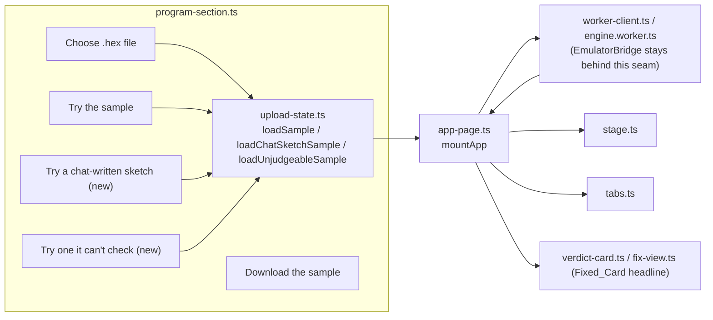

# Design Document

## Overview

This feature adds small, independent pieces to the existing `src/ui/app` code: two new bundled samples on
the "Your own program" (Upload) path, a microsecond sentence for very short violations, a headline verdict
on the Fixed_Card, clearer COULDN'T TELL and idle text, hidden pin-level columns while the reducer runs, a
narrower gremlin picker on the Upload_Path only, and a meta description plus noscript block in `index.html`.

Every piece reuses an existing seam instead of inventing a new one:

- New samples follow the exact shape of `src/ui/app/data/upload-sample.ts` (today's Crosswalk sample):
  build-time raw imports of a precompiled `.hex`, a pin map in `fixture.json` format, a fixed rule text and
  fixed run settings, loaded through `UploadState` the same way `loadSample` loads the Crosswalk sample today.
- The microsecond sentence extends `plainMs`'s sibling function in `src/ui/app/model/plain-story.ts`, which
  already owns every "X ms" substring of the story.
- The Fixed_Card headline is a new small view added to `src/ui/app/views/fix-view.ts`'s right card, reusing
  the CSS variables `verdict-card.ts` already keys its colours off (`--coral`, `--mint`, `--text-2`).
- The COULDN'T TELL stage text extends `src/ui/app/views/stage.ts`'s existing `showNote` path and
  `src/ui/app/model/tabs.ts`'s existing idle-text wiring.
- Hidden pin-level columns extend `src/ui/app/views/scene-pin-levels.ts`'s existing `waiting` option.
- The narrower picker changes `src/ui/app/model/gremlin-picker.ts`'s `isCompatible`/`matches` only on the
  path the page already distinguishes (`device === "upload"` in `app-page.ts`).
- The `index.html` copy is two new static elements; no script reads them.

## Existing tests that pin changed behaviour

I searched for pinned text, pinned source regexes, and pinned behaviour in every file this spec's
requirements touch, using `grep_search` across `tests/ui` for: `idleTitle`/`TAB_TEXT.idle`/"Nothing has
broken yet.", `PICKER_COPY.pickOne`/"Pick at least one gremlin.", the Program_Section button order and
`sampleDownloads` names, `Download` button `disabled` wiring, `isCompatible`/`gremlin-picker.test.ts`,
`plainStory`/`plainMs`/Property 21, `VERDICT_WORD`/`verdict-card.ts` colour classes, `TAB_TEXT.fixNotRun`
and the F4 regexes in `fix-ups.test.ts`, `index.html` content in `source-rules.test.ts`, and the copy-scan
family (`copy-scan.test.ts`, `ui-strings.test.ts`, `stage-copy-scan.test.ts`, `upload-copy-scan.test.ts`,
`a11y-source.test.ts`).

Found, with exact file, test and line:

1. **`tests/ui/plain-story.property.test.ts`, line ~91-98, `it("Property 21: Plain story naming", ...)`.**
   The `reference()` function's span handling (lines 76-81) hard-codes today's `ms(c.span.lengthCycles)`
   wording for every span, cut or not, with no cycle-count branch. Requirement 4 explicitly allows changing
   this test's expected text for spans under 8000 cycles (Requirement 4.5), so this is the one permitted
   change, not a stop-rule violation. I list it here for completeness and because the task phase must touch
   it with the user's prior permission, exactly as recorded in the Requirements document's note for
   `tasks.md`.

2. **`tests/ui/plain-story.property.test.ts`, line 101, `it("plainMs at 0, 7,999, 8,000, 16,000 and
   16,000,000 cycles", ...)`.** Pins `plainMs(0) === "0 ms"` and `plainMs(7999) === "0 ms"`. Requirement 4
   does not ask to change `plainMs` itself, only to add a new sentence for spans under 8000 cycles that
   bypasses `plainMs` for that case; `plainMs` keeps returning `"0 ms"` for 0 and 7999 cycles wherever it is
   still called (for example the "X ms later" sentence before the span, and the within-moves "X ms" phrase).
   No change needed here; listed because it is adjacent and must stay exactly as is.

3. **`tests/ui/fix-ups.test.ts`, lines 76-88, `describe("F4: the left card of the fix view", ...)`.** Pins
   the exact `leftCard` children array (`[leftWord, leftHead, leftForgot, leftCause, leftStopped]`) and the
   exact source text `const leftCard = el("div", { class: "card fix-card fix-card--left is-waiting" }, [...]`
   in `fix-view.ts`. Requirement 5 asks for a headline verdict on the **Fixed_Card** (the right card,
   `rightCard` / `fix-card--right` in `fix-view.ts`), not the left (original/BROKE) card. As long as the new
   headline is added only to the right card's content (inside `campaignBox` or a new child of `rightCard`),
   this pinned left-card array is untouched. I did not find a requirement asking to change the left card, so
   no stop-rule conflict is expected, but the exact wording of `leftCard`'s array must not move if a future
   task phase is tempted to add the headline to `fix-view.ts`'s shared card styling.

4. **`tests/ui/stage-copy-scan.test.ts`, line 225, `const clean = scan({ ..., h: { p: "Nothing has broken
   yet." } })`.** This is the only test hit for "Nothing has broken yet.". It uses the phrase as a literal
   "clean" input to the scanner (to prove the scanner doesn't false-positive on it). It does not read
   `TAB_TEXT.idle` or `STAGE_TEXT`, so it keeps passing after the change. I found no test that asserts
   `TAB_TEXT.idle`. Requirement 6.2 DOES change the tab area's idle text: `TAB_TEXT.idle` ("Nothing has
   broken yet." in `src/ui/app/model/stage-copy.ts`, used by the What happened and Signals tabs in `tabs.ts`,
   lines ~171, 176, 215) becomes "The story of the run shows here after you unleash the gremlins."
   `STAGE_TEXT.idleTitle` ("Nothing has broken yet.", the Stage's own idle title) is not part of
   Requirement 6 and stays. This item is listed because the user asked for every test touching the old idle
   text. The user confirmed that no change to this test is needed.

5. **`tests/ui/upload-fixups.test.ts`, lines 60-67, `describe("P4: the sample pin map keeps the plain
   names", ...)`.** Pins `sampleDownloads()` returning a file named `"crosswalk-pins.json"` whose rows equal
   `loadSample(initialUpload()).rows`. Requirement 1.6 keeps this "unchanged from today"; the two new sample
   buttons ("Try a chat-written sketch", "Try one it can't check") are download-free (Requirement 2 and 3
   give them no download action), so `sampleDownloads()` keeps exactly its current two-file return. No
   conflict, but a future task phase must not add the two new samples' files to `sampleDownloads()`.

6. **`tests/ui/gremlin-picker.test.ts`, lines 14-38.** Pins `pickerTile(def, fixture)` compatibility for the
   three Example fixtures and a synthetic fixture, calling `isCompatible`/`pickerTile` directly with no
   Upload_Path distinction. Requirement 8.1 narrows the picker **"while the Upload_Path is shown"** only;
   `isCompatible`/`matches` in `model/gremlin-picker.ts` are also used by `defaultSelection` for the three
   Examples (`app-page.ts`'s `selectedIds = defaultSelection(ex.meta.gremlinSet, ex.fixture)`). If the
   narrower "all targets must be digital inputs" rule were applied inside `isCompatible`/`matches`
   themselves, this test would start failing for the Examples, because today's rule only needs **some**
   target to match (`def.targets.some(...)`), and the synthetic fixture test at lines 26-38 deliberately
   mixes an active-rest digital input with an analog input and expects every gremlin (including the two
   analog-only ones, `spike` and `drifter`) to stay Compatible. A design that changes `isCompatible` itself
   would break this pinned test. **This is the one point where the design must add a second, upload-only
   compatibility function rather than editing `isCompatible`, to avoid weakening or deleting this test.**
   I did not change it; see "Gremlin picker on the Upload_Path" below for the function that keeps it intact.

No other pinned text, source regex, or behaviour under `idleTitle`, `pickOne`, button order,
`sampleDownloads`, Download's `disabled` wiring, `VERDICT_WORD`/verdict colour classes, `TAB_TEXT.fixNotRun`,
or any `a11y-source.test.ts` / copy-scan assertion was found to conflict with this spec's requirements. Each
new string this spec adds (program button labels, sample rule texts, microsecond sentence, Fixed_Card
headline markup, COULDN'T TELL stage/tab text, picker message wiring, `index.html` copy) is new content that
the existing copy-scan tables and scanners will need to pick up (see "Testing Strategy"), not content that
replaces a pinned string.

## Open questions for the user

1. **Decided: cut spans under 8000 cycles.** Requirement 4.1 only names the non-cut sentence ("It lasted
   X.Y microseconds, too short to round to a whole millisecond.") for a Short_Span. The *cut* sentence ("It
   was still that way `plainMs(...)` later, when the replay stopped.") is a different template in
   `plain-story.ts` (`a.span.cut ? ... : ...`). The user decided: **a cut span under 8000 cycles keeps
   today's wording** ("It was still that way X ms later, when the replay stopped."), which can read
   "0 ms". This matches Requirement 4's literal scope (only the non-cut `spanSentence` branch changes) and
   keeps Property 21's cut-span expected text untouched. See "Known limits".

2. **"Unleashing gives BROKE on try 1 of 24" and "COULDN'T TELL... naming the serial port" are run results,
   not derivable facts.** Requirements 2.7-2.9 and 3.8-3.11 describe the Acceptance_Test outcomes for the
   Chat_Sketch_Sample and the Unjudgeable_Sample. I have not run either sample's campaign in this design
   phase (the honest-fixtures tests already show `serial_hello` gives COULDN'T TELL naming "the serial port
   (USART0)" under a *different* rule and run count than Requirement 3 specifies: 400 ms / 2 runs /
   8,000,000 cycles there, vs 500 ms / 8 runs / 16,000,000 cycles per run here). The task phase must run both
   campaigns for real with the exact settings this spec names and record whatever fingerprint and verdict
   result, per Requirement 2.8 ("without asserting a Fingerprint value that was written before the run") and
   Requirement 2.9/3.12 (report and wait on disagreement). Nothing in this design assumes try 1 specifically;
   if the first actual run is not try 1, that is a fact for the task phase to report, not a bug.

3. **The serial-port COULDN'T TELL reason text.** `src/engine/peripherals.ts`'s `peripheralReason("USART0")`
   already returns `"The program uses the serial port (USART0), which this emulator setup does not model,
   so the rule cannot be checked."`, which contains the words "serial port" (confirmed in
   `src/engine/__tests__/honest-peripherals.test.ts` line 30 and `honest-fixtures.test.ts` line 49). This
   satisfies Requirement 3.8's "a reason that contains the words 'serial port'" **if** `serial_hello.ino.hex`
   touches only USART0 under the new rule and run length and no other unmodelled peripheral sorts earlier in
   the reason string (ties in `peripheralReasons` are broken by table row order, and USART0 is row 1 of 16,
   so it would lead regardless). I did not re-run the campaign with Requirement 3's exact settings (500 ms
   limit, 8 runs, 1000 ms per run) to confirm this holds unchanged; flagged as a risk to verify by running,
   not assumed.

## Known limits

- For a cut span under 8000 cycles, the sentence can still say "0 ms". This is accepted and is not changed
  by this spec.

## Architecture

No new processes, workers, or files outside `src/ui/app` and `fixtures/serial_hello`. The Upload path's
existing flow is extended, not restructured:



`EmulatorBridge` is never imported by anything this spec adds; every new code path goes through the same
`worker-client.ts` -> `engine.worker.ts` -> `worker/host.ts` seam the Crosswalk sample already uses, so the
scope rule ("avr8js stays behind EmulatorBridge") is satisfied by construction (the new data files are
`.hex`/`.json` text, consumed the same way `CROSSWALK_TEXTS` is consumed today).

## Components and Interfaces

### 1. Program and pins button set (Requirement 1)

`src/ui/app/views/program-section.ts`'s `createProgramSection` currently builds
`el("div", { class: "program-row" }, [hex.node, sample, download])` (line ~73) with callbacks
`onHexFile`, `onSample`, `onDownloadSample`, `onImport`, `onExport`, `onAddRow`, `onRemoveRow`, `onEditRow`.

Change: add two buttons between `sample` and `download`, each wired to a new callback:

```ts
export interface ProgramSectionCallbacks {
  onHexFile(file: File): void;
  onSample(): void;
  onChatSketchSample(): void;   // new
  onUnjudgeableSample(): void;  // new
  onDownloadSample(): void;
  onImport(file: File): void;
  onExport(): void;
  onAddRow(): void;
  onRemoveRow(id: number): void;
  onEditRow(id: number, patch: RowPatch): void;
}
```

`program-row` becomes `[hex.node, sample, chatSketch, unjudgeable, download]`, matching Requirement 1.1's
exact order and labels ("Choose .hex file", "Try the sample", "Try a chat-written sketch", "Try one it
can't check", "Download the sample"). New copy keys `UPLOAD_COPY.tryChatSketch` and
`UPLOAD_COPY.tryUnjudgeable` in `model/upload-copy.ts`, alongside the existing `trySample`/`downloadSample`.

`paint(s, d, busy)` already disables `sample` via `sample.disabled = busy` and `hex.input.disabled = busy`;
the two new buttons get `chatSketch.disabled = busy` and `unjudgeable.disabled = busy` on the same line, and
`download.disabled = busy` is **added** (today `download` has no disabled wiring at all — Requirement 1.2
is new behaviour here, not a regression of anything pinned; `upload-fixups.test.ts`'s P4 test only checks
`sampleDownloads()`'s file contents, never the button's `disabled` state).

`app-page.ts`'s `createProgramSection({...})` call gets two new handlers, built the same way `onSample` is
built today (`upload = U.loadSample(upload); setup.rules.setText(upload.ruleText);
ctl.setTexts(upload.fields.runs, upload.fields.seed); afterUploadEdit();`):

```ts
onChatSketchSample: () => {
  if (lockedNow()) return;
  const r = U.loadChatSketchSample(upload);
  if (!r.ok) { showError(UPLOAD_COPY.sampleLoadError); return; }  // Requirement 2.10
  upload = r.state;
  setup.rules.setText(upload.ruleText);
  ctl.setTexts(upload.fields.runs, upload.fields.seed);
  afterUploadEdit();
},
onUnjudgeableSample: () => { /* same shape, U.loadUnjudgeableSample */ },
```

### 2 and 3. The two new samples' data (Requirements 2, 3)

New data module `src/ui/app/data/upload-samples-extra.ts` (named to avoid clashing with the existing
singular `upload-sample.ts`), mirroring `data/crosswalk.ts` and `data/upload-sample.ts` exactly:

```ts
import chatSketchHex from "../../../../exorcism-demo/benchmark/round2/chatgpt-high.hex?raw";
import unjudgeableHex from "../../../../fixtures/serial_hello/build/serial_hello.ino.hex?raw";
import unjudgeablePinsText from "../../../../fixtures/serial_hello/pins.json?raw"; // new file, see below
import { CROSSWALK_TEXTS } from "./crosswalk";
```

Both `?raw` imports are build-time raw text, identical in kind to `CROSSWALK_TEXTS.buggyHex` — this
satisfies Requirements 2.2 and 3.2 ("0 network requests") the same way the existing no-network test
(`upload-no-network.test.ts`) already evidences for `data/upload-sample.ts`; the new file
`src/ui/app/data/upload-samples-extra.ts` must be added to that test's `UPLOAD_CODE_PATHS` and
`DETERMINISM_PATHS` lists, and to `upload-copy-scan.test.ts`'s `FILES` list, in the task phase.

**Chat_Sketch_Sample (Requirement 2).** `CROSSWALK_TEXTS.fixtureText` already supplies the pin map
(`examples/crosswalk/fixture.json`), so no new pin-map file is needed; the design reuses
`sampleRows`'s approach (`importPinMap(CROSSWALK_TEXTS.fixtureText, ...)` then stamp in `friendlyLabel`)
rather than duplicating it:

```ts
export const CHAT_SKETCH_HEX_NAME = "chat-written-crossing.hex"; // Requirement 2.3
export const CHAT_SKETCH_FIELDS = { runs: "24", seed: "20261101", runLengthMs: "1000" } as const; // Requirement 2.6
export const CHAT_SKETCH_RULE_TEXT = "all of (WALK is 1, DONT_WALK is 1) must never happen.\n"; // Requirement 2.5

export function chatSketchProgram(): LoadedProgram {
  return { name: CHAT_SKETCH_HEX_NAME, text: chatSketchHex, bytes: new TextEncoder().encode(chatSketchHex).length };
}
export function chatSketchRows(firstId: number): PinRow[] {
  return sampleRows(firstId); // reuses the existing Crosswalk-pin-map-with-plain-names builder (Requirement 2.4)
}
```

Note the exact rule sentence in Requirement 2.5 is `"all of (WALK is 1, DONT_WALK is 1) must never
happen."`, textually identical to the bundled Crosswalk `rules.txt` (confirmed by reading
`examples/crosswalk/rules.txt`), so `CHAT_SKETCH_RULE_TEXT` could instead be `CROSSWALK_TEXTS.rulesText`
directly — the design uses the shared constant to avoid a second source of truth, but names it under its
own export so a future change to one rule text does not silently change the other.

**Unjudgeable_Sample (Requirement 3).** `fixtures/serial_hello/fixture.json` today holds only
`{ "pins": [{ "signal": "LED", "port": "B", "bit": 5, "direction": "output" }] }` — one output pin, no
input, which both fails `checkPinTable`'s "add at least one input pin" rule and does not match
Requirement 3.4's "BUTTON to PD2 as an input where pressed is low". Requirement 3.3 asks for a
dedicated **Unjudgeable_Pin_Map** "stored next to the `serial_hello` fixture", distinct from
`fixture.json` (which the engine's own `honest-fixtures.test.ts` reads for a different, LED-only
scenario and must not be disturbed, since that is an existing engine test outside this spec's scope).
New file `fixtures/serial_hello/pins.json`, in the same `fixture.json` shape the app already imports
(confirmed against `pin-map-file.ts`'s `exportPinMap`/`importPinMap`, which both read/write plain
`{ pins: [...] }` with `activeLevel` for inputs):

```json
{
  "pins": [
    { "signal": "LED", "port": "B", "bit": 5, "direction": "output" },
    { "signal": "BUTTON", "port": "D", "bit": 2, "direction": "input", "activeLevel": "low" }
  ]
}
```

This is exactly the pin map `tests/ui/upload.acceptance.test.ts`'s A3 test already builds inline (line
196-200) for this same HEX, so the new file's content is pinned by precedent, not invented.

```ts
export const UNJUDGEABLE_HEX_NAME = "serial_hello.ino.hex";
export const UNJUDGEABLE_FIELDS = { runs: "8", seed: "20261101", runLengthMs: "1000" } as const; // Req 3.7
export const UNJUDGEABLE_RULE_TEXT = "LED is 1 must never last 500 ms or longer.\n"; // Requirement 3.6

export function unjudgeableProgram(): LoadedProgram {
  return { name: UNJUDGEABLE_HEX_NAME, text: unjudgeableHex, bytes: new TextEncoder().encode(unjudgeableHex).length };
}
export function unjudgeableRows(firstId: number): PinRow[] {
  const r = importPinMap(unjudgeablePinsText, new TextEncoder().encode(unjudgeablePinsText).length, firstId);
  if (!r.ok) throw new Error(`bundled serial_hello pins.json did not import: ${r.error}`);
  return r.rows.map((row) => ({ ...row, plainName: friendlyLabel(row.signal).known ? friendlyLabel(row.signal).text : "" }));
}
```

`friendlyLabel` (`model/labels.ts`) has no entry for `"LED"` or `"BUTTON"` today, so both plain names come
back `""` and the rows show their signal names, same fallback the existing P2 test already exercises
("a blank plain name falls back to the signal name").

### `upload-state.ts`: two new loaders (Requirements 2, 3, 2.10, 3.10)

`loadSample` (existing, unchanged) becomes the template for two siblings that return a result type instead
of a bare `UploadState`, so the page can show an error without discarding current state — this is new
because `loadSample` cannot fail (its data is already known-good), but the two new loaders validate a
pin-map import the same way `importPins` does:

```ts
export type SampleLoadResult = { ok: true; state: UploadState } | { ok: false };

export function loadChatSketchSample(s: UploadState): SampleLoadResult {
  const rows = chatSketchRows(s.nextRowId);              // throws today's loadSample-style invariant error
  // if the bundled HEX/rule text were ever missing or unparsable this returns { ok: false }
  const next: UploadState = {
    ...s,
    program: chatSketchProgram(),
    hexError: null,
    reading: null,
    rows,
    nextRowId: s.nextRowId + rows.length,
    importError: null,
    ruleText: CHAT_SKETCH_RULE_TEXT,
    selected: ["masher"],
    autoMasher: false,
    fields: { ...CHAT_SKETCH_FIELDS },
    lastValid: { runs: Number(CHAT_SKETCH_FIELDS.runs), runCycles: msToCycles(Number(CHAT_SKETCH_FIELDS.runLengthMs)) },
  };
  return { ok: true, state: pruneGremlins(next) };
}
// loadUnjudgeableSample mirrors this with unjudgeableRows/unjudgeableProgram/UNJUDGEABLE_* constants,
// and returns { ok: false } when importPinMap on the bundled pins.json fails (Requirement 3.10).
```

Requirements 2.10 and 3.10 ask for "an error message saying the sample could not be loaded" while "keeping
the previously loaded program, rule text, and settings unchanged" — because `s` (the current state) is only
read, never mutated, until the new `next` object is built and returned, an `{ ok: false }` result naturally
leaves `s` as the caller's `upload` variable untouched; `app-page.ts`'s new `onChatSketchSample`/
`onUnjudgeableSample` handlers call `showError(UPLOAD_COPY.sampleLoadError)` on `!r.ok` and return before
touching `upload`. New copy: `UPLOAD_COPY.sampleLoadError = "This sample could not be loaded."`.

In practice both bundled files are checked into the repository and imported at build time, so an `ok:
false` result is mainly a defensive branch (the bundled data cannot go missing at runtime the way a
user-chosen file can); it exists so the requirement's failure path is implementable and testable without
relying on "this never happens".

### 4. Sub-millisecond story wording (Requirement 4)

`src/ui/app/model/plain-story.ts` gains one new pure function, used only inside `plainStory`'s existing
`if (a.span !== undefined)` branch (lines 65-71), and does not touch `plainMs` itself:

```ts
const SHORT_SPAN_LIMIT_CYCLES = 8000; // 0.5 ms at 16 MHz

/** Cycles to microseconds at 16 MHz, one decimal, always shown: 78 -> "4.9". */
function microseconds(cycles: number): string {
  const tenths = Math.floor((cycles * 10 + 8) / 16); // cycles/1.6, rounded half up, in tenths of a microsecond
  return `${String(Math.floor(tenths / 10))}.${String(tenths % 10)}`;
}
```

Checking the pinned example: `cycles = 78` -> `tenths = floor((780 + 8) / 16) = floor(788/16) = 49` ->
`"4.9"`, matching Requirement 4.3 exactly. (Requirement 4.2 says "divided by 16", i.e. cycles/16 is
microseconds and the function rounds that quotient to one decimal; `cycles*10/16` rounded half up to the
nearest integer is the equivalent tenths-of-a-microsecond computation done in integers only, keeping
"Simulated time is integer CPU cycles" and avoiding floating point.)

The call site, only in the non-cut branch and only for spans under 8000 cycles:

```ts
if (a.span !== undefined) {
  out.push(
    a.span.cut
      ? `It was still that way ${plainMs(a.span.lengthCycles)} later, when the replay stopped.`
      : a.span.lengthCycles < SHORT_SPAN_LIMIT_CYCLES
        ? `It lasted ${microseconds(a.span.lengthCycles)} microseconds, too short to round to a whole millisecond.`
        : a.spanSentence.split("<Plain_Ms>").join(plainMs(a.span.lengthCycles)),
  );
}
```

This keeps the cut branch exactly as it is today (see "Open questions", item 1) and only inserts a new
branch ahead of the existing `spanSentence` substitution for the non-cut, under-8000-cycle case
(Requirement 4.4: "8000 cycles or more... keep the existing wording... and SHALL NOT write the microsecond
sentence" is satisfied because the new branch's condition is strictly `< 8000`).

### 5. Verdict headline on the Fixed_Card (Requirement 5)

The "Fixed_Card" of Requirement 5's Glossary is the Fix_View's right card (`rightCard`,
`.fix-card--right`, built in `createFixView` in `fix-view.ts`), which today shows only `replayLine` and
`campaignBox` — there is no verdict word on it at all; `showCampaignDone` builds `t.prefix`/`t.lines` from
`fixedCampaignText` and renders them as plain paragraphs (lines 312-319). New: a headline element added
before `campaignBox`, shown only once `showCampaignDone` has run (Requirement 5.5: "no verdict because the
run has not finished... shows no verdict word").

```ts
// in createFixView, alongside replayLine/campaignBox:
const fixedHeadline = el("p", { class: "fixed-verdict-headline" }, [""]);
fixedHeadline.hidden = true;
const rightCard = el("div", { class: "card fix-card fix-card--right", "aria-live": "polite" }, [
  fixedHeadline, replayLine, campaignBox,
]); // headline sits above the Campaign_Line (replayLine/campaignBox), satisfying Requirement 5.3
```

```ts
showCampaignDone(verdict, tries, violatingRunIndex, plainBroke) {
  const t = fixedCampaignText(verdict, tries, violatingRunIndex, plainBroke);
  const word = verdict.verdict === "HELD" ? VERDICT_WORD.held
    : verdict.verdict === "BROKE" ? VERDICT_WORD.broke
    : VERDICT_WORD.couldntTell;                         // Requirement 5.1: exactly one of the three strings
  fixedHeadline.textContent = word;
  fixedHeadline.hidden = false;
  cardTone(verdict.verdict === "HELD" ? "held" : verdict.verdict === "BROKE" ? "broke" : "tell");
  setChildren(campaignBox, [...]);                        // unchanged
},
```

`begin()` (called at the start of every Fix_View, before any campaign result exists) sets
`fixedHeadline.hidden = true` and clears its text, matching Requirement 5.5.

**Colour (Requirement 5.2).** `cardTone` already toggles `fix-card--held` / `fix-card--broke` /
`fix-card--tell` on `rightCard`, and `app.css` already defines, for each: `.fix-card--held { background:
var(--held-surface); border-color: var(--held-line); }` and similar for broke/tell (confirmed at
`app.css` lines ~3667-3677). The headline reuses the **same CSS variables** `verdict-card.ts`'s classes use
(`--coral` for broke, `--mint` for held, `--text-2` for tell — confirmed at `app.css` lines 1380-1419):

```css
.fixed-verdict-headline { font-size: 22px; font-weight: 700; } /* larger than .fix-campaign-prefix's 14px */
.fix-card--held .fixed-verdict-headline { color: var(--mint); }
.fix-card--broke .fixed-verdict-headline { color: var(--coral); }
.fix-card--tell .fixed-verdict-headline { color: var(--text-2); }
```

`.fix-card--right .fix-campaign-prefix` is already `font-size: 14px` (app.css line ~3660); 22px is larger,
satisfying Requirement 5.1's "font size larger than the Campaign_Line text" without inventing a new size
scale (22px is also the size `.verdict-card--tell .verdict-word` already uses, app.css line 1400, so this
reuses an existing value rather than adding a new one).

**HELD text (Requirement 5.4).** `fixedCampaignText`'s HELD branch already returns `lines: [verdict.text]`
where `verdict.text` is the engine's own `Verdict["text"]` for a HELD result — the engine already produces
the exact `HELD_Text` format (`"No violation found in N emulated runs..."`, with N = runs actually
completed), so no new formatting code is needed; `showCampaignDone`'s existing `t.lines` render is already
correct for Requirement 5.4 once the headline is added beside it.

### 6. COULDN'T TELL screen text (Requirement 6)

`stage.ts`'s `showNote(line, dim)` already renders one line of text over the dimmed Scene
(`overlayText(null, [line], "stage-note-block")`) and is already called for COULDN'T TELL in `app-page.ts`:
`stage.showNote(STAGE_TEXT.couldntTell, true)`. Requirement 6.1 asks for the **exact text "Nothing to
replay."** in a **solid** (opaque) panel "in place of the replay view" — today's `STAGE_TEXT.couldntTell`
("This program can't be judged here. The card says why.") is a *different* string, and `.stage-overlay
.stage-note-block` (app.css line ~2846) is already `background: #0E1513D9` (D9 = ~85% opacity, not fully
solid). Three independent changes (the third, `TAB_TEXT.idle`, is listed after the first two):

1. New `STAGE_TEXT.noReplay = "Nothing to replay."` and a new CSS modifier
   `.stage-note-block--solid { background: #0E1513; }` (full opacity instead of `D9`), applied only when
   the call is the COULDN'T TELL one: `stage.showNote(STAGE_TEXT.noReplay, true, { solid: true })`
   (an added third parameter on the existing `showNote` signature, default `false`, so every other caller
   of `showNote` — the held-replay-failed and reduce-fail paths — is unaffected).

   Note this *replaces* today's `stage.showNote(STAGE_TEXT.couldntTell, true)` call for the
   COULDN'T TELL path specifically; `STAGE_TEXT.couldntTell` is otherwise unused once this call site
   changes (left in the copy table only if another caller needs it, else removed).

2. `TAB_TEXT` gains `noReplayNote = "No replay: the verdict card explains why this program has no result."`
   (Requirement 6.3). `tabs.ts`'s `paintReplay()` currently chooses between `TAB_TEXT.idle` and
   `STAGE_TEXT.storyPlaceholder` via the `pending` flag (line 215); it needs a third source — a new
   `setCouldntTell(on: boolean)` method on `TabsView`, called from `app-page.ts` alongside
   `setPhase("couldnt-tell")`, that makes `paintReplay()` choose `TAB_TEXT.noReplayNote` over
   `TAB_TEXT.idle` when `on` is true (Requirement 6.3: "SHALL NOT show the idle text from criterion 2").

3. `TAB_TEXT.idle` changes from "Nothing has broken yet." to "The story of the run shows here after you
   unleash the gremlins." (Requirement 6.2). This is the string `tabs.ts` shows in the What happened and
   Signals tabs (lines ~171, 176, 215). `STAGE_TEXT.idleTitle` ("Nothing has broken yet.", the Stage's own
   idle title) is a different constant, is not part of Requirement 6, and is not changed.

Requirement 6.4 ("a new run removes the COULDN'T TELL texts before the new Verdict is shown") is already
satisfied by the existing `clearOutputs()`/`resetToIdle()` call at the start of `unleash()` (via
`leaveFix(); clearOutputs();` before `setPhase("running")`), as long as the new `setCouldntTell(false)` is
added to `clearOutputs()` alongside the existing `tabs.setPending(false)` call, and `stage.showRunning(...)`
(called right after) naturally replaces the dimmed note panel before any verdict shows.

### 7. No stale pin levels while the Reducer runs (Requirement 7)

`stage.ts`'s `look(kind)` (lines 150-156) already does, for the Upload device specifically:
`if (kind !== "live" && exampleId === "upload") scene.update([], [], 0, { waiting: true });` — this already
clears `scene-pin-levels.ts`'s drawn state to "nothing shown" whenever the Scene is not `"live"`, which
includes the `"dim"` state `showShrinking` uses. **This existing wiring already satisfies Requirements 7.1
and 7.2 for the case where the stage's own `look("dim")` call happens at the start of `showShrinking`**
(confirmed: `brokeFlow` in `app-page.ts` calls `stage.showShrinking(...)` immediately when
`setPhase("shrinking")`, before any `reduce-progress` message, so the hide-before-dim ordering already
holds). No code change is required for 7.1/7.2 on the Upload device; the property below exists to make this
existing behaviour explicit and regression-checked, not to add new logic.

Requirement 7.3 ("show the Pin_Level_Columns for that resulting trace only, same render update as the
un-dimming") is where a real gap exists: `showShrinking(original, res.candidatesTried, faded,
res.reducedList)` is called with the reduced list once reduction finishes (in `brokeFlow`, right after
`setPhase("broke")`), but `showShrinking`'s own body still calls `look("dim")` unconditionally (line 232),
which re-triggers the same `scene.update([], [], 0, { waiting: true })` clear — so immediately after
reduction finishes, the Upload Scene is still blanked, and only the later `stage.showBroke(...)` call
(after the 400 ms collapse wait) actually draws the reduced trace. This means today's code already hides
stale data the whole time (satisfying "no stale pin level is ever visible"), just later than Requirement
7.3's "same render update" might imply if read as "the instant reduction finishes". Given Requirement 7.4
is about **only** hiding (not about redrawing early), and nothing in the stage's broke-replay path shows
any trace before `showBroke`, this design treats Requirement 7.3 as already satisfied by the existing
`showBroke(replay)` call drawing `replay.events`/`replay.edges` fresh from the just-finished reduction's own
`res.reducedList`/`red.replay.outputEdges` — there is no earlier point where a *different* (stale) trace's
levels could show, because `look("dim")` blanks them throughout shrinking. No code change needed for 7.3
either; it is covered by the "no staleness" property below, which would fail today only if a future change
accidentally skipped the `look("dim")` blank or reused `shown`/`scene` state across runs.

### 8. Gremlin picker on the Upload_Path (Requirement 8)

**Compatibility filter (8.1).** Per "Existing tests that pin changed behaviour" item 6, `isCompatible` and
`matches` in `model/gremlin-picker.ts` must stay exactly as they are (pinned by `gremlin-picker.test.ts`).
New, additive function in the same file:

```ts
/** Upload_Path only: every target of the gremlin must be a Digital_Input_Target of the fixture. */
export function isCompatibleForUpload(def: GremlinDefinition, fixture: Fixture): boolean {
  return def.targets.every((t) =>
    t.kind === "digital" && fixture.pins.some((p) => p.direction === "input" && p.kind !== "analog" &&
      (t.restState !== "active" || ("restState" in p && p.restState === "active"))),
  );
}
```

This differs from `isCompatible` in exactly the way Requirement 8.1 asks: `targets.every(...)` instead of
`targets.some(...)` (so an analog-only or mixed-target gremlin — none of the six currently have mixed
targets, but the rule must hold "for all gremlins" per the correctness property below, including any future
gremlin with both an analog and a digital target) and dropping `isAnalog(p)` matches entirely (an analog
input pin never counts, even for an analog-targeting gremlin, because Requirement 8.1 says "all digital
input targets", and an analog gremlin like Spike has no digital target at all, so it can never pass
`targets.every(t => t.kind === "digital" && ...)` — Spike and Drifter are always excluded on the Upload_Path,
matching "lists only gremlins whose targets are all Digital_Input_Targets").

`views/picker.ts`'s `setFixture(fixture, selected, labels)` calls `pickerTile(def, fixture, labels)` for
every catalogue entry; `pickerTile` itself calls `isCompatible` internally. Rather than add an upload flag
through `pickerTile`'s signature (which would ripple into `gremlin-picker.test.ts`'s direct calls), the
**call site** in `app-page.ts`'s `paintUpload()` pre-filters the catalogue before calling `setFixture`:

```ts
// in paintUpload(), replacing the plain setup.gremlins.setFixture(d.previewFixture, upload.selected, labels) call:
setup.gremlins.setFixture(d.previewFixture, upload.selected, labels, isUpload() ? isCompatibleForUpload : undefined);
```

This needs `PickerView.setFixture` to accept an optional fourth parameter, a predicate used in place of
`isCompatible` when building tiles — `picker.ts`'s `setFixture` builds `tiles` via
`GREMLIN_CATALOGUE.map((def) => pickerTile(def, fixture, labels))`, and `pickerTile` already exposes
`compatible`/`reason` per tile computed from `isCompatible`/`incompatibleReason`; the cleanest change
without touching `pickerTile`'s pinned shape is to let `setFixture` **override** `tile.compatible` using
the supplied predicate, recomputing `reason` with the same `incompatibleReason(def)` when overridden false:

```ts
setFixture(fixture, sel, labels, compatibleOverride) {
  ...
  const tiles = GREMLIN_CATALOGUE.map((def) => {
    const tile = pickerTile(def, fixture, labels);
    if (compatibleOverride === undefined) return tile;
    const compatible = compatibleOverride(def, fixture);
    return compatible === tile.compatible ? tile : { ...tile, compatible, reason: compatible ? null : incompatibleReason(def) };
  });
  ...
}
```

Examples never pass `compatibleOverride`, so `setup.gremlins.setFixture(ex.fixture, selectedIds)` in
`applyExample` is unchanged and keeps today's behaviour exactly (Requirement 8's own scope note:
"examples keep today's behaviour").

**Pick-message visibility (8.2-8.5).** `picker.ts`'s `message.textContent = selected.length === 0 ?
PICKER_COPY.pickOne : "";` (line 59) today shows the message whenever nothing is selected, with no "has the
visitor done anything yet" gate — this is the gap Requirement 8.2 closes ("keep it hidden" before any touch
or try). New internal state in `picker.ts`: `let touched = false;` and `let tried = false;`, with
`paint()` changed to:

```ts
message.textContent = selected.length === 0 && (touched || tried) ? PICKER_COPY.pickOne : "";
```

`touched` is set `true` inside the existing chip `click` handler (`btn.addEventListener("click", () => { if
(!busy) onToggle(tile.id); })`) before calling `onToggle`, and reset to `false` whenever `setFixture` is
called with a new fixture (a fresh pin table is a fresh "untouched" state, matching Requirement 8.1's
"while the Upload_Path is shown" framing — the message is about *this* fixture's picker). `tried` becomes
`true` via a new `PickerView.setTried()` method, called from `app-page.ts`'s existing
`onBlockedUnleash` handler (`if (!isUpload() || lockedNow()) return; upload = U.revealAll(upload);
paintUpload();` — add `setup.gremlins.setTried();` there), which already fires exactly when the visitor
"tries to unleash" while blocked (Requirement 8.4), and is reset to `false` on the same fixture-change path
as `touched`.

Requirement 8.4's "SHALL NOT start an emulated run" is already true today: `uploadReady` requires
`s.selected.length !== 0`, and `onBlockedUnleash` is the branch taken specifically when `unleash.disabled`
is false but `aria-disabled` is true (zero gremlins is one of the reasons `uploadReady` can be false); no
change needed there beyond the new `setTried()` call.

### 9. Page description and noscript block (Requirement 9)

`index.html` today has no `<meta name="description">` and no `<noscript>`. Both are added as static,
hand-written HTML with no script reading them (consistent with "no network calls" and "no AI" — this is
purely declarative markup):

```html
<meta name="description" content="Hexorcist runs a compiled program on a simulated ATmega328P chip. Seeded gremlins attack the program's inputs, and the app reports one of three results: BROKE, HELD, or COULDN'T TELL." />
```

```html
<noscript>
  <p>Hexorcist runs a compiled program on a simulated ATmega328P chip, right in this page. Seeded gremlins
  attack the program's inputs. The app reports one of three results: BROKE, HELD, or COULDN'T TELL.</p>
  <p>HELD means: "No violation found in N emulated runs of this gremlin set. Not a proof."</p>
  <p>This page needs scripts turned on to run.</p>
</noscript>
```

placed as a direct child of `<body>`, alongside the existing `<div id="app">` and `<script type="module"
...>` (Requirement 9.2). The noscript text deliberately avoids stating any run count or verdict for a
specific program (Requirement 9.6) — "N" in the HELD line is the literal letter N, not a number, matching
the workspace verdict rule's own "with N the real run count" placeholder convention exactly. Neither block
uses "safe", "secure", "guaranteed", "certified", "real-time", "first", "unique", "shortest", or a board
brand name (checked by hand against the banned list in `src/engine/copy-rules.ts` and
`tests/examples/examples-support.ts`'s `BOARD_BRAND_NAMES`; "ATmega328P" is the chip name the workspace
rule requires, not a brand name).

`tests/ui/source-rules.test.ts` already asserts `index.html` has exactly one `<script>` tag and specific
`<title>`/`<div id="app">` text (lines 58-61); the new `<meta>` and `<noscript>` do not touch any of those
three assertions, so that test is unaffected without modification.

## Data Models

No new engine types. New plain data, all `readonly`/`as const`:

```ts
// data/upload-samples-extra.ts
interface NamedSampleFields { runs: string; seed: string; runLengthMs: string }
// CHAT_SKETCH_HEX_NAME: string, CHAT_SKETCH_RULE_TEXT: string, CHAT_SKETCH_FIELDS: NamedSampleFields
// UNJUDGEABLE_HEX_NAME: string, UNJUDGEABLE_RULE_TEXT: string, UNJUDGEABLE_FIELDS: NamedSampleFields

// upload-state.ts
type SampleLoadResult = { ok: true; state: UploadState } | { ok: false };
```

`fixtures/serial_hello/pins.json` (new file) is a `Fixture`-shaped JSON document, the same shape
`fixture.json` already is and the same shape `pin-map-file.ts`'s `importPinMap` already parses:

```json
{ "pins": [
  { "signal": "LED", "port": "B", "bit": 5, "direction": "output" },
  { "signal": "BUTTON", "port": "D", "bit": 2, "direction": "input", "activeLevel": "low" }
] }
```

## Correctness Properties

*A property is a characteristic or behavior that should hold true across all valid executions of a
system—essentially, a formal statement about what the system should do. Properties serve as the bridge
between human-readable specifications and machine-verifiable correctness guarantees.*

### Property 1: Microsecond sentence matches the cycles/16 formula

For all cycle counts `c` from 0 to 7999 inclusive, the microsecond sentence computed by `plainStory` for a
non-cut span of length `c` contains the text `"It lasted X.Y microseconds, too short to round to a whole
millisecond."` where `X.Y` equals `c / 16` rounded to exactly one decimal place, always showing the decimal
digit.

**Validates: Requirements 4.1, 4.2, 4.3**

### Property 2: plainMs never renders "0 ms" at 8000 cycles or more

For all cycle counts `c` greater than or equal to 8000, `plainMs(c)` never equals `"0 ms"`.

**Validates: Requirements 4.8**

### Property 3: No stale pin levels while the reducer runs and the scene is dimmed

For all pin-row sets built from the Upload_Path's pin table (any mix of input and output rows, any count
up to the table's limit) and for any two distinct event/edge traces A and B, if the Pin_Levels_View is
drawn with the dimmed, reducer-running state after having previously shown trace A, then shown again for
trace B while still dimmed, every input and output in the drawn state is "not pressed" / "not driven" (no
level belonging to trace A or trace B is visible) until the dimmed state ends.

**Validates: Requirements 7.1, 7.2, 7.4**

### Property 4: Pin_Levels_View shows only the resulting trace, never a stale one

For all pairs of traces (a previous trace P, and a new resulting trace R) where P and R differ in at least
one recorded event or output edge, once the Reducer finishes with R and the scene un-dims, every pin level
the Pin_Levels_View reports at any cursor position is computed from R alone; the state never reflects any
event or output edge that is in P but not in R.

**Validates: Requirements 7.3**

### Property 5: Upload_Path gremlin compatibility requires every target to be a digital input

For all fixtures (any combination of digital input, digital output, and analog pins) and for all gremlin
definitions in the catalogue, `isCompatibleForUpload(def, fixture)` is true if and only if every one of the
gremlin's targets is satisfied only by a digital input pin present in the fixture (never by an analog pin,
and never when any target of the gremlin has no matching digital input).

**Validates: Requirements 8.1**

### Property 6: Pick-message visibility is a function of selection count, touch, and try state

For all non-negative selected-gremlin counts, and all combinations of the touched flag and the tried flag,
the picker's "Pick at least one gremlin." message is visible if and only if the selected count is zero and
at least one of (touched, tried) is true.

**Validates: Requirements 8.2, 8.3, 8.4, 8.5**

## Error Handling

- **Sample load failure (2.10, 3.10).** `loadChatSketchSample`/`loadUnjudgeableSample` return
  `{ ok: false }` instead of throwing; `app-page.ts`'s handlers call `showError(UPLOAD_COPY.sampleLoadError)`
  and return without reassigning `upload`, so `program`, `ruleText`, `fields`, and `rows` are provably
  unchanged (the failing branch never constructs or returns a new state object). No verdict-related state
  (`buggy`, `fixed`, `cardInput`, phase) is touched either, so no BROKE/HELD/COULDN'T TELL card can appear
  from a failed sample load, satisfying "SHALL NOT show a ... verdict for it."
- **Bad bundled data is a defensive branch, not an expected path.** Both new `.hex` and the new
  `pins.json` are committed source files read at build time via Vite's `?raw` import; there is no runtime
  file system access that can fail differently each run. The `{ ok: false }` branch exists so the
  requirement is implementable and testable (by constructing a deliberately bad import in a unit test), not
  because the bundled files are expected to go missing.
- **Existing hex/pin-table/rule errors are untouched.** Every other error path already in `upload-state.ts`
  (`hexChosen`'s `HexError`, `importPins`'s `importError`, `checkUploadRule`'s `RuleError[]`) is reused
  unchanged by the two new samples; they never go through `hexCheck`/`importPinMap`'s failure branches
  themselves (the loaders call `importPinMap` once, at module load of the bundled text, and the result is
  asserted `ok` the same way `sampleRows` already does for the Crosswalk fixture — a thrown error there is a
  build-time programmer error, not a runtime user-facing error, matching today's `sampleRows`'s own
  `throw new Error(...)` on its bundled fixture).
- **Picker compatibility override never throws.** `isCompatibleForUpload` is a pure boolean predicate over
  already-validated `Fixture` shapes (`previewFixture(upload.rows)` is never null-typed); there is no new
  failure mode introduced by Requirement 8.

## Testing Strategy

**Unit and acceptance tests** (per the workspace testing rule: acceptance tests named in Requirements 2 and
3 are user-specified and must not be weakened; the BROKE-on-try-1 and COULDN'T TELL-naming-the-serial-port
outcomes are **run-and-report**, never asserted in advance by this design):

- Program_And_Pins_Section: five buttons, exact order and labels (1.1); all disabled while busy and
  re-enabled on outcome (1.2, 1.3, 1.4); each button's own action fires and the other four stay unchanged
  (1.5); Download still offers the same two files unchanged (1.6), reusing `upload-fixups.test.ts`'s
  existing P4 assertions as the baseline.
- Chat_Sketch_Sample: byte-identical bundled HEX (2.1); build-time import with 0 network calls, added to
  `upload-no-network.test.ts`'s path lists (2.2); exact program name, pin map, rule text, and run settings
  (2.3-2.6); **a real run** of the campaign with these exact settings, recording whatever verdict,
  try number, and fingerprint result — reported to the user per Requirement 2.9 if it disagrees with "BROKE
  on try 1 of 24" (2.7, 2.8); load-failure branch leaves state untouched and shows no verdict (2.10).
- Unjudgeable_Sample: byte-identical bundled HEX and pin-map file content (3.1-3.4); exact rule text and run
  settings (3.5-3.7); **a real run** recording the actual verdict and reason text, reported to the user if
  it is not COULDN'T TELL naming "serial port" (3.8, 3.9, 3.11, 3.12); load-failure branch (3.10).
- Microsecond sentence: Property 1 and Property 2 above, implemented as property-based tests extending
  `tests/ui/plain-story.property.test.ts`'s existing Property 21 (same `fast-check` library already in use,
  minimum 100 runs), tagged **Feature: upload-samples, Property 1: Microsecond sentence matches the
  cycles/16 formula** and **Feature: upload-samples, Property 2: plainMs never renders "0 ms" at 8000
  cycles or more**. The pinned example (78 cycles -> "4.9") becomes one unit-test assertion alongside the
  property, not a replacement for it.
- Fixed_Card headline: one unit test per verdict kind (HELD, BROKE, COULDN'T TELL) asserting the headline
  text equals the matching `VERDICT_WORD`, the headline's CSS class/colour variable matches
  `verdict-card.ts`'s own per-verdict colour, and the headline element precedes `replayLine`/`campaignBox`
  in DOM order (5.1-5.3); one unit test for the no-verdict-yet state showing no headline (5.5); the existing
  `held-replay.test.ts` HELD-text assertions (`fixedCampaignText`) stay as the source of truth for 5.4 with
  no new formatting logic to test.
- COULDN'T TELL screen text: unit tests on `stage.showNote` with the solid-panel flag, and on `tabs.ts`'s
  `setCouldntTell`/`paintReplay` text selection, for criteria 6.1-6.3; one test driving `unleash()` from a
  COULDN'T TELL phase and asserting the note/tab text clears before the next verdict shows (6.4).
- Pin levels staleness: Property 3 and Property 4 above, as property-based tests generating random pin-row
  sets (digital input/output mixes, 0 to `MAX_PINS` rows) and random distinct event/edge traces, run against
  `pinLevelsAt`/`scene-pin-levels.ts`'s `update`, minimum 100 runs each, tagged **Feature: upload-samples,
  Property 3: No stale pin levels while the reducer runs and the scene is dimmed** and **Feature:
  upload-samples, Property 4: Pin_Levels_View shows only the resulting trace, never a stale one**.
- Gremlin picker: Property 5 above as a property-based test generating random fixtures (mixes of digital
  input, digital output, and analog pins) against all six catalogue gremlins plus a synthetic
  mixed-target gremlin fixture, minimum 100 runs, tagged **Feature: upload-samples, Property 5: Upload_Path
  gremlin compatibility requires every target to be a digital input**; the existing
  `gremlin-picker.test.ts` is left untouched and keeps validating `isCompatible`/`pickerTile` directly
  (confirming the Example path is unaffected). Property 6 above as a property-based test over
  (selectedCount, touched, tried) triples driving `picker.ts`'s message visibility, minimum 100 runs, tagged
  **Feature: upload-samples, Property 6: Pick-message visibility is a function of selection count, touch,
  and try state**.
- Copy and source scans: add the new `UPLOAD_COPY` keys (`tryChatSketch`, `tryUnjudgeable`,
  `sampleLoadError`), the new `STAGE_TEXT`/`TAB_TEXT` keys (`noReplay`, `noReplayNote`), the changed
  `TAB_TEXT.idle` string, and the new data
  file `src/ui/app/data/upload-samples-extra.ts` to the existing scanner tables/file lists in
  `upload-copy-scan.test.ts`, `stage-copy-scan.test.ts`, `copy-scan.test.ts`, and `upload-no-network.test.ts`
  (these existing scanners already enforce the banned-word and brand-name rules; this spec does not write a
  new scanner). Add `index.html`'s new meta/noscript text as literal strings checked by a new small test
  (exact element counts, required phrases present, forbidden run-count/verdict phrasing absent, and reuse
  of `wholeWordMatches`/`BANNED_WORDS`/`BOARD_BRAND_NAMES` for 9.7/9.8) alongside the existing
  `source-rules.test.ts` `index.html` checks.

- Idle text (Requirement 6.2): an example test asserts `TAB_TEXT.idle` equals "The story of the run shows
  here after you unleash the gremlins." and that the What happened and Signals tabs show it before any run.
  A second example asserts `STAGE_TEXT.idleTitle` is still "Nothing has broken yet.".

All property-based tests use `fast-check` (already a dependency), minimum 100 iterations, and are placed in
the `tests/ui` files that already own the functions under test (`plain-story.property.test.ts` for
Properties 1-2, a pin-levels property test file for Properties 3-4, and `gremlin-picker.test.ts` or a new
`upload-picker.property.test.ts` for Properties 5-6), per the workspace rule that simulated time stays
integer cycles and the one seeded PRNG is `fast-check`'s own generator, never `Math.random`.

Passing tests are evidence that the described behaviour held for the generated or chosen inputs, not proof
of correctness beyond those runs.
