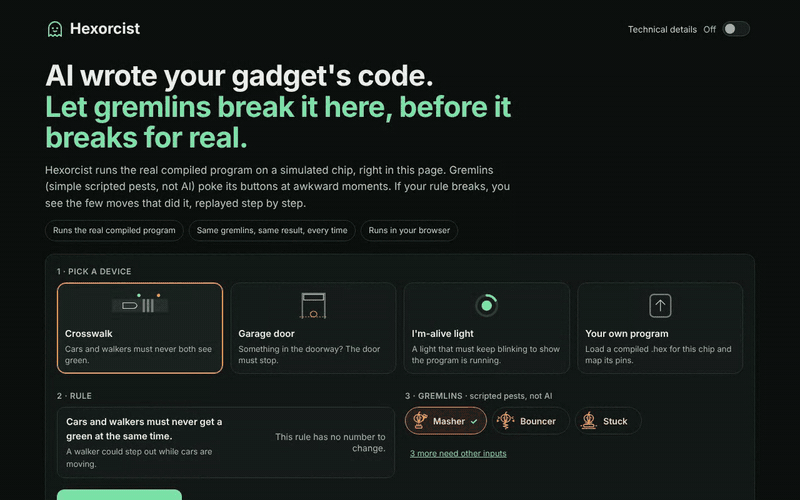
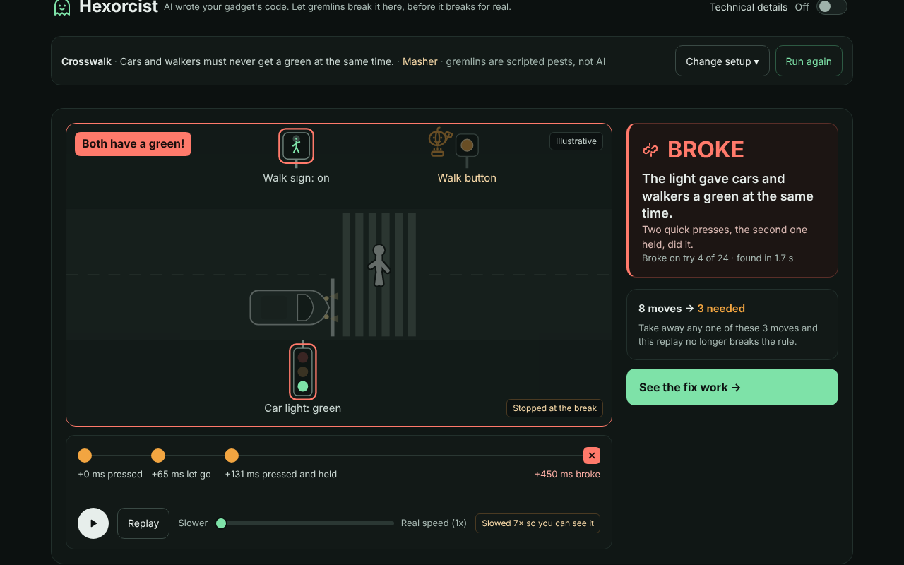
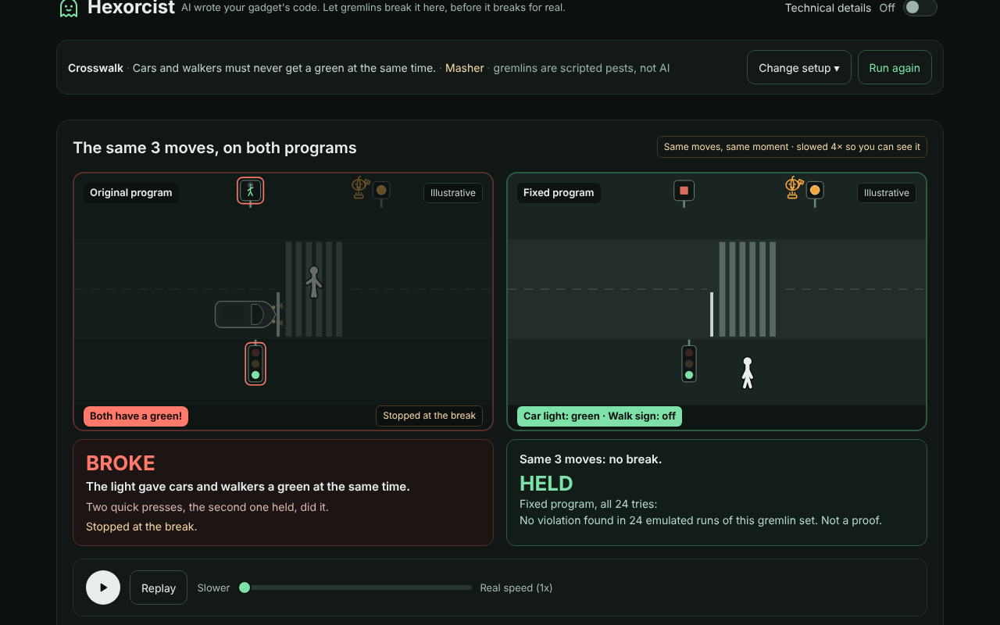
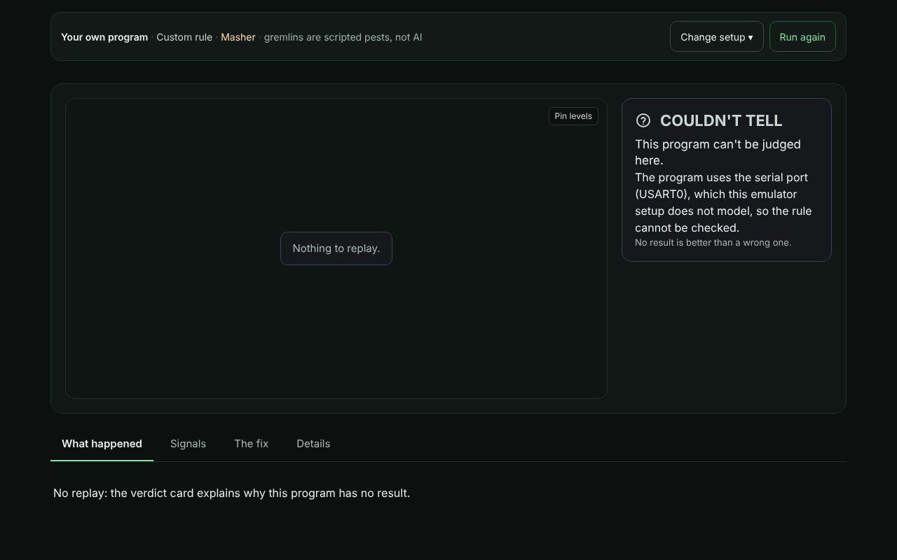

# Hexorcist

**AI wrote your gadget's code. Let gremlins break it here, before it breaks for real.**

Hexorcist runs a real compiled ATmega328P program on a simulated chip inside your browser (no board needed). You write a rule in plain sentences, pick some gremlins (small scripted pests, not AI) and let them poke the program's inputs at awkward moments. If the rule breaks, Hexorcist cuts the attack down to the few moves that matter and replays them, step by step.

- **Live app:** https://lainx06.github.io/Hexorcist/
- **Demo video (under 3 minutes):** _link added at submission_
It stitches together parts that don't usually meet: 8-bit microcontroller machine code running cycle by cycle in a browser worker, rules written as plain sentences, seeded scripted gremlins, a delta-debugging reducer, and an MCP server so a Kiro agent can run the same check. It is for makers, students and teachers who put AI-written code on small boards and don't have a lab to test it in.

- **Judging in a hurry?** [docs/JUDGES.md](docs/JUDGES.md) is a five-minute tour.
- Kiroween 2026 entry, Frankenstein category.



| BROKE, with the moves that matter | Same moves on the fixed program | A program it can't check |
|---|---|---|
|  |  |  |

## Three answers, nothing else

| Verdict | What it means |
|---|---|
| **BROKE** | A rule was broken. You always see the replay that did it. |
| **HELD** | "No violation found in N emulated runs of this gremlin set. Not a proof." |
| **COULDN'T TELL** | The rule can't be checked with what's available (a part of the chip that isn't modelled, an unmapped signal, a rule that never triggered). Hexorcist says why instead of guessing. |

Limits, up front: it emulates one chip, the ATmega328P at 16 MHz; the serial port, SPI, the two-wire (I2C) bus, EEPROM, the watchdog and a few other chip parts are not modelled, so programs that use them get COULDN'T TELL. HELD is evidence from the runs made, never a proof.

The checker is deterministic: time is counted in CPU cycles, the gremlins come from a seeded random number generator, and there is no AI and no network in the verdict. The same seed always gives the same result.

## Try it in 60 seconds

1. Open the live app. **Crosswalk** is already selected, with its rule: *cars and walkers must never get a green at the same time.*
2. Press **Unleash gremlins**.
3. Watch the Masher gremlin press the walk button. The program breaks the rule on try 4 of 24, and Hexorcist shrinks 8 moves down to the 3 that matter.
4. Press **See the fix work**. The same 3 moves play on the original and the fixed program side by side: the original breaks, the fixed one holds.
5. Try **Garage door** and **I'm-alive light**, or open **Your own program** and press **Try the sample**.

## How it works

```
compiled .hex  ->  emulated ATmega328P (avr8js, in a Web Worker)
                       ^                      |
     seeded gremlins move the inputs     outputs, cycle by cycle
                                              v
                                   rule monitors -> verdict
                                              |
                                  BROKE: shrink the moves (delta debugging)
                                              v
                                  replay: scene, move strip, signals
```

- **Emulator:** [avr8js](https://github.com/wokwi/avr8js) runs the program's machine code. Hexorcist wraps it in a bridge that models digital pins (ports B, C, D), timers 0 to 2 and pull-up resistors, and reports any part of the chip it doesn't model.
- **Rules:** five sentence forms, for example `Within 20 ms after BEAM_CLEAR is 0 becomes true, MOTOR_CLOSE is 0 must be true.` Each rule compiles to a monitor that watches the outputs cycle by cycle.
- **Gremlins:** Masher (presses a button over and over), Bouncer (a loose-wire flicker), Stuck (holds a button down), Dropout, Spike and Drifter (the last three need other kinds of input).
- **Shrinking:** when a try breaks a rule, a reducer removes moves until no single move can be taken away without the replay passing. It shows "the smallest replay this reducer found", checked by replaying on a fresh emulator.
- **Scenes:** the crosswalk, garage and I'm-alive scenes are drawings driven only by the program's real outputs, and each is labelled "Illustrative". Your own program gets a "Pin levels" view that shows the real pin levels only.

## Use it on your own program

1. Compile your sketch for an **ATmega328P at 16 MHz** (for example a board built on that chip, such as an Arduino Uno) and export the compiled binary. With `arduino-cli`: `arduino-cli compile -b arduino:avr:uno --output-dir build your_sketch`. Use the plain `.hex`, not the one "with bootloader".
2. In Hexorcist, choose **Your own program**, then **Choose .hex file**. The file is read in your browser tab and is never uploaded anywhere.
3. Fill in the pin table: the signal names your rule will use, the port and bit of each pin, input or output, and the pressed level for inputs. You can import and export the table as JSON.
4. Write a rule (templates are offered for your signal names), pick gremlins and unleash.

Other clock speeds give wrong timings. Programs that use the serial port, SPI, the two-wire bus, EEPROM, the watchdog or analog inputs get COULDN'T TELL, with the part named.

## Evidence

Measured with `npm run bench:evidence` on Nov 23, 2026 (Windows, AMD Ryzen 7 7800X3D, Node 26). These are results of emulated runs, not a proof. Full table: [docs/evidence/EVIDENCE-NUMBERS.md](docs/evidence/EVIDENCE-NUMBERS.md).

| Example | Buggy build, seeds 1 to 100 | Fixed build, seeds 1 to 100 |
|---|---|---|
| Crosswalk | BROKE 99, HELD 1 | HELD 100 |
| Garage door | BROKE 100 | HELD 100 |
| I'm-alive light | BROKE 99, HELD 1 | HELD 100 |

Across the three examples, the fixed builds gave no false alarm in 300 seeded campaigns (HELD 300 of 300), and the buggy builds were caught in 298 of 300.

A single ordinary button press, moved every 10 ms across the whole run, broke none of the six builds. It takes the gremlins' awkward timing to find these bugs.

Chat-written firmware: eight crossing sketches from four chat AIs, checked against seven rules from the same brief, all broke the same rule, each on one ordinary button press: it turns WALK on about 5 microseconds before it turns DON'T WALK off. That catch comes from checking every CPU cycle, not from gremlin timing. With only the headline rule (no green for both), all eight held. Kiro then fixed one of them in 45 seconds. Details: [exorcism-demo/benchmark/README.md](exorcism-demo/benchmark/README.md).

In Chrome on the same desktop, the emulator ran at about 72 to 80 million chip cycles per second. The app shows the figure measured on your own computer in the Details tab.

## Run it from a terminal

The same check runs without a browser, through the same engine functions the page uses, so the verdict, the try number and the fingerprint match the page.

```bash
npm ci
npm run check -- --example crosswalk            # BROKE, exit code 1
npm run check -- --example crosswalk --fixed    # HELD, exit code 0
npm run check -- --hex my.hex --pins pins.json --rules rules.txt --json
```

| Option | Meaning |
|---|---|
| `--example <crosswalk\|garage\|heartbeat>` and `--fixed` | A bundled example, buggy or fixed |
| `--hex`, `--pins`, `--rules` | Your own program: a plain .hex, a pin map in the "Export pin map" format, and a text file with one rule per line |
| `--gremlins <id,id>` | Gremlin ids (default: the example's set, or the Masher for your own program) |
| `--runs`, `--seed`, `--run-ms` | Tries, seed and device time per try, with the same limits as the page |
| `--json` | One JSON object on stdout; the same inputs give the same bytes (no times, paths or host names), and the same fingerprints on Windows and Linux |

Exit codes: `0` HELD, `1` BROKE, `2` COULDN'T TELL, `3` input or internal error. COULDN'T TELL never exits 0.

### As a CI gate (GitHub Action)

```yaml
- uses: lainx06/Hexorcist@main
  with:
    hex: build/my-program.hex
    pins: pins.json
    rules: rules.txt
    seed: "20261101"     # optional, as are gremlins and runs
```

The job fails on BROKE, COULDN'T TELL or an error, and passes on HELD. The verdict, the exit code, the seed and the tries go to the job summary. [`gate-demo.yml`](.github/workflows/gate-demo.yml) runs it on the Crosswalk example: the fixed build passes, the buggy build fails the gate.

### As an MCP server

`npm run mcp` starts a local MCP server on stdio (no network). Tools: `check` (same inputs as the terminal command, returns the same JSON) and `capabilities` (the rule forms, the gremlins and the chip parts that give COULDN'T TELL). In Kiro, add it under MCP servers as the command `npm` with the arguments `run mcp`, started from this folder.

## How Kiro built this

Kiro wrote the web app, the engine and their tests in 13 specs, and wrote the 14th spec, the terminal runner. Everything Kiro used is committed in [`.kiro/`](.kiro/). The full story, with the Exorcism Loop and the credit numbers, is in [docs/HOW-KIRO-BUILT-THIS.md](docs/HOW-KIRO-BUILT-THIS.md).

- **14 specs** in [`.kiro/specs/`](.kiro/specs/): 12 features (emulator bridge, bridge output scan, gremlin engine, rule compiler, trace reducer, example firmware, honest verdicts, three UI stages, the upload path and the headless runner) and 2 bugfix specs. The `input-pullup` bugfix came from a real emulator issue found on day one: an unconnected button with a pull-up resistor read as pressed.
- **Property-based tests** with fast-check throughout. They caught real bugs, including one in how a scene drew fast flickers.
- **Steering** ([`.kiro/steering/`](.kiro/steering/)): determinism rules, the exact verdict texts, scope, test rules and the banned claim words.
- **Hooks** ([`.kiro/hooks/`](.kiro/hooks/)) on four triggers:
  - `guard-before-task` (Pre Task Execution) blocks a spec task if copy uses a claim word or engine code reads the clock. It blocked a real task once, when a design doc listed the banned words. (The copy-scan tests caught Kiro itself writing one in a code comment.)
  - `engine-tests-on-save` and `examples-on-save` (File Save) run the tests whenever Kiro edits engine code or an example sketch; the second one recompiles the sketches before testing.
  - `hexorcist-check-on-stop` (Agent Stop) runs the check on the demo sketch when the agent finishes; `hexorcist-done-guard` (Pre Tool Use) blocks marking a spec task done until the last check said HELD.
- **Custom agent** [`rule-skeptic`](.kiro/agents/rule-skeptic.md): read-only, it argues with a rule before you run it (unmapped signals, triggers that can't happen, limits longer than the run) and opens every answer with "Advice, not a verdict."
- **Power** [`power/hexorcist/`](power/hexorcist/): the `check-firmware` skill and a local MCP server with `check` and `capabilities`.
- **The Exorcism Loop:** Kiro took a crossing sketch written by a chat AI, checked it with the power (BROKE twice), fixed it until the check said HELD, and the Agent Stop hook ran when it finished: 45 seconds, 0.58 credits.
- **CI** runs the type check, the guard, every test and the build on each push, and `gate-demo` runs the GitHub Action on the Crosswalk example.

How the work was split: Kiro wrote the web app, the engine and their tests in 13 specs, up to its credit limit. After that, Claude wrote follow-up code in pull requests the author reviewed and merged (each commit message ends in `(claude)`; the list is in [docs/HOW-KIRO-BUILT-THIS.md](docs/HOW-KIRO-BUILT-THIS.md#who-wrote-what)). ChatGPT, Gemini and DeepSeek gave outside reviews.

## Limits

- One chip: the ATmega328P at 16 MHz. Digital pins, timers 0 to 2 and pull-ups are modelled; the parts listed above are not.
- The analog input path is unit-tested only, and uploads don't accept analog pins yet.
- HELD means no violation in the runs that were made. It is not a proof that the program is correct.
- A rule's time limit that is still running when a try ends is not judged.
- Gremlins are scripted and seeded; they explore awkward input timing, not every possible input.
- Nothing is compiled in the browser; you bring a compiled `.hex`.

## Develop

```
npm ci
npm run dev           # the app at http://localhost:5173
npx vitest --run      # all tests
npm run typecheck
npm run guard         # claim words, clock use, brand names
npm run build
npm run examples:build   # recompile the example sketches (needs arduino-cli)
npm run bench:evidence   # regenerate docs/evidence/EVIDENCE-NUMBERS.md
```

## Licence

MIT, see [LICENSE](LICENSE). Third-party: avr8js (MIT). Dev tools: Vite (MIT), Vitest (MIT), fast-check (MIT), TypeScript (Apache-2.0), tsx (MIT). Prior ideas and re-implemented algorithms are listed in [PRIOR_WORK.md](PRIOR_WORK.md).
