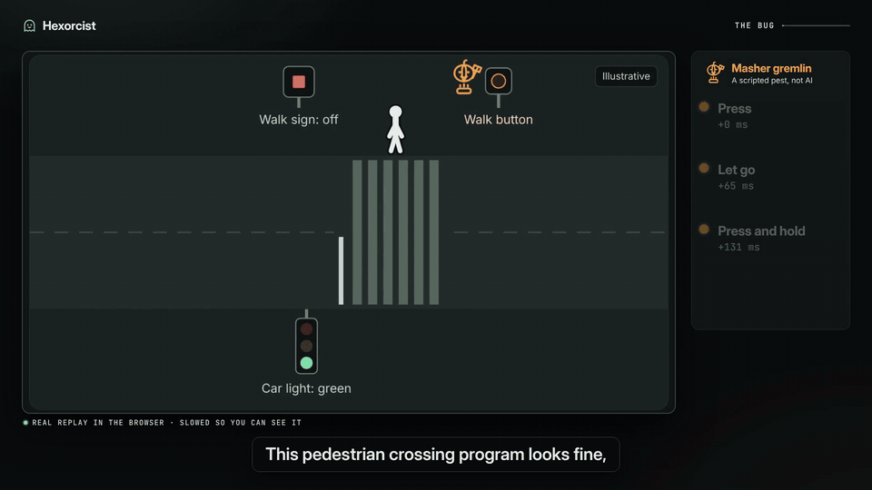

# Hexorcist
**AI wrote your gadget's code. Let gremlins break it here, before it breaks for real.**



Hexorcist checks small ATmega328P programs before they go on a board. It runs a compiled program on a simulated chip inside your browser. You write a rule as a short sentence, in one of five set forms, pick some gremlins (small scripted pests, not AI) and let them poke the program's inputs at awkward moments. If the rule breaks, Hexorcist cuts the attack down to the few moves that matter and replays them, step by step.
- **Live app:** https://lainx06.github.io/Hexorcist/
- **Demo video (under 3 minutes):** _link added at submission_
- **Judges: a five-minute tour:** [docs/JUDGES.md](docs/JUDGES.md)
- Kiroween 2026 entry, Frankenstein category.
- Some of the code was originally written with another AI coding assistant, then removed and rebuilt by Kiro. See [How this was built](#how-this-was-built).
## Three answers, nothing else
| Verdict | What it means |
|---|---|
| **BROKE** | A rule was broken. You always see the replay that did it. |
| **HELD** | "No violation found in N emulated runs of this gremlin set. Not a proof." (N is the real number of runs; for one run it reads "1 emulated run".) |
| **COULDN'T TELL** | The rule can't be checked with the signals, peripherals or run length available (a part of the chip that isn't modelled, an unmapped signal, a rule that never triggered). Hexorcist says why instead of guessing. |
The checker is deterministic: time is counted in CPU cycles, the gremlins come from a seeded random number generator, and there is no AI and no network in the verdict. The same seed gives the same result.
## Limits, up front
- **One chip.** The ATmega328P at 16 MHz, run by [avr8js](https://github.com/wokwi/avr8js). Other clock speeds give wrong timings.
- **What is modelled.** Digital pins on ports B, C and D, timers 0 to 2, and pull-up resistors.
- **What is not.** `src/engine/peripherals.ts` lists 16 unmodelled entries, among them the serial port, the SPI bus, the two-wire bus, the data EEPROM, the watchdog timer and the analog comparator. A program that uses one gets COULDN'T TELL, with the part named. The same list is in the Details tab of the app.
- **Analog pins.** The analog input path is unit-tested only. A pin table that names an analog pin is rejected on import in the upload path.
- **HELD is not a proof.** It means no violation in the runs that were made. A different seed, other gremlins or a longer run could still find one.
- **Time limits.** A rule's time limit that is still running when a try ends is not judged. Rules use the five sentence forms below and no others.
- **Gremlins are scripted and seeded.** They explore awkward input timing, not every possible input.
- **Illustrations.** The crosswalk, garage and I'm-alive scenes are drawings driven by the program's outputs, and each is labelled "Illustrative". Your own program gets a "Pin levels" view instead.
- **No compiling here.** Nothing is compiled in the browser or on a server; you bring a compiled `.hex`, or use a bundled example.
- **Long reasons.** A COULDN'T TELL reason can reach a 200-character limit. The CLI and MCP JSON carry `reasonTruncated` to say when it did.
- **The AI benchmark is a small sample.** Eight chat-written sketches per brief, one seed, one gremlin set. See [exorcism-demo/benchmark/README.md](exorcism-demo/benchmark/README.md).
## Try it in 60 seconds
1. Open the [live app](https://lainx06.github.io/Hexorcist/). **Crosswalk** is already selected, with its rule: *cars and walkers must never get a green at the same time.*
2. Press **Unleash gremlins**.
3. Watch the Masher gremlin press the walk button. The program breaks the rule on try 4 of 24, and Hexorcist shrinks 8 moves down to the 3 that matter.
4. Press **See the fix work**. The same 3 moves play on the original and the fixed program side by side: the original breaks, the fixed one holds.
5. Try **Garage door** and **I'm-alive light**, or open **Your own program**. There you can press **Try the sample**, **Try a chat-written sketch** (a crossing sketch an AI chat tool wrote) or **Try one it can't check** (a program that uses the serial port, so the answer is COULDN'T TELL).
To run it on your machine: `npm ci`, then `npm run dev` (http://localhost:5173).
## How it works
```
compiled .hex  ->  emulated ATmega328P (avr8js, in a Web Worker)
                       ^                      |
     seeded gremlins move the inputs     outputs, cycle by cycle
                                              v
                                   rule monitors -> verdict
                                              |
                                  BROKE: shrink the moves (delta debugging)
                                              v
                                  replay: scene, move strip, signals
```
- **Emulator:** avr8js runs the program's machine code. Only `src/engine/emulator-bridge.ts` imports it (`scripts/guard.mjs` checks that). The bridge models digital pins, timers 0 to 2 and pull-up resistors, and reports any part of the chip it doesn't model.
- **Rules:** five sentence forms, where A and B are conditions such as `BEAM_CLEAR is 0`, `all of (A, B)` or `any of (A, B)`:
  - `A must never happen.`
  - `A must never last N ms or longer.`
  - `Within N ms after A becomes true, B must be true.`
  - `A becomes true may happen at most N times in any M ms.`
  - `After A becomes true, B must stay true for N ms.`

  Each rule compiles to a monitor that watches the outputs cycle by cycle. `is 0` and `is 1` are raw pin levels.
- **Gremlins:** Masher (presses a button over and over), Bouncer (a loose-wire flicker), Stuck (holds a button down), Dropout, Spike and Drifter (the last three need other kinds of input).
- **Shrinking:** when a try breaks a rule, a reducer removes moves until no single move can be taken away without the replay passing. It shows "the smallest replay this reducer found", checked by replaying on a fresh emulator.
## Use it on your own program
1. Compile your sketch for an **ATmega328P at 16 MHz** and export the compiled binary. Use the plain `.hex`, not the one "with bootloader".
2. In Hexorcist, choose **Your own program**, then **Choose .hex file**. The file is read in your browser tab and is never uploaded anywhere.
3. Fill in the pin table: the signal names your rule will use, the port and bit of each pin, input or output, and the pressed level for inputs. You can import and export the table as JSON.
4. Write a rule (templates are offered for your signal names), pick gremlins and unleash. Defaults for an uploaded program: 24 runs, 1000 ms per run, seed 20261100.
## Headless runner
The same check runs from a terminal, a GitHub Action, an MCP client and two Kiro hooks. All of them call the same worker functions as the page, so the verdict, the try number, the reduced move list and the fingerprint match what the page shows.
### Command line
```
npm run check -- --example crosswalk
npm run check -- --example crosswalk --fixed --json
npm run check -- --hex build/my.hex --pins pins.json --rules rules.txt --gremlins masher,bouncer --runs 24 --seed 20261101 --run-ms 1000
```
- `--example <crosswalk|garage|heartbeat>` loads a bundled example (add `--fixed` for its fixed build).
- `--hex`, `--pins` and `--rules` load your own files. Relative paths resolve against the folder you ran the command in. Do not mix them with `--example`.
- `--gremlins` (comma-separated ids), `--runs`, `--seed` and `--run-ms` are optional. Left out, they come from the example's `meta.json`, or from the defaults the page uses for an uploaded program.
- `--json` prints exactly one JSON object and nothing else on stdout. The same inputs give the same bytes on Windows, macOS and Linux. It holds no timestamp, path or duration.
| Exit code | Meaning |
|---|---|
| 0 | HELD |
| 1 | BROKE (the trace that did it is printed) |
| 2 | COULDN'T TELL (the reason is printed) |
| 3 | Bad input or an internal error. A reason goes to stderr and no verdict is printed. |
For COULDN'T TELL, the JSON has `reason` and then `reasonTruncated`: true when the reason reached the 200-character limit, so it may have been cut.
### GitHub Action
`action.yml` at the repo root is a composite action named `hexorcist-gate`.
- Required inputs: `hex`, `pins`, `rules`. Optional inputs: `gremlins`, `runs`, `seed`.
- Outputs: `verdict` and `exit-code`, set before the step that fails the job, so a later step can read them.
- The job fails on exit code 1, 2 or 3 and passes on 0. A Markdown summary with the verdict, exit code, seed and runs goes to the job summary.
- `.github/workflows/gate-demo.yml` runs it on the crosswalk fixed build (passes) and the buggy build (the run goes green when the gate catches it).
### MCP server
`npm run mcp` starts a stdio JSON-RPC server with two tools: `check` (same inputs as the CLI, same JSON back) and `capabilities` (the five rule sentence forms, the gremlin ids and the parts of the chip that are not modelled). It makes no network call.
### Kiro hooks
Two hook files run commands from `cli/`. Both files currently read `"enabled": true`. The stop hook has a 300-second timeout.
- `hexorcist-check-on-stop` runs `cli/hook-stop.ts` when the agent stops. It builds the demo sketch, checks it, and records the verdict in `.hexorcist/last-verdict.json`. With `--block`, a BROKE or COULDN'T TELL verdict sends the agent back to work, up to 3 times in a row.
- `hexorcist-done-guard` runs `cli/hook-guard.ts` before a spec task is marked done. It blocks the call unless the recorded verdict is HELD for the current `.hex` file. It sees only Kiro's task tool (`task_update` with status `completed`). A change to `tasks.md` made by a shell command or a file edit is not blocked.
The demo loop lives in `exorcism-demo/`: `sketch/sketch.ino`, `build.mjs` (needs a command-line sketch compiler on your PATH), `crosswalk-full-rules.txt` and `loop-check.json`. Three more hooks are described under [How this was built](#how-this-was-built).
### Kiro power
`power/hexorcist` is a power with the MCP server and a skill (`check-firmware`) that tells an agent to call `capabilities` before any other tool, write rules in the five sentence forms, then call `check`. Set the `HEXORCIST_ROOT` environment variable once, to this repo's folder. Details and the launcher log location are in [power/hexorcist/README.md](power/hexorcist/README.md).
## Evidence
Measured with `npm run bench:evidence` on Nov 26, 2026 (Windows_NT 10.0.26200 (x64), AMD Ryzen 7 7800X3D 8-Core Processor, 16 cores, Node v26.13.1, avr8js 0.21.1). These are results of emulated runs, not a proof. Full table: [docs/evidence/EVIDENCE-NUMBERS.md](docs/evidence/EVIDENCE-NUMBERS.md).
| Example | Buggy build, seeds 1 to 100 | Fixed build, seeds 1 to 100 |
|---|---|---|
| Crosswalk | BROKE 99, HELD 1 | HELD 100 |
| Garage door | BROKE 100 | HELD 100 |
| I'm-alive light | BROKE 99, HELD 1 | HELD 100 |
A single ordinary input (one press, beam break or pulse), moved every 10 ms across the whole run, broke none of the six builds. It takes the gremlins' awkward timing to find these bugs.
The bench (`bench/evidence.ts`, everything in one process) and the seed sweep below (`scripts/seed-sweep.mjs`, through the command line) are separate tools. They agree: both give BROKE 99 and HELD 1 for Crosswalk and I'm-alive light buggy builds, BROKE 100 for Garage door buggy, and HELD 100 for every fixed build.
The app shows the speed of the emulator on your own computer in the Details tab.

### Seed sweep
`node scripts/seed-sweep.mjs --seeds 1-100` runs the command-line check for every example and build, with seeds 1 to 100 (600 checks in all). A run on Nov 25, 2026 (seeds 1-100, 600 checks, 15 jobs, 410.1 s):

```
example    build  HELD  BROKE  COULDN'T TELL  other  not as expected (seeds)
---------  -----  ----  -----  -------------  -----  -----------------------
crosswalk  buggy  1     99     0              0      62
crosswalk  fixed  100   0      0              0      -
garage     buggy  0     100    0              0      -
garage     fixed  100   0      0              0      -
heartbeat  buggy  1     99     0              0      18
heartbeat  fixed  100   0      0              0      -
```

The fixed builds of all three examples held in every campaign, so there were no false alarms. The buggy builds broke in all but the listed seeds: seed 62 for Crosswalk and seed 18 for I'm-alive light (the `heartbeat` example). Those seeds give the same HELD every time (both were rerun twice and gave HELD each time), which is why HELD says "Not a proof."
### AI chat sketches
`exorcism-demo/benchmark/` holds sketches that AI chat tools wrote for two briefs, unedited, and what Hexorcist found. With seed 20261101:
- Crossing, 8 sketches, one rule (car green and WALK never on together; 24 runs, Masher): HELD for all 8.
- Crossing, the same 8 sketches, a rule that WALK and DONT_WALK are never on together (200 runs, Masher and Bouncer): BROKE for all 8, on try 1. The overlap on the reduced replay was 73 to 78 CPU cycles (4.56 to 4.88 microseconds).
- Motor, 8 sketches, three rules (200 runs, Masher and Bouncer): BROKE for 1 (`chatgpt-fast`, try 159, a STOP rule), HELD for 7.
The benchmark README has the briefs, the commands and the full tables. It is evidence from one seed and one gremlin set, not a proof.
## How this was built
Everything Kiro used is committed in [`.kiro/`](.kiro/). The longer write-up, from the files, is [docs/HOW-KIRO-BUILT-THIS.md](docs/HOW-KIRO-BUILT-THIS.md).
- **17 specs** in [`.kiro/specs/`](.kiro/specs/): 15 feature specs (each with requirements, design and tasks; `exorcism-fix` has a single task) and 2 bugfix specs (`input-pullup`, `held-text`). They cover the emulator bridge, a speed change to it (`bridge-output-scan`), the gremlin engine, the rule compiler, the trace reducer, the examples, honest verdicts, four web-page specs (`bench-ui-*`), the upload samples, the headless runner and the benchmark tools.
- **Steering** ([`.kiro/steering/`](.kiro/steering/)): five always-on files for determinism, the exact verdict texts, scope, test rules and the banned claim words.
- **Hooks** ([`.kiro/hooks/`](.kiro/hooks/)), five files:
  - `guard-before-task` runs `node scripts/guard.mjs` before every spec task (claim words, clock use, brand names, network use, avr8js isolation).
  - `engine-tests-on-save` runs `npx vitest --run` when a file under `src/engine/` is saved.
  - `examples-on-save` rebuilds the examples and runs `tests/examples` when an example `.ino` is saved.
  - `hexorcist-check-on-stop` and `hexorcist-done-guard`, described under Headless runner.
- **Custom agent** [`rule-skeptic`](.kiro/agents/rule-skeptic.md): read-only. It argues with a rule before you run it and opens every answer with "Advice, not a verdict."
- **Power** ([`power/hexorcist/`](power/hexorcist/)) and **MCP server** ([`mcp/`](mcp/)), so an agent in Kiro can run the check on its own work.
- **CI** ([`.github/workflows/ci.yml`](.github/workflows/ci.yml)) runs the type check, the guard, every test and the build. `pages.yml` publishes the static site to GitHub Pages.
### Disclosure: code originally written with another AI coding assistant
Some code was originally written with another AI coding assistant, not with Kiro: the command-line runner (`cli/`), the MCP server, the power, the hook scripts, the GitHub Action, the benchmark scripts, and a few text changes in the web app. On Nov 24, 2026, one commit (`5d54110`, "Remove code written outside Kiro; Kiro rebuilds it next") removed all of it. Kiro then rebuilt it from its own specs: `headless-runner`, `upload-samples` and `benchmark-tools`. The git history keeps the earlier versions and shows which commits that assistant made.
Other work on this repo was also planned or drafted with that assistant: spec prompts, the steering files, drafts of the hook, agent and workflow files, review triage and acceptance checks. The author directed the project, approved every change and ran the browser checks.
## Develop
```
npm ci
npm run dev           # the app at http://localhost:5173
npx vitest --run      # all tests
npm run typecheck
npm run guard         # claim words, clock use, brand names
npm run build
npm run examples:build   # recompile the example sketches (needs a command-line sketch compiler)
npm run bench:evidence   # regenerate docs/evidence/EVIDENCE-NUMBERS.md
```
## Licence
MIT, see [LICENSE](LICENSE). Third-party: avr8js (MIT). Dev tools: Vite (MIT), Vitest (MIT), fast-check (MIT), TypeScript (Apache-2.0), tsx (MIT). Prior ideas and re-implemented algorithms are listed in [PRIOR_WORK.md](PRIOR_WORK.md).
